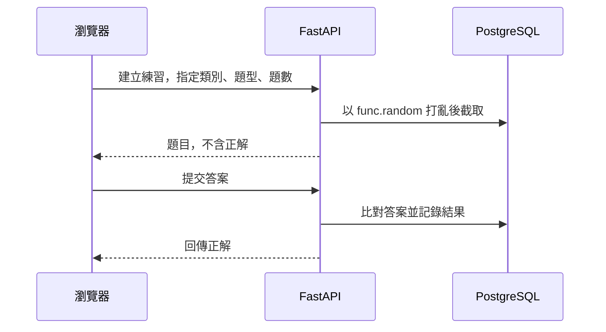
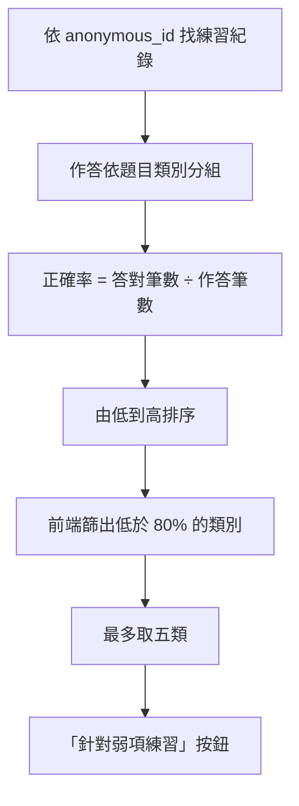

我做這個專案，是因為老婆報名了採購法證照考試。

直接照著 PDF 題庫練習幾次，很容易連題目順序和答案一起記住。下一頁還沒翻，答案已經先浮出來。這種熟悉感讓人分不清，記住的是題目內容，還是答案在 PDF 裡的位置。

所以我要把固定題庫改造成每輪順序不同、還能留下弱項紀錄的練習。

{: width="800" height="430" }
_題序一洗牌，熟悉感就不能代替理解。_

> 本文檢查的版本是 commit [`b29fe3f`](https://github.com/7a6ac0/gpa-question-webapp/tree/b29fe3fc0ccd9ba8b534a974d4c7921a78e007bb)。[`pyproject.toml`](https://github.com/7a6ac0/gpa-question-webapp/blob/b29fe3fc0ccd9ba8b534a974d4c7921a78e007bb/pyproject.toml#L5-L21) 宣告的套件版本是 `0.1.0`，需要 Python `3.11` 以上。
{: .prompt-info }

## 這是一套把官方題庫變成練習紀錄的 Web App

[gpa-question-webapp](https://github.com/7a6ac0/gpa-question-webapp) 是一套政府採購法題庫練習網站。它使用 FastAPI、SQLAlchemy、Jinja2、pdfplumber 與 python-docx，採用 [MIT License](https://github.com/7a6ac0/gpa-question-webapp/blob/b29fe3fc0ccd9ba8b534a974d4c7921a78e007bb/LICENSE#L1-L20)。

它有兩條資料路徑。匯入時，[`parse_command`](https://github.com/7a6ac0/gpa-question-webapp/blob/b29fe3fc0ccd9ba8b534a974d4c7921a78e007bb/src/ingestion/cli.py#L39-L86) 讀取已下載到本機的官方 PDF 或 DOCX，把題目寫進 PostgreSQL。練習時，瀏覽器介面呼叫 FastAPI，讀寫題目、session 與作答紀錄。

{: width="1200" height="548" }
_架構圖依據 commit `b29fe3f` 繪製；[開啟互動版](/assets/img/posts/gpa-question-webapp-study-loop/system-architecture.html)。_

瀏覽器端的路由集中在 [`src/api/main.py`](https://github.com/7a6ac0/gpa-question-webapp/blob/b29fe3fc0ccd9ba8b534a974d4c7921a78e007bb/src/api/main.py#L5-L40)，提供四項功能：

- 隨機練習
- 立即對答案
- 單次成績
- 跨練習的弱項統計

## 資料怎麼從 PDF 走到一道可作答的題目

第一段是匯入。CLI 掃描輸入目錄裡的 `.pdf` 和 `.docx`，依副檔名交給對應的解析器。沒有指定類別時，檔名開頭的 `1` 到 `13` 會被當成類別編號，實作見 [`src/ingestion/cli.py`](https://github.com/7a6ac0/gpa-question-webapp/blob/b29fe3fc0ccd9ba8b534a974d4c7921a78e007bb/src/ingestion/cli.py#L39-L84)。

PDF 解析器先用「是非題」與「選擇題」切段，再用規則運算式辨識題號和答案。選擇題的答案 `1` 到 `4` 會轉成 `A` 到 `D`。規則寫在 [`src/ingestion/pdf_parser.py`](https://github.com/7a6ac0/gpa-question-webapp/blob/b29fe3fc0ccd9ba8b534a974d4c7921a78e007bb/src/ingestion/pdf_parser.py#L11-L19)：

```python
MC_QUESTION_START = re.compile(r"^\s*(\d+)\s+([1-4])\s+(.+)")
TF_QUESTION_START = re.compile(r"^\s*(\d+)\s+([OX])\s+(.+)")
ANSWER_NUM_TO_LETTER = {"1": "A", "2": "B", "3": "C", "4": "D"}
```
{: file="src/ingestion/pdf_parser.py" }

第二段是去重與更新。每題的 `source_hash`，是把類別、題型和題目文字串接後算出的 SHA-256：

```python
@property
def source_hash(self) -> str:
    raw = f"{self.category_id}|{self.question_type}|{self.question_text}"
    return hashlib.sha256(raw.encode("utf-8")).hexdigest()
```
{: file="src/ingestion/base.py" }

再次匯入時，雜湊相同的題目會更新答案、選項或法規出處。來源裡已經消失的題目，會標上 `deleted_at`。完整流程在 [`src/ingestion/base.py`](https://github.com/7a6ac0/gpa-question-webapp/blob/b29fe3fc0ccd9ba8b534a974d4c7921a78e007bb/src/ingestion/base.py#L13-L100)。

第三段才是練習。題目送到瀏覽器時不帶正解，答案由伺服器比對：



抽題在 [`create_session`](https://github.com/7a6ac0/gpa-question-webapp/blob/b29fe3fc0ccd9ba8b534a974d4c7921a78e007bb/src/api/routes/sessions.py#L32-L97)，它用 `func.random()` 打亂符合條件的題目。第一次拿到的 [`QuestionResponse`](https://github.com/7a6ac0/gpa-question-webapp/blob/b29fe3fc0ccd9ba8b534a974d4c7921a78e007bb/src/models/schemas.py#L15-L23) 沒有正確答案欄位，比對在 [`submit_answer`](https://github.com/7a6ac0/gpa-question-webapp/blob/b29fe3fc0ccd9ba8b534a974d4c7921a78e007bb/src/api/routes/sessions.py#L100-L170)。

## 弱項不是猜的，是按類別累積出來

這裡我認為最需要確認的是「跨練習弱項」到底算了什麼。

「跨練習弱項」算的是各類別的累積正確率，分母、門檻與排序方式都很明確：



後端的 [`get_weakness`](https://github.com/7a6ac0/gpa-question-webapp/blob/b29fe3fc0ccd9ba8b534a974d4c7921a78e007bb/src/api/routes/sessions.py#L173-L225) 算到排序為止。`80%` 的門檻與最多取五類，判斷寫在前端的 [`src/templates/weakness.html`](https://github.com/7a6ac0/gpa-question-webapp/blob/b29fe3fc0ccd9ba8b534a974d4c7921a78e007bb/src/templates/weakness.html#L48-L69)：

```javascript
const weakCats = data.categories.filter(c => c.percentage < 80).slice(0, 5);
const weakIds = weakCats.map(c => c.category_id).join(',');
```
{: file="src/templates/weakness.html" }

它不是能力測驗模型，也不會替近期成績加權。同一題做過多次，每次作答都會算進統計。這些界線是我從 `SessionAnswer.id` 的筆數彙整方式看出來的，不是來自 README 對功能的描述。

## 方便的代價是格式耦合與匿名識別

解析器直接依賴官方文件的版面文字與答案格式。段落標題不再是「是非題」或「選擇題」，或選擇題不再用 `1` 到 `4`，現有規則就認不出題目。這項維護成本，從 [`_split_sections`](https://github.com/7a6ac0/gpa-question-webapp/blob/b29fe3fc0ccd9ba8b534a974d4c7921a78e007bb/src/ingestion/pdf_parser.py#L57-L85) 與兩個題型解析函式就看得出來。

執行環境也不是單一靜態網頁。[`docker-compose.yml`](https://github.com/7a6ac0/gpa-question-webapp/blob/b29fe3fc0ccd9ba8b534a974d4c7921a78e007bb/docker-compose.yml#L1-L29) 會啟動應用程式與 PostgreSQL 16，資料存在 `pgdata` volume。練習紀錄若要能在磁碟故障後復原，部署時得另外安排備份。

跨練習的身分只靠瀏覽器 `localStorage` 裡的 `gpa_anonymous_id`。前端把它放進 `/api/weakness` 的查詢參數，流程寫在 [`src/templates/weakness.html`](https://github.com/7a6ac0/gpa-question-webapp/blob/b29fe3fc0ccd9ba8b534a974d4c7921a78e007bb/src/templates/weakness.html#L12-L36)。對應的路由只接收 `anonymous_id`，沒有帳號驗證依賴。

我覺得這對家用工具很省事，但不是存放正式測驗成績該有的權限設計。

## 適合家用練習，不適合直接當正式考試系統

題庫來源固定、使用者範圍明確，需求只是打亂題序並找出常錯類別，這個專案已經把必要流程接起來。題庫變動時，[`upsert_questions`](https://github.com/7a6ac0/gpa-question-webapp/blob/b29fe3fc0ccd9ba8b534a974d4c7921a78e007bb/src/ingestion/base.py#L28-L100) 能更新、保留或軟刪除既有題目，不必每次清空資料庫。

要公開給多人使用，得先處理帳號、授權、資料隔離與備份策略。題庫版面若經常改動，還要替解析器準備失敗報告與新格式測試。在我看來，現有程式適合當自用練習工具，不能直接當成正式考試平台。

## 先跑測試，再接自己的題庫

先確認依賴、CLI 入口與核心行為都正常，再處理官方題庫檔案。下面的命令我在 macOS、Python `3.14.2`、uv `0.9.17` 上實際執行過：

```bash
git clone https://github.com/7a6ac0/gpa-question-webapp.git
cd gpa-question-webapp
uv sync --extra dev
uv run python -m src.ingestion.cli --help
uv run pytest -q
```
{: .nolineno }

我實測的結果是 `34 passed in 1.05s`，CLI 也列出了 `parse` 子命令。這只確認目前的 commit 能安裝、測試能通過，不代表每個版本的官方 PDF 都能成功解析。

接著從[公共工程委員會題庫頁面](https://web.pcc.gov.tw/psms/plrtqdm/questionPublic/indexReadQuestion)下載一個類別的檔案，放進 `data/`。再依[專案 README](https://github.com/7a6ac0/gpa-question-webapp/blob/b29fe3fc0ccd9ba8b534a974d4c7921a78e007bb/README.md#L47-L58) 的匯入指令處理，驗證解析結果。

## 真正有用的是留下可回頭查的練習紀錄

上面查證的內容只能確認功能存在，無法證明它會提高考試成績。我仍判斷這個專案的價值在於補上一個複習循環。

固定的 PDF 只提供題目和答案，網站則把每次作答留成資料。隨機組卷切斷題序提示，類別統計指出下一輪該練哪裡。對我家的需求來說，技術選型只是手段，能一直重複「作答、發現弱項、再練一次」才是成品。

## 延伸閱讀

- [gpa-question-webapp 原始碼](https://github.com/7a6ac0/gpa-question-webapp)：對照本文提到的匯入、作答與弱項統計實作。
- [公共工程委員會採購專業人員題庫](https://web.pcc.gov.tw/psms/plrtqdm/questionPublic/indexReadQuestion)：這個專案處理的官方題庫來源。
- [FastAPI 官方文件](https://fastapi.tiangolo.com/)：路由、回應模型與相依注入。
- [SQLAlchemy 2.0 文件](https://docs.sqlalchemy.org/en/20/)：session、查詢與 ORM 關聯。
