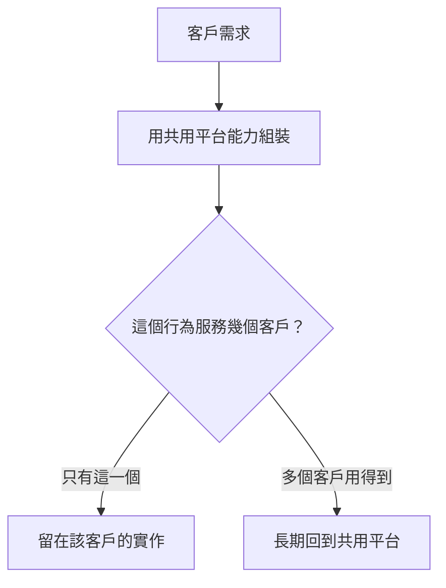
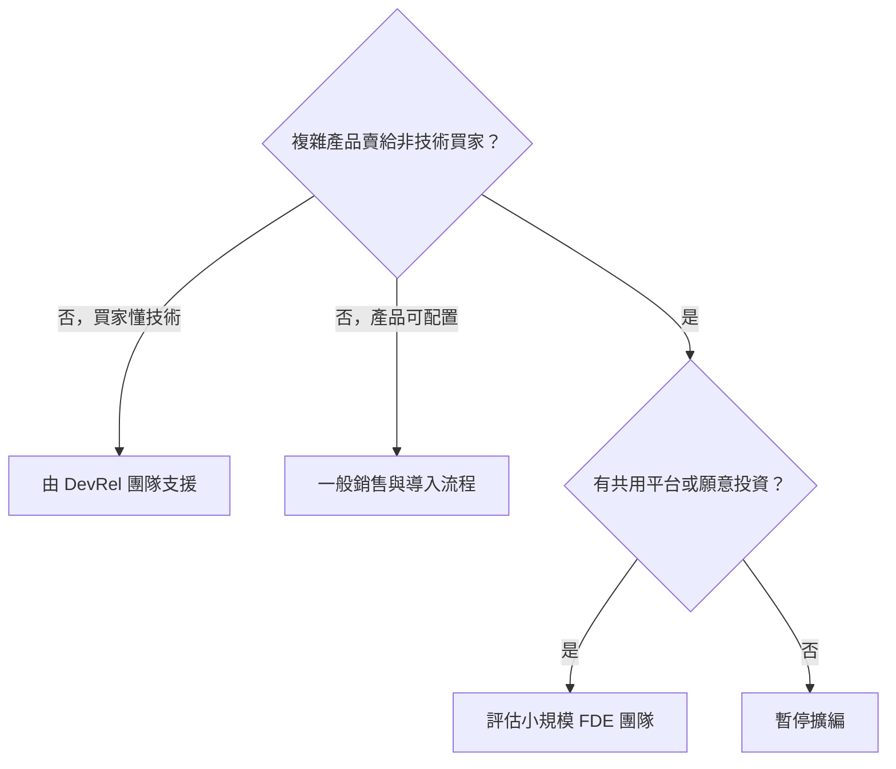

你把一套要在上面開發才能用的平台賣進企業，合約簽了，第一場導入會議也開了。投影幕上卻只有一張空白的工作流程圖。客戶知道要改善商品上架率或銷售吞吐量，卻不知道怎麼把平台組成可用的方案。

眼前的問題是交付邊界。客戶買得起平台，卻沒有工程能力把它變成成果時，供應商該交付多少客製化？又要怎麼避免每個案子變成新的維護負債？

## FDE 交付的是平台上的客戶成果

FDE 是 Forward Deployed Engineering 的縮寫，指工程師直接和客戶合作，在既有的軟體平台上完成客戶需要的方案。Kevin Bai 在演講結尾把這個角色濃縮成一句話：[「面對客戶的軟體工程師」](https://www.youtube.com/watch?v=KwhgfwOSToQ&t=1019s)。

這篇整理的是 AI Engineer World's Fair 2026 的演講 [Forward Deployed Engineering 101](https://ai.engineer/talks/KwhgfwOSToQ-forward-deployed-engineering-101)，官方頁面記錄的片長是 17 分 48 秒。Bai 在開場自我介紹，他任職於 Anthropic 的 applied AI 團隊，先前是 Rippling FDE 團隊最早加入的成員，更早以前在 Palantir。

這些經歷決定了他的觀察視角。我討論的是這場演講，不是 Anthropic 目前的工作。



Bai 在 [3:03 到 3:35](https://www.youtube.com/watch?v=KwhgfwOSToQ&t=183s) 說明 FDE 的交付物。客戶同時取得軟體與工程服務，最後驗收的是建立在平台上的商業成果。工程師要先理解客戶的業務，再用平台做出應用、工作流程或解決方案。

下文的 GTM（go-to-market）指公司用什麼方式觸及客戶、完成成交並持續服務。

## 產品複雜度要和買家能力一起看

Bai 借用 Punnett square（生物學用的 2×2 對照表）說明 FDE 的適用條件。一個軸是使用產品需要多少技術能力，另一個軸是買家能不能消化這份複雜度。他在 [4:03 到 5:15](https://www.youtube.com/watch?v=KwhgfwOSToQ&t=243s) 談了其中三種組合：

| 產品與平台 | 買家或使用者 | 複雜度由誰處理 | 演講中的判斷 |
| --- | --- | --- | --- |
| GitHub、Datadog 這類技術產品 | CTO、CIO、軟體工程師 | 技術使用者自行學習與操作 | 不需要 FDE |
| Rippling、Jira、Slack 這類可配置工具 | 非技術買家與使用者 | 使用者透過設定完成工作 | 不需要 FDE |
| 需要在其上開發的技術平台 | 非技術業務買家 | 供應商派工程師完成客戶方案 | 適合評估 FDE |

這張表是 Bai 在演講裡的分類，不是對這些產品完整能力的評測。演講沒有討論第四種組合，所以我不自行補上第四個象限，也不把自己的推測當成講者的結論。

關鍵在第三列。買家要的結果很明確，卻沒有能在平台上開發的工程團隊。供應商若只交出工具，客戶還得自己招募、培訓與管理工程師。Bai 在 [6:00](https://www.youtube.com/watch?v=KwhgfwOSToQ&t=360s) 形容 FDE 是把熟悉平台的工程能力借給客戶。

## 共用平台把客製需求限制在可維護範圍

FDE 會寫客製程式，但不從空白專案開始。Bai 在 [8:42 到 9:05](https://www.youtube.com/watch?v=KwhgfwOSToQ&t=522s) 說，工程師應該用既有的共用平台能力組裝應用與工作流程。這些能力由產品團隊共同維護，客戶方案只處理差異的部分。

Foundry Ontology 是演講中唯一點名的例子。[Palantir 官方文件](https://www.palantir.com/docs/foundry/ontology/overview)把 Ontology 描述成位於資料集、虛擬資料表與模型之上的操作層。它把資料映射成業務物件、屬性與關係，也提供動作、函式與動態權限。FDE 因此能直接使用已維護的資料與操作能力，不必替每個客戶重建同一套基礎。

客製工作仍要有邊界。Bai 在 [16:10 到 16:48](https://www.youtube.com/watch?v=KwhgfwOSToQ&t=970s) 提出一個簡單原則，依「服務幾個客戶」決定程式放在哪裡：

演講沒有給「幾個客戶算可共用」的數字，所以我認為這個門檻仍要由產品團隊決定。這條邊界決定公司交付的是可維護的方案，還是一批各自演進的專案。

## 把 FDE 當成人力外派會看錯成本結構

常見的說法是「FDE 就是把工程師派到客戶端接案」，但這並不準確。Bai 在 [8:13 到 8:52](https://www.youtube.com/watch?v=KwhgfwOSToQ&t=493s) 直接畫出界線。每位工程師若替每個客戶從頭建一套系統，公司經營的是開發服務，不是他說的平台型 FDE。

改變成本結構的，是客製程式共享了多少已維護的能力，而不是工程師坐在哪裡。沒有平台時，每張新合約都會帶來另一套相依套件、部署流程與支援責任。演講用「工程師不想學 55 個 repo」形容這種維護局面，接著指出維護成本會侵蝕損益。

{: width="1200" height="675" }
_同樣叫 FDE，底層平台會改變工程師每天維護的東西。_

演講中的財務數字，也不能直接證明這套模式能獲利。Bai 在 [6:39 到 7:07](https://www.youtube.com/watch?v=KwhgfwOSToQ&t=399s) 用 ACV（average contract value，平均合約價值）比較幾家公司。他口頭列出 Palantir 400 萬美元、ServiceNow 120 萬美元與 Workday 60 萬美元，並用了「上次查看」與「印象中」這類限定語。

[官方校訂稿](https://ai.engineer/talks/KwhgfwOSToQ-forward-deployed-engineering-101#commercial-case)明確註記，這些數字沒有量測日期、計算方式或獨立排名。所以我只把它們當成講者的商業論證，不當成口徑一致的公司比較。

## 平台只控制維護成本，不能消除它

有了共用平台，客戶方案仍然要維護。Bai 在 [10:38 到 11:12](https://www.youtube.com/watch?v=KwhgfwOSToQ&t=638s) 把平台列為建立 FDE 團隊的必要條件，同時強調平台再健全，維護負擔仍然可觀。平台能減少重複建造，不能讓客戶差異消失。

第二項成本是知識分散。Bai 在 [15:05 到 15:29](https://www.youtube.com/watch?v=KwhgfwOSToQ&t=905s) 的問答中，建議讓多位 FDE 共同參與專案，以免全部脈絡集中在一個人身上。團隊因此要為交接、支援與建立共同理解保留時間。

人才條件也不會因為角色貼近客戶而降低。Bai 在 [16:59 到 17:25](https://www.youtube.com/watch?v=KwhgfwOSToQ&t=1019s) 對理想人選有兩項要求：通過軟體工程師的招募標準，以及讓公司放心把客戶溝通交給他們。公司要願意用軟體工程師的標準聘人，也願意讓他們直接面對客戶。

我的解讀是，FDE 編制不能直接拿售前或客服的人力替換。招募與培養方式，都要同時涵蓋工程與客戶溝通。

## 兩道門檻決定公司需不需要 FDE

Bai 在 [9:50 到 11:12](https://www.youtube.com/watch?v=KwhgfwOSToQ&t=590s) 用兩道門檻判斷。第一道看產品與買家之間有沒有能力缺口，第二道看共用平台：

DevRel 指開發者關係團隊。沒有共用平台也不準備建立時要暫停擴編，否則客製工作會變成各自維護的專案。

AI 沒有取消這兩道門檻。Bai 在 [11:28 到 12:35](https://www.youtube.com/watch?v=KwhgfwOSToQ&t=688s) 明確把一段話標成個人假說：AI 降低了寫程式和製作客製軟體的難度，也讓更多平台具備可客製的能力。

演講沒有提供跨產業的資料，證明這個趨勢會擴及幾乎所有平台。所以我只把 AI 當成重新檢查兩道門檻的理由，不當成建立 FDE 團隊的充分條件。

## 用一張表跑一次 FDE 決策

> 我整理的這份推導流程，能排除明顯不適用的情況，不能估算人力、合約毛利或部署週期。
{: .prompt-info }

先把演講中的三類產品代入兩道門檻：

| 例子 | 產品需要開發 | 買家能自行吸收複雜度 | 有共用平台 | 推導結果 |
| --- | --- | --- | --- | --- |
| GitHub、Datadog | 是 | 是 | 不需判定 | 技術型 GTM，不需 FDE |
| Jira、Slack | 以配置為主 | 否 | 不需判定 | 一般銷售與導入，不需 FDE |
| Foundry 與非技術產業買家 | 是 | 否 | 是 | 符合 FDE 的兩道門檻 |

套用到自己的公司時，拿最近一個企業銷售機會，填完下面五個欄位。只寫已經知道的內容，空白的欄位就是下一步要調查的事。

| 欄位 | 要填的內容 |
| --- | --- |
| 客戶成果 | 客戶用什麼業務結果驗收，不寫產品功能名稱 |
| 開發需求 | 這個結果是否需要在產品上寫程式，還是設定即可完成 |
| 客戶能力 | 客戶是否具備能完成並維護這段開發工作的工程團隊 |
| 共用能力 | 資料模型、權限、動作與部署方式中，哪些由平台集中維護 |
| 長期歸屬 | 客戶特有行為留在哪裡，可共用能力由哪個產品團隊接手 |

填完之後，我的建議如下：

- 產品需要開發、客戶缺少工程能力，而且共用能力已經存在：進入 FDE 的小規模試點。
- 前兩項成立，但共用能力欄仍是空白：先定義平台投資與維護責任。
- 產品與買家之間沒有能力落差：沿用既有的 GTM 方式比較直接。

## 我的判斷：先定平台邊界，再開職缺

我把 FDE 視為產品架構與 GTM 的共同決策，工程師人數只是這項決策之後的編制結果。前面的逐字稿、平台文件與兩道門檻都可以核對，這一節則是我的判斷，現有證據不足以證明它適用於所有 B2B 軟體公司。

產品團隊若還沒定義下面三件事，先招聘 FDE 只會增加客戶專案的分支數：

- 哪些能力集中維護
- 客戶差異留在哪裡
- 前線需求怎麼回到平台

平台邊界清楚之後，FDE 才能把工程時間用在理解業務和組合方案，而不是重建基礎能力。

AI 讓程式碼生成得更快，卻沒有替公司決定支援責任由誰承擔。客製化變便宜時，公司更需要說清楚哪些程式由誰長期維護，所以產品架構必須和 GTM 一起設計。

開職缺之前，先挑一個最近的企業銷售機會，把上面五個欄位填完，確認交付缺口真的存在。

## 延伸閱讀

- [Forward Deployed Engineering 101](https://ai.engineer/talks/KwhgfwOSToQ-forward-deployed-engineering-101)：官方頁面，有校訂稿、完整時間戳與演講提到的資源，可逐句核對本文。
- [Palantir Ontology overview](https://www.palantir.com/docs/foundry/ontology/overview)：Ontology 的物件、關係、動作、函式與權限，也就是 Foundry 提供的共用平台能力。
- [What Is a Forward Deployed Engineer?](https://fdepod.substack.com/p/test)：Kevin Bai 的補充文章，把 FDE 拆成顧問、產品經理與工程師三種工作。他主張這個角色該用在高價值、定義模糊的問題上。
