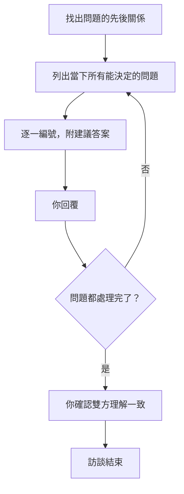
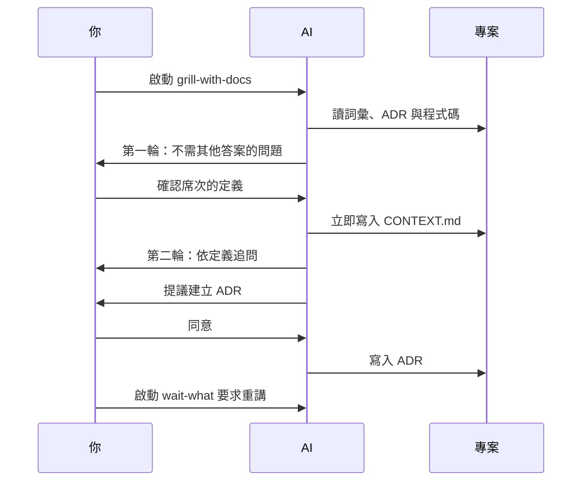

你準備替訂閱服務加入按席次計費功能。會議紀錄裡同時出現「成員」、「使用者」和「席次」，卻沒有人確認三個詞是否代表同一件事。在討論停用成員是否仍要收費前，團隊得先說清楚計費對象到底是人、帳號，還是一份可以指派的資格。

這篇提到的 skill，我會先把它理解成告訴 AI 程式助理如何完成特定工作的操作說明。`mattpocock/skills` 把釐清需求的工作拆成訪談、詞彙整理與重新說明。這篇說明五個相關 skill 的分工，以及訪談結束後哪些內容會留在專案裡。

> mattpocock/skills 系列｜第 2 篇
>
> - 上一篇（第 1 篇）：[先設定專案規則，再用 ask-matt 找下一步](/posts/mattpocock-skills-setup-routing-guide/)
> - 下一篇（第 3 篇）：[先找出缺口，再決定要寫規格還是拆工作單](/posts/mattpocock-skills-specs-work-breakdown/)
> - 系列導讀：[這套 skill 是什麼、六篇該怎麼讀](/posts/mattpocock-skills-series-guide/)
>
> 這篇我以 [`1.2.3` 版](https://github.com/mattpocock/skills/blob/c55ee46073ed923f86ce59a5eb3b6d895095d1b7/package.json#L2-L10)為準。
{: .prompt-info }

> 2026-10-04 發布的 [`1.3.0`](https://github.com/mattpocock/skills/releases/tag/v1.3.0) 改了本文詞彙表的檔名（2026-10-19 查證）：
>
> - `CONTEXT.md` 改成 `GLOSSARY.md`。
> - `CONTEXT-MAP.md` 改成 `GLOSSARY-MAP.md`。
>
> 之後 `grill-with-docs`、`domain-modeling`、`wait-what` 只會讀寫新檔名。所以照本文操作時，請把文中的 `CONTEXT.md` 換成 `GLOSSARY.md`；已經有舊檔的專案，用下面這行改名：
>
> ```bash
> git mv CONTEXT.md GLOSSARY.md
> ```
>
> 我查證時，本文介紹的五個 skill 在最新的 [`1.3.1`](https://github.com/mattpocock/skills/releases/tag/v1.3.1) 都還在。我之後會依新版全面更新這個系列。
{: .prompt-info }

## 五個 skill：三個入口，兩個內部流程

這五個 skill 不是一套必須依序跑完的步驟。你只要選一個符合目前狀況的起點，其餘工作會由內部流程接手。

{: width="800" height="450" }
_選擇一個符合目前狀況的入口，其餘工作由內部流程接手。_

| 角色 | skill | 直接用途 |
| --- | --- | --- |
| 由你啟動 | `grill-me` | 還沒有專案資料夾時，透過訪談釐清想法 |
| 由你啟動 | `grill-with-docs` | 已有專案時，一邊訪談，一邊整理文件 |
| 內部流程 | `grilling` | 按照問題的先後關係安排每一輪提問 |
| 內部流程 | `domain-modeling` | 統一專案用語，必要時留下重要決策 |
| 由你啟動 | `wait-what` | 請 AI 補上背景並改用較直接的說法 |

`grill-me`、`grill-with-docs` 與 `wait-what` 都要由你點名啟動，AI 不會自行使用。`grilling` 與 `domain-modeling` 則可以由 AI 自行採用，也能被其他 skill 叫用。這項差異記錄在[啟動規則](https://github.com/mattpocock/skills/blob/c55ee46073ed923f86ce59a5eb3b6d895095d1b7/.agents/invocation.md#L1-L22)。

## 兩個起點差在是否留下文件

兩個起點使用同一套訪談方式，差別在於訪談期間是否同時整理專案文件。

[`grill-me`](https://github.com/mattpocock/skills/blob/c55ee46073ed923f86ce59a5eb3b6d895095d1b7/skills/productivity/grill-me/SKILL.md#L1-L7)只負責開始訪談。它適合還沒有專案資料夾的情況，例如討論一個尚未成形的想法。它不會建立詞彙表，對話結束後也不會在電腦裡留下文件。

[`grill-with-docs`](https://github.com/mattpocock/skills/blob/c55ee46073ed923f86ce59a5eb3b6d895095d1b7/skills/engineering/grill-with-docs/SKILL.md#L1-L7)會同時啟動兩個內部流程：`grilling` 負責訪談，`domain-modeling` 負責整理詞彙與決策。專案資料夾已經存在時，`ask-matt` 會優先建議這個起點，詳細條件可查看它的[選擇規則](https://github.com/mattpocock/skills/blob/c55ee46073ed923f86ce59a5eb3b6d895095d1b7/skills/engineering/ask-matt/SKILL.md#L13-L18)。

## grilling 先問不能跳過的問題

`grilling` 會先找出問題的先後關係，原始規則稱這種結構為「決策樹」。如果某個問題必須根據前面問題的答案才能回答，AI 就會把它留到下一輪。

例如「停用的成員要不要計費」，必須等計費席次的定義確認後才能回答。定義尚未確定時，AI 不應先猜停用規則。每一輪的流程如下：



[`grilling` 的規則](https://github.com/mattpocock/skills/blob/c55ee46073ed923f86ce59a5eb3b6d895095d1b7/skills/productivity/grilling/SKILL.md#L6-L28)也說明誰負責回答。能從檔案、程式碼或工具查到的事實，由 AI 調查；需要在不同做法之間取捨時，則由你決定。

AI 查資料時，不會讓整輪提問停下來。只有需要那項資料的問題要等結果，其他問題照常先問。

## domain-modeling 會建立專案詞彙表

`domain-modeling` 裡的 domain，指專案所處理的事物與規則。以本文的例子來說，就是工作區、成員、席次與計費方式。這個 skill 會把確認過的名稱寫進 `CONTEXT.md`，我把這個檔案看成專案專用的詞彙表。

如果只是讀取詞彙表並沿用現有名稱，不必特別啟動 `domain-modeling`。只有在舊定義可能有問題、名稱不夠清楚，或需要記錄重要決定時，才需要它介入。

討論名詞時，AI 要做這幾件事：

- 你使用的詞和現有定義衝突時，立即指出差異。
- 遇到一詞多義的名稱，提出較精確的正式用詞。
- 討論名詞之間的關係時，自己設想邊緣情境來測試定義，例如「成員被停用後又重新啟用，原本的席次還在嗎？」，讓雙方把概念之間的界線說清楚。
- 你描述既有行為時，查閱程式碼。

若程式與你的說法不同，決定要沿用現況或改變行為的人仍是你。

確認詞彙後，`domain-modeling` 會立即更新 `CONTEXT.md`，而不是等訪談結束再整理。這個檔案只保存名稱與定義，不放程式怎麼寫等細節。

由多個子專案組成的大型專案，可能每個子專案各有一份詞彙表。這時放在專案最外層資料夾的 `CONTEXT-MAP.md` 就像索引，指出每份詞彙表的位置。[`domain-modeling` 的檔案規則](https://github.com/mattpocock/skills/blob/c55ee46073ed923f86ce59a5eb3b6d895095d1b7/skills/engineering/domain-modeling/SKILL.md#L8-L64)定義了這些界線。

重要的技術選擇則可能寫成 ADR，也就是 Architecture Decision Record，中文常譯為「架構決策紀錄」。它是一份短文件，交代做了什麼選擇以及原因。原始格式允許 ADR 只寫一段話，不要求為了填滿模板增加內容。

只有下面三項條件都成立時，AI 才會提議建立 ADR，而且要你同意後才會寫入：

- 這項決定日後很難修改。
- 沒有背景就不容易理解。
- 當初確實比較過不同做法。

三項條件與格式可在 [`ADR-FORMAT.md`](https://github.com/mattpocock/skills/blob/c55ee46073ed923f86ce59a5eb3b6d895095d1b7/skills/engineering/domain-modeling/ADR-FORMAT.md#L1-L37)核對。

{: width="800" height="450" }
_同意使用同一個詞，還不等於同意同一件事。_

## wait-what 只處理剛才沒聽懂的內容

`wait-what` 是中途使用的修正入口。當 AI 的上一段說明跳得太快或缺少背景時，由你明確啟動它。

它要求 AI 重新說明剛才的內容，並補上理解所需的背景。內容要沿用 `CONTEXT.md` 裡已確認的詞彙；若專案使用多份詞彙文件，它會先從 `CONTEXT-MAP.md` 找到正確位置。

訊息中的英文措辭要符合 ASD-STE100，這是一套限制技術英文用字與句型的規範。讀者不需要先學會這套規範，它在這裡的作用，是讓 AI 使用較短的句子與固定用詞。

完整指令只有一段，可在 [`wait-what/SKILL.md`](https://github.com/mattpocock/skills/blob/c55ee46073ed923f86ce59a5eb3b6d895095d1b7/skills/productivity/wait-what/SKILL.md#L1-L7)核對。它只要求重講上一則訊息，不會重新進行整場訪談。如果問題不只是一段話沒聽懂，而是整體需求仍然模糊，我建議回到 `grill-with-docs` 繼續訪談。

## 訪談結果不會全部寫進同一份文件

{: width="800" height="450" }
_訪談結果依內容性質分別寫入詞彙表、ADR 或後續規格。_

`grill-with-docs` 會寫文件，不代表它會把所有答案都塞進 `CONTEXT.md`。訪談內容有三個去處：

| 內容 | 去處 | 例子 |
| --- | --- | --- |
| 專案特有的正式名詞與短定義 | `CONTEXT.md` | 「計費席次」和「成員」各自代表什麼 |
| 變更成本高、容易讓後人困惑，且經過取捨的決定 | 經你同意後建立 ADR | 為何由負責計費的程式保存席次指派紀錄 |
| 其他功能行為、例外、預設值與完成標準 | 先留在對話，之後交給 `to-spec` | 停用成員何時停止計費 |

`CONTEXT.md` 是詞彙表，不是需求文件；ADR 也不是每項答案的流水帳。大部分答案會先留在對話中。等你另外啟動 [`to-spec`](https://github.com/mattpocock/skills/blob/c55ee46073ed923f86ce59a5eb3b6d895095d1b7/skills/engineering/to-spec/SKILL.md#L7-L19)後，這個 skill 才會把已確認的需求整理成一份供後續開發使用的功能規格。

## 訪談沒有固定題數

兩個起點沒有各自的題庫，它們都把訪談交給 `grilling`，而 `grilling` 也沒有固定輪數或題數。所以訪談時間取決於有多少事情尚未決定，而不是你用了哪個 skill。

比起計算 AI 問了幾題，我會檢查三件事：

- 哪些問題已經有答案。
- 哪些問題還在等前面的答案。
- 詞彙和 ADR 有沒有寫到正確的位置。

`grill-with-docs` 會修改專案文件，所以我認為團隊仍要審查新增的詞彙是否適合沿用，以及 ADR 是否符合三項條件。尚未談妥的定義不該提早寫入，否則下次接手的人或 AI 讀到的只會是另一個含糊定義。

## 先看手上有沒有專案，再選起點

我會先判斷手上是否已有存放程式碼與文件的專案資料夾，再看卡住的是需求、詞彙還是上一段說明。

| 目前狀況 | 選擇 | 不該期待它做什麼 |
| --- | --- | --- |
| 還沒有專案資料夾，只想檢查一個想法 | `grill-me` | 不會把結果寫進專案文件 |
| 已在專案內，需要同時留下詞彙或決策 | `grill-with-docs` | 不會直接產生供後續開發使用的完整需求文件 |
| 只想使用分輪提問的方法 | `grilling` | 不會自行維護詞彙文件 |
| 只需要整理專案用語或重要決策 | `domain-modeling` | 不會收錄所有需求答案 |
| 上一段說明沒有聽懂 | `wait-what` | 不會重新進行整場訪談 |

這張表是用來選擇起點，不是執行順序。

`grill-with-docs` 適合用一次對話就能釐清全貌的需求。如果需求大到無法在一次對話中釐清，[`ask-matt` 的選擇規則](https://github.com/mattpocock/skills/blob/c55ee46073ed923f86ce59a5eb3b6d895095d1b7/skills/engineering/ask-matt/SKILL.md#L38-L46)會改為建議 `wayfinder`。`wayfinder` 是另一個 skill，用來先探索大型工作，找出可以從哪裡開始。

## 模擬情境：把席次問到能寫規格

以下內容依原始規則推演。情境是你已完成上一篇的專案設定，現在要在訂閱服務的專案資料夾內處理按席次計費。整段對話的走向如下：



以 Codex 這套 AI 程式助理為例，先輸入需求並明確啟動 `grill-with-docs`：

```text
$grill-with-docs

我們要替現有訂閱服務加入按席次計費。請幫我把需求問清楚。
```

AI 讀取專案時，像「目前系統是不是依啟用中的成員人數向付款平台收費」這種能從專案裡查到的事實，應由 AI 調查，不該丟回給你。

第一輪先處理不需要參考其他答案的問題。例如，收費依據究竟是已購買席次、已指派席次，還是啟用中的成員數？訂閱又屬於工作區，還是單一付款人？

假設團隊最後確認，工作區擁有一批已購買的席次，成員獲得席次後才可使用付費功能。`domain-modeling` 可以立即把詞彙寫成：

```markdown
**工作區**:
由多位成員組成，並共用一份訂閱的空間。
_Avoid_: 帳號、組織

**計費席次**:
工作區已購買、可指派給一位成員的付費資格。
_Avoid_: 使用者、人數

**席次指派**:
在一段時間內，把一個計費席次分配給一位成員的紀錄。
_Avoid_: 成員資格、訂閱項目

**成員**:
已加入工作區的人。成為成員與取得計費席次是兩件事。
_Avoid_: 使用者、席次
```

這段是我依 [`CONTEXT-FORMAT.md`](https://github.com/mattpocock/skills/blob/c55ee46073ed923f86ce59a5eb3b6d895095d1b7/skills/engineering/domain-modeling/CONTEXT-FORMAT.md#L1-L30)整理的示意內容。每個 `_Avoid_` 都列出容易混用、往後應避免的名稱。

有了這些定義，第二輪才能追問：

- 邀請尚未接受時，是否先保留席次。
- 成員停用後，如何處理指派。
- 增減席次何時影響價格。

若現有程式直接以啟用中的成員數量計費，AI 也要指出新定義與現況不同，請你確認是否要改變行為。

假設團隊進一步決定，由負責計費的程式保存每次席次指派的開始與結束時間，而不是拿現在的成員清單回推過去的數量。這個做法方便日後查回歷史紀錄，代價是每次成員異動時都要同步更新計費資料。

這項選擇可能符合 ADR 的三項條件，所以 `domain-modeling` 應先提議建立 ADR，取得同意後才寫入。

假設 AI 接著用一大段文字解釋席次異動，但你沒有弄懂「席次異動」和「席次指派」的關係。這時才啟動 `wait-what`，要求它沿用剛寫下的詞彙重講。

完成這段流程後，需求還沒整理成完整規格。成果包括：

- 對話中已確認的答案。
- `CONTEXT.md` 裡的詞彙。
- 少數經你同意建立的 ADR。

若這項功能要分好幾次對話才做得完，下一步是在同一段對話中啟動 `to-spec`，讓它把需求整理成規格。

## 最值得留下的是可沿用的詞彙

到這裡，我談到的啟動方式與文件保存規則都有原始資料可查。但這些規則本身，無法證明共用詞彙一定會改善團隊合作。

我仍認為，釐清需求後最值得留下的，是下一個人能直接沿用的詞彙，以及少數不容易從程式碼看懂的決策。問答會留在對話裡，確認過的定義則能進入專案。

這項判斷只適用於多人維護，或要分好幾次對話才做得完的專案。一次性的想法討論不需要為每個名詞建立文件，使用 `grill-me` 完成訪談即可。

## 先讓同一個詞代表同一件事

要試這套流程，先找出需求中最容易產生歧義的一個詞，例如「席次」。在專案內啟動 `grill-with-docs`，先確認它和「成員」的關係，再討論邀請成員時是否占用席次，以及停用後何時停止收費。

訪談的目標不是累積問題，而是讓後續規格裡的同一個詞始終代表同一件事。下一篇我會說明如何用 `to-spec` 整理規格，再用 `to-tickets` 把規格拆成一張張可以直接開工的工作單。

## 延伸閱讀

- [`grill-me`](https://github.com/mattpocock/skills/blob/c55ee46073ed923f86ce59a5eb3b6d895095d1b7/skills/productivity/grill-me/SKILL.md#L1-L7)：確認它只負責啟動訪談流程。
- [`grill-with-docs`](https://github.com/mattpocock/skills/blob/c55ee46073ed923f86ce59a5eb3b6d895095d1b7/skills/engineering/grill-with-docs/SKILL.md#L1-L7)：查看它同時啟動哪兩個內部流程。
- [`grilling`](https://github.com/mattpocock/skills/blob/c55ee46073ed923f86ce59a5eb3b6d895095d1b7/skills/productivity/grilling/SKILL.md#L6-L28)：理解決策樹、分輪提問與停止條件。
- [`domain-modeling`](https://github.com/mattpocock/skills/blob/c55ee46073ed923f86ce59a5eb3b6d895095d1b7/skills/engineering/domain-modeling/SKILL.md#L8-L74)：核對詞彙文件與 ADR 的使用邊界。
- [`wait-what`](https://github.com/mattpocock/skills/blob/c55ee46073ed923f86ce59a5eb3b6d895095d1b7/skills/productivity/wait-what/SKILL.md#L1-L7)：查看它要求 AI 如何重講上一段內容。
- [`to-spec`](https://github.com/mattpocock/skills/blob/c55ee46073ed923f86ce59a5eb3b6d895095d1b7/skills/engineering/to-spec/SKILL.md#L7-L19)：確認訪談內容如何進入正式規格。
