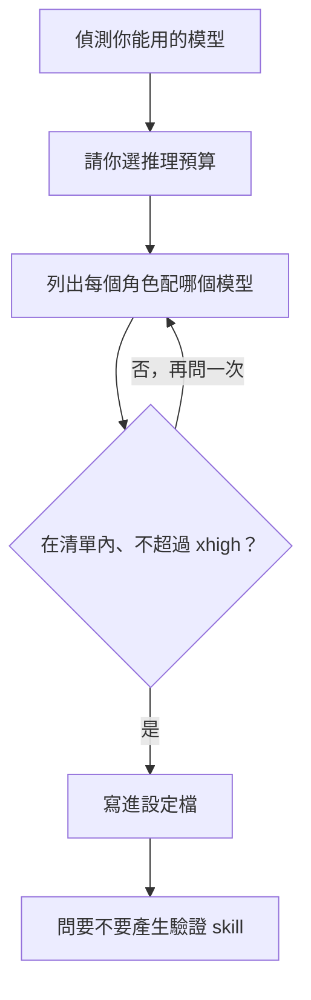
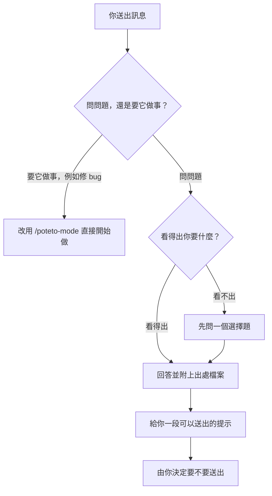

pstack 能讓 AI 程式助理做事更有條理，但打開一看，光是 skill 就有好幾十個。這篇教你第一次怎麼開始：裝好 pstack、確認裝到哪個版本、選好模型，之後每個任務都交給 `/poteto-mode`，不用先背下所有名字。文中的範例提示都是通用寫法，你可以直接複製，再換成自己專案的內容。

> pstack 系列｜第 1 篇
>
> - 系列導讀：[這套 skill 是什麼、四篇該怎麼讀](/posts/pstack-series-guide/)
> - 下一篇（第 2 篇）：[改程式之前，先看懂再設計](/posts/pstack-understand-design/)
>
> **版本提醒**：這篇以 pstack [`0.15.43` 版](https://github.com/cursor/plugins/blob/2f87c854fe3e2fcda44ca86b46ede35aad3c46b7/pstack/.cursor-plugin/plugin.json)為準，搭配 Claude Code 2.1.326。這一版對應 `cursor/plugins` 的 commit `2f87c85`（2026-11-17 05:47，台北時間）。系列五篇在 2026-11-17 一起改以這一版查證，我查證時，`cursor/plugins` 的 main 在 `2f87c85` 之後沒有改動 pstack。Claude Code 的指令和選單，依 2026-10-24 查閱的[官方文件](https://code.claude.com/docs/en/plugins/install)。之後的版本，指令和行為可能會改變。
{: .prompt-info }

## 先認識幾個名詞

| 名詞 | 意思 |
| --- | --- |
| AI 程式助理 | Cursor、Claude Code 這類能讀寫專案檔案、替你寫程式的工具 |
| skill | 一份「告訴 AI 怎麼完成某類工作」的操作說明，用斜線指令呼叫，例如 `/poteto-mode` |
| pstack | Lauren Tan 在 Cursor 官方外掛庫 [`cursor/plugins`](https://github.com/cursor/plugins/tree/2f87c854fe3e2fcda44ca86b46ede35aad3c46b7/pstack) 裡維護的一整組 skill |
| playbook | 針對一種任務寫好的固定步驟，例如「修 bug」要先重現、再找原因、修完再驗證 |
| subagent | 主對話另外派出去、專門做一小段工作的 AI |
| token | AI 計算用量的單位，讀和寫的內容越多，用掉的 token 越多 |

## pstack 裝了什麼

`0.15.43` 版有 58 個 skill，每個 skill 就是一個斜線指令。另外還有 `poteto-agent`、`comment-sicko` 兩個專用的 subagent，以及 `poteto-mode` 底下的 22 個 playbook。

在 Claude Code 裡，外掛的指令前面要加外掛名稱。所以 Cursor 的 `/poteto-mode`，在 Claude Code 裡寫成 `/pstack:poteto-mode`（見 [README](https://github.com/cursor/plugins/blob/2f87c854fe3e2fcda44ca86b46ede35aad3c46b7/pstack/README.md#L30)）。下文的範例都用 Claude Code 的寫法；在 Cursor 裡，把 `pstack:` 拿掉就好。

兩邊的其他差異，列在官方的 [Claude Code 對照說明](https://github.com/cursor/plugins/blob/2f87c854fe3e2fcda44ca86b46ede35aad3c46b7/pstack/docs/harness/claude-code.md)。

{: width="800" height="450" }
_第一次使用的流程：安裝、核對版本、選模型，再從 /poteto-mode 開始。_

## 第 1 步：安裝

[README](https://github.com/cursor/plugins/blob/2f87c854fe3e2fcda44ca86b46ede35aad3c46b7/pstack/README.md#L15-L26) 和[設定指南](https://github.com/cursor/plugins/blob/2f87c854fe3e2fcda44ca86b46ede35aad3c46b7/pstack/docs/guide/01-setup.md#L5-L15)列出兩種裝法。在 Cursor 的對話裡輸入：

```text
/add-plugin pstack
```

在 Claude Code 裡，先把 `cursor/plugins` 這個 GitHub repo（放程式碼的專案庫）加成 marketplace（外掛目錄），再從這個目錄安裝 pstack：

```text
/plugin marketplace add cursor/plugins
/plugin install pstack@cursor-plugins
```

第二行的 `pstack@cursor-plugins`，意思是「從 cursor-plugins 這個目錄安裝 pstack」。

依 [Claude Code 文件](https://code.claude.com/docs/en/plugins/install#install-a-plugin)，在對話裡輸入 `/plugin install` 不會馬上安裝。它會先打開外掛的說明頁，讓你看它會裝哪些東西，再選安裝範圍。選「Install for you」（user scope），就是這台電腦上的所有專案都能用。

> 上面的指令都沒有指定版本，裝到的是當下 `cursor/plugins` 預設分支（branch，repo 裡平常開發用的主線，通常叫 main）上的內容。裝別人的外掛之前該檢查什麼，我在[這篇供應鏈與權限風險的文章](/posts/coding-agent-supply-chain-permission-risks/)談過。
{: .prompt-tip }

網路上也有第三方整理的 pstack 鏡像（例如 `backnotprop/pstack`），它不是 `cursor/plugins` 官方維護的版本。要用的話，建議先看完內容、鎖定版本，理由同樣見[供應鏈與權限風險的文章](/posts/coding-agent-supply-chain-permission-risks/)。

## 第 2 步：檢查版本、更新，或固定版本

### 看裝到哪個版本

裝好之後，先確認裝到的是哪個版本。依 [Claude Code 文件](https://code.claude.com/docs/en/plugins/install#install-a-plugin)，在終端機（輸入指令的視窗）執行下面這行，會列出每個外掛的 `Version`、`Scope` 和 `Status`：

```bash
claude plugin list
```

在對話裡打 `/plugin`，切到 Installed 分頁也看得到。把看到的版本號和 [`plugin.json`](https://github.com/cursor/plugins/blob/2f87c854fe3e2fcda44ca86b46ede35aad3c46b7/pstack/.cursor-plugin/plugin.json) 對一下，就知道自己裝的是不是這篇依據的那一版。

### 更新：預設不會自動更新

依 [Claude Code 文件](https://code.claude.com/docs/en/plugins/install#keep-plugins-updated)，Claude Code 對第三方 marketplace 預設**不自動更新**，所以 pstack 會停在你安裝時的版本。pstack 的 [README](https://github.com/cursor/plugins/blob/2f87c854fe3e2fcda44ca86b46ede35aad3c46b7/pstack/README.md#L28) 也寫了同樣的說明和下面兩種做法。

- **想手動更新一次**：在終端機執行下面這行。依 `claude plugin update --help` 的說明，更新後要重新啟動 Claude Code 才會生效。
- **想開自動更新**：在對話裡打 `/plugin`，切到 Marketplaces 分頁，選 `cursor-plugins`，再選 Enable auto-update。

```bash
claude plugin update pstack@cursor-plugins
```

> 預設不自動更新，反而讓你有機會先檢查。更新前，建議先到 `cursor/plugins` 看看 pstack 這次改了什麼，再決定要不要更新。開了自動更新，就等於每次都直接接受新內容。理由見[供應鏈與權限風險的文章](/posts/coding-agent-supply-chain-permission-risks/)。
{: .prompt-tip }

### 固定在某個 commit

commit 是 git（最常用的版本控制工具）裡的一個版本紀錄，每個 commit 都有一串編號（SHA）。想讓 pstack 一直停在你看過的那個 commit，可以用本機資料夾當 marketplace，因為其他做法在 `cursor/plugins` 上都固定不到 commit：

| 做法 | 能不能固定到 commit |
| --- | --- |
| `/plugin install` | 不能。官方[指令參考](https://code.claude.com/docs/en/plugins/cli-reference#plugin-install)裡，它沒有指定版本或 commit 的選項 |
| `/plugin marketplace add` 加 `#ref` | 只能[固定在某個分支或 tag](https://code.claude.com/docs/en/plugins/install#add-a-marketplace)（tag 是替某個 commit 取的固定名稱，例如 v1.0）。我在 2026-11-17 查證時，`cursor/plugins` 沒有任何 tag |
| `marketplace.json` 的 `sha` 欄位 | 能，但這是目錄維護者設定的（見 [marketplace 參考文件](https://code.claude.com/docs/en/plugins/marketplace-reference#plugin-sources)），`cursor/plugins` 的 pstack 條目沒有設定 |
| 本機資料夾當 marketplace | 能，官方文件支援 |

做法是先把 repo 下載（clone）到自己電腦，切到你審過的 commit，再把這個資料夾加成 marketplace。以下以這篇的 commit 為例，在終端機執行：

```bash
git clone https://github.com/cursor/plugins.git ~/src/cursor-plugins
git -C ~/src/cursor-plugins checkout 2f87c854fe3e2fcda44ca86b46ede35aad3c46b7
claude plugin marketplace add ~/src/cursor-plugins
claude plugin install pstack@cursor-plugins
```

如果你之前已經用 GitHub 來源加過 `cursor/plugins`，兩個來源的目錄名稱都是 `cursor-plugins`。可以先移除舊的：

```bash
claude plugin marketplace remove cursor-plugins
```

再執行上面的四行指令。依 [Claude Code 文件](https://code.claude.com/docs/en/plugins/install#manage-marketplaces)，移除 marketplace 會一併解除安裝從它裝的外掛，所以移除後要重新安裝。

這和我在[供應鏈與權限風險的文章](/posts/coding-agent-supply-chain-permission-risks/)建議的「先 clone，再切到審過的 commit」是同一個做法。之後想升級，就在這個資料夾裡切到新的 commit，再更新外掛。

## 第 3 步：用 /setup-pstack 選模型

pstack 會把工作分給不同角色，例如寫程式的、做判斷的、組成評審小組的，每個角色可以用不同模型。[`/setup-pstack`](https://github.com/cursor/plugins/blob/2f87c854fe3e2fcda44ca86b46ede35aad3c46b7/pstack/skills/setup-pstack/SKILL.md) 負責替這些角色選模型。

裝好之後跑一次。之後換了帳號、換了方案、想改用別的模型，或更新了 pstack，再跑一次：

```text
/pstack:setup-pstack
```

依[設定指南](https://github.com/cursor/plugins/blob/2f87c854fe3e2fcda44ca86b46ede35aad3c46b7/pstack/docs/guide/01-setup.md#L29)，重跑會保留你改過的角色。如果 pstack 改了預設模型，舊的設定檔會一直停在舊的預設值，要重跑才會換成新的，它也會告訴你換了哪些。設定檔如果是舊版 `/setup-pstack` 寫的，`/poteto-mode` 也會提醒你重跑（[SKILL.md](https://github.com/cursor/plugins/blob/2f87c854fe3e2fcda44ca86b46ede35aad3c46b7/pstack/skills/poteto-mode/SKILL.md#L88)）。

它會一步一步做下面這些事（[SKILL.md](https://github.com/cursor/plugins/blob/2f87c854fe3e2fcda44ca86b46ede35aad3c46b7/pstack/skills/setup-pstack/SKILL.md#L10-L78)）：



列出角色配置時，它會問你要照單全收，還是改掉某幾個角色。

### 推理預算

推理預算決定模型「想多久」，也就是 effort。等級越高越仔細，但用的 token 越多。

預算有三種。依[設定指南](https://github.com/cursor/plugins/blob/2f87c854fe3e2fcda44ca86b46ede35aad3c46b7/pstack/docs/guide/01-setup.md#L27)，預設值就是 `large`，而且沒有任何角色會超過 `xhigh`；另外兩種會把每個角色從預設往下降：

| 預算 | 推理強度 |
| --- | --- |
| large（預設值） | 照預設，大多數角色是 `xhigh` |
| medium | 每個角色降一級，`xhigh` 變 `high` |
| small | 每個角色降兩級，`xhigh` 變 `medium` |

### 驗證用的 skill

最後一步會問要不要替專案產生兩種驗證用的 skill。兩個都只會問一次，可以拒絕：

- **`/create-verification-skill`**：讓 AI 能像使用者一樣實際操作你的程式、自己檢查結果。如果專案已經有能實際操作程式來驗證的方法（`verify-*` skill，或現成能操作程式的工具，也就是 harness），就不會問。
- **`/create-formal-verification-skill`**：形式驗證，用來證明程式的某個關鍵性質在範圍內的所有情況都成立，而不只是測試寫到的情況。已經有形式驗證 skill，就不會問。

### 設定寫到哪裡

設定會寫進一份全域的模型設定檔。Cursor 寫在 `~/.cursor/rules/pstack-models.mdc`，Claude Code 寫在 `~/.claude/rules/pstack-models.md`。兩個都在家目錄底下，「全域」的意思是對你電腦上每個專案都生效，不是只對目前的專案。

依[對照說明](https://github.com/cursor/plugins/blob/2f87c854fe3e2fcda44ca86b46ede35aad3c46b7/pstack/docs/harness/claude-code.md#L38)，Claude Code 會在每個新對話開始時自動載入這份檔案。設定完要開一個新對話，因為依[設定指南](https://github.com/cursor/plugins/blob/2f87c854fe3e2fcda44ca86b46ede35aad3c46b7/pstack/docs/guide/01-setup.md#L43)，模型設定只對新的對話生效。

> **只選你的帳號實際能用的模型。** 依[對照說明](https://github.com/cursor/plugins/blob/2f87c854fe3e2fcda44ca86b46ede35aad3c46b7/pstack/docs/harness/claude-code.md#L45)，在 Claude Code 裡，「偵測到的模型」是 subagent 工具允許填的模型名稱，不代表你的帳號或方案每一個都能用。不確定時，可以把角色設成 `inherit-parent` 或 `auto`，它就直接用主對話的模型（見[設定指南](https://github.com/cursor/plugins/blob/2f87c854fe3e2fcda44ca86b46ede35aad3c46b7/pstack/docs/guide/01-setup.md#L31)）。
{: .prompt-tip }

## 不確定時：問 /poteto-help

[`/poteto-help`](https://github.com/cursor/plugins/blob/2f87c854fe3e2fcda44ca86b46ede35aad3c46b7/pstack/skills/poteto-help/SKILL.md) 是 pstack 的說明台。不知道該用哪個 skill、不知道第一步做什麼，或想知道怎麼省 token 時，直接用一般的話問它：

```text
/pstack:poteto-help 我剛裝好 pstack，第一步該做什麼？
```

```text
/pstack:poteto-help 我想請 AI 在合併前審一次我的修改，該用哪個 skill？
```

```text
/pstack:poteto-help 用 pstack 很耗 token，有什麼方法可以少用一點？
```

它收到訊息後會這樣處理（[SKILL.md](https://github.com/cursor/plugins/blob/2f87c854fe3e2fcda44ca86b46ede35aad3c46b7/pstack/skills/poteto-help/SKILL.md#L9-L34)）：



選擇題的選項是設定、開始任務、挑 skill、處理出錯的執行，或客製化 pstack。碰到「怎麼做」的問題，它**不會**自己開始做，因為真的執行會用掉 token。如果你還沒跑過 `/setup-pstack`，而這會影響答案，它會問你要不要現在設定。

## 每個任務：用 /poteto-mode 開頭

[`/poteto-mode`](https://github.com/cursor/plugins/blob/2f87c854fe3e2fcda44ca86b46ede35aad3c46b7/pstack/skills/poteto-mode/SKILL.md) 是 pstack 的入口。你只要說清楚要什麼，它會挑 playbook、照步驟做，需要時再叫用其他 skill。

### 任務怎麼寫

依[指南第 2 章](https://github.com/cursor/plugins/blob/2f87c854fe3e2fcda44ca86b46ede35aad3c46b7/pstack/docs/guide/02-poteto-mode.md#L40-L59)，一段好的任務描述最多包含五個部分，每個部分一句話就夠：

- **目標**：哪裡壞了，或你想要什麼。也就是「症狀」。
- **怎樣算完成**：要能判斷「過」或「不過」。「讓它更好」「做一小時」都不算。
- **你想看到的證據**：例如實際的指令輸出、修改前後的數字。
- **你已經知道的事**：錯誤訊息、重現步驟、相關連結，可以省下它找資料的時間。
- **真正的限制**：例如「先重現再修」「先不要改任何程式」「行為完全不能變」「動手前先給我看」。

有三件事不要寫：

- **怎麼做**：讓它有機會找到更好的做法。
- **你對原因的猜測**：說出猜測會讓它只往那個方向找。
- **要用哪些 skill**：playbook 已經排好順序，自己逐一列出反而容易漏掉或打亂步驟（[指南第 2 章](https://github.com/cursor/plugins/blob/2f87c854fe3e2fcda44ca86b46ede35aad3c46b7/pstack/docs/guide/02-poteto-mode.md#L135)）。

### 三個可以直接改的範例

**調查問題**（只讀不改）：

```text
/pstack:poteto-mode 使用者登出之後，購物車的內容還留著。先查清楚是哪裡把資料留下來的，先不要改任何程式。完成條件：說明資料存在哪裡、什麼時候該被清掉，並附上相關檔案的位置。
```

依[指南第 2 章](https://github.com/cursor/plugins/blob/2f87c854fe3e2fcda44ca86b46ede35aad3c46b7/pstack/docs/guide/02-poteto-mode.md#L103)，「先不要改任何程式」這句話會把任務固定在「調查」的 playbook。

**修 bug**：

```text
/pstack:poteto-mode 匯出 CSV 時最後一列會不見，昨天上線後才開始。先重現，再修。完成條件：用現有的測試資料匯出，列數和資料庫一致。給我看修改前後的列數。
```

**加功能**：

```text
/pstack:poteto-mode 幫這個指令加一個 --json 選項。原本的文字輸出要完全不變。兩種輸出都要驗證。
```

### 它會怎麼做

{: width="800" height="450" }
_/poteto-mode 先判斷任務類型，再照 playbook 的步驟走。_

1. **先說出它理解的目標。** 第一則回覆會用自己的話重述你的目標，以及能達成目標的最小修改，然後直接開始做，不等你確認（[SKILL.md](https://github.com/cursor/plugins/blob/2f87c854fe3e2fcda44ca86b46ede35aad3c46b7/pstack/skills/poteto-mode/SKILL.md#L19)）。
2. **判斷任務類型，挑一個 playbook。** [playbook 清單](https://github.com/cursor/plugins/blob/2f87c854fe3e2fcda44ca86b46ede35aad3c46b7/pstack/skills/poteto-mode/SKILL.md#L108-L110)涵蓋調查（Investigation）、修 bug（Bug fix）、效能問題、新功能（Feature）、重構、試作、撰寫 skill 等。規模大、跨很多地方的工作，或是你要離開、之後才回來看結果的工作，會交給 `figure-it-out` 這個 skill 另外設計一套流程。
3. **把 playbook 的步驟原樣抄進待辦清單**，排在其他待辦前面。
4. **照步驟做**，步驟裡用到的其他 skill 會由它自己叫用。
5. **驗證並回報。** 「開 PR」以外的 playbook 結束時，都會接到「開 PR」的 playbook。PR（pull request）是請別人審查、合併修改的請求。

所以你會看到一份待辦清單，前幾項就是 playbook 的步驟。最後的回覆開頭會再寫一次你的目標，其餘內容由 playbook 規定，例如新功能會寫做了什麼、為什麼這樣選、還有哪些事要你決定（[feature.md](https://github.com/cursor/plugins/blob/2f87c854fe3e2fcda44ca86b46ede35aad3c46b7/pstack/skills/poteto-mode/playbooks/feature.md#L21)）。

依 [SKILL.md](https://github.com/cursor/plugins/blob/2f87c854fe3e2fcda44ca86b46ede35aad3c46b7/pstack/skills/poteto-mode/SKILL.md#L104)，回覆用短句，先講對你有什麼改變，每個說法都附上證據，或標明是實測、推論還是猜測。

### 接著做、換主題、開新任務

- **接著做**：對話裡已經有前後文時，短短一句就夠，例如「do it」「continue」「keep going until done」（[指南第 2 章](https://github.com/cursor/plugins/blob/2f87c854fe3e2fcda44ca86b46ede35aad3c46b7/pstack/docs/guide/02-poteto-mode.md#L77-L93)）。
- **換主題**：在同一段對話裡換任務，先說「new task」，它才會重新挑 playbook，不會把新問題當成上一個任務的下一步（[指南第 2 章](https://github.com/cursor/plugins/blob/2f87c854fe3e2fcda44ca86b46ede35aad3c46b7/pstack/docs/guide/02-poteto-mode.md#L95-L103)）。

```text
/pstack:poteto-mode new task. 查清楚為什麼登出後快取還在。先不要改任何程式。
```

- **每個新任務都重新叫一次**：包括 Claude Code 在內，每個新任務都用 `/pstack:poteto-mode` 開頭。例外是 Cursor 的 Custom Mode，也就是在整段對話持續生效的模式。從 `/` 選單用 Option+Enter（Mac）或 Alt+Enter（Windows）選 `/poteto-mode`，就能把它變成 Custom Mode。不過依 [`poteto-help` 的說明](https://github.com/cursor/plugins/blob/2f87c854fe3e2fcda44ca86b46ede35aad3c46b7/pstack/skills/poteto-help/SKILL.md#L54-L58)，Cursor 的文件只在 Agents 視窗和 CLI（在終端機裡用指令操作的程式）列出 Custom Mode。

## 想要完整功能，一起裝 cursor-team-kit

[README](https://github.com/cursor/plugins/blob/2f87c854fe3e2fcda44ca86b46ede35aad3c46b7/pstack/README.md#L258-L266) 寫明，`/poteto-mode` 會用到的三樣東西不在 pstack 裡，而是在另一個外掛 `cursor-team-kit`：

- 清理程式碼的 `/deslop`。
- 操作 CLI 和瀏覽器畫面的 `control-cli`、`control-ui`。

README 的建議是：想要完整功能，就把 `cursor-team-kit` 一起裝。[指南第 5 章](https://github.com/cursor/plugins/blob/2f87c854fe3e2fcda44ca86b46ede35aad3c46b7/pstack/docs/guide/05-build-and-clean.md#L59)另外說明，開 PR 前的流程會跑 `/deslop`。沒有它的話，就用白話要求同樣的清理，例如刪掉旁白式註解、沒有根據的防禦程式碼，以及和這次無關的修改。

## 什麼時候用哪個

| 情況 | 用哪個 |
| --- | --- |
| 剛裝好 pstack | `/pstack:setup-pstack`，跑一次就好 |
| 換了帳號、方案、想換模型，或更新了 pstack | 再跑一次 `/pstack:setup-pstack` |
| 不知道該用哪個 skill、第一步做什麼 | `/pstack:poteto-help` |
| 任何需要嚴謹的任務：調查、修 bug、加功能 | `/pstack:poteto-mode`，寫清楚目標和完成條件 |
| 同一段對話換主題 | `/pstack:poteto-mode new task. …` |
| 很小、很明顯的修改 | 不用 pstack，直接跟 AI 說 |

## 一個完整的例子（虛構）

假設你剛加入一個網站專案，想用 pstack 處理一個使用者回報：「忘記密碼的信，連結點下去就說已過期。」

**1. 安裝並核對版本。** 照第 1 步裝好 pstack，再用第 2 步的指令列出外掛，確認版本和你預期的一樣。

**2. 選模型。** 照第 3 步跑一次設定，選 `large` 預算，只保留帳號能用的模型。它問要不要產生驗證用的 skill 時，如果這個專案還沒有，可以先答應。設定完，開一個新對話。

**3. 不確定時先問。** 你不確定這算調查還是修 bug，可以先問：

```text
/pstack:poteto-help 使用者說重設密碼的連結一點就過期，我該怎麼開始？
```

它會回你一段建議的提示，你看過、改好之後再送出。

**4. 交給 /poteto-mode。**

```text
/pstack:poteto-mode 使用者回報：忘記密碼信裡的連結一點開就顯示「已過期」。先重現，再修。完成條件：新寄出的連結在有效期限內可以正常重設密碼，過期後才顯示已過期。給我看修改前後的重現結果。
```

這段描述寫了症狀、完成條件和想看的證據，沒有寫你猜的原因，也沒有列 skill。它的第一則回覆會先重述你的目標，值得看一眼，確認它沒有理解錯。接著，待辦清單應該會是修 bug 的 playbook 步驟。

**5. 接著做，或換主題。** 它停下來問你時，回答之後說「continue」。修完想接著加「重新寄送」按鈕，就用 `new task` 開頭，再描述新功能和完成條件。

## 什麼時候不用 pstack，怎麼省 token

- **小改動不需要 pstack。** [設定指南](https://github.com/cursor/plugins/blob/2f87c854fe3e2fcda44ca86b46ede35aad3c46b7/pstack/docs/guide/01-setup.md#L52)寫得很清楚：很小、很明顯的修改，直接說就好。
- **pstack 會多用 token。** 它會派 subagent、組評審小組，這是嚴謹的代價。[設定指南](https://github.com/cursor/plugins/blob/2f87c854fe3e2fcda44ca86b46ede35aad3c46b7/pstack/docs/guide/01-setup.md#L45-L52)列了幾個省 token 的方法：
  - 重跑 `/setup-pstack`，選小一點的預算或便宜一點的模型。
  - 把角色設成 `auto` 或 `inherit-parent`，讓它用主對話的模型。
  - 縮短評審小組的模型清單。清單上每多一個模型，就多派一個 subagent。
  - 只在需要嚴謹的工作才用 `/poteto-mode`。

## 結論

我認為第一次用 pstack，不需要先把所有 skill 記熟。照上面三步做一次，之後每個任務交給 `/poteto-mode` 就能開始。下一篇接著談，改程式之前怎麼用 pstack 先看懂程式、再做設計。

## 延伸閱讀

- [pstack README](https://github.com/cursor/plugins/blob/2f87c854fe3e2fcda44ca86b46ede35aad3c46b7/pstack/README.md)：安裝方式，以及不在 pstack 裡的元件。
- [設定指南：Set up pstack](https://github.com/cursor/plugins/blob/2f87c854fe3e2fcda44ca86b46ede35aad3c46b7/pstack/docs/guide/01-setup.md)：預算、角色和省 token 的方法。
- [指南第 2 章：Route work through /poteto-mode](https://github.com/cursor/plugins/blob/2f87c854fe3e2fcda44ca86b46ede35aad3c46b7/pstack/docs/guide/02-poteto-mode.md)：任務描述的寫法和更多範例。
- [Claude Code 對照說明](https://github.com/cursor/plugins/blob/2f87c854fe3e2fcda44ca86b46ede35aad3c46b7/pstack/docs/harness/claude-code.md)：Cursor 和 Claude Code 的差異。
- [`poteto-mode` 的 SKILL.md](https://github.com/cursor/plugins/blob/2f87c854fe3e2fcda44ca86b46ede35aad3c46b7/pstack/skills/poteto-mode/SKILL.md)：完整的 playbook 清單和挑選規則。
- [Claude Code：Install and manage plugins](https://code.claude.com/docs/en/plugins/install)：marketplace 的加入、版本、更新和移除方式。
- [裝了第三方 skill 和 MCP 之後，你的 Coding Agent 多了哪些破口？](/posts/coding-agent-supply-chain-permission-risks/)：安裝外掛前該檢查什麼。
- [自己寫 Agent Skill](/posts/agent-skill-authoring-guide/)：從寫 skill 的角度看 description、測試與維護。
- [mattpocock/skills 系列第 1 篇](/posts/mattpocock-skills-setup-routing-guide/)和[系列導讀](/posts/mattpocock-skills-series-guide/)：另一套「先設定、再由說明台建議下一步」的 skill。
