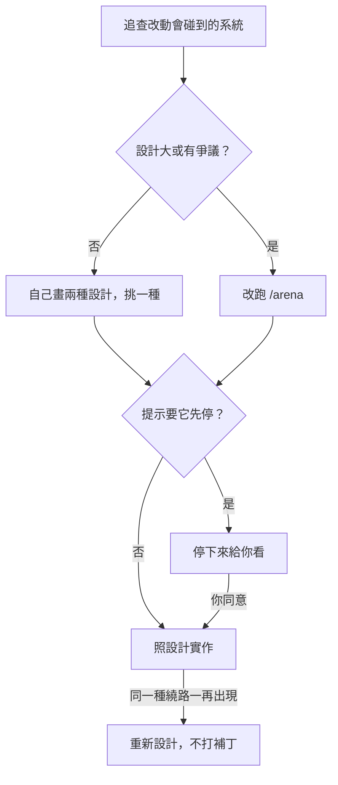
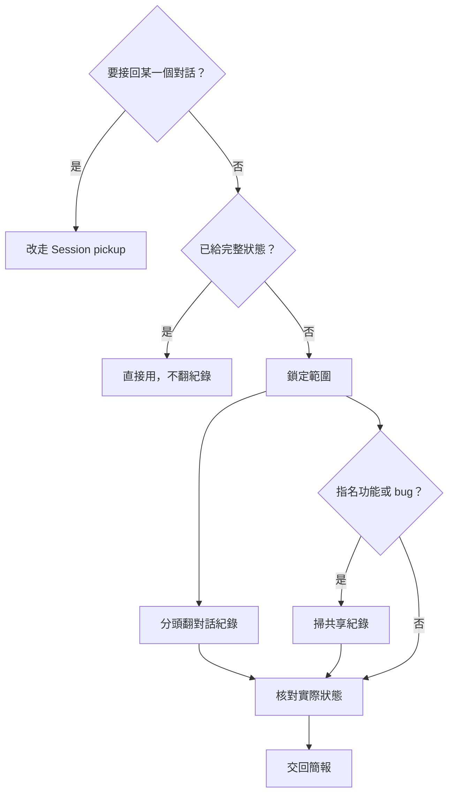
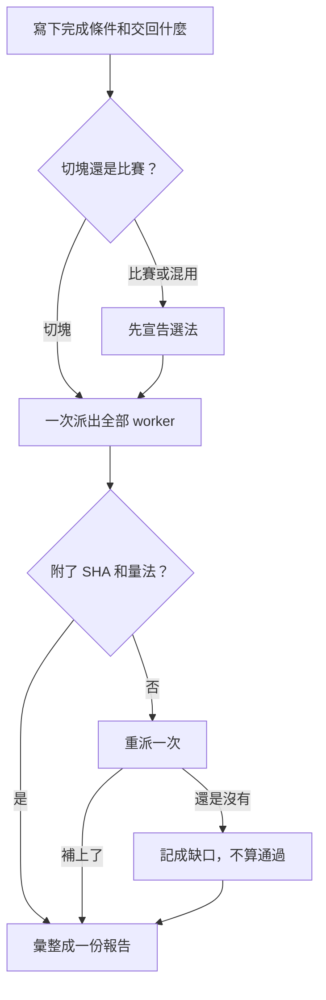

AI 程式助理接到「改一下這個功能」，常常直接從第一個看起來合理的地方動手，用的也是它第一個想到的做法。這篇教你用 pstack 的五個 skill 把順序倒過來：先讓 AI 說清楚程式現在怎麼運作、為什麼長這樣，再比較幾種設計，改完再找別的模型挑毛病。

> pstack 系列｜第 2 篇
>
> - 系列導讀：[這套 skill 是什麼、四篇該怎麼讀](/posts/pstack-series-guide/)
> - 上一篇（第 1 篇）：[安裝、選模型，再用 /poteto-mode 挑 playbook](/posts/pstack-install-routing/)
> - 下一篇（第 3 篇）：[寫完程式之後，先證明它能用再合併](/posts/pstack-build-verify-merge/)
{: .prompt-info }

> 這篇以 pstack [`0.15.43` 版](https://github.com/cursor/plugins/blob/2f87c854fe3e2fcda44ca86b46ede35aad3c46b7/pstack/.cursor-plugin/plugin.json)為準，搭配 Claude Code 2.1.326。這一版對應 `cursor/plugins` 的 commit `2f87c85`（2026-11-17 05:47，台北時間）。系列五篇我在 2026-11-17 一起以這一版查證，當時 main 在 `2f87c85` 之後沒有改動 pstack；之後的版本，行為可能會改變。
{: .prompt-info }

## 開始之前

pstack 是 Cursor 官方外掛庫裡的一整組 skill，skill 是告訴 AI 怎麼完成某類工作的操作說明。安裝和選模型寫在[第 1 篇](/posts/pstack-install-routing/)，這篇假設你已經裝好了。

pstack 的文件用 Cursor 的寫法，例如 `/how`。Claude Code 的外掛指令要加上外掛名稱，寫成 `/pstack:how`。下面的範例都用 Claude Code 的寫法，在 Cursor 裡把 `pstack:` 拿掉就好。

這些 skill 都設定成不讓 AI 自行呼叫，要你親自輸入指令。另一個做法是把任務交給 `/pstack:poteto-mode`，讓它依任務排順序。例如提示裡寫「先不要改任何程式」，它就走唯讀調查，先追查相關的程式，遇到「為什麼」的問題再加上 `/why`。

skill 執行時會另外派出幾個 AI 分頭做事，每一個叫做子代理。

{: w="800" h="450" }
_先看懂，再設計，改完再審查。`/arena` 可以單獨用；設計很大或有爭議時，`/architect` 也會改用它。_

## /how：先弄懂程式現在怎麼運作

要改一塊不熟的程式之前，先用 `/how`。想問「這段程式該放在哪裡、該由哪個模組負責、放在這一層對不對」，也用它。它只回答現在怎麼運作，為什麼這樣寫是 `/why` 的工作。

直接問你真正想知道的事，可以加上入口點和你最在意的部分：

```text
/pstack:how <功能或模組> 是怎麼運作的？請從 <入口，例如某個 API 或指令> 開始，說明資料怎麼一路流動、每個檔案負責什麼。我最想知道 <你在意的部分>。
```

例如：

```text
/pstack:how 使用者登入之後，session 是在哪裡建立、怎麼過期的？過期之後前端會發生什麼事？
```

它的流程很短：

1. 範圍不清楚時，它先說出自己的理解就開始找，錯了你再糾正。
2. 不管問題大小，都只派一個只讀的子代理，一次讀完程式、寫好架構說明。說明寫給不熟這一塊的資深工程師，讀完要能建立正確的理解、放心動手。
3. 把說明交給你，最多小幅潤飾或補上對話裡的前後文，不會大幅改寫。

說明檔沒有規定段落。pstack 指南說，它會講到執行時的流程、關鍵的型別，以及不明顯、容易踩到的地方。想要固定的段落，例如「開始動手時要看哪些檔案」，就寫進提示。

透過 `/pstack:poteto-mode` 走唯讀調查時，結果會整理成 Overview、Key Concepts、How It Works、Where Things Live、Gotchas 這幾段。如果問的是幾個選項怎麼選，則改成一份附比較表的建議。

pstack 指南建議先 how 再 why：先弄懂機制，再查歷史。

## /why：查出程式為什麼長這樣

想知道某段程式為什麼這樣寫、當初為什麼選這個做法、某個門檻數字從哪裡來，或追查一次退化（原本正常、後來壞掉）的來龍去脈，就用 `/why`。它特別適合在動手改之前用，先知道哪些地方有它的道理、不能隨便動。

指出目標和你的問題。如果是為了改它才問，把打算怎麼改也寫進去，再問當初的理由現在還成立嗎：

```text
/pstack:why 為什麼 <某段程式或某個決定> 要這樣做？這個理由現在還成立嗎？我打算 <你想做的修改>。
```

例如：

```text
/pstack:why 為什麼 API 的重試上限設成 5 次？這個理由現在還成立嗎？我打算把它改成可以設定。
```

懷疑是歷史包袱造成現在的混亂，也可以一次要兩個：「先用 why 查歷史，再用 how 說明現在怎麼運作」。

說明檔只有一段話，沒有規定要派幾個子代理、要查哪幾類來源，也沒有固定的報告段落。照我的讀法，它要做三件事：

1. **從紀錄找答案，不從程式碼猜。** 先讀當初加入這段程式的 commit 和 PR 討論，再讀之後每一次修改它的 commit 和 PR。
2. **線索不夠時，才看其他來源。** 你接了 MCP（讓 AI 連到外部工具的接口，例如 issue 系統、Slack、Notion）的話，它可能會用上。
3. **分清楚哪些是有人寫下的。** 引用作者當初寫下的話，自己的推論標明是推論，紀錄裡回答不了的直接說出來。

回答會附上來源。「沒有人寫下原因」本身也是一種答案。

要改程式的話，在提示最後請它列出哪些要**保留**、哪些可以**改**、哪些要**避免**，以及有什麼**風險**。說明檔沒有要它列這份清單，要你開口要。把清單帶到 `/architect`，當作設計的限制條件。

> `/why` 可能透過你接上的 MCP 讀到 issue、文件和聊天紀錄。開始之前，先確認你願意讓 AI 讀到哪些資料。權限怎麼收，可以參考我寫的[裝了第三方 skill 和 MCP 之後，你的 Coding Agent 多了哪些破口？](/posts/coding-agent-supply-chain-permission-risks/)。
{: .prompt-tip }

## /architect：寫程式之前，先畫設計草稿

不是小修小改、一動手就可能把結構定錯的工作，用 `/architect`。pstack 指南的分法是：改動會跨過函式的邊界，或會改變某段程式歸誰負責，就值得用它。

說明要做什麼，加上你最在意的地方。它畫完設計預設會接著寫程式，想先看設計，**一定要在提示裡寫明「設計完先停下來給我看」**：

```text
/pstack:architect 幫我設計 <要做的功能>。設計完先停下來給我看，不要實作，並說明你比較了哪兩種設計、為什麼選這一種。我最在意 <呼叫端怎麼用／效能／之後好不好擴充>。限制：<上一步 /why 查到、不能動的地方>。
```

例如：

```text
/pstack:architect 幫我設計匯入資料的流程，設計完先停下來給我看。我最在意呼叫端怎麼用。
```

說明檔只有短短兩段，流程整理如下：



兩種設計都只有型別、函式簽名和模組的分工。它挑最符合這三點的一種：每一份資料狀態只由一個地方負責修改、同一件事只有一種做法、呼叫端需要知道的東西最少。改跑 `/arena` 時，由幾個子代理各畫一份再比較。

說明檔沒有規定設計用什麼格式交給你。想看兩種設計怎麼比、它為什麼選這一種、還有哪些問題要你決定，就像上面的範例寫進提示。

這個設計很重要、改錯代價很高的話，可以在實作之前先對設計跑一次 `/interrogate`，讓它派出的模型寫個試作，或直接在現有程式上試，找出設計會在哪裡出錯。不然就等實作完，再對改動跑 `/interrogate`。

## /interrogate：找幾個模型一起挑毛病

程式改完、合併之前，用 `/interrogate` 找出你和 AI 都沒看到的問題。每個問題都要實際跑過才算數，所以它最適合審實際的程式改動。拿一份沒有程式的計畫去審，能打破的東西很少，開放的問題先用試作解決。

指出要審什麼，範圍可以是幾個檔案、一份 diff 或整個 branch。加上「先不要改任何東西」和「不要挑小毛病」，結果會更好用：

```text
/pstack:interrogate 審查這個 branch 的全部改動，要嚴格。先不要改任何東西。除非是真正的 bug 或行為退化，不要挑小毛病。
```

只審幾個檔案時：

```text
/pstack:interrogate 審查 <檔案或資料夾>。這次改動的目的是 <你想達成的事>。
```

它的流程：

1. **確定範圍。** 你指定了檔案或 diff 就用那些。沒指定時，它取目前 branch 從分出來的地方（merge base）一路到工作目錄的所有改動，還沒 commit 的也算。
2. **寫下改動的意圖。** 依據你的訊息、commit 說明和 PR 說明，用自己的話寫。意圖不清楚時，它會先問你。
3. **派出對手。** 你在 `interrogate reviewers` 設定的每個模型各派一位對手（skill 裡叫 adversary）。每位有自己的 worktree（同一個專案的另一份工作副本），還沒 commit 的改動也會複製過去。
4. **重跑驗證。** 它重跑每個發現附的指令。輸出真的顯示失敗、而且這個失敗違反改動的意圖才留下，其餘丟掉；根本原因相同的發現合併成一個。

每位對手拿到同樣的範圍、意圖和指示：想辦法弄壞這個改動，每個問題都要對真的程式跑一次來證明，例如失敗的測試、重現問題的腳本，或印出錯誤行為的指令輸出。審的是設計或計畫時，就寫個試作或直接在現有程式上試。

沒跑過的不要報，包括風格、命名、結構，以及要等之後再改什麼才會出事的風險。什麼都沒找到，也是合理的結果。

結論分成三段：

- **Intent**：它對這次改動意圖的重述。
- **Findings**：每一個驗證過的發現，附上指令、輸出、怎麼違反意圖，以及哪幾位對手找到。一個都沒留下時，會寫明沒有驗證過的發現。
- **Dropped**：每位對手被丟掉幾項、為什麼。

它不會自動改你的程式，要不要改、改哪些由你決定。先處理 Findings，每一項都附了指令，你可以自己重跑確認。Dropped 也要讀，Findings 和 Dropped 的判斷你都可以推翻。

{: w="800" h="450" }
_幾個模型各自試著弄壞同一份改動，只留下重跑後仍失敗的發現。_

## /arena：讓幾個 AI 各做一份，再挑最好的

只做一次很可能就把做法定錯的事，交給 `/arena`。pstack 指南舉的例子是命名、資料格式和演算法這類單獨的決定。你也可以拿它要第二意見：把你現在的設計當成其中一份，看看其他做法有沒有更好的。

說清楚任務、為什麼重要，以及要幾份。決定越重要，可以要越多份：

```text
/pstack:arena <任務>。這件事很重要，因為 <之後很難改／會影響很多地方>。要 <N> 份候選，每份用自己的 worktree。
```

每份候選各有自己的工作位置，盡量用 git worktree。平行的 AI 共用一個工作目錄會互相覆蓋，也分不出誰改了什麼，所以可以像上面一樣在提示裡要求。

例如：

```text
/pstack:arena 幫我決定快取 key 的格式，要 3 份候選。這個格式之後很難改。
```

```text
/pstack:arena 針對我們現在的做法給第二意見。
```

它會先開一份待辦清單，分成六個階段：

1. **Frame（定規則）**：每份候選拿到完全相同的提示，所以提示就是約定。它先寫清楚要交出什麼，再訂 3 到 6 條可以打分的評分標準，給評審和第 4 步選底稿用；候選只看到任務。
2. **Fan out（分頭做）**：同時派出 N 個子代理各自完成任務，並說明考慮過哪些做法、為什麼不選。有一份沒交出東西，就用剩下的 N-1 份繼續，並記下來。
3. **Cross-judge（評審）**：全部完成後，派一位只讀的評審依評分標準逐條打分，推薦一份當底。評審一定要用和主對話不同廠商的模型（Fable 也算 Claude），找不到就跳過，並在說明裡寫明。
4. **Pick（選底稿）**：它自己也從頭讀完每份候選、逐條打分，有評審時再比較。一致就確定；不一致代表有一邊有偏見或標準不清楚，要再讀兩邊的理由。它選之後最好擴充、又不容易破壞既有規則的那份。
5. **Graft（嫁接）**：每份落選的候選通常挑一兩個優點，親手融進底稿，不直接貼上。做法一致就直接用共同的做法；差太多代表第 1 步沒講清楚，要重新定規則再跑，而不是取平均。
6. **Verify（驗證）**：像驗證其他產出一樣驗證合併後的結果。有問題時，判斷是第 1 步定錯了（重來），還是某份候選其實抓到了、只是漏了嫁接（回到第 5 步）。

在 Claude Code 裡，子代理只能用 Claude 的模型（Opus、Sonnet、Haiku、Fable）。評審名單裡別家的模型（預設是 Gemini）會[改用主對話的模型](https://github.com/cursor/plugins/blob/2f87c854fe3e2fcda44ca86b46ede35aad3c46b7/pstack/docs/harness/claude-code.md#L36)來跑；名單裡全是 Claude 的模型時，就跳過評審。不論哪一種，結果裡都會寫明。

你會拿到合併後的結果和一段說明：選了哪份當底和原因、評審的結論（或跳過了評審）、每項嫁接來自哪份、哪些被捨棄和原因、有沒有候選收斂或缺席，以及驗證結果。

產出是程式的話，合併前可以再跑 `/interrogate`。要的是「每個套件都檢查一遍」這種覆蓋，而不是比較做法，就改用 `/swarm`。

{: w="800" h="450" }
_候選越多，派出的子代理就越多：N 份候選，再加最多一位評審。_

## 依情況加用：三個 skill 和兩個 playbook

上面五個是主線，下面這幾個只在特定情況才用。試作和寫計畫是 `/poteto-mode` 底下的 playbook，要透過它來跑，沒有單獨的指令。

### /teach：摘要不夠，要真的弄懂

`/how` 給的說明不夠、想真的弄懂一個改動或一塊程式時，用 `/teach`。例如要審一個 PR、接手不熟的模組，或想確認一個修法處理的是原因，而不是症狀。它也能拿來問 AI 自己的做法（[指南第 3 章](https://github.com/cursor/plugins/blob/2f87c854fe3e2fcda44ca86b46ede35aad3c46b7/pstack/docs/guide/03-understand.md#L37-L51)）。

說出你想弄懂什麼。指南建議加一句「說服我」，讓說明變成一段你能檢驗的論證，而不只是導覽：

```text
/pstack:teach 這個 PR 怎麼改了重試的流程？說服我它修的是原因，不是症狀。
```

問 AI 自己的做法：

```text
/pstack:teach 你為什麼這樣實作，而不是用佇列？你取捨了什麼、為什麼？
```

指南提到，這對 AI 也有幫助：它得回去讀程式、替每個說法找證據，不能很有把握地帶過就算了。

它的做法（[SKILL.md](https://github.com/cursor/plugins/blob/2f87c854fe3e2fcda44ca86b46ede35aad3c46b7/pstack/skills/teach/SKILL.md#L11-L17)）：

1. **先決定你該帶走哪幾件事。** 從對話判斷你為什麼問（要改、要審、要除錯，還是剛接手）和已經懂什麼，再挑幾個重點。你顯然懂的就跳過，也不會出題考你。
2. **讓 `/how` 和 `/why` 去查。** 它先自己讀程式找方向，再平行跑 `/how` 和 `/why`，把結果合在一起。一整個子系統就兩個都跑，小改動可能只跑其中一個。
3. **先給最短的完整答案。** 先用一兩句說它是什麼，再接到你眼前的案例，之後才往機制、理由和邊界情況深入。你問了才加深，不會一次倒出一大段。
4. **圖一張一張疊上去。** 有三個以上的部分時，它不畫一張全擠在一起的大圖，而是畫一系列，每張重畫前一張再多加一個部分。
5. **保留 `/why` 的不確定用語。** 為了教學它可以改寫，但 `/why` 標成推論或「紀錄裡找不到」的地方會原樣保留，因為那是查證的結果，不是語氣。

你會拿到一段白話的解釋，不是「我做了什麼」的報告。它先講重點，再說它是什麼、怎麼運作、為什麼這樣，最後列出值得再用 `/how` 或 `/why` 追下去的線索（[SKILL.md](https://github.com/cursor/plugins/blob/2f87c854fe3e2fcda44ca86b46ede35aad3c46b7/pstack/skills/teach/SKILL.md#L21)）。它的目標是讓你懂，不會改任何程式（[SKILL.md](https://github.com/cursor/plugins/blob/2f87c854fe3e2fcda44ca86b46ede35aad3c46b7/pstack/skills/teach/SKILL.md#L9)）。

弄懂了、準備動手，就接 `/architect`。

### /recall：接回舊題目之前，先找回自己的脈絡

要開始或接回一個做過的題目時，先用 `/recall` 找回自己最近做到哪裡。舊對話裡有新開的 AI 不知道的前後文，所以指南建議先載入，再交代新的任務（[指南第 3 章](https://github.com/cursor/plugins/blob/2f87c854fe3e2fcda44ca86b46ede35aad3c46b7/pstack/docs/guide/03-understand.md#L53-L65)）。只要接回**某一個**對話的話，那是 Session pickup playbook 的工作，我寫在[第 4 篇](/posts/pstack-principles-customization/)。

說清楚題目和時間範圍；有新的資料要它處理，就接在後面：

```text
/pstack:recall 幫我整理上週做匯出功能的進度
```

```text
/pstack:recall 我昨天在虛擬列表上做的事，然後讀這份 bug 回報。
```

它的流程如下（[SKILL.md](https://github.com/cursor/plugins/blob/2f87c854fe3e2fcda44ca86b46ede35aad3c46b7/pstack/skills/recall/SKILL.md#L17-L22)）：



完整狀態指路徑、分支和改了什麼。範圍包括時間（「最近」預設是最近 7 天）、題目和專案（預設是目前這個，沒有你的要求不讀其他專案的紀錄），它會先把範圍說給你聽。

翻對話紀錄時，它平行派出幾個用快速、便宜模型的子代理，各負責一部分，只讀和題目有關的對話與段落。只有一兩個對話時不派子代理，直接搜。

每個子代理用同樣的格式回報：題目、你的目標、做過的決定、還沒完成的事、卡住或被糾正的地方，以及產出（PR、ticket、分支）。在 Claude Code 裡，它讀的是 `~/.claude/projects/` 底下這個專案的對話紀錄（`.jsonl` 檔）。它只讀這個專案的資料夾（[Claude Code 對照文件](https://github.com/cursor/plugins/blob/2f87c854fe3e2fcda44ca86b46ede35aad3c46b7/pstack/docs/harness/claude-code.md#L57)）。

共享紀錄指版本控制、issue 系統、聊天頻道、文件和錯誤追蹤，每個來源各派一位子代理，問「現在的狀態是什麼、試過哪些沒成功、使用者還在回報什麼」。題目只要指名了功能、檔案、子系統或 bug，這一步就一定會做，沒接上的 MCP 才跳過並說明。

最後一步用 `git` 和 `gh` 核對找到的 PR、分支和 ticket 現在的狀態。

簡報照固定格式寫（[SKILL.md](https://github.com/cursor/plugins/blob/2f87c854fe3e2fcda44ca86b46ede35aad3c46b7/pstack/skills/recall/SKILL.md#L24-L33)）：

- **Capsule**：最多 5 點，說明這件工作是什麼、整體進行到哪裡。
- **Threads**：每條工作一行，前面標一個狀態，例如 `[merged #N]`、`[open PR #N]`、`[in flight <branch>]`、`[reverted #N]`。
- **Problems**：最多 5 個反覆出現的問題，包括使用者一直回報的症狀，以及上線後又被 revert 的修法，讓下一次從上次失敗的地方開始。
- **Next move**：最有用的下一步。

從對話紀錄找到的內容會附上對話 ID，從共享紀錄找到的會附上來源，例如 PR 編號或 ticket ID。照 Next move 開一個新任務，交給 `/pstack:poteto-mode`。

> `/recall` 會讀你過去的對話紀錄，也可能透過你接上的 MCP 去讀 issue、聊天頻道和錯誤追蹤。和 `/why` 一樣，開始之前先確認你願意讓 AI 讀到哪些資料。
{: .prompt-tip }

### /swarm：要的是覆蓋，不是比較做法

平行做能換到覆蓋，或能讓幾個獨立的嘗試比賽時，用 `/swarm`。例如每個套件各檢查一次，或讓幾個 worker 同時試著重現一個偶發的失敗。

三個會平行派工的 skill，差在怎麼收斂結果：

| skill | 怎麼派工 | 怎麼收斂 |
| --- | --- | --- |
| `/arena` | 同一份任務做 N 次 | 評審打分，選底稿再嫁接優點 |
| `/interrogate` | 借用 `/arena` 的派工，每個模型一位對手 | 不評審、不選底稿也不嫁接；每位對手找到的失敗不一樣，所以保留每一個驗證過的發現 |
| `/swarm` | 切成幾塊各做各的，或讓幾個 worker 拿同一份任務比賽 | 選法事先講好，不選底稿也不嫁接（[指南第 4 章](https://github.com/cursor/plugins/blob/2f87c854fe3e2fcda44ca86b46ede35aad3c46b7/pstack/docs/guide/04-design.md#L47-L55)） |

說清楚怎麼切、每一塊怎麼檢查，以及最後要一份報告：

```text
/pstack:swarm 用每個套件自己的 check.sh 檢查 packages/ 底下的每個套件。一個套件一個 worker，最後給我一份報告。
```

要比賽時，事先講好怎麼選：

```text
/pstack:swarm 派 3 個 worker，各自試著重現這個偶發失敗的測試。先重現的就算數。
```

它會先開一份待辦清單，分成 Frame、Fan out、Aggregate、Report 四個階段（[SKILL.md](https://github.com/cursor/plugins/blob/2f87c854fe3e2fcda44ca86b46ede35aad3c46b7/pstack/skills/swarm/SKILL.md#L11-L41)）：



選法有三種：`first pass`（第一個通過的）、`rank all`（全部排名）或 `best-of`（挑最好的）。worker 的模型讀 `/setup-pstack` 設定裡的 `swarm workers` 那一行，沒有這一行就用 Opus 5.5（high）。

worker 要寫檔時各有自己的輸出位置；要驗證或量測某些 commit 時，任務說明會寫明確切的 SHA 和量法。

每份任務說明都能單獨讀懂，寫明目標、範圍、負責哪一塊、怎麼驗證、回報什麼。回報用 `PASS`、`ISSUES` 或 `BLOCKED` 並附證據，能證明有問題的 worker 要列出每一個能證明的問題，不能只報第一個。

在 Cursor 裡 worker 預設跑在雲端，在 Claude Code 裡改成每個 worker 各用一個 worktree（[Claude Code 對照文件](https://github.com/cursor/plugins/blob/2f87c854fe3e2fcda44ca86b46ede35aad3c46b7/pstack/docs/harness/claude-code.md#L24)）。有 worker 沒交東西，就用剩下的 N-1 個繼續，並記下來。

彙整時，覆蓋型的工作每一塊都要有結果，比賽則照事先宣告的選法挑。報告在對話裡交回，不貼 worker 的原始輸出，內容是結果表、每個問題一行的摘要、缺口或缺席的 worker，比賽時再加上選法。

`ISSUES` 列出的問題一項一項修，`BLOCKED` 和缺口另外處理，不要當成通過。

### 試作：用跑得起來的東西做決定

試作走的是 Prototype playbook，適合跑一下就能回答的開放問題，例如版面、互動、時序或某種做法。指南的建議是不要採用第一個設計，而是要幾個方案，再從看得到的證據挑；不只介面，行為和演算法也適用（[指南第 4 章](https://github.com/cursor/plugins/blob/2f87c854fe3e2fcda44ca86b46ede35aad3c46b7/pstack/docs/guide/04-design.md#L67-L83)）。

`/poteto-mode` 遇到跑一下就能解決的分歧時，本來就會先試作，而不是停下來問你（[SKILL.md](https://github.com/cursor/plugins/blob/2f87c854fe3e2fcda44ca86b46ede35aad3c46b7/pstack/skills/poteto-mode/SKILL.md#L21)）。

說出要比較什麼，以及你想看到的證據：

```text
/pstack:poteto-mode 幫新的下拉選單試作幾個方案，放在同一個切換器後面，每個都截圖給我比較。
```

設計比較大時，可以和 `/architect` 一起用，並留一個由你審查的關卡：

```text
/pstack:poteto-mode 我們要替外部 webhook 加上流量限制。先用 /architect 設計，開放的問題用試作回答。繼續之前先讓我看過。
```

這是唯一一個把「最小改動」和驗證標準倒過來的 playbook。速度優先，程式品質不重要，也不做計畫；嚴謹的地方在於用最低的成本選對設計，它也會提出你沒要求的變化。步驟如下（[Prototype playbook](https://github.com/cursor/plugins/blob/2f87c854fe3e2fcda44ca86b46ede35aad3c46b7/pstack/skills/poteto-mode/playbooks/prototype.md#L5-L12)）：

1. **先講清楚要做哪個決定。** 例如哪種版面、互動、密度，或哪種行為、時序、做法。沒有要做的決定就不試作，改走一般的 Feature playbook。
2. **方向還很開放時，先找參考。** 搜尋前例，整理主題、配色和版面的參考，讓你先挑方向。方向已經定了就跳過。
3. **在暫存資料夾做拋棄式的版本，和正式程式分開。** 視覺的決定用能呈現想法的最輕技術，例如純 HTML、CSS、JavaScript；行為或時序的決定寫一支最小的腳本。不用正式框架、不寫測試、不做抽象。
4. **方案放在同一個切換器後面。** 用按鈕或快捷鍵切換，每個方案都標上名稱。
5. **在對應的介面驗證。** 視覺的決定替每個方案截圖並實際操作，行為或時序的決定記錄時間、印出輸出或看畫面，觀察本身就是測試。截圖要靠操作畫面的 skill，例如 `cursor-team-kit` 的 `control-ui`（見[第 1 篇](/posts/pstack-install-routing/)）。
6. **列出方案、取捨和建議。**

你會拿到試過的方案、證據（視覺的決定是截圖，行為的決定是觀察到的輸出或時間）、取捨、建議，以及暫存資料夾的路徑。它會明說試作是拋棄式的（[Prototype playbook](https://github.com/cursor/plugins/blob/2f87c854fe3e2fcda44ca86b46ede35aad3c46b7/pstack/skills/poteto-mode/playbooks/prototype.md#L14)）。選定方向後交給 Feature playbook 正式實作，或先用 `/architect` 定出形狀，試作的程式不要直接合併進專案。

### 寫計畫：設計定了，再拆成 PR

寫計畫走的是 Multi-phase plan playbook。pstack 刻意沒有做規劃用的 skill；作者在 README 寫明自己不相信先做計畫，認為最好的規格就是程式碼（[README](https://github.com/cursor/plugins/blob/2f87c854fe3e2fcda44ca86b46ede35aad3c46b7/pstack/README.md#L268-L270)）。

工作會跨好幾個 PR、而且設計已經定了，才用它（[指南第 4 章](https://github.com/cursor/plugins/blob/2f87c854fe3e2fcda44ca86b46ede35aad3c46b7/pstack/docs/guide/04-design.md#L95-L111)）。提示裡寫出每個 PR 要怎麼證明能用：

```text
/pstack:poteto-mode 把這個設計寫成計畫。拆成小的、可以驗證的 PR，每個都有自己的驗證步驟。
```

做遷移時，把標準寫進提示：

```text
/pstack:poteto-mode 規劃把 UI 元件庫遷移到新的樣式系統。拆成小的、可以驗證的 PR，每個都要做畫面回歸檢查。結果要和原本完全一樣，連 bug 也一樣。
```

「連 bug 也一樣」是為了不讓遷移順手修掉東西，不然新舊兩邊的結果就沒辦法比對了。

步驟如下（[Multi-phase plan playbook](https://github.com/cursor/plugins/blob/2f87c854fe3e2fcda44ca86b46ede35aad3c46b7/pstack/skills/poteto-mode/playbooks/multi-phase-plan.md#L5-L9)）：

1. **改動小就跳過。** 只動一兩個檔案、做法很明顯時，它說明不需要計畫，然後停下。
2. **先用試作解決還沒定的問題。** 只有跑什麼都決定不了的產品或偏好問題，才問你。
3. **寫計畫檔的開頭。** 寫這次改了什麼、PR 的合併順序和依賴關係：哪些 PR 互相獨立、可以直接從主幹分出來，哪些要等誰，每個 PR 能碰哪些檔案。
4. **每個 PR 一節。** 一個 PR 只做一件事、有自己的證據。每節用核取方塊列出依賴、要改的檔案、要做的那個改動、你會看到的結果，以及怎麼驗證。
5. **只有測試不算驗證。** 單元測試、實際操作和效能三格都要勾滿：實際操作要在真的介面跑一個具體情境並寫出通過條件，效能要寫出指標、量法、先量好的主幹基準，以及超過多少算失敗。改到互動的 PR，合併前要等你審過。
6. **交回計畫檔的路徑就停下。** 你明確說開始，它才會執行。

你會拿到計畫檔的路徑、各個 PR 的編號和依賴、哪些 PR 要你審過才能合併，以及還沒證明的部分（[Multi-phase plan playbook](https://github.com/cursor/plugins/blob/2f87c854fe3e2fcda44ca86b46ede35aad3c46b7/pstack/skills/poteto-mode/playbooks/multi-phase-plan.md#L11)）。計畫裡也會寫明之後由哪個 playbook 執行（[指南第 10 章](https://github.com/cursor/plugins/blob/2f87c854fe3e2fcda44ca86b46ede35aad3c46b7/pstack/docs/guide/10-recipes-and-pitfalls.md#L45)）。

工作會跨好幾天時，指南建議可以暫時把計畫 commit 進 repo，讓其他 agent 看到進度，做完再刪掉。

## 一個完整的例子（虛構）

> **以下是我虛構的情境**，只用來示範五個 skill 怎麼接在一起。
{: .prompt-info }

假設你維護一個網站，現在每來一則通知（有人留言、有人按讚），系統就寄一封信。你想加一個選項：使用者可以改成每天只收一封摘要信。

**1. 先看懂現在的通知怎麼寄。**

```text
/pstack:how 通知是從哪裡觸發、怎麼排進佇列、最後由誰寄出信件的？我最想知道寄信這一步跟使用者偏好設定是怎麼接起來的。
```

讀它的說明，確認你知道寄信的程式在哪裡、有哪些容易踩到的地方。

**2. 查清楚為什麼現在是一則一封。**

```text
/pstack:why 為什麼通知是每來一則就馬上寄，而不是整批寄？這個理由現在還成立嗎？我打算加一個「每日摘要」的選項，最後請列出哪些要保留、哪些可以改、哪些要避免，以及有什麼風險。
```

你在提示最後要了這份清單，報告就會附上。例如它可能提醒你，某類通知當初就是為了即時才這樣設計，要保留。

**3. 先畫設計，停下來給你看。**

```text
/pstack:architect 幫我設計「每日摘要信」這個選項。設計完先停下來給我看，不要實作，並說明你比較了哪兩種設計、為什麼選這一種。我最在意現有的即時通知不要受影響。限制：<貼上第 2 步清單裡要保留和要避免的部分>。
```

`/architect` 的第一步本來就會自己追查改動會碰到的程式，但說明檔沒有要它查歷史。想把當初的理由當成限制，就要像第 2 步這樣自己先跑 `/why`。

前兩步安排成手動跑，也是為了讓你先看懂程式、檢查 AI 的理解有沒有偏。不需要這些的話，可以直接從這一步開始。

**4. 遇到一個單獨的決定，交給 `/arena`。**

假設設計裡還有一個沒定的問題：摘要信的內容要依時間排，還是依通知類型分組？這種單獨的決定，可以另外交給 `/arena`：

```text
/pstack:arena 幫我設計每日摘要信的內容格式，要 3 份候選。重點是讓使用者一眼看到最重要的通知。
```

**5. 改完之後，合併之前審查。**

```text
/pstack:interrogate 審查這個 branch 的全部改動，要嚴格。先不要改任何東西。除非是真正的 bug 或行為退化，不要挑小毛病。
```

先處理 Findings，再讀一遍 Dropped。

> 這個例子我寫成**逐一手動**呼叫每個 skill，好讓你掌握每一步。平常可以直接把目標和限制交給 `/pstack:poteto-mode`，讓它決定用哪些 skill、照什麼順序。這時不要在提示裡逐一列出 skill，那會打亂它排好的順序；只有想改變預設做法時，才點名某個 skill。
{: .prompt-tip }

## 什麼時候用哪一個

pstack 指南先講了一句很重要的話：**大部分的改動，這些都不需要。**下面是它建議的分法，我再加上 `/how`、`/why`、`/teach` 和 `/recall`：

| 情況 | 用哪個 |
| --- | --- |
| 要改一塊不熟的程式，先弄懂它現在怎麼運作 | `/how` |
| 想知道為什麼這樣寫、改之前哪些不能動 | `/why`（要它最後列出哪些要保留、哪些要避免） |
| 摘要不夠，想真的弄懂一個改動或一塊程式 | `/teach` |
| 接回做過的題目，先找回自己做到哪裡 | `/recall`（只接回某一個對話時，用 Session pickup） |
| 一個已經改完的小改動，但你不放心 | 只用 `/interrogate` |
| 改動會跨過函式的邊界，或改變某段程式歸誰負責 | `/architect`（設計大或有爭議時，它會帶上 `/arena`） |
| 一個單獨的決定，例如命名、資料格式、演算法 | 直接用 `/arena` |
| 有爭議、改錯代價很高的設計 | 先 `/architect`，合併前再 `/interrogate` |
| 要做覆蓋，例如每個套件都檢查一遍，或讓幾個 worker 比賽 | `/swarm` |
| 跑一下就能回答的問題，例如版面、時序或做法 | 用 `/poteto-mode` 試作，不要用討論的 |
| 會跨好幾個 PR 的工作 | 設計定了之後，用 `/poteto-mode` 寫計畫 |
| 想交給 AI 自己判斷 | `/poteto-mode`，它已經內建這套分法 |

## 每個 skill 派出多少子代理

派出的子代理越多，通常越耗額度：

| skill | 派出的子代理 |
| --- | --- |
| `/how` | 一個 |
| `/why` | 說明檔沒有規定 |
| `/teach` | 實際跑 `/how` 和 `/why`，小改動可能只跑一個 |
| `/recall` | 平行翻對話紀錄的子代理；題目指名功能或 bug 時，每個共享紀錄的來源再各派一位 |
| `/interrogate` | 每個模型一位對手，每位都在自己的 worktree 裡實際跑程式 |
| `/arena` | N 份候選，再加最多一位評審 |
| `/architect` | 遇到大型或有爭議的設計時跑一整場 `/arena`，這時派出的最多 |
| `/swarm` | 切成幾塊就派幾個 worker |

小改動不值得動用 `/architect` 或 `/arena`。

## 結論

不是每次都要全部跑一遍。小改動直接改，改完不放心再用 `/interrogate` 審查；會動到結構的改動，先用 `/how`、`/why` 看懂，再讓 `/architect` 停下來給你看設計。

## 延伸閱讀

- [指南：Understand the code](https://github.com/cursor/plugins/blob/2f87c854fe3e2fcda44ca86b46ede35aad3c46b7/pstack/docs/guide/03-understand.md)：`/how`、`/why`、`/teach`、`/recall` 各自適合的情況。
- [指南：Design](https://github.com/cursor/plugins/blob/2f87c854fe3e2fcda44ca86b46ede35aad3c46b7/pstack/docs/guide/04-design.md)：`/architect`、`/arena`、`/swarm`、`/interrogate` 和試作。
- [指南：Recipes and pitfalls](https://github.com/cursor/plugins/blob/2f87c854fe3e2fcda44ca86b46ede35aad3c46b7/pstack/docs/guide/10-recipes-and-pitfalls.md)：可以直接複製的提示和常見陷阱。
- skill 的說明檔：[how](https://github.com/cursor/plugins/blob/2f87c854fe3e2fcda44ca86b46ede35aad3c46b7/pstack/skills/how/SKILL.md)、[why](https://github.com/cursor/plugins/blob/2f87c854fe3e2fcda44ca86b46ede35aad3c46b7/pstack/skills/why/SKILL.md)、[architect](https://github.com/cursor/plugins/blob/2f87c854fe3e2fcda44ca86b46ede35aad3c46b7/pstack/skills/architect/SKILL.md)、[interrogate](https://github.com/cursor/plugins/blob/2f87c854fe3e2fcda44ca86b46ede35aad3c46b7/pstack/skills/interrogate/SKILL.md)、[arena](https://github.com/cursor/plugins/blob/2f87c854fe3e2fcda44ca86b46ede35aad3c46b7/pstack/skills/arena/SKILL.md)、[teach](https://github.com/cursor/plugins/blob/2f87c854fe3e2fcda44ca86b46ede35aad3c46b7/pstack/skills/teach/SKILL.md)、[recall](https://github.com/cursor/plugins/blob/2f87c854fe3e2fcda44ca86b46ede35aad3c46b7/pstack/skills/recall/SKILL.md)、[swarm](https://github.com/cursor/plugins/blob/2f87c854fe3e2fcda44ca86b46ede35aad3c46b7/pstack/skills/swarm/SKILL.md)。
- playbook 的說明檔：[Prototype](https://github.com/cursor/plugins/blob/2f87c854fe3e2fcda44ca86b46ede35aad3c46b7/pstack/skills/poteto-mode/playbooks/prototype.md)、[Multi-phase plan](https://github.com/cursor/plugins/blob/2f87c854fe3e2fcda44ca86b46ede35aad3c46b7/pstack/skills/poteto-mode/playbooks/multi-phase-plan.md)。
- [pstack 系列（1）：安裝、選模型，再用 /poteto-mode 挑 playbook](/posts/pstack-install-routing/)：怎麼安裝，以及 `/poteto-mode` 怎麼替任務排順序。
- [自己寫 Agent Skill](/posts/agent-skill-authoring-guide/)：從寫 skill 的角度看 SKILL.md 的結構和測試。
- [裝了第三方 skill 和 MCP 之後，你的 Coding Agent 多了哪些破口？](/posts/coding-agent-supply-chain-permission-risks/)：agent 讀得到哪些檔案、權限怎麼收。
- 另一套 skill 的做法：[mattpocock/skills 系列導讀](/posts/mattpocock-skills-series-guide/)、[把模糊需求問清楚](/posts/mattpocock-skills-requirements-shared-language/)、[先找出缺口，再決定要寫規格還是拆工作單](/posts/mattpocock-skills-specs-work-breakdown/)、[程式寫完之後，誰來看結構、審修改、解衝突](/posts/mattpocock-skills-design-review-integration/)、[查資料、做交接、學新東西](/posts/mattpocock-skills-research-handoff/)。
