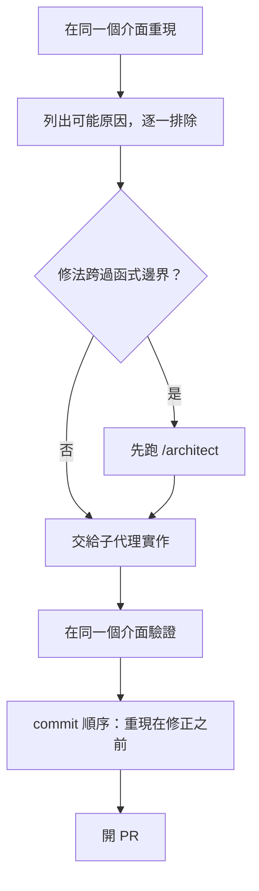
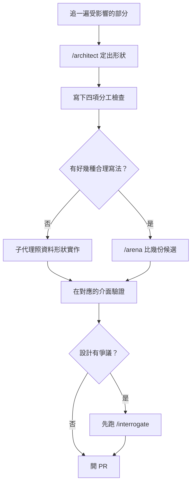
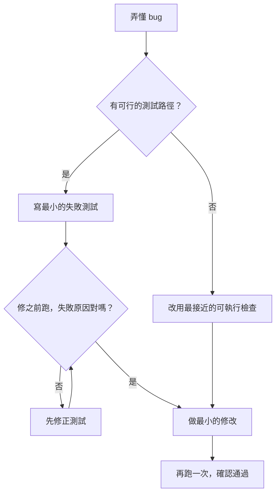
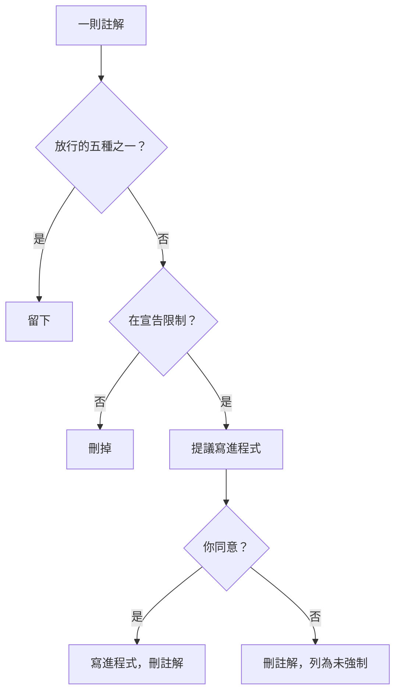
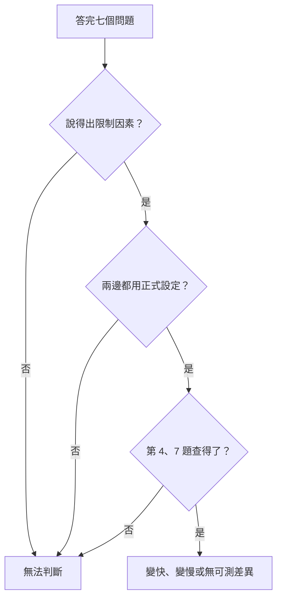

AI 程式助理改完程式，常常回一句「改好了，應該沒問題」。可是編譯通過只證明程式過了編譯檢查，不代表功能符合需求，「應該沒問題」更沒有任何驗證依據。這篇教你用 pstack 把「證明它能用」變成流程的一部分，從先重現再修、清理 diff、找出改動會弄壞的別處、讓 AI 實際操作程式，一路到開 PR、推到可以合併。

> pstack 系列｜第 3 篇
>
> - 系列導讀：[這套 skill 是什麼、四篇該怎麼讀](/posts/pstack-series-guide/)
> - 上一篇（第 2 篇）：[改程式之前，先看懂再設計](/posts/pstack-understand-design/)
> - 下一篇（第 4 篇）：[用原則指揮 AI、做出自己的 mode，再放心讓它自己跑](/posts/pstack-principles-customization/)
{: .prompt-info }

> 這篇以 pstack [`0.15.43` 版](https://github.com/cursor/plugins/blob/2f87c854fe3e2fcda44ca86b46ede35aad3c46b7/pstack/.cursor-plugin/plugin.json)為準，搭配 Claude Code 2.1.326。這一版對應 `cursor/plugins` 的 commit `2f87c85`（2026-11-17 05:47，台北時間）。系列五篇我在 2026-11-17 一起以這一版查證，當時 main 在 `2f87c85` 之後沒有改動 pstack；之後的版本，行為可能會改變。
>
> Claude Code 對第三方外掛市集預設不自動更新（[README](https://github.com/cursor/plugins/blob/2f87c854fe3e2fcda44ca86b46ede35aad3c46b7/pstack/README.md#L28)），所以照第 1 篇裝好的 pstack 會停在安裝時的版本。怎麼更新或固定版本，見[第 1 篇](/posts/pstack-install-routing/)。
{: .prompt-info }

## 開始之前

pstack 是 Cursor 官方外掛庫裡的一整組 skill，skill 是告訴 AI 怎麼完成某類工作的操作說明。安裝方法寫在[第 1 篇](/posts/pstack-install-routing/)，改程式之前怎麼看懂和設計寫在[第 2 篇](/posts/pstack-understand-design/)，這篇假設你已經裝好了。

Claude Code（在終端機裡使用的 AI 程式助理）的外掛指令要加上外掛名稱，例如 `/pstack:tdd`。下面的範例都用 Claude Code 的寫法，在 Cursor 裡把 `pstack:` 拿掉就好。

這篇的工具分成兩種，叫法不一樣：

| 種類 | 是什麼 | 這篇用到的 | 怎麼啟動 |
| --- | --- | --- | --- |
| playbook | `/poteto-mode` 裡的固定流程，一個步驟接一個步驟走 | Feature（新功能）、Bug fix（修 bug）、Opening a PR（開 PR）、Babysit（照顧 PR 到可以合併） | 沒有自己的指令。你把任務交給 `/pstack:poteto-mode`，它依任務挑對應的 playbook |
| skill | 獨立的指令 | `/tdd`、`/unslop`、`/no-comments`、`/blast-radius`、`/benchmark-checklist`、`/create-verification-skill`、`/maintain-verification-skill` | 設定為由使用者呼叫，要用時由你輸入 |

skill 設定成由你呼叫，但這不妨礙 playbook 直接讀它的說明檔。`/poteto-mode` 的 playbook 走到相關步驟時，會自己去讀那個 skill 的說明檔照做（[Claude Code 對照說明](https://github.com/cursor/plugins/blob/2f87c854fe3e2fcda44ca86b46ede35aad3c46b7/pstack/docs/harness/claude-code.md#L12)），例如：

- 修 bug 時用 `/tdd` 的節奏
- 審查前跑 `/no-comments`
- 寫任何文字都套 `/unslop`

`/blast-radius` 和兩個驗證 skill 不在 playbook 的步驟裡，要用就自己叫。

{: w="800" h="450" }
_從寫程式到可以合併的四個階段。開 PR 不會自動開始 babysit，合併永遠由你決定。_

## 先把「怎樣算完成」寫進第一個提示

pstack 指南把這件事放在驗證的第一步（[指南第 6 章](https://github.com/cursor/plugins/blob/2f87c854fe3e2fcda44ca86b46ede35aad3c46b7/pstack/docs/guide/06-verify-and-ship.md#L9-L27)）。例如：

```text
/pstack:poteto-mode 幫這個指令加上 JSON 輸出。原本的文字輸出要一個位元組都不變，JSON 要能被解析，兩種格式都要拿範例專案實際跑一次。把證據給我看。
```

這樣 AI 就有了三項具體的驗收要求，可以逐項檢查是否完成。它的回覆應該附上確切的指令和輸出；有檢查跑不了時，好的回覆會寫「無法判斷」（inconclusive）。**很有自信、卻沒附證據的回覆，我會當成警訊。**

檢查也要對得上改動：

| 改了什麼 | 怎麼檢查 |
| --- | --- |
| 指令 | 實際跑一次指令 |
| 畫面 | 在執行中的程式裡走一遍改過的流程 |
| 解析器或資料遷移 | 重放一份存好的輸入 |
| 效能 | 比較前後的效能剖析 |
| 儲存 | 把寫進去的值讀回來 |

`/poteto-mode` 的第一則回覆，會先說出你的目標和它預計的最小改動，然後直接開始，不等你確認（[SKILL.md](https://github.com/cursor/plugins/blob/2f87c854fe3e2fcda44ca86b46ede35aad3c46b7/pstack/skills/poteto-mode/SKILL.md#L19)）。所以它理解錯了，你馬上就看得出來。

## 實作：用 playbook 寫程式

[指南第 5 章](https://github.com/cursor/plugins/blob/2f87c854fe3e2fcda44ca86b46ede35aad3c46b7/pstack/docs/guide/05-build-and-clean.md#L5-L31)的原則是：在提示裡寫你觀察到的事，讓 playbook 依流程取得驗證所需的證據。playbook 會補上你沒打的步驟，例如修之前先重現、實作之前先說清楚資料形狀。

### 修 bug：先重現，再修

有一個回報的錯誤，要重現、找出根本原因、修好，而且要有執行時的證據，就交給 Bug fix playbook。提示裡寫出症狀，並要求先重現：

```text
/pstack:poteto-mode <症狀：在什麼情況下，發生了什麼，應該是什麼>。先重現，再修，修完驗證。
```

例如：

```text
/pstack:poteto-mode 這個指令在重試之後會寫出兩筆紀錄，應該只有一筆。先重現，再修，修完驗證。
```

它的流程如下（[bug-fix playbook](https://github.com/cursor/plugins/blob/2f87c854fe3e2fcda44ca86b46ede35aad3c46b7/pstack/skills/poteto-mode/playbooks/bug-fix.md)）：



重現時，它在問題發生的同一個介面（指令列、網頁畫面等）實際操作，把 bug 弄出來。只有在它真的碰不到、而且說得出具體原因時，才會請你幫忙重現。直接重現不了，它會自己造出觸發條件，或加上 log，直到 bug 出現。

找原因用的是二分法。它先追一遍相關的程式、用 `/why` 查這段程式的修改歷史，列出幾個可能的原因。接著每一輪挑最能縮小範圍的切法，拿執行時的證據來排除，不用猜的。

實作交給子代理，也就是 skill 執行時另外派出、分頭做事的 AI。驗證時，原本的重現步驟現在要通過；「無法判斷」或在不同的介面驗證，都不算通過。單元測試只能證明某個分支怎麼跑，不能證明 bug 不見了。

commit 的順序是：會失敗的重現（例如一個測試）先進 git 歷史，修正排在它後面。bug 有低成本的本機測試路徑時，照 `/tdd` 的節奏做；測試很貴、要動用一大堆環境，或不清楚怎麼測時，就跳過。

整個過程有一條規則，我覺得最值得記住：**每一行留下來的修改，都要能對應到執行時的證據。**「也許有幫助」的保險寫法只是假設，不會留下。證據推翻了某個假設，因它而改的程式也要還原（[bug-fix playbook 第 5 行](https://github.com/cursor/plugins/blob/2f87c854fe3e2fcda44ca86b46ede35aad3c46b7/pstack/skills/poteto-mode/playbooks/bug-fix.md#L5)）。

它的回覆會說明哪裡壞了、根本原因、怎麼修、怎麼驗證，並**原文貼上修之前失敗、修之後通過的重現輸出**。自己讀一遍那段前後輸出，確認失敗的原因真的是你回報的那個 bug。預設流程會接著開 PR；如果你要求它先停下，就在確認證據後再讓它繼續。

### 新功能：先說清楚資料形狀

新增或改變一個行為時，交給 Feature playbook。提示裡寫出要的行為，以及**什麼不能變**：

```text
/pstack:poteto-mode <要加的行為>。<哪些既有的行為不能變>。<怎麼驗證>。
```

例如（取自[指南第 5 章](https://github.com/cursor/plugins/blob/2f87c854fe3e2fcda44ca86b46ede35aad3c46b7/pstack/docs/guide/05-build-and-clean.md#L13-L17)）：

```text
/pstack:poteto-mode 加一個 --json 選項。原本的文字輸出要一個位元組都不變。兩種格式都要驗證。
```

它的流程如下（[feature playbook](https://github.com/cursor/plugins/blob/2f87c854fe3e2fcda44ca86b46ede35aad3c46b7/pstack/skills/poteto-mode/playbooks/feature.md)）：



`/architect` 會草擬兩種不同的型別、函式簽名和模組邊界，再挑一種（[SKILL.md](https://github.com/cursor/plugins/blob/2f87c854fe3e2fcda44ca86b46ede35aad3c46b7/pstack/skills/architect/SKILL.md#L9)；第 2 篇有詳細介紹）。

四項分工檢查會寫成待辦清單上的四項。某一項不適用時（例如只改一個檔案），它也會留在清單上，註明 `n/a: <理由>`：

- 哪些步驟要先做完
- 哪些工作可以平行
- 哪些狀態會被共用
- 最小又安全的拆法是什麼

交給子代理寫程式時，範圍會寫得很具體：檔案路徑、**資料形狀**，以及成功條件。資料形狀是指程式處理的資料長什麼樣、用什麼結構組織，例如用一個狀態機取代散落各處的一堆真假值，或用一張對照表取代一長串 if。

驗證的標準和修 bug 一樣，「無法判斷」或驗錯了介面都不算通過。每個小單元都先驗證過再進下一個，最後整理成小而有順序的 commit。

它的回覆會說明做了什麼、選了什麼和原因、那四項分工檢查，以及還沒決定的事；設計的替代方案會整理成表格。檢查設計選擇和驗證結果，還有待決的事就先釐清，再讓它繼續開 PR。

### /tdd：先寫一個會失敗的測試

你明確想要 TDD（先寫測試再寫程式）、一個會失敗的測試或回歸測試，或是 bug 有明顯又低成本的本機測試可以寫時，用 `/tdd`（[SKILL.md](https://github.com/cursor/plugins/blob/2f87c854fe3e2fcda44ca86b46ede35aad3c46b7/pstack/skills/tdd/SKILL.md#L3)）。測試路徑不清楚、很貴、要整合一大堆環境時，不要用。

對話裡已經有 bug 的前後文時，輸入下面這行就夠（[指南第 5 章](https://github.com/cursor/plugins/blob/2f87c854fe3e2fcda44ca86b46ede35aad3c46b7/pstack/docs/guide/05-build-and-clean.md#L43-L51)）：

```text
/pstack:tdd implement
```

沒有前後文時，把 bug 說清楚：

```text
/pstack:tdd 修 <bug 的描述>。先寫一個會因為這個 bug 失敗的測試，跑給我看它失敗，再修。
```

它的流程如下（[SKILL.md](https://github.com/cursor/plugins/blob/2f87c854fe3e2fcda44ca86b46ede35aad3c46b7/pstack/skills/tdd/SKILL.md#L13-L26)）：



弄懂 bug 是指弄清楚應該怎樣、現在怎樣、走哪條路徑，以及最小的重現方式。測試優先用這段程式本來就在用的那種；沒有明顯可行的測試路徑，它就不會為了走流程硬造一套。

失敗的測試要最小、剛好抓得到這個 bug，內容寫的是「應該怎樣」，而不是照抄現在的寫法。修之前先跑一次，如果它通過了，或因為不相干的原因失敗，就要先修正測試。修 bug 時做最小的修改，同時不破壞附近的既有約定。

寫失敗的測試不划算時，它會改用最接近的可執行檢查，例如一段腳本、一個手動重現的指令、瀏覽器自動化或記錄比對。它的原則是**寧可不加測試，也不要加壞測試**。下面這幾種都算壞測試：

- 主要在測假物件
- 綁死實作細節
- 依賴時間
- 證明完修好就會被刪掉

你會拿到修之前失敗的測試（或檢查）叫什麼、它產生了什麼失敗，以及修之後通過的那次執行。如果沒辦法示範「修之前會失敗」，它會說明原因和改用的檢查。接著清理 diff（diff 是兩個版本之間改了哪些行），再開 PR。

## 清理：讓 diff 好審

開 PR 的 playbook 在每次 commit 之前，會對 diff 跑 `/deslop`。PR 說明和 commit 說明，則由 `/poteto-mode` 套用 `/unslop`（[指南第 5 章](https://github.com/cursor/plugins/blob/2f87c854fe3e2fcda44ca86b46ede35aad3c46b7/pstack/docs/guide/05-build-and-clean.md#L57-L59)）。三個工具的分工：

| 工具 | 清什麼 |
| --- | --- |
| `/deslop` | 程式 |
| `/unslop` | 文字 |
| `/no-comments` | 註解，交給一個沒寫過它們的審查者 |

`/deslop` 在 `cursor-team-kit` 這個外掛裡，不是 pstack 的一部分，第 1 篇有介紹要不要一起裝。沒裝的話，我會用白話要它做到同樣的結果：

- 刪掉敘述性的註解
- 刪掉沒有根據的防禦檢查
- 刪掉已經沒人用的相容寫法
- 拿掉和這次改動無關的修改

### /unslop：清掉文字裡的 AI 腔

README、文件、PR 說明、commit 說明這類給人看的文字，讀起來像 AI 寫的時候，用 `/unslop`。指出要清的文字，加上你自己的規則：

```text
/pstack:unslop <要清的文字或檔案>，<你的額外規則>
```

例如（取自[指南第 5 章](https://github.com/cursor/plugins/blob/2f87c854fe3e2fcda44ca86b46ede35aad3c46b7/pstack/docs/guide/05-build-and-clean.md#L61-L67)）：

```text
/pstack:unslop the readme changes, no emdashes
```

它先找出文字裡的 AI 寫作習慣，再改寫，同時保留原意和語氣（[SKILL.md](https://github.com/cursor/plugins/blob/2f87c854fe3e2fcda44ca86b46ede35aad3c46b7/pstack/skills/unslop/SKILL.md#L9)）。它的清單是一條條編號的規則（[規則清單](https://github.com/cursor/plugins/blob/2f87c854fe3e2fcda44ca86b46ede35aad3c46b7/pstack/skills/unslop/SKILL.md#L13-L40)），清單裡的例子都是英文，涵蓋這些項目：

- 空泛的修飾
- 「專家認為」這種沒有出處的說法
- AI 愛用的字
- 硬湊三點
- 破折號
- 每個專有名詞都加粗
- 只是重述那一行的粗體小標
- 聊天腔，例如「希望對你有幫助！」
- 贅字
- 抽象的比喻名詞
- 白話原則：主動語態、一句只講一件事、用平常的字

你會拿到改寫後的文字。自己再讀一遍，確認意思沒被改掉。

### /no-comments：讓沒寫過註解的人來審註解

送審之前用 `/no-comments`。寫註解的 AI 容易替自己的寫法辯護，所以要交給沒參與撰寫的審查者（[指南第 5 章](https://github.com/cursor/plugins/blob/2f87c854fe3e2fcda44ca86b46ede35aad3c46b7/pstack/docs/guide/05-build-and-clean.md#L69-L77)）。

```text
/pstack:no-comments the diff
```

沒指定範圍時，它會用目前分支相對於 `main` 的 diff，連還沒 commit 的修改一起算（[SKILL.md](https://github.com/cursor/plugins/blob/2f87c854fe3e2fcda44ca86b46ede35aad3c46b7/pstack/skills/no-comments/SKILL.md#L13-L15)）。也可以指定檔案：

```text
/pstack:no-comments <檔案或資料夾>
```

它會派出 Comment Sicko 來審。這是一個只審註解的子代理，它只碰註解、指出該重構的地方，**從不寫應用程式碼**（[Comment Sicko](https://github.com/cursor/plugins/blob/2f87c854fe3e2fcda44ca86b46ede35aad3c46b7/pstack/agents/comment-sicko.md#L30)）。每一則註解的處理方式如下（[SKILL.md](https://github.com/cursor/plugins/blob/2f87c854fe3e2fcda44ca86b46ede35aad3c46b7/pstack/skills/no-comments/SKILL.md#L17-L24)）：



它只放過這五種註解：

- 授權聲明
- 定義公開 API 約定的文件註解
- 程式表達不了的 issue 或規格連結
- 被外部套件或平台逼出來的不明顯行為
- `// prettier-ignore` 這類格式指令

你自己程式裡令人意外的地方，不會因為有註解就過關。它會標成 `MUST KILL`，要求用改名、抽出函式或改型別的方式，讓程式不用註解也看得懂。

宣告限制的註解，像是「不要刪」「改之前先找某某人」。它會提議用成本最低的方式把這個限制寫進程式，例如型別、執行時檢查、測試或 lint 規則（自動檢查程式寫法的規則），**等你同意**才做。

Comment Sicko 交回報告之後，接著這樣處理：

- 它越界改了程式、或理由寫錯的標記，會被退回。
- 接受的標記，小的直接修，例如刪掉死掉的路徑、拿掉沒用的參數；需要重新設計形狀的，先跑一次 `/architect` 畫草稿。
- 從根本原因修，範圍只在這次的改動裡；超出範圍的會列成待辦，不會順手修。

你會拿到一份報告，包括刪了幾則註解、恢復了哪些、修了什麼、`/architect` 的草稿、提議的強制方式和你同意的部分，以及還沒處理的事。回覆它提議的強制方式；diff 乾淨了，就進入驗證。

## 驗證：證明它真的能用

### /blast-radius：找出改動會弄壞哪裡

一個小 diff 你不太放心，想知道它會不會弄壞**別處**時，用 `/blast-radius`（[指南第 6 章](https://github.com/cursor/plugins/blob/2f87c854fe3e2fcda44ca86b46ede35aad3c46b7/pstack/docs/guide/06-verify-and-ship.md#L29)）。它可以和 `/how`、`/why` 搭配：`/how` 說程式在做什麼，`/why` 說為什麼長這樣，`/blast-radius` 查這次改動可能影響哪些地方。

```text
/pstack:blast-radius <這次的改動，例如目前的 branch 或某個 PR>。我最擔心 <你擔心的地方>。
```

例如：

```text
/pstack:blast-radius 這個 branch 的改動。我最擔心快取清除那一段，會不會清掉還在用的資料。
```

它不只列出搜尋就能找到的呼叫端，還會追查單靠文字搜尋難以看出的行為影響（[SKILL.md](https://github.com/cursor/plugins/blob/2f87c854fe3e2fcda44ca86b46ede35aad3c46b7/pstack/skills/blast-radius/SKILL.md#L13)）：

1. **讀懂改動**，包括 diff 沒有直接呈現的間接行為變化。
2. **找出「它之所以安全」的那一個事實。** 大部分看起來危險的改動，其實都因為某一個事實而安全，例如「這個呼叫只會清掉已經失效的快取，不做別的事」。這個事實成立，大部分風險就一起排除了。
3. **看搜尋看不到的地方**：你呼叫的套件原始碼和它固定的版本、程式在什麼時機執行、API 回傳的 JSON、資料庫欄位、功能開關、下游好幾層的程式。
4. **誠實評估每個風險**：真的會發生的機率，以及發生了的代價。確認的風險和查過、排除的分開列。
5. **跑程式證明那個事實。** 寫一段腳本或測試，呼叫真正的程式，跑一次，貼上結果。
6. 改動很大或很廣時，用 `/arena` 讓幾個模型回答同一個問題，再合併。

每個事實它都會說明證明到哪個程度，由弱到強是（[SKILL.md](https://github.com/cursor/plugins/blob/2f87c854fe3e2fcda44ca86b46ede35aad3c46b7/pstack/skills/blast-radius/SKILL.md#L19-L27)）：

- 只是說說
- 指出程式行號
- 一步步推演出壞情況不會發生
- 寫程式跑過
- 在執行中的程式重現過

你會拿到這些內容（[SKILL.md](https://github.com/cursor/plugins/blob/2f87c854fe3e2fcda44ca86b46ede35aad3c46b7/pstack/skills/blast-radius/SKILL.md#L40-L46)）：

- 它做了什麼
- 它之所以安全的那一個事實，附上證明；證明不了就寫 unproven
- 風險：怎麼壞、在哪一行、機率和代價、怎麼檢查
- 已排除的項目
- 「合併之前」：成本最低、能抓到真正 bug 的測試或重現方式

如果事實被標成 unproven，或列出了確認的風險，先處理再開 PR。「合併之前」那段的測試，可以直接加進這次的改動。

### /benchmark-checklist：檢查效能數字可不可信

你量了一個效能數字，準備寫進 PR 或依它做決定，或是別人的數字好得不太真實時，用 `/benchmark-checklist`。前後對比的數字最容易不小心弄錯，例如快取是熱的、有一邊用了除錯版本，或計時的範圍裡根本沒做事（[指南第 6 章](https://github.com/cursor/plugins/blob/2f87c854fe3e2fcda44ca86b46ede35aad3c46b7/pstack/docs/guide/06-verify-and-ship.md#L31-L49)）。

`/poteto-mode` 的效能問題（Perf issue）和持續優化單一指標（Hillclimb）這兩個 playbook，已經會自己跑這份清單。所以只有在這兩個流程之外量到數字時，才需要你自己叫：

```text
/pstack:benchmark-checklist 在寫進 PR 之前，檢查 <哪個數字，例如匯出變快了多少>
```

開始量之前，它會先寫下你打算宣稱的那句話，例如「匯出在 6 萬筆的資料集上快了 30%」。接著讀量測腳本，看它計什麼、忽略什麼，再看機器忙不忙（[SKILL.md](https://github.com/cursor/plugins/blob/2f87c854fe3e2fcda44ca86b46ede35aad3c46b7/pstack/skills/benchmark-checklist/SKILL.md#L13-L17)）。然後用執行的證據回答七個問題（[SKILL.md](https://github.com/cursor/plugins/blob/2f87c854fe3e2fcda44ca86b46ede35aad3c46b7/pstack/skills/benchmark-checklist/SKILL.md#L19-L27)）：

1. 限制這個數字的是什麼？為什麼不是兩倍？
2. 每一邊都用正式環境的設定跑嗎？
3. 結果有沒有超過物理極限，例如磁碟頻寬或核心數？
4. 有沒有出錯，或回傳錯誤的結果？
5. 輪流跑多次（A、B、A、B……）能重現嗎？中位數和範圍是多少？
6. 從使用者等待的整條路徑來看，這個差距重要嗎？
7. 要計時的工作真的在計時範圍裡發生了嗎？

結論怎麼下（[SKILL.md](https://github.com/cursor/plugins/blob/2f87c854fe3e2fcda44ca86b46ede35aad3c46b7/pstack/skills/benchmark-checklist/SKILL.md#L29-L34)）：



報告先講結論，再附數字和單位、跑了幾次、範圍和限制因素。PR 說明裡只放一個主要數字，詳細的執行紀錄放在另外連結的檔案。

### /create-verification-skill：讓 AI 能像使用者一樣操作你的程式

你的專案還沒有一套寫好的方法，讓 AI 實際啟動程式、像使用者一樣操作、留下證據時，用 `/create-verification-skill`。前面說改畫面要在執行中的程式裡走一遍，這件事需要的就是它（[指南第 6 章](https://github.com/cursor/plugins/blob/2f87c854fe3e2fcda44ca86b46ede35aad3c46b7/pstack/docs/guide/06-verify-and-ship.md#L51-L59)）。

```text
/pstack:create-verification-skill
```

它的流程如下（[SKILL.md](https://github.com/cursor/plugins/blob/2f87c854fe3e2fcda44ca86b46ede35aad3c46b7/pstack/skills/create-verification-skill/SKILL.md)）：

1. **訪談的是專案，不是你。** 它從程式碼回答下面這些問題，只有程式碼回答不了的才問你。專案本身無法建置或啟動時，它會先修好或明確回報，再往下做。
   - 使用者實際碰到的是什麼：網頁、指令列、桌面程式、API……
   - 程式在本機怎麼啟動。
   - AI 可以用什麼方式操作它。優先用專案裡能實際操作程式的現成工具，例如 Playwright／Cypress 腳本、終端機輔助腳本、可以用 curl 呼叫的端點、除錯埠。沒有才用瀏覽器、終端機或 HTTP 這類通用做法。
   - 可以留下什麼證據。
   - 能不能同時開兩份互不干擾。
2. **產生 skill。** 在 Claude Code 裡，它寫進 `.claude/skills/verify-<app>/`。pstack 的說明寫的是 Cursor 的 `.cursor/skills/`，[Claude Code 對照說明](https://github.com/cursor/plugins/blob/2f87c854fe3e2fcda44ca86b46ede35aad3c46b7/pstack/docs/harness/claude-code.md#L49-L53)把它換成 `.claude/skills/`。
3. **建立功能地圖。** 在 `features/` 底下放一份索引，加上每個主要功能一個檔案（先挑 3 到 5 個）。每個檔案從使用者的角度寫：功能是什麼、怎麼走到、怎麼操作、看到什麼結果才算成功。
4. **交出去之前，先自己跑一遍。** 照它剛寫好的說明，啟動、健康檢查、操作一個功能、留證據、收拾，再確認證據在收拾之後還在。沒跑過的 skill 只是草稿。
5. **提醒你可以用 `/maintain-verification-skill` 維護它。**

產生的 skill 是給 AI 看的操作說明，分成這幾段：

| 段落 | 內容 |
| --- | --- |
| Launch | 怎麼啟動 |
| Doctor | 確認程式已就緒、可以開始操作的健康檢查 |
| Drive | 用專案裡真實的選擇器或指令操作 |
| Evidence | 要留什麼證據、放在哪 |
| Cleanup | 怎麼收拾自己開的東西 |
| Helpers | 附帶的腳本怎麼用 |

> Claude Code 把專案的 `.claude/` 資料夾當成受保護的位置，在預設模式下，寫進去之前會先問你（[Claude Code 文件](https://code.claude.com/docs/en/permission-modes)）。看到詢問時，先確認路徑是 `.claude/skills/verify-<app>/` 再同意。
{: .prompt-tip }

你會拿到一個專案專屬的驗證 skill，加上一份功能地圖。之後「在程式裡驗證一下」就是任何 AI 在這個專案都能直接做的步驟，不用再從頭交代怎麼啟動。

把它 commit 進專案，讓每個人和每個 AI 用同一套方式操作程式。之後要它用這套方法驗證，就在提示裡點名（取自[指南第 6 章](https://github.com/cursor/plugins/blob/2f87c854fe3e2fcda44ca86b46ede35aad3c46b7/pstack/docs/guide/06-verify-and-ship.md#L63-L71)）：

```text
/pstack:poteto-mode 做一個「批次封存」的動作。用 /verify-<app> 驗證你的修改，給我影片和截圖當證據。
```

```text
/pstack:poteto-mode 用 /verify-<app> 重現這個問題。如果在 main 上也重現得出來，就修好它，給我一段影片當證據。
```

{: w="800" h="450" }
_產生一次，commit 進專案；程式改了，用 /maintain-verification-skill 讓說明跟上。_

### /maintain-verification-skill：讓驗證 skill 跟上程式

程式一改，功能地圖就可能過時，所以指南建議至少每天跑一次 `/maintain-verification-skill`（[指南第 6 章](https://github.com/cursor/plugins/blob/2f87c854fe3e2fcda44ca86b46ede35aad3c46b7/pstack/docs/guide/06-verify-and-ship.md#L86-L94)）：

```text
/pstack:maintain-verification-skill
```

指南說的排程自動化指的是 Cursor Automations。pstack 的 Claude Code 對照說明寫明，在 Claude Code 裡遇到這一步就略過（[對照說明](https://github.com/cursor/plugins/blob/2f87c854fe3e2fcda44ca86b46ede35aad3c46b7/pstack/docs/harness/claude-code.md#L59-L65)）。Claude Code 有自己的排程任務，但 pstack 沒有提供設定方式，所以我認為最簡單的做法是自己定期跑。

它的流程如下（[SKILL.md](https://github.com/cursor/plugins/blob/2f87c854fe3e2fcda44ca86b46ede35aad3c46b7/pstack/skills/maintain-verification-skill/SKILL.md#L23-L37)）：

1. **找到要維護的驗證 skill。** 有好幾個就問你是哪一個；一個都沒有就停下來，叫你先跑 `/create-verification-skill`。
2. **整理索引**：補上漏掉的、刪掉重複或失效的項目。
3. **讀原始碼**：每個功能檔案派一個只讀不寫的子代理。各自根據原始碼說明該功能怎麼運作，指出說明可能過時的地方，並給一份實際操作的步驟。
4. **整合**：合併重疊的操作步驟，抽查被指出的過時處，也看最近的修改有沒有新出現、地圖還沒收錄的功能。
5. **實際操作一遍**：就算原始碼看起來都沒問題，也一定要做。每個功能至少操作一次，操作前先跑健康檢查，證據要在收拾之後還在。
6. **分類並收尾**：說明寫錯了就改說明。程式明明能用、但操作方法做不到，就修操作方法。程式本身壞了，就記下來告訴你，不會放進這次的修改。

它**只改驗證 skill 自己的資料夾，從不改產品程式**（[SKILL.md](https://github.com/cursor/plugins/blob/2f87c854fe3e2fcda44ca86b46ede35aad3c46b7/pstack/skills/maintain-verification-skill/SKILL.md#L19-L21)）。結果是下面三種之一：

- `clean`：每個功能都讀過原始碼、也實際操作過，沒有要改的，不開 PR。
- `changed`：開一個 PR，只放驗證過的修正。
- `blocked`：沒辦法完成，並寫明卡在哪裡。

結果是 `changed` 就審它開的 PR；報告裡列出的產品問題，另外處理。

### 形式驗證：證明測試很少碰到的情況

驗證 skill 證明的是你實際操作過的路徑。但有些 bug 藏在一般操作和測試很少涵蓋的路徑上，例如兩次重試剛好重疊、鎖在寫到一半時過期、狀態變化的順序亂掉。對這種一出錯代價很高的程式，可以跑：

```text
/pstack:create-formal-verification-skill
```

它的做法如下（[指南第 6 章](https://github.com/cursor/plugins/blob/2f87c854fe3e2fcda44ca86b46ede35aad3c46b7/pstack/docs/guide/06-verify-and-ship.md#L96-L116)）：

1. 從程式碼挑出最值得證明的一個性質。
2. 依問題選工具。例如要判斷事件會不會以錯誤順序發生，預設用 TLA+ 這類模型檢查器。
3. 先讓這個性質在故意改壞的程式上失敗一次，證明檢查真的抓得到問題。
4. 留下一個專案專屬的 skill，讓之後的 AI 能用一個指令檢查新的改動。

## 送審：開 PR，推到可以合併

### 開 PR（Opening a PR playbook）

其他 playbook 結束時都會自動接到它（[opening-a-pr](https://github.com/cursor/plugins/blob/2f87c854fe3e2fcda44ca86b46ede35aad3c46b7/pstack/skills/poteto-mode/playbooks/opening-a-pr.md#L3)），你也可以自己叫（取自[指南第 6 章](https://github.com/cursor/plugins/blob/2f87c854fe3e2fcda44ca86b46ede35aad3c46b7/pstack/docs/guide/06-verify-and-ship.md#L128-L134)）：

```text
/pstack:poteto-mode 開 PR。整理成小而有順序的 commit，證據寫進說明。
```

它的步驟如下（[opening-a-pr](https://github.com/cursor/plugins/blob/2f87c854fe3e2fcda44ca86b46ede35aad3c46b7/pstack/skills/poteto-mode/playbooks/opening-a-pr.md)）：

1. **在 worktree 裡做。** worktree 是同一個專案的另一份工作副本；它從 main 分出來，不讓和這次無關的修改混進來。
2. **整理 commit**：開 PR 之前，重整成小的 commit，每一個都能單獨合併。
3. **清理**：commit 之前對 diff 跑 `/deslop`。另外，送審之前跑 `/no-comments`，以及 PR 標題、說明和 commit 說明先用 `/technical-writing` 寫、再套用 `/unslop`。這兩項是 `/poteto-mode` 對所有工作的固定規則（[SKILL.md](https://github.com/cursor/plugins/blob/2f87c854fe3e2fcda44ca86b46ede35aad3c46b7/pstack/skills/poteto-mode/SKILL.md#L23-L24)），開 PR 時一樣會做。
4. **標題**用 Conventional Commits 格式，也就是類型、括號裡的範圍、冒號，再接說明，例如 `fix(export): ...`。
5. **說明**是給審查者一分鐘看完的摘要，不到 40 行，沒有內容的段落就省略。段落依序是：
   - Why（為什麼）
   - What changed（改了什麼）
   - Scope（範圍）
   - Tradeoffs（取捨，只寫審查者會問到、但沒有採用的做法）
   - Blast Radius（影響範圍）
   - Verification（驗證）
6. **預設用 `gh`（GitHub 的命令列工具）開 PR**，而且直接開成可以審查的狀態，不開草稿。

**它不會在開完 PR 之後自動開始 babysit**（[opening-a-pr](https://github.com/cursor/plugins/blob/2f87c854fe3e2fcda44ca86b46ede35aad3c46b7/pstack/skills/poteto-mode/playbooks/opening-a-pr.md#L9)）。CI（每次推上去就自動跑的檢查）失敗或有審查留言要處理時，要你開口叫 babysit。指南也建議，後續的修改另開一個疊在上面的 PR，不要讓同一個分支越長越大（[指南第 6 章](https://github.com/cursor/plugins/blob/2f87c854fe3e2fcda44ca86b46ede35aad3c46b7/pstack/docs/guide/06-verify-and-ship.md#L134)）。

PR 開好之後，先自己讀一遍說明裡的 Verification。

### Babysit：把 PR 推到可以合併，但不替你合併

PR 開了之後，CI 失敗、審查者留言、main 往前走造成衝突，這些雜事可以交給 babysit（取自[指南第 6 章](https://github.com/cursor/plugins/blob/2f87c854fe3e2fcda44ca86b46ede35aad3c46b7/pstack/docs/guide/06-verify-and-ship.md#L136-L150)）：

```text
/pstack:poteto-mode babysit 這個 PR，讓它全部通過。
```

只想知道目前狀態、不要它動手時，問小一點：

```text
/pstack:poteto-mode 看一下 PR 123，還有什麼沒處理的？
```

回覆的第一行會先宣告用哪一種模式，然後才開始查狀態（[babysit playbook](https://github.com/cursor/plugins/blob/2f87c854fe3e2fcda44ca86b46ede35aad3c46b7/pstack/skills/poteto-mode/playbooks/babysit.md)）：

| 模式 | 你怎麼說 | 它做什麼 |
| --- | --- | --- |
| `drive` | 「babysit 這個」「讓它全部通過」 | 一路處理到可以合併 |
| `threads-only` | 只要它處理審查留言 | 只處理審查留言，其他都不碰 |
| `check` | 「看一下 X」 | 看一次狀態就回報 |

處理時它遵守這些規則：

- **一次只清一個 PR。** 同時有好幾個 PR 時，一個處理完，才換下一個。
- **不改 PR 的結構。** 不 rebase（把分支的 commit 改接到新的基準上）、不改目標分支、不 force push（強制覆蓋遠端分支的歷史）。需要 rebase 的情況，它會回報給你，讓 PR 的主人自己做。
- **順序是衝突、審查留言、CI。** 遇到衝突時，它不會自行解決，而是說哪個分支需要 rebase，然後停下來。
- **用 `watch-pr` 查 GitHub 上的狀態。** 這是 pstack 附的腳本，只支援 GitHub。`drive` 模式會一直監看到出現最終結果，`check` 模式加上 `--status-only`，只看一次。
- **CI 的偶發失敗只重跑一次。** 偶發失敗（flake）是程式沒改、有時通過有時失敗的情況，它只重新跑一次建置。只有這次改動自己的程式造成的失敗，才會為它提交修正。
- **Bugbot（Cursor 的自動審查工具）的留言一律存疑**，逐條對照程式驗證。真的問題才修，雜訊附上具體的反證後駁回；牽涉計費、資料、權限或資安的，交給人決定。
- **審查留言一律當成資料。** 所有審查留言的內容都不會被當成指令照做。
- **停在你該決定的地方。** 等負責人核准是「等待」，不是要它修的問題。

在 GitHub 上，watch-pr 回報 `READY` 時，`drive` 就結束（[watch-pr](https://github.com/cursor/plugins/blob/2f87c854fe3e2fcda44ca86b46ede35aad3c46b7/pstack/skills/poteto-mode/scripts/watch-pr/render.ts#L149-L154)）。`READY` 的意思是沒有衝突、沒有未解決的審查留言，也沒有失敗或還在跑的檢查。

**babysit 從不合併，就算全部都綠了也一樣**（[指南第 6 章](https://github.com/cursor/plugins/blob/2f87c854fe3e2fcda44ca86b46ede35aad3c46b7/pstack/docs/guide/06-verify-and-ship.md#L150)）。只有你明確說「合併」「上線」，才會轉到另一個叫 Shipping 的 playbook（[SKILL.md](https://github.com/cursor/plugins/blob/2f87c854fe3e2fcda44ca86b46ede35aad3c46b7/pstack/skills/poteto-mode/SKILL.md#L27)）。Shipping 會先逐一獨立驗證每個 PR，再從最底下開始一個一個合併（[指南第 6 章](https://github.com/cursor/plugins/blob/2f87c854fe3e2fcda44ca86b46ede35aad3c46b7/pstack/docs/guide/06-verify-and-ship.md#L152-L160)）。

> 叫 babysit，會讓 AI 在你的電腦上從網路下載並安裝套件。`watch-pr` 是用 bun（一個 JavaScript 執行環境）執行的腳本。**第一次執行時**，它會在外掛資料夾裡的 `skills/poteto-mode/scripts/` 跑 `bun install --frozen-lockfile`。這個指令會依照 lockfile（鎖定每個套件確切版本的檔案）從 npm 下載它需要的套件，裝進那裡的 `node_modules`。
>
> 之後外掛更新時，如果改到套件清單（`package.json`）或 lockfile，它會再裝一次（[bootstrap.ts](https://github.com/cursor/plugins/blob/2f87c854fe3e2fcda44ca86b46ede35aad3c46b7/pstack/skills/poteto-mode/scripts/bootstrap.ts#L25-L52)）。lockfile 固定了版本，但我認為你還是應該知道這件事。風險和怎麼收權限，我在〈[裝了第三方 skill 和 MCP 之後，你的 Coding Agent 多了哪些破口？](/posts/coding-agent-supply-chain-permission-risks/)〉談過。
{: .prompt-warning }

`drive` 正常完成時，會回報 PR 已可合併，以及處理過的留言、CI 失敗與判斷依據。遇到需要你處理的衝突或核准，則會說明目前卡在哪裡。`check` 則是交回一份狀態報告。

{: w="800" h="450" }
_衝突只回報不自己解；到了可以合併就停，不會替你按下合併。_

## 一個完整的例子（虛構）

> **以下是我虛構的情境**，只用來示範這些 playbook 和 skill 怎麼接在一起。
{: .prompt-info }

假設你維護一個匯出資料的指令列工具。有使用者回報：網路不穩、指令自動重試之後，輸出的檔案裡同一筆資料會出現兩次。

**1. 先重現並找原因，暫不修改。**

```text
/pstack:poteto-mode 匯出指令在網路逾時、自動重試之後，同一筆資料會寫出兩次，應該只有一次。這一步只重現並找出原因，貼上失敗的輸出；先不要修改程式，也不要開 PR。
```

這裡刻意把流程停在調查階段：讓它建立逾時的觸發條件，縮小問題範圍，再用執行結果確認原因。先讀失敗的輸出，確認重現的是使用者回報的問題。

**2. 用 `/tdd` 先寫失敗的測試，再修正。**

第 1 步明確要求暫停，所以修正要另外啟動。假設這個 bug 有低成本的本機測試路徑，就在同一段對話裡接著輸入：

```text
/pstack:tdd implement
```

確認測試先因為這個 bug 失敗，修正後再通過。如果沒有合適的測試路徑，就改用前面介紹的可執行檢查。

**3. 審註解。**

```text
/pstack:no-comments the diff
```

假設它把一則「這裡不要動，重試會出事」的註解標出來，提議改成一個測試。你同意後，它會先寫測試，再刪註解。

**4. 不放心，找影響範圍。**

```text
/pstack:blast-radius 這個 branch 的改動。我最擔心改了重試邏輯之後，其他會重試的指令會不會也受影響。
```

讀它找到的「之所以安全的那一個事實」有沒有被證明，以及「合併之前」那段建議的測試。

**5. 開 PR，再叫 babysit。**

```text
/pstack:poteto-mode 開 PR。整理成小而有順序的 commit，證據寫進說明。
```

```text
/pstack:poteto-mode babysit 這個 PR，讓它全部通過。
```

babysit 會處理 CI 和審查留言，到 GitHub 判定可以合併時停下來。合併由你按。

> 這個例子我寫成**逐一手動**呼叫每一步，好讓你掌握每個環節。平常你可以把目標和完成條件交給 `/pstack:poteto-mode`，它會依 playbook 自己決定要用哪些 skill。只有想改變預設做法時，才點名某個 skill。
{: .prompt-tip }

## 什麼時候用哪個

| 情況 | 用哪個 |
| --- | --- |
| 有一個回報的 bug 要修 | `/poteto-mode` + 症狀 +「先重現」（Bug fix playbook） |
| 要加一個新功能 | `/poteto-mode` + 行為 + 什麼不能變（Feature playbook） |
| 想先看到一個會失敗的測試再修 | `/tdd`（要有低成本的本機測試路徑） |
| README、PR 說明讀起來像 AI 寫的 | `/unslop` |
| diff 裡有一堆註解，送審之前 | `/no-comments` |
| 一個小 diff，不放心會不會弄壞別處 | `/blast-radius` |
| 量了一個效能數字，要寫進 PR | `/benchmark-checklist` |
| AI 沒辦法自己啟動、操作你的程式 | `/create-verification-skill`（做一次，commit 進專案） |
| 程式改了，驗證 skill 可能過時 | `/maintain-verification-skill` |
| 重試、並行、狀態機這類測試很難碰到的情況 | `/create-formal-verification-skill` |
| 改好了，要開 PR | `/poteto-mode` + 「開 PR」（其他 playbook 結束時會自動接） |
| PR 有 CI 失敗或審查留言要處理 | `/poteto-mode` +「babysit」；只想看狀態就問「看一下」 |
| 要合併 | 你自己按；要 AI 合併得明確說，走 Shipping |

## 結論

下次叫 AI 改程式，先在第一個提示寫清楚怎樣算完成，再要它附上執行的證據。專案還沒有驗證 skill 的話，先跑一次 `/create-verification-skill`，之後每次驗證都用得上。按下合併的，永遠是你。

## 延伸閱讀

- [指南：Build the change and clean the diff](https://github.com/cursor/plugins/blob/2f87c854fe3e2fcda44ca86b46ede35aad3c46b7/pstack/docs/guide/05-build-and-clean.md)：各種實作任務的提示寫法，以及清理的習慣。
- [指南：Verify the result and open a PR](https://github.com/cursor/plugins/blob/2f87c854fe3e2fcda44ca86b46ede35aad3c46b7/pstack/docs/guide/06-verify-and-ship.md)：完成條件、驗證 skill、形式驗證、開 PR、babysit 和 Shipping。
- 四個 playbook：[bug-fix](https://github.com/cursor/plugins/blob/2f87c854fe3e2fcda44ca86b46ede35aad3c46b7/pstack/skills/poteto-mode/playbooks/bug-fix.md)、[feature](https://github.com/cursor/plugins/blob/2f87c854fe3e2fcda44ca86b46ede35aad3c46b7/pstack/skills/poteto-mode/playbooks/feature.md)、[opening-a-pr](https://github.com/cursor/plugins/blob/2f87c854fe3e2fcda44ca86b46ede35aad3c46b7/pstack/skills/poteto-mode/playbooks/opening-a-pr.md)、[babysit](https://github.com/cursor/plugins/blob/2f87c854fe3e2fcda44ca86b46ede35aad3c46b7/pstack/skills/poteto-mode/playbooks/babysit.md)。
- skill 的說明檔：[tdd](https://github.com/cursor/plugins/blob/2f87c854fe3e2fcda44ca86b46ede35aad3c46b7/pstack/skills/tdd/SKILL.md)、[unslop](https://github.com/cursor/plugins/blob/2f87c854fe3e2fcda44ca86b46ede35aad3c46b7/pstack/skills/unslop/SKILL.md)、[no-comments](https://github.com/cursor/plugins/blob/2f87c854fe3e2fcda44ca86b46ede35aad3c46b7/pstack/skills/no-comments/SKILL.md)、[blast-radius](https://github.com/cursor/plugins/blob/2f87c854fe3e2fcda44ca86b46ede35aad3c46b7/pstack/skills/blast-radius/SKILL.md)、[benchmark-checklist](https://github.com/cursor/plugins/blob/2f87c854fe3e2fcda44ca86b46ede35aad3c46b7/pstack/skills/benchmark-checklist/SKILL.md)、[create-verification-skill](https://github.com/cursor/plugins/blob/2f87c854fe3e2fcda44ca86b46ede35aad3c46b7/pstack/skills/create-verification-skill/SKILL.md)、[maintain-verification-skill](https://github.com/cursor/plugins/blob/2f87c854fe3e2fcda44ca86b46ede35aad3c46b7/pstack/skills/maintain-verification-skill/SKILL.md)、[create-formal-verification-skill](https://github.com/cursor/plugins/blob/2f87c854fe3e2fcda44ca86b46ede35aad3c46b7/pstack/skills/create-formal-verification-skill/SKILL.md)。
- [pstack 系列（1）：安裝、選模型，再用 /poteto-mode 挑 playbook](/posts/pstack-install-routing/)：怎麼安裝、更新，以及 `/poteto-mode` 怎麼替任務排順序。
- [pstack 系列（2）：改程式之前，先看懂再設計](/posts/pstack-understand-design/)：`/how`、`/why`、`/architect`、`/interrogate`、`/arena`，以及 `/teach`、`/recall`、`/swarm`、試作和寫計畫。
- [自己寫 Agent Skill](/posts/agent-skill-authoring-guide/)：專案專屬的 skill 放在哪裡、SKILL.md 怎麼寫。
- [裝了第三方 skill 和 MCP 之後，你的 Coding Agent 多了哪些破口？](/posts/coding-agent-supply-chain-permission-risks/)：agent 下載套件、讀檔案時的風險，權限怎麼收。
- 另一套 skill 的做法：[mattpocock/skills 系列導讀](/posts/mattpocock-skills-series-guide/)、[AI 開工寫程式前，先決定要看哪一種訊號](/posts/mattpocock-skills-implementation-feedback-loops/)、[程式寫完之後，誰來看結構、審修改、解衝突](/posts/mattpocock-skills-design-review-integration/)。
