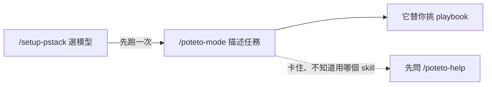
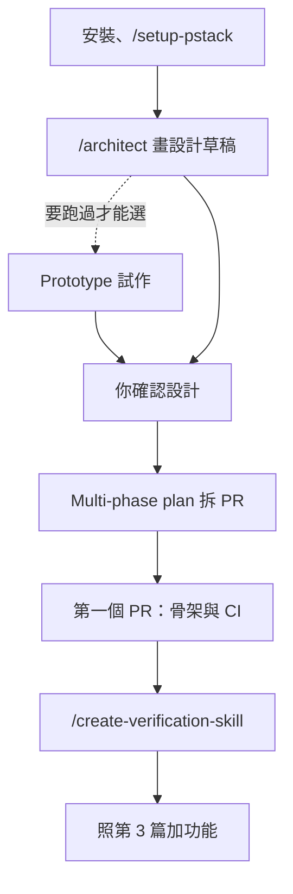

你可能聽人提過 pstack，打開 repo 卻只看到一長串 skill 名稱；也可能是從搜尋點進其中一篇，想知道前後還有哪些。這個系列有四篇，每篇處理用 AI 寫程式時的其中一段流程。這篇導讀不重講細節，只說明 pstack 是什麼，並依你的情況建議從哪一篇開始。

> pstack 系列｜導讀
>
> - 從頭開始（第 1 篇）：[安裝、選模型，再用 /poteto-mode 挑 playbook](/posts/pstack-install-routing/)
>
> 這個系列的五篇都以 pstack [`0.15.43`](https://github.com/cursor/plugins/blob/2f87c854fe3e2fcda44ca86b46ede35aad3c46b7/pstack/.cursor-plugin/plugin.json) 為準，搭配 Claude Code 2.1.326。這一版對應 `cursor/plugins` 的 commit `2f87c85`（2026-11-17 05:47，台北時間）。五篇在 2026-11-17 一起改以這一版查證，我查證時，`cursor/plugins` 的 main 在 `2f87c85` 之後沒有改動 pstack。之後的版本，數量和行為都可能改變。
{: .prompt-info }

## pstack 是什麼

[pstack](https://github.com/cursor/plugins/tree/2f87c854fe3e2fcda44ca86b46ede35aad3c46b7/pstack) 是 [Lauren Tan](https://x.com/poteto)（網路暱稱 poteto）在 Cursor 官方外掛庫 [`cursor/plugins`](https://github.com/cursor/plugins) 裡維護的一整組 skill，採 MIT 授權。它給 Cursor、Claude Code 這類 AI 程式助理使用，也就是能讀寫專案檔案、替你寫程式的工具。

`0.15.43` 這一版的內容如下：

| 類型 | 數量 | 是什麼 |
| --- | --- | --- |
| skill | 58 | 一份操作說明，告訴 AI 程式助理怎麼完成某一類工作 |
| 原則 | 24 | 每條都是簡短而具體的規則，名稱都是 `principle-*` |
| playbook | 22 | 針對某一種任務寫好的固定步驟，掛在 `/poteto-mode` 底下 |

別把它和 Unix 指令 `pstack`（用來印出行程的呼叫堆疊）搞混，這裡說的是這套 AI skill。

有兩件事先知道，後面會比較好讀：

- **幾乎每個 skill 都要你親自叫。** 除了 `/setup-pstack`，其他 skill 都設定成不讓 AI 自己啟動。
- **平常只要記住一個入口。** 凡是需要嚴謹流程的任務，都用 `/poteto-mode` 開頭，並寫清楚目標和「怎樣算完成」。

整個用法是這樣：



安裝方式、怎麼固定版本，以及 Claude Code 裡的指令要加 `/pstack:` 前綴，都寫在[第 1 篇](/posts/pstack-install-routing/)。想裝和這個系列相同的版本，我建議先 clone 下來、checkout 到 `2f87c85`，再加進 marketplace。詳細步驟和不釘版本的風險，見[第 1 篇](/posts/pstack-install-routing/)和[供應鏈與權限風險](/posts/coding-agent-supply-chain-permission-risks/)。

## 適合誰、不適合誰

綜合四篇裡寫過的看法，這套 skill 比較適合下面這幾種情況：

- 你用 Cursor 或 Claude Code，想讓 AI 做事更有條理，但不想先背幾十個 skill 名字（[第 1 篇](/posts/pstack-install-routing/)）。
- 改不熟的程式之前，想先弄懂機制與「為什麼長這樣」，再比較幾種設計（[第 2 篇](/posts/pstack-understand-design/)）。
- 希望「證明它能用」變成固定流程：重現、清理、檢查影響範圍、用驗證 skill 實際操作、開 PR，最後由你自己按下合併（[第 3 篇](/posts/pstack-build-verify-merge/)）。
- 想用原則名稱中途指揮 AI、把習慣做成自己的 mode，並在權限與費用上限內讓它無人值守地跑（[第 4 篇](/posts/pstack-principles-customization/)）。

反過來說，我認為下面這些情況不必動用整套：

- **很小、很明顯的修改**：直接跟 AI 說就好，不用 pstack。第 1、2 篇都提過這點，第 2 篇更直接說，大部分改動其實用不到那些工具。
- **不願意為嚴謹流程多花用量**：pstack 會派出子代理、組評審，讀寫的內容越多，花掉的用量就越多（見第 1、2 篇的注意事項）。
- **無人值守卻想關光所有檢查**，或在沒有隔離的環境裡用 `bypassPermissions`：我在第 4 篇明確反對這麼做。合併、force push、刪資料、對客戶發訊息這類不可逆的動作，還是要由人來決定。

## 四篇照工作流程排列

四篇照一件工作的流程排：先裝好工具，再看懂、設計，接著證明能用，最後用原則指揮，讓它在界線內自己跑。

{: w="800" h="450" }
_四篇照工作流程排列，每篇處理其中一段，細節都寫在各篇裡。_

### 第 1 篇：安裝、選模型，再用 /poteto-mode 挑 playbook

第一次用，該從哪裡開始？這篇講四件事：

- 兩種安裝方式。
- 怎麼檢查並固定版本。
- 怎麼用 `/setup-pstack` 選模型。
- `/poteto-mode` 的任務描述該怎麼寫。

讀完你會知道，不必先背下所有 skill 名字也能上手。

→ [第 1 篇：安裝、選模型，再用 /poteto-mode 挑 playbook](/posts/pstack-install-routing/)

### 第 2 篇：改程式之前，先看懂再設計

面對不熟的程式，怎麼讓 AI 先搞懂再動手？這篇介紹兩組工具：

- 主要的五個：`/how`、`/why`、`/architect`、`/interrogate` 和 `/arena`。每個都講什麼時候用、指令怎麼寫、會拿到什麼，以及下一步怎麼接。
- 依情況加用的：`/teach`、`/recall`、`/swarm`，以及試作和寫計畫兩個 playbook。

大部分小改動並不需要它們。真的需要時，順序是先看懂、比較設計，最後才動手改。

→ [第 2 篇：改程式之前，先看懂再設計](/posts/pstack-understand-design/)

### 第 3 篇：寫完程式之後，先證明它能用再合併

程式寫完了，怎樣才算真的能用？這篇把流程拆成實作、清理、驗證、送審四個階段，會講到 playbook、`/tdd`、驗證 skill、開 PR 和 babysit。開 PR 不會自動開始 babysit，要不要合併永遠由你決定。

→ [第 3 篇：寫完程式之後，先證明它能用再合併](/posts/pstack-build-verify-merge/)

### 第 4 篇：用原則指揮 AI、做出自己的 mode，再放心讓它自己跑

想改 AI 的做法，不必每次都寫一大段話。這篇講四件事：

- 怎麼用原則名稱中途指揮 AI。
- 怎麼用 `/automate-me`、`/reflect`、`/correct` 做出自己的工作方式。
- 讓它無人值守之前，要先寫好的六段提示、權限與費用上限。
- 隔天早上怎麼用 `/show-me-your-work` 檢查決策紀錄。

→ [第 4 篇：用原則指揮 AI、做出自己的 mode，再放心讓它自己跑](/posts/pstack-principles-customization/)

## 依你的情況選起點

{: w="800" h="450" }
_先找出你現在卡在哪一步，再點進對應的那一篇；不必把四篇依序讀完才動手。_

| 你的情況 | 建議從哪裡開始 |
| --- | --- |
| 還沒裝過，或不知道指令怎麼叫 | [第 1 篇](/posts/pstack-install-routing/) |
| 手上只有一個空的 repo | [從空 repo 開始](#starting-from-an-empty-repo) |
| 已會用 `/poteto-mode`，但常常一動手就改錯方向 | [第 2 篇](/posts/pstack-understand-design/) |
| 功能寫完了，卡在「怎樣才算證明能用」或開 PR | [第 3 篇](/posts/pstack-build-verify-merge/) |
| 日常使用已經上手，想用原則指揮、做自己的 mode，或讓它無人值守地跑 | [第 4 篇](/posts/pstack-principles-customization/) |
| 只想先知道這套東西是什麼 | 先讀完這篇，再照上表跳過去 |

### 從空 repo 開始 {#starting-from-an-empty-repo}

手上只有一個空的 repo 時，我會先弄清楚專案要做什麼，再搭一個能跑的骨架。CI、測試和確定會共用的型別也可以一起放進去，之後加功能時就用得上。這是我把 pstack 的 [`foundational-thinking` 原則](https://github.com/cursor/plugins/blob/2f87c854fe3e2fcda44ca86b46ede35aad3c46b7/pstack/skills/principle-foundational-thinking/SKILL.md#L9-L13) 用在新專案上的做法。

整個順序如下，每一步的細節寫在圖後面的清單：



1. 照[第 1 篇](/posts/pstack-install-routing/)安裝並設定模型。如果 `/setup-pstack` 問要不要產生驗證用的 skill，等專案能跑了再做。
2. 空 repo 可以先跳過[第 2 篇](/posts/pstack-understand-design/)用來讀程式的 `/how` 和查歷史的 `/why`。設計還拿不定主意時，請 `/architect` 畫草稿。有些問題跑一下就知道答案，例如兩種做法的輸出是否一致。這時可以在同一則提示裡請 `/pstack:poteto-mode` 用 Prototype playbook 試作。

   ```text
   /pstack:poteto-mode 我想做〈一句話說明專案要做什麼〉。先用 /architect 畫出主要的型別和模組邊界。碰到得實際跑過才能選的做法，用 Prototype playbook 試一下。把設計和試作結果給我看，等我確認再寫正式的程式。
   ```

3. 要分幾個 PR 來做時，可以請 `/pstack:poteto-mode` 用 [Multi-phase plan playbook](https://github.com/cursor/plugins/blob/2f87c854fe3e2fcda44ca86b46ede35aad3c46b7/pstack/skills/poteto-mode/playbooks/multi-phase-plan.md) 寫計畫。它會把計畫存成檔案，等你看過並請它開始，才會動手實作。

   ```text
   /pstack:poteto-mode 用 Multi-phase plan playbook 把這個設計拆成幾個 PR。第一個 PR 先搭專案骨架，讓 CI 能跑一個最小的測試，並寫下怎麼在本機確認骨架能跑。已確定會共用的型別也可以放在這個 PR。後面的 PR 各做一項改動，寫清楚怎麼驗證。
   ```

   測試框架先接好，以後修 bug 就有地方加回歸測試。找不到適合補測試的地方時，[`/tdd` 會改用其他可執行的檢查](https://github.com/cursor/plugins/blob/2f87c854fe3e2fcda44ca86b46ede35aad3c46b7/pstack/skills/tdd/SKILL.md#L16-L24)。

4. 第一個 PR 先在本機確認骨架能跑，再檢查 CI 有沒有跑到測試。等第一個功能能用了，例如 CLI 已經能執行一個指令，就用 [`/create-verification-skill`](https://github.com/cursor/plugins/blob/2f87c854fe3e2fcda44ca86b46ede35aad3c46b7/pstack/skills/create-verification-skill/SKILL.md#L11-L21) 把手動驗證過的步驟寫成 AI 能重跑的 skill。在 Claude Code 裡直接呼叫時，指令是 `/pstack:create-verification-skill`。
5. 後續加功能時，照[第 3 篇](/posts/pstack-build-verify-merge/)實作、驗證、開 PR。寫提示時，把這次改動需要保留的行為列出來。例如新增 CLI 子指令時，原有指令的輸出格式可能還有別的腳本在讀。

## 結論

四篇不必照順序讀完。還沒裝過就從第 1 篇開始；已經在用的話，找出自己卡在哪一步，從那一篇讀起就好。

## 延伸閱讀

- [官方 pstack（本導讀釘選的 commit）](https://github.com/cursor/plugins/tree/2f87c854fe3e2fcda44ca86b46ede35aad3c46b7/pstack)：README、指南與各個 skill。
- [指南目錄](https://github.com/cursor/plugins/tree/2f87c854fe3e2fcda44ca86b46ede35aad3c46b7/pstack/docs/guide/)：從安裝、overnight、原則到做出自己的 mode。
- [第 1 篇](/posts/pstack-install-routing/)｜[第 2 篇](/posts/pstack-understand-design/)｜[第 3 篇](/posts/pstack-build-verify-merge/)｜[第 4 篇](/posts/pstack-principles-customization/)
- [mattpocock/skills 系列導讀](/posts/mattpocock-skills-series-guide/)和[系列（1）](/posts/mattpocock-skills-setup-routing-guide/)：另一套 skill 的系列文章。
- [自己寫 Agent Skill：從 SKILL.md 結構到觸發測試與維護](/posts/agent-skill-authoring-guide/)：skill 放哪裡、`SKILL.md` 怎麼寫。
- [裝了第三方 skill 和 MCP 之後，你的 Coding Agent 多了哪些破口？](/posts/coding-agent-supply-chain-permission-risks/)：權限、沙箱和鎖版本。
