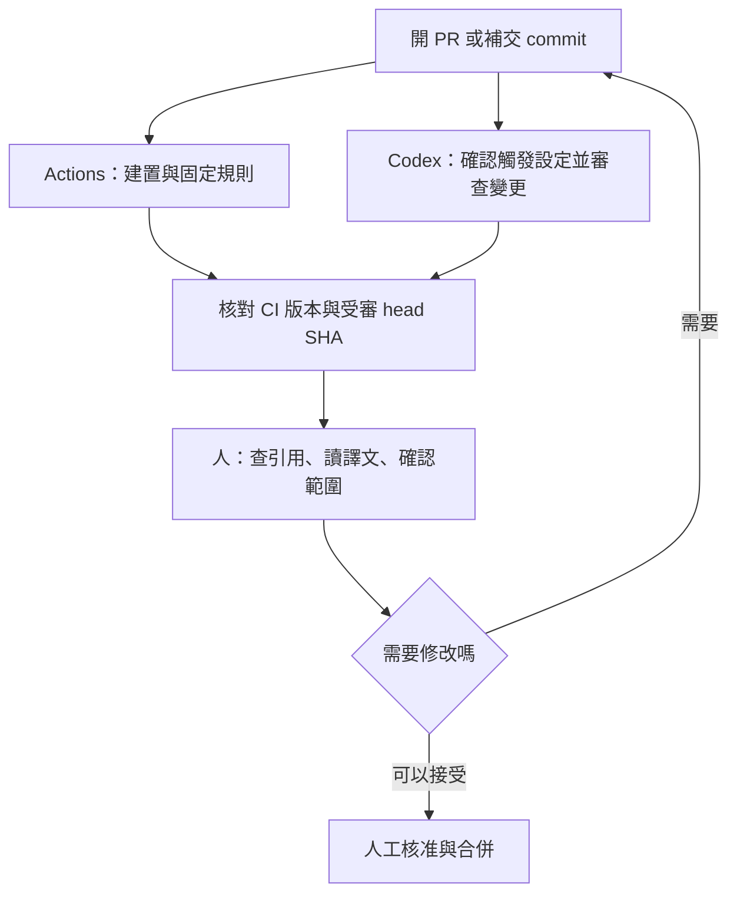

文章改完、PR 開好了，Actions 顯示綠燈，AI 也沒提出問題，可以合併了嗎？先看一下：AI 審的是哪一個 commit？CI 有檢查外部引用嗎？後來補上的翻譯修正，有沒有再被看過？

這篇用本站的 Jekyll 文章 PR，說明怎麼把 GitHub Actions 和 AI Agent 接成一個可追查的審查流程。讀者只要知道 PR 是用來送審的變更、commit 是一次版本紀錄，就能跟上；需要自訂 workflow 的部分另放在後面。

我想解決的問題很具體：**每次送審，都能知道檢查了什麼、檢查到哪個版本，以及還有哪些事要由人決定。**

> **查證範圍**：本文於 2026-11-07 查閱本站原始碼與公開 PR。站台設定以 commit [`15a6041`](https://github.com/justmaocom/justmaocom.github.io/tree/15a6041c0974248f91f3dd678a35ace5d1bec995) 為準，案例是已合併的 [PR #29](https://github.com/justmaocom/justmaocom.github.io/pull/29)。後面的 Codex Action 是擴充方案，本文沒有替本站安裝或啟用它，也沒有宣稱完成過該方案的端到端測試。
{: .prompt-info }

## 本站已經有兩條自動檢查路徑

先看現有設定，才能決定要補什麼。本站的 [Build and Deploy workflow](https://github.com/justmaocom/justmaocom.github.io/blob/15a6041c0974248f91f3dd678a35ace5d1bec995/.github/workflows/pages-deploy.yml) 有 `build`、`lib`、`deploy` 三個 job。

| 工作 | 現在會做什麼 | 能證明的範圍 |
| --- | --- | --- |
| `build` | 用 Ruby 3.4 建置 production 網站，檢查多語系網址，再跑 html-proofer | 網站能產生、受檢查的網址格式與站內連結符合規則 |
| `lib` | 執行 `npm ci` 與 `npm run sync-lib`，比對 `assets/lib` | 提交的前端資源和鎖定的 npm 套件一致 |
| `deploy` | 等前兩個 job 成功，再部署 GitHub Pages | 發布通過這些檢查的建置成品 |

PR 事件會跑前兩個 job；`deploy` 的條件是 `github.event_name != 'pull_request'`，因此 PR 的檢查不會直接發布網站。workflow 另外接受 `main`／`master` 的 push 和手動觸發，所以也不能把它描述成「只有合併 PR 才可能部署」。

這些檢查各有明確邊界。例如 html-proofer 帶了 `--disable-external`，**外部引用是否有效，不在這個檢查範圍內**。`check-i18n.rb` 會檢查各語系的 `og:url`、搜尋資料、feed、sitemap 等網址，但不會判斷英文是否自然、簡體中文是否還留著台灣用語。

另一條路徑在 PR 討論裡。[PR #29 的 Codex 摘要](https://github.com/justmaocom/justmaocom.github.io/pull/29#issuecomment-6655342679) 顯示，開 PR 時已有 Codex Code Review。這是 Codex 的 GitHub 整合；在上述 workflow 裡找不到 `openai/codex-action`，不能因此說本站沒有 AI 審查，也不能說這次審查是 Actions 啟動的。

## PR #29：完成審查之後，內容還會繼續變

這個 PR 新增 [pstack 系列導讀](/posts/pstack-series-guide/)，同時修改四篇文章的導覽連結，涵蓋正體中文、英文與簡體中文。它的公開版本紀錄可以整理成這樣：

| 版本或紀錄 | 可觀察到的事實 |
| --- | --- |
| [`6857f1f`](https://github.com/justmaocom/justmaocom.github.io/commit/6857f1fc9eae761b018d8c48ad6b77c017d991ab) | 新增三語導讀與系列導覽連結；Codex 摘要記載的受審 commit 是這一版，狀態為完成、沒有 findings |
| [`3e0be05`](https://github.com/justmaocom/justmaocom.github.io/commit/3e0be05e3136aeb8d4d6b80bee4aaf1bc02b1657) | 後續修改三語文章的文字 |
| [`ff4455b`](https://github.com/justmaocom/justmaocom.github.io/commit/ff4455b570ad97936f0cce3083fdf8c4ccfecee3) | 把指向 GitHub 目錄的 `blob` 連結改成 `tree`，並調整簡體中文的「关光」為「关掉」；這是 PR 合併前的 head |

這裡能得出的結論是：**摘要裡的那次 Codex 審查，對應初版 `6857f1f`，不能直接拿來證明後來的 `ff4455b` 也受過同一次審查。** 公開摘要沒有列出的檢查，我不推測它曾經做過，也不據此斷言完全沒有人審過。

這個例子也說明了分工的價值。GitHub 外部連結的路徑問題，需要查原始資料或另做外部連結檢查；「关光」這種用語，則要靠語言審稿。建置成功和 AI 沒提出問題，都無法單獨涵蓋這兩件事。這也不表示 Codex 漏報了最後那個修正，因為我們手上的摘要對應的是更早的版本。

## 先讓 CI、Agent 和人各自負責一件事

我會先沿用本站已有的 Actions 與 Codex 整合，讓它們在同一個 PR 裡提供不同證據：



**固定規則交給 Actions。** front matter 能不能解析、網站能不能建、多語系網址有沒有跑錯位置，都有可以重複執行的檢查。對本站，在本機可先跑：

```bash
bash tools/test.sh
```

它會重建 production 網站，再做多語系網址與站內連結檢查；它沒有包含 `lib` job 的 npm 資源同步比對。這次只新增文章時，仍會由 PR 上的完整 workflow 執行 `lib`。

**需要推理的疑點交給 Agent。** 例如文章說某個 action 預設能執行所有使用者的 PR，但引用的版本其實限制觸發者權限；或者三語文章對同一個選項的說明互相矛盾。要求它指出具體檔案、段落、依據與影響，會比「幫我全面審查」更容易驗證。

**引用、語氣與發布決定由人負責。** 尤其是「我實測過」「本站目前已啟用」這類句子，要有實際執行紀錄或設定支持。AI 產生的建議，也要回到來源核對。沒有 findings 只表示這次審查沒有提出問題；它不是編輯校對、事實查核或核准合併的替代品。

## 先用現有 Codex 整合，不必急著多裝一個 bot

[Codex 官方文件](https://developers.openai.com/codex/cloud/code-review) 說明了兩種入口：在 Codex 設定中開啟 repository 的自動審查，或在 PR 留言要求：

```text
@codex review
```

這行是給讀者參考的操作指令，不代表本文已替案例 PR 送出新留言。自動觸發的事件與個人偏好要回設定頁確認；不能從一次「PR opened」的紀錄推定每次 push 都會重審。

對文章型 repository，可以提供這樣的審查要求；若要長期沿用，再整理進版本控制中的 `AGENTS.md`。本站目前把 `AGENTS.md` 列在 `.gitignore`，要讓團隊共用規則，必須另外處理追蹤方式。

```text
只審查本次 PR 引入的問題，並列出受審的 head SHA。
核對文章對工具行為的描述，是否符合文內釘選的來源版本。
比較正體中文、英文、簡體中文的指令、數字、限制條件是否一致。
指出沒有紀錄支持的「已實測」「已啟用」等主張。
每個問題附檔案、段落、依據、影響與建議修法。
無法取得來源或只看過部分變更時，明說限制，不宣稱全數通過。
```

這是希望審查關注的方向，不保證整合會逐項回覆。查閱時的官方文件說明，GitHub Code Review 聚焦 P0、P1 等高優先級問題；想拿它做逐段編輯校對，或一定要拿到固定欄位的完整報告，就需要另外設計流程。

## 何時才需要自訂 Codex Action

如果你需要固定報告格式、讓文章和程式碼走不同的審查提示，或把結果接到既有的審核工具，就可以考慮 [`openai/codex-action`](https://github.com/openai/codex-action/tree/bdf19a4a223ec2549a3e2274a0cf61556bc07675)。它在 runner 上安裝 Codex CLI，透過 API 執行任務，需要自行設定 API key 與用量；這和本站 PR 裡的 Codex GitHub 整合是不同的接法。

下面只示範**審查 job 裡的 Codex step**，不是可直接貼上就運作的完整 workflow。前置步驟必須準備受信任的審查規則、完整的 PR diff 與所需上下文，記下 base／head SHA，並先檢查變更是否被截斷。不要先執行 PR 提供的安裝腳本，再把 API key 帶進同一個環境。


```yaml
- name: Review the prepared PR diff
  id: review
  uses: openai/codex-action@bdf19a4a223ec2549a3e2274a0cf61556bc07675 # v1.13
  with:
    openai-api-key: ${{ secrets.OPENAI_API_KEY }}
    permission-profile: ":read-only"
    safety-strategy: drop-sudo
    prompt-file: review-input/prompt.md
```


這個範例釘選的 [README](https://github.com/openai/codex-action/blob/bdf19a4a223ec2549a3e2274a0cf61556bc07675/README.md) 說明，permission profiles 需要 Codex CLI `0.138.0` 以上，查閱時仍是 beta。`:read-only` 限制命令的檔案與網路存取；`drop-sudo` 處理程序的權限，兩者分工不同。不要把 `permission-profile` 和舊的 `sandbox` input 一起填，也不要把 `safety-strategy: read-only` 當成這兩項設定的同義寫法。

Action 的 SHA 只固定 action 本身，沒有自動固定它安裝的 Codex CLI 或所用模型。正式導入時，還要選定測過的 `codex-version`、模型與報告格式，記錄這些版本，並檢查 runner 是否支援需要的隔離機制。本文不替未跑過的組合填入一組看似保證可用的版本號。

依[官方安全建議](https://github.com/openai/codex-action/blob/bdf19a4a223ec2549a3e2274a0cf61556bc07675/docs/security.md)，把 Codex 放在 job 最後一步；需要留言時，先把 `steps.review.outputs.final-message` 映射成該 job 的 output，再由另一個新 job 透過 `needs` 讀取，只給發文所需的權限。報告是資料，不要插入 shell 或 JavaScript 原始碼裡執行。先採建議模式，讓人讀完再決定要不要修，不把「action 執行成功」當成「內容獲得核准」。

### 觸發與權限也屬於設計的一部分

[GitHub 的事件文件](https://docs.github.com/en/actions/reference/workflows-and-actions/events-that-trigger-workflows#pull_request) 說明，`pull_request` 預設處理 `opened`、`synchronize`、`reopened`。自訂審查若還要涵蓋草稿轉正式，可明列 `ready_for_review`；要跳過草稿，則另加 draft 條件。

`synchronize` 能涵蓋補交 commit，但不代表 Codex Action 一定可執行：它預設限制有 repository 寫入權限的觸發者，fork PR 也通常拿不到 Actions secrets，唯讀的 `GITHUB_TOKEN` 亦不能直接發審查留言。第一版可以先限同一 repository、可信任協作者的 PR；有外部投稿需求時，再把信任、隔離與回報方式設計完整。

不要為了取得 secret，直接改成 `pull_request_target` 後 checkout 並執行外部 PR 程式。PR 的文字、diff 和新增的 `AGENTS.md` 都可能帶入不可信任指令；提示詞提醒有幫助，真正的權限仍要由 runner、token 與隔離設定約束。Action 也不要用 `allow-users: "*"` 來圖方便開放 API 用量。這些限制在 [GitHub 安全指南](https://docs.github.com/en/actions/security-for-github-actions/security-guides/security-hardening-for-github-actions)與上述 Codex Action 安全文件都有說明。

## 補交 commit 後，怎麼確認真的審到新版

以 PR #29 為例，我希望合併前能看到的不是一句「審完了」，而是下面這份紀錄。這是建議的紀錄格式，不是案例中已存在的執行結果：

```text
PR：#29
目前 head：ff4455b
CI：連到檢查此版本的 workflow run，列出 build／lib 結果
AI：列出受審 head、報告連結、未涵蓋範圍
人工：核對 GitHub 目錄連結，讀過三語修正段落
待處理：列出尚未解決的問題；沒有則明寫無
```

檢查順序也可以很簡單：

1. **先處理 CI 失敗。** 網站建不起來、翻譯網址錯了，就先修這些可重現的問題。
2. **看每一項 AI 建議的證據。** 接受就修改，不接受就留下理由；報告缺上下文時補資料，不硬把它算成通過。
3. **有新 commit，就重新核對版本。** 確認 CI 檢查的是最新變更；若 `pull_request` run 用的是合成的 merge commit，同時記下對應 PR head。AI 的受審 head 也要對得上，必要時重審。
4. **最後才人工核准與合併。** GitHub 的 required checks 與 approval 要在 ruleset／branch protection 裡設定；workflow YAML 的存在不代表它們已是合併門檻。

自訂回報程式還要在發出結果前，重新讀一次 PR 的 head。若它已改變，就把舊報告標示為過期，安排最新版本的審查。`concurrency` 可以取消尚未完成的舊 run、減少用量，卻不能撤回早已發出的舊報告，也無法取代這個版本核對。

## 導入時，先驗這幾種情況

審查 bot 上線前，可以用小型測試 PR 確認流程，而不是先追求它能找出多少問題：

| 情況 | 預期結果 |
| --- | --- |
| 新增一篇正常文章 | CI 通過；AI 報告可追到受審版本，結果由人判讀 |
| 故意放一個壞掉的站內連結 | CI 失敗，即使 AI 沒發現也不能算通過 |
| AI 審完後再推一個 commit | 新版重新檢查，舊報告有明確版本標示 |
| diff 太大、來源讀不到、API 逾時 | 顯示未完成或部分審查，不把缺少結果解讀成沒問題 |
| fork PR 沒有 secret，或觸發者無權限 | 明確跳過或等待維護者處理，不為了執行而放寬所有人的權限 |

這是一份建議驗收清單，本文沒有宣稱已替自訂 Action 跑完它。導入後再看實際紀錄：哪些建議被採用、哪些只是噪音、每次審查花多久與多少用量。資料不足時，不先寫「省下多少時間」或「提升多少準確率」。

本站的案例給我的提醒是：先把現有證據串好，往往就能改善審查。Actions 負責可重現的檢查，Agent 提出有依據的疑點，人核對引用、文字與發布範圍；三者都對應到同一份變更，下一次打開 PR 時才知道自己正在批准什麼。

## 參考資料與延伸閱讀

- [本站 workflow：`15a6041` 版本](https://github.com/justmaocom/justmaocom.github.io/blob/15a6041c0974248f91f3dd678a35ace5d1bec995/.github/workflows/pages-deploy.yml)與 [PR #29](https://github.com/justmaocom/justmaocom.github.io/pull/29)：現況與案例的依據。
- [Codex Code Review 官方文件](https://developers.openai.com/codex/cloud/code-review)：GitHub 整合、自動審查、審查規則與手動觸發。
- [Codex Action 固定版本 README](https://github.com/openai/codex-action/blob/bdf19a4a223ec2549a3e2274a0cf61556bc07675/README.md)與[安全文件](https://github.com/openai/codex-action/blob/bdf19a4a223ec2549a3e2274a0cf61556bc07675/docs/security.md)：input、輸出、權限與 job 分工。
- [GitHub：workflow 觸發事件](https://docs.github.com/en/actions/reference/workflows-and-actions/events-that-trigger-workflows#pull_request)、[安全指南](https://docs.github.com/en/actions/security-for-github-actions/security-guides/security-hardening-for-github-actions)、[受保護分支](https://docs.github.com/en/repositories/configuring-branches-and-merges-in-your-repository/managing-protected-branches/about-protected-branches)：事件、token 與合併門檻。
- [寫完程式之後，先證明它能用再合併](/posts/pstack-build-verify-merge/)：把驗證和送審排進 Agent 的工作流程。
- [裝了第三方 skill 和 MCP 之後，你的 Coding Agent 多了哪些破口？](/posts/coding-agent-supply-chain-permission-risks/)：為什麼讀檔、執行命令與持有憑證要分開考慮。
