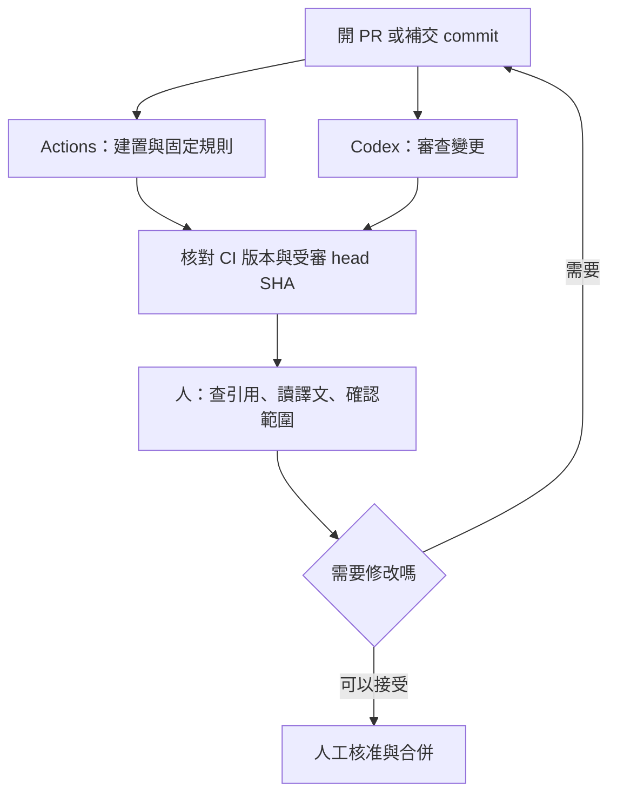

文章改完、送出審查了，GitHub 上的自動檢查亮起綠燈，AI 也沒提出問題，可以合併了嗎？先別急，還有三件事要確認：AI 看的是哪一版？自動檢查有沒有確認外部連結仍然有效？審查之後才補上的翻譯修正，有沒有人再看過？

這篇用本站一次真實的文章送審，說明怎麼讓 GitHub Actions 和 AI Agent 組成一個查得到來龍去脈的審查流程。開始前，先認識三個最常出現的詞：

- **PR（Pull Request）**：把一批修改送出、請人審核後再併入正式版本的申請。
- **commit**：一次存檔的版本紀錄。PR 送出後再補的修改，也會成為新的 commit。
- **AI Agent**：能自己讀檔案、比對內容並提出意見的 AI 助手。本站公開 PR 上看到的審查，來自 OpenAI 的 Codex。

其他術語會在第一次出現時說明。我想解決的問題很具體：**每次送審，都能說清楚檢查了什麼、檢查的是哪一版，以及還有哪些事必須由人決定。**

> **查證範圍**：本文於 2026-11-07 查閱本站原始碼與公開 PR。站台設定以 commit [`15a6041`](https://github.com/justmaocom/justmaocom.github.io/tree/15a6041c0974248f91f3dd678a35ace5d1bec995) 為準，案例是已合併的 [PR #29](https://github.com/justmaocom/justmaocom.github.io/pull/29)。文末的自訂 Codex Action 只是擴充範例：本文沒有替本站安裝或啟用它，文中設定也不代表已驗證、可直接使用。
{: .prompt-info }

## 什麼時候需要這套流程

只要遇到下面任一種情況，就值得把「誰檢查了什麼、檢查的是哪一版」記清楚：

- 審查結束後還會補交修改，例如改字、修翻譯、換連結。
- 同一篇內容有多個語言版本，或文中描述了外部工具的行為。
- 已經有自動檢查和 AI 審查，卻說不出它們各自涵蓋到哪裡。

本文的案例 PR #29，就同時遇到前兩種情況。

## 本站現有的兩種自動檢查

### Actions：依固定規則檢查

**GitHub Actions** 是 GitHub 內建的自動化服務。儲存庫（repository，存放網站原始檔與修改紀錄的地方）發生你指定的事件時，它就照設定執行工作。一份自動化設定叫做 **workflow**，裡面可以再分成幾個 **job**，也就是各自執行的工作段落。其中「每次修改都自動重跑同一套檢查」叫做 **CI**（Continuous Integration，持續整合）。同一個 workflow 也可以負責部署，那一步就不是檢查。

本站的 [Build and Deploy workflow](https://github.com/justmaocom/justmaocom.github.io/blob/15a6041c0974248f91f3dd678a35ace5d1bec995/.github/workflows/pages-deploy.yml) 有三個 job：

| job | 做什麼 | 成功代表什麼 |
| --- | --- | --- |
| `build` | 用 Ruby 3.4 建置正式版（production）網站，檢查各語系網址，再用 html-proofer 檢查網頁連結 | 網站能順利產生；受檢查的網址格式與站內連結符合規則 |
| `lib` | 執行 `npm ci` 與 `npm run sync-lib`，比對 `assets/lib` | 提交的前端資源和鎖定版本的 npm 套件一致 |
| `deploy` | 前兩個 job 都成功後，部署到 GitHub Pages（GitHub 的網站代管服務） | 發布出去的是通過這些檢查的建置成品 |

PR 觸發時只會跑前兩個 job；`deploy` 的執行條件是 `github.event_name != 'pull_request'`，所以 PR 的檢查不會直接發布網站。不過，這個 workflow 也會在有人推送到 `main`／`master` 分支，或手動觸發時執行，因此不能說「只有合併 PR 才可能部署」。push 有 `paths-ignore`，但只排除 `.gitignore`、`README.md` 與 `LICENSE`；`pull_request` 沒有路徑過濾，只新增文章的 PR 仍會跑 `build` 和 `lib`。

固定規則有明確的邊界，通過不代表內容沒有問題：

- html-proofer 帶了 `--disable-external` 參數，**外部連結是否有效，不在檢查範圍內**。
- `check-i18n.rb` 會檢查各語系的 `og:url`、搜尋資料、feed、sitemap 等網址，但不會判斷英文是否自然，也不會發現簡體中文是否還留著台灣用語。

### Codex：在 PR 裡做 AI 審查

另一種檢查出現在 PR 的討論區。[PR #29 的 Codex 摘要](https://github.com/justmaocom/justmaocom.github.io/pull/29#issuecomment-6655342679) 顯示，開 PR 時已經有一次完成的 Codex Code Review，那一列的觸發欄寫的是 PR opened。這則留言來自 Codex 的 GitHub 整合（帳號 `chatgpt-codex-connector`），不寫在上面那份 workflow 裡。所以，workflow 中找不到 `openai/codex-action`，不代表本站沒有 AI 審查；也不能說這次審查是由 Actions 啟動的。

AI 審查的長處是能讀懂文字、比對前後說法，找出需要推理才看得出的疑點；但它提出的意見，仍要由人回到來源核對。

## 案例：PR #29 審完之後，內容又改了

這個 PR 新增三語版本的 [pstack 系列導讀](/posts/pstack-series-guide/)，同時修改四篇文章的導覽連結，涵蓋正體中文、英文與簡體中文。

要判斷「審的是哪一版」，得先認得版本編號。每個 commit 都有一組由英文字母和數字組成的唯一編號，稱為 **SHA**，本文只列出前七碼；PR 當下最新的那個 commit，則稱為 **head**。這個案例只需要看兩個版本：

- [`6857f1f`](https://github.com/justmaocom/justmaocom.github.io/commit/6857f1fc9eae761b018d8c48ad6b77c017d991ab)：初版。Codex 摘要記載的受審 commit 就是這一版，狀態為完成，沒有 findings（審查提出的問題）。
- [`ff4455b`](https://github.com/justmaocom/justmaocom.github.io/commit/ff4455b570ad97936f0cce3083fdf8c4ccfecee3)：合併前的 head。初版之後，先有一個 commit 修改三語文字；最後這個 commit 再把指向 GitHub 目錄的連結從 `blob` 改成 `tree`，並把簡體中文的「关光」改成「关掉」。

由此只能得出有限的結論：**摘要裡那次 Codex 審查對應的是初版 `6857f1f`，不能拿來證明最後的 `ff4455b` 也經過同一次審查。** 公開摘要沒有列出的檢查，我不推測它做過，也不據此斷言後來的修改完全沒人看過。

最後這兩項修正，正好說明為什麼需要分工：GitHub 連結的路徑對不對，要查原始資料或另外做外部連結檢查；「关光」這類用詞，要靠語言審稿。網站建置成功、AI 沒提出問題，都無法單獨涵蓋這兩件事。這也不表示 Codex 漏看了最後的修正，因為我們手上的摘要，本來就只對應更早的版本。

## 分工：固定規則、AI 推理、人工核准

我會先沿用本站既有的 Actions 與 Codex 整合，讓三方在同一個 PR 裡各自提供證據：



**固定規則交給 Actions。** front matter（文章開頭記錄標題、日期等資訊的設定區）能不能解析、網站建不建得起來、各語系網址有沒有放錯位置，這些都有明確的對錯，也能重複檢查。想先在自己的電腦上檢查，可以在本站儲存庫執行：

```bash
bash tools/test.sh
```

它會重建正式版網站，再檢查各語系網址與站內連結，但不包含 `lib` job 的 npm 資源比對。CI 失敗時，就算 AI 沒提出問題，也不能算通過。

**需要推理的疑點交給 AI Agent。** 例如文章說某個 action 預設會替所有使用者的 PR 執行，但引用的版本其實限制了觸發者的權限；或三種語言對同一個選項的說明互相矛盾。要求 Agent 指出具體的檔案、段落、依據與影響，會比一句「幫我全面審查」更容易驗證。

**引用、語氣與發布決定由人負責。** 尤其是「我實測過」「本站目前已啟用」這類句子，要有實際執行紀錄或設定支持。AI 提出的建議，也要回到來源核對。沒有 findings 只表示這次審查沒有提出問題，不能取代編輯校對、事實查核或合併核准。

{: w="800" h="450" }
_三件事分開做：固定規則、需要推理的疑點，以及能不能合併。_

## 實作步驟

### 步驟一：用現有的 Codex 整合觸發審查

不必急著多裝一個 bot（自動執行任務的機器人帳號）。[Codex 官方文件](https://developers.openai.com/codex/cloud/code-review) 說明了兩種啟動方式：在 Codex 設定中為儲存庫開啟自動審查，或在 PR 留言：

```text
@codex review
```

這行是給讀者參考的操作指令，本文沒有替案例 PR 送出新留言。一次性的重點可以接在後面，例如官方文件的 `@codex review for issues in the database migration`。下一節的審查要求也可以這樣交；要每次都沿用，做法見下一節。

PR #29 那則摘要的觸發欄是 PR opened。同一則公開留言列出的觸發方式是：開啟 PR、把草稿標成可審查，或留言 `@codex review`。它沒有把補交 commit 列進去。設定頁還可以另外選擇 Review trigger，所以這一次紀錄不能當成以後每次補交都會重審。

### 步驟二：附上審查要求（可複製）

以文章為主的儲存庫，可以給 Agent 下面這份審查要求：

```text
只審查本次 PR 引入的問題，並列出受審的 head SHA。
核對文章對工具行為的描述，是否符合文內固定的來源版本。
比較正體中文、英文、簡體中文的指令、數字、限制條件是否一致。
指出沒有紀錄支持的「已實測」「已啟用」等主張。
每個問題附檔案、段落、依據、影響與建議修法。
無法取得來源或只看過部分變更時，明說限制，不宣稱全數通過。
```

使用前先了解兩點：

- 這份要求表達的是希望審查關注的方向。查閱時的官方文件寫明，GitHub 上的 Code Review 只標出 P0、P1 這類高優先級問題（最嚴重、最該先處理的問題），不保證逐項回覆。若要逐段校對文字，或一定要拿到固定欄位的完整報告，需要另外設計流程。
- 長期沿用時，官方文件是把規則寫進儲存庫裡的 `AGENTS.md`（寫給 Agent 讀的專案規則檔），並用 `## Code Review Rules` 當標題。Codex 在 GitHub 上讀的是儲存庫裡的檔案。本站目前把 `AGENTS.md` 列在 `.gitignore`（不納入版本控制的檔案清單），未提交的檔案不會出現在公開 PR 裡。要讓團隊和 GitHub 上的審查共用這份規則，必須另外決定怎麼追蹤這個檔案。這份檔案的寫法見 [AGENTS.md 怎麼寫：讓 Coding Agent 讀懂你的專案規則](/posts/agents-md-project-rules-for-coding-agents/)。

### 步驟三：補交 commit 後，確認審到的是新版

以 PR #29 為例，我希望合併前看到的不是一句「審完了」。文章改過之後，舊的審查仍屬於舊版，新版要重新核對。

{: w="800" h="450" }
_舊版上的審查便條不能直接拿來證明新版；改過的段落要重新看過。_

下面這份紀錄是建議的格式，不是案例中已存在的紀錄：

```text
PR：#29
目前 head：ff4455b
CI：連到檢查此版本的 workflow run，列出 build／lib 結果
AI：列出受審 head、報告連結、未涵蓋範圍
人工：核對 GitHub 目錄連結，讀過三語修正段落
待處理：列出尚未解決的問題；沒有則明寫無
```

檢查順序可以很簡單：

1. **先處理 CI 失敗。** 網站建不起來、翻譯網址錯了，就先修這些可以重現的問題。
2. **逐項看 AI 建議的依據。** 接受就修改，不接受就留下理由。報告缺上下文時補資料，不要硬把它算成通過；若因變更太大、讀不到來源或逾時而只完成部分審查，也要標示為未完成，不把沒有結果解讀成沒有問題。
3. **有新 commit，就重新核對版本。** 本站這份 workflow 取出程式碼時沒有另外指定版本。依 [GitHub 文件](https://docs.github.com/en/actions/reference/workflows-and-actions/events-that-trigger-workflows#pull_request)，`pull_request` 的 `GITHUB_SHA`（這次執行實際取出的版本編號）是 PR 與目標分支合成的 merge commit（暫時合併後的版本）。預設的 checkout 步驟取出的就是它，不是 PR head 本身。GitHub 仍把檢查結果標在 PR head 上；PR #29 最後一次 `build`／`lib` 的 head 就是 `ff4455b`。要比對時同時記下這個 head。PR 有合併衝突時，這次 `pull_request` workflow 不會跑，要先解衝突。AI 受審的 head 也要對得上，必要時重審。
4. **最後才由人核准與合併。** GitHub 的必要檢查（required checks）與核准（approval），要在 ruleset 或 branch protection（分支保護規則）裡設定；儲存庫裡有 workflow 設定檔，不代表它已經是合併門檻。

## 進階：何時才需要自訂 Codex Action

> 本站沒有安裝或啟用這一節的設定。以下是擴充範例，不是本站現行的流程。
{: .prompt-info }

如果你需要固定的報告格式、讓文章和程式碼使用不同的審查提示，或把結果接到既有的審核工具，可以考慮 [`openai/codex-action`](https://github.com/openai/codex-action/tree/bdf19a4a223ec2549a3e2274a0cf61556bc07675)。它會在 runner（實際執行 Actions 工作的機器）上安裝 Codex CLI（Codex 的命令列工具），透過 API 執行任務；API key（呼叫服務用的金鑰）與用量都要自行設定與管理。這和本站 PR 裡看到的 Codex GitHub 整合，是不同的接法。

下面只示範**審查 job 裡的 Codex 步驟（step）**，不是貼上就能運作的完整 workflow。前面的步驟必須先準備受信任的審查規則、完整的 PR diff（修改前後的差異）與所需上下文，記下 base／head SHA（比較基準與最新版本的編號），並檢查變更有沒有被截斷。**不要先執行 PR 提供的安裝腳本，再把 API key 帶進同一個環境。**


```yaml
- name: Review the prepared PR diff
  id: review
  uses: openai/codex-action@bdf19a4a223ec2549a3e2274a0cf61556bc07675 # v1.13
  with:
    openai-api-key: ${{ secrets.OPENAI_API_KEY }}
    permission-profile: ":read-only"
    safety-strategy: drop-sudo
    prompt-file: review-input/prompt.md
```


簡單來說，`openai-api-key` 從 GitHub 的 secrets（加密保存的機密設定）讀取金鑰，`prompt-file` 指向事先準備好的審查提示詞，另外兩項用來限制 Codex 的權限。

這個範例固定在特定版本的 [README](https://github.com/openai/codex-action/blob/bdf19a4a223ec2549a3e2274a0cf61556bc07675/README.md) 說明，permission profiles 需要 Codex CLI `0.138.0` 以上，查閱時仍是 beta（測試階段）。`:read-only` 限制命令能存取的檔案與網路；`drop-sudo` 處理程序的權限，兩者分工不同。不要同時填 `permission-profile` 和舊的 `sandbox` input，action 會在啟動前拒絕。`safety-strategy: read-only` 會改走舊的唯讀 sandbox，因此也不能和 permission profile 一起用；它不是 `:read-only` 的另一種寫法。

`uses` 那一行最後的長編號就是 SHA，用來固定 action 的版本。但它只固定 action 本身，不會自動固定它安裝的 Codex CLI 或使用的模型。正式導入時，還要選定測過的 `codex-version`、模型與報告格式，記錄這些版本，並確認 runner 支援所需的隔離機制。本文不替沒跑過的組合填入一組看似保證可用的版本號。

依照[官方安全建議](https://github.com/openai/codex-action/blob/bdf19a4a223ec2549a3e2274a0cf61556bc07675/docs/security.md)：

- 把 Codex 放在 job 的最後一步。
- 需要在 PR 留言時，先把 `steps.review.outputs.final-message` 映射成該 job 的 output，再由另一個新 job 透過 `needs` 讀取，只給它發文所需的權限。
- 報告是資料，不要插進 shell 或 JavaScript 原始碼裡執行。
- 先採建議模式，讓人讀完再決定要不要修；「action 執行成功」不等於「內容獲得核准」。

如果你自訂了回報程式，發出結果前還要重新讀一次 PR 的 head。若 head 已經改變，就把舊報告標示為過期，並安排審查最新版本。`concurrency` 用來限制同一個群組不要同時跑。只寫群組時，新的 run 會等待，並取消還在排隊的舊 run；要連進行中的也停掉，必須另外設 `cancel-in-progress: true`。本站的 Build and Deploy workflow 有這組設定，取消的是同一 ref 上尚未完成的建置或部署。把它用在自訂審查時，也只能停掉還沒跑完的 run，不能撤回已經發出的報告，更不能取代版本核對。

### 觸發條件與權限也要一起設計

[GitHub 的事件文件](https://docs.github.com/en/actions/reference/workflows-and-actions/events-that-trigger-workflows#pull_request) 說明，`pull_request` 預設處理 `opened`（開啟）、`synchronize`（推送新的 commit）、`reopened`（重新開啟）。自訂審查若也要在草稿轉為正式時執行，可以明列 `ready_for_review`；若要跳過草稿，則另加 draft 條件。

`synchronize` 能涵蓋補交的 commit，但不代表 Codex Action 一定能執行：

- 它預設只接受對儲存庫有寫入權限的觸發者。
- 來自 fork（別人複製出去的儲存庫副本）的 PR，通常拿不到 Actions secrets，也就沒有 API key 可跑。

能不能把結果留在 PR 上，是另一件事。`GITHUB_TOKEN` 是 workflow 執行時自動取得的權杖。fork 來的 PR，這個權杖是唯讀；同一個儲存庫的 PR，則看 workflow 或儲存庫怎麼設權限。本站現有 workflow 在頂層把 `contents` 設成 `read`，也沒有給 `pull-requests: write`，所以那份 workflow 不能拿它發審查留言。自訂審查若要留言，得在另一個 job 明確給發文權限。

遇到 fork PR 沒有 secret，或觸發者沒有權限時，應明確跳過或等維護者處理，不要為了讓它跑起來而放寬所有人的權限。第一版可以只處理同一儲存庫內、可信任協作者的 PR；有外部投稿需求時，再把信任、隔離與回報方式設計完整。

**不要為了取得 secret，就改用 `pull_request_target`，再 checkout（取出）並執行外部 PR 的程式。** PR 的文字、diff 和新增的 `AGENTS.md`，都可能夾帶不可信任的指令。提示詞裡的提醒有幫助，但真正的權限仍要靠 runner、token 與隔離設定約束。也不要為了方便，用 `allow-users: "*"` 對所有人開放 API 用量。這些限制在 [GitHub 安全指南](https://docs.github.com/en/actions/security-for-github-actions/security-guides/security-hardening-for-github-actions) 與上述 Codex Action 安全文件中都有說明。

## 成果與下一步

照這套流程，每個 PR 合併前都會留下一份可追查的紀錄：自動檢查跑的是哪一版、AI 審的是哪一版又涵蓋到哪裡、人看過哪些內容、還剩哪些問題。下一次打開 PR，你會知道自己正在核准什麼。

接下來可以這樣做：

1. 到 Codex 設定頁確認自動審查會在哪些事件觸發，並決定補交 commit 後由誰、在什麼時候要求重審。
2. 決定是否把 `AGENTS.md` 納入版本控制，讓團隊能共用上面的審查要求。
3. 如果還沒設定，在 ruleset 或 branch protection 中把必要檢查與人工核准設為合併門檻。
4. 只有在需要固定報告格式、分開文章與程式碼的提示詞，或串接既有工具時，才評估自訂 Codex Action；先限同一儲存庫、可信任協作者的 PR，並從建議模式開始。
5. 導入後回頭看實際紀錄：哪些建議被採用、哪些只是噪音、每次審查花了多少時間與用量。

本站的案例給我的提醒是：先把現有證據串好，往往就能改善審查。Actions 負責可重現的檢查，Agent 提出有依據的疑點，人核對引用、文字與發布範圍；三者都對應到同一份變更，核准才有意義。

## 參考資料與延伸閱讀

- [本站 workflow：`15a6041` 版本](https://github.com/justmaocom/justmaocom.github.io/blob/15a6041c0974248f91f3dd678a35ace5d1bec995/.github/workflows/pages-deploy.yml)與 [PR #29](https://github.com/justmaocom/justmaocom.github.io/pull/29)：現況與案例的依據。
- [Codex Code Review 官方文件](https://developers.openai.com/codex/cloud/code-review)：GitHub 整合、自動審查、審查規則與手動觸發。
- [Codex Action 固定版本 README](https://github.com/openai/codex-action/blob/bdf19a4a223ec2549a3e2274a0cf61556bc07675/README.md)與[安全文件](https://github.com/openai/codex-action/blob/bdf19a4a223ec2549a3e2274a0cf61556bc07675/docs/security.md)：input、輸出、權限與 job 分工。
- [GitHub：workflow 觸發事件](https://docs.github.com/en/actions/reference/workflows-and-actions/events-that-trigger-workflows#pull_request)、[安全指南](https://docs.github.com/en/actions/security-for-github-actions/security-guides/security-hardening-for-github-actions)、[受保護分支](https://docs.github.com/en/repositories/configuring-branches-and-merges-in-your-repository/managing-protected-branches/about-protected-branches)：事件、token 與合併門檻。
- [pstack 系列（3）：寫完程式之後，先證明它能用再合併](/posts/pstack-build-verify-merge/)：把驗證和送審排進 Agent 的工作流程。
- [裝了第三方 skill 和 MCP 之後，你的 Coding Agent 多了哪些破口？](/posts/coding-agent-supply-chain-permission-risks/)：為什麼讀檔、執行命令與持有憑證要分開考慮。
- [Claude Code hooks 教學：自動排版、跑測試與敏感檔提醒](/posts/claude-code-hooks-automate-checks/)：送出 PR 之前，先在 Claude Code 的工作階段裡自動排版、跑測試。
- [AI 寫程式變快了，產品為什麼還是交不出去？我怎麼理解 AI 原生開發流程](/posts/ai-native-sdlc-playbook/)：從需求到上線的六個階段裡，PR 審閱的前後各接著什麼。
