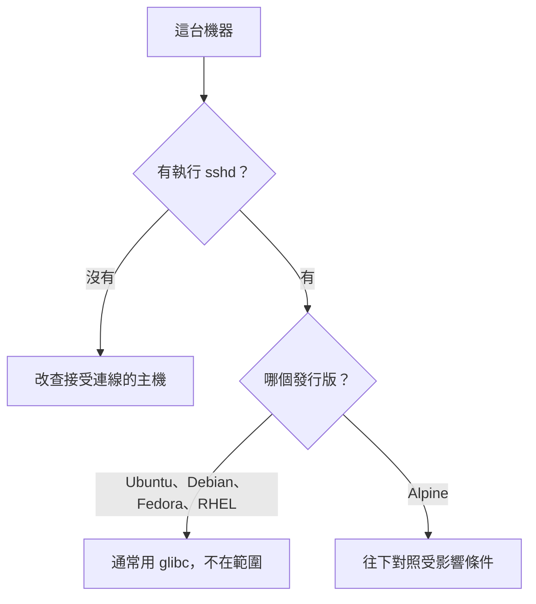
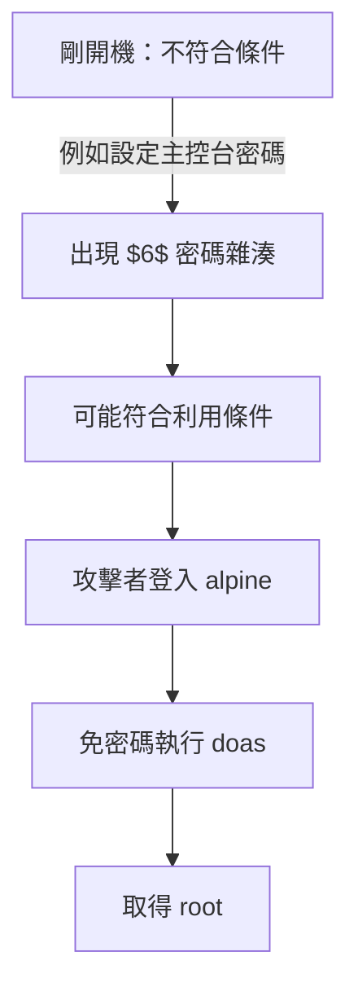
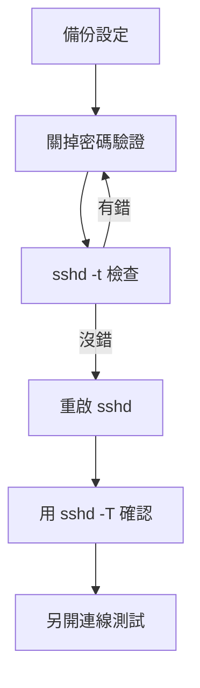
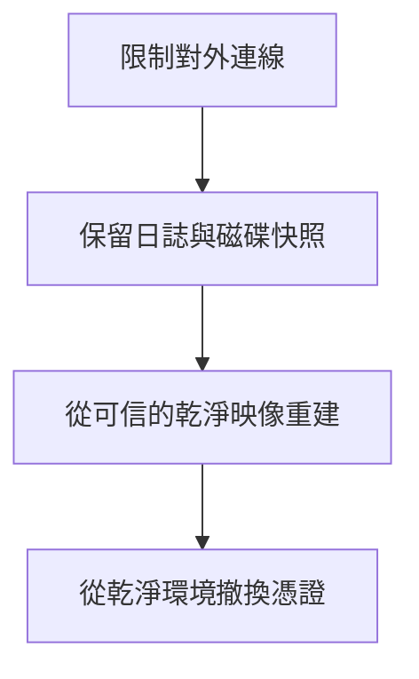

看到「OpenSSH 出現密碼驗證繞過漏洞」，最直接的疑問是：自己的主機有沒有事？這次的 **CVE-2026-123158**，讓攻擊者在特定系統與帳號設定下，不必知道正確密碼就可能登入主機。但受影響的只有伺服器端接受連線的 `sshd`，而且要好幾個條件同時成立。

> 內容依據 OpenSSH 與 Alpine 的官方公告，查證日期是 2026-11-07（台北時間）。漏洞狀態與套件版本若有後續更新，以官方最新資訊為準。
{: .prompt-info }

我會先確認主機用什麼系統、有沒有提供 SSH 遠端登入，再決定要不要往下查：



只用電腦上的 `ssh` 連到別台主機，或容器裡沒有執行 sshd，問題就不在這些用戶端或容器本身。用 Alpine 又開放 SSH 登入的話，不能因為自己平常用金鑰登入就放心，原因在後面的條件裡。

不是管理伺服器的人，可以先把這篇交給維運或資訊人員確認。後面的指令是給主機管理者用的，不需要每位讀者都親自操作。

## 先認識三個名詞

**sshd 是接受遠端登入的程式。** 它在伺服器上等待別人連進來，`ssh` 則是用來連到別台主機的用戶端。這次要修補的是 sshd。

**musl 和 glibc 是系統底層的 C 函式庫。** 它們是程式共用的基礎工具，提供密碼運算等功能。Alpine 使用 musl，多數常見的 Linux 發行版使用 glibc，這次公告針對的是使用 musl 的環境。

**PAM 是處理登入驗證的框架。** sshd 可以把密碼驗證交給 PAM，也可以直接呼叫系統函式處理。這次出問題的是不經過 PAM 的那條驗證流程。

## 11 月 5 日已發布修補，嚴重程度評為 High

OpenSSH 在 2026-11-05 發布 [Portable OpenSSH 10.6p2](https://www.openssh.org/txt/release-10.6p2)，在 sshd 裡加入防護，擋下這次的密碼驗證繞過。OpenSSH 認為根本原因在 sshd 之外，但因為能透過 sshd 觸發，所以先在這裡阻擋。

同一天，[Alpine 發布安全公告](https://alpinelinux.org/posts/2026-11-05-openssh-password-authentication-bypass/)，提供 3.16 到 edge 各分支的修補套件。依 Alpine 的說明，利用條件成立時，攻擊者只要知道帳號名稱就可能登入，不需要猜中密碼。所以我會優先確認兩件事：有沒有修補，以及主機能不能被連入。

嚴重程度有三個來源，說法各不相同：

| 來源 | 嚴重程度 |
| --- | --- |
| OpenSSH 版本說明 | 「critical security workaround」 |
| [CVE 紀錄](https://cveawg.mitre.org/api/cve/CVE-2026-123158)，由 MITRE 提供 | CVSS 3.1 分數 8.1，等級 High |
| [NVD](https://services.nvd.nist.gov/rest/json/cves/2.0?cveId=CVE-2026-123158) | 截至 2026-11-07 仍標示為 Received，尚未提供自己的評分 |

專案的緊急提醒和 CVSS 評分來自不同來源，我會分開看。

Alpine 公告裡寫的「尚未分配 CVE」，是公告撰寫時的狀態。這筆 CVE 紀錄已在 2026-11-05 23:46（台北時間）發布，Alpine 安全資料庫也已列出對應的修補版本。

## 五個條件同時成立，才會受影響

依 Alpine 公告，下面五個條件要同時成立：

1. **主機採用以 musl 為基礎的 Linux，且正在執行的 sshd 尚未修補。** 已安裝發行版的修補套件、並重新啟動 sshd 的主機，不受這個漏洞影響。
2. **sshd 沒有透過 PAM 驗證密碼。** 在 Alpine 上，這包括 `openssh-server`，以及設定為 `UsePAM no` 的 `openssh-server-pam`。後者設為 `UsePAM yes` 則不受影響。
3. **仍允許密碼驗證，也就是 `PasswordAuthentication yes`。** 這是 OpenSSH 的上游預設值，但主機可能另有設定，要以實際套用的內容為準。
4. **有密碼欄為 `*` 的帳號。** 例如部分只用金鑰登入、沒有設定可用密碼的帳號。Alpine 也列出透過 musl-nscd 取得的目錄服務使用者，這類帳號來自集中式帳號系統，本機沒有密碼資料紀錄。
5. **至少有另一個本機帳號，存有 `$5$` 或 `$6$` 開頭的密碼雜湊。** 雜湊是系統用來驗證密碼的運算結果。這個條件表示，別的帳號的密碼設定也會影響風險。

攻擊者還必須能連到 SSH 連接埠，並知道目標帳號名稱。目標帳號也必須能通過其他登入限制。例如，禁止該帳號登入的規則，不會因為密碼比對被繞過就自動失效。

所以我不會只看到一個 `*`，就判定主機一定能被登入。但也不會因為平常沒用密碼登入，就省略這些檢查。

有兩個地方容易混淆：

- **`*` 代表沒有可用的密碼雜湊，不是空白密碼，也不代表帳號完全不能登入。** 這種帳號仍可能用金鑰登入。Alpine 公告另外指出，密碼欄為 `!` 的鎖定帳號不受這個漏洞影響。
- **平常用金鑰登入，不代表伺服器已關閉密碼驗證。** 我會檢查 `PasswordAuthentication` 的實際值，而不是依自己的使用習慣判斷。

### Alpine 雲端映像：剛開機沒事，不代表之後安全

Alpine 公告把官方 tiny-cloud 映像的 3.18.11 到 3.24.3 列為受影響版本。這些映像的 `alpine` 帳號密碼欄是 `*`，而且可以免密碼使用 `doas` 取得 root，也就是系統管理員權限。

公告說這些映像剛開機時不符合利用條件。但**風險會隨帳號設定改變，不能把「剛開機時沒事」當成之後都安全**：



預設的 `PermitRootLogin prohibit-password` 只禁止 root 直接用密碼登入。攻擊者先登入 `alpine`、再用 `doas` 取得 root，這項設定擋不住。

用 cloud-init 設定的映像，Alpine 列為不受影響，因為 cloud-init 會寫入 `PasswordAuthentication no`。但後續修改可能重新開啟密碼驗證，所以我仍會確認目前設定。

## 錯誤回傳的 `*` 被當成密碼相符

我把正常流程簡化成兩步：sshd 用 `crypt()` 函式把輸入的密碼轉成雜湊，再和帳號儲存的值比對。

密碼欄只有 `*` 時，裡面沒有正常雜湊需要的 salt，也就是密碼運算的附加參數。這時 sshd 會借用另一個帳號的參數來計算，所以別的帳號有沒有設定密碼，會影響結果。

依 Alpine 的說明，musl 的 `crypt()` 遇到超過 256 位元組的密碼時，會回傳 `*` 表示錯誤。未修補的 sshd 把這個回傳值拿去和帳號密碼欄比較，而密碼欄剛好也是 `*`，於是誤判為驗證成功。**原本應該拒絕登入的運算錯誤，被當成了密碼相符。**

[OpenSSH 的修補](https://github.com/openssh/openssh-portable/commit/4353fdc43ef646c43a8dda7025cc1a898caf1482)增加了儲存雜湊的長度檢查，讓 `*` 這類過短的值無法通過比對。Alpine 舊分支的套件也帶有對應修補。

{: w="1280" h="720" }
_我用圖中的 `* = *` 表示這次的誤判：運算錯誤的回傳值剛好與帳號儲存值相同，於是被當成密碼正確。_

## 檢查主機：先看系統與套件，再看設定與帳號

以下是給 Alpine 主機管理者的唯讀檢查。讀取 `/etc/shadow`、執行 sshd 檢查，以及後面的更新步驟，都要在有 root 權限的管理 shell 中操作。

### 1. 確認系統與已安裝的套件

```sh
cat /etc/os-release
apk info -v | grep openssh
```

第一行確認是不是 Alpine，以及屬於哪個版本。第二行列出已安裝的 OpenSSH 套件，供後面對照修補版號。不是 Alpine 的話，改用該發行版的套件工具與安全公告。

我不會只看 `ssh -V`。它顯示的是用戶端版本，無法確認伺服器是否已套用發行版的修補。

### 2. 檢查 sshd 會套用的設定

```sh
sshd -T | grep -Ei '^(usepam|passwordauthentication|permitrootlogin) '
```

先看 `passwordauthentication` 是 `yes` 還是 `no`，再搭配 PAM 套件與設定判斷。沒有 PAM 支援的版本可能不會列出 `usepam`，沒有輸出不代表已啟用 PAM。

`sshd -T` 讀取磁碟上的設定檔，再輸出解析結果，**不會詢問正在執行的服務目前用了什麼設定**。所以改完檔案後看到 `no`，仍要讓服務重新載入設定才會生效。

這些指令以預設設定檔為準。服務若使用自訂路徑或啟動參數，檢查時也要保持一致。

設定中有 `Match`，也就是針對特定帳號或來源的例外規則時，要再指定連線情境檢查。例如帳號 `deploy` 從 `203.0.113.10` 連進來：

```sh
sshd -T -C user=deploy,addr=203.0.113.10 | grep -i passwordauthentication
```

把範例帳號與 IP 換成實際值。依 [sshd 說明文件](https://man.openbsd.org/sshd.8)，規則還比對其他條件時，要補上對應的參數：

- 比對來源主機名稱：補上 `host=`。
- 比對伺服器的 IP 或連接埠：補上 `laddr=`、`lport=`。

`Include` 載入的其他設定檔也要一起檢查，只看主設定檔的一行並不夠。

### 3. 只列出相關帳號，不輸出密碼雜湊

```sh
awk -F: '$2=="*"{print "密碼欄為 *:", $1} $2 ~ /^\$[56]\$/{print "有 SHA 密碼雜湊:", $1}' /etc/shadow
```

這行確認是否同時存在兩類帳號，只印出帳號名稱，不印雜湊內容。看到兩類帳號，代表要繼續對照其他條件，不能單憑這份清單判定能否被利用。

這也不是完整的帳號盤點，因為透過 musl-nscd 取得的目錄服務帳號，不在本機 `/etc/shadow` 裡。完整的 `/etc/shadow` 含有敏感資料，我不會把它貼到論壇、聊天群組或 AI 工具裡。

## 更新：依分支版號判斷修補，最後要重啟 sshd

判斷是否已修補，要看 **Alpine 分支對應的套件版號**。Alpine 把修正套用到舊版套件，這叫作 backport，所以不必每台主機都升到 OpenSSH 10.6p2。

依 Alpine 公告，下表是部分分支第一個包含修補的版本。同一分支之後包含該修正的新版也適用：

| Alpine 分支 | 已修補的 openssh 套件版本 |
| --- | --- |
| edge | `10.6_p2-r0` |
| 3.24 | `10.3_p1-r2` |
| 3.23 | `10.2_p1-r1` |
| 3.22 | `10.0_p1-r11` |

3.16 到 3.21 請對照[官方公告的完整表格](https://alpinelinux.org/posts/2026-11-05-openssh-password-authentication-bypass/)。公告也提醒，3.21 已在 2026-11-01 結束支援，更舊的分支同樣不再有例行更新。**這次拿到修補，不代表舊系統恢復長期支援**，我仍會安排移轉到受支援的版本。

動手前，先準備好退路：

- 在另一個視窗確認金鑰登入可用。
- 保留目前的 SSH 連線。
- 確認能透過雲端主控台或其他管理管道救援。

官方建議的 `apk upgrade -U -a` 會更新整個系統的套件，不只 OpenSSH，所以要安排維護時段。接著依序操作，**每一步成功才繼續**：

1. 先更新套件索引，再預覽變動，依序執行：

   ```sh
   apk update
   apk upgrade -a --simulate
   ```

   預覽不會實際升級套件。

2. 確認影響範圍後更新：

   ```sh
   apk upgrade -U -a
   ```

3. 檢查 sshd 設定：

   ```sh
   sshd -t
   ```

   若有錯誤，先修正，不繼續重啟。

4. 重新啟動服務，並確認指令成功：

   ```sh
   rc-service sshd restart
   ```

5. 再查一次套件版號與相關設定，然後開一條新的 SSH 連線測試登入。
6. 新連線正常後，才關閉原本保留的連線。

**裝好修補套件之後，還要成功重啟 sshd。** Alpine 公告特別提醒，更新套件不會替換正在執行的服務。只做更新的話，舊程式可能仍在接受連線。

新連線測試只確認服務可用，不能單靠「還能登入」證明漏洞已修補。

{: w="1280" h="720" }
_我會照圖中的 1 → 2 → 3 操作：保留既有連線，更新並重啟 sshd，再測試新連線；確認成功後才關閉舊連線。_

換映像、在容器裡跑 sshd，或自行編譯時：

- **新映像**：Alpine 3.21.10、3.22.8、3.23.8、3.24.4 映像已包含修補套件，但換成新映像不會自動修好既有主機。
- **容器裡執行 sshd**：更新建置使用的套件，重建映像，再重新部署執行中的容器。
- **自行編譯 OpenSSH**：升級到 10.6p2 或之後包含修補的版本，並確認服務已改用新程式。

## 暫時不能更新：先關掉密碼驗證

Alpine 提供的暫時處理方式，是設定 `PasswordAuthentication no`，關掉這次漏洞利用的密碼驗證途徑。這只是暫時擋住利用途徑，之後仍要安排正式更新。

**先確認金鑰登入可用，再改設定**，避免把自己鎖在主機外。

修改要涵蓋每個會載入設定的地方，因為：

- `Match` 區塊可能另設 `PasswordAuthentication yes`。
- Alpine 預設從 3.19 起才讀取 `/etc/ssh/sshd_config.d/` 這個額外設定資料夾，更舊的版本不會自動讀取。
- 自訂設定也可能和預設不同。

先備份設定，再對照[官方公告的「If you cannot update」段落](https://alpinelinux.org/posts/2026-11-05-openssh-password-authentication-bypass/)修改，涵蓋主設定檔、其他載入的檔案與相關的 `Match` 規則。完整流程如下：



檢查設定有沒有錯誤：

```sh
sshd -t
```

重啟後，用前面的 `sshd -T` 與 `-C`，確認相關情境都是 `passwordauthentication no`。

如果長期目標是「只准金鑰登入」，還要檢查其他驗證方式。例如 [keyboard-interactive 驗證](https://man.openbsd.org/sshd_config#KbdInteractiveAuthentication)可能經由 PAM，要求輸入密碼或一次性驗證碼。

所以只設 `PasswordAuthentication no`，不代表所有互動式密碼提示都已停用。原本有多因素驗證的話，也要先確認需求再調整。

## 懷疑已被登入：查紀錄，無法排除就重建

截至 2026-11-07，我查到的 OpenSSH 與 Alpine 公告沒有提到已知的實際攻擊事件。CVE 紀錄中，CISA 把利用狀態標為 `poc`，表示已有概念驗證。這不等於已證實有實際攻擊，也不能用來保證沒有人利用過。

主機曾暴露在網路上、又符合受影響條件時，我會依 Alpine 建議檢查：

- `/var/log/messages` 中的 `Accepted password for` 紀錄，尤其是本來沒有可用密碼、應該只用金鑰的帳號。日誌另有集中儲存的話，也要一起看。
- `doas` 的使用紀錄，確認有沒有不明的管理員權限操作。
- 最近新增的帳號、檔案，以及 `authorized_keys` 裡不認得的登入金鑰。

「沒查到紀錄」不能證明主機安全，因為日誌可能沒保存、已輪替或被竄改。Alpine 建議，無法排除曾被登入時，就把主機視為已遭入侵。我的處理順序是：



要撤銷並更換的，是可能外洩的憑證，例如主機持有的私鑰、密碼與 API token。**修補漏洞只能阻止後續利用，無法清除已留下的入侵痕跡。**

## 分開確認「我怎麼登入」與「伺服器允許怎麼登入」

這次最值得留下的習慣，是把「我平常怎麼登入」和「伺服器允許怎麼登入」分開確認。需要金鑰登入的主機，我會明確檢查驗證設定。

判斷是否修補時，我會一起看發行版公告、套件版號，以及服務是否已重新啟動。三件事一起確認，才不容易出現套件已更新、舊服務卻還在對外接受連線的落差。

只看版號也會判錯修補狀態，這點我在[從一張 HEIF 圖片看 SSO 如何把論壇事故帶進 Codex](/posts/openai-libheif-sso-attack-chain/)也遇過。那次是發行版回補了安全修正，上游版本號卻沒有變。

## 主要來源

- [OpenSSH 10.6p2 release notes](https://www.openssh.org/txt/release-10.6p2)
- [OpenSSH 密碼驗證繞過修補](https://github.com/openssh/openssh-portable/commit/4353fdc43ef646c43a8dda7025cc1a898caf1482)
- [Alpine Linux 安全公告與完整修補版本表](https://alpinelinux.org/posts/2026-11-05-openssh-password-authentication-bypass/)
- [Alpine secdb（v3.24 main）](https://secdb.alpinelinux.org/v3.24/main.json)與 [v3.22 main](https://secdb.alpinelinux.org/v3.22/main.json)：CVE 與修補版本的對應
- [CVE-2026-123158 紀錄（CVE Services API）](https://cveawg.mitre.org/api/cve/CVE-2026-123158)
- [NVD 上的 CVE-2026-123158（API）](https://services.nvd.nist.gov/rest/json/cves/2.0?cveId=CVE-2026-123158)
- [sshd 檢查參數說明](https://man.openbsd.org/sshd.8)與 [sshd_config 驗證設定說明](https://man.openbsd.org/sshd_config)
