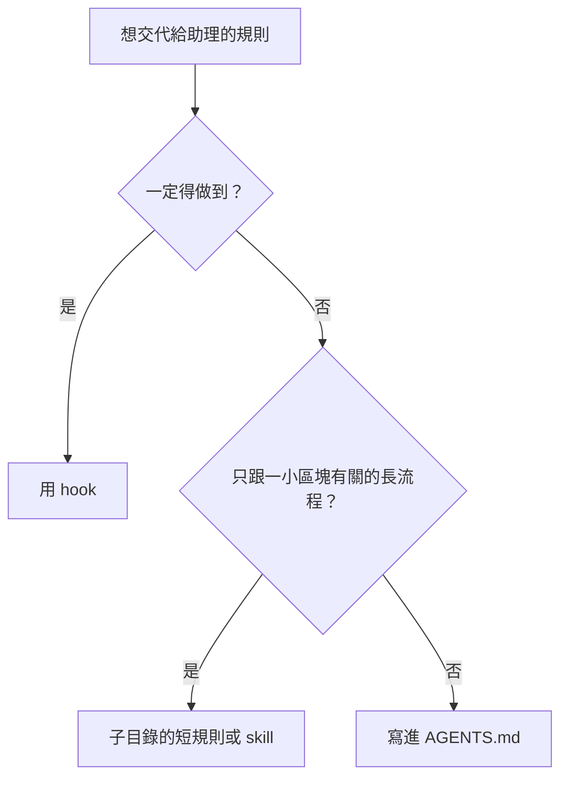
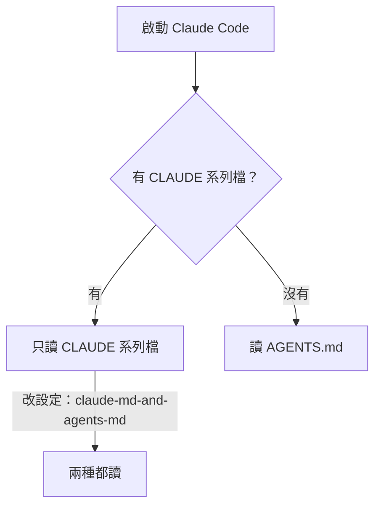
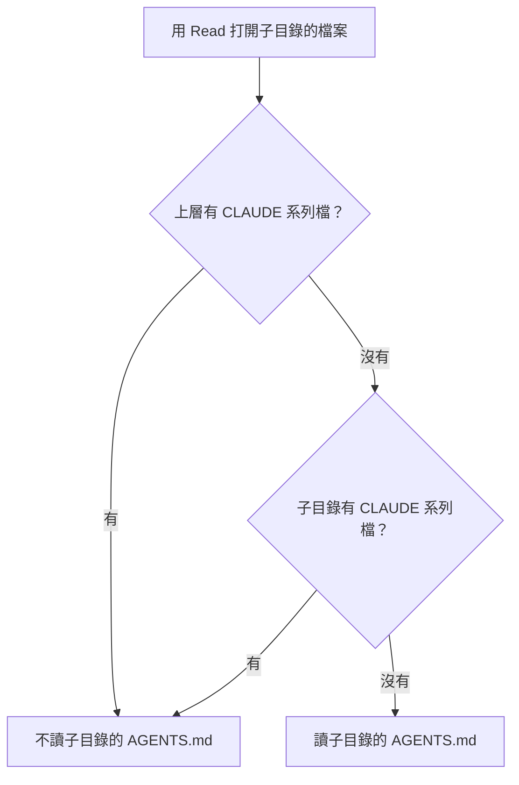
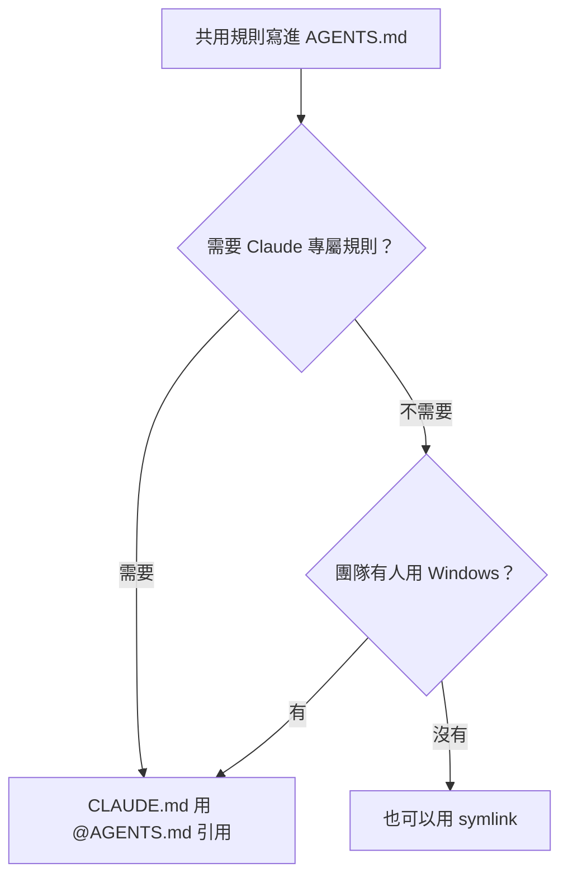

AGENTS.md 是寫給 coding agent 看的專案說明檔，通常放在專案最上層。它告訴 coding agent 測試怎麼跑、哪些檔不能碰、送出變更前要做什麼。

coding agent 是一種 AI 程式助理：你用一般的句子交代工作，它會自己打開專案裡的檔案、修改內容、執行指令。本文談的 Codex（OpenAI 的工具）和 Claude Code（Anthropic 的工具）都屬於這一類。

你可以把 AGENTS.md 想成寫給這些助理看的 README。README 是很多專案最上層都會放的說明檔，告訴第一次來的人「這是什麼、怎麼開始」。

它用 Markdown 寫（一種純文字格式，用 `#` 標出標題、用 `-` 列出清單，副檔名是 `.md`），沒有必填欄位，標題也可以自己取。這個格式由 Linux Foundation 底下的 [Agentic AI Foundation](https://agents.md/) 維護。

Codex 會直接讀 AGENTS.md。Claude Code 也會讀，但專案裡已有 CLAUDE.md 時，預設只讀 CLAUDE.md。我同時開這兩個工具時，最怕同一套專案規則寫了兩份，改了一邊、另一邊卻還是舊的。

這篇只談怎麼寫這份檔，以及 [Codex](https://learn.chatgpt.com/docs/agent-configuration/agents-md) 和 [Claude Code](https://code.claude.com/docs/en/memory#agents-md) 的官方文件分別怎麼說它們會讀哪些檔。我不會寫成「所有工具都一樣」，也不會列出其他還沒查證的產品。

skill 是打包好的做事流程，助理用到時才載入。若你想用一套 skill 幫專案產生規則，可以看我寫的 [mattpocock/skills 系列（1）：先設定專案規則，再用 ask-matt 找下一步](/posts/mattpocock-skills-setup-routing-guide/)。那篇講的是那套 skill 的流程；這篇講的是檔案格式本身，以及這兩個工具實際怎麼讀。

> 我寫這篇時，參考的是 2026-11-10（台北時間）當天的 [Codex AGENTS.md 說明](https://learn.chatgpt.com/docs/agent-configuration/agents-md)、[Claude Code 記憶與 CLAUDE.md 說明](https://code.claude.com/docs/en/memory)（含 [AGENTS.md 段落](https://code.claude.com/docs/en/memory#agents-md)），以及 [AGENTS.md 格式官網](https://agents.md/)。當天 npm 上最新的 Codex CLI 是 0.167.0，Claude Code 是 2.1.322。之後的版本或文件可能改變讀取規則。
{: .prompt-info }

## 開始前：先認識幾個詞

如果你不是工程師，下面這幾個詞會一直出現。先花一分鐘看過，後面會好讀很多：

- **repo（程式碼儲存庫）**：放一個專案所有檔案的資料夾，通常用 Git（記錄每一次修改的版本管理工具）管理。
- **根目錄**：repo 最上層的那個資料夾。用 Git 管理的專案，根目錄通常就是裡面有隱藏資料夾 `.git` 的那一層。
- **子目錄**：資料夾裡的資料夾。例如 `services/payments/`，就是 `services` 資料夾裡的 `payments` 資料夾。
- **終端機**：用打字下指令的視窗。本文標成 `bash` 的程式碼區塊，都是在這裡執行的指令。
- **目前工作目錄**：你啟動 Codex 或 Claude Code 時，終端機所在的那個資料夾，不一定是根目錄。例如先輸入 `cd services/payments`（`cd` 是切換資料夾的指令）再啟動，目前工作目錄就是 `services/payments`。
- **`~`（家目錄）**：代表你自己的使用者資料夾。`~/.codex/AGENTS.md` 的意思是「使用者資料夾裡、`.codex` 資料夾中的 AGENTS.md」。名稱以點開頭的資料夾常被檔案管理程式隱藏，找不到時請打開「顯示隱藏檔案」。
- **import（匯入）**：在 CLAUDE.md 裡寫一行 `@AGENTS.md`，Claude 讀 CLAUDE.md 時就會把 AGENTS.md 的內容一起讀進來。這樣就不必再複製一份。後面〈一份檔案兩邊共用：用 import 引用 AGENTS.md〉會一步步做。

## 同一件事要講第二次，就寫進 AGENTS.md

這些情況就適合把規則寫進 AGENTS.md：

- 同一件事，你已經對助理提醒第二次了。
- 它一直跑錯測試指令，例如該用 `pnpm test`，卻一再執行 `npm test`。
- 這件事新同事也需要知道，或下次再開這個 repo 的人也用得上。

我認為有兩種內容不適合塞進這份檔：只跟某一小區塊有關的長流程，以及「一定得做到」的事。



子目錄的規則後面會講；skill 的寫法見[自己寫 Agent Skill：從 SKILL.md 結構到觸發測試與維護](/posts/agent-skill-authoring-guide/)。

「一定得做到」的事不能只靠說明檔。[Claude Code 的文件](https://code.claude.com/docs/en/memory)寫得很清楚：這些說明是 context（塞進對話裡給模型看的脈絡），不是強制設定。模型會參考它，但最後怎麼做仍由模型判斷。

要在固定時機擋下某個動作，請用 hook（在固定時機由工具自動執行的指令），用法見我寫的[Claude Code hooks 教學：自動排版、跑測試與敏感檔提醒](/posts/claude-code-hooks-automate-checks/)。

## 寫具體、可檢查的句子，而且要短

寫法要具體、可以核對。官方舉的對比很清楚：「用 2 個空白縮排」比「排版好一點」有用；「送 PR 前跑 `npm test`」也比「記得測試」清楚。

我用的判斷方法很簡單：別人看完這句話，如果沒辦法檢查有沒有做到，就再寫具體一點。

我建議至少寫這幾類：

- 安裝與測試指令
- 程式風格
- 送出 pull request（PR：把你這次的修改送給別人審查、再合併進主要版本的請求）前要做的事
- 注意事項，例如安全相關、不要碰的檔案

保持精簡，重要的句子放前面。兩個工具對長度的說法不同：

| 工具 | 長度建議或上限 | 超過時 |
| --- | --- | --- |
| Claude Code | [每份檔案控制在 200 行內](https://code.claude.com/docs/en/memory#write-effective-instructions) | 佔用更多脈絡，也較不容易被遵守 |
| Codex | 各層規則加總，[預設上限是 32 KiB](https://learn.chatgpt.com/docs/agent-configuration/agents-md)（設定項是 `project_doc_max_bytes`） | 超過的部分不會讀進去 |

32 KiB 是 32,768 個位元組（byte）。英文字母一個約佔 1 byte，中文字在常見的 UTF-8 編碼下一個約佔 3 bytes，所以全中文大約是一萬字出頭。

下面是我寫的一份範本，可直接放到根目錄，大約二十多行，請依你的專案改指令和路徑：

```markdown
# AGENTS.md

## 專案概況

這是一個 Node.js 網頁服務。套件管理用 pnpm，Node 版本見 `.nvmrc`。

## 安裝與測試

- 安裝相依套件：`pnpm install`
- 跑全部測試：`pnpm test`
- 跑單一檔案：`pnpm test -- path/to/file.test.ts`
- 送出 PR 前，先跑 `pnpm lint` 和 `pnpm test`

## 程式風格

- 使用 2 個空白縮排，不要用 tab
- 公開函式補上 TypeScript 型別，不要用 `any`

## 注意事項

- 不要修改 `.env`、`.env.*` 或任何含密鑰的檔案
- 不要在程式碼裡寫入真實的 API 金鑰或密碼

## 送 PR 前

- 標題用一句話說這次改了什麼
- 說明裡寫測試怎麼跑、跑過哪些
```

範本裡的 `pnpm install`、`pnpm test`、`pnpm lint` 只是示範用的指令。如果你不確定自己的專案用什麼，可以先看專案原本的 README，或問負責的工程師。沒把握的段落，我寧可先不寫，也不要寫錯。

### 動手做：建立第一份 AGENTS.md

1. 找到專案的根目錄（見上面〈開始前：先認識幾個詞〉的說明）。
2. 在根目錄新增一個純文字檔，檔名取 `AGENTS.md`。任何純文字編輯器都可以；存檔時確認檔名結尾是 `.md`，不是 `AGENTS.md.txt`，也不是 Word 或 RTF 這類格式。
3. 貼上上面的範本，改成你專案真正的指令、路徑和注意事項，然後存檔。
4. 跟專案的其他檔案一樣提交（commit）進 repo，團隊成員和之後進來的人才拿得到同一份。不熟 Git 的話，可以請工程師幫忙。
5. 照後面〈改完之後，確認工具真的讀到了〉的方法，檢查工具有沒有讀到。

### Codex 在 GitHub 審查時看的規則

若你會在 GitHub 上使用 Codex 的程式碼審查（code review：在合併前檢查修改內容），可以加上 `## Code Review Rules` 段落。這段要放在最接近相關程式碼的那份 AGENTS.md。

這是 [Codex 文件對 GitHub 審查](https://learn.chatgpt.com/docs/agent-configuration/agents-md#add-code-review-rules)的說明，只適用於這項功能，不是兩個工具讀取規則檔的通則。

段落標題照官方的寫法，下面再列你希望審查時特別注意的事。例如放在付款服務的 `services/payments/AGENTS.md`：

```markdown
## Code Review Rules

- 付款流程有改動時，確認有補上對應的測試
- 程式碼裡若直接寫入密碼或 API 金鑰，請標出來
```

若想進一步了解怎麼讓 AI agent 在 GitHub 上審查 PR，我另外寫了一篇[用 GitHub Actions 加 AI Agent 自動化審查：以本站 PR 為例](/posts/github-actions-ai-agent-pr-review/)。

## Codex 怎麼讀：從根目錄一路讀到目前目錄

[Codex 的說明](https://learn.chatgpt.com/docs/agent-configuration/agents-md)寫：它會在開始做事之前讀取 AGENTS.md，而且每次啟動只建立一次指令鏈（把找到的規則檔依序串成的一整份說明）。所以你改了檔，要重新啟動才會生效。

Codex 的規則分兩種位置：

- **全域規則**：只屬於你自己、套用到你所有專案的偏好，放在 `~/.codex/AGENTS.md`（若你設了 `CODEX_HOME`，就改到那個目錄）。
- **專案規則**：放在 repo 裡、跟著專案走的規則，也就是本文主要在寫的那份。

專案規則從專案根目錄（通常是 Git 根目錄）往下，一路走到你的目前工作目錄。每一層依序找 `AGENTS.override.md`、`AGENTS.md`，再找你設定的 fallback 檔名（備用檔名，後面會說明）。每層最多收一份。

找到的內容由上往下串在一起。離目前目錄越近的越晚出現，效果上會蓋過前面較一般的規則。

舉例來說，如果你在 `services/payments` 啟動 Codex，它會依序看根目錄、`services/`、`services/payments/` 這三層。每層最多拿一份規則檔，最後接上的是 `services/payments/` 那一份。

{: w="1280" h="720" }
_概念圖，不是實際介面。左邊由上往下是資料夾的層級，青綠色框起來的是你啟動 Codex 的目前資料夾。Codex 沿著青綠箭頭從根目錄往下走，把每層的規則依序接成右邊那一整份，離你最近的那份排在最後；灰色的更深資料夾不會被讀到。_

搜尋會停在目前目錄：比它更深的檔案，啟動時不會讀到。若你要用某個子目錄的規則，請從那個目錄啟動，或在啟動時加上 `--cd`：

```bash
codex --cd 子目錄
```

`--cd` 的作用是讓 Codex 把那個資料夾當成目前目錄。若 Codex 找不到專案根目錄，就只看目前目錄。

所以我會先在根目錄放一份 AGENTS.md。某個子專案規則不同，再在該目錄加檔，並從那裡啟動。

### 同一層有 override 時，只取 override

同一層若同時有覆寫檔 `AGENTS.override.md` 和一般的 `AGENTS.md`，Codex 只會取一份，而且覆寫檔優先：

{: w="1280" h="720" }
_概念圖，不是實際介面。每個資料夾都只有一份規則被燈照到、被 Codex 拿出來。中間的資料夾同時有 AGENTS.override.md（貼著星星的珊瑚色那張）和 AGENTS.md（藍色那張），Codex 取 override；兩旁的資料夾只有 AGENTS.md，就取 AGENTS.md。_

override（覆寫檔）是暫時換成另一套規則用的。我建議用完就刪掉它，不要只是清空後留著。官方的說法是：移除 override，才會回到原本的檔。

### 沿用既有檔名：fallback 檔名

專案裡如果已經有別的檔名，例如 `TEAM_GUIDE.md`，可以把它設成前面說的 fallback 檔名。做法是把它加進 `~/.codex/config.toml`（Codex 的設定檔）的 `project_doc_fallback_filenames`。

某一層沒有 `AGENTS.override.md`，也沒有 `AGENTS.md` 時，Codex 才會照這份清單找。不在清單上的檔名，不會被當成規則檔。

用純文字編輯器打開這個設定檔（沒有就新增），在檔案開頭、任何 `[` 開頭的段落標題之前，加上一行：

```toml
project_doc_fallback_filenames = ["TEAM_GUIDE.md", ".agents.md"]
```

合計長度可用 `project_doc_max_bytes` 調整，預設是 32 KiB（也就是 `32768`）。細節見 [Codex 的設定範例](https://learn.chatgpt.com/docs/config-file/config-sample.md)。

## Claude Code 怎麼讀：預設有 CLAUDE 系列檔就不讀 AGENTS.md

Claude Code 自己的專案說明檔叫 CLAUDE.md，作用跟 AGENTS.md 類似。它也可以讀 repo 裡的 AGENTS.md 當作專案說明，不必另外再寫一份 CLAUDE.md。不過[預設條件](https://code.claude.com/docs/en/memory#agents-md)比較嚴：



這裡的 CLAUDE 系列檔是 `CLAUDE.md`、`.claude/CLAUDE.md` 和 `CLAUDE.local.md`。檢查範圍是目前工作目錄和它的上層，也就是一路往外、包住它的那些資料夾。讀 AGENTS.md 時，也包含 `.claude/AGENTS.md`。

個人的 `~/.claude/CLAUDE.md`、組織統一發佈的 managed CLAUDE.md，以及 `.claude/rules/` 裡的規則，不列入這項判斷。它們存在，也不會讓 AGENTS.md 被跳過。

這裡有一個常見陷阱：你只是想在專案裡放自己不會提交的筆記，於是加了 `CLAUDE.local.md`，Claude 就不再讀 AGENTS.md。

若要兩邊都保留，就把 Project instructions 設成 `claude-md-and-agents-md`。在 Claude Code 的對話框輸入下面這個斜線指令，就能打開設定：

```text
/config
```

另外，Claude Code 不讀 `AGENTS.override.md`、`AGENTS.local.md`，也不讀 `.agents/` 底下的檔。所以你為 Codex 準備的 override，對 Claude 沒有效。

### 子目錄的 AGENTS.md：上層沒有 CLAUDE 系列檔才會讀

子目錄的 AGENTS.md 不是一啟動就全部載入。[官方文件](https://code.claude.com/docs/en/memory#when-claude-code-reads-agents-md)把這段寫在「上層都沒有會佔掉判斷的 CLAUDE 系列檔」這個前提下：



Read 工具是 Claude Code 內建、用來打開檔案內容的功能。若根目錄已經有 CLAUDE.md，預設就不會走這條路；需要子目錄規則時，請看後面〈一份檔案兩邊共用：用 import 引用 AGENTS.md〉的做法。

### 版本需求與載入提示

直接讀 AGENTS.md 需要 Claude Code v2.1.277 或更新的版本。下面這些情況有可能讀不到，這時改用後面〈一份檔案兩邊共用〉那一節的 import：

- 較舊的版本
- 停用了負責讀取的內建 plugin（外掛功能）
- 剛從更舊版本升級後的第一個 session（工作階段：從開啟工具到關閉的這一段對話）

互動 session 若有成功載入，通常會看到類似 `no CLAUDE.md found; AGENTS.md loaded: …` 的提示。

### 改變預設行為

若要改預設行為，可以在 `/config` 調整 Project instructions。也可以在使用者層級的設定檔 `~/.claude/settings.json` 寫入對應值；放在專案裡的設定檔，這一項會被忽略。

不熟設定檔的話，我建議用 `/config`，比較不容易出錯。四個值的意思如下：

| 值 | Claude 會讀什麼 |
| --- | --- |
| `claude-md-or-agents-md` | 預設。有 CLAUDE 系列檔就讀它們；沒有才讀 AGENTS.md |
| `claude-md-and-agents-md` | 兩種都讀。每一層先讀 CLAUDE 系列，再讀 AGENTS.md |
| `claude-md` | 只讀 CLAUDE 系列 |
| `managed-only` | 啟動時只讀組織統一發佈的說明和自動記憶；專案裡的 CLAUDE.md 與 AGENTS.md 都不會在啟動時載入 |

## 一份檔案兩邊共用：用 import 引用 AGENTS.md

若你像我一樣同時用兩個工具，目標是只維護一份共用規則。兩份規則一旦互相矛盾，[Claude 的文件](https://code.claude.com/docs/en/memory#write-effective-instructions)寫：它可能任選一條。

我認為做法的關鍵是 import，意思是「引用另一份檔」。CLAUDE.md 不必把 AGENTS.md 的內容抄一遍，只要寫一行 `@AGENTS.md`。Claude 讀 CLAUDE.md 時，就會把 AGENTS.md 的內容展開，當成 CLAUDE.md 的一部分一起讀。

它不是複製一份貼過去，所以你只需要維護 AGENTS.md 這一份。要選哪種做法，可以這樣判斷：



具體步驟是：

1. 把團隊都該遵守的規則寫在根目錄的 `AGENTS.md`。Codex 會直接讀它。
2. 若專案還需要 Claude 專屬的補充，在同一個資料夾（也就是根目錄）建立 `CLAUDE.md`。第一行寫 `@AGENTS.md`，下面再寫只給 Claude 的內容。

這是[官方範例](https://code.claude.com/docs/en/memory#share-one-file-with-other-coding-tools)的做法：

```markdown
@AGENTS.md

## Claude Code

變更 `src/billing/` 底下的檔案時，先使用 plan mode。
```

範例裡的 plan mode 是 Claude Code 的一種工作模式。這裡只是示範「Claude 專屬規則」可以怎麼寫，請換成你自己需要的內容。

`@` 後面的路徑是相對的，基準是這份 CLAUDE.md 所在的位置，不是你啟動時的工作目錄。CLAUDE.md 和 AGENTS.md 放在同一個資料夾時，寫 `@AGENTS.md` 就對了。

若把路徑放在反引號裡，例如 `` `@AGENTS.md` ``，就只是提到這個檔名，不會展開。

{: w="1280" h="720" }
_概念圖，不是實際介面。左邊的助理代表 Codex，直接讀藍色的 AGENTS.md；右邊的助理代表 Claude Code，讀紫色的 CLAUDE.md。CLAUDE.md 第一行的 `@AGENTS.md` 把共用規則接進來（藍色虛線框），下面才是 Claude 專屬的補充，不必再複製一份。_

### 不需要 Claude 專屬內容時：symlink

若不需要任何 Claude 專屬內容，也可以做符號連結（symlink：一個指向另一個檔的檔名，有點像捷徑）。在終端機切換到根目錄後執行：

```bash
ln -s AGENTS.md CLAUDE.md
```

成功時這個指令不會印出內容。

不過，只要團隊裡有人使用 Windows，我就會改用上面的 import。官方說明了兩個問題：

- 在 Windows 建立 symlink 需要系統管理員權限或開發人員模式。
- Git 若沒啟用 `core.symlinks`，checkout 時可能把它變成只有一行文字的普通檔，規則就讀不到了。

### 這兩種做法不適合代替 import

- **只寫一句「請去讀 AGENTS.md」**：官方說，那樣寫的話，Claude 只有自己決定打開那份檔時才看得到內容。
- **長期用 `/import`**：這是 Claude Code 對話裡的另一個指令，名稱相近，作用不同。官方的用詞是：它會把 AGENTS.md 這類說明「一次性複製」（appends a one-time copy）到對應的 CLAUDE.md。之後你改 AGENTS.md，複製過去的那份不會自動跟著改。

## 改完之後，確認工具真的讀到了

改完檔之後，我不會假設工具已經看到新內容。

### Codex：重新啟動，再請它摘要

Codex 請先重新啟動，再依[官方建議](https://learn.chatgpt.com/docs/agent-configuration/agents-md#verify-your-setup)，在終端機切到專案根目錄後執行：

```bash
codex --ask-for-approval never "Summarize the current instructions."
```

引號裡是交給 Codex 的一句話，意思是「摘要目前的指示」。`--ask-for-approval never` 是官方範例裡的參數，照抄即可。

若要確認子目錄的規則，把目錄換成你的路徑：

```bash
codex --cd services/payments --ask-for-approval never "Show which instruction files are active."
```

這一行的意思是：從 `services/payments` 啟動，並請 Codex「列出目前生效的指示檔」。

你應該會看到它依順序列出目前生效的說明來源，例如全域檔、根目錄的 AGENTS.md，以及（從子目錄啟動時）更接近的那一份。這是官方文件描述的檢查方式。

### Claude Code：看 memory 清單

在 Claude Code 的對話裡輸入下面這行，看清單裡有沒有你的檔：

```text
/memory
```

也可輸入下面這行，在 Memory files 底下確認：

```text
/context all
```

v2.1.280 之前的版本，這裡不會列出直接讀入的 AGENTS.md。若是直接讀 AGENTS.md 的互動 session，也會出現前面提過的 `AGENTS.md loaded` 提示。

### 沒讀到時，先查這三件事

- 檔名和位置對不對。
- Codex 有沒有重新啟動。
- Claude Code 的目前目錄或上層，是不是已經有 CLAUDE 系列檔。有的話，改用 import 或調整設定。

## 實際情境：前端加付款服務

假設這個 repo 裡有前端 `web/`（使用者看到的網頁畫面），也有付款服務 `services/payments/`。這是一種 monorepo（同一個儲存庫裡放了多個子專案）。我會這樣放檔：

```text
my-project/              ← 根目錄
├── AGENTS.md            ← 全專案共用的規則
├── CLAUDE.md            ← 第一行 @AGENTS.md，下面是 Claude 專屬補充
├── web/
└── services/
    └── payments/
        └── AGENTS.md    ← 只寫付款服務自己的規則
```

- 根目錄 `AGENTS.md`：共用的安裝指令、程式風格和 PR 規則
- `services/payments/AGENTS.md`：只寫付款服務自己的測試指令，例如改跑 `make test-payments`
- 根目錄 `CLAUDE.md`：第一行 `@AGENTS.md`，下面再加一條 Claude 專屬規則，例如變更付款相關程式前先用 plan mode

`services/payments/AGENTS.md` 我會寫得很短，只寫跟根目錄不同的部分：

```markdown
# AGENTS.md（付款服務）

## 測試

- 這個資料夾的測試請跑 `make test-payments`，不是 `pnpm test`
```

### Codex 讀到哪些檔

從根目錄啟動 Codex 時，它會讀到全域檔（若你有）以及根目錄的 AGENTS.md。`services/payments/` 裡那一份不會在啟動時讀到，因為搜尋只走到目前目錄。

改用 `codex --cd services/payments` 之後，付款服務那份會接在後面。其中較具體的測試指令，就會蓋過根目錄較一般的寫法。

### Claude Code 讀到哪些檔

從根目錄啟動 Claude Code 時，因為已經有 CLAUDE.md，[預設只讀 CLAUDE 系列檔](https://code.claude.com/docs/en/memory#agents-md)。根目錄的 AGENTS.md 是靠 `@AGENTS.md` 這行 import 帶進來的。

之後 Claude 用 Read 打開 `services/payments/` 裡的檔案時，也不會直接讀 `services/payments/AGENTS.md`。原因見前面〈子目錄的 AGENTS.md：上層沒有 CLAUDE 系列檔才會讀〉：根目錄已經有 CLAUDE.md，不符合官方寫的前提。

若付款服務的規則也要讓 Claude 看到，我會在 `services/payments/` 再放一份以 `@AGENTS.md` 開頭的 `CLAUDE.md`。因為 import 的路徑以 CLAUDE.md 所在位置為準，這一行指的是同一個資料夾裡的 `services/payments/AGENTS.md`，不是根目錄那份。

[子目錄的 CLAUDE.md](https://code.claude.com/docs/en/memory#how-claude-md-files-load) 會在 Claude 讀取、寫入或編輯該目錄中的檔案時載入。另一個做法是把 Project instructions 設成 `claude-md-and-agents-md`，讓兩種檔一起讀。

## 什麼情況用哪個檔

| 情況 | 用哪個檔 |
| --- | --- |
| 全團隊共用的規則 | 根目錄 `AGENTS.md` |
| 只有某個子專案才適用的規則 | 該子目錄的 `AGENTS.md`（Codex 請從該目錄啟動；Claude 若根目錄已有 CLAUDE.md，需另加 import 或改設定） |
| 你個人、套用到所有專案的偏好 | `~/.codex/AGENTS.md`，或 `~/.claude/CLAUDE.md` |
| Codex 暫時要換一套規則 | 同層的 `AGENTS.override.md`（用完刪掉；Claude 不讀這份） |
| 只要補充 Claude 專屬規則 | `CLAUDE.md` 第一行 `@AGENTS.md`，下面再寫補充 |
| 只有自己看、不要提交的 Claude 筆記 | `CLAUDE.local.md`（預設會讓 Claude 不再讀 AGENTS.md，需要的話改設定） |
| 必須強制做到的事 | hook 或權限設定，不是說明檔 |

## 結論

我建議今天就照〈動手做：建立第一份 AGENTS.md〉的步驟，在根目錄放一份 30 行以內的 AGENTS.md，寫上真正會用到的安裝、測試和注意事項。若還需要 Claude 專屬補充，再加一份以 `@AGENTS.md` 開頭的 CLAUDE.md。改完後用上面的指令或 `/memory` 確認有讀到。

想繼續往下讀，可以看這些：

- 為什麼「寫給助理看的每一行都有成本」：見 [mattpocock/skills 系列（6）：查資料、做交接、學新東西，都有固定做法](/posts/mattpocock-skills-research-handoff/)。
- 把規則變成固定時機會執行的檢查：見[hooks 篇](/posts/claude-code-hooks-automate-checks/)。
- 完整的架構說明這類長篇內容，我認為不適合放進 AGENTS.md。把它整理成 repo 內的 wiki、再由 AGENTS.md 指過去的做法，我在 [OpenWiki 追得到程式碼變更，卻證明不了文件正確](/posts/openwiki-agent-docs-maintenance/)裡談過。
- 官方說明：[Codex 的 AGENTS.md 文件](https://learn.chatgpt.com/docs/agent-configuration/agents-md)、[Claude Code 的記憶說明](https://code.claude.com/docs/en/memory#agents-md)，以及 [AGENTS.md 格式官網](https://agents.md/)。
