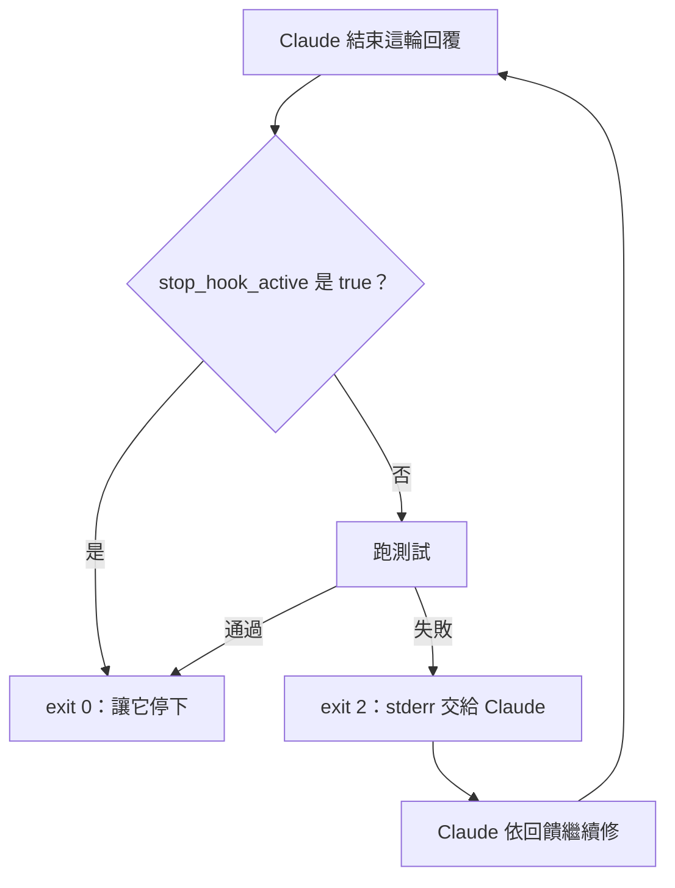

每次請 AI 改完檔，我都還要自己問：排版跑了沒？測試過了沒？有沒有動到 `.env`？Claude Code（在終端機裡使用的 AI 程式助理）的 hooks 讓這些檢查在固定時機自動執行，不必等 AI 自己決定要不要做。

這篇設定四個常用的 hook，最後說明它擋不下什麼。

> 依據官方的 [Claude Code hooks 指南](https://code.claude.com/docs/en/hooks-guide)、[Hooks reference](https://code.claude.com/docs/en/hooks)與 [Security considerations](https://code.claude.com/docs/en/hooks#security-considerations)。查證日期是 2026-11-10（台北時間），當天 npm 上最新的 Claude Code 是 2.1.322。之後的版本可能調整事件與欄位。
{: .prompt-info }

第三方 skill 和 MCP 的權限風險，我在[先前這篇](/posts/coding-agent-supply-chain-permission-risks/)談過。這篇只談你自己設定的日常檢查。

## hooks 是什麼

Hook 是你寫好的指令，Claude Code 會在對話的固定時機執行它。官方的說法是，某些動作會固定發生，不依賴模型自己選擇要不要跑。

我認為它適合每次都該做、不需要臨場判斷的事，例如排版、跑測試、擋下對特定檔案的修改。需要斟酌的決定，留給你或權限設定。

最常用的四個時機：

- **PreToolUse**：工具（改檔、執行指令等）執行前，可以擋下這次呼叫。
- **PostToolUse**：工具成功執行後，例如排版剛改過的檔案。
- **Stop**：Claude 結束這輪回覆時。每次回覆結束都會觸發，不只在整個任務完成時。
- **SessionStart**：對話開始或接續時。matcher 設成 `compact`，就只在壓縮後執行。

完整的事件列表見 [Hooks reference](https://code.claude.com/docs/en/hooks#hook-lifecycle)。

{: w="1280" h="720" }
_概念圖，不是實際介面。四個時機依序是：工具執行前、執行成功後、這輪回覆結束、對話開始或被壓縮之後。_

同一件事你已經提醒過不只一次，而且規則寫得清楚，例如「改完 JavaScript 就排版」「不要用 Edit 或 Write 改 `.env`」，就適合寫成 hook。

## 設定放在哪裡

這篇的範例都寫在專案根目錄的 `.claude/settings.json`，可以提交到 repo 讓團隊共用。另外兩個位置：

- `~/.claude/settings.json`：作用於你本機的所有專案。
- `.claude/settings.local.json`：不進版控。

各層的 hooks 會合併生效，不會互相取代。

設定檔是 JSON，不能有註解，最後一項後面不能有逗號。結構分三層，依序是事件名稱、帶 matcher 的規則、要執行的 hooks。

Matcher 決定這次要不要跑。在 PreToolUse 和 PostToolUse，它比對工具名稱，大小寫要完全一致。`"Edit|Write"` 只在 Claude 用 `Edit` 或 `Write` 時觸發，寫成 `"Edit, Write"` 也一樣。不寫 matcher 或寫 `"*"`，該事件每次發生都會執行。

範例需要 [`jq`](https://jqlang.org/) 從 hook 收到的 JSON 取出欄位，排版那一項另外需要 Node.js 的 `npx`。macOS 和 Linux 上的 hook 腳本要有執行權限：

```bash
chmod +x .claude/hooks/*.sh
```

## 改完檔自動排版：PostToolUse

把這段加進 `.claude/settings.json`。檔案裡已經有 `"hooks"` 的話，只在裡面加 `PostToolUse`，不要整份覆寫：

```json
{
  "hooks": {
    "PostToolUse": [
      {
        "matcher": "Edit|Write",
        "hooks": [
          {
            "type": "command",
            "command": "f=$(jq -r '.tool_input.file_path'); npx prettier --write \"$f\""
          }
        ]
      }
    ]
  }
}
```

`Edit` 或 `Write` 成功後，這條指令從輸入的 JSON 取出檔案路徑，交給 `npx prettier --write` 就地排版。它改寫自官方指南的 Prettier 範例：路徑先存進變數再加引號，含空白或單引號也不會被拆開。

成功時對話裡通常沒有訊息，要開檔看有沒有被重排。官方的測法是請 Claude 在 JavaScript 檔裡加一個單引號字串，再確認它有沒有變成雙引號（Prettier 預設）。

## 改到敏感檔時擋下：PreToolUse

Claude 用 `Edit` 或 `Write` 改 `.env`、`.git/` 裡的檔或 `package-lock.json` 時，這個 hook 會擋下那一次呼叫。擋下的原因會回饋給 Claude。它不代表 AI 碰不到這些檔。

新增 `.claude/hooks/protect-files.sh`。寫法來自官方指南的保護檔範例，另外處理了 Windows 路徑的反斜線：

```bash
#!/bin/bash
# protect-files.sh — based on official Claude Code hooks guide example
INPUT=$(cat)
FILE_PATH=$(echo "$INPUT" | jq -r '.tool_input.file_path // empty')

# Normalize Windows backslash separators so the patterns below match
FILE_PATH="${FILE_PATH//\\//}"

PROTECTED_PATTERNS=(".env" "package-lock.json" ".git/")

for pattern in "${PROTECTED_PATTERNS[@]}"; do
  if [[ "$FILE_PATH" == *"$pattern"* ]]; then
    echo "Blocked: $FILE_PATH matches protected pattern '$pattern'" >&2
    exit 2
  fi
done

exit 0
```

再在 `.claude/settings.json` 的 `"hooks"` 裡加上：

```json
"PreToolUse": [
  {
    "matcher": "Edit|Write",
    "hooks": [
      {
        "type": "command",
        "command": "\"$CLAUDE_PROJECT_DIR\"/.claude/hooks/protect-files.sh"
      }
    ]
  }
]
```

`$CLAUDE_PROJECT_DIR` 是 Claude Code 提供的環境變數，指向專案根目錄。腳本以結束碼 `2` 擋下這次呼叫，寫到 stderr（標準錯誤輸出）的 `Blocked:` 說明會回饋給 Claude。結束碼 `0` 只代表 hook 沒有意見，接著走原本的權限流程，不等於核准。

{: w="1280" h="720" }
_概念圖，不是實際權限畫面。這個 hook 擋的是該次 Edit 或 Write，不是所有可能改到這個檔的路徑。_

只比對 `Edit|Write` 擋不住透過 `Bash` 或 `PowerShell` 改檔，補法見最後的限制一節。

## 收工時跑測試：Stop

這個 hook 在 Claude 結束這輪回覆時跑測試，失敗就把原因交回去，讓它繼續修。

Stop hook 沒有 matcher，每次回覆結束都會跑，使用者中斷時不跑。它要防的是無限迴圈：hook 讓對話繼續之後，下一次收到的 `stop_hook_active` 會是 `true`，腳本看到它就要放行。



官方要求一定要檢查 `stop_hook_active`，或改讀對話紀錄，以免在永遠不會滿足的條件上一直擋。連續擋下八次後，Claude Code 會強制結束這一輪；Claude 只要再呼叫工具，計數就歸零。

新增 `.claude/hooks/run-tests-on-stop.sh`。這裡用 `bun test` 配合後面的情境，請換成你的測試指令，例如 `npm test` 或 `pytest`：

```bash
#!/bin/bash
# run-tests-on-stop.sh — Stop hook with official stop_hook_active guard
INPUT=$(cat)
if [ "$(echo "$INPUT" | jq -r '.stop_hook_active')" = "true" ]; then
  exit 0  # Allow Claude to stop
fi

PROJECT_DIR="${CLAUDE_PROJECT_DIR:-$(cd "$(dirname "$0")/../.." && pwd)}"
if ! (cd "$PROJECT_DIR" && bun test) >&2; then
  echo "Blocked stop: tests failed. Fix the failing tests before finishing." >&2
  exit 2
fi
exit 0
```

對應的設定：

```json
"Stop": [
  {
    "hooks": [
      {
        "type": "command",
        "command": "\"$CLAUDE_PROJECT_DIR\"/.claude/hooks/run-tests-on-stop.sh"
      }
    ]
  }
]
```

結束碼 `2` 在三個事件的效果不同：

| 事件 | 結束碼 `2` 的效果 |
| --- | --- |
| PreToolUse | 擋下這次工具呼叫，stderr 回饋給 Claude |
| PostToolUse | 工具已經執行完，無法撤回，只把 stderr 交給 Claude |
| Stop | 不讓 Claude 停下，stderr 成為繼續工作的理由 |

## 壓縮後把規則補回來：SessionStart

對話脈絡（上下文，也就是目前還留在模型眼前的內容）太長時，Claude Code 會做 compaction（壓縮）。它把先前的對話摘要成較短的內容，好騰出空間，細節可能因此遺失。

官方建議用 matcher 為 `compact` 的 SessionStart hook，每次壓縮後把關鍵規則再寫進脈絡。指令印到 stdout 的純文字會加進 Claude 的脈絡：

```json
"SessionStart": [
  {
    "matcher": "compact",
    "hooks": [
      {
        "type": "command",
        "command": "echo 'Reminder: use Bun, not npm. Run bun test before committing. Current sprint: auth refactor.'"
      }
    ]
  }
]
```

依官方說明，壓縮後 Claude 會再看到這段提醒。把提醒換成你的專案規則。`compact` 涵蓋自動與手動壓縮，SessionStart 擋不住壓縮本身。不常變的規則也可以改放在 `CLAUDE.md`。

## 用 /hooks 檢查設定

在 Claude Code 提示符輸入 `/hooks`，會打開唯讀的瀏覽畫面。每條 hook 都標出來源：使用者設定、專案設定、本機設定、外掛或目前這次對話。選一條可以看它實際執行的指令，以及定義它的設定檔或外掛。切到 `All events` 會連沒設定的事件一起列出。

這個畫面只能看。要改設定，得編輯對應的 JSON 檔。

## 完整範例：一個小專案的一天

假設你維護一個小網站：改完 JavaScript 要排版，不能用 Edit 或 Write 改 `.env`，每次回覆結束先跑測試，壓縮後還要記得「用 Bun、提交前先測」。

1. 在專案根目錄建立 `.claude/settings.json`，放入上面四個事件的設定。建立 `protect-files.sh` 和 `run-tests-on-stop.sh`，把測試指令換成你的，再執行前面的 `chmod`。
2. 確認裝了 `jq`，以及能執行 `npx prettier` 的 Node.js。排版用的是 `npx prettier`，所以和專案用 Bun 還是 npm 管理套件無關。
3. 啟動 Claude Code 輸入 `/hooks`，確認 PostToolUse、PreToolUse、Stop、SessionStart 都在清單裡，來源是專案設定。
4. 請 Claude 在 `.js` 檔加功能。它用 Edit 或 Write 改完後，Prettier 會接著排版。
5. 它試著用 Edit 或 Write 改 `.env` 時，那次修改會被擋下，並帶回 `Blocked:` 說明。
6. 它說做完時，Stop hook 會跑測試，失敗就依回饋繼續修。
7. 對話經過壓縮後，SessionStart 會把你的提醒送回脈絡。

四個 hook 可以分開加，不必一次全開。

## 該用哪個 hook

| 你的情況 | 用這個 |
| --- | --- |
| 用 Edit 或 Write 改完檔，要自動排版 | PostToolUse，matcher 設 `Edit\|Write` |
| 不要讓該次 Edit 或 Write 改到 `.env`、`.git/` 等檔 | PreToolUse，matcher 設 `Edit\|Write`，結束碼 2 擋下並說明原因 |
| 不論誰改了某個檔，都要在檔案寫入後做掃描 | FileChanged（檔案寫入後才跑，不能事先擋住） |
| 這輪回覆結束時先跑測試或掃描工作目錄 | Stop，並檢查 `stop_hook_active` |
| 壓縮後把專案規則補回脈絡 | SessionStart，matcher 設 `compact` |
| 只想確認目前設定了哪些 hooks | `/hooks`（唯讀瀏覽） |

## 它擋不下什麼

**Matcher 只比對工具名稱。** Claude 改用 `Bash` 或 `PowerShell` 改檔時，`"Edit|Write"` 不會觸發。官方的補法有三種：

- 要看到每一輪的所有改動（合規掃描、稽核紀錄）：加一個 Stop hook，在每輪結束時掃描工作目錄。
- 要在每次呼叫時都看到：另外 match `Bash|PowerShell`，用 `git status --porcelain` 列出已修改和未追蹤的檔案。
- 只在意某個檔案被寫入，不論是誰寫的：用 [FileChanged](https://code.claude.com/docs/en/hooks#filechanged)。

{: w="1280" h="720" }
_概念圖。Matcher 守的是指定的工具名稱；經由 Bash 或 PowerShell 改檔，會走另一條路。_

**`if` 只能盡力過濾。** 工具事件可以加 `if`，用權限規則的語法依工具名稱和參數決定要不要啟動，例如 `"Edit(*.ts)"`。官方寫明它是 best-effort（盡力而為，不保證每次都濾對），要強制允許或禁止就用權限系統。`if` 只對工具事件有效，加在其他事件上會讓 hook 完全不跑。

**Hook 回傳 allow 不會繞過 deny。** 設定裡的拒絕規則，包括組織代管的拒絕清單，仍然有效。反過來，hook 的 deny 在每種權限模式都有效。

**PostToolUse 不能還原已經發生的事。** 這時檔案已經寫入、指令已經執行、網路請求已經送出。要事先阻擋或改寫呼叫，用 PreToolUse。

**Hook 以你的完整使用者權限執行。** 官方警告，command hook 能讀、改、刪你的帳號碰得到的任何檔案。加進設定前先讀過指令，在安全的環境試跑；用在共用或正式環境前，先讀 [Security considerations](https://code.claude.com/docs/en/hooks#security-considerations)。

互動模式會先問你是否信任這個資料夾。依官方說明，`claude -p` 和 SDK 不會問，直接視為已信任。所以 repo 裡的 `.claude/settings.json`，可能在你從沒確認過的目錄裡執行。

Hooks 不是安全邊界。要由作業系統限制指令能讀寫的範圍，見 [Claude Code 沙箱設定教學：擋住 SSH 金鑰與 token](/posts/claude-code-sandbox-setup/)。

## 結論

先在專案的 `.claude/settings.json` 加一個 hook，用 `/hooks` 確認它在清單裡，再依需要往上加。把它當成省事的固定檢查，不要當成最後一道防線。

## 延伸閱讀

- [Claude Code hooks 指南](https://code.claude.com/docs/en/hooks-guide)：常見用法與可複製的範例。
- [Hooks reference](https://code.claude.com/docs/en/hooks)：事件、輸入輸出與 [Security considerations](https://code.claude.com/docs/en/hooks#security-considerations)。
- [裝了第三方 skill 和 MCP 之後，你的 Coding Agent 多了哪些破口？](/posts/coding-agent-supply-chain-permission-risks/)：權限與供應鏈風險。
- [AI 寫程式變快了，產品為什麼還是交不出去？我怎麼理解 AI 原生開發流程](/posts/ai-native-sdlc-playbook/)：skill 和 hook 的差別。
- [用 GitHub Actions 加 AI Agent 自動化審查：以本站 PR 為例](/posts/github-actions-ai-agent-pr-review/)：PR 送出後的規則檢查、AI 審查與人工核准。
- [AGENTS.md 怎麼寫：讓 Coding Agent 讀懂你的專案規則](/posts/agents-md-project-rules-for-coding-agents/)：只需要讓 AI 知道、不必強制執行的規則。
- [Claude Code plugin 安全安裝：裝之前先看哪些檔案](/posts/claude-code-plugin-safe-install/)：plugin 可能帶進別人寫的 hook。
