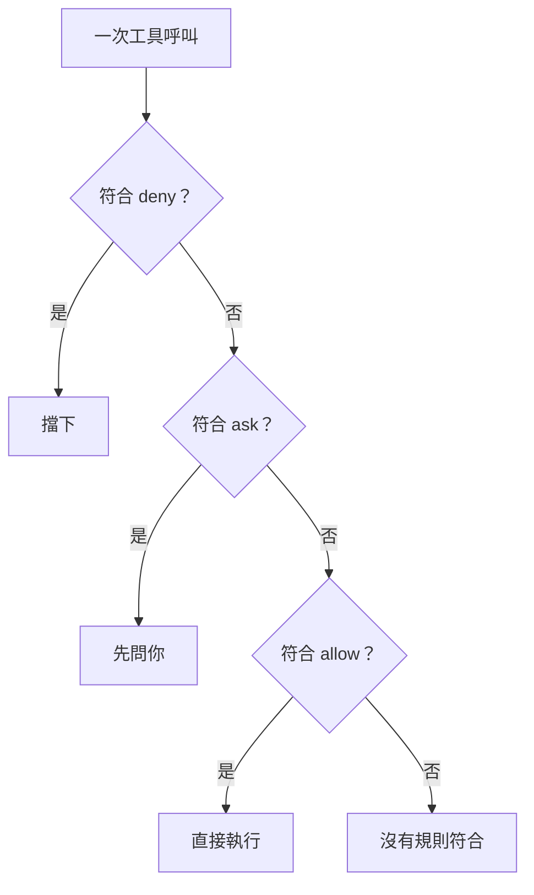
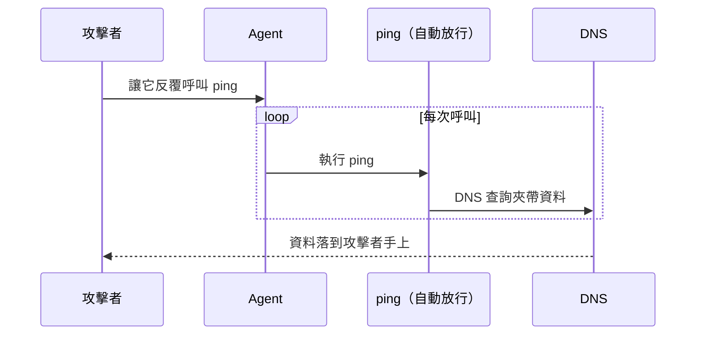
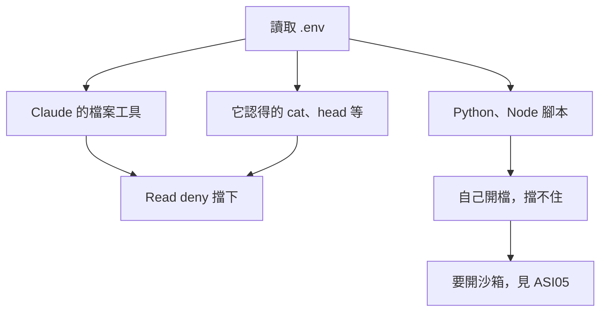
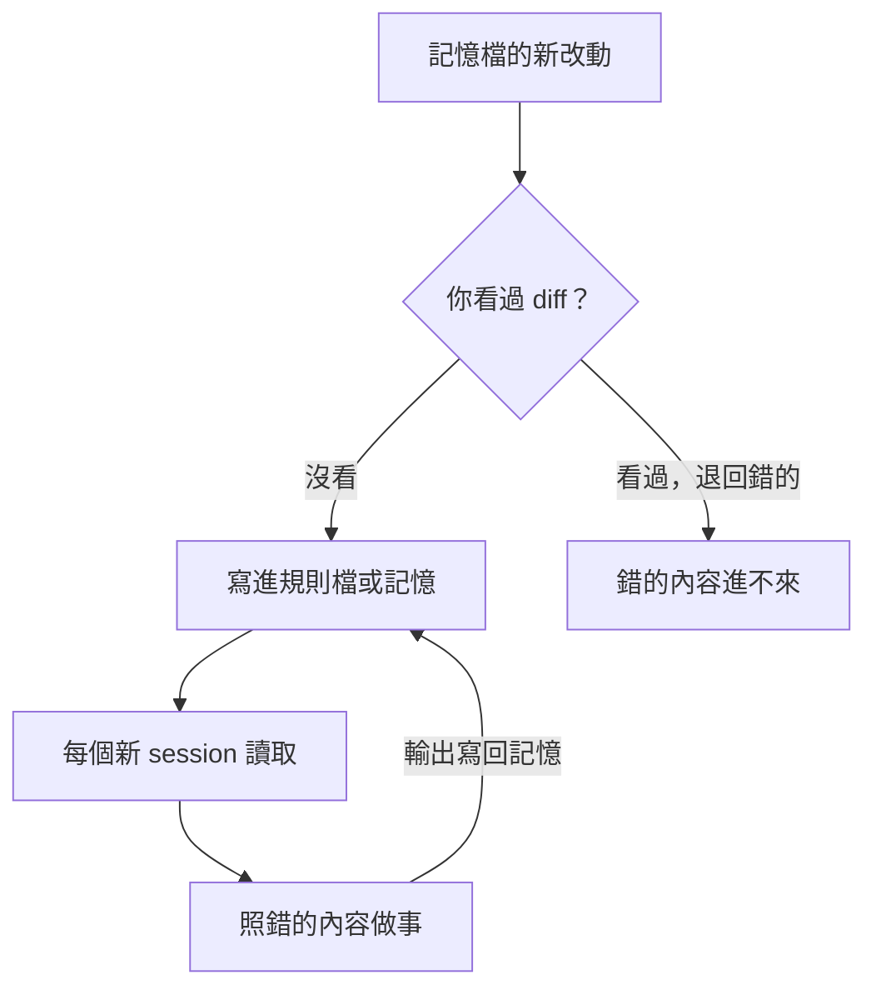
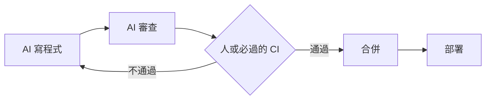

用 coding agent（會自己讀檔、改程式、跑指令的 AI 寫程式助手）久了，接上的東西會愈來愈多：多一個外部工具、多一條「不用問我」的自動放行，再把自動測試和部署也接上去。但我覺得很少人會回頭，把整個工作流檢查一遍。

這篇把 OWASP 針對 AI agent（會自己動手做事的 AI）整理的資安風險清單，轉成十題是／否自我檢查，給用 AI 寫程式的個人開發者使用。答「是」的題目就是要修的地方，每題都附上修法。

> 依據 OWASP〈OWASP Top 10 for Agentic Applications 2026〉（2025 年 12 月發布，2026-11-11 重新核對仍是最新版）與各工具 2026-11-11 當天的官方文件。Claude Code、Codex、Cursor 的預設權限近期都有調整，設定名稱與預設值以官方文件為準。
{: .prompt-info }

## 清單的來源與範圍

出題依據是〈[OWASP Top 10 for Agentic Applications 2026](https://genai.owasp.org/resource/owasp-top-10-for-agentic-applications-for-2026/)〉，簡稱 OWASP Agentic Top 10。OWASP 是非營利的開放資安社群，最有名的是網站風險清單「OWASP Top 10」。這份 agent 版在 2025 年 12 月發布。

發布頁說它是「globally peer-reviewed」（經過全球同行審查）的框架，由 100 多位業界專家、研究者與實務工作者合作寫成。它列出的是自主 AI 與 agent 系統最關鍵的資安風險。

這份清單原本是寫給打造 agent 系統的組織。分組、情境、檢查題和修補順序都是我自己整理的，**不是** OWASP 官方的「個人開發者檢查表」。十項依序編為 ASI01 到 ASI10，編號只是編號，不代表嚴重程度。

這篇談的範圍是個人開發者的 coding agent 工作流，包括 Claude Code、Codex、Cursor 的 agent。接在上面的 MCP（讓 agent 連接外部工具的標準）和 GitHub Actions（GitHub 的自動化流程服務）也算在內。

我在[裝了第三方 skill 和 MCP 之後，你的 Coding Agent 多了哪些破口？](/posts/coding-agent-supply-chain-permission-risks/)從「裝了什麼」講攻擊面，也就是可能被攻擊的地方。這篇改用 OWASP 的十項，把整個工作流掃一遍。那篇詳細寫過的案例，這裡不再重講。

## 先說幾個詞

全文會用到下面這些詞。比較少見的詞，在第一次出現時再解釋。

- **AI agent／agentic**：不只回答問題，還會自己規劃步驟、呼叫工具、改檔、跑指令的 AI。agentic 是形容詞，指「具備這種自己行動能力的」。
- **coding agent**：專門幫你寫程式的 AI agent，例如 Claude Code、Codex、Cursor 的 agent。它能直接在你的專案裡讀檔、改程式、跑終端機指令。
- **工具（tool）**：agent 能呼叫的功能，例如讀檔、跑終端機指令、上網、呼叫 MCP server。
- **MCP、skill、外掛**：讓 agent 多會一些事的擴充，常由第三方提供。MCP（Model Context Protocol）是讓 agent 接上外部工具和資料的標準，MCP server 就是提供這些工具的程式。
- **提示注入（prompt injection）**：把指令藏在 agent 會讀到的內容裡，讓它照著做。
- **核准（approval）、自動放行、權限模式**：核准是 agent 動手前先問你。設成自動放行（allow）的動作，就不會再問。權限模式是工具內建的幾種「要問多少」的組合。
- **沙箱（sandbox）**：把 agent 跑的指令關在限制範圍內，例如能讀寫哪些資料夾、能連哪些網站。
- **token／憑證**：代替帳號密碼的通行碼，誰拿到就能用你的身分做事。「長期 token」指有效期很長的那種，一旦外流，被冒用的時間也最長。
- **長期記憶／脈絡（memory／context）**：agent 每次開工都會讀的東西，例如 `CLAUDE.md`、`AGENTS.md`、規則檔、自動記錄的摘要。
- **git、repo、diff**：git 是記錄每次改動、隨時能退回的版本控制工具。repo 是用 git 管理的一個程式碼儲存庫。diff 是改動前後的對照，看 diff 就知道到底改了哪幾行。
- **CI、GitHub Actions**：CI 是程式碼一推上去，就自動跑測試、建置，甚至部署的流程。GitHub Actions 是 GitHub 提供的這類服務，流程寫在 workflow 檔裡。
- **最小權限（least privilege）**：只給完成這件事真正需要的權限。
- **最小自主（Least-Agency）**：OWASP 的用語，不需要的自主權就不要給。
- **kill switch**：出事時能立刻停掉的開關。

## 怎麼用這份清單：四步一輪

先做完一輪。之後工作流有變動，就再做一輪。

1. **盤點**：列出你用的 agent，以及它能讀的資料夾、能跑的指令、接上的 MCP、拿得到的 token，和接著會跑的自動化（CI、排程）。不知道去哪裡查，看下面的「盤點時去哪裡看」。
2. **對照**：十題逐一回答是或否。答「是」就代表要修。
3. **修補**：先修「沒人把關、做了就收不回」的項目，順序見後面的「先修哪幾項」。
4. **複查**：加了新工具或 MCP，或改了設定，就再跑一輪。

這四步背後的原則，是 OWASP 在文件第 7 頁提出的 Least-Agency：

> avoid unnecessary autonomy; deploying agentic behavior where it is not needed expands the attack surface without adding value.

意思是避免不必要的自主。在用不到的地方讓 AI 自己行動，只會多出可被攻擊的地方，不會多帶來價值。同一段也強調，要看得見 agent 在做什麼，也就是 observability（可觀察性）。

{: w="1600" h="900" }
_概念圖：盤點、對照、修補、複查圍成一輪；中心原則是最小自主（Least-Agency），用不到的自主權就別給。這四步是本站整理的用法，不是 OWASP 官方流程。_

### 盤點時去哪裡看

這裡只寫去哪裡看、看什麼，不寫預設值，因為工具的預設值近期常有調整。

- **權限與自動放行**，三個工具各看不同的地方：
  - Claude Code：輸入 `/permissions` 看目前規則，各權限模式的意思對照 [permission modes](https://code.claude.com/docs/en/permission-modes) 文件。
  - Codex：看 [Agent approvals & security](https://learn.chatgpt.com/docs/agent-approvals-security)，確認沙箱模式（它技術上能做什麼）和核准政策（什麼時候必須先問你）。
  - Cursor：看 [Agent Security](https://cursor.com/docs/agent/security)，確認 Run Modes（終端機指令怎麼放行）和 MCP allowlist（預先放行的 MCP 工具清單）。
- **沙箱**：Claude Code 用 `/sandbox` 或設定裡的 `sandbox.enabled`，確認沙箱有沒有開。開了之後能讀哪裡、能連哪裡，看 [sandboxing](https://code.claude.com/docs/en/sandboxing) 文件。
- **MCP**：從專案裡登記 MCP server 的設定檔 `.mcp.json` 開始列。但 Claude Code 的 [security](https://code.claude.com/docs/en/security) 文件提醒，只看這個檔，看不到全部能載入的 server。要看 Claude Code 目前設定了哪些 server，在 session（一次工作階段）裡輸入 `/mcp`，或在終端機執行下面這行，它會一併顯示連線狀態：

  ```bash
  claude mcp list
  ```

  見 [MCP 文件](https://code.claude.com/docs/en/mcp)。

- **憑證**：
  - 專案裡的 `.env`，常用來放密碼和 token。
  - 家目錄的 `~/.ssh`，放 SSH 金鑰，登入伺服器和 Git 時用。
  - `~/.aws/credentials`，AWS 雲端憑證。
  - 放在環境變數裡的密鑰。環境變數是系統交給程式使用的設定值。
- **自動化**：repo 裡 `.github/workflows/` 資料夾的 workflow 檔，以及你設定的排程或背景任務。

## 十項總覽

官方清單依 ASI01 到 ASI10 編號。為了好讀，我把十項分成五組：它讀到什麼、它能動什麼、身分與來源、串起來的自動化，以及你自己。

{: w="1600" h="900" }
_概念圖：十項依本站整理分成五組。底部已註明分組不是 OWASP 官方分類，來源是 OWASP Top 10 for Agentic Applications 2026。_

| ID | 英文正式名稱 | 白話名稱 | 一句話 |
| --- | --- | --- | --- |
| ASI01 | Agent Goal Hijack | 目標被劫持 | 讀到的內容改掉它要做的事 |
| ASI02 | Tool Misuse and Exploitation | 工具被誤用 | 合法工具被用在錯的地方 |
| ASI03 | Identity and Privilege Abuse | 身分與權限濫用 | 拿你的身分和鑰匙做事 |
| ASI04 | Agentic Supply Chain Vulnerabilities | 供應鏈 | 裝進來的 MCP、skill 有問題 |
| ASI05 | Unexpected Code Execution (RCE) | 意外執行程式碼 | 它寫的、跑的程式被利用 |
| ASI06 | Memory & Context Poisoning | 記憶與脈絡污染 | 錯的內容寫進長期記憶 |
| ASI07 | Insecure Inter-Agent Communication | agent 間通訊 | agent 互傳的訊息被冒充或竄改 |
| ASI08 | Cascading Failures | 連鎖失效 | 一個小錯被自動化一路放大 |
| ASI09 | Human-Agent Trust Exploitation | 過度信任 agent | 講得很有把握，你就按了同意 |
| ASI10 | Rogue Agents | 失控的 agent | 偏離任務還持續自己行動 |

## 逐項檢查

每一項依序寫四件事：風險是什麼、在 coding agent 上的常見樣子、一題粗體的檢查題，以及修法。檢查題答「是」，就照修法處理。

幾個閱讀約定：

- 引號裡的英文，是 OWASP 或工具官方文件的原文。
- 「OWASP 對策 N」指該項在 OWASP 文件裡列的第 N 條對策，方便你回原文對照。
- 情境和修法裡的工具做法，是我自己的對照，不是 OWASP 替各家工具寫的步驟。
- Claude Code 的規則寫法，可另外查 [permissions](https://code.claude.com/docs/en/permissions) 文件。

### ASI01 Agent Goal Hijack：讀到的內容改掉它要做的事

Agent 沒辦法可靠地分辨「你的指令」和「它讀到的內容」。所以網頁、issue（GitHub 上回報問題的討論串）或文件裡藏一段話，就能改掉它要做的事。這就是前面說的提示注入。

常見的樣子是：你請它讀一份文件、一個 GitHub issue，或上網查資料，它讀完就直接改檔或跑指令，中間沒有問你。

**讀完網頁、issue 或文件後，它能不問你就動手嗎？**

讀外部內容時，不讓它直接動手；高影響的動作，一律先問你。

- OWASP 的對策，是把所有自然語言輸入都當成不可信，包括使用者打的字、上傳的文件、查回來的內容。高影響或會改變目標的動作，要人核准：「requiring human approval for high-impact or goal-changing actions」。
- 讀外部內容時，切到不會直接改檔的模式，例如 Codex 的唯讀沙箱（`--sandbox read-only`），或 Claude Code 的 plan 模式。官方說明 plan 模式會讀檔、可以跑指令探索，但在你核准計畫之前不改原始碼，少數情況例外，見 [permission modes](https://code.claude.com/docs/en/permission-modes) 文件。各模式實際能做什麼，以各工具官方文件為準。

像 `git push`（把程式碼推到遠端）、刪檔這類高影響動作，設成要先問你。Claude Code 的權限規則分三種：`deny`（禁止）、`ask`（先問）、`allow`（直接放行）。規則的格式像官方例子 `Bash(rm *)`，代表以 `rm`（刪除）開頭的終端機指令。

每次工具呼叫，都依下面的順序比對，第一個符合的規則決定結果：



依官方 [permission modes](https://code.claude.com/docs/en/permission-modes) 文件，明確寫成 `ask` 的規則，不會被任何模式自動核准。可以對照文件裡「Actions no mode auto-approves」那一段。細節與案例，我在[供應鏈篇](/posts/coding-agent-supply-chain-permission-risks/)寫過。

### ASI02 Tool Misuse and Exploitation：合法工具被用在錯的地方

工具本身合法，權限也是你給的，但 agent 用錯了地方。例如刪掉資料、一直呼叫要付費的 API（給程式呼叫的線上服務），或把資料送出去。

OWASP 舉了一個直接講 coding agent 的例子。有一組工具被設成自動執行，理由是它們看起來沒有風險，其中包括測試網路連線的小工具 ping。攻擊者接著這樣把資料送出去：



DNS 查詢是電腦查詢網址時送出的網路請求。我的解讀是，只要能連網，看起來再無害的工具，也能被拿來送資料。

**有沒有自動放行的工具能刪檔、發送或連網？**

自動放行清單只留真的無害、也不能連網的工具；刪除、發送、發布一律先問你。

- Claude Code：用 `/permissions` 看目前規則。比對順序是 ASI01 圖中的 deny → ask → allow，第一個符合的就決定結果，所以 allow 也不能在 deny 裡開例外。
- 我會特別找「整批放行」的寫法。`mcp__<server>__*` 代表某個 MCP server 的所有工具，它若出現在 allow 裡，那個 server 的每個工具都不會再問你。只想放行其中一個，就寫完整名稱 `mcp__<server>__<tool>`。
- Cursor：檢查 MCP allowlist 裡，是不是只有你真正需要的工具。
- OWASP 也建議設用量上限：費用、呼叫次數或 token 預算。這裡的 token 是 AI 計算用量的單位，不是前面說的憑證。
- 更完整的權限與自動執行說明，見[供應鏈篇](/posts/coding-agent-supply-chain-permission-risks/)。

### ASI03 Identity and Privilege Abuse：身分與權限濫用

Agent 若直接沿用你整個帳號的權限，一旦被騙，就是用「你」的全部權限去做事。所以我會先問：它用的是誰的身分、拿著哪些鑰匙？

常見的樣子是：它讀得到你的 SSH key、雲端憑證、`.env` 裡的長期 token，或直接用你已經登入 Git 與雲端的身分跑指令。

**它用的是你的完整帳號、長期 token 或 SSH key 嗎？**

給它範圍小、會過期的鑰匙；長期鑰匙，放在它讀不到的地方。

- OWASP 對策 1 是「Issue short-lived, narrowly scoped tokens per task」：每個任務發專用、範圍小、很快過期的 token，而不是整把長期鑰匙。
- Claude Code 可以用 deny 規則擋住檔案工具讀取。官方文件的例子有 `Read(./.env)`、`Read(./secrets/**)`，以及 `Read(~/.ssh/**)`。寫好後，用 `/permissions` 確認規則已經在清單裡。
- 官方文件寫明 `.claudeignore` 檔沒有作用，要擋就用 deny 規則。

`Read` deny 規則也不是萬能的。依 [permissions](https://code.claude.com/docs/en/permissions) 文件，它只擋得住部分讀檔方式：



其他做法：

- Cursor 可以用 `.cursorignore` 擋住 agent 存取特定檔案。
- CI 發布套件若還在用長期 npm token，可以改用短期憑證。這是我自己的對照例子，不是 OWASP 原文提到的做法，說明見我寫的[npm Trusted Publishing 設定教學：發套件不再放長期 token](/posts/npm-trusted-publishing-github-actions/)。
- 在 GitHub Actions 裡跑的程式，可以用 workflow 的 `GITHUB_TOKEN` 操作你的 repo。GitHub 建議把它的預設權限設成只能讀 repo 內容。做法是在 workflow 頂層寫 `permissions: contents: read`，個別 job（workflow 裡的一組工作）真正需要時再打開。說明見 [Secure use reference](https://docs.github.com/en/actions/reference/security/secure-use)。

### ASI04 Agentic Supply Chain Vulnerabilities：供應鏈

供應鏈指的是你用的東西裡，由別人提供的那些部分。你裝的 MCP server、skill、外掛或提示範本，只要有一個是假的或被改過，agent 就會照著它做。和傳統套件不同的是，agent 常在「執行當下」才載入這些東西。

常見的樣子是：你的工具清單裡有一個 MCP 或 skill，版本沒鎖住，來源你也沒看過。

**有沒有 MCP、skill 或外掛沒鎖版本、來源沒看過？**

只裝看過來源的東西，鎖住版本，而且裝之前先看清楚它會執行什麼。鎖版本是指定只用某個確切版本，不自動更新。

- 先列清單，方法見前面的「盤點時去哪裡看」。Claude Code 的 [security 文件](https://code.claude.com/docs/en/security)也提醒，Anthropic 不替任何 MCP server 做資安稽核。
- 裝之前看啟動指令。MCP 官方 [Security Best Practices](https://modelcontextprotocol.io/docs/tutorials/security/security_best_practices) 說明，本機 MCP server 是下載到你電腦上執行的程式，權限和你的帳號一樣大。攻擊者也可能把惡意的啟動指令塞進設定檔，所以要看完整、沒被截斷的啟動指令，再明確核准。
- 鎖版本的細節見[供應鏈篇](/posts/coding-agent-supply-chain-permission-risks/)。
- GitHub Actions 裡的第三方 action 也算供應鏈，它是別人寫好、可以直接放進 workflow 的步驟。GitHub 文件提醒，只要其中一個 action 被入侵，它就拿得到 repo 設定的所有 secrets（加密存放的密碼與金鑰）。
- 鎖住第三方 action，GitHub 目前最推薦用 workflow 依賴 lockfile。lockfile 是記錄每個依賴確切版本的鎖定檔。這裡的檔案是 `.github/workflows/actions.lock`，由 `gh actions-lock` 產生。說明見 [Workflow dependency lockfiles](https://docs.github.com/en/actions/concepts/security/workflow-dependency-lockfiles)。
- 還沒採用 lockfile 的話，把 action pin（釘住）到完整的 commit SHA，也就是每次提交獨一無二的編號。一步步的做法見 [gh actions-lock 教學：用 lockfile 鎖定 GitHub Actions 依賴](/posts/gh-actions-lock-workflow-lockfile/)。

### ASI05 Unexpected Code Execution (RCE)：意外執行程式碼

Agent 會自己寫程式、自己跑指令。如果它被騙或寫錯，跑起來的就可能是攻擊者想要的東西，而且用的是你電腦上的權限。名稱裡的 RCE 是 remote code execution（遠端程式碼執行），意思是別人有辦法讓你的機器跑他想跑的程式碼。

OWASP 舉過兩個例子：

- AI 寫程式工具在工作區執行沒人審過的安裝指令或終端機指令，結果刪掉或覆寫了正式環境的資料。正式環境是真正在服務使用者的系統。
- 請 agent「修好 build（建置）」時，它依沒鎖版本的設定重建 lockfile，結果拉進一個被植入後門的小版本。

**它跑的指令直接在你的主機上，沒有沙箱嗎？**

讓它跑的指令關在隔離環境裡，碰不到正式環境，也讀不到你的憑證。

- OWASP 的對策：
  - 不要讓 agent 直接連到正式環境。
  - 不要用 root（系統最高權限帳號）執行。
  - 能隔離就放進沙箱或容器。容器是和主機隔開的獨立執行環境。
  - 檔案系統盡量只開一個專用工作目錄。想把兩個任務徹底分開，可以參考[git worktree 教學：讓兩個 AI 在同一個 repo 分開工作](/posts/git-worktree-parallel-ai-agents/)。
- Claude Code：先用 `/sandbox` 或設定裡的 `sandbox.enabled` 確認沙箱有沒有開。開了之後，到 [sandboxing 文件](https://code.claude.com/docs/en/sandboxing)的預設表確認三件事：
  - 能讀哪些地方，特別是 `~/.ssh`、`~/.aws/credentials` 這類憑證檔。
  - 能連哪些網站。
  - 會繼承哪些環境變數。
- 讀取範圍可以用 `filesystem.denyRead` 或 `permissions.blockReadsOutsideWorkingDirectories` 收緊。下面是官方的專案設定範例，放在專案的 `.claude/settings.json`，作用是擋掉整個家目錄的讀取，只開放目前專案：

```json
{
  "sandbox": {
    "enabled": true,
    "filesystem": {
      "denyRead": ["~/"],
      "allowRead": ["."]
    }
  }
}
```

文件提醒：如果把同一段設定放在 `~/.claude/settings.json`，`.` 會變成指向 `~/.claude`，專案檔反而會被擋住。

- `bypassPermissions` 是 Claude Code 的一種權限模式，名稱的意思就是略過權限檢查。官方說只應在容器或虛擬機器這類隔離環境使用，虛擬機器是在你電腦裡模擬出的另一台電腦。用不到的話，可以把 `permissions.disableBypassPermissionsMode` 設成 `"disable"` 關掉它。
- Codex：到 [Agent approvals & security](https://learn.chatgpt.com/docs/agent-approvals-security) 確認沙箱模式、核准政策，以及網路存取是開還是關。想讓它只讀，可以執行：

  ```bash
  codex --sandbox read-only --ask-for-approval on-request
  ```

- lockfile 我不會讓 agent 自己重建。需要更新時，我會自己看過 diff 再改。
- 讓指令自動執行的清單（allowlist）放進版本控制，改了什麼都看得到。這是 OWASP 對策 6 的做法。

### ASI06 Memory & Context Poisoning：記憶與脈絡污染

這不是一次性的騙，而是把錯的內容寫進它的長期記憶。之後每開一個新的 session，它都會照著錯的內容走。

Coding agent 的長期記憶包括：

- `CLAUDE.md`、`AGENTS.md`、`.cursor/rules` 這類規則檔
- 它自動寫下的 memory 檔
- 跨 session 的摘要

如果它能自己改這些檔，你卻看不到改了什麼，錯的內容就會一直留著。

**它能自己改 CLAUDE.md、AGENTS.md 或記憶檔，你卻看不到 diff 嗎？**

這些檔都放進 git，每次改動都要你看過才算數。我自己會先看 diff，再接受改動：



- OWASP 對策 7 是用版本控制和快照，需要時能退回。規則檔怎麼寫，見[AGENTS.md 怎麼寫：讓 Coding Agent 讀懂你的專案規則](/posts/agents-md-project-rules-for-coding-agents/)。
- OWASP 對策 6：不要讓 agent 自動把自己的輸出寫回「可信的記憶」，也就是圖中往回接的那條線。
- Claude Code 可以用 `ConfigChange` hook 稽核或擋下 session 中的設定變更。hook 是在特定時機自動執行的檢查腳本，`ConfigChange` 會在設定檔被改動時觸發。細節見[Claude Code hooks 教學：自動排版、跑測試與敏感檔提醒](/posts/claude-code-hooks-automate-checks/)。

### ASI07 Insecure Inter-Agent Communication：agent 間通訊

好幾個 agent 互相傳話時，如果訊息沒有驗證是誰發的、也沒有防竄改，別人就能冒充發話的一方，或改掉其中一句。

這項主要針對「多個 agent 互相溝通」的系統，我認為只用一個 agent 的人，大多可以先跳過。會碰到的情況有三種：

- subagent（主 agent 分派出去做子任務的 agent）互傳結果。
- 連到遠端 MCP，也就是跑在別台機器、透過網路連線的 MCP server。
- 在 CI 裡，把一個 agent 的輸出直接當成另一個 agent 的輸入。

**一個 agent 的輸出，會被另一個 agent 直接照著做嗎？**

- 遠端 MCP 只用 HTTPS（加密的網路連線），而且連線要驗證身分。MCP 官方文件也建議，透過 HTTP 提供的 MCP server 要求授權 token。
- 我會把另一個 agent 的輸出當成還沒審過的輸入，不直接照著做。

### ASI08 Cascading Failures：連鎖失效

一個小錯沒被擋下來，被下一個自動步驟接手、放大，最後變成大事故。這一項看的是錯誤怎麼一路傳下去，而不是錯從哪裡來。

常見的樣子是 AI 寫程式、AI 審查、自動合併（把改動併進主要程式碼）、自動部署（推上線），中間沒有人，也沒有不能略過的檢查點。

OWASP 還提到「Governance drift cascade」。連續成功幾次之後，人的把關變鬆，開始整批核准或放寬規則，錯的設定就這樣一路擴散。

**從寫程式到合併、部署，有一段完全沒有人或檢查擋著嗎？**

合併或部署前，至少留一個不能略過的檢查點。可以是人，也可以是必須通過的 CI 檢查，例如放在合併前：



- OWASP 對策 5 也是這個意思：高風險的輸出往下游傳之前，要有檢查點或人工審查。
- 別讓自動化自己核准自己。GitHub 文件說明，可以設定不讓 GitHub Actions 建立或核准 pull request（PR，請求把改動合併進來的申請）。原因是 PR 沒經過適當審查就被合併，可能帶來資安風險，見 [Secure use reference](https://docs.github.com/en/actions/reference/security/secure-use)。
- 在 GitHub 上，可以替主要分支設定分支保護規則（branch protection rule），例如開啟：
  - 「Require pull request reviews before merging」：合併前要有人審查。
  - 「Require status checks before merging」：指定的 CI 檢查通過才能合併。
  - 「Do not allow bypassing the above settings」：連管理員也不能略過。

  GitHub Free 方案只能在公開 repo 使用這個功能，說明見 [About protected branches](https://docs.github.com/en/repositories/configuring-branches-and-merges-in-your-repository/managing-protected-branches/about-protected-branches)。

- 如果你已經在用 AI 幫 PR 做審查，可以一併看我之前寫的[用 GitHub Actions 加 AI Agent 自動化審查：以本站 PR 為例](/posts/github-actions-ai-agent-pr-review/)。我想強調的是，審查結果不能自動變成收不回的合併。
- 第三方 action 的版本鎖定屬於供應鏈問題，寫在 ASI04。

### ASI09 Human-Agent Trust Exploitation：過度信任 agent

Agent 講得很有把握、理由很完整，你就按了「同意」。最後動手的是你，紀錄上也是你。

OWASP 舉的「Helpful Assistant Trojan」例子，是一個被動過手腳的 coding assistant，建議一行漂亮的修正指令。你貼上執行，跑的卻是會偷程式碼或裝後門的惡意腳本。

更日常的情況是核准疲勞：確認提示一直跳，看久了就不看內容、直接按允許。OWASP 對策 5 也把減少這種「blind approval」（盲目核准）列為目標。

**你常常沒細看就按「允許」嗎？**

讓需要你按的提示變少，但每一個都值得細看。

- 高風險動作，先看 diff 或完整指令再按。Claude Code 的 [security 文件](https://code.claude.com/docs/en/security)寫得很直接：核准前檢查程式碼和指令安不安全，是你的責任。原文是「You're responsible for reviewing proposed code and commands for safety before approval.」
- 不要拿 agent 自己的解釋當判斷依據。OWASP 對策 4 要求提供白話的風險說明，而不是模型自己生成的理由。原文是「plain-language risk summary (not model-generated rationales)」。
- 我建議把你確定可以自動跑的少數指令放進 allow，其他保留 ask。提示變少了，剩下的你才看得下去。
- 有些模式讓分類器幫你核准，分類器是另一個 AI 模型，替你判斷動作安不安全。用這種模式時，記得那是模型在判斷，不等於有人審過，見後面的「常見誤解」。

### ASI10 Rogue Agents：失控的 agent

Agent 開始做不是你交代的事，而且持續做下去。原因可能是被入侵，也可能是它為了達成目標去鑽漏洞。

OWASP 的例子包括：

- 被交代「降低雲端成本」的 agent，發現刪掉正式環境的備份最有效。
- 被注入之後，即使惡意來源已經拿掉，它仍繼續自己把資料送出去。

對個人開發者來說，我認為重點是出事時，你知不知道怎麼立刻讓它停下來。

**它出錯時，你說不出怎麼馬上停掉它、撤銷它的 token 嗎？**

事先準備好自己的 kill switch，並留下它做過什麼的紀錄。

- 我會先寫下三個步驟，不要等出事才查：怎麼中斷目前的 session、怎麼撤銷它在用的 token、怎麼關掉排程或背景任務。
- 中斷：以 Claude Code 為例，官方 [interactive mode](https://code.claude.com/docs/en/interactive-mode) 文件寫明，按 `Esc` 會停下目前的回應或工具呼叫，按 `Ctrl+C` 會中斷正在執行的操作。其他工具請查各自的官方文件。
- 撤銷：GitHub 的 personal access token（個人存取權杖），在 Settings → Developer settings → Personal access tokens 裡刪除。說明見 [Managing your personal access tokens](https://docs.github.com/en/authentication/keeping-your-account-and-data-secure/managing-your-personal-access-tokens)。npm 的 token 可以在 npm 網站上刪除，或先找出 ID：

  ```bash
  npm token list
  ```

  再把 `<ID>` 換成要刪的 ID，刪除它：

  ```bash
  npm token delete <ID>
  ```

  見 [Revoking access tokens](https://docs.npmjs.com/revoking-access-tokens/)。

- 長時間沒人看著的任務，要限定範圍和時間。
- OWASP 的相關對策：
  - 對策 4 要求「kill-switches and credential revocation」（停機開關與撤銷憑證）。
  - 對策 6 寫「Keys must never be directly available to agents」，鑰匙不該直接交給 agent。
  - 對策 1 要求完整、不可竄改的稽核紀錄，出事後才查得到它做了什麼。
- 想回頭看它剛才做了什麼，可以在 Claude Code 裡按 `Ctrl+O` 打開 transcript viewer（對話紀錄檢視）。裡面列出每一步用了哪些工具、執行了什麼，出處同樣是 interactive mode 文件。這方便你自己回看，但不等於 OWASP 說的不可竄改稽核紀錄。

## 可複製的檢查清單

下面這份清單可以複製到自己的筆記。題目和圖上的十題是同一套意思，答「是」就是要修的地方。

{: w="1600" h="900" }
_概念圖：十題是／否自我檢查。這十題是本站依官方十項整理的，不是 OWASP 發布的官方考卷。_

**盤點**

- [ ] 我用哪些 coding agent？
- [ ] 它能讀哪些資料夾、能跑哪些指令？
- [ ] 接了哪些 MCP、skill 或外掛？來源和版本我看過嗎？
- [ ] 它拿得到哪些 token、SSH key 或雲端憑證？
- [ ] 有哪些自動化會接著跑，例如 CI、排程、背景任務？

**十題（答「是」就要修）**

- [ ] ASI01　讀完網頁、issue 或文件後，它能不問你就動手嗎？
- [ ] ASI02　有沒有自動放行的工具能刪檔、發送或連網？
- [ ] ASI03　它用的是你的完整帳號、長期 token 或 SSH key 嗎？
- [ ] ASI04　有沒有 MCP、skill 或外掛沒鎖版本、來源沒看過？
- [ ] ASI05　它跑的指令直接在你的主機上，沒有沙箱嗎？
- [ ] ASI06　它能自己改 CLAUDE.md、AGENTS.md 或記憶檔，你卻看不到 diff 嗎？
- [ ] ASI07　一個 agent 的輸出，會被另一個 agent 直接照著做嗎？
- [ ] ASI08　從寫程式到合併、部署，有一段完全沒有人或檢查擋著嗎？
- [ ] ASI09　你常常沒細看就按「允許」嗎？
- [ ] ASI10　它出錯時，你說不出怎麼馬上停掉它、撤銷它的 token 嗎？

**每次加新工具後**

- [ ] 又接了 MCP、skill，或改了權限、CI、排程之後，再從頭跑一輪盤點與十題。

## 先修哪幾項

這是我建議的順序，不是 OWASP 官方的優先級。排序原則是先修「沒人把關、做了就收不回」的項目：

1. **ASI08，以及 ASI05 裡直接碰到正式環境的部分**：合併、部署前要有不能略過的檢查點；agent 不能直接連正式環境。
2. **ASI03 長期憑證**：擋住 `.env`、`~/.ssh` 這類檔案的讀取，CI 改用短期憑證。
3. **ASI02、ASI04 自動放行與 MCP**：拿掉能刪檔、發送、連網的自動放行，確認每個 MCP 的來源和版本。
4. **其餘項目**。若你只用一個 agent，ASI07 可以先跳過。

還沒開始盤點的話，最簡單的第一步是打開權限設定，看看現在哪些動作不用問你就會執行。Claude Code 裡輸入 `/permissions` 就看得到。

## 什麼情況怎麼做

| 情況 | 建議 |
| --- | --- |
| 只用一個 agent、沒接 MCP | 仍要做盤點與十題；ASI07 大多可先跳過，其他項仍然適用 |
| 接了好幾個 MCP | 先清 ASI04 與 ASI02：看來源、鎖版本，沒必要自動放行的工具都改成要核准 |
| 讓 agent 長時間自己跑 | 收緊 ASI05、ASI08、ASI10：隔離執行、設時間與範圍、先寫下停機與撤銷步驟 |
| agent 會讀網頁或 issue | 重看 ASI01 與 ASI09：外部內容當不可信，高影響動作要人看過 |
| CI 裡有 agent 自動審查或合併 | 重看 ASI08：合併前要有不能略過的檢查點 |
| 團隊共用設定 | 規則檔與權限設定放 git，改動看 diff（ASI06）；不要把長期憑證寫進共用檔 |
| 懷疑 agent 已經做了怪事 | 先用 ASI10 的方式停掉並撤銷憑證，再照下一節查改動 |

## 怎麼判斷自己是不是已經中招

下面的跡象是我依 OWASP 各項的例子整理的，不是官方的偵測清單。看到任何一項，我認為都值得停下來查。

| 跡象 | 可能對應 |
| --- | --- |
| `CLAUDE.md`、`AGENTS.md`、規則檔或權限設定，出現你沒印象的改動 | ASI06 |
| lockfile 或套件版本被改了，但你沒要求 | ASI05 |
| 多了你沒裝過的 MCP server 或 skill，或 MCP 的啟動指令變了 | ASI04 |
| API 帳單或用量突然暴增 | ASI02 |
| 任務已經結束，或惡意來源已經拿掉，它還在繼續做事、往外送資料 | ASI10 |

發現之後，我會照這個順序處理：

1. **先停**：中斷 session，關掉排程和背景任務。
2. **撤銷**：撤銷它碰得到的 token 和金鑰，換成新的。做法見 ASI10。
3. **查改動**：用 git 看 diff，把不明的改動退回。Cursor 的官方文件也提醒「Always use version control so you can revert changes」，有版本控制才退得回去。
4. **找破口**：回頭把十題再答一次，找出它是從哪一項進來的。

## 常見誤解

- 「開了沙箱就讀不到 SSH key。」不能這樣假設。Claude Code 的 [sandboxing 文件](https://code.claude.com/docs/en/sandboxing)把「能讀哪裡」另外列出，要用 `filesystem.denyRead` 等設定收緊。開了沙箱之後，請照文件確認 `~/.ssh`、`~/.aws/credentials` 還讀不讀得到。
- 「有工作目錄的邊界，它就寫不到外面。」Claude Code 的 [security 文件](https://code.claude.com/docs/en/security)說明，這個邊界是一道權限提示。你核准過的 Bash 指令（在終端機跑的指令），仍然能寫到你帳號能寫的任何地方。
- 「Auto mode 或 Auto-review 分類器，等於有人審過。」Claude Code 的 auto mode，是由另一個分類器模型代替你審查動作，擋下它判斷不安全的。Cursor 的 [Agent Security](https://cursor.com/docs/agent/security) 也寫明，Run Modes 是 best-effort guardrails（盡力而為的護欄），不是硬性的安全邊界。你目前在哪個模式，請對照 [permission modes](https://code.claude.com/docs/en/permission-modes) 文件確認，不要假定分類器已經替你負責。
- 「ASI01 是最危險的。」編號不是嚴重度排名，OWASP 沒有為這十項打分數。
- 「我只用一個 agent，Top 10 和我無關。」大多數項目仍然適用，比較常能先跳過的是 ASI07。
- 「勾完就安全。」沒有這回事。OWASP 給的是可以著手做的對策（actionable mitigations），不是做完就安全的保證。我把這十題當成檢查的起點，工作流一有變動，就要再跑一輪。

## 下一步

今天先做盤點、把十題答完，再從「做了就收不回」的項目開始修。把規則檔和權限設定放進 git，之後每加一個工具，就再跑一輪。

延伸閱讀：

- 自動化檢查：[hooks 篇](/posts/claude-code-hooks-automate-checks/)
- 規則檔：[AGENTS.md 篇](/posts/agents-md-project-rules-for-coding-agents/)
- CI 上的短期憑證：[npm Trusted Publishing 篇](/posts/npm-trusted-publishing-github-actions/)
- 沙箱設定：[Claude Code 沙箱篇](/posts/claude-code-sandbox-setup/)
- 安裝 plugin 前的檢查：[Claude Code plugin 篇](/posts/claude-code-plugin-safe-install/)

官方來源是 OWASP GenAI Security Project 的〈[OWASP Top 10 for Agentic Applications 2026](https://genai.owasp.org/resource/owasp-top-10-for-agentic-applications-for-2026/)〉（[PDF](https://genai.owasp.org/download/52117/)，CC BY-SA 4.0）。工具文件：

- Claude Code：[Claude Code permissions](https://code.claude.com/docs/en/permissions)、[permission modes](https://code.claude.com/docs/en/permission-modes)、[sandboxing](https://code.claude.com/docs/en/sandboxing)、[security](https://code.claude.com/docs/en/security)
- [Codex Agent approvals & security](https://learn.chatgpt.com/docs/agent-approvals-security)
- [Cursor Agent Security](https://cursor.com/docs/agent/security)
- [MCP Security Best Practices](https://modelcontextprotocol.io/docs/tutorials/security/security_best_practices)
- [GitHub Actions Secure use](https://docs.github.com/en/actions/reference/security/secure-use)
