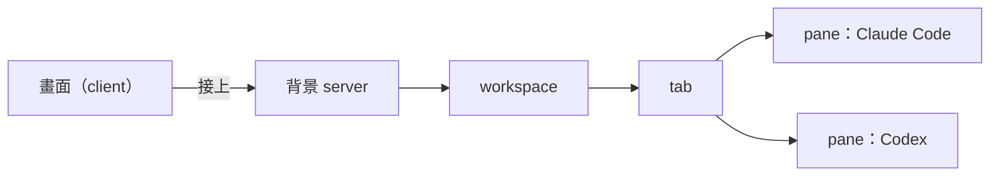
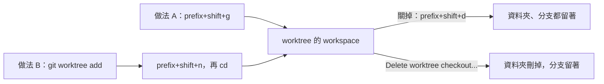
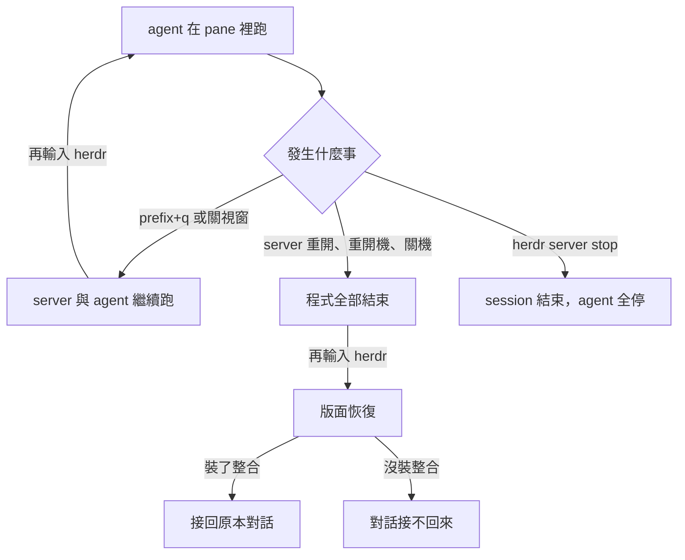

如果你照[git worktree 教學：讓兩個 AI 在同一個 repo 分開工作](/posts/git-worktree-parallel-ai-agents/)讓兩三個 coding agent 同時做事，下一個麻煩通常是分不出哪個在等你按「允許」、哪個還在跑。你得一個視窗一個視窗切過去看。終端機一關，或 SSH 連線一斷，做到一半的工作也可能跟著停掉。

herdr 是在終端機裡管理多個工作區和分割畫面的工具，官方也稱它為 terminal workspace manager。它把每個 agent 放進自己的分割畫面（pane），認出裡面跑的是哪個 coding agent，再用側欄不同顏色的圓點標出它在跑、在等你，還是已經做完。

關掉你看到的畫面，背景的工作也能繼續。官方的說法是「the runtime your coding agents live on」。

herdr 不會包住或取代你的 agent，README 寫：「herdr doesn't wrap or replace them; it owns their terminals.」它管的是終端機，agent 還是你原來用的那個。

這篇講的是終端機裡的 Herdr TUI（[herdr.dev/tui](https://herdr.dev/tui)）。herdr.dev 首頁現在主推的 Herdr desktop App（[herdr-app](https://github.com/herdrdev/herdr-app)）是另一個程式，在其中一個啟動的 agent，不會出現在另一個裡。桌面 App 的用法見[Herdr 桌面 App 入門：用 space 與分頁管理多個 AI](/posts/herdr-app-desktop-manage-ai-agents/)。

文中以 macOS 和 Linux 為主，用 Claude Code 與 Codex 當例子，官方支援的其他 agent 見[Agents](https://herdr.dev/tui/docs/0.9.5/agents/)。Windows 已有原生支援，但有已知限制，見[Windows support](https://herdr.dev/tui/docs/0.9.5/windows-beta/)。

> 依 herdr v0.9.5 的官方文件，這一版在 2026-10-15 發布，我在 2026-11-12 確認它仍是最新穩定版。herdr 還是 0.x 版，更新很快，指令與快捷鍵以[官方文件](https://herdr.dev/tui/docs/0.9.5/)為準。
{: .prompt-info }

## 先說幾個詞

- **終端機（terminal）**：輸入指令的文字視窗。
- **detach（離開）／reattach（接回）**：暫時離開畫面，之後再接回同一個 session。
- **prefix 鍵**：先按 `ctrl+b` 再放開，接著按下一個鍵。官方[Keyboard](https://herdr.dev/tui/docs/0.9.5/keyboard/)的例子是「`prefix+c` means: press `ctrl+b`, release, then press `c`.」`prefix+shift+g` 就是放開 `ctrl+b` 之後按 `shift+g`。Mac 上是 control 鍵，不是 command 鍵；用過 tmux 的人會覺得眼熟。
- **套件管理器**：像 Homebrew（`brew`）和 mise 這類幫你安裝、升級、移除工具的程式。
- **coding agent、worktree、分支**：沿用 worktree 篇的說法，agent 會自己改檔、跑指令。worktree 是同一個 repo 裡另一份獨立的工作目錄。分支是 git 裡一條獨立的修改紀錄，每份工作目錄各自停在一條分支上。

herdr 本身分成下面幾層：



- **背景 server／client**：herdr 把終端機放在背景的 server 裡跑，你看到的畫面只是接上去的 client。
- **workspace**：一個專案或任務，官方建議 one workspace per repo, task, or investigation。
- **tab**：workspace 裡的一個版面。
- **pane**：真正的終端機分割畫面，官方原話是「A pane is a real terminal.」

指令、快捷鍵、狀態定義和斷線後的行為，我都依官方文件並附上連結。「用 brew 或 mise 安裝」「一個 worktree 配一個 workspace」「先處理 blocked」是我的建議，文中會標明。

## 什麼時候值得用

同時跑兩個以上的 agent，或常常要離開座位、用 SSH 連遠端機器時，我建議用 herdr。只跑一個 agent，或已經有順手的安排，不一定要換。

## 開始前要準備

- 一台 macOS 或 Linux 電腦，以及終端機。macOS 用內建的「終端機」App 就可以。
- Homebrew 或 mise 其中一個。兩個都沒用過的話，macOS 可以先照 [Homebrew 官網](https://brew.sh/)的說明裝好 Homebrew。
- 一個用 git 管理、至少有過一次 commit 的專案資料夾，步驟 3 開 worktree 時會用到。
- 已經裝好並登入 Claude Code 或 Codex：在一般終端機輸入 `claude` 或 `codex`，能正常啟動。

裝好 herdr 之後，每一輪的用法是下圖的五步，分別對應步驟 2 到 6。

{: w="1600" h="900" }
_概念圖：一輪的五個步驟是開 herdr、開工作目錄、跑 agent、找卡住的、離開再接回。prefix 是先按 ctrl+b 放開，再按下一個鍵。_

## 步驟 1：安裝

{: w="1600" h="900" }
_概念圖：左邊是本站建議的做法，用 brew 或 mise 安裝與升級；右邊是官方 Install／TUI 頁的一行安裝，若要用，先下載腳本、看過再執行。_

已經在用 [Homebrew](https://formulae.brew.sh/formula/herdr) 的人，我建議用 brew 安裝：

```bash
brew install herdr
```

已經在用 [mise](https://mise.jdx.dev/) 的人，用 mise 安裝：

```bash
mise use -g herdr
```

這兩種都列在官方[Install](https://herdr.dev/tui/docs/0.9.5/install/)頁。用 mise 時若出現 `herdr not found in mise tool registry`，依官方說法，先更新 mise 再試一次。用 brew 裝的 mise 執行：

```bash
brew upgrade mise
```

其他方式裝的 mise 執行：

```bash
mise self-update
```

### 官方的一行安裝：先下載、看過再執行

官方 Install／TUI 頁另外提供一行安裝指令 `curl -fsSL https://herdr.dev/install.sh | sh`。我建議不要直接貼上執行，原因有兩個：

- 這樣跑的是伺服器當下回傳、你沒看過的內容，下次執行也可能不一樣。
- 它會裝到 `~/.local/bin`，之後靠 `herdr update` 自己更新，不會出現在套件管理器的清單裡。日後比較難查到裝了什麼，也比較難移除。用 brew 或 mise 裝，版本查得到，升級和移除也都用同一套指令。

這不是說安裝腳本有問題，而是出於我「先看過再執行」的習慣，原因我在[裝了第三方 skill 和 MCP 之後，你的 Coding Agent 多了哪些破口？](/posts/coding-agent-supply-chain-permission-risks/)談過。

若一定要用官方腳本，先把它下載成檔案：

```bash
curl -fsSL https://herdr.dev/install.sh -o herdr-install.sh
```

用文字編輯器打開看過。也可以在終端機用 less 看，看完按 `q` 離開：

```bash
less herdr-install.sh
```

確認沒問題再執行：

```bash
sh herdr-install.sh
```

看不懂腳本在做什麼的話，改用 brew 或 mise。

### 確認裝好

裝好後執行：

```bash
herdr --version
```

依官方文件，這會顯示版本號，例如 0.9.5。用中文、日文或韓文輸入法時，如果 prefix 快捷鍵沒反應，請確認版本是 0.9.5 或更新，官方在這一版修過這個問題。

### 更新：用原本安裝的那套工具

官方原文是：「Use `herdr update` only for installs managed by Herdr's own installer. Update Homebrew, mise, and Nix installs through those package managers instead.」用 brew 裝的執行：

```bash
brew upgrade herdr
```

用 mise 裝的執行：

```bash
mise upgrade herdr
```

套件管理器更新之後，再輸入一次 `herdr`，就會用新版畫面接上。原本在跑的背景 server 和 agent 不受影響。

要連 server 也換成新版，先停掉 server 再重新啟動，見 Install 頁的 Update 節。停掉 server 會停掉所有正在跑的 agent（見步驟 6）。依序執行：

```bash
herdr server stop
herdr
```

不想讓 herdr 在背景連 herdr.dev，就關掉設定檔裡 `[update]` 底下的這兩項，見[Configuration](https://herdr.dev/tui/docs/0.9.5/configuration/)。設定檔是 `~/.config/herdr/config.toml`，沒有就自己建立：

```toml
[update]
version_check = false
manifest_check = false
```

## 步驟 2：在專案資料夾開 herdr

在終端機進入專案資料夾，再輸入 `herdr`，例如：

```bash
cd ~/projects/demo-app
herdr
```

依[Quick start](https://herdr.dev/tui/docs/0.9.5/quick-start/)，這會啟動或接上預設的背景 session。session 裡還沒有 workspace 時，會自動開一個，也就是下圖側欄的 demo-app。之後每開一個 worktree，就多一個 workspace（步驟 3）。

{: w="1600" h="900" }
_實際畫面：在 demo-app 資料夾開 herdr，再用 prefix+v 分出第二個 pane。這兩個 pane 跑的是一般 shell，不是 agent，所以 agents 區是空的。_

herdr 可以全程用滑鼠操作：點一下切換 pane、tab、workspace 和 agent，拖邊界調整大小，按右鍵分割。官方說滑鼠能完成所有操作，鍵盤快捷鍵是選用的，所以下文的快捷鍵記不住也沒關係。

## 步驟 3：每個工作目錄一個 workspace

我建議每個 worktree 配一個 workspace，讓每個 agent 只改自己的那份工作目錄，兩個 agent 就不會同時改到同一個檔案。這和 worktree 篇的原則相同。

做完之後怎麼合併、怎麼刪分支，以及有 submodule 的 repo 為什麼不建議用 worktree，見[git worktree 教學：讓兩個 AI 在同一個 repo 分開工作](/posts/git-worktree-parallel-ai-agents/)。

開法有兩種，選一種即可，底層都是 `git worktree`。收尾時要分清楚，關掉 workspace 和刪掉 worktree 是兩回事：



**做法 A：用 herdr 開。**

1. 在專案的 workspace 裡按 `prefix+shift+g`，或在側欄 workspace 那一列選 `New worktree`，會跳出 new worktree 視窗。
2. 分支欄一開始會填好隨機名稱。先按 ctrl+c 清掉，再輸入你要的分支名稱，例如 `login-page`。
3. 按 Enter。herdr 會建好 git worktree，並把它開成一個新的 workspace，排在原專案底下。點側欄的名稱就能切換。

這個操作等同在專案資料夾內執行：

```bash
herdr worktree create --branch login-page
```

{: w="1600" h="900" }
_實際畫面：按 prefix+shift+g 開 worktree。分支欄一開始會填好隨機名稱，先按 ctrl+c 清掉再輸入；按 Enter 會建好並開成新的 workspace。_

預設位置是 `~/.herdr/worktrees/<repo>/<分支>`。要改位置，在 `~/.config/herdr/config.toml` 設定 `[worktrees] directory`，見[Configuration](https://herdr.dev/tui/docs/0.9.5/configuration/)。

**做法 B：沿用 worktree 篇。** 先在專案資料夾內用 git 開好資料夾，例如：

```bash
git worktree add -b login-page ../demo-app-login-page
```

再在 herdr 按 `prefix+shift+n` 開新的 workspace，然後在裡面進入剛才開好的資料夾：

```bash
cd ../demo-app-login-page
```

依官方說明，關掉專案那一列時，排在它底下的 worktree workspace 也會一起關掉。

要刪掉 worktree 的資料夾，在側欄選那個 worktree 的 workspace（排在專案底下的那一列），用 `Delete worktree checkout...`。它的底層是 `git worktree remove`，你也可以自己執行。不論哪一種，分支都要另外刪。

## 步驟 4：在 pane 裡啟動 agent

切到要工作的 workspace，在 pane 裡輸入 `claude` 或 `codex`，跟在一般終端機啟動一樣。依 Quick start，herdr 會自動認出這是哪個 agent，側欄的 agents 區會多出一列。

官方還支援 Cursor Agent CLI、GitHub Copilot CLI、OpenCode 等，完整清單見[Agents](https://herdr.dev/tui/docs/0.9.5/agents/)。同一個 workspace 裡若還要多開一個終端機，例如跑測試，就分割 pane：`prefix+v` 向右，`prefix+minus` 向下。

整合（integration）是選用的。不裝也能看狀態；裝了之後，herdr 的背景 server 重開時，才能接回同一段對話。Claude Code 的安裝指令是：

```bash
herdr integration install claude
```

Codex 的安裝指令是：

```bash
herdr integration install codex
```

整合會改 agent 的設定，見[Integrations](https://herdr.dev/tui/docs/0.9.5/integrations/)：

- Claude Code：多一支 hook 腳本，並在 `settings.json` 加上對應的 hook 設定。
- Codex：多一支 hook 腳本，改 `hooks.json`，並在 `config.toml` 開啟 `[features] hooks = true`。

要移除時執行下面這行，Codex 把 `claude` 換成 `codex`。移除後，Codex 的 `config.toml` 不會被改回去。

```bash
herdr integration uninstall claude
```

hook 是什麼，可以參考我寫的[Claude Code hooks 教學：自動排版、跑測試與敏感檔提醒](/posts/claude-code-hooks-automate-checks/)。

## 步驟 5：看狀態，找出卡住的那個

{: w="1600" h="900" }
_概念圖：五種狀態的意思，以及本站建議你該做的事。blocked 要先處理；新的提示畫面可能先顯示成 idle，看到 idle 也不代表可以不看內容就按「允許」。圖上的顏色是本站配圖用的，不是 herdr 介面的配色。_

側欄用不同顏色的圓點標出每個 agent 的狀態。同一個 workspace 裡有 agent 是 blocked 時，workspace 自己的那一列也會換成 blocked 的顏色。官方定義了五種狀態，表格最右欄「你該做什麼」是我的建議。

| 狀態 | 官方定義（白話） | 本站建議你該做什麼 |
| --- | --- | --- |
| blocked | 在等你回答、核准或做決定 | 先處理：打開看清楚再回答 |
| working | 正在跑 | 不用管，讓它做 |
| done | 做完了，你還沒看 | 去看結果、檢查改了什麼 |
| idle | 做完了或在等下一個指示，而且你已經看過 | 可以交代下一件事 |
| unknown | herdr 認不出狀態 | 自己點進去看一眼 |

{: w="1600" h="900" }
_實際畫面（herdr 預設主題）：黃點 working、紅點 blocked、青綠點 done、空心綠圈 idle。示範用的「agent」是用 herdr pane report-agent 回報狀態的 shell 腳本，不是 Claude Code 或 Codex。_

側欄只有圓點。要看寫成文字的狀態名稱，或快速找到卡住的 agent，按 `prefix+g` 打開 Go to 清單。

在清單裡按 `b` 只看 blocked；`w`、`i`、`d` 分別只看 working、idle、done，`a` 看全部。用方向鍵選好後按 Enter 跳過去。

{: w="1600" h="900" }
_實際畫面：按 prefix+g 開 Go to，狀態直接寫成文字；再按 b 只留下 blocked 的那一列，按 Enter 跳過去。清單裡示範的「agent」是用 herdr pane report-agent 回報狀態的 shell 腳本，不是 Claude Code 或 Codex。_

### idle 不代表可以核准

依官方[Agents](https://herdr.dev/tui/docs/0.9.5/agents/)頁，blocked 的判斷刻意從嚴：herdr 沒見過的新提示畫面，一開始可能顯示成 idle，而不是 blocked。同一頁也寫明「idle status is not authorization to approve an action」，也就是看到 idle，不代表可以直接核准。

所以跳過去之後，要看清楚再按允許。這和我在[OWASP Agentic Top 10 檢查表：AI 工作流十項風險與修法](/posts/owasp-agentic-top-10-ai-workflow-checklist/)裡談的過度信任、審批疲勞是同一件事。

狀態看起來不對時，用下面這行查看 herdr 的判斷依據，見[Agents](https://herdr.dev/tui/docs/0.9.5/agents/)：

```bash
herdr agent explain <目標>
```

### 通知預設關閉

herdr 預設不會跳出通知。設定檔裡 `[ui.toast]` 的 `delivery` 決定通知出現在哪裡：

| `delivery` | 通知出現在哪裡 |
| --- | --- |
| `off`（預設） | 不跳出通知 |
| `herdr` | herdr 畫面裡 |
| `system` | 作業系統的通知；macOS 會優先透過 terminal-notifier 發送 |

要開啟 herdr 畫面裡的通知，在設定檔 `~/.config/herdr/config.toml` 加上：

```toml
[ui.toast]
delivery = "herdr"
```

存檔後執行下面這行，或按 `prefix+shift+r`，設定就會生效：

```bash
herdr server reload-config
```

改用 `system` 的話，官方建議 macOS 先安裝 terminal-notifier：

```bash
brew install terminal-notifier
```

其他選項見[Configuration](https://herdr.dev/tui/docs/0.9.5/configuration/)或[Config reference](https://herdr.dev/tui/docs/0.9.5/config-reference/)。

## 步驟 6：離開，再接回來

要離開時，按 `prefix+q`（先 `ctrl+b` 再 `q`），或直接關終端機視窗。依 Quick start，之後再輸入 `herdr` 就會接回同一個 session。不同情況下，agent 會怎樣：



server 重開或重開機那一條，README 的原文是「the original processes do not survive」，agent 也包括在內。圖中的版面指 workspace、tab、pane 的排列，整合是步驟 4 裝的 integration。什麼會留下、什麼不會，完整的表見官方[Session state](https://herdr.dev/tui/docs/0.9.5/session-state/)。

用 SSH 連遠端機器做事時，直接在遠端執行 `herdr`，斷線後工作仍可繼續。另一種做法是用 `--remote` 指定主機，見[How to work](https://herdr.dev/tui/docs/0.9.5/how-to-work/)：

```bash
herdr --remote <主機>
```

全部收工時執行：

```bash
herdr server stop
```

官方說明是結束這個 session，並停止裡面的 pane。請注意，這會停掉所有 pane 裡正在跑的 agent。

## 快捷鍵速查

忘記時按 `prefix+?` 可看全部快捷鍵。

| 按鍵 | 作用 |
| --- | --- |
| `prefix+v`／`prefix+minus` | 向右／向下分割 pane |
| `prefix+h`／`j`／`k`／`l` | 移到左／下／上／右邊的 pane |
| `prefix+c` | 新 tab（會先跳出命名視窗，按 Enter 建立） |
| `prefix+w` | 打開 workspace 導覽，切換 workspace |
| `prefix+shift+n` | 新 workspace |
| `prefix+shift+g` | 新 worktree |
| `prefix+shift+d` | 關掉選取的 workspace |
| `prefix+g` | 打開 Go to（再按 `b` 只看 blocked） |
| `prefix+z` | 放大目前 pane |
| `prefix+x` | 關掉目前 pane |
| `prefix+q` | 離開（detach） |
| `prefix+?` | 看全部快捷鍵 |

## 下一步

官方也提供讓 agent 自己操作 herdr 的 skill。下面這行會印出與目前版本相符的內容：

```bash
herdr --skill
```

裝任何第三方 skill 之前，我建議先讀過內容，原因見[裝了第三方 skill 和 MCP 之後，你的 Coding Agent 多了哪些破口？](/posts/coding-agent-supply-chain-permission-risks/)。

延伸閱讀： [herdr README](https://github.com/herdrdev/herdr)、[v0.9.5 release](https://github.com/herdrdev/herdr/releases/tag/v0.9.5)、[文件首頁](https://herdr.dev/tui/docs/0.9.5/)、[Install](https://herdr.dev/tui/docs/0.9.5/install/)、[Quick start](https://herdr.dev/tui/docs/0.9.5/quick-start/)、[Concepts](https://herdr.dev/tui/docs/0.9.5/concepts/)、[Keyboard](https://herdr.dev/tui/docs/0.9.5/keyboard/)、[Agents](https://herdr.dev/tui/docs/0.9.5/agents/)、[Integrations](https://herdr.dev/tui/docs/0.9.5/integrations/)、[Session state](https://herdr.dev/tui/docs/0.9.5/session-state/)、[Configuration](https://herdr.dev/tui/docs/0.9.5/configuration/)、[Windows support](https://herdr.dev/tui/docs/0.9.5/windows-beta/)、[Homebrew formula](https://formulae.brew.sh/formula/herdr)。
