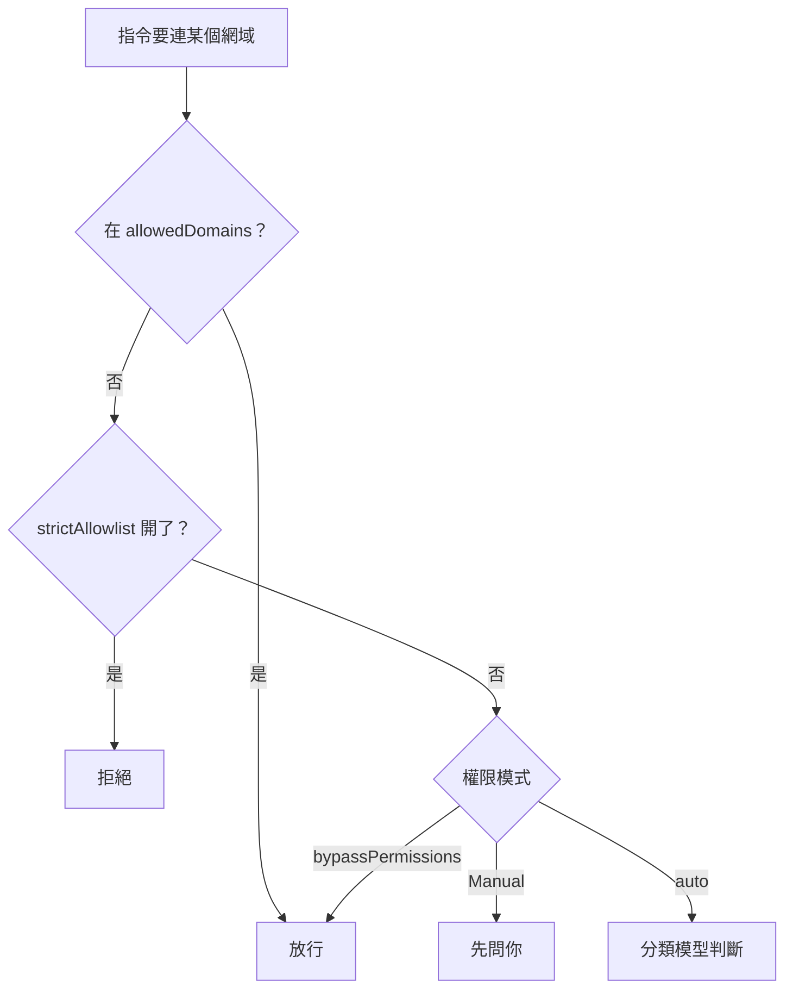
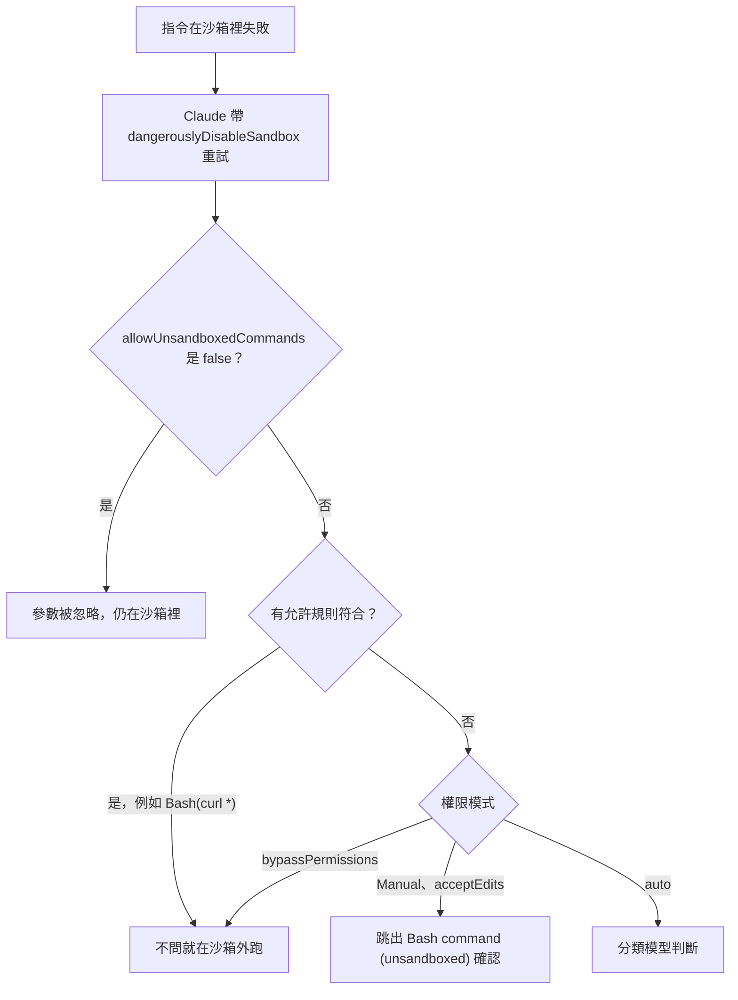
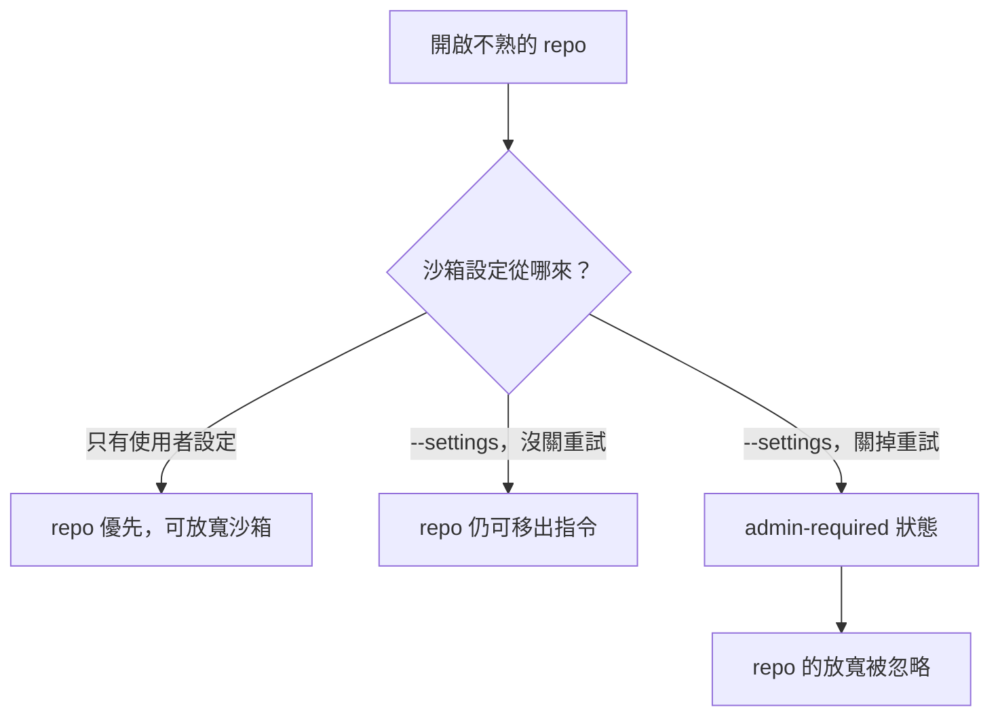

Claude Code（在終端機裡使用的 AI 程式助理）會自己下指令：跑測試、裝套件、呼叫 `git`。這些指令用的是你的帳號，所以預設能讀你讀得到的所有檔案，包括 SSH 金鑰和雲端憑證。Claude Code 內建沙箱（sandbox），可以把這些指令關在作業系統強制執行的範圍裡，限制它們能寫到哪裡、能連到哪些網站。

但沙箱**預設是關閉的**。就算打開了，官方文件也寫明：預設仍讀得到 `~/.ssh` 和 `~/.aws/credentials`。很多人以為「開了就安全」，我認為其實還差幾步。

這篇一步步把這幾步補上，每一步都附上我在自己的 Mac 上實際跑出來的結果，文末有一份可以直接複製的 `settings.json`。

> 依據 2026-11-13（台北時間）當天的 [Sandboxing](https://code.claude.com/docs/en/sandboxing)、[Permissions](https://code.claude.com/docs/en/permissions)、[Settings reference](https://code.claude.com/docs/en/settings-reference) 與 [changelog](https://code.claude.com/docs/en/changelog)。我在同一天用 macOS 上的 Claude Code 2.1.323（當天最新版，11 月 12 日發布）實際跑過一次。
{: .prompt-info }

11 月的幾個版本連續修了沙箱與權限規則的問題：

- 2.1.321 修正唯讀指令沒經過提示就在沙箱外執行，以及 `cp`／`mv` 寫進資料夾時拒絕規則失效。
- 2.1.323 修正沙箱可能在對話中途關掉，以及 `excludedCommands` 讓沒列到的指令跑出沙箱。

照著做之前，請先在終端機依序執行這兩行，更新後再確認版本：

```bash
claude update
claude --version
```

這篇是〈[OWASP Agentic Top 10 檢查表：AI 工作流十項風險與修法](/posts/owasp-agentic-top-10-ai-workflow-checklist/)〉的實作續篇。那篇我只請你「確認 `/sandbox` 有沒有開」，這篇示範開了之後怎麼設定。為什麼要限制 agent 的權限，我在〈[裝了第三方 skill 和 MCP 之後，你的 Coding Agent 多了哪些破口？](/posts/coding-agent-supply-chain-permission-risks/)〉談過，這裡不再重講。

## 先認識幾個名詞

- **沙箱（sandbox）**：一個由作業系統看守的圍欄。程式在裡面照常執行，但只能碰到圍欄允許的檔案和網路。
- **token**：一串代替密碼的文字，工具拿它登入 GitHub、npm 這類服務。被別人拿到，就等於對方能用你的身分操作。
- **環境變數**：程式啟動時從終端機帶進去的一組設定值。很多工具把 token 放在這裡，例如 `GITHUB_TOKEN`。
- **網域（domain）**：網站的名字，例如 `example.com`、`github.com`。
- **允許清單（allowlist）**：你事先列好「可以連」的網域，不在清單上的就要另外處理。
- **代理（proxy）**：幫忙轉送網路連線的中間站。沙箱裡的指令要連外，都得經過 Claude Code 在你電腦上開的代理，由它檢查網域。
- **權限模式**：決定 Claude 做事前要不要先問你。預設的 Manual 模式會逐一詢問，auto 模式交給另一個 AI 分類模型判斷，`bypassPermissions` 模式什麼都不問。
- **`!` 指令**：在 Claude Code 的輸入框開頭打 `!`，後面接的指令會直接在你的終端機執行，不經過 Claude。

## 我怎麼實測

為了讓結果可以重現，先交代我的做法：

- **環境**：macOS（Apple Silicon）、Claude Code 2.1.323，2026-11-13 上午（台北時間）。
- **方式**：`/sandbox` 面板只能在互動畫面裡操作。非互動模式是 `claude -p`：把問題直接當參數交給 Claude，跑完就結束。在這個模式下，`/sandbox` 會回覆 `/sandbox isn't available in this environment.`。所以我把每一步的設定寫成 JSON 檔，用 `claude -p "請用 Bash 執行……" --settings 檔案` 帶入。這和在面板或 `settings.json` 裡設定是同一組鍵值。
- **不拿真的金鑰測**：我建了一個假的「誘餌檔」`~/.sandboxlab-canary/secret.txt` 代替 `~/.ssh`。它的內容是 `FAKE-SECRET-FOR-TEST`，21 bytes。假的環境變數 `SANDBOXLAB_FAKE_TOKEN` 則代替 `GITHUB_TOKEN`。測完都刪掉了。
- **沒有人能按「允許」**：非互動模式沒人回答詢問，所以凡是「會跳出詢問」的情況，下面的結果都是被拒絕。你在一般的互動畫面裡操作時，會看到確認視窗。
- **輸出有改寫**：家目錄路徑改寫成 `~`，測試資料夾縮寫成 `…/sandboxlab`，我只刪掉了 curl 的進度列，其餘照原樣。

## 沙箱擋什麼、預設放行什麼

沙箱只包住「指令」：Claude 透過 Bash、PowerShell 和 Monitor 工具跑的指令，以及這些指令再啟動的程式。限制由作業系統執行，各平台用的機制不同：

| 平台 | 沙箱機制 |
| --- | --- |
| macOS | 內建的 Seatbelt |
| Linux、WSL2 | bubblewrap |
| WSL1 | 不支援，請先升級到 WSL2 |
| 原生 Windows | 不支援，Claude Code 會直接在沙箱外跑指令。要在 Windows 上用沙箱，得把 Claude Code 裝在 WSL2 裡 |

官方文件列出開啟後的預設值：

| 項目 | 預設 | 用哪個設定調整 |
| --- | --- | --- |
| 寫入 | 只能寫工作目錄（你啟動 Claude Code 的那個資料夾）、一個每位使用者專用的暫存資料夾，以及你另外加入的資料夾。其中 Claude Code 的設定檔、`.mcp.json`、`.git/hooks` 這類受保護的路徑仍然不能寫 | `filesystem.allowWrite`、`filesystem.denyWrite` |
| 讀取 | 幾乎整台電腦都讀得到，**包括 `~/.ssh`、`~/.aws/credentials`** | `filesystem.denyRead`、`credentials` |
| 網路 | 不能直接連外。連線都要經過本機的代理，代理會比對你允許的網域，而允許清單一開始是空的。不在清單上的網域怎麼處理，**看你的權限模式**（見步驟一的圖） | `network.allowedDomains`、`network.deniedDomains`、`network.strictAllowlist` |
| 環境變數 | 沿用 Claude Code 的環境，**包括裡面的 token** | `credentials` |

{: w="1600" h="900" }
_概念圖，不是實際介面。沙箱只管指令，其他元件依權限規則或以你的完整權限執行。_

寫入和網路預設就收得很緊，讀取和環境變數則幾乎沒擋。我只開沙箱、其他什麼都不設，請 Claude 檢查誘餌檔和假 token，結果和沙箱關閉時一模一樣：

```text
# 設定：{"sandbox": {"enabled": true}}，請 Claude 執行：
# wc -c ~/.sandboxlab-canary/secret.txt; test -n "$SANDBOXLAB_FAKE_TOKEN" && echo set || echo unset
      21 ~/.sandboxlab-canary/secret.txt
set
```

`21` 代表讀得到檔案，`set` 代表拿得到 token。這就是第三步要補的地方。

## 什麼時候該開

符合下面任一種情況，就值得開：

- 你常按「允許」讓 Claude 跑指令，或想讓它不必每次問你就能跑。開了沙箱之後，越界的動作由沙箱擋下，不必再靠你逐一檢查每個指令。
- 你會讓 Claude 讀不是你寫的東西，例如別人的 repo、issue、網頁或套件原始碼。這些內容可能藏著要 AI 執行指令的文字。
- 你的電腦上有金鑰、雲端憑證或 token，而且不想讓 AI 跑的指令讀到它們。

## 步驟一：用 /sandbox 開啟

**macOS** 不用另外安裝。**Linux 和 WSL2** 要先裝 bubblewrap 和 socat：

```bash
# Ubuntu / Debian
sudo apt-get install bubblewrap socat

# Fedora
sudo dnf install bubblewrap socat
```

裝好後重新啟動 Claude Code，因為它只在啟動時檢查這些套件。較新的 Ubuntu 預設用 AppArmor 限制使用者命名空間，會讓 bubblewrap 無法啟動。`/sandbox` 會指出這個問題，解法見官方的 [Add an AppArmor profile for bubblewrap](https://code.claude.com/docs/en/sandboxing#add-an-apparmor-profile-for-bubblewrap)。

接著在 Claude Code 裡輸入：

```text
/sandbox
```

會打開沙箱面板，有三個分頁：

- **Mode**：選擇沙箱裡的指令要怎麼核准。
- **Overrides**：在沙箱裡失敗的指令，能不能改到沙箱外重跑。第四步會關掉它。
- **Config**：查看目前生效的沙箱設定。

在 Linux 上，面板還可能出現 Dependencies 分頁：

- 面板**只有** Dependencies 分頁：沙箱還無法啟動。照分頁列出的缺項（或 AppArmor 限制）處理後重啟。
- Dependencies 出現在其他分頁旁邊：缺的只是選用元件（seccomp filter），沙箱照樣能跑。

在 Mode 分頁二選一：

| 模式 | 沙箱裡的指令 | 適合 |
| --- | --- | --- |
| auto-allow | 不再逐一詢問你。拒絕規則仍然有效，`Bash(git push *)` 這類指定內容的詢問規則也照樣會跳出確認 | 想少按幾次「允許」 |
| regular permissions | 沙箱照樣限制，但每個指令仍照一般權限流程問你 | 想每個指令都自己看過 |

兩種模式的檔案與網路限制完全相同，差別只在要不要問你。選了 auto-allow 之後，Claude 用指令改工作目錄裡的檔案就不會再問你，就算你用的是平常改檔都會先問的 Manual 模式也一樣。

在面板選的模式只會存進**這個專案**的 `.claude/settings.local.json`。要讓所有專案都開沙箱，在 `~/.claude/settings.json` 設 `"sandbox": { "enabled": true }`。

只寫 `enabled` 時，預設就是 auto-allow。要改成 regular permissions，再加上 `"autoAllowBashIfSandboxed": false`。

開啟之後，Claude 跑的指令就受沙箱限制。指令第一次要連某個網域時，依下圖決定放不放行：



不想讓任何模式放行清單外的網域，就打開 `strictAllowlist`。在使用者設定（或 `--settings` 帶入的檔案）的 `sandbox` 裡加上 `"network": { "strictAllowlist": true }` 即可。

這個設定 2.1.219 起才有，寫在 repo 的設定檔裡無效。打開之後，需要的網域改寫進 `allowedDomains`。

我請 Claude 執行 `curl -sS -o /dev/null -w "%{http_code}\n" https://example.com`，換了四種設定。這行只印出網站回應的狀態碼，`200` 代表連上了：

```text
# 1. 允許清單是空的，Manual 模式（非互動，沒人回答詢問 → 拒絕）
curl: (56) CONNECT tunnel failed, response 403
000

<sandbox_violations>
deny network-outbound example.com:443 (user denied)
</sandbox_violations>

# 2. 把 example.com 加進 allowedDomains，Manual 模式
200

# 3. 允許清單是空的，bypassPermissions 模式（沒有問就放行了）
200

# 4. 加上 strictAllowlist: true，bypassPermissions 模式
curl: (56) CONNECT tunnel failed, response 403
000

<sandbox_violations>
deny network-outbound example.com:443 (host is not on the allow list)
</sandbox_violations>
```

第 3 和第 4 組的對比最值得注意：在 `bypassPermissions` 模式下，清單外的網域會不問就放行，要加 `strictAllowlist` 才擋得住。

## 步驟二：確認真的有擋

官方給了兩行檢查指令。請**叫 Claude 執行**，不要自己在 `!` 後面打，因為你自己用 `!` 打的指令大多本來就在沙箱外跑，測不出沙箱有沒有作用：

```bash
touch ~/sandbox-probe
curl --noproxy '*' https://example.com
```

| 指令 | 測什麼 | 沙箱有作用時的結果 |
| --- | --- | --- |
| 第一行 `touch` | 在家目錄建一個空檔案，測試「寫不到工作目錄以外」 | macOS 顯示 `Operation not permitted`；Linux 和 WSL2 顯示 `Read-only file system` |
| 第二行 `curl` | 叫 curl 不走代理、直接連外，測試「沒辦法自己連外」 | 顯示 `Could not resolve host`，因為這個指令繞不過沙箱的代理 |

檢查時，注意三件事：

1. **用 Manual 模式。** 如果 Claude 問你要不要改到沙箱外重試，**拒絕**。在 `bypassPermissions` 模式，或有允許規則剛好符合這個指令時，重試會不問就在沙箱外跑，檢查就不準了（第四步會關掉這個重試）。
2. **不要在家目錄啟動 Claude Code。** 如果你在家目錄啟動，或把家目錄加成了工作目錄，`touch` 本來就寫得進去，換一個專案資料夾再測。
3. **排除上面兩種情況後 `touch` 仍然成功**，先刪掉 `~/sandbox-probe`，再執行 `/sandbox` 確認沙箱有開、相依套件都裝好了。

我在 macOS 上跑出來的結果：

```text
# 請 Claude 執行：touch ~/sandbox-probe
touch: ~/sandbox-probe: Operation not permitted
# 結束代碼 1

# 請 Claude 執行：curl --noproxy '*' https://example.com
curl: (6) Could not resolve host: example.com
# 結束代碼 6
```

兩行都失敗，代表寫入和網路限制有在作用。

## 步驟三：把金鑰和 token 擋在外面

沙箱**沒有內建的憑證清單**，只有你列出來的檔案和變數才會被擋。要保護的項目，用 `sandbox.credentials` 列出。

下面是官方範例。它擋住 AWS 憑證檔和整個 SSH 資料夾，並把 `GITHUB_TOKEN`、`NPM_TOKEN` 從沙箱指令的環境裡拿掉：

```json
{
  "sandbox": {
    "enabled": true,
    "credentials": {
      "files": [
        { "path": "~/.aws/credentials", "mode": "deny" },
        { "path": "~/.ssh", "mode": "deny" }
      ],
      "envVars": [
        { "name": "GITHUB_TOKEN", "mode": "deny" },
        { "name": "NPM_TOKEN", "mode": "deny" }
      ]
    }
  }
}
```

`"mode": "deny"` 用在檔案，代表沙箱裡的指令不能讀；用在環境變數，代表每個沙箱指令執行前先把它移除。把清單換成你電腦上真的有的憑證，例如其他雲端服務的設定檔，或其他存 token 的環境變數。

我建議放在使用者設定 `~/.claude/settings.json`，所有專案都會套用。各層設定的 `deny` 會合併：任何一層都可以再加，但沒有一層能拿掉別層加的 `deny`。

不過，這不代表別人的 repo 就動不了你的保護。repo 的設定優先於使用者設定，還有別的辦法放寬沙箱，步驟五會說明怎麼防。

確認的方法如下。兩個檢查都只印出「檔案大小」或「有沒有設定」，不會把金鑰或 token 的內容印進對話。

1. 自己在 `!` 後面打這行（換成你電腦上確實存在的檔案）：

   ```bash
   wc -c ~/.ssh/known_hosts
   ```

   這是在沙箱外跑，會印出檔案大小。
2. 再請 Claude 跑同一行。設定生效後，它應該讀不到這個檔案。
3. 環境變數也一樣，先自己用 `!` 跑這行：

   ```bash
   test -n "$GITHUB_TOKEN" && echo set || echo unset
   ```

   確認印出 `set`，代表你的 shell 本來就有這個變數。再請 Claude 跑，生效後應該印出 `unset`。
4. 如果 Claude 要求改到沙箱外重試，拒絕。

不想拿真正的金鑰測，也可以照我的做法：自己建一個內容是假字串的檔案和一個假的環境變數，把它們寫進 `credentials`，測完再刪掉。

我把誘餌資料夾 `~/.sandboxlab-canary` 和假 token `SANDBOXLAB_FAKE_TOKEN` 都設成 `"mode": "deny"`，再請 Claude 跑和前面同一行：

```text
# 設定 credentials 之前（只開沙箱）
      21 ~/.sandboxlab-canary/secret.txt
set

# 設定 credentials 之後
wc: ~/.sandboxlab-canary/secret.txt: open: Operation not permitted
unset
```

檔案打不開，token 也從環境裡消失了。

擋掉 `~/.ssh` 的代價是，沙箱裡走 SSH 的 `git push`、`git pull` 會失敗。其實在 macOS 上，就算沒擋 `~/.ssh`，沙箱裡的 SSH remote 本來也連不上。解法有三種：

- 最簡單：推送時自己在 `!` 後面打：

  ```bash
  git push
  ```

  它在沙箱外跑。

- 把 remote 換成 HTTPS。但這需要 personal access token 之類的 HTTPS 憑證，而上面的設定已經把 `GITHUB_TOKEN` 從沙箱裡拿掉了，要自己權衡。

- 用官方的 `excludedCommands` 把 `git push` 等指令移出沙箱。但被移出的指令會用你的完整權限執行、能連任何主機，用之前請想清楚。

> 想讓工具在沙箱裡照常登入、又不讓它看到真正的 token，官方另有 `"mode": "mask"`。指令只看到一個替代值，代理在送出請求時才換成真的。它要搭配實驗性的 `network.tlsTerminate`，而且 macOS 上對檔案使用 `mask` 的效果等於 `deny`。設定較複雜，入門先用 `deny`，細節見 [Mask credentials](https://code.claude.com/docs/en/sandboxing#mask-credentials)。
{: .prompt-tip }

## 步驟四：關掉「沙箱外重試」

指令在沙箱裡失敗時，Claude 可以帶上 `dangerouslyDisableSandbox` 參數，要求在沙箱外重跑一次。這是給不相容沙箱的工具用的逃生口。這次重跑會不會發生、由誰核准，依下圖決定，第一個判斷就是這一步要加的設定：



我先在 `bypassPermissions` 模式、沒關掉重試的情況下測。請 Claude 在工作目錄外建檔，失敗就帶 `dangerouslyDisableSandbox` 重試：

```text
# 第一次（在沙箱裡）
touch: ../outside/probe-T12.txt: Operation not permitted

# 第二次（dangerouslyDisableSandbox: true，沒有任何詢問）
(Bash completed with no output)
```

第二次成功了，檔案真的建在工作目錄外面。換成 Manual 模式時，重試會停在確認步驟。我用的是非互動模式，沒有人按「允許」，結果是 `Run outside of the sandbox` 被拒絕。

想讓 Claude 跑的指令都留在沙箱裡，我會關掉這個逃生口：

```json
{
  "sandbox": {
    "enabled": true,
    "allowUnsandboxedCommands": false,
    "failIfUnavailable": true
  }
}
```

- `allowUnsandboxedCommands: false`：Claude Code 會忽略 `dangerouslyDisableSandbox`。之後 Claude 跑的指令，除了符合 `excludedCommands` 的以外，都在沙箱裡執行。`/sandbox` 的 Overrides 分頁把這個狀態叫做 **Strict sandbox mode**。
- `failIfUnavailable: true`：沙箱啟動不了時（平台不支援或缺相依套件），Claude Code 直接在啟動時報錯結束。沒有這一項，Claude Code 只會在啟動時顯示警告，**照樣在沙箱外跑指令**。代價是在原生 Windows 這類不支援的平台上，或 Ubuntu 的 AppArmor 限制還沒處理時，Claude Code 會無法啟動。

從 2.1.285 起，使用者設定裡的 `allowUnsandboxedCommands: false`，就算專案設定寫 `true` 也不會被蓋掉。

同樣的要求、同樣是 `bypassPermissions` 模式，我加上 `allowUnsandboxedCommands: false` 之後再跑一次：

```text
# 第一次（在沙箱裡）
touch: ../outside/probe-T13.txt: Operation not permitted

# 第二次（Claude 照樣帶了 dangerouslyDisableSandbox: true，但被忽略，仍在沙箱裡）
touch: ../outside/probe-T13.txt: Operation not permitted
```

現在指令在沙箱裡失敗就是失敗。Claude 會回報錯誤，由你決定要不要調整設定，而不是自己跑到沙箱外。

代價是和沙箱不相容的工具會直接失敗，Claude 也不能再改到沙箱外重試。官方疑難排解列出的例子有：

- `docker`、`jest`
- macOS 上的 `gh`、`gcloud`、`terraform` 這類 Go 寫的工具
- 需要開瀏覽器的登入流程

遇到時自己用 `!` 執行。

如果覺得完全關掉太嚴，另一個做法是保留重試，但在 `permissions.ask` 加一條詢問規則 `Bash(dangerouslyDisableSandbox:true)`。之後每次要到沙箱外重試都會先問你，連 auto 模式和 `bypassPermissions` 模式也一樣。

我在 `bypassPermissions` 模式加了這條規則，Claude 的重試就被攔在確認步驟，檔案沒有建立。非互動模式下，它顯示為 `Run outside of the sandbox` 被拒絕。

## 步驟五：沙箱管不到什麼

下面這些不在沙箱的範圍內，要用別的方法補。

**Claude 的檔案工具和網路工具。** Read、Edit、Write、WebFetch、WebSearch 是 Claude Code 內建的工具，依權限規則決定能不能用，不受沙箱限制。官方特別寫明：`denyRead` 擋不住 Read 工具，`allowedDomains` 也限制不了 WebFetch。

所以就算沙箱擋住了 `cat ~/.ssh/id_ed25519`，Claude 還是可以用 Read 工具去讀。我沿用步驟三的設定（誘餌資料夾已設成 `deny`），請 Claude 改用 Read 工具讀同一個檔案：

```text
# Read 工具的結果（行號是 Read 工具自己加的）
1	FAKE-SECRET-FOR-TEST
```

沙箱裡的 `wc` 打不開的檔案，Read 工具照樣讀到了內容。

還有一個插曲。第一次問時，Claude 自己拒絕用 Read，說要尊重沙箱的設定；但我說明這是授權測試、檔案是假的之後，它就讀了。所以我不會把 AI 的「自律」當成防線，藏在網頁或 repo 裡的文字一樣可能說服它。

要真正補上這一塊，我會在權限設定加拒絕規則：

```json
{
  "permissions": {
    "deny": [
      "Read(~/.ssh/**)",
      "Read(~/.aws/credentials)"
    ],
    "blockWritesOutsideWorkingDirectories": true
  }
}
```

`Read(...)` 拒絕規則會擋住：

- Claude 的檔案工具讀這個路徑
- Claude Code 認得的 `cat`、`head` 這類讀檔指令
- 用 Edit 和 Write 改同一個路徑（NotebookEdit 例外）

開了沙箱時，Claude Code 也會把它加進沙箱的讀取拒絕清單。路徑寫法和沙箱不同：`~/` 代表家目錄，絕對路徑要寫成 `//` 開頭。

`blockWritesOutsideWorkingDirectories`（2.1.314 起）讓 Write、Edit、NotebookEdit 在任何權限模式下，都拒絕寫到工作目錄以外。它不限制指令，指令的寫入範圍由沙箱負責，兩者剛好互補。

開了它要知道兩個副作用：

- Claude 不能再改 Claude Code 的設定檔，連專案裡的也不行，要自己改。
- Claude 的 `EnterWorktree`、`ExitWorktree` 工具會被拿掉。

要關掉它，得從每個設定檔刪掉這個鍵再重啟。想連讀取也限制在工作目錄內，還有 `blockReadsOutsideWorkingDirectories`（2.1.257 起）可用。

我加上這兩條規則後，Read 工具改成直接被拒絕。在 `bypassPermissions` 模式叫 Write 工具寫到工作目錄外，也被拒絕：

```text
# Read 工具讀誘餌檔
File is in a directory that is denied by your permission settings.

# Write 工具寫 ../outside/probe-T16.txt
…/sandboxlab/outside/probe-T16.txt is outside …/sandboxlab/project; the
permissions.blockWritesOutsideWorkingDirectories setting blocks writes outside
the working directories. Ask the user to add the directory with /add-dir, or to
remove that setting.
```

**Claude Code 自己啟動的程式。** 下面這些都以你的完整權限執行，沙箱幫不上忙：

- [Hooks](/posts/claude-code-hooks-automate-checks/)
- 本機的 MCP server
- 外掛的 monitor、LSP server
- 狀態列指令、`apiKeyHelper`
- Mod（在 Claude Code 裡執行自己程式碼的外掛）

所以裝之前我會先看過它會做什麼。想讓這些程式也拿不到憑證類的環境變數，官方提供 `CLAUDE_CODE_SUBPROCESS_ENV_SCRUB` 環境變數。不論有沒有沙箱，它都會把憑證從所有子程式的環境裡拿掉。

**你自己用 `!` 打的指令。** 它們大多在沙箱外執行，連開了 Strict sandbox mode 也一樣。步驟三自己打 `git push` 推送，靠的就是這一點；反過來說，在這裡打的指令沒有沙箱幫你擋。

**`excludedCommands` 列出的指令。** 被列進去的指令完全不受沙箱限制，條目寫得愈寬（例如 `docker *`），沙箱外能做的事就愈多。

官方建議，工具只是需要多寫一個資料夾或多連一個網域時，改用 `allowWrite` 或 `allowedDomains`，讓它留在沙箱裡。

**別人 repo 裡的設定檔。** repo 的 `.claude/settings.json` 和 `.claude/settings.local.json` 優先於你的使用者設定。一般情況下，它們可以：

- 寫 `"enabled": false` 把沙箱關掉。
- 加 `excludedCommands` 把指令移出沙箱（被移出的指令讀得到 `~/.ssh` 和 token）。
- 用更窄的 `allowRead` 重新打開你擋掉的路徑。
- 加 `allowWrite`、`allowedDomains` 放寬寫入和網路。

只寫在 `~/.claude/settings.json` 的設定擋不住這些，所以打開不熟的 repo 前，我會先看一下這兩個檔案。

我覺得更穩的做法是把沙箱設定另存一份，例如 `~/.claude/sandbox-strict.json`，再用 `--settings` 帶入啟動。檔案內容是下一節完整設定裡的 `sandbox` 那一段，最外層是 `{ "sandbox": { ... } }`：

```bash
claude --settings ~/.claude/sandbox-strict.json
```

repo 能不能放寬沙箱，要看你怎麼帶入設定：



從 2.1.285 起，用 `--settings` 關掉沙箱外重試時，沙箱會進入官方說的「admin-required」狀態。這時 Claude Code 會忽略 repo 設定裡的這些項目：

- `excludedCommands`
- `allowedDomains`
- 寫入權限
- 把 `enabled` 改成 `false` 的設定

`--settings` 裡的 `credentials` 擋掉的路徑，repo 也不能再用 `allowRead` 打開。

代價是 `/sandbox` 不再開啟面板，而是顯示 `Sandbox settings are overridden by a higher-priority configuration`。要確認設定來源，改用 `/status` 看 `Setting sources`。

我做了一個「不懷好意」的測試 repo 來驗證。它的 `.claude/settings.json` 只寫了 `{"sandbox": {"excludedCommands": ["touch *"]}}`。我在裡面請 Claude 執行 `touch`，在 repo 外面建一個空檔案：

```text
# --settings 只開沙箱：repo 把 touch 移出了沙箱，檔案建立成功
(Bash completed with no output)

# --settings 加上 allowUnsandboxedCommands: false：repo 的 excludedCommands 被忽略
touch: ../outside/probe-T15b.txt: Operation not permitted
```

**網域允許清單只看主機名稱。** 代理依連線要求的主機名稱放行，預設不解開、也不檢查加密流量的內容。官方警告，允許 `github.com` 這類範圍很大的網域，可能成為把資料送出去的管道，所以允許清單我只會放真正需要的網域。

另外，在網路確認視窗選「Yes, and don't ask again」時，Claude Code 會存一條 `WebFetch(domain:...)` 允許規則。這條規則也讓 WebFetch 工具可以連到那個網域。

**git worktree。** 如果你照〈[git worktree 教學：讓兩個 AI 在同一個 repo 分開工作](/posts/git-worktree-parallel-ai-agents/)〉的方式在 worktree 裡開 Claude Code，沙箱會允許寫入主 repo 共用的 `.git` 資料夾。所以 `git commit` 照常運作，但其中的 `hooks/` 和 `config` 仍不能寫。

從 2.1.323 起，沙箱裡的 `git worktree add`、`move`、`remove` 會因為唯讀而失敗。在不是這次對話開啟或加入的 worktree 裡 commit，也會失敗。建立和移除 worktree，請自己在終端機做。

想把上面這些也一起關起來，就要把整個 Claude Code 放進容器、虛擬機器或官方的 sandbox runtime 裡執行。比較方式見官方的 [Sandbox environments](https://code.claude.com/docs/en/sandbox-environments)。

## 完整的 settings.json

下面這份是我把前面幾步合起來的設定，可以放在 `~/.claude/settings.json`。如果檔案裡已經有 `permissions` 或 `sandbox`，把內容合併進去，不要整份覆蓋：

```json
{
  "permissions": {
    "deny": [
      "Read(~/.ssh/**)",
      "Read(~/.aws/credentials)"
    ],
    "blockWritesOutsideWorkingDirectories": true
  },
  "sandbox": {
    "enabled": true,
    "failIfUnavailable": true,
    "allowUnsandboxedCommands": false,
    "credentials": {
      "files": [
        { "path": "~/.aws/credentials", "mode": "deny" },
        { "path": "~/.ssh", "mode": "deny" }
      ],
      "envVars": [
        { "name": "GITHUB_TOKEN", "mode": "deny" },
        { "name": "NPM_TOKEN", "mode": "deny" }
      ]
    }
  }
}
```

這份設定做了這些事：

- 所有專案預設都開沙箱，沙箱開不了就不啟動。
- Claude 跑的指令不能改到沙箱外重試。
- 沙箱裡的指令讀不到 SSH 金鑰和 AWS 憑證，也拿不到 `GITHUB_TOKEN`、`NPM_TOKEN`。
- Claude 的檔案工具讀不到同樣的檔案，也不能寫到工作目錄以外。

這些都是「repo 沒有另外放寬」時的效果。要擋住 repo 放寬，照步驟五把 `sandbox` 那一段另存成 `~/.claude/sandbox-strict.json`，用 `--settings` 啟動。檔案本身仍是一個 JSON 物件，最外層是 `{ "sandbox": { ... } }`。

存檔後重啟 Claude Code，執行 `/sandbox`，到 Config 分頁確認設定有生效。用 `--settings` 啟動時，改看 `/status` 的 `Setting sources`。最後照步驟二和步驟三的方法再檢查一次。

## 被擋住了怎麼辦、怎麼關掉

開了沙箱之後，偶爾會遇到正常的工作也被擋。先看錯誤訊息判斷是哪一種：

| 你看到的訊息 | 代表什麼 | 怎麼處理 |
| --- | --- | --- |
| `Operation not permitted`（Linux 是 `Read-only file system`） | 指令想寫到允許範圍以外，或讀了被你擋掉的檔案 | 確定需要的話，把那個資料夾加進 `filesystem.allowWrite`；不確定就自己用 `!` 執行 |
| `CONNECT tunnel failed, response 403`，或 `<sandbox_violations>` 裡寫著 `deny network-outbound 網域` | 連到不在允許清單上的網域 | 確定需要的話，把網域加進 `allowedDomains`，或在確認視窗按允許 |
| `Could not resolve host` | 工具沒有走代理，自己直接連外 | 多半是不支援代理的工具（例如直接用 `ssh`、資料庫用戶端），自己用 `!` 執行 |

我的原則是：只開剛好夠用的那一個資料夾或網域，不要為了省事把整個工具丟進 `excludedCommands`。

要暫時或永久關掉沙箱，到你當初開啟它的那個設定檔，把 `"enabled"` 改成 `false`，存檔後重啟 Claude Code：

- 用面板開的：在專案的 `.claude/settings.local.json`。
- 設在使用者設定的：在 `~/.claude/settings.json`。
- 用 `--settings` 帶入的：下次啟動時不帶那個檔案就好。

## 結論

我照這篇的順序實際跑過一次，實測到的每一項都和官方文件說的一致。建議你也從步驟一做到步驟四，再依步驟五補上沙箱管不到的地方。最後一個提醒：沙箱只包住指令，實測中 Read 工具就直接繞過了它。

## 延伸閱讀

- [Sandboxing](https://code.claude.com/docs/en/sandboxing)：官方的完整說明，包括疑難排解與組織層級的強制設定。
- [Permissions](https://code.claude.com/docs/en/permissions)：權限規則的寫法，以及怎麼限制檔案工具。
- [OWASP Agentic Top 10 檢查表：AI 工作流十項風險與修法](/posts/owasp-agentic-top-10-ai-workflow-checklist/)：這篇的起點，十題自我檢查。
- [裝了第三方 skill 和 MCP 之後，你的 Coding Agent 多了哪些破口？](/posts/coding-agent-supply-chain-permission-risks/)：MCP server 和外掛在沙箱外執行帶來的風險。
- [Claude Code hooks 教學：自動排版、跑測試與敏感檔提醒](/posts/claude-code-hooks-automate-checks/)：hooks 以你的完整權限執行，不受沙箱限制。
- [Claude Code plugin 安全安裝：裝之前先看哪些檔案](/posts/claude-code-plugin-safe-install/)：plugin 可能帶進在沙箱外執行的 hook 和 MCP server，安裝前要看哪些檔案。
