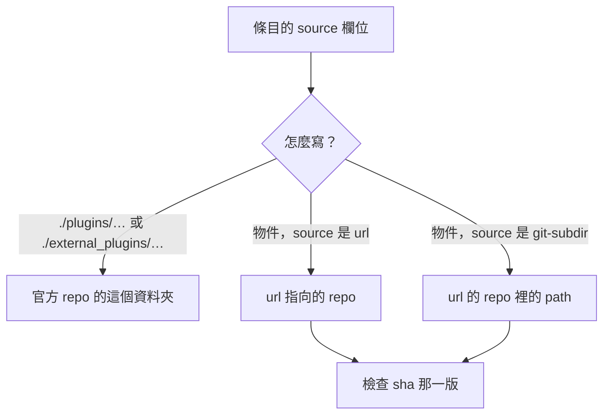
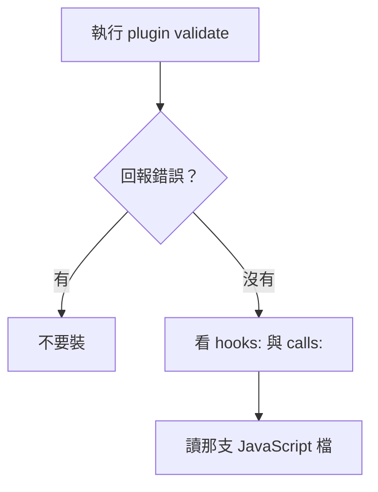
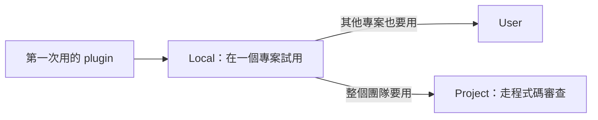
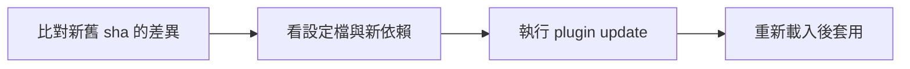

Claude Code（在終端機裡使用的 AI 程式助理）的 plugin 是一整包擴充功能。裝一次，就可能同時帶進 skill、斜線指令、hook 和 MCP server，各自的意思見下一節。

方便的地方，正好也是要小心的地方。其中幾樣會在你沒下任何指令時自己執行程式，用的還是你的帳號權限。官方在安裝前會顯示這段提醒（我的中譯）：

> Plugin 可以在你的電腦上執行程式，並存取你的檔案與 shell。安裝、更新或使用 plugin 之前，請確認你信任它。Anthropic 無法控制 plugin 內含哪些 MCP server、檔案或其他軟體，也無法驗證它們會如預期運作，或日後不會改變。詳情請見各 plugin 的首頁。

讀到「確認你信任它」，我的第一個疑問是：到底要怎麼確認？我把官方的幾份文件讀過一輪，整理成裝 plugin 前後照著做的檢查方法。

這篇不推薦任何 plugin。文中「我會怎麼做」的部分，都是依官方文件排出來的步驟。

> 依據的官方文件查證於 2026-11-14（台北時間）：[安裝與管理 plugin](https://code.claude.com/docs/en/discover-plugins)、[plugin 總覽](https://code.claude.com/docs/en/plugins)、[plugin 參考手冊](https://code.claude.com/docs/en/plugins-reference)、[plugin 安全說明](https://code.claude.com/docs/en/plugins/security)、[組織管理](https://code.claude.com/docs/en/plugins/org)、[市集參考手冊](https://code.claude.com/docs/en/plugins/marketplace-reference)。市集的部分另外讀了 [anthropics/claude-plugins-official](https://github.com/anthropics/claude-plugins-official) 的 README 與市集清單。2026-11-17 我再對照上述頁面修正部分說法，並依當天的 [mod 總覽](https://code.claude.com/docs/en/plugins/mods/overview) 與 [mod 管理說明](https://code.claude.com/docs/en/plugins/mods/admin) 補上 mod 的部分。終端機指令對照過 Claude Code 2.1.325 的 `--help`（`plugin validate` 對照 2.1.326）。指令與介面會隨版本改變，請以你安裝的版本為準。
{: .prompt-info }

第三方擴充為什麼會帶來風險，我在〈[裝了第三方 skill 和 MCP 之後，你的 Coding Agent 多了哪些破口？](/posts/coding-agent-supply-chain-permission-risks/)〉談過。這篇只處理 plugin 的具體檢查步驟。

## 先認識幾個名詞

- **plugin**：一包 Claude Code 擴充功能，可能同時含有下面幾種東西。完整名稱寫成「plugin 名稱@市集名稱」。
- **市集（marketplace）**：plugin 的目錄。Claude Code 要先認識一個市集，才能從裡面安裝 plugin。Anthropic 的官方市集叫 `claude-plugins-official`，第一次開啟 Claude Code 的互動畫面時會自動加入。
- **skill**：一份寫給 Claude 看的操作說明（`SKILL.md`），Claude 遇到相關工作時會照著做。
- **斜線指令**：在 Claude Code 輸入框以 `/` 開頭的指令，例如 `/plugin`。
- **hook**：在固定時機自動執行的 shell 指令，例如 Claude 每次改完檔案就自動排版。用法見〈[Claude Code hooks 教學：自動排版、跑測試與敏感檔提醒](/posts/claude-code-hooks-automate-checks/)〉。
- **MCP server**：讓 Claude 連到外部工具或服務的小程式，例如資料庫、GitHub 或文件搜尋。它可能是一支在你電腦上啟動的程式，也可能只是一個網址。
- **shell**：終端機裡負責執行指令的程式。能下 shell 指令，就幾乎能做你在終端機做得到的任何事。

## 一個 plugin 帶進的東西：有些會在沙箱外執行程式

plugin 是一個資料夾，檔案依用途放在固定位置。依官方的參考手冊與安全說明，這些檔案可以分成兩類：只給 Claude 讀的文字，以及會執行程式的部分。

| 位置 | 是什麼 | 會自己執行程式嗎 |
| --- | --- | --- |
| `.claude-plugin/plugin.json` | plugin 的名片：名稱、版本、作者、首頁、授權。也可以直接寫入 hook、MCP server 等元件，或指向其他位置的設定檔 | 本身不會，但它宣告的 hook 和 server 會 |
| `skills/`、`commands/`、`agents/` | 寫給 Claude 的說明（Markdown 檔） | 不會，但會影響 Claude 接下來怎麼做 |
| `hooks/hooks.json` | 在固定時機執行的 shell 指令 | **會**，時機一到就執行 |
| `hooks/hooks.json` 裡的 `modules`（mod） | 指向一支 JavaScript 檔（例如 `register.js`），在 Claude Code 裡面執行 | **會**，還能改寫 Claude 的工具呼叫 |
| `monitors/monitors.json` | 在背景持續執行的指令 | **會** |
| `.mcp.json` | MCP server 設定：要啟動哪支程式，或要連到哪個網址 | **會**，本機的 server 由 Claude Code 啟動 |
| `.lsp.json` | 語言伺服器（提供程式碼跳轉、錯誤提示的背景程式） | **會** |
| `bin/` | 可執行檔，plugin 啟用期間 Claude 可以直接呼叫 | Claude 呼叫時才執行，會經過權限規則 |

官方安全說明裡最該記住的是這一點：Claude Code 的權限規則和沙箱，管的是 Claude 自己發出的工具呼叫，不管 plugin 自己執行的程式。hook、monitor、MCP server、LSP server 和 mod 都在沙箱外，以你完整的使用者權限執行。

我在〈[Claude Code 沙箱設定教學：擋住 SSH 金鑰與 token](/posts/claude-code-sandbox-setup/)〉教過怎麼開 `/sandbox`。但就算開了，plugin 的 hook 和 mod 還是在沙箱外面跑。

還有一點容易誤會：`plugin.json` 不是必要的檔案。官方說它可以省略；就算有，也只有 `name` 一定要填，作者、首頁、授權這些欄位都可能是空的。所以欄位空著不代表它有問題，填得很完整也不代表可以放心。

{: w="1600" h="900" }
_概念圖：左邊是給 Claude 讀的文字，右邊是會執行程式的部分。安裝前要逐一打開右邊的檔案，標成黃色的 `plugin.json` 也要看，它可能直接宣告 hook 與 MCP server。_

## 官方目錄能防冒名，不代表每個 plugin 都審查過

看到「官方」兩個字，很容易以為裡面的 plugin 都經過 Anthropic 審查。我讀了官方 plugin 目錄的 README 和清單檔，才確定範圍沒有這麼大。

這個目錄是 GitHub 上的 [anthropics/claude-plugins-official](https://github.com/anthropics/claude-plugins-official)。這個 repo 同時是兩樣東西。它存放 plugin，也放著 `claude-plugins-official` 市集的清單檔 `.claude-plugin/marketplace.json`。

repo 裡有兩個放 plugin 的資料夾，README 這樣說明：

- **`/plugins`**：Anthropic 自己開發與維護的 plugin。每次有人提出修改，這裡的每個資料夾都會被檢查。
- **`/external_plugins`**：在投稿管道改到 claude.ai/directory/manage 之前加入的第三方 plugin。另外還有 Anthropic 的頻道類 plugin（Discord、fakechat、iMessage 和 Telegram）。

不過，市集清單裡的 plugin 大多不在這兩個資料夾。我在 2026-11-14 打開 `marketplace.json` 時，它列了 317 個 plugin。放在這個 repo 裡的只有 55 個，其餘 262 個都在 repo 外：

| plugin 放在哪裡 | 數量 |
| --- | --- |
| 這個 repo 的 `/plugins` | 41 |
| 這個 repo 的 `/external_plugins` | 14 |
| 其他公司或開發者自己的 repo | 261 |
| 要在你的電腦上執行指令來取得 | 1 |

README 寫得很直接：這個 repo 的檢查涵蓋放在這裡的 plugin 資料夾，不涵蓋放在其他 repo 的 plugin。

官方文件也提醒，市集的名稱告訴你這份目錄是誰發行的，不代表裡面每個 plugin 做了什麼。所以不論來自哪個市集，安裝前都要檢查。安裝前的那段提醒也不分市集，內容都一樣。

官方目錄能幫你少裝到冒名的假貨。`claude-plugins-official` 這類官方名稱，Claude Code 只接受來自 `github.com/anthropics/` 的來源。其他人沒辦法用同樣的名稱發行市集。

但這不等於每個 plugin 都通過安全審查。從官方目錄裝的 plugin，我一樣會照後面的步驟檢查。

### 查出 plugin 實際放在哪裡

既然多數 plugin 放在別的 repo，裝之前一定要先查這件事。在 `marketplace.json` 裡找到 plugin 的條目，看它的 `source` 欄位：



條目的結構大致如下（數值是示意）：

```json
{
  "name": "example-plugin",
  "author": { "name": "Example Inc." },
  "source": {
    "source": "git-subdir",
    "url": "https://github.com/example-org/claude-plugins.git",
    "path": "plugins/example-plugin",
    "ref": "v1.2.0",
    "sha": "<40 個字元的 commit SHA>"
  },
  "homepage": "https://example.com"
}
```

`sha` 是一個 commit 的編號，代表程式碼在某一次提交時的樣子。依市集參考手冊，條目同時寫了 `ref` 和 `sha` 時，Claude Code 會取出 `sha` 這一版。

所以要檢查的是那個 commit 的檔案，不是對方 repo 現在的最新版。在 GitHub 上，我會用 `https://github.com/<帳號>/<repo>/tree/<sha>/<path>` 這種網址打開那一版的資料夾。

條目也不只是一張索引卡。依市集參考手冊，條目本身也可以寫元件欄位，效果要看 plugin 有沒有 `plugin.json`：

| 條目裡的欄位 | plugin 有 `plugin.json` | plugin 沒有 `plugin.json` |
| --- | --- | --- |
| `commands`、`agents`、`skills`、`outputStyles`、`themes` | 預設併進 `plugin.json` | 載入 |
| `hooks` | 預設併進 `plugin.json`，並依事件取代 `plugin.json` 裡同一個事件的設定 | 載入 |
| `mcpServers`、`lspServers` | 不生效 | 載入 |

plugin 沒有 `plugin.json` 時，條目就直接當作它的設定檔。條目裡如果有這些欄位，我也會一起看。

## 步驟 1：在 `/plugin` 找到 plugin，先看詳細資訊

找 plugin 時，我會先打開 plugin 管理畫面。在 Claude Code 的輸入框輸入：

```text
/plugin
```
{: .nolineno }

依官方文件，畫面會開在 **Discover** 分頁，列出你已加入的市集裡的 plugin。直接打字可以搜尋，按 Enter 打開詳細資訊。其他分頁是 **Installed**（已安裝）、**Marketplaces**（已加入的市集）和 **Errors**（載入錯誤）。

已經知道名稱的話，也可以直接輸入：

```text
/plugin install <plugin 名稱>@claude-plugins-official
```
{: .nolineno }

在對話裡執行這行不會馬上安裝。它會先打開同一個詳細資訊面板，讓你選好安裝範圍再確認。

詳細資訊面板有一區 **Will install**，列出這個 plugin 會裝進哪些指令、agent、skill、hook，以及 MCP 和 LSP server。先看這裡有沒有 hook、MCP server 或 LSP server。有的話，裝了之後就會有程式自動執行，後面的檢查要更仔細。

官方市集裡大多數 plugin 放在其他 repo。Anthropic 沒有這種 plugin 的元件資料時，這一區可能只顯示 `Component summary not available for remote plugin`。遇到這種情況，就直接照步驟 2 去看原始檔。

就算這一區列出了元件，官方也說明它只告訴你「有 hook」，不告訴你 hook 會執行什麼。所以不管這裡列了什麼，下一步都是去讀原始檔。

## 步驟 2：裝之前，打開這幾個檔案

在詳細資訊面板選 **Open homepage** 或 **View on GitHub**，可以打開原始碼。兩個選項都沒有的話，就回到市集的 repo，用〈查出 plugin 實際放在哪裡〉的方法找到 plugin 的資料夾。市集當初是從哪裡加入的，可以在終端機用這行確認：

```bash
claude plugin marketplace list
```
{: .nolineno }

第一個要打開的一定是 `plugin.json`。它可以把 hook、MCP server、LSP server 和 monitor 直接寫在裡面，或指向其他路徑的設定檔。所以預設位置找不到某個檔案，不代表 plugin 沒有那項功能；先看 `plugin.json` 宣告了什麼，才知道還要打開哪些檔案。

### `.claude-plugin/plugin.json`：誰做的、還宣告了什麼

先看 `author`、`homepage`、`repository` 和 `license`，確認首頁和 repo 欄位指向的，就是你正在看的 repo。名稱很像、帳號卻不一樣的，我會先停下來查清楚是誰。

再來看它有沒有宣告元件或依賴。下面這份是我寫的示範：

```json
{
  "name": "example-plugin",
  "author": { "name": "Example Inc." },
  "homepage": "https://example.com",
  "hooks": "./config/hooks.json",
  "mcpServers": {
    "example-api": { "command": "node", "args": ["${CLAUDE_PLUGIN_ROOT}/server.js"] }
  },
  "dependencies": ["example-helper"]
}
```
{: file=".claude-plugin/plugin.json" }

這份檔案我會這樣讀：

- `hooks` 指向 `config/hooks.json`，不在預設的 `hooks/hooks.json`。兩個位置的 hook 會合併載入，所以兩個檔案都要看。
- `mcpServers` 直接寫在 `plugin.json` 裡，安裝後會啟動 `server.js`。`lspServers` 和 `experimental.monitors` 也能這樣寫，讀法跟後面的 `hooks/hooks.json` 和 `.mcp.json` 一樣。
- `dependencies` 列出這個 plugin 依賴的其他 plugin。依官方文件，安裝時 Claude Code 會以同樣的範圍把它們一起安裝並啟用，所以 `example-helper` 也要照這篇的步驟檢查一次。
- 依賴的寫法決定它從哪裡來。只寫名稱的依賴從同一個市集取得；寫成 `名稱@市集` 的來自另一個市集，這種跨市集的依賴預設不會自動安裝，除非市集明確允許。

### `hooks/hooks.json`：什麼時候、自動執行什麼

如果只能挑一個檔案細看，我會挑這個。每個 hook 都看兩件事：事件名稱（什麼時候執行），以及它執行什麼。

要看哪個欄位，取決於 `type`。`type` 是 `command` 時看 `command` 欄位；是 `http` 時看 `url`，事件內容會送到那個網址。`type` 也可能是 `mcp_tool`、`prompt` 或 `agent`。

結構大致如下（內容是示意）：

```json
{
  "hooks": {
    "SessionStart": [
      {
        "hooks": [
          { "type": "command", "command": "bash \"${CLAUDE_PLUGIN_ROOT}/hooks/setup.sh\"" }
        ]
      }
    ],
    "PostToolUse": [
      {
        "matcher": "Edit|Write",
        "hooks": [
          { "type": "command", "command": "bash \"${CLAUDE_PLUGIN_ROOT}/hooks/format.sh\"" }
        ]
      }
    ]
  }
}
```
{: file="hooks/hooks.json" }

這份設定逐項這樣看：

- `SessionStart`：每次開啟 Claude Code 就執行 `setup.sh`，不需要你做任何事。恢復先前的對話、執行 `/clear` 或對話被壓縮時，也會再執行。
- `PostToolUse` 加上 `"matcher": "Edit|Write"`：Claude 每次用 Edit 或 Write 工具改完檔案，就執行 `format.sh`。
- `${CLAUDE_PLUGIN_ROOT}` 代表 plugin 安裝後所在的資料夾。指令只寫「去執行某支腳本」時，要把那支腳本也打開來看，真正做事的是它。

hook 有下面這些行為時，我會先停下來弄清楚原因：

- 用 `curl`、`wget` 下載東西後直接執行
- 把檔案內容或環境變數送到外部網址
- 刪除或修改專案以外的檔案
- 讀取 `~/.ssh`、`.env` 這類存放金鑰的位置

這些不一定是惡意。有些 hook 本來就會把程式碼片段送到外部服務分析，通常會寫在 README 裡。我在意的是自己知不知道它會這麼做，以及能不能接受。

### `hooks.json` 裡的 `modules`：在 Claude Code 裡面執行的 mod

`hooks.json` 如果有 `"modules": ["./register.js"]` 這樣的欄位，代表這個 plugin 帶了 mod。mod 是一支在 Claude Code 裡面執行的 JavaScript 程式，不在沙箱裡。

依官方的 mod 說明，它能做到這些事：

- 用你的權限讀寫檔案、啟動程式、連上網路
- 讀到環境變數和設定檔裡的 API key
- 看到你送出的每一則訊息和 Claude 的每一次工具呼叫，並且改寫它們
- 內建的防護沒有擋住時，核准原本會被你的 deny、ask 規則或 `PreToolUse` hook 擋下的工具呼叫

所以 plugin 帶了 mod，我會看得比 hook 更仔細。後面介紹的 `plugin details` 元件清單不會列出 mod。官方提供的檢查方式是先取得 plugin 的檔案（例如 clone 下來），再對 plugin 資料夾執行：

```bash
claude plugin validate <plugin 資料夾>
```
{: .nolineno }



回報錯誤的 mod 不要裝，這是官方的提醒，因為有些錯誤不會阻止它載入。輸出裡的 `hooks:` 列出 mod 會接收哪些事件，`calls:` 列出它會呼叫哪些功能，例如：

- `$.fs.read`：讀檔案
- `$.process.run`：啟動程式
- `$.http.fetch`：連網
- `$.env.get`：讀環境變數

### `.mcp.json`：會啟動哪些程式、連到哪裡

```json
{
  "mcpServers": {
    "example-docs": {
      "type": "http",
      "url": "https://mcp.example.com/mcp"
    },
    "example-db": {
      "command": "npx",
      "args": ["-y", "@example/db-mcp@1.4.2"],
      "env": { "DB_URL": "${DB_URL}" }
    }
  }
}
```
{: file=".mcp.json" }

這份設定，我會照欄位分開看：

- 有 `url` 的 server 會連到外部網址。我會確認網域是不是那個服務本身，因為你在 Claude 裡透過它查詢或傳送的內容，都會送到那個網址。
- 有 `command` 的 server 會在你的電腦上啟動程式。`npx -y 套件名稱` 會從 npm 下載並執行那個套件。
- 我希望看到寫死的版本號（例如 `@1.4.2`）。沒寫版本或寫 `@latest`，每次啟動都可能跑到不同的程式。
- `env` 列出它需要哪些環境變數，通常就是 token 或密碼。我給它的權限，只開到它真正需要的範圍。

### `bin/`、`monitors/` 和 `.lsp.json`

- `bin/` 裡的每個檔案都要看。plugin 啟用期間，這些檔案會被放進 Claude 執行指令時的搜尋路徑（`PATH`），Claude 可以像一般指令一樣直接呼叫它們。
- `monitors/monitors.json` 是在背景執行的指令，讀法跟 hook 一樣，看每一個 `command`。
- `.lsp.json` 會啟動語言伺服器，看它啟動的是哪支程式。

### `skills/`、`commands/`、`agents/`：快速掃過

這些是給 Claude 讀的說明，本身不會執行，但說明可以叫 Claude 去執行指令。我會快速掃過一遍，留意這幾種段落：

- 要 Claude 下載並執行東西
- 要 Claude 把資料傳到外部
- 要 Claude 略過你的規則

這類藏在內容裡的指令，〈[裝了第三方 skill 和 MCP 之後，你的 Coding Agent 多了哪些破口？](/posts/coding-agent-supply-chain-permission-risks/)〉的「入口一」有詳細說明。

### 用一行指令核對元件清單

自己翻資料夾，難免有漏看的時候。官方安全說明提供一個核對方法：用 `plugin details` 列出 Claude Code 在 plugin 資料夾裡找到的元件。先把 plugin 所在的 repo clone 下來，切到市集條目寫的 commit，再執行：

```bash
git clone https://github.com/example-org/claude-plugins.git
cd claude-plugins
git checkout <市集條目裡的 sha>
claude --plugin-dir ./plugins/example-plugin plugin details example-plugin
```
{: .nolineno }

它會印出 `Component inventory`（元件清單），列出 skill 與指令、agent、hook（含觸發事件）、MCP server 和 LSP server。我會拿它對照剛才看過的檔案，有漏看的就回去補。

這份清單沒有涵蓋全部，下面這些要另外看：

- monitor、`bin/` 裡的檔案和 mod 不在清單裡，要自己打開來看。
- 清單列的是這個資料夾裡的元件。市集條目另外加上的元件，要回去看條目。
- `dependencies` 裡的其他 plugin，要各自檢查。

裝好之後，也可以用這行檢查實際安裝的那一份：

```bash
claude plugin details <plugin 名稱>
```
{: .nolineno }

### 可複製的檢查清單

上面的檢查整理成一份清單，可以直接貼進筆記或團隊文件：

```markdown
## Claude Code plugin 安裝前檢查

- [ ] 從市集條目的 source 與 sha，確認 plugin 實際放在哪個 repo、哪個 commit
- [ ] plugin.json 的作者、首頁、repo，和我正在看的來源一致
- [ ] plugin.json 有沒有直接宣告 hooks、mcpServers、lspServers、monitors，或指向其他路徑的設定檔；市集條目有沒有另外寫元件欄位
- [ ] dependencies 列出的每個 plugin，都照這份清單檢查過
- [ ] 詳細資訊面板的 Will install：有沒有 hook、MCP server、LSP server
- [ ] hooks/hooks.json：每個 hook 的觸發時機與 command（http hook 看 url），以及它呼叫的腳本
- [ ] hooks.json 有沒有 modules（mod）；有的話用 claude plugin validate 列出 hooks 與 calls，並讀過那支 JS 檔
- [ ] .mcp.json：每個 server 啟動的程式（版本有沒有寫死）或連線網址，需要哪些環境變數
- [ ] bin/、monitors/、.lsp.json：每個會執行的檔案
- [ ] skills/、commands/、agents/：沒有要 Claude 下載執行、外傳資料或略過規則的內容
- [ ] 用 claude --plugin-dir <資料夾> plugin details <名稱> 核對過 hook、MCP server 與 LSP server
- [ ] 決定安裝範圍（local、user 或 project）和要不要自動更新
```

{: w="1600" h="900" }
_概念圖：四項檢查都在安裝之前完成。第三項只看得到你打開的檔案，第四項用元件清單核對 hook、MCP 和 LSP server；monitor、`bin/` 和 mod 仍要自己看。_

## 步驟 3：從最小的安裝範圍開始

在詳細資訊面板按下安裝時，要選安裝範圍（scope）：

| 範圍 | 誰會用到 | 寫進哪個設定檔 |
| --- | --- | --- |
| Local | 只有你，而且只在這個 repo | `.claude/settings.local.json` |
| User | 你自己，這台電腦上的所有專案 | `~/.claude/settings.json` |
| Project | 這個 repo 的所有協作者 | `.claude/settings.json`（會提交進 repo） |

第一次用的 plugin，我會照這個順序擴大範圍：



Project 範圍的審查做法，見後面的〈把檢查清單放進團隊規則〉。在終端機安裝的寫法如下，不加 `--scope` 時預設是 user：

```bash
claude plugin install <plugin 名稱>@claude-plugins-official --scope local
```
{: .nolineno }

安裝前，先記住三件事：

- **安裝就等於啟用。** 除非 plugin 自己設定了 `defaultEnabled: false`，裝好它就開始運作。
- **依賴會一起裝。** plugin 宣告了依賴的話，Claude Code 會以同樣的範圍一起安裝並啟用，完成訊息會列出它們。
- **Project 範圍不會自動裝到同事的電腦。** 設定提交進 repo 之後，每位協作者仍要自己執行一次安裝。

## 加入其他市集之前，先確認來源

除了官方市集，任何人都可以建立市集。加入市集要比裝單一 plugin 更謹慎，因為加入之後，裡面的每個 plugin 都能用一行指令裝進來。加入市集的指令是：

```text
/plugin marketplace add <來源>
```
{: .nolineno }

來源可以是這幾種：

- GitHub repo，寫成 `owner/repo`。可以用 `#` 指定標籤或分支，例如 `your-org/plugins#v1.2.0`。
- 其他 Git 主機的完整網址，例如 `https://gitlab.example.com/your-group/your-marketplace.git#v1.0.0`。
- 本機資料夾的路徑。
- 指向 `marketplace.json` 的 `https://` 網址。

加入之前，我會先確認這幾件事：

- **這個 repo 是誰的。** 只從信任的地方取得連結，例如工具的官方網站或官方文件，不只看搜尋結果。名稱相似的帳號並不少見。
- **有沒有指定版本。** 加上 `#v1.2.0` 這類標籤，市集內容就不會隨對方每次提交而改變。不過標籤本身可以被移動（原理見〈[gh actions-lock 教學：用 lockfile 鎖定 GitHub Actions 依賴](/posts/gh-actions-lock-workflow-lockfile/)〉），所以它只能讓變動少一點。
- **一行安裝指令也可能順便加入市集。** 在對話裡輸入 `/plugin install <名稱> --marketplace owner/repo` 時，若市集還沒加入，Claude Code 會先顯示來源請你確認。在終端機執行 `claude plugin install <名稱> --marketplace owner/repo` 則不會詢問，直接加入市集。看到別人貼這種指令，一樣要先確認 `owner/repo` 是誰。

### 自動更新會換掉你看過的檔案

依官方文件，Anthropic 的官方市集（例如 `claude-plugins-official`）預設會自動更新。其他市集，包括第三方市集和本機市集，預設不會。

開啟自動更新時，Claude Code 會在背景更新從這個市集安裝的 plugin。所以你審查過的檔案，可能在你不知道的時候被換掉。

要關閉某個市集的自動更新，在 `/plugin` 切到 **Marketplaces** 分頁，選擇市集，再選 **Disable auto-update**。

關掉的代價是不會自動拿到修正，所以我不會全部關掉。我只對第三方或不熟悉的市集關閉自動更新，改成定期手動更新：



比對差異的網址是 `https://github.com/<帳號>/<repo>/compare/<舊 sha>...<新 sha>`。比對時特別看 `plugin.json`、`hooks/hooks.json`、`.mcp.json` 和新增的依賴。手動更新的指令是：

```bash
claude plugin update <plugin 名稱>@<市集名稱>
```
{: .nolineno }

更新後要重新啟動 Claude Code，或在對話裡執行下面這行，才會套用：

```text
/reload-plugins
```
{: .nolineno }

## 裝了之後：先停用，確定不用再移除

我會先確認自己到底裝了什麼。這行會列出每個 plugin 的版本、安裝範圍和狀態：

```bash
claude plugin list
```
{: .nolineno }

處理方式由輕到重有三種：停用、移除 plugin、移除整個市集。

{: w="1600" h="900" }
_概念圖：由輕到重的三種處理方式。懷疑出事時先停用，確定不用再移除。_

### 停用：檔案還在，之後可以重新啟用

暫時不用，或懷疑它有問題時，我會先走這一步。在 `/plugin` 的 Installed 分頁選中 plugin 後按空白鍵，或輸入下面這行打開面板操作：

```text
/plugin disable
```
{: .nolineno }

在終端機則是：

```bash
claude plugin disable <plugin 名稱>@<市集名稱>
```
{: .nolineno }

停用後檔案還在，之後可以用 `claude plugin enable` 重新啟用。如果還有其他啟用中的 plugin 依賴它，停用會失敗，並列出要先停用哪些。

遇到不明狀況、想先全部停下來，可以用這行停用所有 plugin：

```bash
claude plugin disable --all
```
{: .nolineno }

### 移除：範圍要和安裝時一樣

在輸入框輸入：

```text
/plugin uninstall
```
{: .nolineno }

或在終端機執行：

```bash
claude plugin uninstall <plugin 名稱>@<市集名稱> --scope <當初的範圍>
```
{: .nolineno }

`--scope` 要和安裝時一樣，不寫的話預設是 user。移除時有幾件事要特別留意：

- 從最後一個安裝範圍移除時，plugin 存放資料的資料夾 `~/.claude/plugins/data/<id>/` 會一起刪除。plugin 保存的選項和密鑰也會跟著刪掉。加上 `--keep-data` 才會保留資料夾。
- 程式檔本身會在 `~/.claude/plugins/cache/` 多留 14 天，才由背景清理刪除。確定不再信任它，我會自己刪掉 `~/.claude/plugins/cache/<市集名稱>/<plugin 名稱>/`。
- 當初跟著安裝的依賴不會一起移除。加上 `--prune` 會一併移除沒有其他 plugin 需要的依賴，之後也可以用這行清理：

  ```bash
  claude plugin prune
  ```
  {: .nolineno }

- Project 範圍的 plugin 在介面上移除時，會問你要選 **Disable for me** 還是 **Uninstall for everyone**。前者只對自己停用，寫進你的 `.claude/settings.local.json`。後者從共用的 `.claude/settings.json` 拿掉，影響所有協作者。

移除 plugin 不會讓曾經交給它的 token 失效。如果是因為懷疑 plugin 有問題才移除它，我會把這些 token 也換掉。後續處理可以參考〈[裝了第三方 skill 和 MCP 之後，你的 Coding Agent 多了哪些破口？](/posts/coding-agent-supply-chain-permission-risks/)〉的「出事之後」清單。

### 移除市集：連同裝過的 plugin 一起移除

在輸入框輸入：

```text
/plugin marketplace remove <市集名稱>
```
{: .nolineno }

從這個市集安裝的所有 plugin 會一起被移除。

## 把檢查清單放進團隊規則

團隊裡每個人都可能裝 plugin，只有我一個人小心還不夠，要有共同的做法。我會從三個層次著手。

### 寫進專案規則

我會把上面的檢查清單放進 `CLAUDE.md`、`AGENTS.md` 或 PR 範本，約定「新增 plugin 或市集時，要附上這份清單」。規則檔怎麼寫，我整理在〈[AGENTS.md 怎麼寫：讓 Coding Agent 讀懂你的專案規則](/posts/agents-md-project-rules-for-coding-agents/)〉。

### 把設定檔當成程式碼審查

專案要推薦 plugin 時，我會在 `.claude/settings.json` 寫兩個欄位：

- `extraKnownMarketplaces`：要認識哪些市集
- `enabledPlugins`：要啟用哪些 plugin

```json
{
  "extraKnownMarketplaces": {
    "your-marketplace": {
      "source": { "source": "github", "repo": "your-org/your-marketplace" }
    }
  },
  "enabledPlugins": {
    "code-formatter@your-marketplace": true
  }
}
```
{: file=".claude/settings.json" }

這個檔案會提交進 repo，所以我把改它當成改程式，一樣要經過 PR 審查。也可以把它加進 CODEOWNERS（指定哪些檔案由誰審核的設定檔），讓熟悉這份檢查清單的人負責核准。

官方文件另外說明兩點。第一，在 repo 寫了 `enabledPlugins` 不會自動安裝，協作者要自己執行：

```bash
claude plugin install <名稱>@<市集> --scope project
```
{: .nolineno }

第二，`extraKnownMarketplaces` 只在協作者已經信任的資料夾裡生效。

### 在組織層級限制市集來源

公司若有統一管理 Claude Code 的設定（managed settings），管理員可以限制市集來源。`strictKnownMarketplaces` 只允許特定來源，`blockedMarketplaces` 則封鎖特定來源。官方的允許清單範例如下：

```json
{
  "strictKnownMarketplaces": [
    { "source": "github", "repo": "anthropics/claude-plugins-official" },
    { "source": "github", "repo": "your-org/*" },
    { "source": "skills-dir" }
  ]
}
```

前兩行只允許官方市集和公司自己帳號底下的市集。

第三行的 `skills-dir` 處理放在 skill 資料夾裡的 plugin。`~/.claude/skills/` 和專案 `.claude/skills/` 裡帶有 `.claude-plugin/plugin.json` 的資料夾，會繼續以 plugin 的形式載入。只有 `SKILL.md` 的一般 skill 不受這份清單影響。

管理員也可以設定 `pluginTrustMessage`，在安裝前的提醒後面加上公司內部的說明，例如審查流程的連結。

## 什麼情況怎麼做

| 我想… | 怎麼做 |
| --- | --- |
| 找 plugin | `/plugin` 的 Discover 分頁；或用 `/plugin install <名稱>@claude-plugins-official` 先打開詳細資訊 |
| 知道 plugin 實際放在哪 | 看 `marketplace.json` 條目的 `source` 和 `sha` |
| 知道裝了會自動執行什麼 | 先看 `plugin.json` 宣告的元件，再讀 `hooks/hooks.json`、`.mcp.json`、`bin/`、`monitors/`、`.lsp.json` |
| 知道 mod 會做什麼 | `claude plugin validate <資料夾>`，看 `hooks:` 與 `calls:`，再讀那支 JavaScript 檔 |
| 知道還會一起裝哪些 plugin | 看 `plugin.json` 的 `dependencies`，每個都照清單檢查 |
| 核對 hook、MCP、LSP 有沒有漏看 | clone 後執行 `claude --plugin-dir <資料夾> plugin details <名稱>`；monitor、`bin/`、mod 另外看 |
| 先小範圍試用 | 安裝時選 Local |
| 加入別的市集 | 從官方連結確認 `owner/repo`，用 `#標籤` 指定版本 |
| 不讓看過的檔案在背景被換掉 | `/plugin` → Marketplaces → Disable auto-update，改成手動更新並先看差異 |
| 暫時不用 | `claude plugin disable <名稱>@<市集>` |
| 懷疑出事，先全部停下 | `claude plugin disable --all` |
| 完全移除 | `claude plugin uninstall <名稱>@<市集> --scope <範圍> --prune`，需要時刪掉 cache 資料夾 |
| 讓團隊做法一致 | 檢查清單寫進專案規則，`.claude/settings.json` 走 PR 審查 |

## 結論

整理完這篇，我給自己的規則只有一條：裝 plugin 之前，先弄清楚它會在什麼時候、用我的權限做什麼事。官方目錄和 Will install 只是起點，會執行程式的檔案要自己讀。確定要裝，就從最小的範圍開始。

想繼續往下讀，可以看我寫的這幾篇：

- 〈[Claude Code hooks 教學：自動排版、跑測試與敏感檔提醒](/posts/claude-code-hooks-automate-checks/)〉：看懂 plugin 帶來的 hook 在做什麼。
- 〈[自己寫 Agent Skill：從 SKILL.md 結構到觸發測試與維護](/posts/agent-skill-authoring-guide/)〉：plugin 裡的 skill 是怎麼寫成的。
- 〈[OWASP Agentic Top 10 檢查表：AI 工作流十項風險與修法](/posts/owasp-agentic-top-10-ai-workflow-checklist/)〉：用同一套思路檢查整個 AI 工作流的供應鏈風險。
