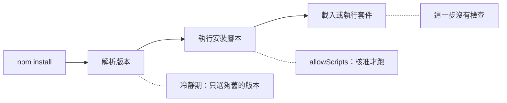
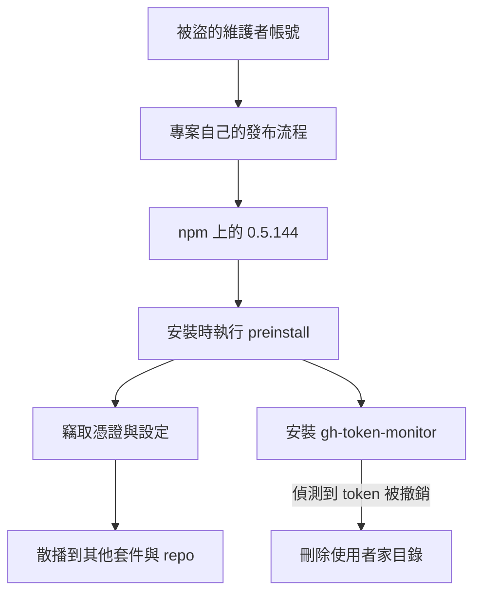

升級到 npm 12 之後，`npm install` 順利結束，套件也裝進來了，某個功能卻不能用。原因可能是相依套件的安裝腳本被跳過了，因為 npm 12 預設不再執行這些腳本。

這篇說明怎麼找出需要審查的套件、確認腳本的用途與來源，再核准必要的項目並提交名單。另外可以加上 7 天冷靜期，減少第一時間裝到惡意新版本的機會。我認為這兩道防線各有用途，也各有限制。步驟都是我依官方文件整理的。

先認識幾個詞：

- **相依套件**（dependency）：你的專案用到的套件，以及它們再用到的套件。
- **安裝腳本**（install script）：套件安裝時自動執行的指令，常見名稱是 `preinstall`、`install`、`postinstall`。它用執行 npm 的帳號權限運作，能接觸該帳號可讀的檔案與憑證。
- **`package.json`**：記錄專案設定與相依套件的檔案，npm 12 的腳本核准名單也放在這裡。
- **lockfile**（`package-lock.json`）：記錄解析出的相依套件版本與來源，讓後續安裝能使用同一組版本。
- **`.npmrc`**：npm 的設定檔。本文把團隊共用的設定放在專案根目錄。
- **token**（權杖）：一串用來驗證身分的通行碼，拿到的人就能在它的權限範圍內操作。

安裝腳本值得審查，是因為惡意程式在安裝階段就能執行，不必等你的程式載入套件。2026 年 10 月 8 日的 `tensorlake@0.5.144` 就是例子。依[官方安全公告](https://github.com/tensorlakeai/tensorlake/security/advisories/GHSA-8g63-53c9-65j2)，它在 `preinstall` 階段竊取 token 與憑證。

發布者那一端的做法，我在[npm Trusted Publishing 設定教學：發套件不再放長期 token](/posts/npm-trusted-publishing-github-actions/)談過。這篇從安裝套件的人出發：怎麼管理腳本、避開剛發布的版本，以及 tensorlake 事件為什麼要特別注意處理順序。

> 步驟依 npm CLI 12.2.2 的官方文件整理，查證日期是 2026-11-13。依據的文件是〈[npm-install-scripts](https://docs.npmjs.com/cli/v12/commands/npm-install-scripts/)〉、〈[npm-approve-scripts](https://docs.npmjs.com/cli/v12/commands/npm-approve-scripts/)〉、〈[config](https://docs.npmjs.com/cli/v12/using-npm/config/)〉，以及 GitHub 的 [npm v12 變更公告](https://github.blog/changelog/2026-07-08-npm-install-time-security-and-gat-bypass2fa-deprecation/)。指令與預設值以對應版本的官方文件為準。
{: .prompt-info }

## npm 12 改了什麼

GitHub 在 2026-07-08 的[變更公告](https://github.blog/changelog/2026-07-08-npm-install-time-security-and-gat-bypass2fa-deprecation/)宣布 npm v12 正式發布，並標成 `latest`。和這篇有關的改變有三項：

- **相依套件的安裝腳本預設不跑。** 包括 `preinstall`、`install`、`postinstall`，以及由 `binding.gyp` 隱含觸發的 node-gyp 編譯。從 git、本機檔案或連結安裝的相依套件，其 `prepare` 腳本也受管控。
- **預設會跳過腳本，讓安裝繼續。** 安裝結束時，npm 會列出尚未核准的套件供你審查。所以安裝成功只代表套件裝進來了，不代表它需要的建置或下載步驟已經完成。
- **核准與拒絕名單放在 `package.json` 的 `allowScripts`。** 符合允許規則的腳本可以執行。明確拒絕的會被跳過，也不再列為待審項目。

同一次改版也預設禁止 git 相依套件（`allow-git`）和遠端網址相依套件（`allow-remote`，例如直接指向 `.tgz`）。來源是否允許、腳本是否允許，是兩個不同的檢查，核准腳本不會順便放行來源。用到這些來源的專案，要另外看相關設定。

{: w="1600" h="900" }
_在預設設定下，符合核准規則的腳本才會執行；明確拒絕的直接跳過，尚未審查的也跳過並列出。核准預設會釘住版本，升級後需要重新審查。_

最容易受影響的，是影像處理、資料庫驅動這類需要編譯或下載原生程式的套件。官方文件用 `canvas`、`sharp` 示範核准指令，但這不代表每個專案都需要核准它們，要看實際使用的版本與安裝方式。

## 步驟 1：確認 npm 版本

在終端機執行：

```bash
npm -v
```

- **12.x**：預設就會擋下未核准的安裝腳本，直接進行步驟 2。
- **11.16.0 以上的 11.x**：依 GitHub [6 月的預告](https://github.blog/changelog/2026-06-09-upcoming-breaking-changes-for-npm-v12/)，這些版本會先用警告提醒，方便你準備遷移。但警告不等於 npm 12 的預設阻擋。用下面這行檢視清單，再逐一核准或拒絕：

  ```bash
  npm approve-scripts --allow-scripts-pending
  ```

- **更舊的版本**：先確認 Node.js 符合目標 npm 版本的需求，再升級。若要照本文操作，可指定 npm 12：

  ```bash
  npm install -g npm@12
  ```

我建議團隊成員與 CI（自動測試、建置流程）使用同一個 npm 版本。因為同一份 `allowScripts` 交給舊版 npm，不保證會照著阻擋。另外也要檢查有沒有設定覆寫了預設行為。

## 步驟 2：看哪些套件需要審查

在已經裝好相依套件的專案資料夾中執行：

```bash
npm install-scripts ls
```

這個指令只列出「有安裝腳本、但還沒被 `allowScripts` 規則涵蓋」的套件，不會修改任何檔案。已經明確拒絕的套件不會出現在這份清單裡。

新專案可以先在 npm 12 的預設設定下安裝一次：

```bash
npm install
```

再看安裝結束時的提示與這份清單。

接著逐一檢查每個版本的腳本。例如清單中有 `canvas@3.2.0`，可以查：

```bash
npm view canvas@3.2.0 scripts
```

`npm view` 查的是目前設定的 registry 上的資料，未必等於本機實際裝進來的檔案。所以實際審查時，我還會對照 `node_modules` 裡的這幾樣東西：

- 該版本的 `package.json`。
- 腳本呼叫的檔案。
- 腳本下載程式的來源。

間接相依套件可能在巢狀目錄中，同名套件也可能裝了不只一版，所以別只看最外層那份。

判斷時，我參考下面的原則：

| 腳本在做什麼 | 做法 |
| --- | --- |
| 需要編譯或下載原生程式 | 可能確實需要腳本，但仍要確認來源、下載位置與用途，不能只因為「要編譯」就放行 |
| 只是回傳使用統計，或印出廣告、感謝訊息 | 若不影響需要的功能，可以拒絕 |
| 從不明網址下載內容，或程式碼刻意混淆 | 先不要核准，查明原因；若懷疑是惡意套件，也不要為了測試而執行它 |
| 用途還不確定 | 先保留待審 |

用途不確定、但來源可信的套件，可以在腳本仍被擋住的情況下測試相關功能。如果功能出錯，先查清楚缺了什麼，再決定是否核准。這個測試只能幫你判斷是否需要腳本，不能證明套件安全。

## 步驟 3：核准或拒絕，補跑腳本後再提交

下面沿用官方文件的套件名稱示範，請換成你已經審查過的項目：

```bash
npm install-scripts approve canvas sharp
npm install-scripts deny telemetry-pkg
```

`telemetry-pkg` 是拒絕項目的示意名稱。`npm approve-scripts` 與 `npm deny-scripts` 也能完成相同操作。

**核准預設會釘住版本。** `approve` 寫入的是 `套件@版本`，讓核准範圍只限於審查過的版本。不過[文件](https://docs.npmjs.com/cli/v12/commands/npm-approve-scripts/)也說明，傳入套件名稱時，核准會套用到它所有已安裝的版本。所以專案裡同時裝了兩版時，核准前兩版都要看過。

寫進 `package.json` 後大致如下。這是我依文件整理的片段，版本號只是示意，實際結果以指令產生的內容為準：

```json
{
  "allowScripts": {
    "canvas@3.2.0": true,
    "sharp@0.34.5": true,
    "telemetry-pkg": false
  }
}
```

- `true` 是允許，`false` 是拒絕。拒絕以名稱記錄，不分版本，而且既有的拒絕規則優先於核准。
- `--no-allow-scripts-pin` 只記名稱，連未來版本也一起放行，我一般不建議使用。
- `approve --all` 會一次核准所有待審項目，應該在逐一審查之後才用。

**lockfile 缺少 `resolved` 下載網址時，核准範圍會被放寬。** 這時 npm 可能無法驗證版本，就改成只按名稱核准，並發出警告。不要忽略這個警告，依下面的順序修正：

1. 若啟用了 `omit-lockfile-registry-resolved`，先調整這個設定。
2. 依[文件](https://docs.npmjs.com/cli/v12/commands/npm-approve-scripts/)補回 lockfile 的來源資訊。
3. 移除過寬的名稱核准，再重新核准。
4. 檢查差異，確認留下的是版本限定規則。

**核准只會更新名單，不會補跑剛才跳過的腳本。** 所以核准之後要執行：

```bash
npm rebuild canvas sharp
```

依 [npm rebuild 文件](https://docs.npmjs.com/cli/v12/commands/npm-rebuild/)，它會執行對應套件的生命週期腳本。完成後，再跑專案的測試與建置，確認實際需要的功能正常。

提交前我會先看差異。核准名單一定要提交；lockfile 若也有預期中的變動，再一起提交：

```bash
git diff -- package.json package-lock.json
git add package.json
# 若 package-lock.json 有需要保留的變動，再 git add package-lock.json
git commit -m "chore(deps): 核准需要的安裝腳本"
```

**套件升級之後要重新審查。** 新版本不再符合舊的核准規則，會重新列為待審。看過新版腳本再核准，npm 會更新對應的版本規則。已失效的項目可以先預覽：

```bash
npm install-scripts prune --dry-run
```

再清理：

```bash
npm install-scripts prune
```

`prune` 也會移除對不到已安裝套件的拒絕規則。如果團隊想預先擋下某些套件，清理前要先確認。

**要讓 CI 遇到待審項目就失敗**，在專案的 `.npmrc` 加上：

```ini
strict-allow-scripts=true
```

依[文件](https://docs.npmjs.com/cli/v12/using-npm/config/#strict-allow-scripts)，加上這行後，尚未審查的安裝腳本會讓安裝失敗，明確拒絕的仍直接跳過。設定與名單提交後，我建議讓 CI 以相同的 npm 版本跑 `npm ci` 和既有測試，確認從乾淨安裝也能正常建置。

## 步驟 4：在 .npmrc 加上 7 天冷靜期

冷靜期讓剛發布的版本先等七天才會被選中，有問題的新版本因此多一段被發現、通報與下架的時間。它和安裝腳本審查管的是安裝過程的不同階段：



不過惡意版本不一定會在七天內被抓到，所以冷靜期只是多一段緩衝。

先在專案根目錄的 `.npmrc` 加上：

```ini
min-release-age=7
```

這裡的單位是**天**。依[文件](https://docs.npmjs.com/cli/v12/using-npm/config/#min-release-age)，npm 解析相依套件時，會在允許的版本範圍內選擇發布超過七天的版本。找不到符合條件的版本，解析就會失敗。

如果某個自家套件需要一發布就能安裝，再替它加入例外，例如：

```ini
min-release-age-exclude[]=@your-org/internal-tool
```

請把示意名稱換成實際套件。也可以用 `@your-org/*` 排除整個 scope，但範圍越大，繞過冷靜期的套件就越多，所以我會從必要的個別套件開始。

設定例外時要注意兩點：

- **只有符合名稱的套件不受限。** 它的相依套件仍要遵守冷靜期，除非也符合排除規則。
- **排除不會改變下載來源。** 例外名單只比對名稱，不會替你設定 registry。文件也提醒，使用私有 scope 時，要在公開 npm registry 上擁有同一個 scope，避免他人搶先發布同名套件。

{: w="1600" h="900" }
_以 tensorlake 事件說明原理。圖中的組織排除規則只是選配範例，不必照抄。_

依公告，`tensorlake@0.5.144` 在 npm 上只存活約 1 小時 40 分鐘。它在 2026-10-08 01:12 到 02:54 UTC 之間上線，也就是台北時間 09:12 到 10:54。如果解析版本時有套用七天限制，而且沒有例外或覆寫，它到被移除前都還不滿七天，不會被選中。

**但冷靜期不保證每種安裝情境都擋得住。** 官方文件沒有明確交代 lockfile 已鎖定的版本是否會重新檢查。所以我不會把冷靜期當成檢查既有相依套件的掃毒工具。

**緊急修補也可能被擋住。** 文件指出，如果冷靜期擋住 `npm audit fix` 要裝的修補版本，npm 會保留有漏洞的版本、發出警告，並以失敗結束。這時先確認修補版本與來源，再暫時把該套件加入排除名單，完成更新與驗證後記得移除例外。調小天數也能放寬限制，但會同時影響其他套件。

**同時設定 `before` 時，要確認哪個設定生效。** `before` 只選某個日期之前的版本。它和冷靜期寫在同一份設定檔時，會以 `before` 為準；分散在不同設定來源時，則依 npm 的設定優先順序決定。所以也要留意 CI 參數、環境變數或個人設定，是否改變了專案預期的限制。

最後確認 `.npmrc` 裡沒有 token 等機密，再提交到版本控制，讓團隊和 CI 套用同一份政策。

## 步驟 5：全域安裝與 npx 怎麼放行

全域安裝（`npm install -g`）與一次性執行（`npm exec`、`npx`）沒有專案的 `package.json` 可以記錄核准名單。執行 `npm install-scripts -g` 也只會得到 `EGLOBAL` 錯誤。這些情況要改用 `allow-scripts` 設定。

下面的 `your-cli@1.2.3` 是示意的工具與版本，請換成實際要安裝或執行的工具。`canvas,sharp` 也要換成它真正需要、你已審查過的腳本套件：

```bash
# 指定要安裝的工具，只在這次安裝放行所列套件的腳本
npm install -g your-cli@1.2.3 --allow-scripts=canvas,sharp

# 一次性執行：-- 後面是工具的命令與參數
npm exec --allow-scripts=canvas,sharp --package=your-cli@1.2.3 -- your-cli

# 若確實需要長期有效，才存到個人設定
npm config set allow-scripts=canvas,sharp --location=user
```

- `--allow-scripts` 指定的是**允許跑安裝腳本的套件**，不等於指定要安裝哪個工具。
- 依[文件](https://docs.npmjs.com/cli/v12/using-npm/config/#allow-scripts)，在專案的 `npm install`、`npm ci`、`npm update` 或 `npm rebuild` 命令列直接傳入這個參數會報錯。專案請維護 `allowScripts`。
- 這裡的名單按套件名稱比對，不像 `allowScripts` 預設會釘住版本。存進個人設定後會持續有效，不需要時可用下面這行移除：

  ```bash
  npm config delete allow-scripts --location=user
  ```

- 它只管安裝腳本。`npm exec`、`npx` 之後執行的工具本身，仍會用你的權限運作，所以不能因為腳本被擋，就放心執行陌生工具。

## 裝到惡意套件之後：tensorlake 事件的特殊處理順序

這次事件要**先移除常駐服務，再撤銷 token**。因為惡意程式會安裝 `gh-token-monitor` 常駐服務，它偵測到被竊的 GitHub token 遭撤銷時，會刪除使用者家目錄。所以公告要求先隔離機器、移除服務，之後才撤銷 token。

輪換憑證仍是必要的應變措施，只是順序要對。以下是我依公告整理的這次事件處理方式，不能直接套用成所有事件的固定流程。

依[官方公告](https://github.com/tensorlakeai/tensorlake/security/advisories/GHSA-8g63-53c9-65j2)，受影響的是 npm 的 `tensorlake@0.5.144` 與同版本的 `tensorlake-native-*` 系列。PyPI、crates.io 上的同名套件與 tensorlake CLI，不受這次事件影響。攻擊的經過如下：



因為惡意版本是經專案自己的發布流程發出的，它帶有有效的 npm provenance（來源證明）。來源證明只能說明套件從哪裡、經由什麼流程建置，不能保證程式碼沒有惡意行為。

惡意腳本收集的內容包括：

- GitHub、npm 與雲端憑證。
- SSH 與 GPG 金鑰。
- `.env`。
- 瀏覽器密碼。
- AI 工具和 MCP 的設定。

### 怎麼確認是否受影響

我會先查 lockfile 與安裝紀錄，不必執行可疑套件：

- 找出 `tensorlake`、`tensorlake-native-*` 的項目，確認對應的 `version` 是否為 `0.5.144`。有些 lockfile 格式會把名稱與版本分開記錄，只搜尋完整字串 `tensorlake@0.5.144` 可能會漏掉。
- `npm list tensorlake` 只能查目前安裝的版本。就算現在已經移除或降版，也不能證明過去沒裝過。
- 回查 CI 紀錄，特別是 2026-10-08 01:12 到 02:54 UTC 之間有沒有解析到該版本。目前的 lockfile 也不能取代歷史紀錄。

公告指出，只要在啟用安裝腳本的電腦或 CI 上裝過 0.5.144，就應把機器與它能接觸的憑證視為已遭入侵。所以找到該版本只是調查的起點，是否執行過腳本、能接觸哪些憑證，都要一起確認。

### 依公告處理

1. **先斷網**，隔離受影響的機器。
2. **在撤銷 GitHub token 前，停止並移除 `gh-token-monitor`**：
   - 在 Linux 上執行：

     ```bash
     systemctl --user disable --now gh-token-monitor.service
     ```

     再刪除 `~/.config/gh-token-monitor/` 和 `~/.local/bin/gh-token-monitor.sh`。

   - 在 macOS 上執行：

     ```bash
     launchctl bootout gui/$(id -u) ~/Library/LaunchAgents/com.user.gh-token-monitor.plist
     ```

     再刪除這個 plist 檔。

   - Windows：刪除名為 `gh-token-monitor` 的排程工作，以及 `%LOCALAPPDATA%\gh-token-monitor\` 資料夾。
3. **從另一台乾淨的電腦輪換所有可接觸的憑證**，不要在受影響的機器上輸入新憑證。
4. **檢查套件與 repo 是否被用來散播**。公告列出的線索有：
   - 不明的發布。
   - 作者顯示為 `claude` 的 commit。
   - `dependabot/github_actions/format/setup-formatter` 分支。

   這些線索仍要對照內容與紀錄判斷。
5. **用可信映像重建機器**。

{: w="1600" h="900" }
_這是 tensorlake 公告的特殊順序。處理其他事件時，請依該事件的公告與應變指引判斷。_

**專案的相依版本也要處理。** 公告列出 `0.5.143` 與更早的版本未受這次事件影響。恢復環境時，應移除惡意版本、更新 lockfile，並確認後續安裝不會再選到 `0.5.144`。只降版或刪掉 `node_modules`，無法撤回已外洩的憑證，也不能取代上面的機器重建與調查。

## 這些設定保護不到什麼

> - **腳本核准不是沙箱。** 核准後的腳本仍用執行 npm 的帳號權限運作，不會自動限制檔案或網路存取。
> - **套件載入與工具執行仍有風險。** `require`、`import` 或直接執行工具時，惡意程式仍可能執行。
> - **釘版本只能限制核准範圍。** 如果核准的版本本身有問題，釘住它也不會變安全。
> - **冷靜期不能代替審查與修補。** 發布超過七天仍未被發現的惡意版本，照樣可能被選到。緊急修補則可能需要受控的例外。
> - **workspaces 要另外確認。** 官方文件註明 `npm install-scripts` 不會辨識 workspaces，所以不能假設加上 `-w` 就能分別管理每個 workspace 的政策。
> - **其他設定可能覆寫政策。** `--ignore-scripts` 會讓已核准的腳本也不執行。`--dangerously-allow-all-scripts` 則會繞過核准與拒絕規則，不要把它當成日常解法。
{: .prompt-warning }

## 常見情況怎麼處理

| 情況 | 做法 |
| --- | --- |
| 安裝成功，功能卻不能用 | 先查 `npm install-scripts ls`，確認需要的建置步驟是否被跳過 |
| 核准後功能仍沒恢復 | 確認已執行 `npm rebuild <套件>`，再檢查 `ignore-scripts` 與建置紀錄 |
| 同名套件有多個版本 | 逐版審查；按名稱核准會匹配所有已安裝版本 |
| 升級 PR 的 CI 因待審腳本失敗 | 看過新版腳本後重新核准，把名單變動一起提交 |
| 曾拒絕的套件現在需要放行 | 先移除對應拒絕規則，再審查與核准；`approve --all` 不會覆寫 `false` |
| 核准時警告無法釘版本 | 檢查 lockfile 的 `resolved` 資訊，修復後重新核准，確認留下的是版本限定規則 |
| 緊急修補被冷靜期擋住 | 確認來源後，暫時只排除該套件，更新與驗證完再移除例外 |
| 全域安裝或一次性工具需要安裝腳本 | 指定工具與版本，再用 `--allow-scripts` 列出核准的腳本套件 |

我建議先從現有專案的待審清單開始，讓必要的腳本在審查後恢復運作，再把名單與 `.npmrc` 一起提交，讓團隊和 CI 共用。之後每次升級相依套件，也要一起審查新版的腳本。

## 延伸閱讀

- [npm Trusted Publishing 設定教學](/posts/npm-trusted-publishing-github-actions/)：發布者端如何移除長期 token。
- [開了 Trusted Publishing 還不夠：npm 發布流程也要上鎖](/posts/npm-release-pipeline-lockdown/)：發布流程怎麼再加上審查關卡。
- [Coding Agent 供應鏈與權限風險](/posts/coding-agent-supply-chain-permission-risks/)：AI 工具與 MCP 的相關風險。
- [OWASP Agentic Top 10 檢查表](/posts/owasp-agentic-top-10-ai-workflow-checklist/)：更完整的工作流檢查。
