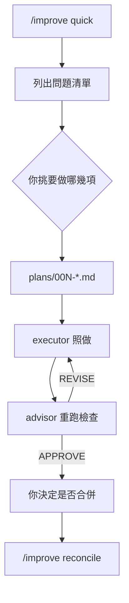

把「這個專案哪裡要改」丟給 coding agent，常會拿回一張長清單，哪些該改、怎麼驗證還得自己判斷。

[shadcn/improve](https://github.com/shadcn/improve) 讓能力較強的模型讀程式碼、寫計畫，再交給較便宜的模型執行。我用它在範例專案上產生四份計畫、執行其中兩份。各步驟的實際輸出和 token 用量也一併附上。

> 依據 shadcn/improve 的 README、SKILL.md 與 `references/` 底下三份文件，查證與實測都在 2026-11-22（台北時間）。我安裝的是 commit `cac56e1`（2026-09-12），SKILL.md 標示 `version: "1.0.0"`。
{: .prompt-info }

## advisor 寫計畫，executor 照著改

improve 是 shadcn 寫的 agent skill，也就是 agent 照著做的指示。它沒有程式，只有一份 SKILL.md 和三份 Markdown 參考文件，把工作分給兩個角色：

- **advisor**（出主意）：就是你在 agent 裡正在用的模型。它讀程式碼、列問題、寫計畫，除了 `plans/` 資料夾什麼都不能改。
- **executor**（動手）：執行 `execute` 時派出的 subagent，也就是主 agent 另外開來做單一任務的 agent。它在獨立的 git worktree 裡照計畫修改，worktree 是同一個 repo 的另一份工作目錄。預設用 Sonnet，也可以指定其他模型。



improve 本身不呼叫任何 API。兩個角色都跑在你的 agent 裡，用的是你自己的訂閱額度或 API 用量。

SKILL.md 把理解程式碼、判斷優先順序和寫計畫交給能力較強的模型。這次我選了 Opus 5.5 當 advisor。

這篇照 README「How to use」一節的順序走完一輪。README 的用法清單還列了這幾種：

| 指令 | README 的說明 |
| --- | --- |
| `/improve security` | 只審查安全這一類，也可以換成 perf、tests、bugs 等 |
| `/improve next` | 建議功能，也就是專案接下來可以往哪裡走 |
| `/improve plan <描述>` | 跳過審查，直接為一件事寫計畫 |
| `/improve review-plan <檔案>` | 檢討並收緊一份現有的計畫 |

## 準備一個埋了問題的範例專案

我寫了一個叫 `bookmarks-api` 的書籤服務，需要 Node.js 22 以上，沒有相依套件。程式只有 4 個原始檔、約 150 行，測試只有 1 個。

裡面故意埋了四個問題：

| 埋的問題 | 位置 |
| --- | --- |
| 下載備份時先解碼檔名再 `join()`，`..%2F` 可以讀到資料夾外的檔案 | `src/server.js` |
| 分頁用 `page * pageSize` 算起點，但頁碼從 1 開始，第 1 頁會跳過前 20 筆 | `src/store.js` |
| 匯入只檢查 `new URL()` 能不能解析，`javascript:` 網址也能匯入 | `src/import.js` |
| 請求內容不是合法的 JSON 時回 500，而不是 400 | `src/server.js` |

我在 ADR（架構決策紀錄）`docs/adr/0001-json-file-storage.md` 裡寫明，這個專案刻意讓每個請求都用同步 API 讀寫 JSON 檔。我想看 advisor 能不能辨認出這是設計上的取捨。

專案提交成 commit `acf5380`，推到本機一個 bare repo（只有 git 歷史、沒有工作目錄的 repo）當作 `origin`。Claude Code 用下面的指令啟動：

```bash
claude --model opus --permission-mode auto
```

這次實測的環境和模型：

| 項目 | 版本或設定 |
| --- | --- |
| 作業系統 | macOS |
| Node.js | 25.2.1 |
| Claude Code | 2.1.330，effort 用預設的 medium，權限模式 auto |
| 安裝工具 | `skills` 1.9.0 |
| advisor | `claude-opus-5-5`（Claude Code 主 session） |
| executor | `claude-sonnet-5-5`、`claude-haiku-5-5`（由 skill 派出） |

後面的終端機截圖是把錄下的畫面文字排成圖片，除了下面幾處，其餘都是原始輸出：

- 拿掉 Claude Code 啟動時的標頭。
- 家目錄路徑寫成 `~`。
- 一段含暫存路徑的指令縮短成 `…`。
- 安裝畫面的提示字元縮成 `$`。
- `⋮` 表示省略的段落，黃底是我加的標示。

## 步驟一：安裝 skill

```bash
npx skills add shadcn/improve
```

`skills` 是安裝 [Agent Skills](https://agentskills.io) 格式的命令列工具，直接執行會問你要裝給哪個 agent。我固定了版本並指定 agent，讓它不必再問。`DISABLE_TELEMETRY=1` 則關掉它的使用統計：

```bash
DISABLE_TELEMETRY=1 npx -y skills@1.9.0 add shadcn/improve --skill improve --agent claude-code -y
```

{: w="1099" h="1087" }
_skill 被複製到專案的 .claude/skills/improve（實際輸出）_

安裝工具會在專案根目錄寫一份 `skills-lock.json`，記下來源、commit 和檔案雜湊。這個 repo 沒有發布 GitHub Release。要確認實際裝到的內容，可以查這裡的 `commit`。

```json
{
  "version": 2,
  "skills": {
    "improve": {
      "source": "shadcn/improve",
      "commit": "cac56e1ebd3c279aa9153616cfeac7b174ab90f9",
      "sourceType": "github",
      "skillPath": "skills/improve/SKILL.md",
      "computedHash": "9e8fe9ea4f9a0e4155801d1624e38ca23798467bb88b447efaa5120f7b1fe802"
    }
  }
}
```

輸出最後一行提醒，skill 擁有和 agent 一樣的權限。improve 只有四份 Markdown、沒有腳本，裝之前花幾分鐘讀完就好。[裝了第三方 skill 和 MCP 之後，你的 Coding Agent 多了哪些破口？](/posts/coding-agent-supply-chain-permission-risks/)整理了這類風險。

## 步驟二：用 `/improve quick` 列出問題

在 Claude Code 裡輸入：

```text
/improve quick
```

`quick` 是三種審查深度裡最便宜的一種。SKILL.md 的設定如下：

| | `quick` | `standard`（預設） | `deep` |
| --- | --- | --- | --- |
| 範圍 | 最常改、最關鍵的熱點 | 熱點加主要套件 | 整個 repo |
| subagent | 0 到 1 個 | 最多 4 個同時跑 | 最多 8 個同時跑 |
| 類別 | 正確性、安全、測試 | 全部 9 類 | 全部 9 類 |
| 列出的問題 | 約前 6 項，只列高信心的 | 完整表格 | 完整表格，含低信心的待查項目 |

{: w="1099" h="887" }
_它讀完所有檔案、跑了測試，再對真的伺服器重現問題（實際輸出）_

專案很小，它沒有派 subagent，自己讀完全部程式碼。接著它用暫存資料庫啟動伺服器，逐一重現每個問題。

{: w="1099" h="1689" }
_五個問題、一個被排除的項目，以及這次沒審查的範圍（實際輸出）_

四個埋的問題都找到了，每一項都附上 `file:line`。能從 API 重現的，它也附上實際結果，例如 `GET /exports/..%2Fpackage.json` 回 200。

第 4 項還多了一個我沒刻意埋的問題。檔案不存在時，500 的錯誤訊息會帶出伺服器的絕對路徑。第 5 項是測試太少，它建議不另寫計畫，改由每份計畫自帶測試。

誘餌沒有騙到它。ADR 寫明的同步寫檔列在「Rejected」，它認出那是刻意的選擇。

輸出最後列出 quick 模式沒看的範圍，包括效能、文件，以及寫檔寫到一半當掉造成的資料遺失。

表格沒有信心程度這一欄。SKILL.md 要求每個問題都評估信心程度，但它規定的表格欄位本來就不含這一欄，信心程度只用來排序。

## 步驟三：挑出要做的項目，讀計畫

回覆要做哪幾項：

```text
plan 1, 2, 3 and 4
```

{: w="1099" h="1511" }
_四份計畫加一份索引，都寫在 plans/，原始碼沒有改動（實際輸出）_

匯入需要共用 API 的 `validateBookmark`。advisor 把修正這個驗證函式的工作排成計畫 `003`，再把匯入驗證排成計畫 `004`。下表對照審查時的問題編號與寫成計畫後的編號。

| 問題 | 計畫 |
| --- | --- |
| 1：下載備份的路徑穿越 | `001-block-export-path-traversal.md` |
| 2：分頁跳過第一頁 | `002-fix-pagination-off-by-one.md` |
| 4：錯誤輸入回 500 | `003-return-400-for-bad-input.md` |
| 3：匯入沒套用驗證 | `004-validate-imported-bookmarks.md` |

SKILL.md 說「計畫才是產品」（The plan is the product）。計畫是寫給「另一個能力較弱、對這個 session 一無所知的模型」看的。001 有 219 行，開頭先交代執行規則與漂移檢查：

```markdown
> **Executor instructions**: Follow this plan step by step. Run every
> verification command and confirm the expected result before moving to the
> next step. If anything in the "STOP conditions" section occurs, stop and
> report — do not improvise. When done, update the status row for this plan
> in `plans/README.md` — unless a reviewer dispatched you and told you they
> maintain the index.
>
> **Drift check (run first)**: `git diff --stat acf5380..HEAD -- src/server.js test/exports.test.js`
> If any in-scope file changed since this plan was written, compare the
> "Current state" excerpts against the live code before proceeding; on a
> mismatch, treat it as a STOP condition.
```

漂移檢查比對的是計畫寫成時的 commit。程式碼在那之後若有改動，executor 要先核對計畫引用的程式碼片段，對不上就停下來。

範圍和停止條件寫得很具體。下面節錄同一份計畫的兩段：

```markdown
**Out of scope** (do NOT touch):
- The generic `catch` block at lines 44–46 — another plan (003) changes it. Leave it as is.
- The `/bookmarks` routes, `src/store.js`, `src/validate.js`, `src/import.js`.

## STOP conditions

Stop and report back (do not improvise) if:

- `src/server.js` does not match the excerpts above (drift).
- Test 2 returns 404 before your change (someone already fixed it differently).
- Making a test pass seems to need changes to the generic `catch` block (lines 44–46) — that belongs to plan 003.
```

其餘段落依序是：

- **現況**：貼出要改的程式碼原文和行號。
- **步驟**：先寫會失敗的測試，再修改。每一步都附驗證指令和預期結果。
- **完成條件**包含可執行的驗證指令。例如用搜尋指令確認 `decodeURIComponent` 只出現在新函式裡。
- **Git 流程**：分支名稱 `advisor/001-block-export-path-traversal` 和 commit 訊息。

`plans/README.md` 是所有計畫的索引：

```markdown
| Plan | Title | Priority | Effort | Depends on | Status |
|------|-------|----------|--------|------------|--------|
| [001](001-block-export-path-traversal.md) | `GET /exports/:file` only serves files directly inside `exports/` | P1 | S | — | TODO |
| [002](002-fix-pagination-off-by-one.md) | `GET /bookmarks?page=1` returns the first 20 bookmarks | P1 | S | — | TODO |
| [003](003-return-400-for-bad-input.md) | Bad request bodies return 400; 500s stop leaking details | P2 | S | 001 (same file) | TODO |
| [004](004-validate-imported-bookmarks.md) | Imported bookmarks pass the same validation as the API | P2 | S | 003 | TODO |
```

計畫 `004` 要把 `importFromFile` 的回傳值從數字改成 `{ imported, skipped }`。執行前要先確認是否接受這個改動。如果還有其他呼叫端，executor 會依計畫停下來回報。

## 步驟四：用 `/improve execute` 交給便宜的模型

```text
/improve execute 001
```

{: w="1099" h="776" }
_先跑漂移檢查，再派 Sonnet 5.5 到獨立的 worktree 執行（實際輸出）_

advisor 先自己跑一次漂移檢查，結果是 `DRIFT-OK`。接著派出一個 subagent，畫面上標示的模型是 Sonnet 5.5。`plans/` 還沒提交，worktree 裡讀不到，所以計畫內容要直接貼進 subagent 的指示裡。

closing-the-loop.md 要求貼上計畫全文。我比對了對話紀錄，001 和 002 貼進去的都是 advisor 濃縮過的版本。

以 001 為例，長度從 10,599 位元組縮成 7,946 位元組。「Test plan」和「Maintenance notes」兩節不見了，其餘各節也都改寫得更短。

步驟、完成條件和停止條件都還在。但 executor 照做的內容，和你讀過的計畫檔不完全相同。

executor 在 `.claude/worktrees/` 底下自己的 worktree 工作，不會動到你的工作目錄。worktree 的原理見 [git worktree 教學：讓兩個 AI 在同一個 repo 分開工作](/posts/git-worktree-parallel-ai-agents/)。

executor 花了 46 秒完成。advisor 沒有直接採信它的報告，而是自己在 worktree 裡驗收：

{: w="1099" h="1221" }
_advisor 重跑完成條件、檢查範圍、讀過 diff 和測試後才核准（實際輸出）_

它照 `references/closing-the-loop.md` 的四項檢查走：

1. 重跑每一條完成條件。
2. 確認只改了範圍內的檔案。
3. 讀完整個 diff，對照計畫要解決的問題。
4. 讀新測試實際斷言了什麼，避免測試通過卻什麼都沒測。

executor 回報了三個偏離計畫的地方，其中一項是計畫自己寫錯。計畫預期 `%2E%2E` 的測試在修改前會失敗，但 Node 的 URL 解析器會先處理掉它，修改前就已經回 404。

executor 還跳過了一次中途測試，修補與測試的 commit 順序也和計畫相反。advisor 在最終驗收時重跑了測試。

closing-the-loop.md 規定，有說明的偏離要看理由判斷，不是一律退件。這次 advisor 判定三項都不影響結果，給了 APPROVE。

APPROVE 之後，它把索引的狀態改成 DONE。它沒有合併，也沒有 push，合併由你決定。

第二份計畫指定給 Haiku：

```text
/improve execute 002 haiku
```

{: w="1099" h="1177" }
_Haiku 5.5 執行 30 秒，advisor 另外確認 001 和 002 的分支能一起合併（實際輸出）_

Haiku 花 30 秒做完，同樣拿到 APPROVE。這次 advisor 多做了一件事，用 `git merge-tree` 確認 001 和 002 兩個分支一起合併不會衝突。

我另外查了 Claude Code 的對話紀錄。兩個 executor 實際使用的模型分別是 `claude-sonnet-5-5` 和 `claude-haiku-5-5`，與畫面上的標示一致。

## 步驟五：合併前用 `/improve branch` 再看一次

`APPROVE` 表示 advisor 驗收通過。合併前，可以直接在 executor 的 worktree 裡開一個新 session 做分支審查。

我這次在原本的工作目錄切到 001 的分支做審查。Git 預設同一個分支一次只能在一個 worktree 裡 checkout，所以我先移除了 001 的 worktree，也一併清理了 002 的。worktree 的資料夾名稱每次都不同，可以用下方第一個指令查。

```bash
git worktree list
git worktree remove .claude/worktrees/agent-ac299380af963eaff
git worktree remove .claude/worktrees/agent-ac8a3882939c9f9e3
git switch advisor/001-block-export-path-traversal
```

開一個新的 Claude Code session，執行：

```text
/improve branch
```

`branch` 只審查這個分支改過的檔案，以及呼叫這些檔案的程式碼。每個問題會標示是這個分支帶進來的（`introduced`），還是原本就有的（`pre-existing`）。

{: w="1099" h="1956" }
_路徑穿越修好了，但它找到一個修補沒涵蓋的情況（實際輸出）_

分支審查確認原本的路徑穿越已修補，8 個測試全過。第 2 項的標籤是 `introduced (the fix is incomplete)`。它指出一個修補未涵蓋的例外，有些無效檔名仍會收到 500 回應，訊息也會帶出伺服器的絕對路徑。

計畫 001 驗收時檢查過類似的路徑洩漏。我認為這反映了兩次審查的差異，驗收著重計畫列出的條件，分支審查則從這次改動出發，找出計畫和測試漏掉的情況。

它建議把第 1 項寫成新的計畫 005，第 2 項併進計畫 003，並問你要把哪些寫成計畫。

我選擇先合併 001 和 002。這次範例服務只在本機執行，advisor 把第 2 項評為低影響。第 1 項的新計畫留到下一輪。

計畫 003 已包含把 500 的錯誤訊息改成通用訊息，可處理這次看到的路徑洩漏。這個例外應回哪個狀態碼，則是分支審查建議另外處理的部分。

## 步驟六：合併之後用 `/improve reconcile` 整理清單

合併兩個分支、跑測試，再推上去：

```bash
git switch main
git merge --no-ff --no-edit advisor/001-block-export-path-traversal
git merge --no-ff --no-edit advisor/002-fix-pagination-off-by-one
npm test
git push origin main
```

15 個測試全部通過。下一次開 session 時執行：

```text
/improve reconcile
```

{: w="1099" h="887" }
_兩份計畫驗證完成，003 只有行號過期，在原檔更新（實際輸出）_

reconcile 依索引裡的狀態分別處理：

| 狀態 | reconcile 做什麼 |
| --- | --- |
| DONE | 在目前的 HEAD 重跑便宜的完成條件 |
| BLOCKED | 查出卡住的原因，改寫計畫或標成 REJECTED |
| IN PROGRESS | 提醒你，executor 可能中途中斷 |
| TODO | 跑漂移檢查，必要時更新計畫；問題已不存在就標成 REJECTED |

這次 001、002 在 `35fb742` 上重跑通過。004 的檔案沒動過，維持原樣。

003 的程式碼被前面的合併往下推，行號過期了，但引用的片段還一字不差。所以它直接更新行號和漂移檢查的基準 commit，並確認問題還在。

更新後的索引：

```markdown
| Plan | Title | Priority | Effort | Depends on | Status |
|------|-------|----------|--------|------------|--------|
| [001](001-block-export-path-traversal.md) | `GET /exports/:file` only serves files directly inside `exports/` | P1 | S | — | DONE — verified on `35fb742` (merged to `main`) |
| [002](002-fix-pagination-off-by-one.md) | `GET /bookmarks?page=1` returns the first 20 bookmarks | P1 | S | — | DONE — verified on `35fb742` (merged to `main`) |
| [003](003-return-400-for-bad-input.md) | Bad request bodies return 400; 500s stop leaking details | P2 | S | 001 ✓ | TODO — refreshed at `35fb742`, ready |
| [004](004-validate-imported-bookmarks.md) | Imported bookmarks pass the same validation as the API | P2 | S | 003 | TODO — no drift; waits for 003 |
```

它只改了 `plans/` 裡的兩個檔案，沒有提交。`plans/` 要不要進版本控制，由你決定。

## `--issues` 要明確加上才會開 issue

improve 可以把每份計畫開成 GitHub issue，但只有加上 `--issues` 才會執行，例如：

```text
/improve quick --issues
```

依 closing-the-loop.md，它會依序做這些事：

1. 確認 `gh auth status` 成功，而且 repo 有 GitHub remote。
2. 用 `gh repo view --json visibility` 檢查 repo 是否公開。公開的話，發布安全漏洞或憑證位置相關的計畫前，要先取得你的確認。
3. 列出要建立的 issue 標題，問你一次。
4. 用 `gh issue create --body-file` 建立 issue，加上 `improve` 和類別標籤，再把網址寫回計畫和索引。

像 001 這種路徑穿越的計畫，修好之前不該出現在公開 repo 的 issue 裡。第 2 步的確認就是為了這個。

## 按 API 牌價換算約 US$2.76，advisor 占 93%

數字來自 Claude Code 存在本機的對話紀錄，也就是 `~/.claude/projects/` 底下的 jsonl 檔。每則模型回應都有 `usage` 欄位，同一則回應會寫成好幾行，我以訊息 id 去重後加總。

價格用 2026-11-22 的 [Claude 定價](https://platform.claude.com/docs/en/about-claude/pricing)換算。快取是把提示存起來，讓後續呼叫便宜讀回。未快取的輸入每個階段只有幾十個 token，表上省略。

| 階段 | 模型 | 輸出 | 寫入快取 | 讀取快取 | 定價換算 |
| --- | --- | ---: | ---: | ---: | ---: |
| quick | Opus 5.5 | 3,167 | 18,419 | 150,490 | $0.241 |
| plan 1, 2, 3 and 4 | Opus 5.5 | 21,785 | 24,813 | 265,124 | $0.687 |
| execute 001（advisor） | Opus 5.5 | 6,824 | 18,919 | 916,208 | $0.471 |
| execute 001（executor） | Sonnet 5.5 | 5,418 | 37,273 | 338,423 | $0.181 |
| execute 002（advisor） | Opus 5.5 | 5,522 | 14,190 | 697,471 | $0.364 |
| execute 002（executor） | Haiku 5.5 | 6,322 | 39,527 | 306,512 | $0.011 |
| branch | Opus 5.5 | 4,675 | 28,073 | 273,952 | $0.373 |
| reconcile | Opus 5.5 | 4,320 | 32,655 | 418,019 | $0.431 |
| 合計 | | | | | $2.759 |

換算用的定價（每百萬 token，美元）：

| 模型 | 輸入 | 寫入快取（5 分鐘） | 寫入快取（1 小時） | 讀取快取 | 輸出 |
| --- | ---: | ---: | ---: | ---: | ---: |
| Opus 5.5 | 4 | 5 | 8 | 0.20 | 20 |
| Sonnet 5.5 | 2 | 2.50 | 4 | 0.10 | 10 |
| Haiku 5.5（提示 10 萬 token 以內） | 0.10 | 0.125 | 0.20 | 0.01 | 0.50 |

Sonnet 5.5 每個 token 的價格是 Opus 5.5 的一半。Haiku 5.5 的輸入和輸出只有 Opus 的 1/40。

Opus 的費用是 US$2.567，包含初審、寫計畫、派工與驗收，以及分支審查和合併後的檢查。

Opus 費用最高的一項是寫入快取。紀錄裡主 session 的快取有效期是 1 小時，Opus 寫入一百萬 token 要 US$8。單是 Opus 的快取寫入就約 US$1.10，占總額約四成。

`branch` 和 `reconcile` 各開了新的 session。寫入快取約占這兩個階段合計費用的六成。

execute 001 裡，Opus 這一段花了 $0.471，Sonnet 執行只花 $0.181。Opus 這一段包含派工、等待和審查，共跑了 11 次模型呼叫。

這 11 次呼叫的提示長度在 7.7 萬到 9.1 萬 token 之間，大部分從快取讀回。其中約 7 萬 token 在進入這個階段前就已存在。它們是系統提示、skill 內容，以及 quick 和 plan 兩個階段的對話。

這組數字有三個限制：

- Sonnet 和 Haiku 執行的是不同的計畫，兩者的費用不能直接比較。
- 這只是一次執行。快取有效期由 Claude Code 決定，這次主 session 用 1 小時，subagent 用 5 分鐘。
- 用訂閱方案的人不會收到這張帳單，花的是方案額度。換算成定價只是為了比較各角色的份量。

這次執行的兩份計畫都估為 S（S/M/L 裡最小的一級）。我推測工作量較大的計畫可能更適合這樣分工。要驗證能省多少，得讓 Opus 單獨完成相同的工作，再比較整輪費用。

## 從一次 `/improve quick` 開始

在自己的專案試跑時，先選一項寫成計畫。讀完計畫，再用實際產生的編號執行，下方以 `001` 為例。

```text
/improve quick
plan 1
/improve execute 001
```

切到 executor 的分支，或直接進入它的 worktree，再開一個新 session 做分支審查。

```text
/improve branch
```

## 延伸閱讀

- [shadcn/improve](https://github.com/shadcn/improve)：原始碼、README 與完整的指令列表。
- [官方範例計畫](https://github.com/shadcn/improve/blob/main/examples/001-extract-shadow-config-resolution.md)：對 shadcn/ui 跑出來的一份計畫。
- [Agent Skills](https://agentskills.io)：improve 採用的 skill 格式。
- [git worktree 教學：讓兩個 AI 在同一個 repo 分開工作](/posts/git-worktree-parallel-ai-agents/)：`execute` 用來隔離 executor 的機制。
- [mattpocock/skills 系列（3）：先找出缺口，再決定要寫規格還是拆工作單](/posts/mattpocock-skills-specs-work-breakdown/)：把需求拆成可交接工作單的另一種做法。
- [AI 寫程式變快了，產品為什麼還是交不出去？我怎麼理解 AI 原生開發流程](/posts/ai-native-sdlc-playbook/)：規劃、實作、審查分開的整體流程。
- [自己寫 Agent Skill：從 SKILL.md 結構到觸發測試與維護](/posts/agent-skill-authoring-guide/)：SKILL.md 的寫法。
- [裝了第三方 skill 和 MCP 之後，你的 Coding Agent 多了哪些破口？](/posts/coding-agent-supply-chain-permission-risks/)：安裝第三方 skill 前該檢查什麼。
