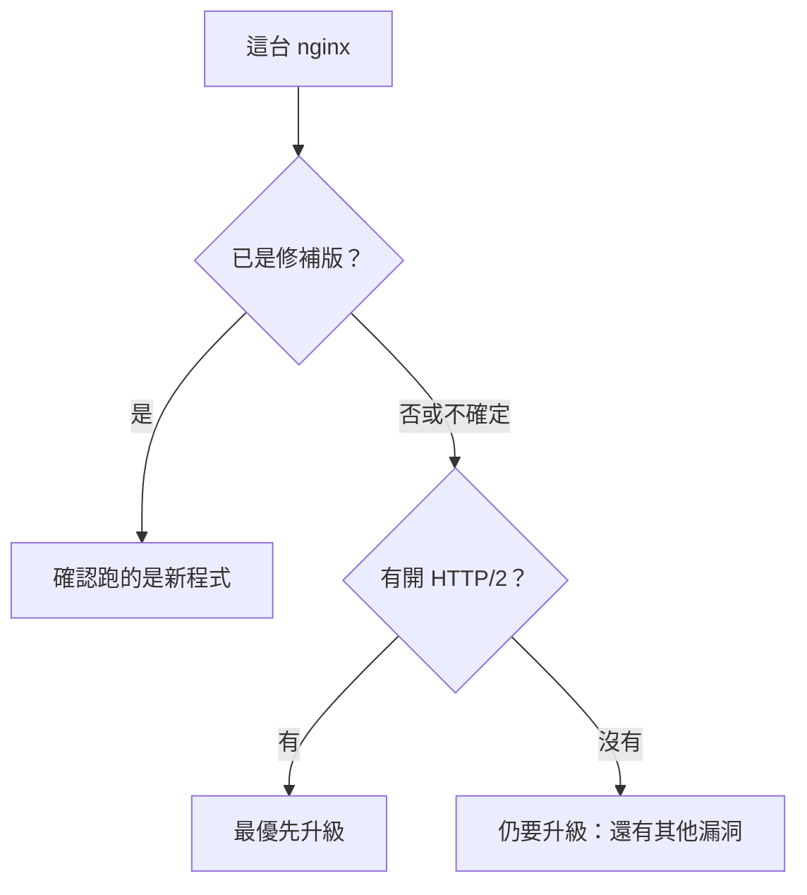
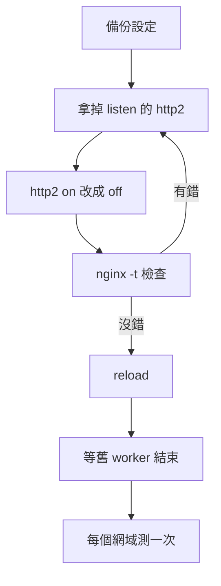

nginx 在 11 月 18 日修補了 HTTP/2 漏洞 **CVE-2026-123007**。網站開著 HTTP/2，不需登入的遠端攻擊者就可能讓 nginx 的記憶體損毀，進而執行程式碼。

我整理了確認版本與設定的指令，也用官方 Docker 映像確認了一個容易漏掉的步驟：升級後只 reload，舊程式會繼續服務。

> 內容依據 nginx 官方安全公告、F5 寫在 CVE 紀錄中的說明、CERT-EU 與三個研究團隊的文章，查證日期是 2026-11-22（台北時間）。利用狀態與修補版本會變動，以官方最新資訊為準。
{: .prompt-info }

我會先用這張圖判斷要多急：



「修補版」包含發行版已修補的套件，判斷方式在後面。不是管理伺服器的人，可以把這篇交給維運人員，後面的指令需要 root 權限。

## 11 月 18 日的更新修了 10 個問題，HTTP/2 這個最急

nginx 在 2026-11-18 同時發布 1.31.9 與 1.30.7。1.31.9 屬於 mainline，也就是功能較新的分支；1.30.7 屬於只收修正的 stable 分支。

1.31.9 修了 10 個安全問題，1.30.7 修了其中 9 個，少的那個只影響 1.31.x。

CVE-2026-123007 影響 1.9.5 到 1.31.8。1.9.5 是 2015 年 9 月加入 HTTP/2 的版本，所以開過 HTTP/2 的 nginx 幾乎都在範圍內。

嚴重程度有三個來源。F5 是 nginx 的母公司，也是這筆 CVE 的編號單位；CVSS 是常見的漏洞評分標準，3.1 與 4.0 是兩個版本：

| 來源 | 評分 |
| --- | --- |
| [nginx 官方公告](https://nginx.org/en/security_advisories.html) | major（nginx 自己的分級，分為 major、medium、minor） |
| [F5 在 CVE 紀錄給的 CVSS 3.1](https://www.cve.org/CVERecord?id=CVE-2026-123007) | 8.1，High |
| F5 在 CVE 紀錄給的 CVSS 4.0 | 9.2，Critical |

[NVD](https://nvd.nist.gov/vuln/detail/CVE-2026-123007) 截至 2026-11-22 沒有自己的評分，只轉列 F5 的分數。所以看到 8.1 和 9.2 兩個數字，差別在評分版本，不是兩個機構看法不同。

利用狀態我分三件事看：

| 項目 | 狀態 | 來源 |
| --- | --- | --- |
| 公開的概念驗證程式 | 已有，2026-11-18 公開 | [Rapid7](https://www.rapid7.com/blog/post/ve-cve-2026-123007-critical-nginx-http-2-integer-underflow-leads-to-rce-fixed/) |
| 在野利用的報告 | 尚未有（2026-11-18 的說法） | [CERT-EU](https://www.cert.europa.eu/publications/security-advisories/2026-022/) |
| CISA 已知遭利用漏洞清單（KEV） | 未列入（2026-11-20 版） | [CISA KEV](https://www.cisa.gov/known-exploited-vulnerabilities-catalog) |

概念驗證程式（PoC）是證明漏洞能被利用的範例程式，這篇不附連結。沒列入 KEV 只代表 CISA 還沒確認有人利用，不代表沒有人在試。

### 研究人員寫出的利用門檻不低

依 Rapid7 的說明，他們的示範要送出約 128 GB 的 HTTP/2 資料。網路慢於約 300 Mbit/s 時，在 nginx 預設的一小時連線期限內送不完。HTTP/2 中途經過其他代理再轉送的話，攻擊多半也無法成功。

ASLR 是讓程式每次載入時記憶體位置都不同的防護。F5 說，要在 ASLR 關閉或被繞過時才能執行程式碼。[Wiz](https://www.wiz.io/blog/nginx-http2-rce-vulnerabilities) 則說 ASLR 擋不住這次的問題，他們在只提供靜態檔案的一般伺服器上示範了遠端執行程式碼。

我判斷門檻不低，但 PoC 已經公開，攻擊者只要找到開著 HTTP/2 的主機就能嘗試。所以我會把它當成要馬上處理的漏洞。

## HTTP/2 流量控制算錯，worker 的記憶體被寫壞

HTTP/2 用流量控制限制每條連線能傳多少資料。接收端會告訴傳送端自己還能收多少，這個額度叫作視窗（window）。

依 Rapid7 的說明，攻擊者能讓 nginx 算錯「用戶端還允許它送出多少回應資料」。F5 說，視窗可能超過允許的上限，造成 heap buffer overflow，也就是寫到配置範圍以外的記憶體。

出問題的是 worker。nginx 由一個 master 程序讀設定、管理 worker，實際處理連線的是 worker。master 通常以 root 執行，worker 以 `nginx`、`www-data` 這類一般帳號執行。

依 [Xint](https://xint.io/blog/nginx2root-remote-code-execution) 的說明，攻擊成功時，指令以 worker 的權限執行。Xint 另外把它和一個 Linux 核心漏洞串起來，從 Docker 容器裡的 nginx 取得了 root。所以我不會把「worker 不是 root」當成可以晚點處理的理由。

## 先查三件事：版本、HTTP/2 設定、正在跑的程式

以下指令給管理 nginx 主機的人用，需要 root 權限。

### 1. 版本：用發行版套件時，看套件版號

```sh
nginx -v
nginx -V 2>&1 | grep -o with-http_v2_module
```

第一行顯示上游版本。第二行確認執行檔有沒有編入 HTTP/2 模組，沒有輸出就代表沒有編入，這次的 HTTP/2 漏洞碰不到它。nginx 原始碼預設不編入這個模組，但 nginx.org 與 Debian 的套件都有編入。

自行編譯或使用 nginx 官方套件、官方 Docker 映像時，版本到 1.30.7 或 1.31.9 以上就已修補。

用發行版套件時，`nginx -v` 不準。發行版常把修正套用到舊版套件，這叫作 backport，上游版本號不會變。最明顯的例子是 Debian unstable：套件 `1.30.6-4` 已修補，但 1.30.6 在 nginx 官方公告裡屬於受影響版本。

我在 Debian 12 的容器裡裝到的是已修補的 `1.22.1-9+deb12u11`，`nginx -v` 只顯示 1.22.1。

先查套件版號，依系統選一行執行：

```sh
dpkg -l | grep nginx
rpm -qa | grep nginx
apk info -v | grep nginx
```

第一行用在 Debian、Ubuntu，第二行用在 RHEL 系列，第三行用在 Alpine。再對照發行版公告，下表是幾個常見版本第一個包含修補的套件：

| 發行版 | 已修補的套件版本 | 公告 |
| --- | --- | --- |
| Debian 12 bookworm | `1.22.1-9+deb12u11` | [DLA-4918-1](https://security-tracker.debian.org/tracker/CVE-2026-123007) |
| Debian 13 trixie | `1.26.3-3+deb13u11` | [DSA-6642-1](https://security-tracker.debian.org/tracker/CVE-2026-123007) |
| Ubuntu 22.04 jammy | `1.18.0-6ubuntu14.23` | [USN-9159-1](https://ubuntu.com/security/CVE-2026-123007) |
| Ubuntu 24.04 noble | `1.24.0-2ubuntu7.20` | [USN-9159-1](https://ubuntu.com/security/CVE-2026-123007) |
| RHEL 9 | `nginx-1.20.1-32.el9_9.2` | [RHSA-2026:100748](https://access.redhat.com/security/cve/CVE-2026-123007) |
| RHEL 10 | `nginx-1.26.3-16.el10_3.3` | [RHSA-2026:100744](https://access.redhat.com/security/cve/CVE-2026-123007) |
| Alpine 3.22、3.23 | `1.28.3-r8` | [Alpine secdb](https://secdb.alpinelinux.org/v3.23/main.json) |
| Alpine 3.24 | `1.30.7-r0` | [Alpine secdb](https://secdb.alpinelinux.org/v3.24/main.json) |

RHEL 9 與 RHEL 8 的 nginx 模組串流（module stream）另有各自的公告，用 `dnf module` 裝的人要看 Red Hat 的完整清單。Ubuntu 16.04、18.04、20.04 的修補要有 Ubuntu Pro 才收得到。

### 2. HTTP/2 設定：每個 server 區塊都要看

```sh
sudo nginx -T 2>/dev/null | grep -E '^# configuration file|http2'
```

`nginx -T` 會把主設定檔和所有 `include` 進來的檔案一起印出來。這行只留下檔名與含 `http2` 的行，讀的時候注意兩種寫法：

- `listen 443 ssl http2;`：舊寫法，1.25.1 起標為過時，但仍然有效。
- `http2 on;`：1.25.1 起的新寫法，可以寫在 `server` 區塊，也可以寫在 `http` 區塊讓所有 server 繼承。

兩種寫法的作用範圍不同。我用官方 Docker 映像試了四種設定：

| 設定 | 結果 |
| --- | --- |
| 同一個埠上，A 寫 `http2 on;`，B 寫 `http2 off;` | 連 A 走 HTTP/2，連 B 走 HTTP/1.1 |
| 同一個埠上，A 寫 `listen ... http2`，B 寫 `http2 off;` | A 和 B 都走 HTTP/2 |
| 同一個 server 寫 `listen ... http2`，又寫 `http2 off;` | 仍走 HTTP/2 |
| 明文的 80 埠寫 `http2 on;` | 用戶端直接送 HTTP/2 時會被接受 |

所以判斷有沒有開 HTTP/2，要以「位址加埠」為單位。TLS 連線時，用戶端會用 SNI 告訴伺服器要連哪個網域名稱。同一個埠上只要有一個 server 開著，攻擊者就能在 SNI 指定那個名稱，走到 HTTP/2。

從外面確認時，每個網域名稱各測一次：

```sh
curl -s --http2 -o /dev/null -w '%{http_version}\n' https://example.com/
curl -s --http2-prior-knowledge -o /dev/null -w '%{http_version}\n' http://example.com/
```

把 `example.com` 換成實際網域。第一行測 HTTPS，第二行測明文連線。印出 `2` 代表接受 HTTP/2；印出 `1.1`，或第二行失敗印出 `0`，代表沒有。這只測得到你指定的名稱，所以設定檔仍是主要依據。

### 3. 正在跑的程式：`nginx -v` 看的是磁碟上的檔案

```sh
sudo ls -l /proc/$(cat /run/nginx.pid)/exe
```

輸出結尾出現 `(deleted)`，代表磁碟上的執行檔已經換掉，但正在服務的還是舊程式。Alpine 的 pid 檔在 `/run/nginx/nginx.pid`，其他系統可以從 `nginx -V` 輸出裡的 `--pid-path=` 找到位置。這個檢查用的是 Linux 的 `/proc`。

## 升級後要重啟，只 reload 不夠

nginx 官方只為兩個分支發布修補，更舊的分支要換到其中之一，或改用發行版的修補套件：

| 你用的版本 | 升級到 |
| --- | --- |
| nginx stable（1.30.x） | 1.30.7 以上 |
| nginx mainline（1.31.x） | 1.31.9 以上 |
| NGINX Plus 37.0.x | 37.0.8.1 以上 |
| NGINX Plus 37.1 以後 | 37.3.0.1 以上 |
| 發行版套件 | 上一節表格中的版本 |

NGINX Plus 的版號取自 F5 的 CVE 紀錄。F5 的紀錄也把 R33 以後的 R 系列列為受影響，但沒有列出 R 系列的修補版本。

1.31.9 另外開始拒絕沒有冒號的標頭行，以及分塊開銷過大的 chunked 請求本文。1.30.7 只有安全修正，用 stable 的人升級時不會碰到這些行為變更。

### reload 不會換掉執行檔

我在 1.30.6 的官方映像裡，把磁碟上的執行檔換成 1.30.7，模擬套件升級。然後看每一步之後，實際回應連線的版本：

| 步驟 | `nginx -v` | 回應標頭的版本 | `/proc/<pid>/exe` |
| --- | --- | --- | --- |
| 換掉執行檔後 | 1.30.7 | 1.30.6 | `(deleted)` |
| 再執行 `nginx -s reload` | 1.30.7 | 1.30.6 | `(deleted)` |
| 重啟後 | 1.30.7 | 1.30.7 | 正常 |

reload 只讓 master 重讀設定、換一批 worker。master 本身還是舊的執行檔，新的 worker 也是從它分出來的。Xint 的文章也寫明，只 reload 設定不會換掉正在執行的程式。

套件升級時會不會自動處理，要看套件。nginx.org 的 [deb](https://github.com/nginx/pkg-oss/blob/master/debian/debian/nginx.postinst) 與 rpm 套件會嘗試不停機換掉執行檔，失敗時只印出一行訊息，套件升級仍算成功。所以不管套件怎麼做，我都會在升級後用前面的 `/proc` 檢查確認。

確認設定無誤後重啟：

```sh
sudo nginx -t
sudo systemctl restart nginx
```

Alpine 這類使用 OpenRC 的系統，第二行改成：

```sh
sudo rc-service nginx restart
```

重啟會中斷現有連線一下。不能中斷的服務，nginx 文件有[不停機更換執行檔](https://nginx.org/en/docs/control.html#upgrade)的作法。重啟後再跑一次 `/proc` 檢查，結尾不應該再有 `(deleted)`。

用容器執行 nginx 時，要換成新版映像，例如 `nginx:1.30.7`，再重新部署。重啟同一個舊映像的容器不會更新。

F5 的 NGINX Ingress Controller、NGINX Gateway Fabric 等產品也內含 nginx，[NVD](https://nvd.nist.gov/vuln/detail/CVE-2026-123007) 把它們列在受影響清單裡，要看 F5 的公告。

Kubernetes 社群的 ingress-nginx 已在 2026 年 3 月停止維護，用它的人要看自己所用分支或雲端業者的公告。

## 暫時不能升級：拿掉 listen 的 http2，也要設 http2 off

CERT-EU、Xint 與 Wiz 都建議，不能馬上升級時先關閉 HTTP/2。這只擋住兩個 HTTP/2 漏洞：CVE-2026-123007 與 CVE-2026-123633。F5 的 CVE 紀錄在緩解措施一欄寫的是 None，所以這只是爭取時間的作法。

CERT-EU 寫的是「拿掉 `listen` 的 `http2`，或設 `http2 off;`」。但前面的測試顯示**兩件事都要做**。只要還有一行 `listen ... http2`，`http2 off;` 就沒有作用。Xint 與 Wiz 的寫法也是兩者都要。

改完的 server 區塊像這樣：

```nginx
server {
    listen 443 ssl;    # 拿掉原本的 http2
    http2 off;         # 原本是 http2 on;
    # 其他設定不變
}
```

1.25.0 以前的版本沒有 `http2` 指令，只要拿掉 `listen` 的 `http2`。修改範圍要涵蓋：

- 同一個位址與埠上的每個 server 區塊，包括 default server。
- `http` 區塊裡的 `http2 on;`，它會被所有 server 繼承。
- 80 埠這類明文 listener 上的 `http2 on;`。

完整流程如下：



這裡用 reload 就夠了，因為只改設定、沒換執行檔：

```sh
sudo nginx -t
sudo nginx -s reload
```

但已經建立的 HTTP/2 連線，會留在舊的 worker 上直到連線結束。nginx 預設一條連線最長可以維持一小時。用這行看還有沒有舊 worker：

```sh
ps -eo pid,args | grep '[w]orker process is shutting down'
```

有輸出就代表舊 worker 還在處理舊連線。不想等的話，改用前面的指令重啟。舊 worker 都結束後，用「先查三件事」裡的 `curl` 指令對每個網域各測一次，HTTPS 都要印出 `1.1`。

關閉 HTTP/2 有兩個副作用要先確認：

- **gRPC 會壞。** gRPC 建立在 HTTP/2 上，用 `grpc_pass` 提供 gRPC 服務的主機，用戶端會連不上。
- **HTTP/3 不受影響，也沒被保護。** HTTP/3 有自己的漏洞 CVE-2026-121810，關閉 HTTP/2 擋不住它。

一般瀏覽器會自動改用 HTTP/1.1。升級完成後，記得把 HTTP/2 開回來。

## 沒開 HTTP/2 也要升級：同一批還有其他漏洞

沒開 HTTP/2 的主機，CVE-2026-123007 碰不到，但同一批還修了其他問題。[CERT-EU](https://www.cert.europa.eu/publications/security-advisories/2026-022/) 認為，其中包括 CVE-2026-123007 在內的五個，可能讓不需登入的遠端攻擊者執行程式碼。

下表依 [nginx 官方公告](https://nginx.org/en/security_advisories.html)整理，「涉及的功能」取自公告的標題：

| CVE | 問題 | nginx 分級 | 涉及的功能 |
| --- | --- | --- | --- |
| CVE-2026-123633 | use-after-free | medium | HTTP/2 反向代理 |
| CVE-2026-121810 | use-after-free | medium | HTTP/3 |
| CVE-2026-123634 | use-after-free | medium | `resolver` |
| CVE-2026-113425 | use-after-free | major | mail 代理 |
| CVE-2026-118899 | 無窮迴圈 | major | 透過 TLS 1.3 讀取請求本文 |
| CVE-2026-125283 | buffer overflow | minor | `alias` 搭配 `try_files` |
| CVE-2026-120967 | SNI 繞過 | medium | stream 模組的用戶端憑證驗證 |
| CVE-2026-123640 | 驗證不足 | minor | stream 模組的 `ssl_preread` |
| CVE-2026-120993 | NULL pointer | minor | PROXY protocol v2，只影響 1.31.4 到 1.31.8 |

use-after-free 是程式繼續使用已經釋放的記憶體。

表中第一列要特別注意。nginx 分級是 medium，但 F5 給的 CVSS 和 CVE-2026-123007 一樣是 8.1 與 9.2。依 F5 的說明，它在反向代理到後端、而且 worker 的連線數快用完時觸發。

nginx 官方公告上，CVE-2026-121810 目前顯示成「CVE-CVE-2026-121810」，連結也因此失效，查詢時要用正確的編號。

還停在 1.31.7、1.30.6 以前的話，這次升級也會一併修掉 10 月 14 日公布的 5 個問題。這些漏洞各有條件，我不會逐條判斷能不能跳過，而是直接升級。

## 日誌裡的 worker 崩潰，不等於已被入侵

CERT-EU 建議監看 worker 崩潰，error log 會出現這樣的紀錄：

```sh
sudo grep 'exited on signal' /var/log/nginx/error.log
```

符合的行長得像 `worker process 165 exited on signal 11`。CERT-EU 也說，這不是成功執行程式碼的高可信指標，比較可能是有人在嘗試；Xint 則提醒，worker 也可能因為與攻擊無關的原因崩潰。

依 Xint 的說法，最明確的跡象是 worker 啟動了其他程式。nginx 的 worker 平常不會啟動其他程式，用這行列出 worker 目前的子程序：

```sh
ps --ppid "$(pgrep -d, -P "$(cat /run/nginx.pid)")" -o pid,user,args
```

只印出標題列就代表目前沒有。這只看得到現在，過去的紀錄要看 auditd 或端點防護工具的程序建立日誌。Xint 也提醒，這類攻擊在 access log 裡可能只留下很少痕跡。

主機曾對外開著 HTTP/2、又跑著受影響的版本，而且查到可疑的子程序時，我會把它當成已遭入侵處理：

1. 限制對外連線，保留日誌與磁碟快照。
2. 從可信的乾淨映像重建主機。
3. 從乾淨的環境撤換 worker 讀得到的憑證、API token 與密碼。

TLS 私鑰我也會一起換。worker 要處理 TLS 連線，私鑰就在它的記憶體裡，這是我的推論。修補只能擋住之後的攻擊，不會清掉已經留下的東西。

## 版本對了，還要確認跑的是新程式

這次最容易出錯的地方，是套件升級了、`nginx -v` 也顯示新版，舊程式卻還在服務。升級後我會看 `/proc` 確認。

同樣是「套件更新了、舊服務還在跑」，我在 [OpenSSH 密碼驗證繞過漏洞 CVE-2026-123158：Alpine 怎麼修補](/posts/openssh-musl-password-bypass-alpine/)也遇過，那次是 sshd 沒重啟。

## 主要來源

- [nginx 安全公告](https://nginx.org/en/security_advisories.html)：每個 CVE 的分級與受影響版本
- [nginx 1.31.9 變更紀錄](https://nginx.org/en/CHANGES)與 [1.30.7 變更紀錄](https://nginx.org/en/CHANGES-1.30)
- [CVE-2026-123007 紀錄](https://www.cve.org/CVERecord?id=CVE-2026-123007)：F5 的說明、CVSS 與 NGINX Plus 版號
- [NVD 上的 CVE-2026-123007](https://nvd.nist.gov/vuln/detail/CVE-2026-123007)：受影響的 F5 產品清單
- [CERT-EU 2026-022](https://www.cert.europa.eu/publications/security-advisories/2026-022/)：利用狀態、緩解方式與日誌監看
- [加拿大網路安全中心 AV26-1174](https://www.cyber.gc.ca/en/alerts-advisories/f5-security-advisory-av26-1174)：F5 公告摘要
- [Rapid7 的分析](https://www.rapid7.com/blog/post/ve-cve-2026-123007-critical-nginx-http-2-integer-underflow-leads-to-rce-fixed/)：利用條件與實際限制
- [Wiz 的分析](https://www.wiz.io/blog/nginx-http2-rce-vulnerabilities)：兩個 HTTP/2 漏洞與 NGINX Plus 版號
- [Xint 的 nginx2root](https://xint.io/blog/nginx2root-remote-code-execution)：檢查方式、緩解與入侵跡象
- [nginx http2 指令說明](https://nginx.org/en/docs/http/ngx_http_v2_module.html)與[程序控制說明](https://nginx.org/en/docs/control.html)
- 發行版公告：[Debian](https://security-tracker.debian.org/tracker/CVE-2026-123007)、[Ubuntu](https://ubuntu.com/security/CVE-2026-123007)、[Red Hat](https://access.redhat.com/security/cve/CVE-2026-123007)
- [CISA KEV 清單](https://www.cisa.gov/known-exploited-vulnerabilities-catalog)
