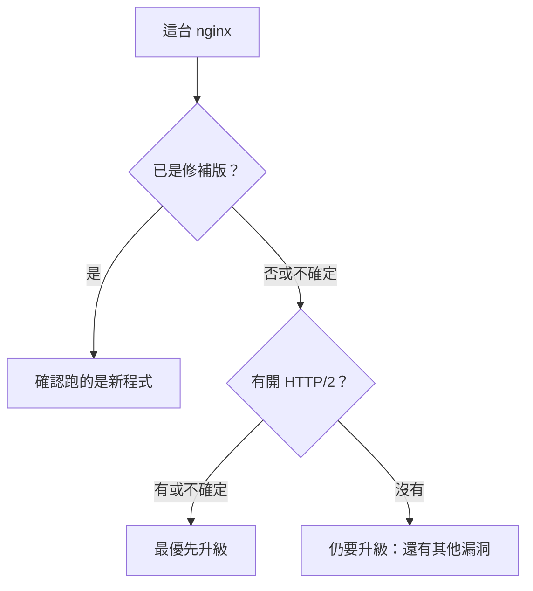
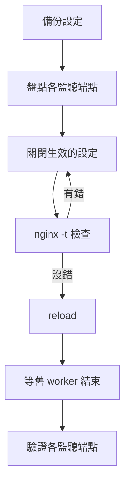

nginx 在 11 月 18 日修補了 HTTP/2 漏洞 **CVE-2026-123007**。受影響的 nginx 若啟用 HTTP/2，不需登入的遠端攻擊者就可能破壞 nginx 的記憶體，進而執行程式碼。

我整理了確認版本與設定的指令，也用官方 Docker 映像確認了一個容易漏掉的步驟：套件若只換了磁碟上的執行檔，reload 後舊程式仍會繼續服務。

> 內容依據 nginx 官方安全公告、F5 寫在 CVE 紀錄中的說明、CERT-EU 與三個研究團隊的文章，查證日期是 2026-11-22（台北時間）。利用狀態與修補版本會變動，以官方最新資訊為準。
{: .prompt-info }

先用這張圖排修補順序。圖中的「修補版」指磁碟上已安裝的版本，也包含發行版提供的修補套件。



若查到仍有舊程序在跑，請按後面的升級步驟完成換版。若你不管理伺服器，可以把這篇交給維運人員。

## 先查三件事：版本、HTTP/2 設定、正在跑的程式

請在執行 nginx 的主機或容器內查版本與設定。已用 root 登入時，可以省略範例的 `sudo`。

### 1. 版本：用發行版套件時，看套件版號

```sh
nginx -v
nginx -V 2>&1 | grep -o with-http_v2_module
```

第一行顯示這份執行檔的上游版本。若 `nginx -V` 正常執行，第二行沒有輸出就表示這份執行檔未編入 HTTP/2 模組。nginx.org 與 Debian 的套件有編入這個模組，自行編譯時則要明確啟用。

自行編譯或使用 nginx 官方套件、官方 Docker 映像時，要按分支比對版號。stable 1.30.x 至少要 1.30.7，mainline 1.31.x 至少要 1.31.9。

用發行版套件時，請用完整套件版號判斷。發行版常把修正套用到舊版套件並保留上游版本號，這叫作 backport。例如 Debian unstable 的 `1.30.6-4` 已包含修補，而 nginx 官方公告列出的 1.30.6 是上游原版。

我在 Debian 12 的容器裡裝到的是已修補的 `1.22.1-9+deb12u11`，`nginx -v` 只顯示 1.22.1。

先查套件版號，依系統選一行執行：

```sh
dpkg -l | grep nginx
rpm -qa | grep nginx
apk info -v | grep nginx
```

第一行用在 Debian、Ubuntu，第二行用在 RHEL 系列，第三行用在 Alpine。再對照發行版公告，下表是幾個常見版本第一個包含修補的套件：

| 發行版 | 已修補的套件版本 | 公告 |
| --- | --- | --- |
| Debian 12 bookworm | `1.22.1-9+deb12u11` | [DLA-4918-1](https://security-tracker.debian.org/tracker/CVE-2026-123007) |
| Debian 13 trixie | `1.26.3-3+deb13u11` | [DSA-6642-1](https://security-tracker.debian.org/tracker/CVE-2026-123007) |
| Ubuntu 22.04 jammy | `1.18.0-6ubuntu14.23` | [USN-9159-1](https://ubuntu.com/security/CVE-2026-123007) |
| Ubuntu 24.04 noble | `1.24.0-2ubuntu7.20` | [USN-9159-1](https://ubuntu.com/security/CVE-2026-123007) |
| RHEL 9 | `nginx-1.20.1-32.el9_9.2` | [RHSA-2026:100748](https://access.redhat.com/security/cve/CVE-2026-123007) |
| RHEL 10 | `nginx-1.26.3-16.el10_3.3` | [RHSA-2026:100744](https://access.redhat.com/security/cve/CVE-2026-123007) |
| Alpine 3.22、3.23 | `1.28.3-r8` | [Alpine secdb](https://secdb.alpinelinux.org/v3.23/main.json) |
| Alpine 3.24 | `1.30.7-r0` | [Alpine secdb](https://secdb.alpinelinux.org/v3.24/main.json) |

RHEL 9 與 RHEL 8 的 nginx 模組串流（module stream）另有各自的公告，用 `dnf module` 裝的人要看 Red Hat 的完整清單。Ubuntu 16.04、18.04、20.04 的修補要有 Ubuntu Pro 才收得到。

### 2. HTTP/2 設定：每個 server 區塊都要看

```sh
sudo nginx -T
```

`nginx -T` 會檢查磁碟上的設定，並印出主設定檔和所有 `include` 進來的檔案。請使用服務的執行檔與啟動參數，包括自訂的 `-c`、`-p` 和 `-g`。若檢查失敗，先解決錯誤再判讀。

看各個監聽位址、埠與虛擬主機的設定時，找這兩種寫法。

- `listen 443 ssl http2;`：舊寫法，1.25.1 起標為過時，但仍然有效。
- `http2 on;`：1.25.1 起的新寫法。寫在 `http` 區塊時，沒有個別設定的 server 會繼承它。

兩種寫法的作用範圍不同。我用官方 Docker 映像試了四種設定：

| 設定 | 結果 |
| --- | --- |
| 共用同一位址與埠，A 寫 `http2 on;`，B 寫 `http2 off;` | 連 A 走 HTTP/2，連 B 走 HTTP/1.1 |
| 共用同一位址與埠，A 寫 `listen ... http2`，B 寫 `http2 off;` | A 和 B 都走 HTTP/2 |
| 同一個 server 寫 `listen ... http2`，又寫 `http2 off;` | 仍走 HTTP/2 |
| 明文的 80 埠寫 `http2 on;` | 用戶端直接送 HTTP/2 時會被接受 |

先按監聽位址和埠檢查舊寫法，再看每個虛擬主機的新寫法。TLS 用戶端透過 SNI 告知 nginx 要連的網域，所以同一個位址和埠上的不同網域可能有不同結果。也要檢查預設虛擬主機，它會接到未指定網域或網域未匹配的 TLS 連線。

設定檔可能改過但還沒載入，請從可以直連自己 nginx 的網路測試各個監聽位址、埠和網域。若前面有 CDN 或負載平衡器，從公開網域測到的協定可能來自代理層。下列指令用 `--resolve` 指定 nginx 位址，並保留原本的網域名稱。

```sh
curl -sS --noproxy '*' --http2 --resolve example.com:443:192.0.2.10 \
  -o /dev/null -w '%{http_version}\n' https://example.com/
curl -sS --noproxy '*' --http2-prior-knowledge --resolve example.com:80:192.0.2.10 \
  -o /dev/null -w '%{http_version}\n' http://example.com/
```

把網域、位址和埠換成實際值。第一條測 HTTPS，第二條測明文 HTTP/2。收到 HTTP 回應時，`2` 代表該連線用了 HTTP/2，`1.1` 代表用了 HTTP/1.1。

印出 `0` 或命令失敗時，先當成「無法確認」。明文 HTTP/2 測試失敗時，可以在同一個位址和埠用 `--http1.1` 確認服務有回應，再核對明文 listener 的設定。

### 3. 用程序清單確認哪個執行檔正在服務

`nginx -v` 只顯示這次執行的檔案版本。用程序清單找出服務的 master 與 worker PID。master 負責讀取設定和管理程序，worker 實際處理連線。

```sh
ps -e -o pid,ppid,args | grep -E '[n]ginx: (master|worker) process'
```

在 Linux 上，把 `1234` 換成要查的 PID，並把 `/usr/sbin/nginx` 換成已確認修補的執行檔。對這個實例的 master 和每個 worker 各查一次。

```sh
pid=1234
patched_binary=/usr/sbin/nginx
sudo readlink "/proc/$pid/exe"
sudo stat -Lc '%d:%i %n' "/proc/$pid/exe" "$patched_binary"
```

`(deleted)` 表示程序仍引用已從原路徑移除的檔案。用 `stat` 比對裝置號與 inode，也就是檔案的識別資訊。兩個值都相同，才確認該程序正在使用指定的修補檔。

## 11 月 18 日兩個分支都有修補，開了 HTTP/2 優先升級

nginx 在 2026-11-18 同時發布 mainline 1.31.9 與 stable 1.30.7，都修了 CVE-2026-123007。功能較新的 mainline 修了 10 個安全問題，只收修正的 stable 修了其中 9 個。第 10 個只影響 1.31.4 至 1.31.8。

CVE-2026-123007 影響啟用 HTTP/2 的 nginx 開源版 1.9.5 至 1.30.6，以及 1.31.0 至 1.31.8。1.9.5 是 2015 年 9 月加入 HTTP/2 的版本。

nginx 用自己的分級，負責分配這筆 CVE 編號的 F5 則用了兩個版本的漏洞評分標準 CVSS。

| 來源 | 評分 |
| --- | --- |
| [nginx 官方公告](https://nginx.org/en/security_advisories.html) | major（nginx 自己的分級，分為 major、medium、minor） |
| [F5 的 CVE 紀錄](https://www.cve.org/CVERecord?id=CVE-2026-123007) | CVSS 3.1 為 8.1（High）<br>CVSS 4.0 為 9.2（Critical） |

截至 2026-11-22，[NVD](https://nvd.nist.gov/vuln/detail/CVE-2026-123007) 列出的兩筆分數都來自 F5。

概念驗證程式（PoC）是用來證明漏洞可被利用的範例程式。是否已在真實環境遭利用，要看當時的通報和清單。

| 項目 | 狀態 | 來源 |
| --- | --- | --- |
| 公開的概念驗證程式 | 已有，2026-11-18 公開 | [Rapid7](https://www.rapid7.com/blog/post/ve-cve-2026-123007-critical-nginx-http-2-integer-underflow-leads-to-rce-fixed/) |
| 在野利用的報告 | 尚未有（2026-11-18 的說法） | [CERT-EU](https://www.cert.europa.eu/publications/security-advisories/2026-022/) |
| CISA 已知遭利用漏洞清單（KEV） | 未列入（2026-11-20 版） | [CISA KEV](https://www.cisa.gov/known-exploited-vulnerabilities-catalog) |

### 研究示範的條件各異，對外的 HTTP/2 仍要優先修補

依 Rapid7 的說明，他們的示範有特定的網路與部署條件。

ASLR 是讓程式每次載入時記憶體位置都不同的防護。F5 說，要在 ASLR 關閉或被繞過時才能執行程式碼。[Wiz](https://www.wiz.io/blog/nginx-http2-rce-vulnerabilities) 在只提供靜態檔案的一般伺服器上示範了遠端執行程式碼，認為單靠 ASLR 不足以防護。

我判斷成功利用仍取決於部署環境。既然已有公開示範，我會優先修補對外接收 HTTP/2 的受影響主機。

## HTTP/2 流量控制算錯，worker 的記憶體被寫壞

HTTP/2 用流量控制限制每條連線能傳多少資料。接收端會告訴傳送端自己還能收多少，這個額度叫作視窗（window）。

依 Rapid7 的說明，攻擊者能讓 nginx 算錯「用戶端還允許它送出多少回應資料」。F5 說，視窗可能超過允許的上限，造成 heap buffer overflow，也就是寫到配置範圍以外的記憶體。

出問題的是處理連線的 worker。master 通常以 root 執行，worker 則通常以 `nginx` 或 `www-data` 這類一般帳號執行。

依 [Xint](https://xint.io/blog/nginx2root-remote-code-execution) 的說明，攻擊成功時，指令以 worker 的權限執行。Xint 另外把它和一個 Linux 核心漏洞串起來，從 Docker 容器裡的 nginx 取得了 root。所以我不會把「worker 不是 root」當成可以晚點處理的理由。

## 升級後要換掉正在執行的程式

先依安裝來源選擇修補版本。使用沒有修補的舊開源分支時，可以換到表中的開源分支，或改用發行版的修補套件。

| 你用的版本 | 升級到 |
| --- | --- |
| nginx stable（1.30.x） | 1.30.7 以上 |
| nginx mainline（1.31.x） | 1.31.9 以上 |
| NGINX Plus 37.0.x | 37.0.8.1 以上 |
| NGINX Plus 37.1.0 起，低於 37.3.0.1 | 37.3.0.1 以上 |
| 發行版套件 | 「先查三件事」中的套件版號 |

NGINX Plus 的版號取自 F5 的 CVE 紀錄。紀錄也從 R33 起列出受影響的 R 系列，包含 CERT-EU 點名的 R34 至 R36。F5 的 CVE 紀錄未列出 R 系列的修補版，請依 F5 公告遷移到有修補的分支。

1.31.9 另外開始拒絕沒有冒號的標頭行，以及分塊開銷過大的 chunked 請求本文。1.30.7 只有安全修正，用 stable 的人升級時不會碰到這些行為變更。

### reload 不會換掉執行檔

我在 1.30.6 的官方映像裡，把磁碟上的執行檔換成 1.30.7，模擬套件升級。然後看每一步之後，實際回應連線的版本：

| 步驟 | `nginx -v` | 回應標頭的版本 | `/proc/<pid>/exe` |
| --- | --- | --- | --- |
| 換掉執行檔後 | 1.30.7 | 1.30.6 | `(deleted)` |
| 再執行 `nginx -s reload` | 1.30.7 | 1.30.6 | `(deleted)` |
| 重啟後 | 1.30.7 | 1.30.7 | 正常 |

reload 只讓 master 重讀設定、換一批 worker。master 本身還是舊的執行檔，新的 worker 也是從它分出來的。Xint 的文章也寫明，只 reload 設定不會換掉正在執行的程式。

有些套件會在升級時自動替換正在執行的程式。nginx.org 的 [deb](https://github.com/nginx/pkg-oss/blob/master/debian/debian/nginx.postinst) 與 rpm 套件會嘗試不停機換版，但換版失敗時，套件升級仍可顯示成功。我會用前面的 `/proc` 檢查看是否還有舊程序。

在主機上直接安裝 nginx 時，若舊程序仍在跑且服務可以短暫中斷，就在設定檢查成功後重啟。若服務用自訂設定檔或啟動參數，檢查時要用同一套設定。

```sh
sudo nginx -t && sudo systemctl restart nginx
```

Alpine 這類使用 OpenRC 的系統改用這行。

```sh
sudo nginx -t && sudo rc-service nginx restart
```

重啟可能中斷現有連線。不能中斷的服務，nginx 文件有[不停機更換執行檔](https://nginx.org/en/docs/control.html#upgrade)的作法。

不停機更換期間，原本的 PID 檔可能已指向新 master，舊 master 的 PID 另存在副檔名為 `.oldbin` 的檔案。這段期間新舊 worker 都可能在服務。升級後用程序清單和 `/proc` 確認每個仍在服務的 worker 都使用修補檔，並確認舊 worker 已退出。

用容器執行 nginx 時，要換成新版映像，例如 `nginx:1.30.7`，再重新部署。重啟同一個舊映像的容器不會更新。

F5 的產品各有自己的修補版號。依 [F5 公告](https://my.f5.com/manage/s/article/K000163926)，NGINX Gateway Fabric 2.x 要升到 `2.9.0`。NGINX Ingress Controller 5.x 要升到 `5.8.0`，LTS 要升到 `2026-lts-r11`。

其他分支請對照同一份公告。

Kubernetes 社群的 ingress-nginx 已在 2026 年 3 月停止維護，用它的人要看自己所用分支或雲端業者的公告。

## 暫時不能升級時，關閉 nginx 所有對外的 HTTP/2

CERT-EU、Xint 與 Wiz 都建議，不能馬上升級時先關閉對外的 HTTP/2，以降低 CVE-2026-123007 與 CVE-2026-123633 的風險。F5 的 CVE 紀錄未列出緩解措施。同一批的其他漏洞仍要靠升級修補。

關閉前先確認用戶端是否依賴 HTTP/2。gRPC 建立在 HTTP/2 上，透過 `grpc_pass` 提供的 gRPC 服務若關閉 HTTP/2，用戶端就會失去連線。一般瀏覽器可改用 HTTP/1.1，也可能改用已啟用的 HTTP/3。

若有啟用 HTTP/3，CVE-2026-121810 仍須修補。

CERT-EU 提到兩種關閉方式。要用哪一種，取決於目前是怎麼開啟 HTTP/2 的。

| 目前的設定 | 要改的地方 |
| --- | --- |
| 只有舊式 `listen ... http2` | 移除同一位址與埠上各個 server 的 `listen` 裡的 `http2` |
| 只有 `http2 on;` | 讓各 server 生效的設定為 `http2 off;`，包括原本從 `http` 區塊繼承的設定 |
| 兩種寫法並存 | 同時處理兩處。只設 `http2 off;`，舊的 `listen ... http2` 仍會啟用 HTTP/2 |

兩種寫法並存時，改完的 server 區塊可以像這樣。

```nginx
server {
    listen 443 ssl;    # 拿掉原本的 http2
    http2 off;         # 原本是 http2 on;
    # 其他設定不變
}
```

`http2` 指令從 1.25.1 起才支援。也要檢查預設虛擬主機，以及 80 埠這類明文監聽端點。



如果這次只改了設定，可以在檢查通過後 reload。

```sh
sudo nginx -t && sudo nginx -s reload
```

reload 後先確認 error log 沒有載入設定失敗的訊息。已建立的 HTTP/2 連線仍可能留在舊 worker 上。用這行看是否還有正在退出的 worker。

```sh
ps -eo pid,args | grep '[w]orker process is shutting down'
```

等舊 worker 退出後，用前面的 `curl` 指令驗證各端點。預期仍提供 HTTPS 的端點應能成功以 HTTP/1.1 回應。明文端點則依前述方式測試並核對設定。

如果必須立即結束舊連線，可以用前面的指令重啟，但要把服務中斷算進去。

確認修補版已在服務後，可以恢復需要的 HTTP/2 設定。

## 沒開 HTTP/2 也要升級：同一批還有其他漏洞

CVE-2026-123007 只影響啟用 HTTP/2 的部署。同批更新也修了涉及 HTTP/3、郵件代理等功能的漏洞。[CERT-EU](https://www.cert.europa.eu/publications/security-advisories/2026-022/) 指出，這批漏洞中有五個可能讓不需登入的遠端攻擊者執行程式碼，其中一個是 CVE-2026-123007。

下表依 [nginx 官方公告](https://nginx.org/en/security_advisories.html)整理，「涉及的功能」取自公告的標題：

| CVE | 問題 | nginx 分級 | 涉及的功能 |
| --- | --- | --- | --- |
| CVE-2026-123633 | use-after-free | medium | HTTP/2 反向代理 |
| CVE-2026-121810 | use-after-free | medium | HTTP/3 |
| CVE-2026-123634 | use-after-free | medium | `resolver` |
| CVE-2026-113425 | use-after-free | major | mail 代理 |
| CVE-2026-118899 | 無窮迴圈 | major | 透過 TLS 1.3 讀取請求本文 |
| CVE-2026-125283 | buffer overflow | minor | `alias` 搭配 `try_files` |
| CVE-2026-120967 | SNI 繞過 | medium | stream 模組的用戶端憑證驗證 |
| CVE-2026-123640 | 驗證不足 | minor | stream 模組的 `ssl_preread` |
| CVE-2026-120993 | NULL pointer | minor | PROXY protocol v2，只影響 1.31.4 到 1.31.8 |

use-after-free 是程式繼續使用已經釋放的記憶體。

表中第一列要特別注意。nginx 分級是 medium，但 F5 給的 CVSS 和 CVE-2026-123007 一樣是 8.1 與 9.2。依 F5 的說明，它在反向代理到後端、而且 worker 的連線數快用完時觸發。

nginx 官方公告上，CVE-2026-121810 目前顯示成「CVE-CVE-2026-121810」，連結也因此失效，查詢時要用正確的編號。

10 月 14 日公布的五個問題也包含在這次修補中。這批修正最早已隨 mainline 1.31.7 和 stable 1.30.6 發布。我會直接升級，一次納入適用的修補。

## 日誌裡的 worker 崩潰，不等於已被入侵

CERT-EU 建議監看 worker 崩潰，error log 會出現這樣的紀錄：

```sh
sudo grep 'exited on signal' /var/log/nginx/error.log
```

例如 `worker process 165 exited on signal 11`。CERT-EU 把這類崩潰視為可能有人嘗試利用的線索。Xint 提醒，worker 也可能因其他原因崩潰，還要查有沒有異常的程序活動。

依 Xint 的說法，worker 啟動非預期的程式是更強的線索。下例從 PID 檔找到 master，再查它的子程序是否又啟動了其他程序。請依服務的 `pid` 設定調整路徑，Alpine 套件使用 `/run/nginx/nginx.pid`。

```sh
ps --ppid "$(pgrep -d, -P "$(cat /run/nginx.pid)")" -o pid,user,args
```

這個指令需要支援 `--ppid` 的 `ps`，只會列出當下還存在的程序。查過去的活動要看 auditd 或端點防護工具的程序建立日誌。Xint 也提醒，這類攻擊在 access log 裡可能只留下很少痕跡。

主機曾對外開著 HTTP/2、又跑著受影響的版本，而且查到可疑的子程序時，我會把它當成已遭入侵處理：

1. 限制對外連線，保留日誌與磁碟快照。
2. 從可信的乾淨映像重建主機。
3. 從乾淨的環境撤換 worker 讀得到的憑證、API token 與密碼。

若由 nginx 處理 TLS，且 worker 能存取私鑰，我也會一起換。我的判斷是，能以 worker 權限執行程式碼，就可能接觸它能讀取的金鑰。重建與撤換憑證是為了處理修補前就可能發生的入侵。

## 版本對了，還要確認跑的是新程式

升級後，我會用程序清單與 `/proc` 確認修補版正在服務，舊 worker 也已退出。

同樣是「套件更新了、舊服務還在跑」，我在 [OpenSSH 密碼驗證繞過漏洞 CVE-2026-123158：Alpine 怎麼修補](/posts/openssh-musl-password-bypass-alpine/)也遇過，那次是 sshd 沒重啟。

nginx 後面若接 PHP-FPM，PHP 也有已遭利用的 php2shell 要修。重啟 nginx 不會換掉 PHP 程序，PHP-FPM 要另外重啟，做法見 [PHP CVE-2026-109618：php2shell 已遭利用怎麼修](/posts/php2shell-cve-2026-109618/)。

## 主要來源

- [nginx 安全公告](https://nginx.org/en/security_advisories.html)：每個 CVE 的分級與受影響版本
- [nginx 1.31.9 變更紀錄](https://nginx.org/en/CHANGES)與 [1.30.7 變更紀錄](https://nginx.org/en/CHANGES-1.30)
- [CVE-2026-123007 紀錄](https://www.cve.org/CVERecord?id=CVE-2026-123007)：F5 的說明、CVSS 與 NGINX Plus 版號
- [NVD 上的 CVE-2026-123007](https://nvd.nist.gov/vuln/detail/CVE-2026-123007)：受影響的 F5 產品清單
- [CERT-EU 2026-022](https://www.cert.europa.eu/publications/security-advisories/2026-022/)：利用狀態、緩解方式與日誌監看
- [加拿大網路安全中心 AV26-1174](https://www.cyber.gc.ca/en/alerts-advisories/f5-security-advisory-av26-1174)：F5 公告摘要
- [Rapid7 的分析](https://www.rapid7.com/blog/post/ve-cve-2026-123007-critical-nginx-http-2-integer-underflow-leads-to-rce-fixed/)：利用條件與實際限制
- [Wiz 的分析](https://www.wiz.io/blog/nginx-http2-rce-vulnerabilities)：兩個 HTTP/2 漏洞與 NGINX Plus 版號
- [Xint 的 nginx2root](https://xint.io/blog/nginx2root-remote-code-execution)：檢查方式、緩解與入侵跡象
- [nginx http2 指令說明](https://nginx.org/en/docs/http/ngx_http_v2_module.html)與[程序控制說明](https://nginx.org/en/docs/control.html)
- 發行版公告：[Debian](https://security-tracker.debian.org/tracker/CVE-2026-123007)、[Ubuntu](https://ubuntu.com/security/CVE-2026-123007)、[Red Hat](https://access.redhat.com/security/cve/CVE-2026-123007)
- [CISA KEV 清單](https://www.cisa.gov/known-exploited-vulnerabilities-catalog)
