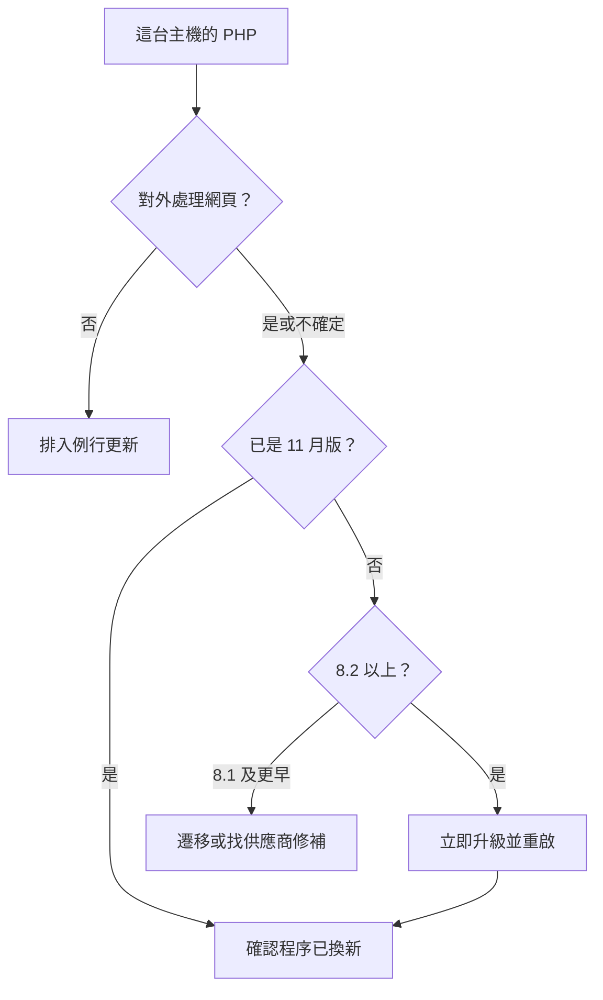

PHP 在 10 月 21 日為兩個合稱 php2shell 的漏洞發布第一輪修補，分別是 **CVE-2026-109618** 與 **CVE-2026-109619**。在特定條件下，攻擊者無需登入就能遠端執行程式碼，CISA 已把兩個漏洞列入已知遭利用漏洞清單。

即使 10 月已更新，也請依目前的 PHP 分支或發行版套件確認是否需要後續修補。

> 內容依據 php.net、PHP 在 GitHub 發布的安全公告（GHSA）、PHP Foundation、CISA 與 NVD，查證日期是 2026-11-23（台北時間）。修補版本與利用狀態會變動，以官方最新資訊為準。
{: .prompt-info }

用這張圖安排更新順序。「11 月版」指各分支 11 月 19 日的版本或更新版，也包括已提供所需修補的發行版套件。只服務內網的網站仍會處理網頁請求，請沿「是或不確定」的分支確認修補狀態。



## php2shell 影響 PHP 的記憶體管理與錯誤處理

依 PHP Foundation 的說明，幾乎每個請求都會用到這兩部分。修補時既要處理漏洞，也要維持既有應用程式的相容性。

| CVE | 出問題的地方 | 已確認的遠端執行程式碼 |
| --- | --- | --- |
| CVE-2026-109618 | 記憶體耗盡（OOM）時，PHP 會中斷手上的工作。請求資料可能只初始化一半，清理時卻被當成有效資料 | Apache mod_php 的預設設定下，請求在應用程式碼執行前就能觸發 |
| CVE-2026-109619 | 請求結束後，PHP 的全域狀態仍指向已釋放的記憶體，同一個 worker 的下一個請求會用到它 | mod_php 已示範。session 上傳進度的路徑在 mod_php 與 PHP-FPM 都驗證過 |

worker 是實際處理請求的程序。使用已釋放的記憶體，這類錯誤叫作 use-after-free。

兩者的 CVSS 4.0 都是 9.2（Critical），向量相同。攻擊複雜度標為高，而且需要特定前提。

### 只要 PHP 處理網頁請求，就要確認修補狀態

在這裡，SAPI 指 PHP 接收網頁伺服器請求的介面。php.net 列出的受影響 SAPI 有 PHP-FPM、Apache mod_php、php-cgi、FrankenPHP 與 LiteSpeed。官方認為其中 mod_php 的風險最高。

mod_php 是 Apache 直接載入的 PHP 模組。PHP-FPM 則是獨立的 PHP 程序池，由 nginx 等伺服器把請求轉過去。

CVE-2026-109618 在 PHP-FPM 上的狀態，兩份官方文件寫法不同：

| 來源 | 對 PHP-FPM 的說法 |
| --- | --- |
| [PHP Foundation](https://thephp.foundation/blog/2026/10/21/todays-php-security-release-and-how-were-strengthening-php-security/)（10 月 21 日） | 已透過應用層的路徑確認可遠端執行程式碼 |
| [GHSA-w8hw-w9fx-j79w](https://github.com/php/php-src/security/advisories/GHSA-w8hw-w9fx-j79w)（11 月 3 日更新） | 依原始碼分析判定受影響，但還沒有針對 FPM 的完整示範 |

我的判斷是，用 FPM 不代表可以晚點修。CVE-2026-109619 已在 FPM 上驗證過遠端執行程式碼。

### CISA 在公開五天後列入已知遭利用清單

CISA 的已知遭利用漏洞清單（KEV）收錄有證據已遭實際利用的漏洞。

| 日期 | 事件 |
| --- | --- |
| 10 月 20 日 | php.net 預告重大安全更新 |
| 10 月 21 日 | 發布 8.5.12、8.4.27、8.3.36、8.2.35，CISA 發出警報 |
| 10 月 23 日 | php.net 補充 session 上傳進度的提醒 |
| 10 月 26 日 | CISA 把兩個 CVE 列入 KEV |
| 11 月 19 日 | 發布 8.5.13、8.4.28、8.3.37、8.2.36，包含後續修補 |

依 PHP Foundation 的說法，揭露前一天有研究團隊誤發了示範影片，隨後陸續出現概念驗證程式（PoC）。截至 10 月 21 日公開揭露時，PHP 安全團隊在檢視過的 PoC 中還沒發現能實際運作的攻擊程式。10 月 26 日的 KEV 紀錄則反映 CISA 已掌握實際利用的證據。

## 先查網站實際使用的 PHP 版本

`php -v` 只顯示命令列（CLI）那份 PHP。網站用的可能是另一個套件、另一個版本，設定檔也不同。

文中的檢查指令與緩解設定，我都在官方 Docker 映像裡跑過。

### 1. 找出 SAPI

```sh
ps -eo pid,user,args | grep -E '[p]hp-fpm|[a]pache2|[h]ttpd|[l]sphp|[f]rankenphp|[p]hp-cgi'
```

看到 `php-fpm: master process`，表示主機上有 PHP-FPM。若同時跑了多個網站或不同版本的 FPM，請用網站設定指向的 socket 或連接埠，對照實際接收請求的 FPM pool。看到 `apache2` 或 `httpd` 時，可以查 Apache 的設定是否載入 PHP 模組。

```sh
apache2ctl -M 2>/dev/null | grep -i php
httpd -M 2>/dev/null | grep -i php
```

第一行用在 Debian、Ubuntu，第二行用在 RHEL 系列。輸出 `php_module (shared)` 表示 Apache 的設定有載入 mod_php。主機若也跑了 PHP-FPM，再從該網站的 VirtualHost（個別網站的設定區塊）確認請求交給哪一個處理。

### 2. 查網頁那份 PHP 的版本

PHP-FPM 的執行檔名稱常帶版本。從上一步找到的 FPM 程序確認執行檔，再查這個檔案的版本。

```sh
ls /usr/sbin/php-fpm* /usr/local/sbin/php-fpm 2>/dev/null
php-fpm8.3 -v
```

把 `php-fpm8.3` 換成對應的執行檔。輸出中的 `(fpm-fcgi)` 表示它是 FPM 版本。若剛升級套件，還要用後面的方式確認正在執行的程序已載入新檔。

mod_php 沒有獨立的執行檔，要看套件版號。網站有送出 `X-Powered-By` 標頭時，也能從外面看到版本：

```sh
curl -sI https://example.com/ | grep -i x-powered-by
```

我在官方 `php:8.5-apache` 映像裡得到 `X-Powered-By: PHP/8.5.13`。正式環境可能關掉 `expose_php`，所以沒有這個標頭時，仍要從服務端查版本。發行版是否已套用修補，則要看完整的套件版號。

### 3. 發行版看完整的套件版號

依系統選一行執行：

```sh
dpkg -l | grep -E 'php[0-9.]*-(fpm|cli|cgi|common)|libapache2-mod-php'
rpm -qa | grep -E '^php'
apk info -v | grep -E '^php[0-9]+'
```

第一行用在 Debian、Ubuntu，第二行用在 RHEL 系列，第三行用在 Alpine。對照方式見下一節的發行版表格。

CISA 提醒，PHP 常被包在其他軟體裡，不一定看得出來。容器、主機管理面板、套裝應用都要算進去。用容器的話，進到容器裡用同樣的方法查。

## 上游 PHP 升到 11 月 19 日的版本或更新版

| 分支 | 10 月 21 日 | 11 月 19 日（目標） |
| --- | --- | --- |
| 8.5 | 8.5.12 | 8.5.13 |
| 8.4 | 8.4.27 | 8.4.28 |
| 8.3 | 8.3.36 | 8.3.37 |
| 8.2 | 8.2.35 | 8.2.36 |

10 月的安全更新納入兩個漏洞的第一輪修補。11 月版依 PHP 每四週的發布週期推出，保留了 10 月的修補，也補上 CVE-2026-109619 的缺口。

11 月版另外修了兩個和 CVE-2026-109619 同一類的漏洞，GHSA 都評為 Critical 9.2：

- GHSA 將 CVE-2026-129481 歸因於 CVE-2026-109619 的修補不完整。上游 8.3、8.4 和 8.5 分支在升到表列的 11 月版本前都受影響。[CVE-2026-129481](https://github.com/php/php-src/security/advisories/GHSA-g3vh-838c-65v7)
- CVE-2026-129182 影響 8.5.13 以前的 8.5 版本。8.5.12 清掉了一個全域狀態，但之後的關閉流程還能把它寫回去。[CVE-2026-129182](https://github.com/php/php-src/security/advisories/GHSA-2fjv-p558-g82m)

兩份 GHSA 都說，透過這兩條路徑執行程式碼還沒有被示範。php.net 也說，11 月評為 Critical 的問題需要非預設設定或少見的環境。我還是會直接升到 11 月版，一次納入這些修補。

同一批還修了 PHP-FPM 的請求走私（CVE-2026-129289）等問題，完整清單見 [PHP 8 ChangeLog](https://www.php.net/ChangeLog-8.php)。8.2 會在 2026-12-31 停止安全更新，要開始規劃升級。

### 8.1 及更早沒有正式的修補版本

PHP 專案已不再替 8.1 及更早的版本發布更新。因為這次太嚴重，安全團隊為 7.4、8.0、8.1 提供了最小的原始碼回溯修補，給自己編譯 PHP 的人用。

部分發行版與長期支援（LTS）供應商也有回溯修補，請向供應商確認。依 CISA 的建議，無法套用修補的系統，以及仍在使用未修補的 8.1 或更早版本的系統，應先下線，等修補完成再恢復服務。

### 發行版套件

發行版常把修正套用到舊版套件並保留上游版本號，這叫作 backport。php.net 說，發行版與 LTS 供應商事先拿到了修補。

下表列出各發行版首次納入修補的套件版本，並以完整套件版號為準。「不受影響」只指 11 月欄位列出的 CVE-2026-129481，10 月的兩個漏洞仍須修補。「secdb 尚無紀錄」表示安全資料庫未列出該漏洞的狀態，請再向供應商確認。

| 發行版 | 套件 | php2shell（10 月） | CVE-2026-129481（11 月） |
| --- | --- | --- | --- |
| Debian 12 | `php8.2` | `8.2.35-1~deb12u1`（DLA-4848-1） | 不受影響 |
| Debian 13 | `php8.4` | `8.4.27-1~deb13u1`（DSA-6574-1） | `8.4.28-1~deb13u1`（DSA-6641-1） |
| Ubuntu 22.04 | `php8.1` | `8.1.2-1ubuntu2.28`（USN-8948-1） | `8.1.2-1ubuntu2.29` |
| Ubuntu 24.04 | `php8.3` | `8.3.6-0ubuntu0.24.04.13`（USN-8948-1） | `8.3.6-0ubuntu0.24.04.14` |
| Ubuntu 26.04 | `php8.5` | `8.5.4-0ubuntu1.5`（USN-8948-1） | `8.5.4-0ubuntu1.6` |
| RHEL 8 | `php:8.2` 模組 | `8.2.35-1.module+el8.10.0`（RHSA-2026:87073） | 不受影響 |
| RHEL 9 | `php:8.3` 模組 | `8.3.36-1.module+el9.8.0`（RHSA-2026:87079） | 受影響，尚未修補 |
| RHEL 10 | `php` | `8.3.36-1.el10_2`（RHSA-2026:87070） | 受影響，尚未修補 |
| RHEL 10 | `php8.4` | `8.4.27-1.el10_2`（RHSA-2026:87071） | `8.4.28-1.el10_3`（RHSA-2026:100821） |
| Alpine 3.22 | `php83`、`php84` | `8.3.36-r0`、`8.4.27-r0` | secdb 尚無紀錄 |
| Alpine 3.23 | `php83`、`php84`、`php85` | `8.3.36-r0`、`8.4.27-r0`、`8.5.12-r0` | secdb 尚無紀錄 |
| Alpine 3.24 | `php83`、`php84`、`php85` | `8.3.36-r0`、`8.4.27-r0`、`8.5.12-r0` | `8.3.37-r0`、`8.4.28-r0`、`8.5.13-r0` |

表中的版本取自 [Debian](https://security-tracker.debian.org/tracker/CVE-2026-109618)、[Ubuntu](https://ubuntu.com/security/CVE-2026-109618)、[Red Hat](https://access.redhat.com/security/cve/CVE-2026-109618) 與 [Alpine secdb](https://secdb.alpinelinux.org/v3.24/community.json)。11 月那一欄取自各家的 CVE-2026-129481 頁面，例如 [Debian](https://security-tracker.debian.org/tracker/CVE-2026-129481)。RHEL 的其他模組串流，例如 RHEL 8 的 `php:7.4`，見 Red Hat 頁面的完整清單。

上游公告列的是 PHP 專案自己發布的版本。Ubuntu 的追蹤頁另為 22.04 的 PHP 8.1 套件列出 CVE-2026-129481 的修補版，表格採用 Ubuntu 的紀錄。[Ubuntu 漏洞追蹤頁](https://ubuntu.com/security/CVE-2026-129481)

另一個後續漏洞 CVE-2026-129182 只影響 8.5。Ubuntu 26.04 已在 `8.5.4-0ubuntu1.6` 修補，Alpine 的 secdb 截至查證日尚無紀錄。

截至查證日，RHEL 9 的 `php:8.3` 與 RHEL 10 的 `php` 在一般套件來源尚未修補 CVE-2026-129481。部分 EUS（延長支援的次要版本）已有修補。

在取得 CVE-2026-129481 的修補前，GHSA 建議先處理 session（工作階段）清理時可能發生的 fatal error。PHP-FPM 也可暫用下文的 `pm.max_requests` 設定降低風險。

### Windows 與 Docker 映像的版本

Windows 版在 10 月 26 日另外重建成 8.5.12-1 等版本，修的是 Brotli 的漏洞，PHP 本身的版本不變。

我查的時候，官方 Docker 映像 `php:8.5-apache` 與 `php:8.5-fpm` 已是 11 月 19 日建置的 8.5.13。用容器的話，要拉新映像並重新部署，重啟舊容器不會更新。

`php:latest`、`php:fpm` 這類沒寫分支的標籤已指向 8.6.0。8.6.0 與 11 月版同一天發布，ChangeLog 也列了 CVE-2026-129481 與 CVE-2026-129182 的修補。要留在原本的分支，請寫明版本，例如 `php:8.4-fpm`。

## 升級後重啟 PHP，再確認沒有舊程序

套件升級後，仍要確認處理請求的 PHP 程序已載入新檔。舊程序可能繼續使用升級前載入的檔案。GHSA 也提醒，套用緩解設定後要重啟每個 PHP worker。

我在官方映像裡，把磁碟上的檔案換成一份複本，模擬套件升級。然後看各程序載入的是哪份檔案：

| 服務與 reload 方式 | 換掉檔案後 | reload 後 |
| --- | --- | --- |
| Apache mod_php，`apache2ctl -k graceful` | master 與 worker 的 `libphp.so` 都顯示 `(deleted)` | 全部換成新檔 |
| PHP-FPM，對 master 送 `USR2` | master 與 worker 的 `php-fpm` 都顯示 `(deleted)` | 全部換成新檔 |

`(deleted)` 表示程序還在用已從原路徑移除的舊檔。上表兩種 reload 都在我的測試中載入了新檔。如果 nginx 將請求轉給 PHP-FPM，請確認 PHP-FPM 本身已重啟或重新載入。

服務名稱與 reload 的實作因發行版而異，所以我會直接重啟實際處理該網站請求的服務。第一行用於 PHP-FPM，第二行用於 Apache mod_php。

```sh
sudo systemctl restart php8.3-fpm
sudo systemctl restart apache2
```

依系統換成實際的服務名稱，例如 RHEL 系列的 `php-fpm` 與 `httpd`。重啟可能中斷現有連線，請算進維護時間。

```sh
sudo grep -l 'libphp.*(deleted)' /proc/[0-9]*/maps 2>/dev/null
sudo ls -l /proc/[0-9]*/exe 2>/dev/null | grep -E 'php.*\(deleted\)'
```

第一行找仍載入已移除的 `libphp` 檔案的程序，也涵蓋 Debian 的 `libphp8.3.so`。第二行找仍使用已移除的 PHP 執行檔的程序，例如 `php-fpm`、`php-cgi`、`lsphp`。若兩行都沒有輸出，表示這次未找到符合條件的程序，仍要確認服務正常，且網站實際使用的 PHP 已修補。

## 暫時不能升級時，官方的緩解都不完整

php.net 寫得很清楚：只有更新是完整解法。下面的設定只能擋掉特定的攻擊路徑，不會讓系統變安全。

### CVE-2026-109618：拿掉可控制的記憶體上限

- 設定 `memory_limit=-1`，而且用應用程式改不掉的方式設，例如 FPM pool 或 Apache 設定裡的 `php_admin_value`。也要確認沒有其他 pool、目錄或應用程式設定把上限加回來。這只拿掉可控制的記憶體上限，底層的記憶體配置失敗仍會走到有漏洞的路徑。
- 把 `post_max_size` 設低。不需要上傳檔案時設 `8M`，需要時設 `32M`，並讓 `upload_max_filesize` 小於它。
- 在網頁伺服器或代理層限制解碼後的請求大小、欄位數、multipart 段數、標頭數與巢狀深度，沒有可用 `Content-Length` 的請求也要限制。multipart 是表單上傳檔案用的請求格式。GHSA 另外建議，應用程式不用 multipart 時，直接在前端擋掉這類請求。
- 用容器或 cgroup（Linux 限制程序資源的機制）的記憶體上限當可用性的邊界，最好只砍掉超用的 worker。不要改用 `RLIMIT_AS` 或 `RLIMIT_DATA`，它們會讓記憶體配置失敗，正好觸發有漏洞的路徑。

我的理解是，`memory_limit=-1` 讓單一請求能用掉大量記憶體，所以 php.net 把 cgroup 上限列在同一組。

### CVE-2026-109619：關掉已確認的兩條路徑

- 設定 `session.upload_progress.enabled=0`，並重啟每個 worker。要寫在解析請求前就生效的 `php.ini`、FPM pool 或伺服器設定，不要靠 `ini_set()` 或 FPM 的 `.user.ini`。這只擋得住已確認的 session 路徑。
- PHP 8.5 另外設定 `fatal_error_backtraces=0`，並重啟每個 worker。這只擋得住已確認的 fatal error 回溯路徑。
- 移除每個請求才套用、而且會產生警告的無效或過時設定。用 `error_reporting`、`display_errors` 或 `@` 隱藏警告沒有用。
- 修掉攻擊者能觸發的 fatal error 與執行逾時，包括 callback、上傳或匯入處理、清理流程裡的錯誤。
- GHSA 也建議在 PHP-FPM 設定 `pm.max_requests=1` 並重啟服務，讓每個 worker 處理一次請求後就換新。頻繁建立 worker 會增加效能開銷。

11 月版已把 session 上傳進度的預設值改成關閉。我在官方映像裡查到 8.4.27、8.5.12 是 `1`，8.4.28、8.5.13 是 `0`。依 [GHSA-658j-r8rw-q6mx](https://github.com/php/php-src/security/advisories/GHSA-658j-r8rw-q6mx)，設定檔明寫開啟時仍會蓋過新的預設值。

GHSA 也提到另一個暴露條件：nginx 等前端用 `PHP_VALUE` 或 `PHP_ADMIN_VALUE` 逐請求送設定。這些值若會產生警告，FPM 就可能受 CVE-2026-109619 影響。

所以緩解設定要寫進 pool 檔，不要從前端送。先查前端有沒有這樣送設定：

```sh
sudo grep -rn -E 'PHP_(ADMIN_)?VALUE' /etc/nginx /etc/apache2 /etc/httpd 2>/dev/null
```

### 設定寫在 pool 或 Apache 設定裡

PHP-FPM 的設定寫在網站使用的 pool 裡。以預設的 `www` pool 為例，Debian 或 Ubuntu 的 PHP 8.3 使用 `/etc/php/8.3/fpm/pool.d/www.conf`。RHEL 系列常見的路徑是 `/etc/php-fpm.d/www.conf`。

兩個範例中的 `fatal_error_backtraces` 都只適用於 PHP 8.5，其他版本請略過該行。

```ini
php_admin_value[memory_limit] = -1
php_admin_value[session.upload_progress.enabled] = 0
; 下一行只用在 PHP 8.5
php_admin_value[fatal_error_backtraces] = 0
```

mod_php 寫在 Apache 的主設定或 VirtualHost 裡：

```apache
php_admin_value memory_limit -1
php_admin_flag session.upload_progress.enabled off
php_admin_flag fatal_error_backtraces off
```

我在官方映像裡試了這兩種寫法，並用一支應用程式呼叫 `ini_set('memory_limit', '128M')`：

| 查看方式 | `memory_limit` | `ini_set()` 的結果 |
| --- | --- | --- |
| FPM 處理的請求 | `-1` | 回傳 `false`，值不變 |
| mod_php 處理的請求 | `-1` | 回傳 `false`，值不變 |
| `php -i`（CLI） | `128M` | 不適用 |
| `php-fpm -i` | `128M` | 不適用 |

表中的 `128M` 來自命令列輸出，實際處理請求時，測試中的 PHP 採用了 `-1`。PHP-FPM 可用 `-tt` 讀取設定，再用下列指令篩出 `php_admin_value` 項目。

```sh
sudo php-fpm8.3 -tt 2>&1 | grep php_admin_value
```

改完設定後，依「升級後重啟 PHP」一節重啟服務，再透過實際的網站請求確認設定已生效。CISA 另外提到，網頁應用程式防火牆（WAF）在修補前可能提供部分保護。

## 修補後仍要檢查入侵跡象

修補前若曾對外提供 PHP 服務，更新後也要回查暴露期間是否有入侵跡象。

CISA 建議留意 PHP worker 啟動 shell 或下載工具。下面的指令列出指定帳號目前的程序，並以名稱篩掉常見的 PHP-FPM 和 Apache 程序。

```sh
ps -u www-data -o pid,ppid,user,lstart,args | grep -v -E 'php-fpm|apache2|httpd'
```

把 `www-data` 換成 PHP worker 的帳號，常見的還有 `apache` 與 `nginx`。我在容器裡讓 PHP 在背景啟動一個 `sleep`。它被移交給 PID 1，不再是 worker 的子程序，這個指令仍列得出來。

看到程序不一定是入侵，排程工作也可能用同一個帳號。這個指令只看得到當下的程序，要查過去的活動，得看 auditd 或端點防護工具的紀錄。CISA 也提供了 [SIGMA 偵測規則](https://github.com/cisagov/SIGMA_Rules)。

GHSA 提醒，日誌裡沒有錯誤不代表安全。舊日誌可能沒收 deprecation 等級的訊息，PHP 也可能在寫入訊息前就出錯。

依 GHSA，確認的影響是以網站 worker 帳號的權限執行程式碼。查到可疑跡象時，我會把主機當成已遭入侵處理：

1. 限制對外連線，保留日誌與磁碟快照。
2. 從可信的乾淨映像重建主機。
3. 從乾淨的環境撤換 worker 讀得到的憑證，例如資料庫密碼、API token 與應用程式的密鑰。

## 前端是 nginx 的話，一起看 nginx 的漏洞

PHP-FPM 常放在 nginx 後面。nginx 在 11 月 18 日也修了可遠端執行程式碼的 HTTP/2 漏洞，見 [nginx CVE-2026-123007：開了 HTTP/2 就要升級](/posts/nginx-http2-cve-2026-123007/)。

套件更新了、舊服務還在跑的情況，我在 [OpenSSH 密碼驗證繞過漏洞 CVE-2026-123158：Alpine 怎麼修補](/posts/openssh-musl-password-bypass-alpine/)也遇過。

## 主要來源

- [php.net 10 月 21 日安全公告](https://www.php.net/archive/2026.php#2026-10-21-5)：受影響的 SAPI、修補版本與暫時緩解
- [php.net 2026 年新聞](https://www.php.net/archive/2026.php)：10 月 23 日的補充與 11 月 19 日的版本
- [GHSA-w8hw-w9fx-j79w](https://github.com/php/php-src/security/advisories/GHSA-w8hw-w9fx-j79w)：CVE-2026-109618 的技術說明與緩解
- [GHSA-6wmf-4rv5-p3rp](https://github.com/php/php-src/security/advisories/GHSA-6wmf-4rv5-p3rp)：CVE-2026-109619 的技術說明與緩解
- [GHSA-g3vh-838c-65v7](https://github.com/php/php-src/security/advisories/GHSA-g3vh-838c-65v7) 與 [GHSA-2fjv-p558-g82m](https://github.com/php/php-src/security/advisories/GHSA-2fjv-p558-g82m)：11 月的後續修補
- [GHSA-658j-r8rw-q6mx](https://github.com/php/php-src/security/advisories/GHSA-658j-r8rw-q6mx)：session 上傳進度改為預設關閉
- [PHP 8 ChangeLog](https://www.php.net/ChangeLog-8.php)：各版本的完整修正清單
- [PHP Foundation 的說明](https://thephp.foundation/blog/2026/10/21/todays-php-security-release-and-how-were-strengthening-php-security/)：發現經過與揭露時間線
- [CISA 警報](https://www.cisa.gov/news-events/alerts/2026/10/21/critical-vulnerabilities-php-require-immediate-patching)：處置建議與各國資源
- [CISA 列入 KEV 的公告](https://www.cisa.gov/news-events/alerts/2026/10/26/cisa-adds-two-known-exploited-vulnerabilities-catalog)與 [KEV 清單](https://www.cisa.gov/known-exploited-vulnerabilities-catalog)
- [NVD 上的 CVE-2026-109618](https://nvd.nist.gov/vuln/detail/CVE-2026-109618) 與 [CVE-2026-109619](https://nvd.nist.gov/vuln/detail/CVE-2026-109619)
