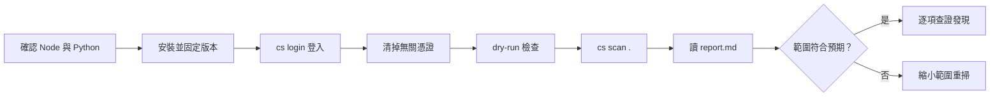

想知道自己的程式有沒有漏洞，又不想先架一整套資安平台？OpenAI 的 Codex Security 提供命令列工具 `cs`，在 repo 目錄執行一行指令，就會讓模型讀過程式碼、驗證疑似漏洞，再存成一份 Markdown 報告。這篇帶你在自己的電腦完成第一次掃描，並讀懂那份報告。

> 步驟依 [openai/codex-security](https://github.com/openai/codex-security) 的 npm-v0.10.1 版 [README](https://github.com/openai/codex-security/blob/npm-v0.10.1/README.md)、[CLI 參考](https://github.com/openai/codex-security/blob/npm-v0.10.1/sdk/typescript/docs/cli.md)，以及官方的 [CLI 快速入門](https://learn.chatgpt.com/docs/security/cli)整理，查證日期是 2026-11-24。工具更新很快，選項以已安裝版本的 `cs scan --help` 為準。
{: .prompt-info }

## Codex Security 會找漏洞，但不等於資安審計

Codex Security 是 OpenAI 官方的漏洞掃描工具，原始碼以 Apache-2.0 授權公開在 GitHub。它可以在 Codex 對話裡用，也能從終端機執行，或接進 CI（每次推送程式碼就自動跑的檢查）。這篇只談終端機的 CLI。

依 README 的說明，一次掃描會找出疑似漏洞、對照原始碼驗證，再把結果存成報告與發現項目（findings）。它還能替發現產生修補並驗證修補，這部分這篇不談。

我不會把它的結果當成正式的資安審計或滲透測試。官方文件也寫明，掃描完成不代表每個檔案都看過，報告沒有發現也不代表沒有漏洞。我把報告當成「接下來該先查哪裡」的清單。

第一次掃描的流程如下：



## 掃描前先知道：它用你的權限執行，結果含原始碼

Codex Security 以你的本機帳號執行，能做的事和你自己一樣多。依[官方快速入門](https://learn.chatgpt.com/docs/security/cli)，CLI 執行時不會停下來請你核准。[SECURITY.md](https://github.com/openai/codex-security/blob/npm-v0.10.1/SECURITY.md) 因此建議，只掃你信任、也有權評估的 repo。

開始前先確認這幾件事：

- **掃描程序會繼承環境變數。** 官方提醒，這包括和掃描無關的 API token 與雲端憑證，開始前要先移除。
- **程式碼會交給模型分析。** 預設的模型供應商是 OpenAI，也可以改用 Amazon Bedrock 等其他供應商。
- **結果裡有原始碼。** 報告會附上程式碼片段和漏洞細節。依[官方 FAQ](https://learn.chatgpt.com/docs/security/cli/faq)，`cs scans logs` 印出的紀錄也沒有遮蔽，分享前先看過內容。
- **帳號可能要先申請資安存取資格。** 依 README，部分資安請求與受保護的發現需要 [Trusted Access for Cyber](https://chatgpt.com/cyber)。沒有資格時，掃描可能一開始就被拒絕，處理方式見步驟 4。

要找出目前終端機裡疑似憑證的環境變數，可以只印名稱、不印值：

```bash
env | grep -iE 'token|secret|key|pass' | cut -d= -f1
```
{: .nolineno }

把和掃描無關的變數在這個終端機裡清掉。下面的名稱只是範例，換成你列出來的那些：

```bash
unset GITHUB_TOKEN AWS_ACCESS_KEY_ID AWS_SECRET_ACCESS_KEY
```
{: .nolineno }

`unset` 只影響目前這個終端機，關掉視窗就恢復原狀。`OPENAI_API_KEY` 和 `CODEX_API_KEY` 會影響登入方式，步驟 3 再說明。

## 步驟 1：確認 Node.js 與 Python 版本

CLI 需要 Node.js 22.13.0 以上的 22.x，或是 24.x、26.x，另外要有 Python 3.10 以上。先看手邊的版本：

```bash
node --version
python3 --version
```
{: .nolineno }

套件宣告的支援範圍是 `^22.13.0 || ^24.0.0 || ^26.0.0`，23、25 這類奇數版不在其中。用 Python 3.10 的話，還要裝 `tomli`：

```bash
python3 -m pip install tomli
```
{: .nolineno }

## 步驟 2：安裝 CLI，並固定在 0.10.1

用 npm 全域安裝，並寫明版本號：

```bash
npm install --global @openai/codex-security@0.10.1
```
{: .nolineno }

裝好後確認版本，應該印出 `0.10.1`：

```bash
cs --version
```
{: .nolineno }

安裝會提供 `cs` 和 `codex-security` 兩個指令，兩者完全相同。`cs` 和你電腦上的其他指令撞名時，改用 `codex-security`。

不想全域安裝，或 npm 回報 `EEXIST` 衝突，就改用 npx。後面每個步驟的 `cs`，都換成 `npx @openai/codex-security@0.10.1`：

```bash
npx @openai/codex-security@0.10.1 --version
```
{: .nolineno }

之後要升級，先讀 [GitHub Releases](https://github.com/openai/codex-security/releases) 的版本說明，再用新的版本號重裝。`cs update` 也能更新，但它會直接換到最新版。

## 步驟 3：用 cs login 登入 ChatGPT 帳號

**平常也用 Codex CLI 的人，第一次掃描或查登入狀態之前，一定要先跑 `cs login`。** 依 CLI 參考，沒有自己的登入時，Codex Security 會匯入 Codex 存在檔案裡的登入資訊。兩邊因此共用一個只能用一次的更新權杖（refresh token）。

共用的後果是，其中一邊更新權杖後，另一邊下次更新就可能失敗。這時狀態甚至仍顯示已登入。

登入會打開瀏覽器，用 ChatGPT 帳號完成。登入後再確認狀態：

```bash
cs login
cs login status
```
{: .nolineno }

在沒有瀏覽器的遠端機器上，工作區（workspace）允許的話，改用裝置驗證：

```bash
cs login --device-auth
```
{: .nolineno }

工作區不允許裝置驗證時，照 [CLI 參考的 SSH 轉發說明](https://github.com/openai/codex-security/blob/npm-v0.10.1/sdk/typescript/docs/cli.md#remote-login-with-ssh-forwarding)登入。

遇到「refresh token 已被使用」這類錯誤，先登出再重新登入：

```bash
cs logout
cs login
```
{: .nolineno }

環境裡有 `OPENAI_API_KEY` 或 `CODEX_API_KEY` 時，非互動式與 JSON 輸出的掃描，預設會改用這把 key。互動式掃描則會問你要用哪一個。要固定用 ChatGPT 登入，掃描時加上 `--auth chatgpt`：

```bash
cs scan . --auth chatgpt
```
{: .nolineno }

## 步驟 4：先 dry-run，再正式掃描

切到 repo 的根目錄，先做一次 dry-run：

```bash
cd /path/to/your-repo
cs scan . --dry-run
```
{: .nolineno }

dry-run 只檢查本機的輸入：要掃哪裡、用哪種模式、結果存到哪裡。它不會開始掃描、不載入憑證，也不檢查 Python。所以 dry-run 通過，不代表登入和執行環境都沒問題。

輸出裡的 `stateDirectory` 是結果的存放位置，預設是 `~/.codex/state/plugins/codex-security`。它在 repo 之外，結果不會被你順手 commit 進去。想存到別處，加上 `--output-dir`，指定一個空的、在 repo 外的目錄。

想在花額度之前先看報告長什麼樣子，可以跑 mock 掃描。它不呼叫模型、不分析程式碼，也不必登入，只產生標題帶 `[Mock]` 的虛構發現。mock 結果會照常記進掃描歷史，官方建議另外指定一個臨時的狀態目錄，不和真正的結果混在一起：

```bash
CODEX_SECURITY_STATE_DIR="$(mktemp -d)" cs scan . --mock
```
{: .nolineno }

確認無誤後，拿掉 `--dry-run` 正式掃描：

```bash
cs scan .
```
{: .nolineno }

在互動式終端機裡，掃描會顯示即時儀表板，按 `d` 可以看細節。想要一行一行的純文字進度，加上 `--headless`。

用 ChatGPT 登入時，進度畫面會顯示帳號額度在各個時段用掉的百分比。想限制一次掃描的花費，用 `--max-cost` 指定美元金額：

```bash
cs scan . --max-cost 5
```
{: .nolineno }

這個金額依 API 的標準費率估算，估計值超過就停止。它不是硬性上限，已經送出的請求仍可能讓實際用量超過。

掃描結束時，終端機會印出一段摘要。下面是官方文件的範例：

```text
  REPORT    /path/outside/repository/codex-security-results/report.md
  FINDINGS  2 (2 confirmed this scan; 0 previously found; 1 high, 1 medium)
  SCOPE     repository: .
  ELAPSED   42s
  RESULTS   /path/outside/repository/codex-security-results
```
{: .nolineno }

`REPORT` 是報告的路徑，`RESULTS` 是這次掃描的結果目錄。預設情況下，有發現也會以 0 結束，只有掃描本身執行失敗才會以 2 結束。

掃描也可能在建立威脅模型的階段就以 2 結束，並顯示這段訊息：

```text
This content was flagged for possible cybersecurity risk. If this seems wrong, try rephrasing your request. If you’re doing authorized security work that requires more cyber permissive safeguards, apply for Daybreak access via https://platform.openai.com/settings/organization/status-and-access before retrying.
```
{: .nolineno }

這表示 OpenAI 的資安使用政策擋下了請求。訊息裡的 Daybreak，是給已授權資安工作使用、限制較寬鬆的存取方案。帳號沒有這個資格時，縮小掃描範圍不一定有用，要先到 [Trusted Access for Cyber](https://chatgpt.com/cyber) 申請。

依 CLI 參考，通過後再掃描時要加上 `--codex daybreak=true`，因為這個開關預設關閉：

```bash
cs scan . --codex daybreak=true
```
{: .nolineno }

## 步驟 5：讀報告時，先看範圍再看發現

結果目錄裡最重要的是這三個檔案：

| 檔案 | 用途 |
| --- | --- |
| `report.md` | 給人讀的報告，整理掃描範圍與每個發現 |
| `findings.json` | 每個發現的位置與佐證，適合交給程式處理 |
| `scan-manifest.json` | 掃描狀態、目標與範圍，`scan.scope` 記錄納入與排除的路徑 |

另外還有 `exports/results.sarif`。SARIF 是程式碼掃描結果的標準格式，GitHub 等平台都讀得懂。

mock 掃描走的是正式的報告流程，產生的 `report.md` 由上到下依序是：

1. **Scope**：掃描的目標、commit（Revision）、納入與排除的路徑，以及 Limitations and exclusions。
2. **Scan Summary**：掃描結果、發現數量，以及嚴重度與可信度的分布。
3. **Threat Model**：這次掃描採用的威脅模型摘要。威脅模型是「誰可能從哪裡攻擊什麼」的整理。
4. **Findings**：所有發現的總表，每列有嚴重度（Severity）與可信度（Confidence），再往下是各個發現的詳細說明。

讀的時候，我會先確認 Scope。repo、commit 和排除的路徑都對了，後面的發現才有意義。Limitations and exclusions 列出的，就是這次沒看到的地方。

可信度分三級，報告裡附有定義：

| 可信度 | 意思 |
| --- | --- |
| high | 有直接證據支持，沒有重大的未解疑點 |
| medium | 證據顯示問題可能存在，但還缺執行期或可觸及性的證明 |
| low | 證據不完整，只是留著待追查 |

每個發現的詳細說明分成幾段，從 Summary、Root Cause 一路到 Remediation。官方快速入門建議，每個發現都逐一確認：

- 受影響的程式碼在哪裡。
- 攻擊者要具備什麼前提條件。
- 驗證的證據是什麼。
- 還剩下哪些不確定的地方。

這些發現來自原始碼分析，不一定附有實際執行的重現結果。官方的建議是，證據足以支持問題成立之後，才挑出來修。

讀完範圍和發現，依情況決定下一步：

| 情況 | 下一步 |
| --- | --- |
| 掃描完成，範圍也符合預期 | 逐項查證發現，記下報告列出的限制 |
| 重要的目錄或問題沒被看到 | 用 `--path` 對那個目錄重掃，見後面「縮小範圍」一節 |
| 掃描失敗或被取消 | 用 `cs scans logs` 查原因，修好後重跑 |

依 CLI 參考，同樣的掃描再跑一次，不保證會補上漏掉的地方。缺的是存取權限或背景資料時，要先補上。

## 步驟 6：之後用 cs scans show 找回結果

在同一個 repo 裡執行下面這行，會顯示最近一次完成的掃描：

```bash
cs scans show
```
{: .nolineno }

輸出的 `artifacts` 列出 `report.md`、`findings.json`、`scan-manifest.json` 與 SARIF 檔的完整路徑。要看這個 repo 的所有掃描，或跨掃描仍未處理的發現：

```bash
cs scans list
cs findings list
```
{: .nolineno }

`cs findings list` 會替每個未處理的發現列出 occurrence ID。確認某個發現是誤判時，用這個 ID 記下理由：

```bash
cs findings false-positive OCCURRENCE_ID --reason "這個輸入在進入查詢前已由框架跳脫"
```
{: .nolineno }

之後掃描同一個 repo，會把這個理由當成參考資料。依官方 FAQ，掃描仍會獨立檢查目前的程式碼，不會因此略過整類問題。

AI 掃描每次的結果可能不同。要比較兩次掃描，用 `cs scans compare`，預設比對最近兩次完成的掃描：

```bash
cs scans compare
```
{: .nolineno }

## 縮小範圍：只掃某些目錄，或只掃這次的變更

repo 很大，或只想看某一塊時，用下面這些選項：

```bash
# 只掃 src 和 tests
cs scan . --path src --path tests

# 排除 examples 目錄
cs scan . --exclude-path examples/

# 只掃從 origin/main 到 HEAD 已 commit 的變更
cs scan . --diff origin/main

# 給 Standard 掃描大約 15 分鐘的調查時間
cs scan . --max-time 15
```
{: .nolineno }

- **`--exclude-path` 優先於 `--path`。** 被排除的檔案仍可能被讀來當上下文，但位置全在排除範圍內的發現，會從結果中移除。
- **`--diff` 需要乾淨、完整的 checkout。** 目前所在的 commit 必須就是要掃的那一個，有未提交的修改要先 commit 或 stash。想掃還沒 commit 的修改，改用 `--working-tree`。
- **`--max-time` 的單位是分鐘。** 在 Standard 模式它只是建議值，時間到就不再開始新的調查，整理報告可能還要再花一些時間。

`--mode deep` 會分批重複執行 Standard 掃描，再合併並去除重複的發現，花的時間和額度都比較多。我建議第一次先用預設的 Standard 模式，看過報告再決定要不要用 deep。

## 放進 CI：改用 API key 與官方 GitHub Action

CI 裡沒有瀏覽器可以登入，要改用 API key，也就是把 `OPENAI_API_KEY` 或 `CODEX_API_KEY` 設在掃描程序的環境變數裡。依官方 CLI 參考，這把 key 應該只給掃描那一步，並在可信任的 workflow 裡執行。

官方也提供 GitHub Action。依 README，先把 OpenAI API key 存成 repo secret `CODEX_SECURITY_API_KEY`，再複製[每週掃描的 workflow 範例](https://github.com/openai/codex-security/blob/npm-v0.10.1/github-action/examples/repository.yml)。

範例裡的 `REPLACE_WITH_REVIEWED_COMMIT`，要換成 Action release 標示、你審查過的 commit SHA。把 action 釘在 commit SHA 的理由，可以參考[gh actions-lock 教學](/posts/gh-actions-lock-workflow-lockfile/)。

範例每次掃描的估計上限是 5 美元，只回報發現，不會讓 job 失敗。要讓 CI 在有 high 或 critical 發現時失敗，CLI 加上 `--fail-on-severity high`。Action 則設定同名的 `fail-on-severity` 輸入。

## 結論

我建議第一次先挑自己熟悉的 repo，用預設的 Standard 模式掃一次。讀報告時先看 Scope，再逐項看每個發現的證據。報告是線索，修之前要先確認問題在你的系統裡真的成立。

## 延伸閱讀

- [openai/codex-security](https://github.com/openai/codex-security)：原始碼、README 與版本說明。
- [Codex Security CLI 快速入門](https://learn.chatgpt.com/docs/security/cli)：官方的第一次掃描教學。
- [Codex Security CLI FAQ](https://learn.chatgpt.com/docs/security/cli/faq)：誤判、重掃結果不同、費用上限等常見問題。
- [OWASP Agentic Top 10 檢查表：AI 工作流十項風險與修法](/posts/owasp-agentic-top-10-ai-workflow-checklist/)：替 coding agent、MCP 與 CI 做十題自我檢查。
- [Claude Code 沙箱設定教學：擋住 SSH 金鑰與 token](/posts/claude-code-sandbox-setup/)：讓 AI 執行的指令碰不到金鑰與 token。
- [用 GitHub Actions 加 AI Agent 自動化審查：以本站 PR 為例](/posts/github-actions-ai-agent-pr-review/)：在 CI 用 Codex 審 PR 的實例。
- [gh actions-lock 教學：用 lockfile 鎖定 GitHub Actions 依賴](/posts/gh-actions-lock-workflow-lockfile/)：把 workflow 用到的 action 鎖在確切的 commit。
