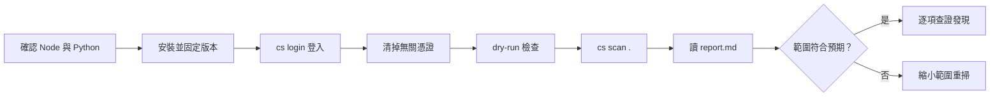

想替自己的程式找漏洞，又不想先架一整套資安平台，可以試試 OpenAI 的 Codex Security。它提供命令列工具 `cs`，在程式碼儲存庫（repo）的目錄裡就能掃描。這篇從安裝講到第一次掃描，再用官方的範例報告說明怎麼核對掃描範圍和結果。

> 步驟依 [openai/codex-security](https://github.com/openai/codex-security) 的 npm-v0.10.1 版 [README](https://github.com/openai/codex-security/blob/npm-v0.10.1/README.md)、[CLI 參考](https://github.com/openai/codex-security/blob/npm-v0.10.1/sdk/typescript/docs/cli.md)，以及官方的 [CLI 快速入門](https://learn.chatgpt.com/docs/security/cli)整理，查證日期是 2026-11-24。工具更新很快，選項以已安裝版本的 `cs scan --help` 為準。
{: .prompt-info }

## Codex Security 會找漏洞，但不等於資安審計

Codex Security 是 OpenAI 官方的漏洞掃描工具，原始碼以 Apache-2.0 授權公開在 GitHub。它可以在 Codex 對話裡用，也能從終端機執行，或接進 CI（每次推送程式碼就自動跑的檢查）。這篇只談終端機的 CLI。

依 README 的說明，一次掃描會找出疑似漏洞、對照原始碼驗證，再把結果存成報告和一筆筆發現（findings）。它也能替發現產生修補程式並驗證，這篇不談這部分。

我不會把它的結果當成正式的資安審計或滲透測試。官方文件也寫明，掃描完成不代表每個檔案都看過，報告沒有發現也不代表沒有漏洞。我把報告當成「接下來該先查哪裡」的清單。

第一次掃描的流程如下：



## 掃描前先知道：它用你的權限執行，結果含原始碼

Codex Security CLI 以你的本機使用者身分執行。依[官方快速入門](https://learn.chatgpt.com/docs/security/cli)，掃描途中它不會停下來等你核准。[SECURITY.md](https://github.com/openai/codex-security/blob/npm-v0.10.1/SECURITY.md) 建議只掃你信任、也有權做安全評估的 repo。

開始前先確認這幾件事：

- **掃描程序會繼承環境變數。** 官方提醒，這包括和掃描無關的 API token 與雲端憑證。步驟 4 會在掃描前清掉這些變數。
- **程式碼會交給模型分析。** 預設的模型供應商是 OpenAI，也可以改用 Amazon Bedrock 等其他供應商。
- **報告與紀錄可能含敏感資訊。** 報告會附上程式碼片段和漏洞細節。依[官方 FAQ](https://learn.chatgpt.com/docs/security/cli/faq)，`cs scans logs` 會印出未遮蔽的紀錄，可能含有原始碼或憑證。分享前先檢查內容。
- **登入成功，不代表能掃描。** 依 README，有些資安相關的請求和受保護的發現，需要 [Trusted Access for Cyber](https://chatgpt.com/cyber) 資格。帳號沒有資格時，掃描可能被拒絕，處理方式見步驟 4。

## 步驟 1：確認 Node.js 與 Python 版本

CLI 支援 Node.js 22.13.0 以上的 22.x，以及 24.x 和 26.x，23、25 這類奇數版不支援。Python 則要 3.10 以上。先看手邊的版本：

```bash
node --version
python3 --version
```
{: .nolineno }

如果是 Python 3.10，還要另外裝 `tomli`：

```bash
python3 -m pip install tomli
```
{: .nolineno }

## 步驟 2：安裝 CLI，並固定在 0.10.1

用 npm 全域安裝，並寫明版本號，之後的選項和輸出才會和這篇一致：

```bash
npm install --global @openai/codex-security@0.10.1
```
{: .nolineno }

裝好後確認版本，應該印出 `0.10.1`：

```bash
cs --version
```
{: .nolineno }

安裝後會有 `cs` 和 `codex-security` 兩個指令，作用完全相同。如果 `cs` 和電腦上的其他指令撞名，就改用 `codex-security`。

不想全域安裝，或 npm 回報 `EEXIST` 衝突時，改用 npx，把後面每個步驟的 `cs` 換成 `npx @openai/codex-security@0.10.1`。例如確認版本：

```bash
npx @openai/codex-security@0.10.1 --version
```
{: .nolineno }

之後要升級，先讀 [GitHub Releases](https://github.com/openai/codex-security/releases) 的版本說明，再用新的版本號重裝。`cs update` 也能更新，但它會直接換到最新版。

## 步驟 3：用 cs login 登入 ChatGPT 帳號

第一次掃描之前，先用 `cs login` 登入。登入會打開瀏覽器，用 ChatGPT 帳號完成，接著確認狀態：

```bash
cs login
cs login status
```
{: .nolineno }

**如果你也用 Codex CLI，而且它的登入資訊存在檔案裡，這一步一定不能跳過。** 依 CLI 參考，Codex Security 還沒有自己的登入時，掃描或查詢狀態會直接匯入 Codex 的登入資訊。兩個工具因此共用同一枚只能用一次的更新權杖（refresh token）。

其中一個工具更新權杖後，另一個下次更新就可能失敗，狀態卻仍顯示已登入。

在沒有瀏覽器的遠端機器上，如果 ChatGPT 工作區（workspace）允許，改用裝置驗證：

```bash
cs login --device-auth
```
{: .nolineno }

工作區不允許裝置驗證時，照 [CLI 參考的 SSH 轉發說明](https://github.com/openai/codex-security/blob/npm-v0.10.1/sdk/typescript/docs/cli.md#remote-login-with-ssh-forwarding)登入。

如果 Codex Security 回報 refresh token 已經用過，先登出再重新登入：

```bash
cs logout
cs login
```
{: .nolineno }

回報這個錯誤的如果是 Codex CLI 或 Codex app，就改在 Codex 那邊登出再登入。

## 步驟 4：清掉無關憑證，先 dry-run 再掃描

先在要跑掃描的終端機裡，找出掃描用不到的憑證。如果環境變數裡有 PEM 私鑰這類多行的值，不要用下面的篩選，它會印出值的片段。其他情況可以用它列出疑似憑證的變數名稱：

```bash
env | grep -iE 'token|secret|key|pass' | cut -d= -f1
```
{: .nolineno }

篩選也會比對變數的值，所以可能列出和憑證無關的名稱。確認哪些是掃描用不到的憑證後，用 `unset` 移除。下面的名稱只是範例，換成你找到的那些：

```bash
unset GITHUB_TOKEN AWS_ACCESS_KEY_ID AWS_SECRET_ACCESS_KEY
```
{: .nolineno }

`unset` 只影響目前這個終端機，從這裡啟動的掃描就不會繼承這些變數。shell 設定檔和其他已開啟的終端機不受影響。

切到 repo 的根目錄，先做一次 dry-run：

```bash
cd /path/to/your-repo
cs scan . --dry-run
```
{: .nolineno }

dry-run 只檢查這次掃描的設定，像是要掃哪裡、用哪種模式（預設是 Standard）、結果存到哪裡。它不會開始掃描、不載入憑證，也不檢查 Python。所以 dry-run 通過，不代表登入和執行環境都沒問題。

dry-run 會顯示 `stateDirectory`，也就是存放掃描歷史和預設結果的目錄，通常是 `~/.codex/state/plugins/codex-security`。想把這次的結果存到 repo 外的某個空目錄，dry-run 和正式掃描都要加上同一個 `--output-dir`。

想先看報告長什麼樣子，可以跑 mock 掃描。它不必登入，也不呼叫模型、不分析程式碼，報告裡標著 `[Mock]` 的發現都是模擬資料。官方建議替 mock 掃描另外指定一個暫存的狀態目錄，免得它混進正式掃描的歷史：

```bash
CODEX_SECURITY_STATE_DIR="$(mktemp -d)" cs scan . --mock
```
{: .nolineno }

dry-run 的設定沒問題，就拿掉 `--dry-run` 正式掃描：

```bash
cs scan .
```
{: .nolineno }

環境裡有 `OPENAI_API_KEY` 或 `CODEX_API_KEY` 時，依 CLI 參考，非互動式和輸出 JSON 的掃描會優先用這把 API key。互動式掃描則會讓你在 ChatGPT 登入和 API key 之間選。想固定用 ChatGPT 帳號，改用這個指令：

```bash
cs scan . --auth chatgpt
```
{: .nolineno }

在互動式終端機裡，掃描會顯示即時儀表板，按 `d` 可以看細節。想要一行一行的純文字進度，加上 `--headless`。

用 ChatGPT 登入時，如果 CLI 拿得到額度資訊，進度畫面會顯示帳號在各個額度週期已用掉的百分比。想替單次掃描設費用上限，用 `--max-cost` 指定美元金額：

```bash
cs scan . --max-cost 5
```
{: .nolineno }

這個金額是 CLI 照模型標準費率算出的估計值，估計值超過上限就停止掃描。停止時已送出的請求仍會跑完，所以最後可能略超過上限。ChatGPT 訂閱的額度不在這個估計裡。

掃描結束時，終端機會印出一段摘要。下面是官方文件的範例：

```text
  REPORT    /path/outside/repository/codex-security-results/report.md
  FINDINGS  2 (2 confirmed this scan; 0 previously found; 1 high, 1 medium)
  SCOPE     repository: .
  ELAPSED   42s
  RESULTS   /path/outside/repository/codex-security-results
```
{: .nolineno }

`REPORT` 是報告檔，`RESULTS` 是這次掃描的結果目錄。掃描完成時預設回傳結束碼 0，有發現也一樣。加上 `--fail-on-severity high` 時，有 high 或 critical 的發現會回傳 1，輸入或執行出錯則可能回傳 2。

不過，掃描不一定能跑到這裡。掃描開始時會先整理出可能的攻擊情境，也就是威脅模型。我用 ChatGPT Team 帳號實測，兩次掃描都在這一步被擋下，結束碼是 2，CLI 顯示這段訊息：

```text
This content was flagged for possible cybersecurity risk. If this seems wrong, try rephrasing your request. If you’re doing authorized security work that requires more cyber permissive safeguards, apply for Daybreak access via https://platform.openai.com/settings/organization/status-and-access before retrying.
```
{: .nolineno }

這表示 OpenAI 的資安使用政策擋下了請求。訊息裡的 Daybreak，是給已授權資安工作使用、限制較寬鬆的存取方案。

帳號沒有這個資格時，縮小範圍也沒用。我第一次掃整個 repo，第二次只掃程式碼目錄，兩次都被擋下。掃描紀錄（`cs scans logs`）裡也寫著 `Daybreak access: status=not_granted`。

依 README，要先申請 [Trusted Access for Cyber](https://chatgpt.com/cyber)。用 API key 掃描時，依 GitHub Action 的說明，組織核准後還要替 API 專案啟用對應的方案，並改用那個專案的 key。核准後被拒絕的情況會變少，但不保證每次掃描都能跑完。

資格核准後，依 CLI 參考，掃描時要加上 `--codex daybreak=true`。這個開關預設關閉，打開它也不會讓你取得資格：

```bash
cs scan . --codex daybreak=true
```
{: .nolineno }

## 步驟 5：讀報告時，先看範圍再看發現

結果目錄裡最重要的是這三個檔案：

| 檔案 | 用途 |
| --- | --- |
| `report.md` | 給人讀的報告，整理掃描範圍與每個發現 |
| `findings.json` | 每個發現的位置與佐證，適合交給程式處理 |
| `scan-manifest.json` | 掃描狀態、目標與範圍，`scan.scope` 記錄納入與排除的路徑 |

掃描也會試著產生 `exports/results.sarif`。SARIF 是程式碼掃描結果的標準格式，GitHub 等平台都能讀。這份匯出是選用的，沒產生不代表掃描失敗。

以下依官方文件與 mock 掃描的 `report.md`，由上到下說明報告各節的用途：

1. **Scope** 記錄掃描目標、commit（Revision）、納入與排除的路徑，以及掃描限制（Limitations and exclusions）。
2. **Scan Summary** 整理結果、發現數量，以及嚴重度和可信度的分布。
3. **Threat Model** 是這次掃描採用的威脅模型摘要。
4. **Findings** 先列出每個發現的嚴重度（Severity）與可信度（Confidence），再逐項說明。

我會先在 Scope 核對 repo、commit 與排除的路徑，確認這份報告對應到我想掃的版本和範圍。接著看 Limitations and exclusions，了解哪些地方沒掃到、還有哪些事項待查。

嚴重度是漏洞被利用時的影響有多大。可信度是現有證據有多支持這個發現，報告裡分成三級：

| 可信度 | 意思 |
| --- | --- |
| high | 有直接證據支持，沒有重大的未解疑點 |
| medium | 證據顯示問題可能存在，但還缺執行期或可觸及性的證明 |
| low | 證據不完整，先記下來待追查 |

每個發現的說明分成 Summary、Root Cause、Remediation 等幾段。官方快速入門建議逐一確認每個發現的這幾件事：

- 受影響的程式碼在哪裡。
- 攻擊者要具備什麼前提條件。
- 驗證的證據是什麼。
- 還剩下哪些不確定的地方。

這些發現來自閱讀原始碼，不一定附有實際執行的重現結果。官方的建議是，等證據足以證明問題成立，再挑出來修。

讀完範圍和發現，依情況決定下一步：

| 情況 | 下一步 |
| --- | --- |
| 掃描完成，範圍也符合預期 | 逐項查證發現，記下報告列出的限制 |
| 重要目錄沒掃到，或報告列出待查的問題 | 先弄清楚缺的是範圍、權限還是背景資料，再決定要不要只針對那些目錄重掃 |
| 掃描失敗或被取消 | 用 `cs scans logs` 查那次掃描的原因，處理後再重跑 |

依 CLI 參考，同樣的掃描再跑一次，不保證會補上漏掉的地方。如果是漏選了路徑，用後面「縮小範圍」一節的 `--path` 指定要補查的目錄。

## 步驟 6：之後用 cs scans show 找回結果

在同一個 repo、用同一個狀態目錄執行下面的指令，會顯示最近一次完成的掃描：

```bash
cs scans show
```
{: .nolineno }

輸出的 `artifacts` 會列出報告、結果檔和匯出檔的路徑。依 CLI 參考，`cs scans logs` 預設查的則是最近一次執行，包含失敗或還在跑的掃描。兩個指令看到的可能不是同一次，要對照時就都指定掃描 ID：

```bash
cs scans show SCAN_ID
cs scans logs SCAN_ID
```
{: .nolineno }

掃描 ID 和這個 repo 的掃描紀錄，用 `cs scans list` 查。要看各次掃描累積、還沒處理的發現，用 `cs findings list`：

```bash
cs scans list
cs findings list
```
{: .nolineno }

`cs findings list` 會替每個未處理的發現列出 occurrence ID。確認某個發現是誤判時，用這個 ID 記下理由：

```bash
cs findings false-positive OCCURRENCE_ID --reason "這個輸入在進入查詢前已由框架跳脫"
```
{: .nolineno }

之後掃描同一個 repo 時，會參考這個理由。依官方 FAQ，掃描仍會重新檢查目前的程式碼，不會因此略過整類問題。

同一個 repo 掃兩次，結果可能不一樣。要比較兩次掃描，用 `cs scans compare`，它預設比對最近兩次完成的掃描：

```bash
cs scans compare
```
{: .nolineno }

## 縮小範圍：只掃某些目錄，或只掃這次的變更

repo 很大，或只想看某一塊時，用下面這些選項：

```bash
# 只掃 src 和 tests
cs scan . --path src --path tests

# 排除 examples 目錄
cs scan . --exclude-path examples/

# 只掃從 origin/main 到 HEAD 已 commit 的變更
cs scan . --diff origin/main

# 給 Standard 掃描大約 15 分鐘的調查時間
cs scan . --max-time 15
```
{: .nolineno }

- **`--exclude-path` 優先於 `--path`。** 被排除的檔案仍可能被讀來當上下文，但一個發現的位置如果全落在排除範圍內，就會從結果中拿掉。
- **`--diff` 需要乾淨、完整的 checkout。** 目前所在的 commit 必須就是要掃的那一個，有未提交的修改要先 commit 或 stash。想掃還沒 commit 的修改，改用 `--working-tree`。
- **`--max-time` 的單位是分鐘。** 在 Standard 模式它只是建議值，時間到就不再開始新的調查，整理報告可能還要再花一些時間。

`--mode deep` 會分批重複執行 Standard 掃描，再合併並去除重複的發現，花的時間和額度都比較多。我建議第一次先用預設的 Standard 模式，看過報告再決定要不要用 deep。

## 放進 CI：改用 API key 與官方 GitHub Action

CI 裡沒有瀏覽器可以登入，所以要改用 API key，把 `OPENAI_API_KEY` 或 `CODEX_API_KEY` 設成掃描步驟的環境變數。依官方 CLI 參考，這把 key 只該交給可信任 workflow 裡的掃描步驟。

官方也提供 GitHub Action。依 README，先把 OpenAI API key 存成 repo secret `CODEX_SECURITY_API_KEY`，再複製[每週掃描的 workflow 範例](https://github.com/openai/codex-security/blob/npm-v0.10.1/github-action/examples/repository.yml)。

範例裡的 `REPLACE_WITH_REVIEWED_COMMIT`，要換成 Action release 說明裡列出、你也審查過的 commit SHA。為什麼要把 action 鎖在 commit SHA，可以參考 [gh actions-lock 教學](/posts/gh-actions-lock-workflow-lockfile/)。

範例把單次掃描的估計費用上限設為 5 美元。預設情況下，有發現只會回報，不會讓 job 失敗。只有掃描本身出錯，job 才會失敗，像步驟 4 那樣被資安政策擋下也算。

要讓 CI 在有 high 或 critical 的發現時也失敗，CLI 加上步驟 4 提過的 `--fail-on-severity high`，Action 則把 `fail-on-severity` 設成 `high`。

## 結論

我建議第一次先挑自己熟悉的 repo 掃描，熟悉程式碼，才判斷得出哪些發現是真的。從證據最充分的一項發現開始，對照程式碼確認問題成立再修。

## 延伸閱讀

- [openai/codex-security](https://github.com/openai/codex-security)：原始碼、README 與版本說明。
- [Codex Security CLI 快速入門](https://learn.chatgpt.com/docs/security/cli)：官方的第一次掃描教學。
- [Codex Security CLI FAQ](https://learn.chatgpt.com/docs/security/cli/faq)：誤判、重掃結果不同、費用上限等常見問題。
- [OWASP Agentic Top 10 檢查表：AI 工作流十項風險與修法](/posts/owasp-agentic-top-10-ai-workflow-checklist/)：替 coding agent、MCP 與 CI 做十題自我檢查。
- [Claude Code 沙箱設定教學：擋住 SSH 金鑰與 token](/posts/claude-code-sandbox-setup/)：讓 AI 執行的指令碰不到金鑰與 token。
- [用 GitHub Actions 加 AI Agent 自動化審查：以本站 PR 為例](/posts/github-actions-ai-agent-pr-review/)：在 CI 用 Codex 審 PR 的實例。
- [gh actions-lock 教學：用 lockfile 鎖定 GitHub Actions 依賴](/posts/gh-actions-lock-workflow-lockfile/)：把 workflow 用到的 action 鎖在確切的 commit。
