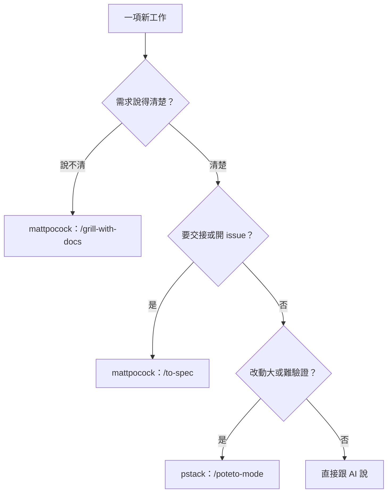

想讓 AI 程式助理照固定流程做事，常會看到 mattpocock/skills 和 pstack 這兩套 skill。兩套都能裝進 Claude Code，我也各寫過一個完整系列。這篇用兩套的原始碼對照差在哪裡，再依你手上的工作建議先裝哪一套。

> 比較基準是 mattpocock/skills [`1.3.2`](https://github.com/mattpocock/skills/blob/d1478fcb140db0b93c0c8df17bcfd311844749d0/.claude-plugin/plugin.json#L3) 與 pstack [`0.15.48`](https://github.com/cursor/plugins/blob/9e278fe4d4ecd8bfe98b1b79bf4be662efb338cc/pstack/.cursor-plugin/plugin.json#L4)，查證日期是 2026-11-24。兩個系列寫成時用的是較舊的 `1.2.3` 與 `0.15.43`，這篇的數字以新版為準。
{: .prompt-info }

## 最大的差別在誰決定下一步

從 `/ask-matt` 開始時，由你決定接著叫哪個 skill。從 `/poteto-mode` 開始時，pstack 會依目標安排並執行步驟。兩個入口都要手動呼叫。

- mattpocock/skills 的入口是 `/ask-matt`。依它的 [`SKILL.md`](https://github.com/mattpocock/skills/blob/d1478fcb140db0b93c0c8df17bcfd311844749d0/skills/engineering/ask-matt/SKILL.md#L1-L9)，它是架在其他 skill 上面的路由：你描述現在的情況，它建議下一個該叫的 skill，再由你去叫。
- pstack 的入口是 `/poteto-mode`。它會把任務對到一份 playbook（針對某種任務寫好的固定步驟），把步驟抄進待辦清單後[開始照做](https://github.com/cursor/plugins/blob/9e278fe4d4ecd8bfe98b1b79bf4be662efb338cc/pstack/skills/poteto-mode/SKILL.md#L108)。

`/poteto-mode` 會自己讀 playbook 用到的其他 skill。可以復原的工作會直接做，對共用分支 force push、部署或刪除資料前會先停下來。 [pstack 自主規則](https://github.com/cursor/plugins/blob/9e278fe4d4ecd8bfe98b1b79bf4be662efb338cc/pstack/skills/poteto-mode/SKILL.md#L76-L78)

無人值守時，如果遇到需要你決定的產品取捨，或工作真的走不下去，pstack 也會把問題交回來。 [自主執行 playbook](https://github.com/cursor/plugins/blob/9e278fe4d4ecd8bfe98b1b79bf4be662efb338cc/pstack/skills/poteto-mode/playbooks/autonomous-run.md#L3-L9)

## 一張表看兩套的差異

| | mattpocock/skills | pstack |
| --- | --- | --- |
| 作者 | Matt Pocock | Lauren Tan（網路暱稱 poteto） |
| 放在哪裡 | 作者自己的 repo [`mattpocock/skills`](https://github.com/mattpocock/skills)，MIT 授權 | Cursor 官方外掛庫 [`cursor/plugins`](https://github.com/cursor/plugins/tree/9e278fe4d4ecd8bfe98b1b79bf4be662efb338cc/pstack)，MIT 授權 |
| 規模 | 官方外掛收錄 [27 個 skill](https://github.com/mattpocock/skills/blob/d1478fcb140db0b93c0c8df17bcfd311844749d0/.claude-plugin/plugin.json#L21-L49) | 59 個 skill（其中 24 個是原則），加上 22 份 playbook |
| 支援的 AI 程式助理 | Claude Code、Codex、GitHub Copilot 有外掛，Cursor 等其他工具用 `npx skills` 安裝 | Cursor，以及用外掛安裝的 Claude Code |
| 入口 | `/ask-matt` 建議下一個 skill | `/poteto-mode` 挑 playbook 並照做 |
| 其他 skill 由誰叫 | 你依 `/ask-matt` 的建議叫，其中 11 個 AI 也能自己用 | `/poteto-mode` 依 playbook 叫，你也可以直接叫 |
| 第一次設定寫到哪裡 | repo 裡的 `docs/agents/`，以及 `AGENTS.md` 或 `CLAUDE.md` | 使用者目錄裡的模型設定檔 |
| 工作記在哪裡 | issue、詞彙表 `GLOSSARY.md`、決策紀錄 | 計畫檔、分支與 PR |
| 用哪個模型 | 不指定，README 說任何模型都能用 | 依角色指定，評審預設開三個席位 |

在 Claude Code 裡，pstack 會跳過需要 Cursor Automations 或啟動 Bugbot 的步驟。原本分給 Gemini 的評審席會沿用目前對話的模型。 [pstack 的 Claude Code 相容說明](https://github.com/cursor/plugins/blob/9e278fe4d4ecd8bfe98b1b79bf4be662efb338cc/pstack/docs/harness/claude-code.md)

表上的數字是我數兩個 repo 在上述版本的檔案得出的，和兩個系列寫的不同。

mattpocock/skills 系列寫的是 25 個。新版多了 `implement-spec`、`pr`、`retro`，拿掉了 `resolving-merge-conflicts`。pstack 系列寫的是 58 個，`0.15.47` 多了一個 `/reframe`。

## mattpocock/skills 把決定留在 repo 裡

mattpocock/skills 的產出多半是 repo 裡的檔案，下一次對話或下一個人可以從檔案接手。第一次設定時，`setup-matt-pocock-skills` 會[寫下這些東西](https://github.com/mattpocock/skills/blob/d1478fcb140db0b93c0c8df17bcfd311844749d0/skills/engineering/setup-matt-pocock-skills/SKILL.md#L69-L70)：

- `docs/agents/` 底下的三份檔案，記錄 issue 放在哪裡、分類標籤叫什麼、領域文件在哪裡。
- `AGENTS.md` 或 `CLAUDE.md` 裡的一個 `## Agent skills` 區塊，讓 AI 每次開工都讀得到。

之後的 skill 也照這個方向走。`grill-with-docs` 訪談時確認的詞彙會寫進 `GLOSSARY.md`，重要決定寫成 ADR（架構決策紀錄）。`to-tickets` 把規格切成一張張工作單（issue），每張寫明被哪幾張擋住。詳細流程見 mattpocock/skills 系列的[第 2 篇](/posts/mattpocock-skills-requirements-shared-language/)與[第 3 篇](/posts/mattpocock-skills-specs-work-breakdown/)。

工作單拆好後，你也可以用 `/implement-spec` 一次實作整份規格。它會依工作單的相依關係安排哪些能並行實作，再把成果合進同一個整合分支。 [implement-spec 的步驟](https://github.com/mattpocock/skills/blob/d1478fcb140db0b93c0c8df17bcfd311844749d0/skills/engineering/implement-spec/SKILL.md#L17-L33)

我認為這套最適合多人維護，或一項功能要分好幾次對話才做得完的專案。這些文件能讓接手的人查到當初做了哪些決定。

## pstack 把力氣花在動手前後的檢查

pstack 的強項是改程式前先看懂，改完之後證明它能用。它的工具大致分三段：

- 看懂與設計：`/how`、`/why` 讀程式與歷史，`/architect`、`/arena` 比較幾種設計（[第 2 篇](/posts/pstack-understand-design/)）。
- 證明能用：`/interrogate` 讓幾個 AI 試著找出改動的漏洞，只留下實際跑得出來的問題；驗證 skill 把手動驗證寫成 AI 能重跑的步驟（[第 3 篇](/posts/pstack-build-verify-merge/)）。
- 自己跑：設好權限與費用上限後，讓它在你離開時照 playbook 做完（[第 4 篇](/posts/pstack-principles-customization/)）。

pstack 也有釐清需求的工具，但結果放的地方不同。`/reframe` 教你描述這件事的專業用詞，`/sharpen` 把任務往深處挖，兩者最後都是改寫你這次的提示。它們不會像 `grill-with-docs` 那樣，把結論寫進 repo 的文件。

代價是用量。pstack 常派出子代理，也就是另外開一個 AI 去做子任務。評審與設計比較預設同時開[三個評審席位](https://github.com/cursor/plugins/blob/9e278fe4d4ecd8bfe98b1b79bf4be662efb338cc/pstack/skills/poteto-mode/SKILL.md#L92)，每個席位各跑一個子代理。

mattpocock/skills 也有幾個 skill 會派子代理，例如 [`code-review`](https://github.com/mattpocock/skills/blob/d1478fcb140db0b93c0c8df17bcfd311844749d0/skills/engineering/code-review/SKILL.md#L11) 讓兩個子代理分頭審查，但它不替你挑模型。

## 兩套可以裝在同一個 Claude Code

我的 Claude Code 兩套都裝著。mattpocock/skills 從 Claude Code 官方外掛市集安裝，在終端機執行：

```bash
claude plugin install mattpocock-skills@claude-plugins-official
```

依 [README](https://github.com/mattpocock/skills/blob/d1478fcb140db0b93c0c8df17bcfd311844749d0/README.md#L26)，外掛與 `npx skills` 只能選一種，兩種都裝會讓每個 skill 出現兩次。

pstack 要先加入 Cursor 的外掛庫，在 Claude Code 裡輸入：

```text
/plugin marketplace add cursor/plugins
/plugin install pstack@cursor-plugins
```

兩套都有 `tdd` 與 `teach`，但不會互相蓋掉。Claude Code 會在外掛的指令前面加上外掛名稱，所以叫的時候要寫完整：

```text
/mattpocock-skills:tdd
/pstack:tdd
```

同名不代表做法相同。mattpocock/skills 的 [`tdd`](https://github.com/mattpocock/skills/blob/d1478fcb140db0b93c0c8df17bcfd311844749d0/skills/engineering/tdd/SKILL.md#L3) 是先寫測試的紅綠重構流程；pstack 的 [`tdd`](https://github.com/cursor/plugins/blob/9e278fe4d4ecd8bfe98b1b79bf4be662efb338cc/pstack/skills/tdd/SKILL.md#L3) 只在你明確要求、或有便宜的測試可寫時才用。

我建議每個階段都選定一套流程，讓接手的人清楚下一步該用哪套工具。

更新的預設也不同。mattpocock/skills 的外掛預設[會自動更新](https://github.com/mattpocock/skills/blob/d1478fcb140db0b93c0c8df17bcfd311844749d0/README.md#L35-L38)；pstack 來自第三方外掛庫，Claude Code [預設不自動更新](https://github.com/cursor/plugins/blob/9e278fe4d4ecd8bfe98b1b79bf4be662efb338cc/pstack/README.md#L28)。要固定 pstack 的版本，做法見 [pstack 系列第 1 篇](/posts/pstack-install-routing/)。

## 依你手上的工作選

例如要替後台新增訂單 CSV 匯出，團隊得先定好要匯出哪些欄位、誰可以下載。可以用 mattpocock/skills 討論這些問題，再把共識寫成規格，交給下一個人接手。 [規格 skill](https://github.com/mattpocock/skills/blob/d1478fcb140db0b93c0c8df17bcfd311844749d0/skills/engineering/to-spec/SKILL.md)

等規格和驗收條件確認後，同一項工作可以交給 pstack 的功能 playbook。它會走過設計和實作，驗證匯出結果，再開 PR。 [功能 playbook](https://github.com/cursor/plugins/blob/9e278fe4d4ecd8bfe98b1b79bf4be662efb338cc/pstack/skills/poteto-mode/playbooks/feature.md)

如果你只想先裝一套，可以從手上的工作卡在哪裡開始判斷。



另外有三種情況，可以直接決定答案：

- 你用 Codex 或 GitHub Copilot：選 mattpocock/skills，pstack 沒有提供這兩個工具的安裝方式。
- 你想在離開時讓 AI 自己做完：選 pstack，先讀[第 4 篇](/posts/pstack-principles-customization/)的權限與費用上限。
- 用量預算很緊：我建議先從 mattpocock/skills 開始，pstack 的評審會同時開三個子代理。

還沒決定的話，先從你最常卡住的那一段開始。兩篇系列導讀都有依情況挑起點的表格，可以直接從那裡選第一篇。

## 延伸閱讀

- [mattpocock/skills 系列導讀：這套 skill 是什麼、六篇該怎麼讀](/posts/mattpocock-skills-series-guide/)：六篇照開發順序排。
- [pstack 系列導讀：這套 skill 是什麼、四篇該怎麼讀](/posts/pstack-series-guide/)：四篇照工作流程排。
- [自己寫 Agent Skill：從 SKILL.md 結構到觸發測試與維護](/posts/agent-skill-authoring-guide/)：兩套都不合用時，自己寫一個。
- [裝了第三方 skill 和 MCP 之後，你的 Coding Agent 多了哪些破口？](/posts/coding-agent-supply-chain-permission-risks/)：裝任何一套之前，先看權限與鎖版本。
- [mattpocock/skills 的 README](https://github.com/mattpocock/skills/blob/d1478fcb140db0b93c0c8df17bcfd311844749d0/README.md)：各家 AI 程式助理的安裝方式（`1.3.2`）。
- [pstack 的 README](https://github.com/cursor/plugins/blob/9e278fe4d4ecd8bfe98b1b79bf4be662efb338cc/pstack/README.md)：作者的設計理念與 Claude Code 的安裝說明（`0.15.48`）。
