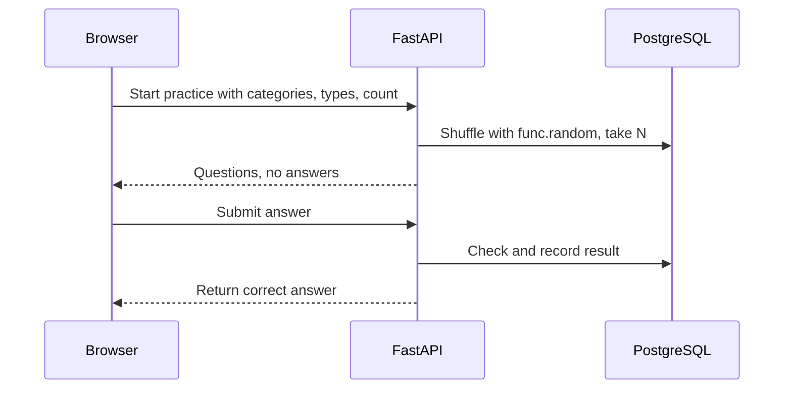
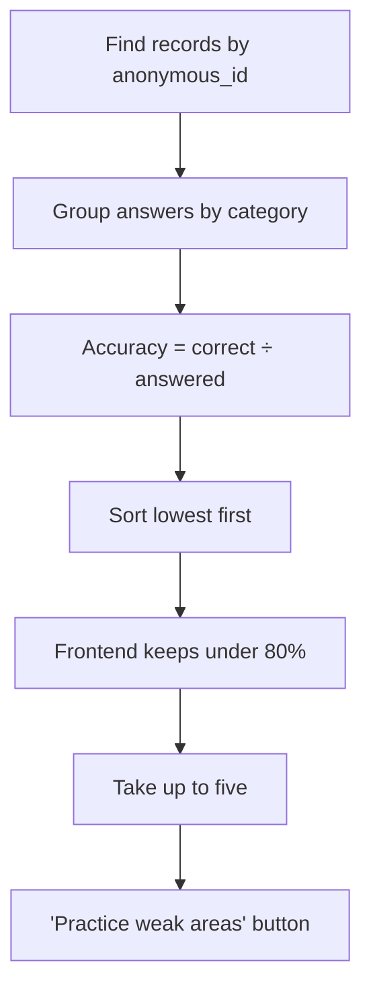

I built this project because my wife signed up for the Government Procurement Act certification exam.

If you practice straight from the PDF question bank a few times, it's easy to end up memorizing the question order along with the answers. Before you turn the page, the answer has already popped into your head. That familiarity can't tell you whether you remember the material or just where the answer sits in the PDF.

So I set out to turn a fixed question bank into practice rounds that come in a different order every time and still leave a record of your weak areas.

{: width="800" height="430" }
_Once the question order is shuffled, familiarity can no longer stand in for understanding._

> This post examines commit [`b29fe3f`](https://github.com/7a6ac0/gpa-question-webapp/tree/b29fe3fc0ccd9ba8b534a974d4c7921a78e007bb). [`pyproject.toml`](https://github.com/7a6ac0/gpa-question-webapp/blob/b29fe3fc0ccd9ba8b534a974d4c7921a78e007bb/pyproject.toml#L5-L21) declares package version `0.1.0` and requires Python `3.11` or later.
{: .prompt-info }

## A web app that turns the official question bank into practice records

[gpa-question-webapp](https://github.com/7a6ac0/gpa-question-webapp) is a practice site for the Government Procurement Act question bank. It uses FastAPI, SQLAlchemy, Jinja2, pdfplumber, and python-docx, and is released under the [MIT License](https://github.com/7a6ac0/gpa-question-webapp/blob/b29fe3fc0ccd9ba8b534a974d4c7921a78e007bb/LICENSE#L1-L20).

It has two data paths. On import, [`parse_command`](https://github.com/7a6ac0/gpa-question-webapp/blob/b29fe3fc0ccd9ba8b534a974d4c7921a78e007bb/src/ingestion/cli.py#L39-L86) reads the official PDF or DOCX files you've downloaded locally and writes the questions into PostgreSQL. During practice, the browser UI calls FastAPI to read and write questions, sessions, and answer records.

{: width="1200" height="548" }
_Architecture diagram based on commit `b29fe3f`; [open the interactive version](/assets/img/posts/gpa-question-webapp-study-loop/system-architecture.html)._

The browser-facing routes are wired up in [`src/api/main.py`](https://github.com/7a6ac0/gpa-question-webapp/blob/b29fe3fc0ccd9ba8b534a974d4c7921a78e007bb/src/api/main.py#L5-L40) and cover four features:

- Randomized practice
- Instant answer checking
- Per-session scores
- Cross-session weak-area stats

## How data travels from a PDF to an answerable question

The first stage is import. The CLI scans the input directory for `.pdf` and `.docx` files and hands each one to the parser that matches its extension. If no category is specified, a leading `1` to `13` in the filename is treated as the category number. See [`src/ingestion/cli.py`](https://github.com/7a6ac0/gpa-question-webapp/blob/b29fe3fc0ccd9ba8b534a974d4c7921a78e007bb/src/ingestion/cli.py#L39-L84).

The PDF parser first splits the document at the Chinese headings for "true/false questions" (是非題) and "multiple-choice questions" (選擇題). It then uses regular expressions to recognize question numbers and answers. Multiple-choice answers `1` to `4` become `A` to `D`. The rules are in [`src/ingestion/pdf_parser.py`](https://github.com/7a6ac0/gpa-question-webapp/blob/b29fe3fc0ccd9ba8b534a974d4c7921a78e007bb/src/ingestion/pdf_parser.py#L11-L19):

```python
MC_QUESTION_START = re.compile(r"^\s*(\d+)\s+([1-4])\s+(.+)")
TF_QUESTION_START = re.compile(r"^\s*(\d+)\s+([OX])\s+(.+)")
ANSWER_NUM_TO_LETTER = {"1": "A", "2": "B", "3": "C", "4": "D"}
```
{: file="src/ingestion/pdf_parser.py" }

The second stage is deduplication and updating. Each question's `source_hash` is the SHA-256 of its category, question type, and question text joined together:

```python
@property
def source_hash(self) -> str:
    raw = f"{self.category_id}|{self.question_type}|{self.question_text}"
    return hashlib.sha256(raw.encode("utf-8")).hexdigest()
```
{: file="src/ingestion/base.py" }

On re-import, a question with a matching hash gets its answer, options, or legal reference updated. Questions that have disappeared from the source get marked with `deleted_at`. The full flow is in [`src/ingestion/base.py`](https://github.com/7a6ac0/gpa-question-webapp/blob/b29fe3fc0ccd9ba8b534a974d4c7921a78e007bb/src/ingestion/base.py#L13-L100).

Practice only begins in the third stage. Questions reach the browser without the correct answer, and the server checks each answer:



[`create_session`](https://github.com/7a6ac0/gpa-question-webapp/blob/b29fe3fc0ccd9ba8b534a974d4c7921a78e007bb/src/api/routes/sessions.py#L32-L97) draws the questions, shuffling the matching ones with `func.random()`. The [`QuestionResponse`](https://github.com/7a6ac0/gpa-question-webapp/blob/b29fe3fc0ccd9ba8b534a974d4c7921a78e007bb/src/models/schemas.py#L15-L23) you get first has no correct-answer field. Checking happens in [`submit_answer`](https://github.com/7a6ac0/gpa-question-webapp/blob/b29fe3fc0ccd9ba8b534a974d4c7921a78e007bb/src/api/routes/sessions.py#L100-L170).

## Weak areas aren't guessed; they accumulate by category

I think the part most worth checking here is what "cross-session weak areas" actually computes.

"Cross-session weak areas" means the cumulative accuracy of each category, with a clear denominator, threshold, and sort order:



On the backend, [`get_weakness`](https://github.com/7a6ac0/gpa-question-webapp/blob/b29fe3fc0ccd9ba8b534a974d4c7921a78e007bb/src/api/routes/sessions.py#L173-L225) stops after sorting. The `80%` threshold and the five-category cap live in the frontend, in [`src/templates/weakness.html`](https://github.com/7a6ac0/gpa-question-webapp/blob/b29fe3fc0ccd9ba8b534a974d4c7921a78e007bb/src/templates/weakness.html#L48-L69):

```javascript
const weakCats = data.categories.filter(c => c.percentage < 80).slice(0, 5);
const weakIds = weakCats.map(c => c.category_id).join(',');
```
{: file="src/templates/weakness.html" }

It isn't an ability-estimation model, and it doesn't give extra weight to recent results. If you answer the same question several times, every attempt counts toward the stats. I worked out these limits from how the code counts `SessionAnswer.id` rows, not from the README's description of the feature.

## The price of convenience: format coupling and anonymous identity

The parser depends directly on the layout text and answer format of the official documents. If the section headings no longer read "true/false questions" or "multiple-choice questions," or multiple-choice answers no longer use `1` to `4`, the current rules stop recognizing questions. You can see this maintenance cost in [`_split_sections`](https://github.com/7a6ac0/gpa-question-webapp/blob/b29fe3fc0ccd9ba8b534a974d4c7921a78e007bb/src/ingestion/pdf_parser.py#L57-L85) and the two question-type parsing functions.

The runtime isn't a single static web page, either. [`docker-compose.yml`](https://github.com/7a6ac0/gpa-question-webapp/blob/b29fe3fc0ccd9ba8b534a974d4c7921a78e007bb/docker-compose.yml#L1-L29) starts the application and PostgreSQL 16, and keeps data in a `pgdata` volume. If practice records need to survive a disk failure, you have to arrange backups separately when you deploy.

Cross-session identity relies only on `gpa_anonymous_id` in the browser's `localStorage`. The frontend puts it into the `/api/weakness` query string, as shown in [`src/templates/weakness.html`](https://github.com/7a6ac0/gpa-question-webapp/blob/b29fe3fc0ccd9ba8b534a974d4c7921a78e007bb/src/templates/weakness.html#L12-L36). The matching route only accepts `anonymous_id` and has no account-authentication dependency.

I find that convenient for a household tool, but it isn't the access control you'd want for storing official exam scores.

## Good for home practice, not a ready-made official exam system

If your question bank comes from a fixed source, your users are a known group, and you only need shuffled questions plus the categories you keep missing, this project already wires the necessary pieces together. When the question bank changes, [`upsert_questions`](https://github.com/7a6ac0/gpa-question-webapp/blob/b29fe3fc0ccd9ba8b534a974d4c7921a78e007bb/src/ingestion/base.py#L28-L100) can update, keep, or soft-delete existing questions, so you don't have to wipe the database each time.

To open it up to many users, you first need accounts, authorization, data isolation, and a backup strategy. If the question bank's layout changes often, the parser also needs failure reports and tests for new formats. As I see it, the current code suits a personal practice tool and shouldn't be treated as an official exam platform as-is.

## Run the tests first, then plug in your own question bank

Confirm the dependencies, the CLI entry point, and the core behavior before you deal with the official question-bank files. I ran the commands below on macOS with Python `3.14.2` and uv `0.9.17`:

```bash
git clone https://github.com/7a6ac0/gpa-question-webapp.git
cd gpa-question-webapp
uv sync --extra dev
uv run python -m src.ingestion.cli --help
uv run pytest -q
```
{: .nolineno }

I got `34 passed in 1.05s`, and the CLI listed the `parse` subcommand. This only confirms that the current commit installs and passes its tests. It doesn't mean every version of the official PDF will parse.

Next, download one category's file from the [Public Construction Commission question bank page](https://web.pcc.gov.tw/psms/plrtqdm/questionPublic/indexReadQuestion) and put it in `data/`. Then process it with the import command in the [project README](https://github.com/7a6ac0/gpa-question-webapp/blob/b29fe3fc0ccd9ba8b534a974d4c7921a78e007bb/README.md#L47-L58) and check the parsing results.

## What really matters is a practice record you can look back on

Everything checked above confirms only that these features exist. It can't prove the project will raise exam scores. I still judge that its value lies in closing a review loop.

A fixed PDF gives you only questions and answers, while the website turns every attempt into data. Randomized quizzes cut off the question-order cues, and category stats point to what to practice next round. For my family's need, the tech choices are just a means. The real product is being able to keep repeating "answer, find weak areas, practice again."

## Further reading

- [gpa-question-webapp source code](https://github.com/7a6ac0/gpa-question-webapp): the import, answering, and weak-area stats code discussed here.
- [Public Construction Commission procurement professional question bank](https://web.pcc.gov.tw/psms/plrtqdm/questionPublic/indexReadQuestion): the official source this project processes.
- [FastAPI documentation](https://fastapi.tiangolo.com/): routing, response models, and dependency injection.
- [SQLAlchemy 2.0 documentation](https://docs.sqlalchemy.org/en/20/): sessions, queries, and ORM relationships.
