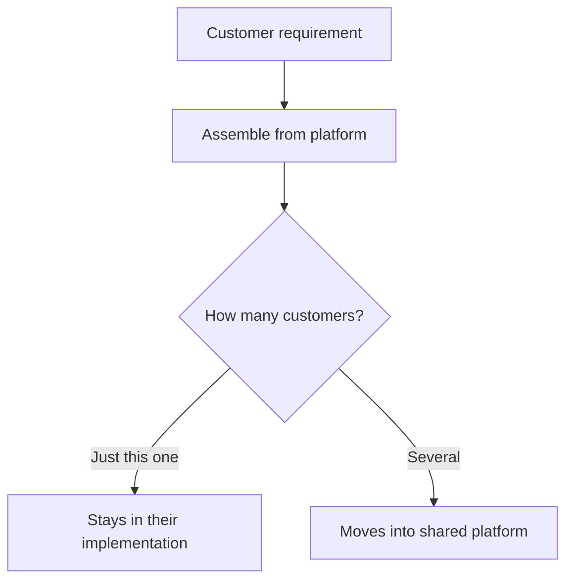
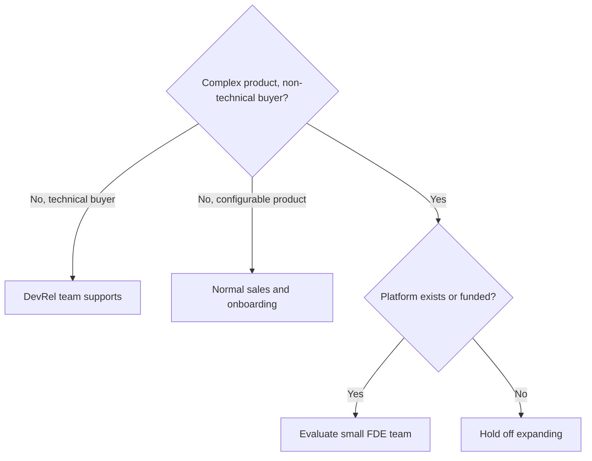

You've sold an enterprise a platform that only becomes useful once someone builds on top of it. The contract is signed, and the first onboarding meeting is underway. But the only thing on the projector is a blank workflow diagram. The customer knows they want to improve their product listing rate or sales throughput, but has no idea how to assemble the platform into a working solution.

The real problem is where delivery ends. When a customer can afford the platform but lacks the engineering capacity to turn it into results, how much customization should the vendor deliver? And how do you keep every deal from turning into a new maintenance liability?

## FDEs deliver customer outcomes on top of a platform

FDE stands for Forward Deployed Engineering: engineers work directly with customers to build the solutions they need on an existing software platform. At the end of his talk, Kevin Bai boiled the role down to one phrase: ["a customer-facing software engineer"](https://www.youtube.com/watch?v=KwhgfwOSToQ&t=1019s).

This post covers the AI Engineer World's Fair 2026 talk [Forward Deployed Engineering 101](https://ai.engineer/talks/KwhgfwOSToQ-forward-deployed-engineering-101), which the official page lists at 17 minutes 48 seconds. In his introduction, Bai said he works on Anthropic's applied AI team. He was one of the earliest members of Rippling's FDE team, and before that worked at Palantir.

Those experiences shape his point of view. I'm discussing the talk itself, not Anthropic's current work.



From [3:03 to 3:35](https://www.youtube.com/watch?v=KwhgfwOSToQ&t=183s), Bai explains what an FDE delivers. The customer gets software and engineering services together, and what they finally sign off on is a business outcome built on the platform. The engineer first has to understand the customer's business, then use the platform to build the application, workflow, or solution.

Below, GTM (go-to-market) means how a company reaches customers, closes deals, and keeps serving them.

## Look at product complexity together with buyer capability

Bai borrows the Punnett square (the 2×2 grid from biology) to explain when FDE applies. One axis is how much technical skill it takes to use the product. The other is whether the buyer can absorb that complexity. From [4:03 to 5:15](https://www.youtube.com/watch?v=KwhgfwOSToQ&t=243s) he walks through three of the combinations:

| Product and platform | Buyer or user | Who handles the complexity | Verdict in the talk |
| --- | --- | --- | --- |
| Technical products like GitHub and Datadog | CTOs, CIOs, software engineers | Technical users learn and operate it themselves | No FDE needed |
| Configurable tools like Rippling, Jira, and Slack | Non-technical buyers and users | Users get the job done through configuration | No FDE needed |
| Technical platforms you have to build on | Non-technical business buyers | The vendor sends engineers to build the customer's solution | Worth evaluating FDE |

This table is Bai's classification from the talk, not an assessment of everything these products can do. The talk doesn't discuss the fourth combination, so I won't fill in a fourth quadrant or present my own guesses as the speaker's conclusions.

The key is the third row. The buyer knows exactly what outcome they want, but has no engineering team that can build on the platform. If the vendor hands over only the tool, the customer still has to recruit, train, and manage engineers themselves. At [6:00](https://www.youtube.com/watch?v=KwhgfwOSToQ&t=360s), Bai describes FDE as lending the customer engineers who already know the platform.

## A shared platform keeps custom requirements maintainable

FDEs do write custom code, but they don't start from an empty project. From [8:42 to 9:05](https://www.youtube.com/watch?v=KwhgfwOSToQ&t=522s), Bai says engineers should assemble applications and workflows from capabilities the shared platform already provides. The product team maintains those capabilities in common, and each customer solution handles only what's different.

Foundry Ontology is the only example named in the talk. [Palantir's official docs](https://www.palantir.com/docs/foundry/ontology/overview) describe the Ontology as an operational layer on top of datasets, virtual tables, and models. It maps data into business objects, properties, and relationships, and also provides actions, functions, and dynamic permissions. FDEs can therefore use data and operational capabilities that are already maintained, instead of rebuilding the same foundation for every customer.

Custom work still needs boundaries. From [16:10 to 16:48](https://www.youtube.com/watch?v=KwhgfwOSToQ&t=970s), Bai offers a simple rule: how many customers a behavior serves decides where its code lives.

The talk doesn't give a number for "how many customers makes something shareable," so I think that threshold is still the product team's call. This boundary decides whether the company delivers maintainable solutions or a pile of projects that each evolve on their own.

## Treating FDE as staff augmentation misreads the cost structure

A common way to put it is "FDE just means sending engineers to the customer's site to do contract work," but that's inaccurate. From [8:13 to 8:52](https://www.youtube.com/watch?v=KwhgfwOSToQ&t=493s), Bai draws the line directly. If every engineer builds a system from scratch for every customer, the company is running a development services business, not what he calls platform-based FDE.

What changes the cost structure is how much already-maintained capability the custom code shares, not where the engineers sit. Without a platform, every new contract brings another set of dependencies, another deployment pipeline, and another support obligation. The talk sums up this maintenance situation with the line "engineers don't want to learn 55 repos," then points out that maintenance costs eat into the P&L.

{: width="1200" height="675" }
_Same FDE title, but the underlying platform changes what the engineer maintains every day._

The financial figures in the talk can't directly prove this model is profitable, either. From [6:39 to 7:07](https://www.youtube.com/watch?v=KwhgfwOSToQ&t=399s), Bai compares several companies by ACV (average contract value). He cites Palantir at $4 million, ServiceNow at $1.2 million, and Workday at $600,000, with qualifiers like "last I checked" and "I think."

The [official annotated transcript](https://ai.engineer/talks/KwhgfwOSToQ-forward-deployed-engineering-101#commercial-case) explicitly notes that these figures have no measurement date, calculation method, or independent ranking. So I read them only as the speaker's business argument, not as an apples-to-apples comparison between companies.

## A platform controls maintenance costs; it doesn't eliminate them

Even with a shared platform, you still have to maintain customer solutions. From [10:38 to 11:12](https://www.youtube.com/watch?v=KwhgfwOSToQ&t=638s), Bai lists a platform as a prerequisite for building an FDE team. He also stresses that the maintenance burden stays substantial even when the platform is solid. A platform reduces duplicated building, but it doesn't make customer differences go away.

Scattered knowledge is the second cost. In the Q&A from [15:05 to 15:29](https://www.youtube.com/watch?v=KwhgfwOSToQ&t=905s), Bai recommends having multiple FDEs work on a project together, so the full context doesn't live in one person's head. The team therefore has to set aside time for handoffs, support, and building shared understanding.

The hiring bar doesn't drop just because the role is close to customers. From [16:59 to 17:25](https://www.youtube.com/watch?v=KwhgfwOSToQ&t=1019s), Bai names two requirements for the ideal candidate: they clear the software engineering hiring bar, and the company is comfortable handing customer communication over to them. The company has to be willing to hire to the software engineering bar and to put these people directly in front of customers.

My reading is that you can't staff FDE roles by simply swapping in presales or customer support people. Both hiring and training have to cover engineering and customer communication.

## Two gates decide whether a company needs FDE

From [9:50 to 11:12](https://www.youtube.com/watch?v=KwhgfwOSToQ&t=590s), Bai uses two gates. The first asks whether there's a capability gap between product and buyer. The second asks about a shared platform:

DevRel means a developer relations team. If you have no shared platform and don't plan to build one, hold off on expanding, or custom work turns into separately maintained projects.

AI doesn't remove these two gates. From [11:28 to 12:35](https://www.youtube.com/watch?v=KwhgfwOSToQ&t=688s), Bai explicitly flags one part as his personal hypothesis: AI has made writing code and building custom software easier, and has made more platforms customizable.

The talk doesn't provide cross-industry data showing that this trend will extend to almost every platform. So I treat AI only as a reason to re-check the two gates, not as sufficient grounds for building an FDE team.

## Run an FDE decision through one table

> The decision process I put together here can rule out cases that clearly don't fit, but it can't estimate headcount, contract margins, or deployment timelines.
{: .prompt-info }

First, apply the two gates to the three product types from the talk:

| Example | Product requires building | Buyer can absorb the complexity | Has a shared platform | Result |
| --- | --- | --- | --- | --- |
| GitHub, Datadog | Yes | Yes | Not applicable | Technical GTM, no FDE needed |
| Jira, Slack | Mostly configuration | No | Not applicable | Normal sales and onboarding, no FDE needed |
| Foundry with non-technical industry buyers | Yes | No | Yes | Passes both FDE gates |

To apply this to your own company, take your most recent enterprise sales opportunity and fill in the five fields below. Write down only what you already know. Any blank field is the next thing to investigate.

| Field | What to fill in |
| --- | --- |
| Customer outcome | The business result the customer will use to sign off, not product feature names |
| Build requirement | Whether this result requires writing code on the product, or can be done through configuration |
| Customer capability | Whether the customer has an engineering team that can build and maintain this work |
| Shared capabilities | Which of the data model, permissions, actions, and deployment approach are centrally maintained by the platform |
| Long-term ownership | Where customer-specific behavior lives, and which product team takes over shareable capabilities |

Once the fields are filled in, here's what I'd recommend:

- The product requires building, the customer lacks engineering capacity, and the shared capabilities already exist: start a small FDE pilot.
- The first two hold, but the Shared capabilities field is still blank: define the platform investment and maintenance ownership first.
- There's no capability gap between the product and the buyer: sticking with your existing GTM approach is more direct.

## My take: set the platform boundary before opening the job req

I see FDE as a joint decision about product architecture and GTM. The number of engineers is just the staffing outcome that follows from that decision. The transcript, the platform docs, and the two gates above can all be checked. This section is my own judgment, and the available evidence isn't enough to prove it applies to every B2B software company.

If the product team hasn't defined these three things, hiring FDEs first will only multiply the number of customer project branches:

- Which capabilities are centrally maintained
- Where customer differences live
- How frontline requirements flow back into the platform

Once the platform boundaries are clear, FDEs can spend their engineering time understanding the business and assembling solutions, rather than rebuilding foundational capabilities.

AI makes code faster to generate, but it doesn't decide who carries the support burden. As customization gets cheaper, the company needs to be even clearer about who maintains which code over the long run, so product architecture has to be designed together with GTM.

Before you open the job req, pick a recent enterprise sales opportunity and fill in the five fields above to confirm the delivery gap is real.

## Further reading

- [Forward Deployed Engineering 101](https://ai.engineer/talks/KwhgfwOSToQ-forward-deployed-engineering-101): the official page, with an annotated transcript, full timestamps, and the resources mentioned in the talk, for checking this post line by line.
- [Palantir Ontology overview](https://www.palantir.com/docs/foundry/ontology/overview): the Ontology's objects, relationships, actions, functions, and permissions, which are the shared platform capabilities Foundry provides.
- [What Is a Forward Deployed Engineer?](https://fdepod.substack.com/p/test): Kevin Bai's follow-up article, which breaks FDE into three jobs (consultant, product manager, and engineer). He argues the role belongs on high-value, ill-defined problems.
