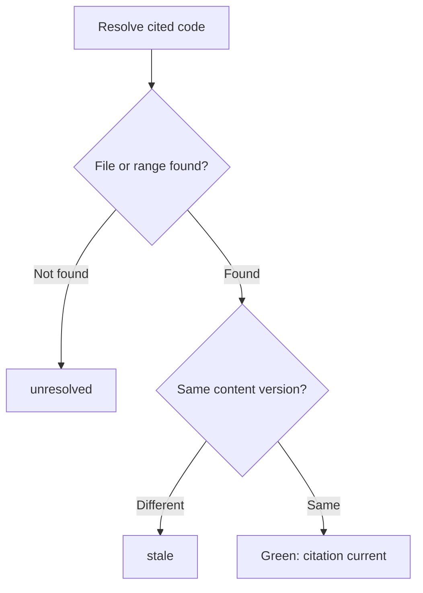
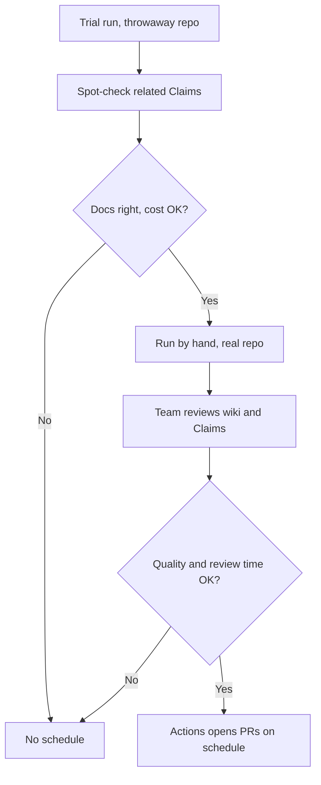

`AGENTS.md` is a good place for build commands and working rules, but it can't hold a full architecture write-up. When a coding agent takes over an unfamiliar repo, it still has to work out module relationships, data flow, and failure handling from the source code and tests.

OpenWiki organizes that information into a wiki inside the repo, which the agent reads when it needs to. I wanted to find out how it decides which pages need rewriting after the code changes, and how far you can trust the updated result. For this post I mainly read the source code, and confirmed locally that the CLI starts.

[When LangChain announced OpenWiki](https://www.langchain.com/blog/introducing-openwiki-an-open-source-agent-for-repo-documentation), it argued that an agent instruction file only needs to point to a repo wiki. Coding agents can then pull in docs on demand, instead of you cramming everything into a single instruction file. That keeps the instruction file short, but it adds a wiki that goes stale along with the code.

> This post analyzes OpenWiki `0.5.2`. When I checked on 2026-10-19, the latest on npm was `0.7.2` (2026-10-10).
>
> Since [`0.6.0`](https://github.com/langchain-ai/openwiki/releases/tag/v0.6.0), the native CLI can [work on several pages at once](https://github.com/langchain-ai/openwiki/blob/27b3c76cb9b28bc3bb31ccbeb4f0192b0802cf96/README.md#parallel-page-workers) via `OPENWIKI_PAGE_CONCURRENCY`. The default is still 1, so you have to raise it to get parallel processing, and runs through coding-agent integrations still go page by page. Only when you raise that setting do this post's statements stop holding: that page jobs run in order, and that the worker handles only the page job at the front of the queue.
{: .prompt-info }

## OpenWiki turns repo docs into a wiki it can update

OpenWiki is a command-line tool that generates and maintains a repo wiki. I checked source commit [`715109a`](https://github.com/langchain-ai/openwiki/tree/715109a8ab1cda6d47680fcc8170e203c751bf61). At that commit, [`package.json`](https://github.com/langchain-ai/openwiki/blob/715109a8ab1cda6d47680fcc8170e203c751bf61/package.json) lists version `0.5.2`, requires Node.js `22.22.0` or later, and uses the [`MIT License`](https://github.com/langchain-ai/openwiki/blob/715109a8ab1cda6d47680fcc8170e203c751bf61/LICENSE#L1).

I focus on code mode, which puts the generated docs back into the original repo under version control. When you initialize in code mode, OpenWiki:

- Creates an `openwiki/` directory.
- Writes instruction blocks it manages into `AGENTS.md` and `CLAUDE.md`.
- Creates `.github/workflows/openwiki-update.yml` if the repo has no update workflow yet.

So `--init` doesn't just read your code. It also changes your agent instructions and may change your GitHub Actions setup. You can find this behavior in [`ensureCodeModeRepoSetup`](https://github.com/langchain-ai/openwiki/blob/715109a8ab1cda6d47680fcc8170e203c751bf61/src/ingestion/code-mode.ts#L47) and [`writeCodeModeAgentSnippets`](https://github.com/langchain-ai/openwiki/blob/715109a8ab1cda6d47680fcc8170e203c751bf61/src/ingestion/code-mode.ts#L192).

The instructions OpenWiki writes frame `openwiki/` as an evidence index to consult on demand. The agent uses the wiki to find the relevant systems and files, then goes back to the source code and tests to confirm. The wiki itself is not the final authority. This limit is written into the instructions that [`createCodeModeAgentsSnippet`](https://github.com/langchain-ai/openwiki/blob/715109a8ab1cda6d47680fcc8170e203c751bf61/src/ingestion/code-mode.ts#L423) generates.

{: width="800" height="430" }
_AGENTS.md only points the way; the wiki is an on-demand evidence index, and you still go back to the code to confirm._

## How an update decides which pages to change

When OpenWiki generates wiki pages, it also creates a Claim for each important statement, recording the source location that supports it. Claims aren't written into the wiki body. They're stored separately in sidecar metadata files. Each page together with its Claims is one page job, and page jobs run in order.

A repo update goes through four stages in order:

{: width="800" height="430" }
_An update first looks at what changed in the code, then decides on pages and writes Claims, and only runs the batch-wide checks at the end._

**Git changes.** `getRepositoryChangedPaths` compares the last recorded Git commit with the currently checked-out `HEAD`. Uncommitted changes count too:

- Staged files already added to the Git index
- Unstaged files not yet added to the index
- New files Git doesn't track yet

It excludes the `openwiki/` directory that OpenWiki generates, plus any paths listed in `.openwikiignore`, so doc output isn't mistaken for code changes. [`src/agent/utils.ts`](https://github.com/langchain-ai/openwiki/blob/715109a8ab1cda6d47680fcc8170e203c751bf61/src/agent/utils.ts#L909) lists the actual Git commands.

**Planner.** The planner decides which pages the wiki should have. It reads manifests like `package.json`, entry points, the main directories, and representative tests. It then organizes pages by system boundaries, runtime environments, and cross-system flows.

The planner's prompt explicitly forbids listing files one by one following the source directory layout, because the goal is to explain how the system works, not to copy the file tree. You can find this in [`createRepositoryPlannerPrompt`](https://github.com/langchain-ai/openwiki/blob/715109a8ab1cda6d47680fcc8170e203c751bf61/src/agent/repository-prompts.ts#L43).

**Page job.** The worker that writes pages handles only the page job at the front of the queue. After it writes the page, it also has to list which Claims were added, revised, confirmed, or retracted. These actions tell OpenWiki the state of each statement:

| Action | Meaning |
| --- | --- |
| Added | A new statement |
| Confirmed | An existing statement still holds |
| Revised | An existing statement's content needs changing |
| Retracted | An existing statement should be removed from the docs |

[`submitRepositoryPage`](https://github.com/langchain-ai/openwiki/blob/715109a8ab1cda6d47680fcc8170e203c751bf61/src/generation/repository-run.ts#L1184) rejects pages submitted out of queue order, and confirms the page file is readable before accepting it.

When writing the page and its Claims, OpenWiki first checks that the page version the worker read is still the latest, so it won't overwrite other updates. Next it confirms that each Claim in the sidecar can find the code it cites. Only then does it mark the page job done.

**Final checks.** After all pages are processed, [`finalizeWikiArtifacts`](https://github.com/langchain-ai/openwiki/blob/715109a8ab1cda6d47680fcc8170e203c751bf61/src/agent/wiki-finalizer.ts#L248) also checks Mermaid diagrams, the wiki index, internal links, Claim sources, and this run's generation record.

Each time a page finishes, OpenWiki writes the result to this update's checkpoint, so the records for finished pages survive if the process fails partway. [`finishRepositoryRun`](https://github.com/langchain-ai/openwiki/blob/715109a8ab1cda6d47680fcc8170e203c751bf61/src/generation/repository-run.ts#L1487) removes this run state only after every page passes validation and the generation record is written. Keeping partial progress after an interruption doesn't mean an unfinished wiki is ready to merge.

## How far Claims can check

Grounded Claims let you trace important doc statements back to the source code. Each Claim links to a `repo://` URI, which can point to a whole file or narrow down to a range of lines.

Claims survive shifted line numbers. Besides line numbers, the repository resolver computes a SHA-256 of the cited content and stores hashes of the first and last lines and their neighbors. If someone inserts code above the cited range and shifts it down, the resolver finds the new position from the original content and its context.

See [`resolveLineRangeEvidence`](https://github.com/langchain-ai/openwiki/blob/715109a8ab1cda6d47680fcc8170e203c751bf61/src/claims/evidence/repository/resolver.ts#L294) and [`locateUnchangedLineRange`](https://github.com/langchain-ai/openwiki/blob/715109a8ab1cda6d47680fcc8170e203c751bf61/src/claims/evidence/repository/resolver.ts#L404) for this logic.

Before every update, `runClaimsPreflight` resolves the code each Claim cites, with three possible results:



OpenWiki declares a run a `no-op`, meaning it won't regenerate the docs, only when all three conditions hold:

- The Git check finds no changes that must be handled.
- Every Claim checks out.
- Every page already has Claims to serve as its coverage baseline.

[`preflight.ts`](https://github.com/langchain-ai/openwiki/blob/715109a8ab1cda6d47680fcc8170e203c751bf61/src/claims/brains/code/preflight.ts#L40) and [`repository-run.ts`](https://github.com/langchain-ai/openwiki/blob/715109a8ab1cda6d47680fcc8170e203c751bf61/src/generation/repository-run.ts#L410) implement these two levels of checks.

This check answers only two questions: does the cited location still exist, and has the content there changed? It doesn't re-judge whether the natural language in the docs is correct.

Say the docs claim "after three retries, it writes to the dead-letter queue," but the cited code actually retries only twice. As long as that code hasn't changed, the stored hash stays the same, and neither `stale` nor `unresolved` shows up.

So an all-green source check only means each Claim still links to the content it originally cited. Reviewers still need to read that code and its tests to confirm the docs haven't misread conditions, counts, or execution order.

{: width="800" height="430" }
_Even with all Claims green, the doc statements still need a human check._

## What changes in day-to-day work

### Coming back to a personal project after a few months

On a personal project, you're both the developer and the doc reviewer. Come back after a few months to fix a login bug, and you may remember which directory the feature lives in, but forget the details:

- Where the session gets renewed
- Which tests cover timeouts
- Which environment variable the deploy reads

Say the wiki has a page on the login flow, with Claims linking to the session code, tests, and deploy config. The coding agent can then read those spots first instead of searching the whole repo for keywords.

Personal use also makes it easy to skip review, since nobody will reject a wrong doc PR. If the project is split into several modules, or you come back only every few months, I'd make spot-checking Claims a routine part of every update. If the project has only a few files and you change it every week, reading the source and tests directly is usually faster.

### On-call and cross-team changes at a company

Say an on-call engineer gets an alert about duplicate orders, and the original author is on vacation. The engineer first has to find three places: the API that receives orders, where retries happen, and where the service generates and checks idempotency keys.

If the wiki's order-flow page already links to that code and its tests, the engineer and the coding agent can start from the cited locations. The wiki won't determine the incident's root cause, but it helps the engineer confirm which services the request passes through without waiting for the original author.

Cross-team changes make stale docs more costly. Say the payments team adds a required version field to an event format, and both the order and notification services have to update their parsers. OpenWiki can use Git changes and existing Claims to find the pages that may need rewriting, and open a doc PR.

Reviewers still have to confirm that the docs say whether old events keep working, and that tests cover both old and new formats. The team also has to decide in advance who reviews doc PRs, how quickly, and whether to accept partial results when generation gets interrupted. Without those arrangements, auto-generated PRs just sit in the queue.

Whether a project is personal or corporate doesn't directly decide whether it needs a repo wiki. A wiki can save time on repeated digging only when every handoff means re-finding the entry points, flows, and tests, and someone is responsible for checking the docs.

## Which repos are worth the maintenance cost

OpenWiki adds model calls, CI configuration, and human review. Before adopting it, I'd at least confirm who carries these costs:

- **Model spend.** Every generation and update calls a model, and the [README's quick start](https://github.com/langchain-ai/openwiki/blob/715109a8ab1cda6d47680fcc8170e203c751bf61/README.md#quick-start) asks you to set a model provider, API key, and model name. The bill, run time, and output quality vary with the model and the repo.
- **CI permissions.** The official [`openwiki-update.yml`](https://github.com/langchain-ai/openwiki/blob/715109a8ab1cda6d47680fcc8170e203c751bf61/examples/openwiki-update.yml#L1) fetches the full Git history so OpenWiki can compare commits. It also needs a model key plus `contents: write` and `pull-requests: write` permissions to commit doc changes and open PRs. Review these permissions like any other automation that can write to the repo.
- **The init diff.** `--init` touches files outside the wiki, so after the first run, review the whole diff, not just the generated wiki pages.
- **Human review.** Claims take you to the exact source location behind a statement, but clicking the link isn't the same as reviewing it. Reviewers still need to compare the statement, the cited range, and the related tests.

A good fit is a repo with several subsystems, where coding agents often change unfamiliar areas and the team is willing to review automated doc PRs. There, a wiki can collect each system's entry points and how the systems interact.

A small repo with only a few entry points, whose source and tests already explain its behavior, doesn't need a second, similar copy of that information in a wiki. Without people to review, I also wouldn't turn on scheduled updates, because each run just adds another PR waiting for someone.

Company repos also need to rule out paths that shouldn't go to a model. `.openwikiignore` blocks OpenWiki's file tools from reading the listed content. With ignore rules enabled, OpenWiki's local execution backend also refuses arbitrary shell commands, because a shell could bypass the file tools and read ignored files directly.

This restriction is implemented in [`OpenWikiLocalShellBackend.execute`](https://github.com/langchain-ai/openwiki/blob/715109a8ab1cda6d47680fcc8170e203c751bf61/src/agent/docs-only-backend.ts#L481). `.openwikiignore` only restricts OpenWiki's own tools. It doesn't replace repo access controls, and it can't undo secrets already committed to Git.

## Try the update flow on one repo first

First confirm the CLI starts locally. The commands below install OpenWiki into a fresh directory under `/tmp`, so they don't touch the test repo's dependencies or npm's usual global install location. I ran them on macOS arm64 with Node.js `25.2.1` and npm `11.6.2`.

OpenWiki's interactive terminal UI uses Ink, so run it in an environment with a PTY, like Terminal. If stdin doesn't support raw mode, Ink prints an error right away.

```bash
check_prefix="$(mktemp -d /tmp/openwiki-check.XXXXXX)"
npm install --global --prefix "$check_prefix" openwiki@0.5.2 --no-audit --no-fund
PATH="$check_prefix/bin:$PATH" openwiki --help
```
{: .nolineno }

When the install succeeds, the output shows version `0.5.2` and a `Usage` section. The ellipsis marks where I trimmed the middle:

```console
>_ OpenWiki v0.5.2 agent docs for codebases
...
# Usage
   openwiki [--init|--update] [message]
```

For this post I verified that the CLI starts. The `--init` and `--update` commands below come straight from the project's [`README`](https://github.com/langchain-ai/openwiki/blob/715109a8ab1cda6d47680fcc8170e203c751bf61/README.md#quick-start). Because `--init` changes agent instructions and may add a workflow, run your first test in a throwaway repo or a clean test branch:

```bash
openwiki --init

# After changing and committing a behavior that has test coverage
openwiki --update
```
{: .nolineno }

A successful exit only means the process finished. To judge whether it's worth adopting, I'd also check these results:

1. Read the full diff of `openwiki/`, `AGENTS.md`, `CLAUDE.md`, and any new workflow. Confirm which files OpenWiki changed and which permissions the workflow gets.
2. Pick a wiki page about a feature you know well, and check whether it misses major entry points, error handling, or representative tests.
3. Spot-check a few Claims on that page. For each one, confirm the statement is precise, the `repo://` range really supports it, and the related tests match it.
4. Record generation time, model usage, the number of wrong statements, and the time spent on manual fixes. Only with these numbers can you compare against maintaining the docs by hand.

## How far to automate doc maintenance

The source code cited above shows how OpenWiki tracks sources, but it can't prove it saves money or time for every team. So I'd roll it out in stages and turn on the scheduled workflow last:



OpenWiki stores the code location and content version each Claim cites, so reviewers can find out whether a source still exists. Looking only at when the docs were last generated can't tell you that.

While the team reviews, keep recording how many wrong statements spot checks find, which major flows the wiki leaves out, and how much manual editing each doc PR needs. If that review takes longer than updating the docs by hand did, automation has only moved the time into PR review.

## Further reading

- [Introducing OpenWiki](https://www.langchain.com/blog/introducing-openwiki-an-open-source-agent-for-repo-documentation): why the launch used a short agent instruction file pointing to a large repo wiki.
- [OpenWiki README](https://github.com/langchain-ai/openwiki/blob/715109a8ab1cda6d47680fcc8170e203c751bf61/README.md): how to use the CLI, code mode, Grounded Claims, and scheduled updates.
- [Claims preflight implementation](https://github.com/langchain-ai/openwiki/blob/715109a8ab1cda6d47680fcc8170e203c751bf61/src/claims/brains/code/preflight.ts): the actual rules for `stale` and `unresolved`.
- [Repository evidence resolver](https://github.com/langchain-ai/openwiki/blob/715109a8ab1cda6d47680fcc8170e203c751bf61/src/claims/evidence/repository/resolver.ts): how content hashes and context relocate evidence after line numbers shift.
- [How to Write AGENTS.md: Give Coding Agents Your Project Rules](/posts/agents-md-project-rules-for-coding-agents/): what belongs, and what doesn't, in the file OpenWiki writes its instruction block into.
- [Automating PR Review With GitHub Actions and an AI Agent: This Site as an Example](/posts/github-actions-ai-agent-pr-review/): auto-generated doc PRs still need a human reviewer. This post covers what automated checks, AI review, and human approval each look at.
