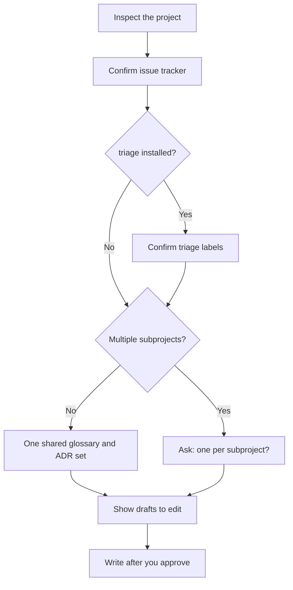
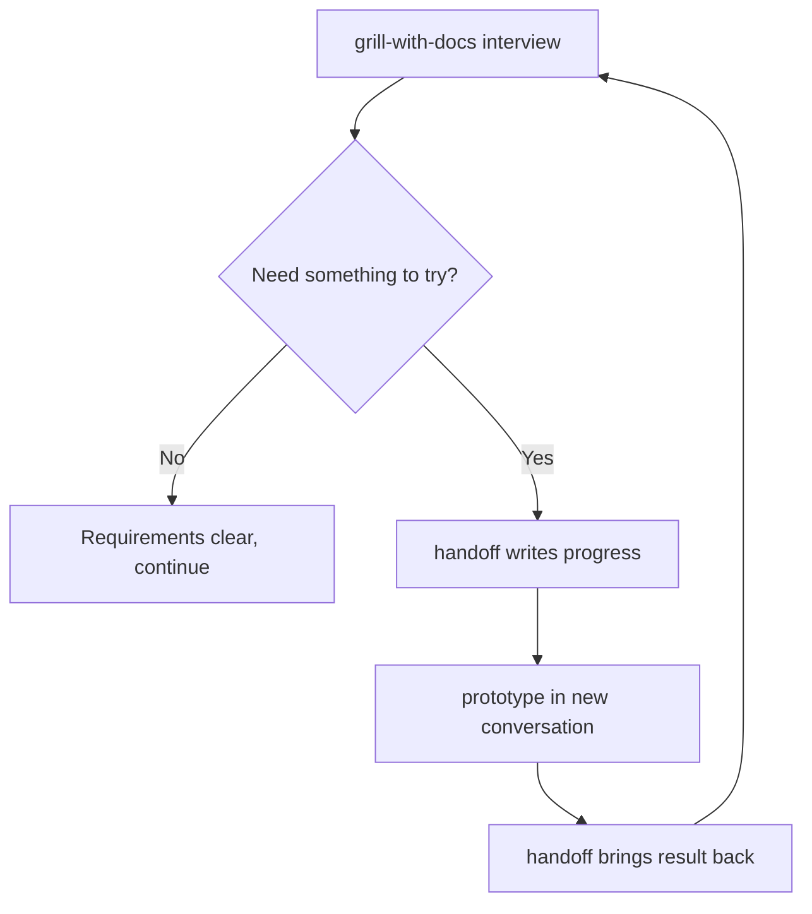
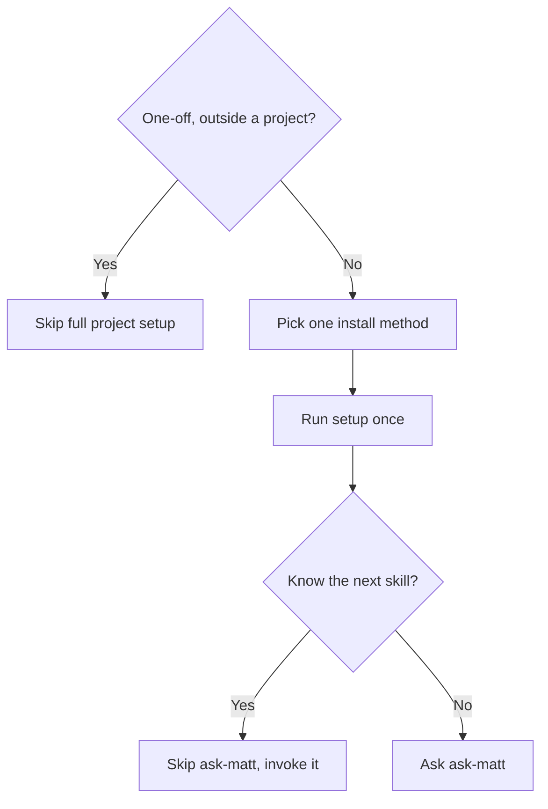

You're about to add per-seat billing to an existing subscription service, but you're not sure whether to start by clarifying requirements, writing a spec, adding tests, or just diving into the code. You've heard that `mattpocock/skills` can help an AI coding assistant handle this kind of work more methodically, but when you open the list, you're greeted by 25 skill names. Do you really have to understand every one of them before you can begin?

You don't. Your first time through takes just two steps:

1. Use `setup-matt-pocock-skills` to record your project's working rules.
2. Describe your problem to `ask-matt`, and let it suggest the next skill to use.

As I see it, `ask-matt` is more of a help desk than a manager that runs the whole pipeline automatically. It only tells you which skill to use next; you still have to start that skill yourself.

> mattpocock/skills Series | Part 1
>
> - Next (Part 2): [From Vague Requirements to Shared Terms](/posts/mattpocock-skills-requirements-shared-language/)
> - Series guide: [What It Is, How to Start](/posts/mattpocock-skills-series-guide/)
>
> I based this post on [version `1.2.3`](https://github.com/mattpocock/skills/blob/c55ee46073ed923f86ce59a5eb3b6d895095d1b7/package.json#L2-L10). The official plugin's [`plugin.json`](https://github.com/mattpocock/skills/blob/c55ee46073ed923f86ce59a5eb3b6d895095d1b7/.claude-plugin/plugin.json#L21-L47) includes 25 skills. The repository also contains 9 items that are still experimental and 4 that aren't currently being promoted, listed in [`in-progress/README.md`](https://github.com/mattpocock/skills/blob/c55ee46073ed923f86ce59a5eb3b6d895095d1b7/skills/in-progress/README.md#L1-L18) and [`misc/README.md`](https://github.com/mattpocock/skills/blob/c55ee46073ed923f86ce59a5eb3b6d895095d1b7/skills/misc/README.md#L1-L8) respectively. This series only covers the 25 included in the official plugin.
{: .prompt-info }

> On 2026-10-04, [`1.3.0`](https://github.com/mattpocock/skills/releases/tag/v1.3.0) and [`1.3.1`](https://github.com/mattpocock/skills/releases/tag/v1.3.1) took the official plugin from 25 skills to 27 (checked 2026-10-19):
>
> - `resolving-merge-conflicts` is gone.
> - `implement-spec`, `pr`, and `retro` are new, and `ask-matt` suggests them too.
> - The project glossary was renamed from `CONTEXT.md` to `GLOSSARY.md`. Skills in the new releases only look for the new name, so rename an existing file with `git mv`.
>
> I plan to fully update this series for the new releases.
{: .prompt-info }

I think of a skill as a set of instructions that tells an AI coding assistant how to do a specific job. Examples include interviewing you about requirements or breaking a spec down into individual tasks. An AI coding assistant is a tool such as Claude Code or Codex that can read and write the files in your project and write code for you. `mattpocock/skills` is a complete set of skills published by Matt Pocock.

## Installing and Invoking Are Separate Questions

The installation method determines where the skill files live and who is responsible for updating them. The invocation method determines who can tell a skill to start working.

{: width="800" height="450" }
_The full path for first-time use: choose an installation method, run setup, then let ask-matt suggest the next skill._

### Pick One Installation Method

`mattpocock/skills` treats [`.agents/install-block.md`](https://github.com/mattpocock/skills/blob/c55ee46073ed923f86ce59a5eb3b6d895095d1b7/.agents/install-block.md#L5-L57) as the single source of truth for installation instructions. Choose based on the tool you use:

| Your situation                                  | Installation method | Maintenance afterward                                          |
| ----------------------------------------------- | ------------------- | -------------------------------------------------------------- |
| Using Claude Code, no plans to modify the skills | Official plugin     | Updates automatically; contents can't be modified              |
| Using Claude Code, want to modify the skills     | skills.sh           | Files are copied into your project; you modify and update them |
| Using Codex or another tool that supports skills | skills.sh           | Files are copied into your project; you modify and update them |

I suggest picking only one of the two methods. If you use both, every skill shows up twice.

Claude Code is Anthropic's AI coding assistant, while Codex comes from OpenAI. The command to install the official plugin for Claude Code is:

```bash
claude plugins install mattpocock-skills
```
{: .nolineno }

You can also type this directly inside Claude Code:

```text
/plugin install mattpocock-skills
```
{: .nolineno }

If you want to modify the skills, or you use Codex or another tool, use the skills.sh installer instead:

```bash
npx skills@latest add mattpocock/skills
```
{: .nolineno }

skills.sh lets you check off which skills to install and which AI coding assistants to install them for. Be sure to include `setup-matt-pocock-skills`, and include `ask-matt` too if you want to follow along with this post. Any other skill that `ask-matt` recommends later also has to be installed before you can use it.

With skills.sh, the command to update a single skill is:

```bash
npx skills@latest update <name>
```
{: .nolineno }

### Understand Who Can Invoke a Skill

`mattpocock/skills` sorts skills into two categories based on who can invoke them:

| Term          | Who can invoke it                                                          |
| ------------- | -------------------------------------------------------------------------- |
| user-invoked  | Only a human, by typing its name                                           |
| model-invoked | A human can invoke it, and the AI can also pick it up on its own when the task calls for it |

A user-invoked skill can in turn call a model-invoked skill, but it cannot call another user-invoked skill. The full set of constraints is documented in the [invocation rules](https://github.com/mattpocock/skills/blob/c55ee46073ed923f86ce59a5eb3b6d895095d1b7/.agents/invocation.md#L1-L22).

Both `setup-matt-pocock-skills` and `ask-matt` are user-invoked, so you have to type their names yourself. Claude Code and Codex use different syntax:

| Tool        | Example input               |
| ----------- | --------------------------- |
| Claude Code | `/setup-matt-pocock-skills` |
| Codex       | `$setup-matt-pocock-skills` |

In Codex, you can type `$` and then pick a skill from the list, or type `$skill-name` directly. You can verify this syntax in [OpenAI's Codex skills documentation](https://developers.openai.com/codex/skills/). For other AI coding assistants, use their own skill menu or input syntax.

I think this constraint also explains why `ask-matt` can only make suggestions. For example, `grill-with-docs`, which it often recommends, is also user-invoked, so you have to type it yourself. It also won't automatically go on to run `to-spec`, `to-tickets`, and `implement`.

## Setup Inspects, Then Asks, Then Writes

Before a project first uses the skills that focus on software development, you need to run `setup-matt-pocock-skills` once. That's because these skills (grouped under "engineering" in the repo) need some basic information about your project. Setup isn't an installer that does the same thing every time; it inspects first, asks questions next, and writes files only at the end:



First, it looks at the current state of the project:

- Which platform hosts the code, GitHub for example.
- Whether the project already has AI instruction files (`AGENTS.md` or `CLAUDE.md`).
- A glossary and decision records.
- Configuration files left over from a previous run.
- Whether the project is made up of multiple subprojects (a monorepo).

The glossary (`CONTEXT.md`) records definitions of project-specific terms, and decision records (ADRs) capture the reasoning behind important technical choices. I cover both in detail in the next post.

The issue tracker is the place where your team records to-do items. If your code is on GitHub, setup suggests GitHub Issues by default; if it's on GitLab, it suggests GitLab Issues.

You can also track work in Markdown files inside the project folder. If you use another tool such as Jira or Linear, you describe how to work with it in a short paragraph.

The triage labels are used by `triage`, which sorts incoming external reports, so setup only asks about them if `triage` is installed.

After you confirm, it modifies or creates the following files:

| Location                       | What gets written                                                     | Condition                                               |
| ------------------------------ | --------------------------------------------------------------------- | ------------------------------------------------------- |
| `CLAUDE.md` or `AGENTS.md`     | An `## Agent skills` section pointing to the configuration files below | Edits `CLAUDE.md` if it exists, otherwise `AGENTS.md`   |
| `docs/agents/issue-tracker.md` | Where the issue tracker is and how to use it                          | Always created or updated                               |
| `docs/agents/domain.md`        | How the glossary and decision records are organized                    | Always created or updated                               |
| `docs/agents/triage-labels.md` | The names of the triage labels                                        | Created or updated only if `triage` is installed        |

If the project has neither instruction file, it asks which one you want to create rather than deciding on its own. For how Codex and Claude Code each load these two files, see [What Is AGENTS.md? Write One for Codex and Claude Code](/posts/agents-md-project-rules-for-coding-agents/). If a file already contains an `## Agent skills` section, it updates that section in place instead of adding a duplicate.

Setup only writes the label names into `docs/agents/triage-labels.md`; the process as written has no step that creates those labels on GitHub or GitLab. So before you start triaging, I'd first make sure the label names in your issue tracker match the configuration file.

Before writing anything, it must show you drafts of the `## Agent skills` section and each configuration file so you can edit and approve them. Once written, these files are just ordinary project documents that you can edit directly. You only need to run setup again if you want to switch issue trackers or start over from scratch.

## ask-matt Suggests a Starting Point for Your Situation

`ask-matt` doesn't expect you to memorize every skill first. Just describe your current situation, and it suggests which skill to start with. Common starting points:

| Current situation                                                  | Suggested starting point |
| ------------------------------------------------------------------ | ------------------------ |
| In a project, want to talk through a half-formed idea              | `grill-with-docs`        |
| No project folder, just want to talk an idea through               | `grill-me`               |
| Need to sort through bug reports and requests submitted by others  | `triage`                 |
| Hitting a bug that's hard to reproduce, intermittent, or recently introduced | `diagnosing-bugs` |
| The scope is fuzzy and won't fit in a single conversation          | `wayfinder`              |

The main path for typical feature development starts with `grill-with-docs`, which clarifies requirements through an interview. Some questions can only be answered by building something you can actually try out, such as what a screen should look like. Then the flow takes a temporary detour:



`prototype` builds a throwaway prototype.

If you're sure the work will take several conversations to complete, use `to-spec` next to put together a spec and `to-tickets` to split the spec into individual tickets. Finally, open a fresh conversation for each ticket and implement it with `implement`.

Internally, `implement` uses `tdd` (a development approach where you write the tests first, then the code) to build the feature, and runs `code-review` before committing the changes.

Everything from the requirements interview through `to-tickets` should stay in the same conversation, so that later steps build on the earlier discussion. Only after the tickets are created does each one get its own new conversation. That works because each ticket already spells out the information it needs, so it doesn't depend on earlier conversation history. The full rules are in [`ask-matt/SKILL.md`](https://github.com/mattpocock/skills/blob/c55ee46073ed923f86ce59a5eb3b6d895095d1b7/skills/engineering/ask-matt/SKILL.md#L9-L90).

{: width="800" height="450" }
_Memory test canceled. Time to get to work._

## Walkthrough: Adding Per-Seat Billing to an Existing Service

I reasoned through this section from the rules as written in version `1.2.3`. Assume the project is made up of several subprojects, the code is hosted on GitHub, and work is tracked in GitHub Issues.

Using Codex as the example, first install the skills you need with skills.sh. Here I'll assume every skill mentioned below has been selected. Then type:

```text
$setup-matt-pocock-skills
```

Setup notices the code is on GitHub and suggests sticking with GitHub Issues. It also sees from the folder structure that the project consists of multiple subprojects, so it asks whether the glossary should be one shared copy or one per subproject.

If `triage` is installed as well, setup also asks whether to keep the five default labels:

```text
needs-triage
needs-info
ready-for-agent
ready-for-human
wontfix
```

In order, these five labels mean "awaiting evaluation," "waiting for more information," "ready to hand off to the AI," "needs a human," and "decided not to fix." If your team's issue tracker already uses different label names, you can map them to those names instead to avoid ending up with duplicate labels.

Once you confirm these choices, the AI coding assistant first shows you what it's going to write. Only after you approve does it modify `CLAUDE.md` or `AGENTS.md` and create the configuration files under `docs/agents/`.

With setup done, describe the work you're stuck on:

```text
$ask-matt We need to add per-seat billing to an existing subscription system. Right now there's only a short requirements description. The requirements should be clear after one conversation, but the implementation will happen over several sessions.
```

Following its rules, `ask-matt` will suggest starting with `grill-with-docs`. That skill works through a few questions: how pricing is calculated, when a seat starts and stops being used, the billing cycle, and how existing customers are migrated. The flow doesn't continue automatically; you have to type the next skill yourself:

```text
$grill-with-docs
```

Once the requirements are clear, stay in the same conversation and type the following in order:

```text
$to-spec
$to-tickets
```

`to-tickets` splits the spec into smaller tickets and marks which ones must be done first and which have to wait until earlier ones are finished.

After the tickets are created, open a new conversation for each ticket and type:

```text
$implement <ticket URL or number>
```

This workflow only handles the order of the work. It won't decide your pricing rules, how seats are counted, or how old data is migrated for your team. Those product and technical decisions still have to be made by the team during requirements clarification.

## How to Choose on Your First Run



Even when you know the next skill, skills that read your issue tracker or glossary configuration still need setup to be completed first.

In this post I checked the design and usage of version `1.2.3`; that doesn't mean this workflow will necessarily shorten development time. I think its direct benefits are that it turns your project conventions into written documentation and suggests a suitable skill when you're unsure what to do next. The next post covers how to clarify requirements and build a vocabulary your team shares.

## Further Reading

- [`README.md`](https://github.com/mattpocock/skills/blob/c55ee46073ed923f86ce59a5eb3b6d895095d1b7/README.md#L25-L80): verify the official installation methods and first-time setup instructions.
- [Invocation rules](https://github.com/mattpocock/skills/blob/c55ee46073ed923f86ce59a5eb3b6d895095d1b7/.agents/invocation.md#L1-L22): learn which skills can only be invoked by a human.
- [`setup-matt-pocock-skills`](https://github.com/mattpocock/skills/blob/c55ee46073ed923f86ce59a5eb3b6d895095d1b7/skills/engineering/setup-matt-pocock-skills/SKILL.md#L9-L116): see which files it reads and writes.
- [`ask-matt`](https://github.com/mattpocock/skills/blob/c55ee46073ed923f86ce59a5eb3b6d895095d1b7/skills/engineering/ask-matt/SKILL.md#L9-L90): see which next step fits each situation.
- [OpenAI Codex skills](https://developers.openai.com/codex/skills/): verify how Codex selects and invokes skills.
