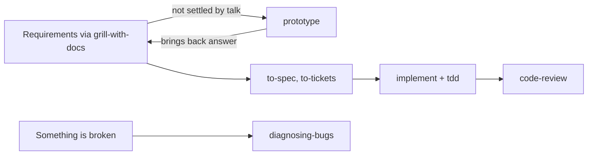
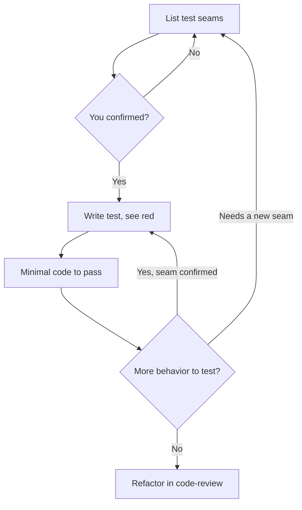
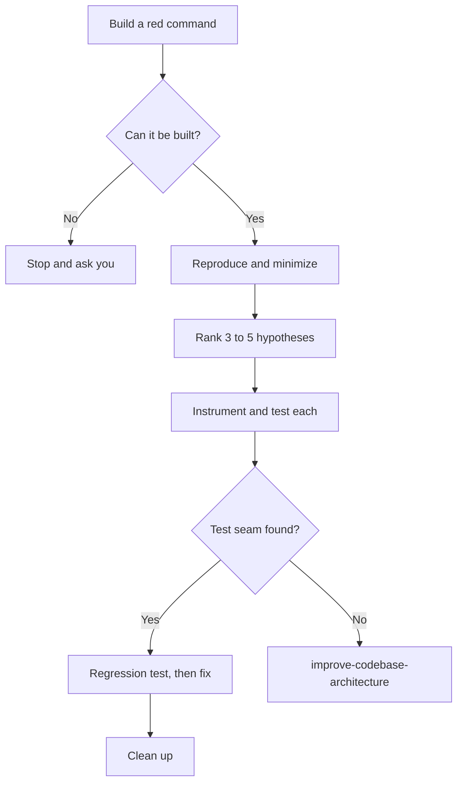

In the walkthrough in my previous post, `to-tickets` split per-seat billing into three tickets, each labeled `ready-for-agent` to show it had everything needed to hand off to an AI. Now you open a fresh conversation and have the AI implement one of them: "Deactivate a member and release the seat." It changes the code, writes the tests, and finally reports that "all tests pass."

But the AI wrote those tests too, so they might just vouch for the code it wrote, without ever checking against the requirements. When the AI writes both the code and the tests, what should you look at to know it got things right?

`mattpocock/skills` hands this stage to four skills: `implement`, `tdd`, `diagnosing-bugs`, and `prototype`. Each one watches a different signal to decide whether the work is right.

> mattpocock/skills Series | Part 4
>
> - Previous (Part 3): [Spec, Tickets, or More Questions?](/posts/mattpocock-skills-specs-work-breakdown/)
> - Next (Part 5): [Structure, Code Review, and Merge Conflicts](/posts/mattpocock-skills-design-review-integration/)
> - Series guide: [What It Is and How to Read It](/posts/mattpocock-skills-series-guide/)
>
> I inferred the skill invocations in the per-seat billing example from the original instructions; the red and green test outputs shown in the post are real results from my own runs.
{: .prompt-info }

> **Version note (checked 2026-10-19):** I based this post on [version `1.2.3`](https://github.com/mattpocock/skills/blob/c55ee46073ed923f86ce59a5eb3b6d895095d1b7/package.json#L2-L10). `mattpocock/skills` released [`1.3.0`](https://github.com/mattpocock/skills/releases/tag/v1.3.0) and [`1.3.1`](https://github.com/mattpocock/skills/releases/tag/v1.3.1) on 2026-10-04. All four skills covered here are still there, but three things are different:
>
> - `implement-spec`, previously experimental, moved into the official plugin. It implements a whole spec at once, using worktrees (several working folders of the same repo) to work on multiple tickets in parallel. It is an alternative to running `implement` one ticket at a time.
> - `retro`, which moved into the official plugin at the same time, is the last step of the main flow. It looks back on the work after `code-review`.
> - The glossary that `tdd` and `diagnosing-bugs` read was renamed from `CONTEXT.md` to `GLOSSARY.md`.
>
> Also, starting with `1.3.1`, `ask-matt` suggests running `retro` after a bug is fixed. I plan to fully update this series for the new version.
{: .prompt-warning }

## A Few Terms First

The following terms come up repeatedly:

| Term used here | Original term | Meaning |
| --- | --- | --- |
| Red, green | red, green | A failing test shows red, a passing one shows green. You first write a test that fails, then write just enough code to make it pass; that back-and-forth is one cycle |
| Test seam | seam | A public entry point for observing the program's behavior from the outside, such as an exported function. Tests only go in through here and never touch internal details |
| Feedback loop | feedback loop | A command you can run repeatedly that immediately tells you "right" or "wrong," such as a test run or a script |
| Prototype | prototype | Code written only to answer a design question, and never shipped to production as-is |

## Each of the Four Skills Watches One Kind of Feedback Signal

All four skills live under the repo's `skills/engineering/` directory, and the package is licensed under [MIT](https://github.com/mattpocock/skills/blob/c55ee46073ed923f86ce59a5eb3b6d895095d1b7/package.json#L10). They sit at different points on the `ask-matt` roadmap:



These positions come from the `ask-matt` [main flow](https://github.com/mattpocock/skills/blob/c55ee46073ed923f86ce59a5eb3b6d895095d1b7/skills/engineering/ask-matt/SKILL.md#L22-L26), its [entry point for "something is broken"](https://github.com/mattpocock/skills/blob/c55ee46073ed923f86ce59a5eb3b6d895095d1b7/skills/engineering/ask-matt/SKILL.md#L42), and its [side branch for design questions that conversation alone can't settle](https://github.com/mattpocock/skills/blob/c55ee46073ed923f86ce59a5eb3b6d895095d1b7/skills/engineering/ask-matt/SKILL.md#L18-L21). `implement` works with `tdd` on each ticket, then runs `code-review` once done. `code-review` reviews the changes made in this round, and I'll cover it in Part 5.

Each skill relies on something different to tell whether the work is right:

| skill | How it tells whether the work is right |
| --- | --- |
| `implement` | Type checking, tests, and a final `code-review` |
| `tdd` | A test that goes red then green, at a seam agreed on in advance |
| `diagnosing-bugs` | A command that has already gone red for this bug |
| `prototype` | How a person reacts after actually clicking through or looking at it |

## `implement` Hands the Ticket Over to Tests and Review

`implement` is the shortest of the four skills. Leaving out the front matter settings block at the top of the file, the entire instruction is just five lines:

```markdown
Implement the work described by the user in the spec or tickets.

Use /tdd where possible, at pre-agreed seams.

Run typechecking regularly, single test files regularly, and the full test suite once at the end.

Once done, use /code-review to review the work.

Commit your work to the current branch.
```
{: file="skills/engineering/implement/SKILL.md" }

Going through it line by line, the AI does these five things:

1. Read the spec or tickets you point it to, and implement what they describe.
2. Use `tdd` wherever possible, and write tests only at seams agreed on in advance.
3. Run type checking and single test files often along the way, and run the full test suite only once at the end.
4. When done, call `code-review` to review the changes.
5. Commit the work to the current branch.

Point 3 deserves attention: the full suite runs only once at the end. So test files that this ticket doesn't touch won't run until the very end. If this change accidentally breaks something elsewhere, you won't find out until then either.

`implement` doesn't start on its own: you have to invoke it explicitly, and the AI won't run it just because the conversation turns to "let's start coding." That's because of two settings:

- Its front matter sets [`disable-model-invocation: true`](https://github.com/mattpocock/skills/blob/c55ee46073ed923f86ce59a5eb3b6d895095d1b7/skills/engineering/implement/SKILL.md#L4).
- `agents/openai.yaml` sets [`allow_implicit_invocation: false`](https://github.com/mattpocock/skills/blob/c55ee46073ed923f86ce59a5eb3b6d895095d1b7/skills/engineering/implement/agents/openai.yaml#L5).

When a feature takes several conversations to finish, [`ask-matt` recommends](https://github.com/mattpocock/skills/blob/c55ee46073ed923f86ce59a5eb3b6d895095d1b7/skills/engineering/ask-matt/SKILL.md#L23) running `implement` once per ticket and clearing the conversation in between. Each ticket already spells out the information it needs, so there's no need to keep the previous ticket's conversation.

## `tdd` Agrees on Where to Test First, Then Works One Small Slice at a Time

The second line of `implement` hands testing over to `tdd`. `tdd` deals with "where to test" first, and only then with "how to test."

[Its rules](https://github.com/mattpocock/skills/blob/c55ee46073ed923f86ce59a5eb3b6d895095d1b7/skills/engineering/tdd/SKILL.md#L18-L24) require the AI to list the seams it plans to test and ask you to confirm them before writing any test. The stated reasoning is that you can't test everything. Agreeing on seams first keeps the tests focused on the most important flows and the most complex logic.

When the AI starts exploring the code, [it reads `CONTEXT.md` first if the project has one](https://github.com/mattpocock/skills/blob/c55ee46073ed923f86ce59a5eb3b6d895095d1b7/skills/engineering/tdd/SKILL.md#L10), so test names reuse the project's shared vocabulary. That glossary is the one left behind by `grill-with-docs` in Part 2.

Only after the seams are confirmed does the red-green cycle begin:



[The cycle rules](https://github.com/mattpocock/skills/blob/c55ee46073ed923f86ce59a5eb3b6d895095d1b7/skills/engineering/tdd/SKILL.md#L34-L38) come down to three points:

- **Red before green.** Write only enough code to make this test pass, without anticipating tests that haven't been written yet.
- **One small slice at a time.** Each cycle handles just one seam, one test, and one minimal implementation.
- **Refactoring isn't part of the cycle.** Refactoring means tidying up how the code is written without changing its behavior, and that's left for the `code-review` stage.

`tdd` also calls out [three anti-patterns](https://github.com/mattpocock/skills/blob/c55ee46073ed923f86ce59a5eb3b6d895095d1b7/skills/engineering/tdd/SKILL.md#L28-L32):

| Anti-pattern | What it looks like | What goes wrong |
| --- | --- | --- |
| Coupling to implementation details | Mocking your own internal modules, testing private methods, or bypassing the interface to query the database directly | The tests break even though you only tidied the code and its behavior didn't change |
| Tautology | Recomputing the expected value with exactly the same algorithm as the code | The test passes no matter what and never disagrees with the code |
| Horizontal slicing | Writing all the tests first, then writing all the implementation at once | You end up testing imagined behavior, and the test structure is locked in before any implementation exists |

The fix for the third one is vertical slicing: one test paired with one implementation, then on to the next cycle. Each cycle adjusts based on what you learned in the last. The tracer bullet idea that `to-tickets` used to split tickets in the previous post shows up again here, just scaled down to a single test.

There are also limits on what gets mocked. [`mocking.md`](https://github.com/mattpocock/skills/blob/c55ee46073ed923f86ce59a5eb3b6d895095d1b7/skills/engineering/tdd/mocking.md#L3-L14) only allows test doubles at system boundaries, where a test double is a fake object standing in for something the code depends on. A system boundary is where the program touches the outside world, such as payment or email services, time, and randomness; your own modules and internal components don't get doubles.

## `diagnosing-bugs` Builds a Command That Goes Red First

`tdd` deals with code that hasn't been written yet, while `diagnosing-bugs` deals with code that's already broken. Its [first phase](https://github.com/mattpocock/skills/blob/c55ee46073ed923f86ce59a5eb3b6d895095d1b7/skills/engineering/diagnosing-bugs/SKILL.md#L18-L22) says outright "This is the skill," meaning this step is what the whole skill is about. Until it has built a command that goes red for this bug, the AI is not allowed to start guessing at causes.

Only with that command in hand do the next five phases begin:



[The skill lists ten approaches](https://github.com/mattpocock/skills/blob/c55ee46073ed923f86ce59a5eb3b6d895095d1b7/skills/engineering/diagnosing-bugs/SKILL.md#L24-L35), to be tried roughly in order. The first few are:

1. A failing test
2. A script that sends requests to the dev server
3. A CLI command with fixed input
4. A script that drives a browser

The last resort is `scripts/hitl-loop.template.sh`, used only when a human really has to click through the UI. The template provides two functions: [`step` shows one action and waits for you to press Enter, and `capture` records the observation you type in](https://github.com/mattpocock/skills/blob/c55ee46073ed923f86ce59a5eb3b6d895095d1b7/skills/engineering/diagnosing-bugs/scripts/hitl-loop.template.sh#L20-L30). At the end, it prints everything as `KEY=VALUE` and hands it back to the AI.

The first phase has [four completion criteria](https://github.com/mattpocock/skills/blob/c55ee46073ed923f86ce59a5eb3b6d895095d1b7/skills/engineering/diagnosing-bugs/SKILL.md#L57-L66). The AI must show a command it has actually run and paste its output, and the command must:

- Reach the code path that fails, and check for the exact symptom the user reported.
- Produce the same result every time it runs.
- Finish within a few seconds.
- Be runnable by the AI on its own, without a person standing by to operate it.

For bugs that only show up occasionally, reproducing them every time isn't required; [the goal is to push the reproduction rate up](https://github.com/mattpocock/skills/blob/c55ee46073ed923f86ce59a5eb3b6d895095d1b7/skills/engineering/diagnosing-bugs/SKILL.md#L49-L51). The skill gives an example: a bug that reproduces 50% of the time can still be chased down, while one at 1% can't.

When a loop truly can't be built, [the AI has to stop](https://github.com/mattpocock/skills/blob/c55ee46073ed923f86ce59a5eb3b6d895095d1b7/skills/engineering/diagnosing-bugs/SKILL.md#L53-L55) and list what it tried. Then it asks you for one of these:

- An environment that reproduces the problem
- Logs with secrets removed
- Permission to temporarily add instrumentation in production

{: width="800" height="450" }
_Without a command that goes red, no amount of guessing can confirm which theory is right._

Once there's a loop, each of the remaining five phases has its own requirements:

1. **[Reproduce and minimize](https://github.com/mattpocock/skills/blob/c55ee46073ed923f86ce59a5eb3b6d895095d1b7/skills/engineering/diagnosing-bugs/SKILL.md#L68-L86).** Confirm that what's going red is the symptom the user reported. Then remove one input or step at a time until every remaining one is essential.
2. **Form hypotheses.** List 3 to 5 prioritized hypotheses at once, each stating what it predicts will happen, and [show them to you first](https://github.com/mattpocock/skills/blob/c55ee46073ed923f86ce59a5eb3b6d895095d1b7/skills/engineering/diagnosing-bugs/SKILL.md#L88-L98). If you're not around, the AI continues with its own ranking.
3. **[Add instrumentation](https://github.com/mattpocock/skills/blob/c55ee46073ed923f86ce59a5eb3b6d895095d1b7/skills/engineering/diagnosing-bugs/SKILL.md#L100-L112).** Instrumentation means debug output in the code, such as printing intermediate values. Each probe maps to one hypothesis, and only one variable changes at a time. All debug output gets a prefix like `[DEBUG-a4f2]`, so a single search at the end finds all of it for removal.
4. **Fix and add a regression test.** A regression test confirms the same bug won't come back, so write a failing regression test first, then fix. This assumes [a proper test seam can be found](https://github.com/mattpocock/skills/blob/c55ee46073ed923f86ce59a5eb3b6d895095d1b7/skills/engineering/diagnosing-bugs/SKILL.md#L114-L128). If it can't, that tells you something too: the current code structure offers no way for a test to keep this bug from coming back. In that case, [`ask-matt` hands the follow-up to `improve-codebase-architecture`](https://github.com/mattpocock/skills/blob/c55ee46073ed923f86ce59a5eb3b6d895095d1b7/skills/engineering/ask-matt/SKILL.md#L42), which I'll cover in the next post.
5. **[Clean up](https://github.com/mattpocock/skills/blob/c55ee46073ed923f86ce59a5eb3b6d895095d1b7/skills/engineering/diagnosing-bugs/SKILL.md#L130-L138).** Rerun the original loop, confirm the regression test passes, delete output starting with `[DEBUG-`, and write the confirmed hypothesis into the commit or PR message.

The hypotheses in step 2 should be phrased as "If the cause is X, then changing Y will make the bug disappear." Any hypothesis that can't produce a prediction should be dropped or rewritten. For the seat example, I would write: "If the cause is that deactivation doesn't remove the member from the assigned list, then adding that removal will make available seats go up correctly."

## `prototype` Uses Throwaway Code to Answer One Design Question

The first three skills can all judge right and wrong with a command. But some design questions only reveal what's off once a person has tried them by hand. For example, what should happen when a deactivated member needs to be reactivated, but the workspace has no available seats left?

`prototype` states right at the top that a prototype is [throwaway code that answers a question](https://github.com/mattpocock/skills/blob/c55ee46073ed923f86ce59a5eb3b6d895095d1b7/skills/engineering/prototype/SKILL.md#L8-L17), and the question decides what shape the prototype takes. It splits into two paths:

| Question to answer | Output | How to use it |
| --- | --- | --- |
| Is this logic or state model right? | A standalone HTML file you can open with a double-click | Press buttons to advance the state, and see the full state after each step |
| What should this screen look like? | Several variants on the same URL path, switched with `?variant=` | Flip between variants with a floating bar at the bottom of the screen |

Logic prototypes are meant for people who don't write code. [`LOGIC.md`](https://github.com/mattpocock/skills/blob/c55ee46073ed923f86ce59a5eb3b6d895095d1b7/skills/engineering/prototype/LOGIC.md#L35-L50) requires buttons and state to be labeled in domain language, with the screen split into three areas:

- The current state
- Buttons you can press freely
- Guided scenarios split across several tabs

Every scenario starts from the same initial state, and the set should cover the happy path, tricky edge cases, and one action that ought to be rejected. The logic that answers the question should be a standalone module that doesn't touch web page elements. Once the question is resolved, it can move straight into the production code.

UI prototypes default to 3 variants, [with a maximum of 5](https://github.com/mattpocock/skills/blob/c55ee46073ed923f86ce59a5eb3b6d895095d1b7/skills/engineering/prototype/UI.md#L36-L38). The variants must differ structurally, such as in layout, information hierarchy, or primary interaction.

[`UI.md`](https://github.com/mattpocock/skills/blob/c55ee46073ed923f86ce59a5eb3b6d895095d1b7/skills/engineering/prototype/UI.md#L54) says three slightly tweaked card grids aren't a prototype, just wallpaper: each has its own pattern, but none answers a design question. [It also recommends putting the variants directly into the existing page](https://github.com/mattpocock/skills/blob/c55ee46073ed923f86ce59a5eb3b6d895095d1b7/skills/engineering/prototype/UI.md#L14-L30), because only real data and the surrounding navigation will expose design problems.

{: width="800" height="450" }
_Variants need to differ in layout and interaction; changing only the colors reveals no design differences._

Both paths share [six rules](https://github.com/mattpocock/skills/blob/c55ee46073ed923f86ce59a5eb3b6d895095d1b7/skills/engineering/prototype/SKILL.md#L19-L26):

1. A prototype is labeled as throwaway from day one.
2. It launches with a single command or double-click.
3. It doesn't persist data by default.
4. It skips tests and error handling.
5. After every action, it displays the full state.
6. When it's done, validated decisions go into the production code. The prototype itself is committed to a throwaway branch off the mainline, and the implementation ticket gets a note pointing to that branch.

[`ask-matt` names this branch `prototype/<name>`](https://github.com/mattpocock/skills/blob/c55ee46073ed923f86ce59a5eb3b6d895095d1b7/skills/engineering/ask-matt/SKILL.md#L80). Only validated conclusions stay on the mainline.

## Two Rules That Make AI-Written Tests Worth Trusting

I asked at the start: when the AI writes both the code and the tests, are the tests just vouching for the code? `tdd` guards against this with two rules.

**The first rule is that you confirm where the tests go.** As mentioned earlier, the AI can only write tests at the seams it lists after you approve them. Use this step to mark behaviors stated in the requirements as must-verify items, such as "available seats go up after a member is deactivated."

**The second rule is that expected values need an independent source.** When `tdd` explains [the tautology anti-pattern](https://github.com/mattpocock/skills/blob/c55ee46073ed923f86ce59a5eb3b6d895095d1b7/skills/engineering/tdd/SKILL.md#L31), it requires expected values to come from somewhere outside the code. That can be a known-correct value, a hand-calculated example, or the spec. `tests.md` shows both approaches with the same sum function:

```typescript
// BAD: Expected value is recomputed the way the code computes it
test("calculateTotal sums line items", () => {
  const items = [{ price: 10 }, { price: 5 }];
  const expected = items.reduce((sum, i) => sum + i.price, 0);
  expect(calculateTotal(items)).toBe(expected);
});

// GOOD: Expected value is an independent, known literal
test("calculateTotal sums line items", () => {
  expect(calculateTotal([{ price: 10 }, { price: 5 }])).toBe(15);
});
```
{: file="skills/engineering/tdd/tests.md" }

The first version recomputes `expected` with `reduce`. The test calculates the same way the code does, so it will always pass. The second version writes `15` directly, a number you can check against the spec or by hand, so the test fails when the code gets it wrong.

Still, both rules are just instructions written in Markdown, with no code enforcing them. I looked through [the `tdd` folder](https://github.com/mattpocock/skills/tree/c55ee46073ed923f86ce59a5eb3b6d895095d1b7/skills/engineering/tdd), and it has no checking scripts at all. It contains only `SKILL.md`, `tests.md`, `mocking.md`, and an `agents/openai.yaml`.

If you approve the AI's list of seams without looking closely, the first rule does nothing. So in my view, whether the tests count comes down to two things you have to check yourself: the list of seams you confirmed, and whether each expected value traces back to the spec.

{: width="800" height="450" }
_If the expected value is recomputed with the code's own algorithm, the test will always pass._

## Where Your Time Goes

These four skills mean you no longer have to go by gut feeling to decide whether the work is done. But by my count, the steps below all take someone's effort, and most of it falls on you:

| Step | Who puts in the effort | What they put in |
| --- | --- | --- |
| Invoking `implement` | You | Invoke it manually once per ticket, clearing the conversation between tickets |
| Before `tdd` writes tests | You | Review each test seam the AI lists, one by one |
| Wrapping up `implement` | The AI and you | Run the full test suite and `code-review`; you need to read the review results |
| `diagnosing-bugs` phase 1 | The AI, and you when needed | The skill calls for [a disproportionate amount of effort](https://github.com/mattpocock/skills/blob/c55ee46073ed923f86ce59a5eb3b6d895095d1b7/skills/engineering/diagnosing-bugs/SKILL.md#L22) here; when a loop can't be built, you have to provide the environment or logs |
| `diagnosing-bugs` hypotheses | You | Look over the hypothesis ranking and add background you know |
| After `prototype` is delivered | You or a domain expert | Actually click through every scenario or variant, and say what's wrong |
| Wrapping up `prototype` | The team | Maintain the `prototype/<name>` branch and leave a note on the ticket pointing to it |

The most time-consuming part is phase 1 of `diagnosing-bugs`. The skill holds that [once the loop is right, the bug is 90% fixed](https://github.com/mattpocock/skills/blob/c55ee46073ed923f86ce59a5eb3b6d895095d1b7/skills/engineering/diagnosing-bugs/SKILL.md#L37), so that's where the time goes.

## Which One to Use When

Pick based on the situation in front of you:

| Your situation | Skill to use | When it doesn't fit |
| --- | --- | --- |
| A spec or tickets labeled `ready-for-agent` | `implement` | If there's no spec or tickets yet, go back to `to-spec` first, or use `tdd` on its own |
| [No spec](https://github.com/mattpocock/skills/blob/c55ee46073ed923f86ce59a5eb3b6d895095d1b7/skills/engineering/ask-matt/SKILL.md#L26); you just want to build one concrete feature test-first | `tdd` | If [you haven't even settled what the public interface should look like](https://github.com/mattpocock/skills/blob/c55ee46073ed923f86ce59a5eb3b6d895095d1b7/skills/engineering/tdd/SKILL.md#L26), first discuss the interface using `codebase-design` vocabulary |
| A feature throws errors, gives wrong results, or is slow, and the cause isn't obvious at first glance | `diagnosing-bugs` | When it can't build a command that goes red, the AI stops and asks you for an environment or logs instead of guessing |
| A state model or screen that can't be judged through conversation alone | `prototype` | When the question can be settled in conversation, stay in `grill-with-docs` and keep asking |

## Simulated Scenario: Implementing "Deactivate a Member and Release the Seat"

I inferred the flow below from the original `1.2.3` instructions. The red and green test runs are real: I ran them on Node.js v25.2.1. The code is a minimal example I wrote for this post, not taken from `mattpocock/skills`.

Assume the first two tickets, "Show the workspace's purchased and available seats" and "Assign an available seat to a member," are already done. You open a fresh conversation and attach the third ticket:

```text
$implement <link to the "Deactivate a member and release the seat" ticket>
```
{: .nolineno }

After reading the ticket and `CONTEXT.md`, the AI follows the `tdd` rules and lists test seams first. For example: "the workspace's exported `deactivateMember()` and `availableSeats()`." You need to confirm two things:

- These two functions are entry points that other code actually calls.
- The acceptance criterion "available seats go up by one" can be observed from here.

Once you agree, the AI writes the first test. The expected value comes from the "testing decisions" field in the spec: after a member is deactivated, available seats go up by one. With 5 seats purchased and 2 assigned, deactivating one person should leave 4 available.

Save the following as `seats.test.js`:

```javascript
import { test } from "node:test";
import assert from "node:assert/strict";
import { createWorkspace, assignSeat, deactivateMember, availableSeats } from "./seats.js";

test("deactivating a member frees up one seat", () => {
  const workspace = createWorkspace({ purchasedSeats: 5 });
  assignSeat(workspace, "alice");
  assignSeat(workspace, "bob");

  deactivateMember(workspace, "alice");

  assert.equal(availableSeats(workspace), 4);
});
```

At this point, `seats.js` only has what the first two tickets built, and `deactivateMember()` is still empty:

```javascript
export function createWorkspace({ purchasedSeats }) {
  return { purchasedSeats, assigned: new Set() };
}

export function assignSeat(workspace, memberId) {
  workspace.assigned.add(memberId);
}

export function deactivateMember(workspace, memberId) {
  // not implemented yet
}

export function availableSeats(workspace) {
  return workspace.purchasedSeats - workspace.assigned.size;
}
```

Put a `package.json` containing `{ "type": "module" }` in the same folder, then run the single test file:

```bash
node --test seats.test.js
```
{: .nolineno }

It goes red. The actual number of available seats is 3, but 4 was expected:

```plaintext
✖ deactivating a member frees up one seat (0.92075ms)
ℹ tests 1
ℹ suites 0
ℹ pass 0
ℹ fail 1
...
✖ failing tests:

test at seats.test.js:5:1
✖ deactivating a member frees up one seat (0.92075ms)
  AssertionError [ERR_ASSERTION]: Expected values to be strictly equal:
  
  3 !== 4
  
      at TestContext.<anonymous> (file:///<redacted path>/seat-tdd/seats.test.js:12:10)
...
```

The red light means this test can catch the "seat not released after deactivation" problem. Next, write only enough code to make it pass, which means replacing `// not implemented yet` with one line:

```javascript
export function deactivateMember(workspace, memberId) {
  workspace.assigned.delete(memberId);
}
```

Run the same command again, and it turns green:

```plaintext
✔ deactivating a member frees up one seat (0.343958ms)
ℹ tests 1
ℹ suites 0
ℹ pass 1
ℹ fail 0
ℹ cancelled 0
ℹ skipped 0
ℹ todo 0
ℹ duration_ms 43.76225
```

That's only one cycle. The ticket's acceptance criteria also include "the billing system receives the new seat count," but that isn't on the list of seams you just confirmed. So the AI first adds a billing system seam to the list and asks you to confirm it, then continues to the next cycle, one test per cycle.

When everything is done, `implement` runs the full test suite, calls `code-review`, and commits to the current branch. What you check is the review result, and whether each test's expected value traces back to the spec.

If you later get a report that available seats don't go up after deactivating a member, the `node --test` command above is exactly the loop that phase 1 of `diagnosing-bugs` asks for. It has gone red for this symptom. And judging by `duration_ms` above, it finishes in under 50 milliseconds, which meets the "finishes within a few seconds" criterion.

## The Quality of `implement` Depends on the Ticket

This section is my own view; the source material doesn't say this directly.

`implement` doesn't say who to ask when a ticket is vague, and it doesn't cover what to do when acceptance criteria are incomplete. It only hands "test at the seams agreed on in advance" over to `tdd`. Most of those seams and expected values were decided long before, when `to-spec` confirmed checkpoints and `to-tickets` wrote the acceptance criteria.

So I don't expect `implement` to rescue a badly split ticket. If the seams the AI lists don't match the acceptance criteria, or an expected value can't be found in the spec, I pause the implementation. Then I go back to `grill-with-docs` or `to-spec` to fill in what's missing.

This view only applies to projects that follow this flow of writing a spec first and then splitting it into tickets. When you use `tdd` on its own for a small feature, the seams and expected values are settled right there in the conversation. There's no prewritten spec or ticket to go back and fix.

## What to Do Next

To tell whether the AI got it right, look at what it can't change itself. In your own project, open a fresh conversation and run `implement` on a ticket labeled `ready-for-agent` with no prerequisite work, using the command from the simulated scenario. When the AI lists test seams, confirm each one; once it writes tests, check that every expected value can be found in the spec.

The next post covers four skills for after the code is written:

- `codebase-design` and `improve-codebase-architecture`: look at code structure.
- `code-review`: review this round of changes.
- `resolving-merge-conflicts`: resolve merge conflicts.

## Further Reading

- [`implement`](https://github.com/mattpocock/skills/blob/c55ee46073ed923f86ce59a5eb3b6d895095d1b7/skills/engineering/implement/SKILL.md#L1-L15): the full five-line instruction.
- [`tdd`](https://github.com/mattpocock/skills/blob/c55ee46073ed923f86ce59a5eb3b6d895095d1b7/skills/engineering/tdd/SKILL.md#L12-L38): seam confirmation, the three anti-patterns, and the red-green cycle.
- [`tdd/tests.md`](https://github.com/mattpocock/skills/blob/c55ee46073ed923f86ce59a5eb3b6d895095d1b7/skills/engineering/tdd/tests.md#L1-L77): good and bad tests side by side.
- [`diagnosing-bugs`](https://github.com/mattpocock/skills/blob/c55ee46073ed923f86ce59a5eb3b6d895095d1b7/skills/engineering/diagnosing-bugs/SKILL.md#L18-L138): ten ways to build a loop, and each phase's completion criteria.
- [`prototype`](https://github.com/mattpocock/skills/blob/c55ee46073ed923f86ce59a5eb3b6d895095d1b7/skills/engineering/prototype/SKILL.md#L6-L26): how logic and UI prototypes split, and what to keep afterward.
