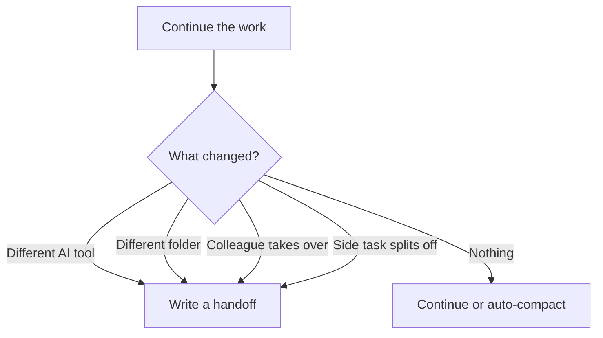
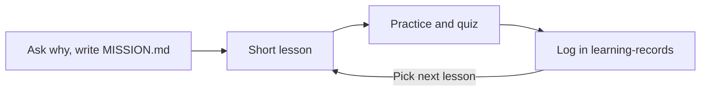

The first five parts were about getting a feature built: clarifying requirements, writing a spec, splitting tickets, writing code, reviewing and merging. But building per-seat billing for real also brings tasks that aren't coding, yet often hold everything up:

- How does the payment service calculate a prorated charge? Someone has to read the official docs.
- The prototype lives in another folder. How do you carry over what was agreed in this conversation?
- Only you can log into the payment service's dashboard to get the keys (secret strings that let a program use the service). The AI can't help there.
- You only half understand "prorated billing" yourself and want to learn it properly.
- The project's instructions for the AI keep getting longer, yet the AI often doesn't follow them.

This post covers the five skills `mattpocock/skills` uses for these: `research`, `handoff`, `wizard`, `teach`, and `writing-for-agents`.

> mattpocock/skills Series | Part 6
>
> - Previous (Part 5): [Structure, Code Review, and Merge Conflicts](/posts/mattpocock-skills-design-review-integration/)
> - Series guide: [What It Is and How to Read It](/posts/mattpocock-skills-series-guide/)
>
> This post is based on [version `1.2.3`](https://github.com/mattpocock/skills/blob/c55ee46073ed923f86ce59a5eb3b6d895095d1b7/package.json#L2-L10), and all five skills are still there in the latest release, `1.3.1`. I inferred the skill invocations in the per-seat billing example from the original instructions. Only the syntax check on the wizard script is one I actually ran.
{: .prompt-info }

> After `1.3.1`, the main branch on GitHub picked up small, not-yet-released fixes to three of these skills. None of them change what this post describes:
>
> - [The `wizard` script template](https://github.com/mattpocock/skills/blob/49dd158d1076134a641b33efb035946536778336/skills/engineering/wizard/template.sh) fixed a few compatibility issues.
> - [`handoff`](https://github.com/mattpocock/skills/blob/49dd158d1076134a641b33efb035946536778336/skills/productivity/handoff/SKILL.md#L8) spells out how to find the temporary folder.
> - [`teach`](https://github.com/mattpocock/skills/blob/49dd158d1076134a641b33efb035946536778336/skills/productivity/teach/SKILL.md#L110) asks that a quiz's correct answer not always sit in the same position.
{: .prompt-tip }

## Three Terms First

| Term | In one sentence |
| --- | --- |
| primary source | Where something actually comes from, such as an official manual, source code, or a spec, rather than someone's write-up after reading it |
| background helper | A separate AI working on the side while you keep talking to the original one about something else |
| conversation memory | Everything the AI remembers within this one conversation. Start a new conversation and it's wiped |

## What Each Skill Does

| skill | What it does | When to use it | Can the AI start it on its own? |
| --- | --- | --- | --- |
| `research` | Sends a background helper to read primary sources and write a note with citations | When you need facts from official docs, API rules (how programs talk to each other), and the like | Yes |
| `handoff` | Turns the current conversation into a handoff sheet | When switching folders, switching tools, or passing work to a colleague | No, you start it yourself |
| `wizard` | Writes a small program that walks you through steps one by one | When you hit a step only you can do, such as logging into a dashboard to get a key | Yes |
| `teach` | Teaches you a new topic over several sessions, inside one folder | When you want to really learn something | No, you start it yourself |
| `writing-for-agents` | A reference manual for writing documents the AI reads | When writing a skill or the project instructions file `AGENTS.md` | Yes |

Both `handoff` and `teach` are [set](https://github.com/mattpocock/skills/blob/c55ee46073ed923f86ce59a5eb3b6d895095d1b7/skills/productivity/handoff/SKILL.md#L5) [so the AI can't start them on its own](https://github.com/mattpocock/skills/blob/c55ee46073ed923f86ce59a5eb3b6d895095d1b7/skills/productivity/teach/SKILL.md#L4). As I see it, handing off and taking a lesson are things you decide to begin, so the AI shouldn't spring them on you mid-chat.

On the `ask-matt` roadmap, [`handoff` sits under "phase boundaries"](https://github.com/mattpocock/skills/blob/c55ee46073ed923f86ce59a5eb3b6d895095d1b7/skills/engineering/ask-matt/SKILL.md#L61-L69). The other four are in [a standalone section outside every flow](https://github.com/mattpocock/skills/blob/c55ee46073ed923f86ce59a5eb3b6d895095d1b7/skills/engineering/ask-matt/SKILL.md#L73-L86), used only when needed.

## `research`: Send a Helper to Read the Original

`research` is short; [the whole thing is three points](https://github.com/mattpocock/skills/blob/c55ee46073ed923f86ce59a5eb3b6d895095d1b7/skills/engineering/research/SKILL.md#L6-L12):

1. Start a background helper to do the reading, so you can keep working on other things.
2. Use only primary sources. Every claim has to be traced back to where it really comes from, not to someone's retelling.
3. Write the results as a Markdown note (a plain-text file formatted with simple symbols), with a source for every claim. Save it where the project usually keeps notes; if there's no such place, pick a sensible one and say where.

The reason to insist on primary sources is that tutorials online are often written for one particular version, and they go stale when the version changes. I think of it like asking for directions: a passer-by saying "turn left up ahead, I think" is far less reliable than opening the map yourself.

{: width="800" height="450" }
_Second-hand articles drift with every retelling; primary sources are the current rules._

The note isn't the end of the road. [As `ask-matt` explains](https://github.com/mattpocock/skills/blob/c55ee46073ed923f86ce59a5eb3b6d895095d1b7/skills/engineering/ask-matt/SKILL.md#L81), research results go into `grill-with-docs` in the main flow, as material for discussing requirements. Research is there to help you think, not to decide for you.

## `handoff`: Write a Handoff Sheet for Whoever Comes Next

`handoff` covers the moment someone else takes over. That "someone" can be another AI conversation or a colleague.

It's like a hospital shift change. The nurse going off shift doesn't retell the whole day. They hand over a sheet that says how the patient is doing, what still needs doing, and where to find the records. `handoff` writes that sheet.

It has just [five rules](https://github.com/mattpocock/skills/blob/c55ee46073ed923f86ce59a5eb3b6d895095d1b7/skills/productivity/handoff/SKILL.md#L8-L16):

1. Summarize the current conversation into a handoff document, saved in the computer's temporary folder, not in the project.
2. Include a "suggested skills" section telling the next person which skills to call first.
3. Don't copy what's already written elsewhere; just give the path or link. That covers specs, tickets, and commits (a commit saves a batch of changes as one version, with a note).
4. Redact anything sensitive, such as passwords, keys, and personal data.
5. If you said what the next session is for when calling it, tailor the sheet to that.

I think rule 3 matters most. A handoff sheet has to be short for anyone to read it. Copying the spec in not only makes it longer; the two copies can later drift apart.

{: width="800" height="450" }
_The next person doesn't need the whole conversation, just a sheet that states where things are and what's next._

### When You Actually Need a Handoff Sheet

`ask-matt` keeps its use [very narrow](https://github.com/mattpocock/skills/blob/c55ee46073ed923f86ce59a5eb3b6d895095d1b7/skills/engineering/ask-matt/SKILL.md#L67): only when the place or the person changes.



When nothing changed, simply continuing in the same conversation is easier than writing a sheet. So is letting the tool condense the conversation into a summary automatically and carrying on.

`prototype`, which I covered in part 4, is the classic case. Because the prototype lives in a separate folder, you [hand off once on the way there and once on the way back](https://github.com/mattpocock/skills/blob/c55ee46073ed923f86ce59a5eb3b6d895095d1b7/skills/engineering/ask-matt/SKILL.md#L18-L21). That brings what the prototype taught you back into the original discussion.

## `wizard`: For Steps Only You Can Do, Let a Program Walk You Through

Some things the AI genuinely can't do: log into the payment service's dashboard and copy a key, click a few buttons on a cloud provider's website, store a password in GitHub's encrypted settings. Explaining these steps to the AI again every time gets old.

`wizard`'s answer is to [write a small interactive program](https://github.com/mattpocock/skills/blob/c55ee46073ed923f86ce59a5eb3b6d895095d1b7/skills/engineering/wizard/SKILL.md#L8) that walks you through step by step, like furniture assembly instructions. It opens the web page for you and tells you what to click and copy. Once you paste, it saves the value where it belongs; it has you confirm every step and shows how many are left.

The program is a bash script, a list of commands run one after another in the terminal (the text window where you type commands). The look and the interaction are [already written in the template `template.sh`](https://github.com/mattpocock/skills/blob/c55ee46073ed923f86ce59a5eb3b6d895095d1b7/skills/engineering/wizard/SKILL.md#L10), including progress display, hidden password entry, and re-running without corrupting the settings file. The AI only plans the steps and fills in each one; the shared code in the template's top half must never be edited.

{: width="800" height="450" }
_The AI writes the steps; you just follow the screen and paste the values._

It works in four steps:

1. **[List every manual step first](https://github.com/mattpocock/skills/blob/c55ee46073ed923f86ce59a5eb3b6d895095d1b7/skills/engineering/wizard/SKILL.md#L16-L25).** The AI reads the project's settings files to work out which values are needed. These include `.env` (the file holding keys and other settings) and the automation settings. For every value it must know where it comes from, where it goes, and whether it's secret. You confirm the resulting list of steps first.
2. **[Spell out the route for each step](https://github.com/mattpocock/skills/blob/c55ee46073ed923f86ce59a5eb3b6d895095d1b7/skills/engineering/wizard/SKILL.md#L27-L31).** For example: "Dashboard → Developers → API keys → Reveal test key → copy". When the AI isn't sure what the screen currently looks like, it must ask you or check the docs. It must [never make up steps that may not exist](https://github.com/mattpocock/skills/blob/c55ee46073ed923f86ce59a5eb3b6d895095d1b7/skills/engineering/wizard/SKILL.md#L29).
3. **[Write the script](https://github.com/mattpocock/skills/blob/c55ee46073ed923f86ce59a5eb3b6d895095d1b7/skills/engineering/wizard/SKILL.md#L33-L37).** Each step does one thing; secrets use hidden entry; anything that can't be undone asks you first.
4. **[Check it and hand it over](https://github.com/mattpocock/skills/blob/c55ee46073ed923f86ce59a5eb3b6d895095d1b7/skills/engineering/wizard/SKILL.md#L39-L44).** The AI runs a syntax check but [doesn't run it end to end itself](https://github.com/mattpocock/skills/blob/c55ee46073ed923f86ce59a5eb3b6d895095d1b7/skills/engineering/wizard/SKILL.md#L43). That's because the script opens a browser and waits for a person to type. Instead it traces through line by line to confirm every value is collected and saved in the right place.

The script is [meant for one use by default](https://github.com/mattpocock/skills/blob/c55ee46073ed923f86ce59a5eb3b6d895095d1b7/skills/engineering/wizard/SKILL.md#L12) and deleted afterward. It goes into the project only if you want future people to run it too, with a note in the README. Then the next person can run the script instead of asking the AI again.

## `teach`: Treat the AI as a Tutor, Over Several Sessions

`teach` is different from the other skills: it doesn't do the work for you, it [teaches you how to do something](https://github.com/mattpocock/skills/blob/c55ee46073ed923f86ce59a5eb3b6d895095d1b7/skills/productivity/teach/SKILL.md#L8), and by default over several lessons. So it treats the current folder as your learning binder and [keeps your progress in a few kinds of files](https://github.com/mattpocock/skills/blob/c55ee46073ed923f86ce59a5eb3b6d895095d1b7/skills/productivity/teach/SKILL.md#L12-L20):

| File | Like a… | What goes in |
| --- | --- | --- |
| `MISSION.md` | Goal card | Why you want to learn this, and what you'll be able to do afterward |
| `RESOURCES.md` | Reading list | Trustworthy sources, plus communities where you can ask people |
| `lessons/` | Handouts, one per lesson | One web page per lesson, each teaching one small thing |
| `reference/` | Cheat sheets | Key points distilled from the lessons, for looking things up later |
| `learning-records/` | Learning journal | What you've already learned |

Each session picks up from the last journal entry. The whole loop looks like this:



### First, It Asks Why You Want to Learn

[The first job is working out why you're learning this](https://github.com/mattpocock/skills/blob/c55ee46073ed923f86ce59a5eb3b6d895095d1b7/skills/productivity/teach/SKILL.md#L71-L79). Without a clear purpose, lessons turn vague, and the AI has no way to judge what to teach next. The goal should be concrete: ["Run a half marathon by October" beats "get fitter."](https://github.com/mattpocock/skills/blob/c55ee46073ed923f86ce59a5eb3b6d895095d1b7/skills/productivity/teach/MISSION-FORMAT.md#L28)

### Each Lesson Teaches a Little, and You Do Something

[Every lesson should be short](https://github.com/mattpocock/skills/blob/c55ee46073ed923f86ce59a5eb3b6d895095d1b7/skills/productivity/teach/SKILL.md#L53), because people can only hold a little in mind at once. Each lesson should give you one visible small win. The difficulty should be [just a bit above where you are now](https://github.com/mattpocock/skills/blob/c55ee46073ed923f86ce59a5eb3b6d895095d1b7/skills/productivity/teach/SKILL.md#L83-L89), because too easy teaches nothing and too hard makes you give up.

It also cares a lot about actually remembering. [The skill splits memory into two kinds](https://github.com/mattpocock/skills/blob/c55ee46073ed923f86ce59a5eb3b6d895095d1b7/skills/productivity/teach/SKILL.md#L36-L45): being able to recall something right now, and still remembering it a while later. Recalling it right now easily fools you into thinking you've learned it. So it uses methods like "recall it yourself without looking" and "practice again a few days later" to make it last.

Knowledge always [comes from trustworthy sources, not the AI's own impressions](https://github.com/mattpocock/skills/blob/c55ee46073ed923f86ce59a5eb3b6d895095d1b7/skills/productivity/teach/SKILL.md#L30). For questions that need real-world experience, it [points you to a community where people who've actually done it can help](https://github.com/mattpocock/skills/blob/c55ee46073ed923f86ce59a5eb3b6d895095d1b7/skills/productivity/teach/SKILL.md#L116-L120).

## `writing-for-agents`: Documents for AI Have a Craft Too

The skills above are documents written for AI. So is the project's `AGENTS.md`, a file in the project that tells the AI how to work on it. `writing-for-agents` is the reference manual for writing them, with the goal of getting the AI to [work the same way every time](https://github.com/mattpocock/skills/blob/c55ee46073ed923f86ce59a5eb3b6d895095d1b7/skills/productivity/writing-for-agents/SKILL.md#L6).

The manual is long. These are its six most practical points:

1. **A pointer sentence decides whether the AI reads the document.** For example, `AGENTS.md` tells the AI to read `docs/billing.md` before changing billing. [According to the skill](https://github.com/mattpocock/skills/blob/c55ee46073ed923f86ce59a5eb3b6d895095d1b7/skills/productivity/writing-for-agents/SKILL.md#L12), whether the AI goes and reads it depends on how clear that sentence is, not on how good the target document is.
2. **Text that's always loaded has a cost.** The AI reads every line of `AGENTS.md` in every conversation. [The skill splits the cost into two kinds](https://github.com/mattpocock/skills/blob/c55ee46073ed923f86ce59a5eb3b6d895095d1b7/skills/productivity/writing-for-agents/SKILL.md#L20-L27): words the AI must always hold, and documents a person must remember exist.
3. **Put what's used often up front; store the rest separately.** It's like a toolbox. The screwdriver you always use sits on the top tray, and rarely used tools go in a lower drawer with a label saying what's inside. [What every case needs goes in the main document; what only some cases need moves to another file](https://github.com/mattpocock/skills/blob/c55ee46073ed923f86ce59a5eb3b6d895095d1b7/skills/productivity/writing-for-agents/SKILL.md#L39).
4. **Every step needs a clear "this is what done looks like."** ["Understanding reached" is too vague, and the AI will easily call it done too early](https://github.com/mattpocock/skills/blob/c55ee46073ed923f86ce59a5eb3b6d895095d1b7/skills/productivity/writing-for-agents/SKILL.md#L47-L52); "every modified model accounted for" is much clearer.
5. **Say what to do, not just what not to do.** Tell someone "don't think of an elephant," and the elephant is all they can think of. [The skill recommends writing the behavior you want](https://github.com/mattpocock/skills/blob/c55ee46073ed923f86ce59a5eb3b6d895095d1b7/skills/productivity/writing-for-agents/SKILL.md#L74), such as "write one-line comments," instead of "don't write long comments."
6. **Delete sentences the AI would follow anyway.** [If removing a sentence doesn't change what the AI does, it's just taking up space](https://github.com/mattpocock/skills/blob/c55ee46073ed923f86ce59a5eb3b6d895095d1b7/skills/productivity/writing-for-agents/SKILL.md#L81).

If you're writing a skill, a second file, [`SKILL-MECHANICS.md`](https://github.com/mattpocock/skills/blob/c55ee46073ed923f86ce59a5eb3b6d895095d1b7/skills/productivity/writing-for-agents/SKILL-MECHANICS.md#L5-L14), explains how to choose between letting the AI start it on its own and starting it only by hand. The first permanently takes up the AI's conversation memory, while the second requires you to remember it exists. That also explains why `handoff` and `teach` are set to manual start only.

## Where Your Time Goes

| Stage | Who | What to do |
| --- | --- | --- |
| The question for `research` | You | Ask the question clearly; afterward, read the note and check the source really supports each claim |
| When to `handoff` | You | Decide whether you really are changing place or person; if not, stay in the conversation |
| Reading the handoff sheet | The next person | Start with the "suggested skills," then follow the links to the original documents |
| The `wizard` step list | You | Confirm the order of steps and where each value should go |
| Running the `wizard` | You | Log into dashboards and copy and paste as the screen says; double-check anything that can't be undone |
| The `teach` goal | You | Say clearly why you want to learn and what you want to be able to do |
| Lessons | You | Practice and take the quiz in every lesson; ask whenever something's unclear |
| Editing `AGENTS.md` | You and the AI | For every line added, ask: if I removed it, would the AI behave differently? |

The biggest time cost is `teach`, because learning takes your own effort, and no AI can do that part for you. Next is `wizard`, but what it saves is the time spent re-explaining things to the AI every time, so it pays off after one run.

## Which One to Use When

| What you're facing | Use | When it doesn't fit |
| --- | --- | --- |
| You need official docs or source code to confirm a rule | `research` | If the answer is in the project and one file tells you, just read it |
| You're switching folders or AI tools, or passing work to a colleague | `handoff` | If you're carrying on in the same place, stay in the conversation or let the tool compress it automatically |
| You're stuck on a step only you can do | `wizard` | If the AI can do it itself, [just let it](https://github.com/mattpocock/skills/blob/c55ee46073ed923f86ce59a5eb3b6d895095d1b7/skills/engineering/wizard/SKILL.md#L3) |
| You want to really learn a topic | `teach` | If you just want one answer, just ask |
| You're writing a skill or tidying up `AGENTS.md` | `writing-for-agents` | For documents meant for people, such as blog posts, use ordinary writing principles |

## Walkthrough: Research, Handoff, and Key Setup for Per-Seat Billing

I inferred the flow below from the `1.2.3` instructions. The wizard script in this section is a minimal example I wrote for this post from the `1.2.3` template. I ran a syntax check on it with bash 5.2.37.

### First, Pin Down the Proration Rules

In part 3, I used `to-questionnaire` to prepare questions for the finance lead: should a seat added mid-month be charged in proportion to the days left? Suppose finance chose prorated charging. The next thing to confirm is how the payment service actually calculates it, so you decide to read the official docs first:

```text
$research How does the payment service prorate charges when quantity increases mid-subscription? Use only official docs and the API reference.
```
{: .nolineno }

While the background helper reads, you keep discussing other tickets with the original AI. When it's done, the project has a new note in which every rule links to the official docs (inferred). You take this note into `grill-with-docs` and decide whether per-seat billing should follow the payment service's rules.

### Hand Off to the Prototype Folder

You want to prototype how adding a seat mid-month should look on screen. The prototype lives in another folder, so you call a handoff:

```text
$handoff Next session uses prototype to try out the confirmation screen for adding a seat mid-month
```
{: .nolineno }

The handoff sheet might look like this (inferred):

- **Where we are**: all three tickets are done, and the billing rules have been researched.
- **Next step**: prototype the confirmation screen for adding a seat mid-month, comparing two versions.
- **Suggested skills**: `prototype`.
- **Links**: the spec, the third ticket, and the research note just written, as paths only, without copying their content.

Open a new conversation in the prototype folder, give it this sheet, and it can pick up straight away.

### Set Up the Payment Service Keys With a Wizard

Connecting to the real payment service means getting the keys first, and only you can log into the dashboard for them. After reading `.env.example` and the automation settings, the AI lists two steps for you to confirm: get the API keys, and get the ID of the per-seat price. Once you confirm, it writes the script from the template. The steps section looks roughly like this:

```bash
TOTAL_STAGES=2

banner "Per-seat billing setup"

stage "Stripe: API keys"
say "We'll grab your Stripe test keys for local dev + CI."
open_url "https://dashboard.stripe.com/test/apikeys"
step "Copy the Publishable key (starts pk_test_)."
ask STRIPE_PUBLISHABLE_KEY "Paste the publishable key:"
step "Click 'Reveal test key' on the Secret key row, then copy it."
ask_secret STRIPE_SECRET_KEY "Paste the secret key:"
write_env STRIPE_PUBLISHABLE_KEY "$STRIPE_PUBLISHABLE_KEY"
write_env STRIPE_SECRET_KEY "$STRIPE_SECRET_KEY"
set_secret STRIPE_SECRET_KEY "$STRIPE_SECRET_KEY"

stage "Stripe: per-seat price"
open_url "https://dashboard.stripe.com/test/products"
step "Open the seat product and copy its Price ID (starts price_)."
ask STRIPE_SEAT_PRICE_ID "Paste the price ID:"
write_env STRIPE_SEAT_PRICE_ID "$STRIPE_SEAT_PRICE_ID"

finish
```
{: file="setup-billing.sh (steps section)" }

The first step copies the Stripe example from the template; the second was added for per-seat billing. `ask_secret` is hidden entry, so the key you paste doesn't show on screen. `set_secret` is used only for the one key the automation actually needs.

Then I ran the syntax check:

```bash
bash -n setup-billing.sh
```
{: .nolineno }

This command printed nothing and exited with 0 (the signal for a normal finish), which means the syntax is fine. What's left is for you to run the script in the terminal and follow the screen step by step:

```bash
./setup-billing.sh
```
{: .nolineno }

## Start With Rule 3 of `handoff`

This section is my own view; the source material doesn't say it directly.

Of the five skills, the easiest to underrate is `handoff`, with just five rules. But I think rule 3, "don't copy what's already written elsewhere; just link it," applies far beyond handoff sheets. The other skills share the same idea: give everything a single original copy, and have everything else point to it.

- `research` notes cite their sources.
- `wizard` saves values to `.env` instead of leaving them in the conversation.
- `writing-for-agents` [asks that each thing be written in only one place](https://github.com/mattpocock/skills/blob/c55ee46073ed923f86ce59a5eb3b6d895095d1b7/skills/productivity/writing-for-agents/SKILL.md#L78).

The specs, tickets, and `CONTEXT.md` from the first five parts are those originals. So I'd start practicing with the handoff sheet: before handing off, ask whether this content already lives in some document. If it does, just link it.

That said, the habit has a precondition: the originals have to actually exist and be kept up to date. If a project never writes specs, a handoff sheet that only links things hands over nothing at all. In that case the key points have to go into the sheet itself.

## Conclusion

Back to per-seat billing: the next step is to run the wizard script above and set up the payment service keys. Then go to the prototype folder and use the handoff sheet to start prototyping the mid-month seat screen.

## Further Reading

- [`research`](https://github.com/mattpocock/skills/blob/c55ee46073ed923f86ce59a5eb3b6d895095d1b7/skills/engineering/research/SKILL.md#L1-L12): the full instructions, all three steps.
- [`handoff`](https://github.com/mattpocock/skills/blob/c55ee46073ed923f86ce59a5eb3b6d895095d1b7/skills/productivity/handoff/SKILL.md#L1-L16): the five rules for a handoff sheet.
- [`wizard`](https://github.com/mattpocock/skills/blob/c55ee46073ed923f86ce59a5eb3b6d895095d1b7/skills/engineering/wizard/SKILL.md#L1-L44): the four steps and what "done" means for each; [`template.sh`](https://github.com/mattpocock/skills/blob/c55ee46073ed923f86ce59a5eb3b6d895095d1b7/skills/engineering/wizard/template.sh#L182-L204) is the script template, ending with the Stripe example steps.
- [`teach`](https://github.com/mattpocock/skills/blob/c55ee46073ed923f86ce59a5eb3b6d895095d1b7/skills/productivity/teach/SKILL.md#L1-L140): the learning folder's layout and lesson design; [`MISSION-FORMAT.md`](https://github.com/mattpocock/skills/blob/c55ee46073ed923f86ce59a5eb3b6d895095d1b7/skills/productivity/teach/MISSION-FORMAT.md#L1-L31) is the format for the goal card.
- [`writing-for-agents`](https://github.com/mattpocock/skills/blob/c55ee46073ed923f86ce59a5eb3b6d895095d1b7/skills/productivity/writing-for-agents/SKILL.md#L1-L81): the full principles for documents the AI reads; [`SKILL-MECHANICS.md`](https://github.com/mattpocock/skills/blob/c55ee46073ed923f86ce59a5eb3b6d895095d1b7/skills/productivity/writing-for-agents/SKILL-MECHANICS.md#L1-L22) explains how to choose a skill's start mode.
