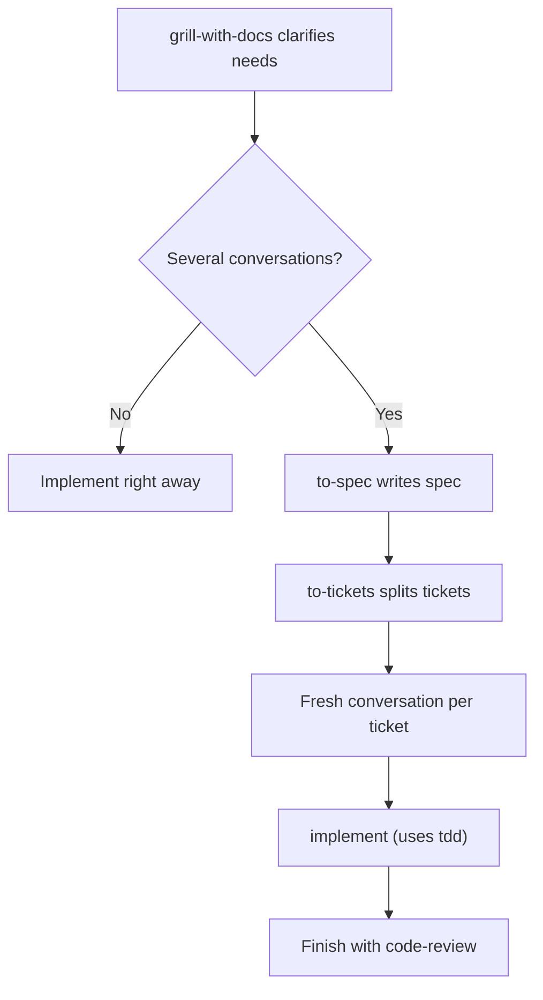

Maybe someone mentioned `mattpocock/skills`, and when you opened the repo, you found a long list of skill names. Or maybe a search landed you on one part of this series, and you want to see what comes before and after it. The series has six parts, each covering one stretch of the development process. This guide shows how they fit together and suggests where to start for your situation.

> mattpocock/skills Series | Guide
>
> - Start here (Part 1): [Get Started Without Memorizing 25 Skills](/posts/mattpocock-skills-setup-routing-guide/)
>
> I based this series on [version `1.2.3`](https://github.com/mattpocock/skills/blob/c55ee46073ed923f86ce59a5eb3b6d895095d1b7/package.json#L2-L10). Each part also notes changes in later versions at the top.
{: .prompt-info }

> I published the six parts between September 21 and October 14, 2026, while the repo was still changing. On 2026-10-04, [`1.3.0`](https://github.com/mattpocock/skills/releases/tag/v1.3.0) and [`1.3.1`](https://github.com/mattpocock/skills/releases/tag/v1.3.1) took the official plugin from the 25 skills mentioned below to 27 (checked 2026-10-19):
>
> - `resolving-merge-conflicts`, covered in [Part 5](/posts/mattpocock-skills-design-review-integration/), was removed. The other 24 skills are still there.
> - The new `implement-spec`, `pr`, and `retro` aren't covered in this series yet.
> - The glossary file from [Part 2](/posts/mattpocock-skills-requirements-shared-language/), `CONTEXT.md`, is now `GLOSSARY.md`.
>
> I plan to update the whole series for the new version. Before you rely on any detail, I suggest checking it against the repo's current version.
{: .prompt-info }

## What Is mattpocock/skills?

[`mattpocock/skills`](https://github.com/mattpocock/skills) is a complete set of skills published by Matt Pocock. I think of a skill as a set of instructions that tells an AI coding assistant how to do a specific job, such as interviewing you about requirements or breaking a spec into tickets. An AI coding assistant here means a tool such as Claude Code or Codex that can read and write your project files and write code for you.

In the [README](https://github.com/mattpocock/skills/blob/c55ee46073ed923f86ce59a5eb3b6d895095d1b7/README.md#L19), the author says the skills are designed to be small, easy to adapt, and composable. The official plugin's [`plugin.json`](https://github.com/mattpocock/skills/blob/c55ee46073ed923f86ce59a5eb3b6d895095d1b7/.claude-plugin/plugin.json#L21-L47) includes 25 skills, and the six parts of this series cover all of them. The repo also has items that are still experimental or not currently promoted; those are outside the series.

Two things make the rest easier to follow:

- **Most work starts only when you call for it.** Many skills are set up so that only a person can start them; the AI won't run them on its own.
- **`ask-matt` is a help desk, not a manager.** You describe where you're stuck, and it suggests the next skill to use. It doesn't run the whole process for you.

Installation and first-time setup are in [Part 1](/posts/mattpocock-skills-setup-routing-guide/).

## Best for Team Projects That Span Several Conversations

Going by the six parts, I think these skills fit best when:

- Several people maintain the project, or a feature takes more than one conversation to finish.
- Your team tracks and hands off work in an issue tracker, such as GitHub Issues.
- You want the AI to follow fixed steps, with a person signing off at each key point.

On the other hand, you may not need the full process when:

- The feature fits in one conversation. Once the requirements are clear, go straight to implementation and skip `to-spec` and `to-tickets` (Part 3).
- You're talking through an idea that hasn't taken shape yet. One interview with `grill-me` is enough; there's no need to document every term (Part 2).
- The task is a one-off outside any project folder. There's no need to set up a whole project just to use one skill (Part 1).

There are also things the skills can't do. As Part 1 points out, the process doesn't guarantee faster development. The direct benefit is that your project's conventions get written down, and you get a suggestion when you're unsure what to do next.

Part 4 adds that these rules are only instructions in Markdown files, with no program enforcing them. So if you approve the AI's list of places to test without reading it, that check does nothing.

## The Six Parts Follow the Order of Development

I put the six parts in the order a feature moves through, from requirements to merge. Parts 1–5 form one main path, and Part 6 handles work that isn't coding but often holds things up.

{: width="800" height="450" }
_The six parts follow the order of development, one stretch each, with Part 6 covering the work outside coding._

The skills on the main path connect roughly like this:

Most other skills are side roads:

- Reports sent in by other people go to `triage`.
- Work too big to list all its decisions goes to `wayfinder`.
- When something breaks, use `diagnosing-bugs`.

I use the same example in all six parts: adding per-seat billing to a subscription service. It starts with the simulated scenario in Part 1 and carries through to Part 6, so if you read in order, you can watch one feature move forward step by step.

## What Each Part Covers

### Part 1: Get Started Without Memorizing 25 Skills

Faced with 25 skills, where do you begin? This part's answer: you can start without understanding every skill first. It explains three things:

- How to choose between the two installation methods.
- What `setup-matt-pocock-skills` adds to your project.
- How to use `ask-matt` to find your next step.

→ [Part 1: Get Started Without Memorizing 25 Skills](/posts/mattpocock-skills-setup-routing-guide/)

### Part 2: From Vague Requirements to Shared Terms

The meeting notes use "member," "user," and "seat" interchangeably. How do you pin them down? This part covers `grill-me`, `grill-with-docs`, `grilling`, `domain-modeling`, and `wait-what`.

The AI asks questions round by round, in the order they depend on each other. With `grill-with-docs`, agreed terms go into the project glossary, `CONTEXT.md`, and a few important decisions are written up as decision records.

→ [Part 2: From Vague Requirements to Shared Terms](/posts/mattpocock-skills-requirements-shared-language/)

### Part 3: Spec, Tickets, or More Questions?

Once the requirements are talked through, do you write a spec, break the work into tickets, or go ask the person who has the answer? This part explains which gap each of `to-spec`, `to-tickets`, `triage`, `wayfinder`, and `to-questionnaire` fills. I think the point is to figure out what information is missing first, not to run all five.

→ [Part 3: Spec, Tickets, or More Questions?](/posts/mattpocock-skills-specs-work-breakdown/)

### Part 4: Trusting Code When the AI Writes the Tests

When the AI writes both the code and the tests, how do you know it got things right? This part covers `implement`, `tdd`, `diagnosing-bugs`, and `prototype`. The answer is to look at what the AI can't change:

- The test locations you approved.
- Expected values taken from the spec.
- A command that has failed on the bug.

I actually ran the red-to-green test in the post.

→ [Part 4: Trusting Code When the AI Writes the Tests](/posts/mattpocock-skills-implementation-feedback-loops/)

### Part 5: Structure, Code Review, and Merge Conflicts

Passing tests don't mean the structure isn't getting messier, or that the change does what was asked. This part covers four skills:

- `codebase-design` and `improve-codebase-architecture`: look after structure with regular health checks.
- `code-review`: asks "written by the rules?" and "built what was asked?" separately.
- `resolving-merge-conflicts`: in a merge conflict, first understand what each side wanted.

The merge conflict in the post is one I actually created.

→ [Part 5: Structure, Code Review, and Merge Conflicts](/posts/mattpocock-skills-design-review-integration/)

### Part 6: Skills for Research, Handoffs, and Learning

Work outside coding can stall a project too: looking up official docs, handing work to the next person, setup steps that need your own login, and learning a new topic. This part covers `research`, `handoff`, `wizard`, `teach`, and `writing-for-agents`, each with its own repeatable process.

→ [Part 6: Skills for Research, Handoffs, and Learning](/posts/mattpocock-skills-research-handoff/)

## Start Where You're Stuck

You don't have to read from start to finish. First think about where you're stuck right now:

{: width="800" height="450" }
_Find where you're stuck, then start with the matching part._

| Your situation | Read |
| --- | --- |
| First time, wondering if it's worth installing | Parts 1 → 2 → 3 |
| Requirements stay fuzzy and people use words differently | Part 2 |
| Requirements are settled, but spec or tickets? | Part 3 |
| Can you trust the code and tests the AI writes? | Parts 4 → 5 |
| Reviewing changes, tidying structure, or fixing merge conflicts | Part 5 |
| Handing off work, researching, or learning a new topic | Part 6 |
| Seeing one feature go from start to finish | Parts 1 through 6, in order |

If you already have the skills installed, you can also just ask `ask-matt`. Describe the step you're stuck on, and it will suggest the next skill; then come back and read the part that covers it.

## Further Reading

- [`mattpocock/skills`](https://github.com/mattpocock/skills): the official repo.
- [`README.md`](https://github.com/mattpocock/skills/blob/c55ee46073ed923f86ce59a5eb3b6d895095d1b7/README.md): the author's overview and installation instructions (version `1.2.3`).
- [`plugin.json`](https://github.com/mattpocock/skills/blob/c55ee46073ed923f86ce59a5eb3b6d895095d1b7/.claude-plugin/plugin.json#L21-L47): the list of 25 skills in the official plugin.
- [`ask-matt/SKILL.md`](https://github.com/mattpocock/skills/blob/c55ee46073ed923f86ce59a5eb3b6d895095d1b7/skills/engineering/ask-matt/SKILL.md#L9-L90): the full route map `ask-matt` uses to suggest your next step.
- [pstack Series Guide: What It Is and How to Read the Four Parts](/posts/pstack-series-guide/): my guide to another skill pack, pstack.
