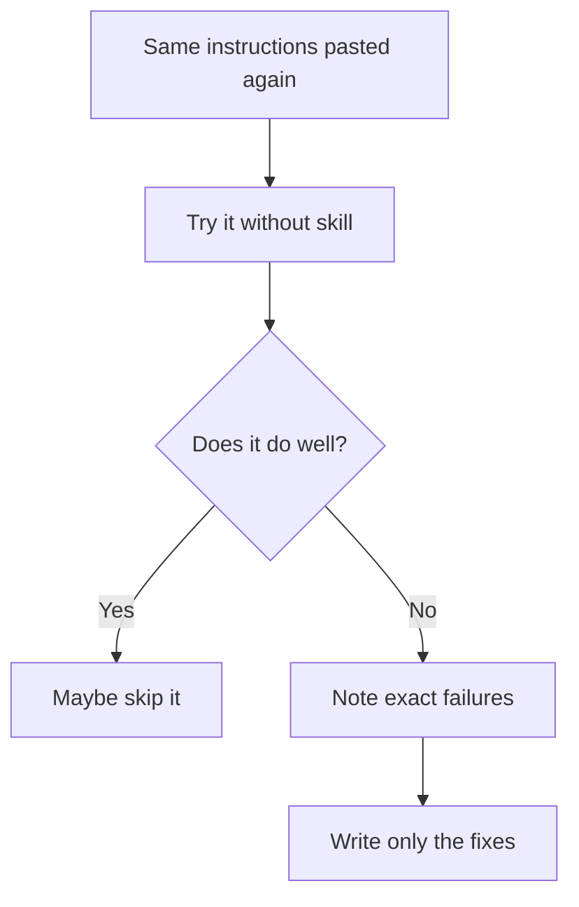
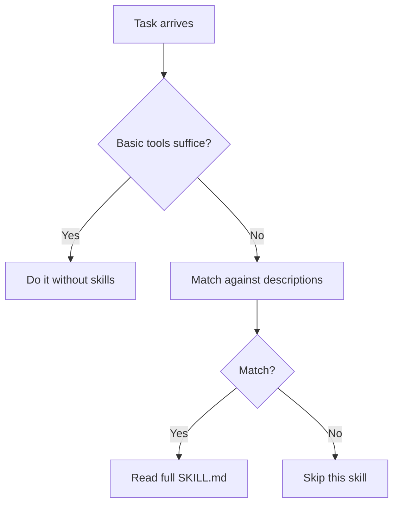
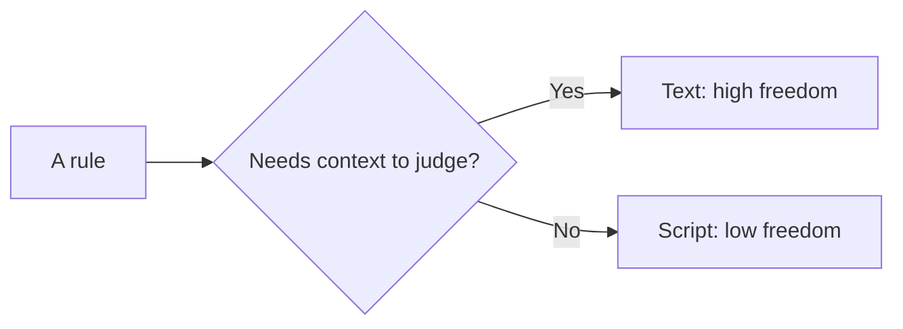
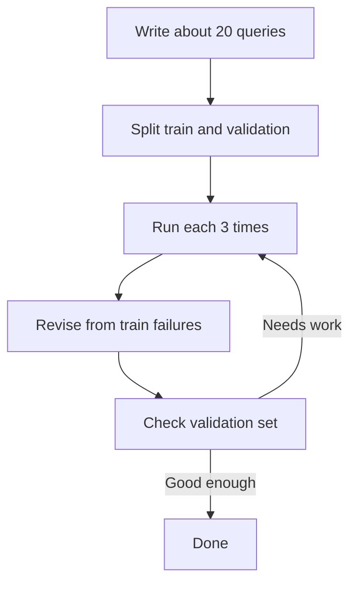
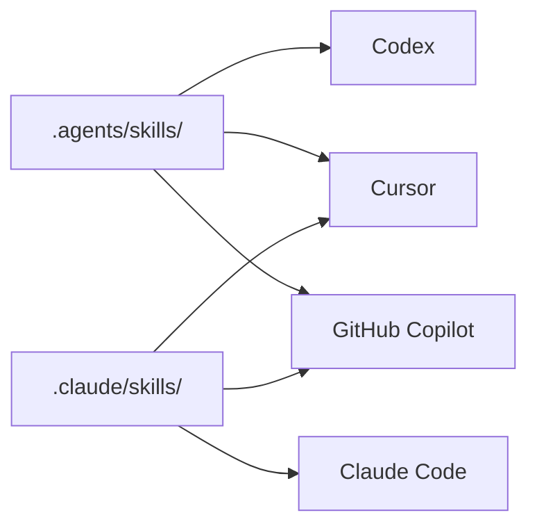
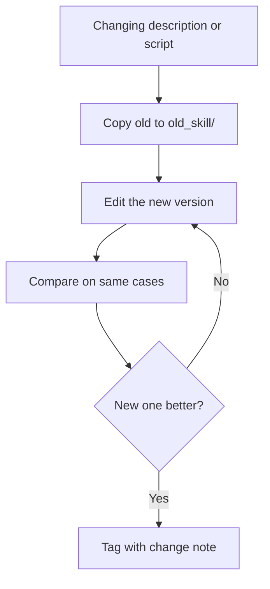

Every time I ask an AI to write a commit message, I have to repeat the same rules. Start with a type like `fix:` or `feat:`, keep the first line short, no period at the end, only describe what's staged... By the fifth time, I start to wonder: can it just remember?

That's what an Agent Skill is for. This post looks at skills from the author's side. I build two skills to show how to write one that gets picked at the right moment, and how to test and maintain it:

- **A: `writing-commit-messages`**. It reads the staged changes in git, writes a commit message in Conventional Commits format, and checks the format with a small script. This is the main example. I use it to show how to create a skill, write its script, and test it in three layers.
- **B: `meeting-notes-to-todos`**. It turns meeting notes into a to-do list with owners and due dates. It has only the instructions file and an output template, with no code at all. I use it to show what a skill without code looks like, and how to write a description that doesn't fire by mistake.

This post doesn't cover installing skills other people wrote. To start with ready-made ones, see my [mattpocock/skills series guide](/posts/mattpocock-skills-series-guide/).

> The spec and each tool's docs are as of the official pages on October 17, 2026. The Conventional Commits, commitlint and git docs are as of October 18, 2026. These URLs carry no version numbers and their content changes, so check them again before you rely on them.
>
> I ran the commands and got the outputs shown here on October 18, 2026, with git 2.47.3 and Python 3.13.5. The validator was skills-ref 0.1.0, at commit `69ef37e` of agentskills/agentskills.
{: .prompt-info }

## A few terms first

| Term | In one sentence |
| --- | --- |
| Skill | A folder whose core is `SKILL.md`, an instructions file for the AI; it can also hold scripts and reference material. |
| Front matter | The settings block between the two `---` lines at the top of a file; `SKILL.md` uses it for the name and description. |
| YAML | A format that writes settings one `name: value` line at a time; front matter is written in it. |
| Staging area | Where `git add` collects the changes for the next commit; the git docs also call it the index. |
| Conventional Commits | A convention for commit messages whose first line reads `type(scope): summary`, e.g. `fix(login): reject empty passwords`. |
| Context window | The most text an AI can see at once. The more that stays loaded, the less room is left for the work. |
| Token | The unit an AI uses to measure text. More text means more tokens. |

## Worth a skill: what you keep pasting and the AI gets wrong alone

The Claude Code docs give a test I find practical. Write a skill when you keep [pasting the same instructions, checklist or multi-step procedure into chat](https://code.claude.com/docs/en/skills). The same goes for a section of `CLAUDE.md` that has grown from facts into a procedure.

The difference is when each one loads: `CLAUDE.md` is read into every conversation, but a skill's body loads only when it's used. The same docs note that long reference material costs almost nothing until it's needed. `AGENTS.md` is always loaded too, so every line has a cost, as I covered in [Part 6 of the series](/posts/mattpocock-skills-research-handoff/).

Before you write one, confirm that the AI really gets the task wrong without it:



The agentskills.io [best practices](https://agentskills.io/skill-creation/best-practices) put it bluntly. If the agent does the whole job well without the skill, the skill may add no value. The evaluation steps in the diagram, running a few representative tasks and noting what fails, come from Anthropic's [authoring guide](https://platform.claude.com/docs/en/agents-and-tools/agent-skills/best-practices).

Take A: the AI already knows how to write commit messages and how git works. But it doesn't know which types your team uses or how long the first line may be. Nor does it know a rule you care about, such as "don't `git add` anything the user didn't stage."

B is the same. The AI can read meeting notes, but the format changes every time, and it sometimes guesses an owner for a task nobody claimed. These are exactly the gaps a skill should fill.

Docs written for an AI share general writing principles: how to phrase instructions, put common cases first, and cut extra sentences. I covered those in the [`writing-for-agents` section of Part 6](/posts/mattpocock-skills-research-handoff/). This post covers only what is specific to skills.

## The minimum: one SKILL.md, only the six spec fields

Under the [Agent Skills specification](https://agentskills.io/specification), a skill needs only a folder with a `SKILL.md` inside. Everything else is optional:

- `scripts/`: code that can run
- `references/`: docs read only when needed
- `assets/`: templates, images and similar resources

`SKILL.md` starts with YAML front matter, followed by a Markdown body. The minimal version looks like this:

```markdown
---
name: skill-name
description: A description of what this skill does and when to use it.
---
```

The spec defines only six fields:

| Field | Required | Rules |
| --- | --- | --- |
| `name` | Yes | 1–64 characters; lowercase letters, digits and `-` only; can't start or end with `-`; no consecutive `--`; **must match the parent folder name** |
| `description` | Yes | 1–1024 characters; says what the skill does and when to use it |
| `license` | No | A license name, or the name of a license file bundled with the skill |
| `compatibility` | No | 1–500 characters; environment requirements, such as system packages. The spec says most skills don't need it |
| `metadata` | No | A string-to-string map for extra information the spec doesn't define |
| `allowed-tools` | No | A space-separated list of pre-approved tools; **experimental**, and support varies by tool |

Each tool adds its own rules on top. The [Anthropic platform](https://platform.claude.com/docs/en/agents-and-tools/agent-skills/overview#skill-structure) forbids XML tags and the reserved words `anthropic` and `claude` in `name`. It also forbids XML tags in `description`.

The tools also react differently when a field is wrong or extra:

| Tool | When a field is wrong or extra |
| --- | --- |
| Claude Code | [Every field is optional](https://code.claude.com/docs/en/skills), and a missing `name` falls back to the folder name. A misspelled or unknown field is silently ignored. If the YAML fails to parse, the skill still loads, but every field is empty |
| claude.ai upload, Skills API | The same docs say these two paths accept only the six spec fields. One extra field is an error, like this one |

```text
Unexpected key(s) in SKILL.md frontmatter: argument-hint. Allowed properties are: allowed-tools, compatibility, description, license, metadata, name
```

That's the trap: a mistake in Claude Code gets no warning, and the error shows up only when you upload the same skill somewhere else. So I think the safest choice is to **use only the six spec fields**, and the cross-agent checks later in this post build on that.

## The description decides whether it gets picked

At startup, an agent loads only each skill's `name` and `description`. The spec calls this [progressive disclosure](https://agentskills.io/specification#progressive-disclosure): load a summary first, and read the full text only when needed. So the agentskills.io [guide to optimizing descriptions](https://agentskills.io/skill-creation/optimizing-descriptions) is blunt: whether a skill triggers rests entirely on its description.



The first check is easy to miss. The same guide notes that agents usually look for a skill only when they can't do the task alone. A one-step request like "read this PDF" may not trigger a skill even when the description matches exactly.

### The two official guides conflict

The two official guides disagree on how to write a description:

| | agentskills.io ([optimizing guide](https://agentskills.io/skill-creation/optimizing-descriptions#writing-effective-descriptions)) | Anthropic ([authoring guide](https://platform.claude.com/docs/en/agents-and-tools/agent-skills/best-practices#writing-effective-descriptions)) |
| --- | --- | --- |
| Voice | Imperative, written as instructions to the agent | Always third person |
| Example | Write "Use this skill when...", not "This skill does..." | Write "Processes Excel files and generates reports"; avoid "I can help you..." or "You can use this to..." |
| Other | Describe what the user wants to achieve, not how the skill works inside; list the situations it fits, including when the user doesn't name the domain; keep it concise | The description goes into the system prompt, and an inconsistent point of view can make the skill harder to find |

The conflict is about voice. agentskills.io says not to write "This skill does...". But Anthropic's own example is exactly that kind of third-person sentence: "Processes Excel files...".

Both of my examples use a compromise. This is my own choice, not a recommendation from either guide:

1. The first sentence says what it does, in the third person.
2. The second sentence lists situations with "Use this skill when...".
3. The last sentence says when not to use it.

Here's A's:

```yaml
description: "Writes a git commit message for the currently staged changes, in Conventional Commits format (type(scope): summary, optional body and footers). Use this skill when the user asks for a commit message, asks you to commit what they staged, or asks how to describe their changes, even if they don't say 'Conventional Commits'. Do not use it to explain git commands, to edit commits that were already pushed, or to write changelogs or release notes."
```

I wrapped the whole value in double quotes for a reason, which comes up later under "Format checks".

The final "Do not use it to..." sentence also has a source. The optimizing guide suggests stating what the skill does **not** do when queries keep triggering it by mistake, to separate it from neighboring capabilities.

### Using B to avoid false triggers

Meeting notes get mixed up with other requests easily. "Summarize this meeting", "prioritize my to-dos" and "set up the next meeting" all sound related, but each wants something different. Here's how I wrote B's description:

```yaml
description: Turns meeting notes or a meeting transcript into a to-do list of tasks with owners and due dates, in a fixed Markdown format. Use this skill when the user shares notes, minutes or a transcript of a meeting or call and asks what needs to be done, who is doing what, or for the follow-ups, even if they don't say "action items". Do not use it for a plain meeting summary with no tasks, for editing or prioritizing an existing to-do list, or for scheduling a meeting.
```

Each of its three sentences does one job:

- The first makes clear the output is a list of tasks with owners and due dates, not a summary.
- The second lists how people actually ask (notes, minutes, transcripts, who is doing what, follow-ups), including when they never say "action items".
- The last rules out the three closest requests.

I'll compare a few queries:

| Query | Should it trigger? | Why |
| --- | --- | --- |
| "Here are my notes from yesterday's standup. Who's doing what?" | Yes | Never says "to-do", but asks who owns what |
| "Summarize this meeting in three bullet points" | No | Wants a summary, not tasks |
| "Sort my to-do list by priority" | No | Already a to-do list; nothing to pull out of notes |
| "Set up a meeting for Wednesday afternoon" | No | Scheduling a meeting, not processing one |

This table is where my test queries start. See "Trigger tests" below for how to turn it into a real test.

### Length has a budget

The description limit is 1024 characters, but the usable space is often smaller. Every skill's entry has to fit into the context window together:

| Tool | Listing budget | When it overflows |
| --- | --- | --- |
| Claude Code | The whole listing takes 1% of the context window; each skill's `description` plus `when_to_use` is cut at 1,536 characters in the listing ([docs](https://code.claude.com/docs/en/skills)) | Drops descriptions, starting with the least-used skills |
| Codex | The initial listing takes at most 2% of the context window, or 8,000 characters when the window size is unknown ([docs](https://learn.chatgpt.com/docs/build-skills)) | Shortens descriptions first; with many skills it may leave some out and show a warning |

Both recommend **putting the key use case first**, so the most important words survive truncation. A's description is 444 characters and B's is 464. I ordered both sets of three sentences by this rule.

## One skill, one job

[agentskills.io](https://agentskills.io/skill-creation/best-practices#design-coherent-units) compares a skill to a function: it should be one complete unit of work. Split too fine, and one task loads several skills whose instructions may clash; split too coarse, and it's hard to pick the skill at the right moment. The Codex docs say it in one line: [Keep each skill focused on one job](https://learn.chatgpt.com/docs/build-skills#best-practices).

A only writes commit messages: it reads the staging area, picks a type, writes a summary and checks the format. PR descriptions, release notes and editing pushed commits are out of scope. B only turns meeting notes into to-dos, without summarizing meetings or deciding how to order the tasks afterward.

For names, Anthropic [recommends gerunds](https://platform.claude.com/docs/en/agents-and-tools/agent-skills/best-practices#naming-conventions), such as `processing-pdfs`. Noun phrases (`pdf-processing`) and action-oriented names (`process-pdfs`) are also acceptable. Avoid vague names like `helper` or `utils`.

A is called `writing-commit-messages`, a gerund. B's `meeting-notes-to-todos` follows an input-to-output pattern that is none of the three.

The same guide says a set of skills should share one naming style. So if you keep these two in one project, I'd pick one style, such as gerunds for both.

### Who can start it

Some skills shouldn't run whenever the AI decides. Each tool has its own switch:

| Tool | Setting | Effect |
| --- | --- | --- |
| Claude Code | `disable-model-invocation: true` | Claude won't start it on its own; only you can, by typing `/name` ([docs](https://code.claude.com/docs/en/skills#control-who-invokes-a-skill)) |
| Claude Code | `user-invocable: false` | You can't start it with `/name`; only Claude can |
| Cursor | `disable-model-invocation: true` | Loads only when you type `/skill-name` explicitly ([docs](https://cursor.com/docs/skills#disabling-automatic-invocation)) |
| Codex | `policy.allow_implicit_invocation: false` in `agents/openai.yaml` | Won't start automatically from a prompt; you can still call it with `$skill` ([docs](https://learn.chatgpt.com/docs/build-skills#optional-metadata)) |

The Claude Code docs suggest making a workflow manual-only when it has side effects or you want to control the timing, such as `/commit` or `/deploy`. The reason: you don't want Claude to deploy just because the code looks ready. For a real example, see [`implement` in Part 4 of the series](/posts/mattpocock-skills-implementation-feedback-loops/), which sets both the Claude Code and the Codex switch.

A sits right on this line, because a commit is a side effect. My approach: A only writes and checks the message, and **runs `git commit` only when the user asks for a commit in the conversation** (step 5).

That's an agreement in the instructions, not a technical barrier. If you want "commit as soon as I call it", make the skill manual-only instead.

There's a tradeoff here: `disable-model-invocation` and `user-invocable` aren't among the six spec fields. If you put them in `SKILL.md`, Claude Code honors them, while Cursor supports only `disable-model-invocation`.

But claude.ai uploads and the Skills API reject them, and the `skills-ref` check later in this post reports an error. Codex keeps the same setting in a separate file, `agents/openai.yaml`, so `SKILL.md` itself can stay within the spec fields.

## Move details into reference files and scripts

{: width="800" height="450" }
_One skill loads in three layers: each layer down is bigger but enters the context window later._

The [spec](https://agentskills.io/specification#progressive-disclosure) splits a skill into three layers:

1. **Metadata** (about 100 tokens): `name` and `description`. This layer loads for every skill at startup.
2. **Body** (under 5000 tokens recommended): the whole `SKILL.md`, read when the skill starts.
3. **Resources**: files in `scripts/`, `references/` and `assets/`, loaded only when needed.

The spec also suggests keeping `SKILL.md` under 500 lines, with file references only one level deep. Anthropic's authoring guide explains why. When Claude reads a referenced file that references yet another file, it [may only preview it with something like `head -100`](https://platform.claude.com/docs/en/agents-and-tools/agent-skills/best-practices#avoid-deeply-nested-references) and get incomplete information.

So link every reference file directly from `SKILL.md`, and give any reference file over 100 lines a table of contents at the top.

Splitting files isn't enough; you also have to say **when** to read each one. The agentskills.io example is "[read `references/api-errors.md` when the API returns a non-200 status](https://agentskills.io/skill-creation/best-practices#structure-large-skills-with-progressive-disclosure)". That's far more useful than "see references/".

A keeps its list of types and rules in a reference file that it usually doesn't need, and `SKILL.md` says:

```markdown
Read `references/conventional-commits.md` when you are not sure which type
fits, or when the change removes or renames something other code depends on.
```

### After a script runs, only its output takes context

The biggest difference between a script and a reference file is that a script is meant to run. According to [Anthropic's overview](https://platform.claude.com/docs/en/agents-and-tools/agent-skills/overview#level-3-resources-and-code-loaded-as-needed), scripts run through bash. The code itself never enters the context; only the output costs tokens.

The authoring guide also says to [state clearly whether to run a script or read it as reference](https://platform.claude.com/docs/en/agents-and-tools/agent-skills/best-practices#provide-utility-scripts).

### Rules go to a script or to text

If code can check a rule, I don't leave it to the AI's judgment through text:



Anthropic's authoring guide calls this [degrees of freedom](https://platform.claude.com/docs/en/agents-and-tools/agent-skills/best-practices#set-appropriate-degrees-of-freedom). It also says that fragile work, which must come out the same every time, suits a fixed script.

A puts its format rules into `scripts/check_commit_msg.py`: type, length, period, blank line, and an uppercase `BREAKING CHANGE`. But no script can tell whether a change is a `fix` or a `feat`. The AI still has to read the diff (the before-and-after of the change) and decide, and the Gotchas section says so.

B's rules are things like "if the notes name no owner, don't guess" and "turn 'next Friday' into a date only when the meeting date is known". You have to understand the sentences to apply them, and code would be less reliable. So B has no script.

B's only resource is `assets/todo-template.md`, a fixed output template. The template makes every result look the same, so you or the next tool can pick it up. That's the [template pattern](https://platform.claude.com/docs/en/agents-and-tools/agent-skills/best-practices#template-pattern) in the authoring guide, which also says to decide how strict the template should be.

### Design scripts for how agents use them

A's script follows the [agentskills.io scripts guide](https://agentskills.io/skill-creation/using-scripts#designing-scripts-for-agentic-use):

| What the guide asks | What A's script does |
| --- | --- |
| No interactive prompts (agents run in non-interactive shells, and a script waiting for input hangs) | Reads the message from a file, or from stdin with `-`; never stops to ask |
| Provide `--help` | `--help` lists both usages, the options, the output format, the exit codes and examples |
| Error messages say what's wrong and how to fix it | e.g. `write the type in lowercase: 'fix'` |
| Data to stdout, diagnostics to stderr | The result is always one JSON object; notes like "nothing is staged" and errors go to stderr |
| Meaningful exit codes, documented in `--help` | 0 passed (or something is staged), 1 problems found (or nothing is staged), 2 usage error |
| Predictable output size | Returns only the header and the list of problems, never the whole diff |

The full `--help` text is the docstring at the top of the script in the appendix.

I added the `--repo` option myself. The scripts guide says command paths in `SKILL.md` should be [relative to the skill's root](https://agentskills.io/skill-creation/using-scripts#referencing-scripts-from-skill-md), because the agent runs commands from there.

But git has to run in the user's repo, so the script takes the repo path through `--repo`. `SKILL.md` also says at the top: "run commands from the skill directory; `<repo>` is the user's repository."

### State the dependencies

The scripts guide suggests [listing prerequisites in `SKILL.md`](https://agentskills.io/skill-creation/using-scripts#one-off-commands) instead of assuming the agent's environment has them. Runtime requirements can go in the `compatibility` field. Anthropic's authoring guide even has a section titled "[Avoid assuming tools are installed](https://platform.claude.com/docs/en/agents-and-tools/agent-skills/best-practices#avoid-assuming-tools-are-installed)".

A's script uses only the Python standard library plus git, and I listed both in `compatibility`. B has no script and needs nothing installed, so it can omit `compatibility`. That matches the spec's note that most skills don't need it.

If a script needs third-party packages, declare them inside the script with [PEP 723](https://peps.python.org/pep-0723/), and say in `SKILL.md` how to run it.

## Building A: a skill for commit messages

A's full layout:

```console
$ find writing-commit-messages -type f | sort
writing-commit-messages/SKILL.md
writing-commit-messages/evals/evals.json
writing-commit-messages/evals/files/empty-password.diff
writing-commit-messages/evals/files/mixed-changes.diff
writing-commit-messages/evals/trigger-queries.json
writing-commit-messages/references/conventional-commits.md
writing-commit-messages/scripts/check_commit_msg.py
```

`evals/` holds the test files used later in "Test in three layers". The full reference file, script and both test sets are in the appendix. Here I'll look only at `SKILL.md`.

### SKILL.md

````markdown
---
name: writing-commit-messages
description: "Writes a git commit message for the currently staged changes, in Conventional Commits format (type(scope): summary, optional body and footers). Use this skill when the user asks for a commit message, asks you to commit what they staged, or asks how to describe their changes, even if they don't say 'Conventional Commits'. Do not use it to explain git commands, to edit commits that were already pushed, or to write changelogs or release notes."
compatibility: Requires git and python3 (tested with git 2.47 and Python 3.13). Standard library only.
metadata:
  version: "1.0"
---

# Writing Commit Messages

## Steps

Run the commands below from this skill's directory. `<repo>` is the path
of the user's git repository.

1. See what is staged: `python3 scripts/check_commit_msg.py --staged --repo <repo>`.
   Exit code 1 means nothing is staged: stop and tell the user. Do not run
   `git add` yourself.
2. Read the staged changes with `git -C <repo> diff --cached`. For a long
   diff, read one file at a time: `git -C <repo> diff --cached -- <path>`.
3. Write the message to a temporary file: a header `type(scope): summary`,
   then a blank line and a short body that says why, if the header alone
   does not make the reason clear.
4. Check it: `python3 scripts/check_commit_msg.py <file>`. Fix every
   problem and check again until it exits 0.
5. Show the message to the user. Run `git -C <repo> commit -F <file>` only
   if the user asked you to commit in this conversation.

Read `references/conventional-commits.md` when you are not sure which type
fits, or when the change removes or renames something other code depends on.

## Gotchas

- The checker only looks at the message. It cannot tell whether `fix` or
  `feat` matches the diff; that call is yours.
- If the staged changes do two unrelated things, suggest splitting them
  into two commits instead of writing one vague message.
- Do not invent issue numbers, `Closes #...` or `Co-authored-by` lines.
  Add footers only when the user gave you the information.
- Never use `git commit -a` or `git add .`: they would include changes the
  user did not stage.
- `BREAKING CHANGE:` must be uppercase. `!` before the colon also marks a
  breaking change.
````

There are only five steps. Step 4 is what agentskills.io calls a [validation loop](https://agentskills.io/skill-creation/best-practices#validation-loops): run the check after writing, fix what fails, and run it again until it passes.

agentskills.io considers Gotchas [the most valuable part](https://agentskills.io/skill-creation/best-practices#gotchas-sections) of many skills. They aren't general advice but concrete facts that the AI gets wrong unless told. Take `git commit -a`: the [git docs](https://git-scm.com/docs/git-commit) say it automatically stages modified and deleted files, so it would commit changes the user never picked.

The reference file `references/conventional-commits.md` lists 11 types and 7 check rules. The spec itself defines only `feat` and `fix`; the other 9 come from [commitlint's config-conventional](https://github.com/conventional-changelog/commitlint/blob/master/%40commitlint/config-conventional/src/index.ts).

The 72-character header limit is my own choice. The [git docs](https://git-scm.com/docs/git-commit#_discussion) suggest 50 characters or fewer for the title, and commitlint allows 100 by default, so I picked a value in between. Every rule in the reference file names its source, so you can see at a glance which come from the spec and which are my choices.

### A test run

I set up a throwaway git repo to try it. I added two lines to `app/login.py` that return False when the password is empty, and staged them. I also changed `README.md` but didn't stage it:

```console
$ git status --short
 M README.md
M  app/login.py
```

The two columns are the staging area and the working tree: `M ` means changed and staged, and ` M` means changed but not staged. Following step 1, I checked what was staged:

```console
$ python3 scripts/check_commit_msg.py --staged --repo /tmp/cc-demo
{
  "staged": 1,
  "files": [
    {
      "status": "M",
      "path": "app/login.py",
      "added": 2,
      "deleted": 0
    }
  ]
}
```

Only `app/login.py` shows up. The unstaged `README.md` doesn't appear, and the exit code is 0. Next I checked a valid message, and the exit code was 0:

```console
$ cat good.txt
fix(login): reject empty passwords

Return False before hashing when the password is empty,
instead of passing an empty string to hash_password().
$ python3 scripts/check_commit_msg.py /tmp/cc-msgs/good.txt
{
  "ok": true,
  "header": "fix(login): reject empty passwords",
  "problems": []
}
```

Then a common bad message, with an uppercase type, a trailing period and no blank second line. The exit code was 1:

```console
$ cat bad.txt
Fix(login): Handle empty password.
Users saw an error page when the password field was empty.
$ python3 scripts/check_commit_msg.py /tmp/cc-msgs/bad.txt
{
  "ok": false,
  "header": "Fix(login): Handle empty password.",
  "problems": [
    {
      "rule": "type",
      "message": "write the type in lowercase: 'fix'"
    },
    {
      "rule": "full-stop",
      "message": "do not end the summary with '.'"
    },
    {
      "rule": "blank-line",
      "message": "line 2 must be empty; put the body after a blank line"
    }
  ]
}
```

Each of the three problems says how to fix it, so the agent can fix them and run the check again.

Finally, I made a real commit with the valid message. The unstaged `README.md` stayed where it was. The staging area was now empty, so the exit code was 1 and the note went to stderr:

```console
$ git commit -q -F /tmp/cc-msgs/good.txt && git log --format="%h %s" -2 && git status --short
891c9d5 fix(login): reject empty passwords
5c0fd3d chore: initial commit
 M README.md
$ python3 scripts/check_commit_msg.py --staged --repo /tmp/cc-demo
nothing is staged; ask the user what to stage
{
  "staged": 0,
  "files": []
}
```

## Building B: a skill for meeting to-dos

B has only two files:

```console
$ find meeting-notes-to-todos -type f | sort
meeting-notes-to-todos/SKILL.md
meeting-notes-to-todos/assets/todo-template.md
```

### SKILL.md

````markdown
---
name: meeting-notes-to-todos
description: Turns meeting notes or a meeting transcript into a to-do list of tasks with owners and due dates, in a fixed Markdown format. Use this skill when the user shares notes, minutes or a transcript of a meeting or call and asks what needs to be done, who is doing what, or for the follow-ups, even if they don't say "action items". Do not use it for a plain meeting summary with no tasks, for editing or prioritizing an existing to-do list, or for scheduling a meeting.
metadata:
  version: "1.0"
---

# Meeting Notes to To-dos

## Steps

1. Find every action item in the notes: something a person agreed to do,
   was asked to do, or said they would do. Decisions and opinions are not
   action items unless someone has to act on them.
2. For each item, take the owner and the due date only from the notes.
3. Fill in `assets/todo-template.md` and output only the filled template.
   Write it in the language the notes are written in.

## Rules

- Never guess an owner or a date. If the notes don't say, write
  `(not stated)` in the notes' language and list the item under
  "Needs an owner or date".
- Turn a relative date ("next Friday") into a calendar date only when the
  meeting date is in the notes and the words point to one day. Otherwise
  keep the words as written and list the item under "Needs an owner or date".
- Quote a few words from the notes in the Source column, so the user can
  check where each item came from.
- One task per row. If one sentence holds two tasks, split it.
- If there are no action items, say so in one sentence instead of
  filling the template.
````

It's all written rules, and the focus is "don't guess". A missing owner is marked "not stated", and a vague date stays as written. These items are then gathered at the end, so the user sees at a glance what to fill in.

### assets/todo-template.md

```markdown
## To-dos: {meeting title} ({meeting date, or "date not stated"})

| # | Task | Owner | Due | Source |
| --- | --- | --- | --- | --- |
| 1 | {start with a verb} | {name from the notes} | {YYYY-MM-DD} | "{a few words quoted from the notes}" |

### Needs an owner or date

- #{row number}: {what is missing, e.g. "no owner named", "due date only says 'soon'"}

{Leave out this section when every row has an owner and a due date.}
```

### Checking it against sample notes

> The meeting notes below are **sample data** I made up, not a real meeting. The table after them is an expected result I **wrote by hand** from the template to show how it's used.
{: .prompt-warning }

```text
Weekly sync, 2026-10-12 (Monday)
- Lin: website redesign mockups, will share with everyone before Friday
- The login page error message needs changing, Zhe says he'll take it
- Budget sheet is due next month, nobody has picked it up yet
- Decision: no test environment upgrade this week
```

Following B's rules, I'd expect the result to look like this:

```markdown
## To-dos: Weekly sync (2026-10-12)

| # | Task | Owner | Due | Source |
| --- | --- | --- | --- | --- |
| 1 | Share the website redesign mockups | Lin | 2026-10-16 | "will share with everyone before Friday" |
| 2 | Change the login page error message | Zhe | (not stated) | "Zhe says he'll take it" |
| 3 | Submit the budget sheet | (not stated) | next month | "nobody has picked it up yet" |

### Needs an owner or date

- #2: no due date
- #3: no owner named; due date only says "next month"
```

A few spots map to the rules:

- The meeting was on a Monday, so "before Friday" becomes 2026-10-16.
- "Next month" doesn't point to one day, so it stays as written.
- "No test environment upgrade" is a decision that nobody has to act on, so it isn't a to-do.

## Test in three layers: format, triggering, output

{: width="800" height="450" }
_Each layer tests one thing: is the format right, does it get picked, and does it do the job once picked._

### Format checks

The spec recommends [skills-ref](https://github.com/agentskills/agentskills/tree/69ef37e9424c0a7ea9dd2293b559e43ec8176379/skills-ref) for validating frontmatter. Be clear about what it is: a reference implementation for demonstration, not a production tool. Its README says:

> **intended for demonstration purposes only, not meant to be used in production**

I installed it at a fixed commit:

```console
$ git clone -q https://github.com/agentskills/agentskills.git && cd agentskills && git checkout -q 69ef37e9424c0a7ea9dd2293b559e43ec8176379 && git log -1 --format='%h %cs'
69ef37e 2026-08-09
$ python3 -m venv .venv && .venv/bin/pip install -q -e skills-ref && .venv/bin/skills-ref --version
skills-ref, version 0.1.0
```

My first validation of A failed. The description had no quotes yet:

```console
$ skills-ref validate writing-commit-messages
Validation failed for writing-commit-messages:
  - Invalid YAML in frontmatter: mapping values are not allowed here
  in "<unicode string>", line 3, column 119:
     ... onal Commits format (type(scope): summary, optional body and foo ... 
                                         ^ (line: 3)
```

The problem was `type(scope): summary` inside the description. YAML treats a colon followed by a space as the separator in `name: value`. A second one on the same line breaks parsing for the whole front matter.

My fix was to wrap the whole value in double quotes and change the double quotes inside the sentence to single quotes. B's description has no colon followed by a space, so it passes without quotes.

As noted earlier, Claude Code still loads a skill when its YAML fails to parse, but with every field empty. So Claude Code never warns you about this error. My inference is that a skill with an empty description is unlikely to be picked automatically.

With the quotes added, both pass. Each prints one line, and both exit with 0:

```console
$ skills-ref validate writing-commit-messages
Valid skill: writing-commit-messages
$ skills-ref validate meeting-notes-to-todos
Valid skill: meeting-notes-to-todos
```

Then I made three broken copies of A on purpose and validated each one. All three exit with 1:

- A name with consecutive `--`.
- A folder name that doesn't match `name`.
- An extra Claude Code-only field, `when_to_use`.

```console
$ skills-ref validate bad--name
Validation failed for bad--name:
  - Skill name cannot contain consecutive hyphens
$ skills-ref validate commit-messages
Validation failed for commit-messages:
  - Directory name 'commit-messages' must match skill name 'writing-commit-messages'
$ skills-ref validate writing-commit-messages
Validation failed for writing-commit-messages:
  - Unexpected fields in frontmatter: when_to_use. Only ['allowed-tools', 'compatibility', 'description', 'license', 'metadata', 'name'] are allowed.
```

I find the last one matters most. The same field is perfectly valid in Claude Code and an error in skills-ref.

Claude Code also has a command that finds `SKILL.md` files whose frontmatter fails to parse. It [needs v2.1.233 or later](https://code.claude.com/docs/en/skills):

```bash
claude plugin validate <skills-dir>
```

### Trigger tests

A correct format doesn't mean the skill gets picked at the right moment. The agentskills.io [optimizing guide](https://agentskills.io/skill-creation/optimizing-descriptions#designing-trigger-eval-queries) suggests this loop:



The details for each step:

- Of about 20 queries, 8–10 **should** trigger and 8–10 **should not**.
- Make the should-not queries near misses. An unrelated query like "write a Fibonacci function" tests nothing.
- The default threshold for the trigger rate is 0.5.
- Put about 60% of the queries in the train set and 40% in validation. Don't use the validation set to revise the description. Use it only to check that the improvement carries over to new queries, so the description doesn't overfit.
- About 5 rounds is enough. If nothing improves, the queries themselves may be the problem.

The Claude Code docs follow [the same idea](https://code.claude.com/docs/en/skills#evaluate-and-iterate-on-a-skill). Run the same queries in a new session with the skill on and again with it off, and compare. The session must be new, because the conversation you had while writing the skill hides what the text leaves unclear.

I wrote 20 queries for A: 10 should trigger and 10 shouldn't. 12 are in the train set and 8 in validation, and each set is split evenly between the two kinds.

`split` is a field I added to keep the split fixed; the guide's example format has only `query` and `should_trigger`.

The full JSON is in the appendix; many queries are in Chinese, since the set mixes both languages on purpose. A few of them:

| Query | Should it trigger? | Why it's in the set |
| --- | --- | --- |
| 「這次改動要怎麼描述比較好？我要提交了」 ("How should I describe this change? I'm about to commit") | Yes | Never says "commit message" |
| "fix the typo in the last commit message, it's already pushed to main" | No | Also about a commit message, but one that's already pushed |
| 「幫我把這個月的 commit 整理成 release notes」 ("Turn this month's commits into release notes") | No | Also about commits, but wants release notes |
| 「幫我寫一個 commit-msg hook，用 Node 檢查訊息格式」 ("Write a commit-msg hook that checks the message format in Node") | No | Even says "check the message format", but wants code written |

> Trigger tests have to run in a real agent, to see whether it reads `SKILL.md`. This post provides the queries and the method. You can take A's JSON and B's comparison table into your own agent and run them the way the guide describes.
{: .prompt-warning }

### Output checks

Once picked, the skill still has to do the job right. The agentskills.io [guide to evaluating output](https://agentskills.io/skill-creation/evaluating-skills) suggests putting test cases in `evals/evals.json`, each with three things:

- `prompt`: what the user would ask.
- `expected_output`: what success looks like.
- `files`: the files the case needs.

After reviewing the first round of results, add `assertions` that can be checked objectively. The guide suggests starting with 2–3 cases. I wrote three for A, and the full file is in the appendix:

| Case | What it checks |
| --- | --- |
| 1. The staged change is `empty-password.diff`; write a message but don't commit yet | The type is `fix`, the message passes the script, no made-up issue numbers, no `git commit` run |
| 2. The staged change is `mixed-changes.diff`, mixing README text and a new logout function | Suggests two commits, and both messages pass the check |
| 3. The user says "I think I staged everything", but nothing is staged | Says nothing is staged and doesn't run `git add` itself |

Both `.diff` files are real exports from that throwaway repo, made with `git show` and `git diff --cached`, not written by hand. For `mixed-changes.diff`, I added a logout function to the same repo after that commit. I staged it together with the README change and then exported it.

Run each case twice, once with the skill and once without; when you revise a skill, use the old version as the baseline instead. Start each run from a clean context.

Assertions must be objective: "the output is valid JSON" beats "the output is good". The guide also notes that a script checks mechanical things more reliably than an LLM.

For A, I'd use A's own script to check that the message passes, and compare `git log -1` before and after to confirm no `git commit` ran. No AI scoring is needed.

Anthropic's authoring guide adds one more point. A skill's effect depends on the model it runs with, so [test it with every model you plan to use](https://platform.claude.com/docs/en/agents-and-tools/agent-skills/best-practices#test-with-all-models-you-plan-to-use).

> The `evals.json` in the appendix is a finished set of cases. To write an `evals.json` for B, use the hand-written expected result above as the `expected_output` of its first case.
{: .prompt-warning }

## Another agent: no single path all four read

Agent Skills is an open standard. Claude Code, Codex, Cursor and GitHub Copilot document their support officially. The agentskills.io [Client Showcase](https://agentskills.io/clients) lists more products.

Each of the four looks for skills in these places:

| Tool | In the project | Personal |
| --- | --- | --- |
| Claude Code ([docs](https://code.claude.com/docs/en/skills#where-skills-live)) | `.claude/skills/<name>/SKILL.md` | `~/.claude/skills/<name>/SKILL.md` |
| Codex ([docs](https://learn.chatgpt.com/docs/build-skills#where-codex-loads-local-skills)) | `.agents/skills` in every folder from the current directory up to the repo root | `$HOME/.agents/skills`; plus the admin-level (ADMIN) `/etc/codex/skills` |
| Cursor ([docs](https://cursor.com/docs/skills#skill-directories)) | `.agents/skills/`, `.cursor/skills/`; for compatibility, also `.claude/skills/` and `.codex/skills/` | `~/.agents/skills/`, `~/.cursor/skills/`; for compatibility, also `~/.claude/skills/` and `~/.codex/skills/` |
| GitHub Copilot ([docs](https://docs.github.com/en/copilot/concepts/agents/about-agent-skills)) | `.github/skills`, `.claude/skills`, `.agents/skills` | `~/.copilot/skills`, `~/.agents/skills` |

Here are `.agents/skills/` and `.claude/skills/`, and the tools that read each one:



As of the October 17, 2026 docs, Claude Code doesn't list `.agents/skills/`, and Codex doesn't list `.claude/skills/`. In other words, **no single path is read by all four**. That's my inference from the table, not something any of the docs states.

### Static checks on the examples

Without running an agent, you can still check portability statically by looking only at the files:

| Check | Result |
| --- | --- |
| Frontmatter uses only the six spec fields | Yes. A: `name`, `description`, `compatibility`, `metadata`; B: `name`, `description`, `metadata`. Both pass `skills-ref validate` |
| `name` is set and matches the folder | Yes. The Codex docs require `name` and `description` in `SKILL.md`; Cursor also requires `name` to match the folder |
| No tool-specific body syntax | Yes. No Claude Code `` !`command` `` dynamic injection and no `${CLAUDE_SKILL_DIR}`; A's script paths are relative to the skill root, as the [scripts guide](https://agentskills.io/skill-creation/using-scripts#referencing-scripts-from-skill-md) recommends |

The last row needs a word of explanation. Claude Code's `` !`command` `` runs a command before Claude sees the skill and inserts the output into the body. `${CLAUDE_SKILL_DIR}` is replaced with the skill's folder.

The Claude Code docs use dynamic injection as an example of these Claude Code-only body features, which [don't work on claude.ai or the API](https://code.claude.com/docs/en/skills). I couldn't find docs on this for the other tools. So all I can say is: **don't assume they work**.

## Versions and upkeep: keep the old version before changing it

The only versioning in the spec is that `metadata` can hold a `version: "1.0"`, and the spec doesn't define what the number means. Using git tags or a CHANGELOG is convention, not spec.

My suggestion is to tag every change to the description or to script behavior, with a one-line note. Say the team adds a commit type. You'd have to update both the table in the reference file and `TYPES` in the script, and that's a change worth recording.

The update loop:



Keeping the old version as a baseline is [how the output evaluation guide handles revisions](https://agentskills.io/skill-creation/evaluating-skills#spawning-runs), a routine I find practical. Comparing both on the same cases tells you whether the new version is really better, or just wrong in a different way.

Three more upkeep habits I recommend:

- **Don't write information that goes stale.** Anthropic's authoring guide suggests moving retired approaches into [an "old patterns" section](https://platform.claude.com/docs/en/agents-and-tools/agent-skills/best-practices#avoid-time-sensitive-information) instead of mixing them into the main steps.
- **Add a Gotcha every time you correct the AI.** agentskills.io calls this [one of the most direct ways to improve a skill](https://agentskills.io/skill-creation/best-practices#gotchas-sections).
- **Remove unused skills regularly.** Every skill uses up the listing budget above, whether or not it's used. Claude Code's `/skill-doctor` lists each skill's cost and use count, and it [needs v2.1.252 or later](https://code.claude.com/docs/en/skills#find-unused-skills).

## Security prep authors owe their users

I covered the risks of installing other people's skills, and how users should check them, in [the supply-chain security post](/posts/coding-agent-supply-chain-permission-risks/). Here I cover only what skill authors can do up front:

- **Don't let a skill fetch external URLs and treat the content as instructions.** Anthropic's docs say [skills that fetch external data are especially risky](https://platform.claude.com/docs/en/agents-and-tools/agent-skills/overview#security-considerations), because the fetched content can hide malicious instructions. Even a trusted skill can be compromised when an external dependency changes.
- **Keep `allowed-tools` minimal.** In Claude Code, this field lets a skill use the listed tools without asking, for the turn in which it's invoked. The docs stress that [workspace trust doesn't block this field](https://code.claude.com/docs/en/skills#pre-approve-tools-for-a-skill). A skill in a repo can grant itself permissions, and that applies even with `-p` in an untrusted folder.
- **Keep secrets out of scripts.** This is my own practice, not a rule from any doc. Read keys and tokens from environment variables and never write them into any file in the skill, because the whole folder gets shared and committed to repos.
- **Pin dependency versions.** The scripts guide asks for [versions on one-off commands](https://agentskills.io/skill-creation/using-scripts#one-off-commands), so the same command gives the same result later. With `npx`, for example, pin ESLint to 9.0.0 instead of writing just `npx eslint`. npm's [package spec docs](https://docs.npmjs.com/cli/using-npm/package-spec/) show how.
- **Offer `--dry-run` for operations that change things.** The scripts guide suggests [letting the agent preview](https://agentskills.io/skill-creation/using-scripts#further-considerations) destructive or state-changing operations. A's script only reads git state and never writes files. The one command that changes things, `git commit`, lives outside the script and runs only when the user asks, so the script doesn't need this flag.

Users will review your skill like any other software. I think what you can do is make it easy to review: few files, scripts whose purpose is obvious, and nothing that reaches outside.

## My take

These are my opinions, not conclusions from any doc.

**The description and the Gotchas deserve the most time.** Folder layout and field rules take one pass with the spec, and `skills-ref` catches mistakes, like A's missing quotes. What really decides whether a skill works is whether it gets picked at the right moment, and whether it then avoids the traps you already know about.

**Put rules that a script can check into a script, and leave judgment to text.** A skill like B, where the whole job means understanding sentences, gets less reliable with forced scripts. A template is enough.

**For cross-agent use, give up some convenient fields.** `when_to_use` and `disable-model-invocation` are handy in Claude Code, but put them in `SKILL.md` and the skill fails skills-ref and claude.ai uploads. If the skill is only for you in Claude Code, using them is fine; for a team or across tools, I stick to the six fields.

**A description without trigger tests is just a guess.** Only after you run the queries in a real agent will you know whether A gets picked when someone asks how to describe their change.

## Further reading

Spec and methods (agentskills.io):

- [Specification](https://agentskills.io/specification): folder layout, the six fields, progressive disclosure
- [Best practices for skill creators](https://agentskills.io/skill-creation/best-practices): scope, Gotchas, validation loops
- [Optimizing skill descriptions](https://agentskills.io/skill-creation/optimizing-descriptions): writing descriptions and trigger tests
- [Evaluating skill output quality](https://agentskills.io/skill-creation/evaluating-skills): `evals.json` and with-vs-without comparisons
- [Using scripts in skills](https://agentskills.io/skill-creation/using-scripts): script interface design
- [Client Showcase](https://agentskills.io/clients): products that support Agent Skills
- [skills-ref](https://github.com/agentskills/agentskills/tree/69ef37e9424c0a7ea9dd2293b559e43ec8176379/skills-ref): validator (for demonstration)

Vendor docs:

- Anthropic: [Agent Skills overview](https://platform.claude.com/docs/en/agents-and-tools/agent-skills/overview), [Skill authoring best practices](https://platform.claude.com/docs/en/agents-and-tools/agent-skills/best-practices)
- Claude Code: [Extend Claude with skills](https://code.claude.com/docs/en/skills)
- Codex: [Build skills](https://learn.chatgpt.com/docs/build-skills)
- Cursor: [Agent Skills](https://cursor.com/docs/skills)
- GitHub Copilot: [About agent skills](https://docs.github.com/en/copilot/concepts/agents/about-agent-skills)

Commit message rules used by example A:

- [Conventional Commits 1.0.0](https://www.conventionalcommits.org/en/v1.0.0/): message structure, `feat`/`fix`, `BREAKING CHANGE`
- [commitlint config-conventional](https://github.com/conventional-changelog/commitlint/blob/master/%40commitlint/config-conventional/src/index.ts): the 11 common types
- [git commit docs](https://git-scm.com/docs/git-commit): what `-a` does, header length advice

Related posts on this site:

- [mattpocock/skills series guide](/posts/mattpocock-skills-series-guide/): start with ready-made skills
- [Part 6 of the series](/posts/mattpocock-skills-research-handoff/): `writing-for-agents` writing principles
- [Part 4 of the series](/posts/mattpocock-skills-implementation-feedback-loops/): a real manual-only skill
- [Third-Party Skills and MCP Servers: The New Attack Surface in Your Coding Agent](/posts/coding-agent-supply-chain-permission-risks/): user-side risks and a checklist
- [What Is AGENTS.md? Write One for Codex and Claude Code](/posts/agents-md-project-rules-for-coding-agents/): how to write project rules that load in every conversation
- [Modern Web Guidance Hands-On: Agents Fix Legacy Web Code](/posts/modern-web-guidance-coding-agent/): installing and using a ready-made agent skill

## Appendix: Example A's Full Files

### references/conventional-commits.md

````markdown
# Conventional Commits: Rules Used by This Skill

Based on Conventional Commits 1.0.0 (https://www.conventionalcommits.org/en/v1.0.0/).
Rows marked "skill choice" are this skill's own rules, not the spec's.

## Message shape

```
type(scope)!: summary

body (optional, after one blank line)

footers (optional, after one blank line), e.g. Refs: #123
```

## Types

| Type | Use it for |
| --- | --- |
| `feat` | A new feature for users (spec: MUST be used for new features) |
| `fix` | A bug fix (spec: MUST be used for bug fixes) |
| `docs` | Documentation only |
| `style` | Formatting, white space; no change in behavior |
| `refactor` | Code change that neither fixes a bug nor adds a feature |
| `perf` | Performance improvement |
| `test` | Adding or fixing tests |
| `build` | Build system or dependencies |
| `ci` | CI configuration and scripts |
| `chore` | Other changes that don't touch source or test files |
| `revert` | Reverts an earlier commit |

The spec only defines `feat` and `fix`; the other nine are the list used by
@commitlint/config-conventional.

## Rules the checker enforces

| rule | Requirement | Source |
| --- | --- | --- |
| `header` | First line is `type(scope)!: summary`; scope and `!` are optional; a colon and one space before the summary | spec |
| `type` | One of the types above, in lowercase | list: commitlint; lowercase: skill choice |
| `length` | Header is at most 72 characters | skill choice (git docs suggest 50 or fewer for the title; commitlint allows 100) |
| `full-stop` | Summary does not end with `.` | commitlint |
| `blank-line` | Line 2 is empty when there is a body | spec |
| `breaking` | A breaking-change footer is written `BREAKING CHANGE:` or `BREAKING-CHANGE:` in uppercase | spec |
| `empty` | The message is not empty | — |

## Breaking changes

Mark a change that breaks existing users with `!` before the colon
(`feat(api)!: drop the v1 endpoint`), or with a footer
`BREAKING CHANGE: <what breaks>`, or both.
````

### scripts/check_commit_msg.py

```python
#!/usr/bin/env python3
"""Check a commit message against Conventional Commits, or list staged files.

Usage:
  python3 scripts/check_commit_msg.py [--max-header N] FILE
  python3 scripts/check_commit_msg.py --staged [--repo PATH]

FILE is a text file holding the commit message; use - to read stdin.

Options:
  --staged          List the files staged in git instead of checking a message
  --repo PATH       Repository for --staged (default: current directory)
  --max-header N    Longest allowed header line (default: 72)
  -h, --help        Show this help and exit

Output: one JSON object on stdout; errors go to stderr.
Exit codes:
  0  message is valid / at least one file is staged
  1  message has problems / nothing is staged
  2  usage error (bad option, file not found, not a git repository)

Examples:
  python3 scripts/check_commit_msg.py /tmp/msg.txt
  python3 scripts/check_commit_msg.py --staged --repo ~/code/my-app
"""
import argparse
import json
import re
import subprocess
import sys
from pathlib import Path

TYPES = ("build", "chore", "ci", "docs", "feat", "fix", "perf",
         "refactor", "revert", "style", "test")
HEADER_RE = re.compile(r"^(?P<type>[A-Za-z]+)(?:\((?P<scope>[^()\s]+)\))?"
                       r"(?P<bang>!)?: (?P<summary>\S.*)$")
BREAKING_RE = re.compile(r"^breaking[ -]change:", re.IGNORECASE)


class UsageError(Exception):
    pass


def check_message(text, max_header):
    lines = text.rstrip().splitlines()
    if not lines or not lines[0].strip():
        return "", [("empty", "the message is empty or starts with a blank line")]
    header, probs = lines[0], []
    m = HEADER_RE.match(header)
    if not m:
        probs.append(("header", "first line must look like 'type(scope): summary', "
                      "e.g. 'fix(login): handle empty password'"))
    else:
        t = m["type"]
        if t.lower() not in TYPES:
            probs.append(("type", f"'{t}' is not an allowed type; use one of: "
                          + ", ".join(TYPES)))
        elif t != t.lower():
            probs.append(("type", f"write the type in lowercase: '{t.lower()}'"))
        if m["summary"].rstrip().endswith("."):
            probs.append(("full-stop", "do not end the summary with '.'"))
    if len(header) > max_header:
        probs.append(("length", f"header is {len(header)} characters, "
                      f"limit is {max_header}"))
    if len(lines) > 1 and lines[1].strip():
        probs.append(("blank-line", "line 2 must be empty; put the body after a blank line"))
    for n, line in enumerate(lines[1:], start=2):
        if BREAKING_RE.match(line) and not line.startswith(
                ("BREAKING CHANGE:", "BREAKING-CHANGE:")):
            probs.append(("breaking", f"line {n}: write 'BREAKING CHANGE:' in uppercase"))
    return header, probs


def git(repo, *args):
    try:
        out = subprocess.run(["git", "-C", repo, *args], capture_output=True,
                             text=True, check=True)
    except FileNotFoundError:
        raise UsageError("git is not installed or not on PATH")
    except subprocess.CalledProcessError as e:
        raise UsageError(f"git failed in {repo}: {e.stderr.strip()}")
    return out.stdout


def staged(repo):
    """Return the staged files with their status and line counts."""
    git(repo, "rev-parse", "--git-dir")  # fails with exit 2 outside a repo
    counts = {}
    for line in git(repo, "diff", "--cached", "--numstat", "--no-renames").splitlines():
        added, deleted, path = line.split("\t", 2)
        counts[path] = (added, deleted)
    files = []
    for line in git(repo, "diff", "--cached", "--name-status", "--no-renames").splitlines():
        status, path = line.split("\t", 1)
        added, deleted = counts.get(path, ("-", "-"))
        files.append({"status": status, "path": path,  # "-" = binary file
                      "added": int(added) if added.isdigit() else None,
                      "deleted": int(deleted) if deleted.isdigit() else None})
    return files


def main(argv):
    ap = argparse.ArgumentParser(add_help=False)  # bad options exit with 2
    ap.add_argument("-h", "--help", action="store_true")
    ap.add_argument("--staged", action="store_true")
    ap.add_argument("--repo", default=".")
    ap.add_argument("--max-header", type=int, default=72)
    ap.add_argument("file", nargs="?")
    args = ap.parse_args(argv)
    if args.help:
        print(__doc__.strip())
        return 0
    if args.staged:
        files = staged(args.repo)
        if not files:
            print("nothing is staged; ask the user what to stage", file=sys.stderr)
        print(json.dumps({"staged": len(files), "files": files}, ensure_ascii=False, indent=2))
        return 0 if files else 1
    if not args.file:
        raise UsageError("give a message file (or - for stdin), or use --staged")
    if args.file == "-":
        text = sys.stdin.read()
    elif Path(args.file).is_file():
        text = Path(args.file).read_text(encoding="utf-8")
    else:
        raise UsageError(f"file not found: {args.file}")
    header, probs = check_message(text, args.max_header)
    print(json.dumps({"ok": not probs, "header": header,
                      "problems": [{"rule": r, "message": m} for r, m in probs]},
                     ensure_ascii=False, indent=2))
    return 1 if probs else 0


if __name__ == "__main__":
    try:
        sys.exit(main(sys.argv[1:]))
    except UsageError as e:
        print(f"Error: {e}", file=sys.stderr)
        sys.exit(2)
```

### evals/evals.json

```json
{
  "skill_name": "writing-commit-messages",
  "evals": [
    {
      "id": 1,
      "prompt": "This is what I have staged right now (see evals/files/empty-password.diff). Write me a commit message for it, but don't commit yet.",
      "expected_output": "One Conventional Commits message, e.g. a fix(login) header about rejecting empty passwords, that the checker accepts, and no commit is made.",
      "files": ["evals/files/empty-password.diff"],
      "assertions": [
        "scripts/check_commit_msg.py exits 0 on the proposed message",
        "The type is fix",
        "The message does not mention issue numbers or Closes/Refs footers",
        "No git commit was run"
      ]
    },
    {
      "id": 2,
      "prompt": "幫我把暫存區的東西寫成 commit 訊息，內容在 evals/files/mixed-changes.diff",
      "expected_output": "指出暫存區混了兩件無關的事（README 文字、新增 logout），建議拆成兩個 commit，並各給一則符合格式的訊息。",
      "files": ["evals/files/mixed-changes.diff"],
      "assertions": [
        "The response suggests splitting the changes into two commits",
        "Each proposed message passes scripts/check_commit_msg.py",
        "No git add or git commit was run"
      ]
    },
    {
      "id": 3,
      "prompt": "commit message please, I think I staged everything",
      "expected_output": "The skill finds that nothing is staged, says so, and does not stage files itself.",
      "files": [],
      "assertions": [
        "The response says nothing is staged",
        "git add was not run",
        "No commit message is presented as ready to use"
      ]
    }
  ]
}
```

### evals/trigger-queries.json

```json
[
  { "query": "幫我寫這次的 commit 訊息，改動我已經 git add 了", "should_trigger": true, "split": "train" },
  { "query": "write a commit message for what I staged", "should_trigger": true, "split": "train" },
  { "query": "I fixed the login crash and staged it, commit it for me", "should_trigger": true, "split": "train" },
  { "query": "這次改動要怎麼描述比較好？我要提交了", "should_trigger": true, "split": "train" },
  { "query": "is 'Fixed stuff' an ok commit message for my staged changes? suggest a better one", "should_trigger": true, "split": "train" },
  { "query": "幫我看暫存區改了什麼，然後給我一行 commit 標題", "should_trigger": true, "split": "train" },
  { "query": "staged the README update, need a message in our feat/fix format", "should_trigger": true, "split": "validation" },
  { "query": "我加了登出功能也加進暫存區了，幫我提交", "should_trigger": true, "split": "validation" },
  { "query": "what should the commit say for these staged changes? keep it short", "should_trigger": true, "split": "validation" },
  { "query": "幫我寫 commit，這次是把 API 的 v1 拿掉，會影響舊的呼叫端", "should_trigger": true, "split": "validation" },
  { "query": "git rebase 和 git merge 差在哪？", "should_trigger": false, "split": "train" },
  { "query": "fix the typo in the last commit message, it's already pushed to main", "should_trigger": false, "split": "train" },
  { "query": "幫我把這個月的 commit 整理成 release notes", "should_trigger": false, "split": "train" },
  { "query": "how do I unstage a file I added by mistake?", "should_trigger": false, "split": "train" },
  { "query": "幫我寫一個 commit-msg hook，用 Node 檢查訊息格式", "should_trigger": false, "split": "train" },
  { "query": "write the PR description for this branch", "should_trigger": false, "split": "train" },
  { "query": "Conventional Commits 的 feat 跟 fix 會怎麼影響版本號？解釋就好", "should_trigger": false, "split": "validation" },
  { "query": "squash my last three commits into one", "should_trigger": false, "split": "validation" },
  { "query": "幫我回覆同事在 PR 上的 review 留言", "should_trigger": false, "split": "validation" },
  { "query": "generate a CHANGELOG.md from the git history", "should_trigger": false, "split": "validation" }
]
```
