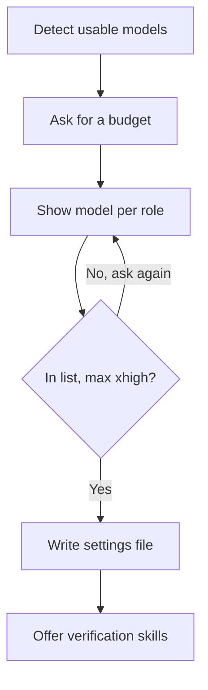
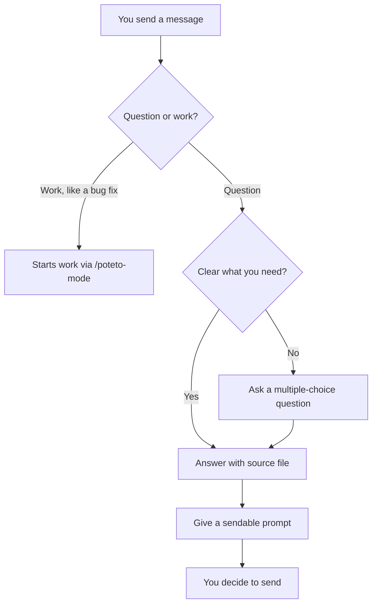

To install pstack in Claude Code, add Cursor's official plugin catalog, `cursor/plugins`, then install pstack from it. In Cursor, it takes one command. Step 1 below has the commands for both.

pstack helps an AI coding assistant work in a more orderly way, but open it up and there are dozens of skills. This post shows you how to start: install pstack, confirm which version you got, pick your models, and then hand every task to `/poteto-mode`, without learning every name first. The example prompts are generic, so copy them and swap in details from your own project.

> pstack Series | Part 1
>
> - Series guide: [What It Is and Where to Start](/posts/pstack-series-guide/)
> - Next (Part 2): [Understand Code and Compare Designs First](/posts/pstack-understand-design/)
>
> **Version note**: This post is based on pstack [version `0.15.43`](https://github.com/cursor/plugins/blob/2f87c854fe3e2fcda44ca86b46ede35aad3c46b7/pstack/.cursor-plugin/plugin.json), with Claude Code 2.1.326. That version is `cursor/plugins` commit `2f87c85` (2026-11-17 05:47 Taipei time). All five posts in the series were rechecked against this version on 2026-11-17, and when I checked, `cursor/plugins` main had no pstack changes after `2f87c85`. The Claude Code commands and menus follow the [official docs](https://code.claude.com/docs/en/plugins/install) as read on 2026-10-24. Later versions may change commands and behavior.
{: .prompt-info }

## A Few Terms First

| Term | Meaning |
| --- | --- |
| AI coding assistant | A tool such as Cursor or Claude Code that can read and write the files in your project and write code for you |
| skill | A set of instructions that tells the AI how to do one kind of work; you call it with a slash command such as `/poteto-mode` |
| pstack | A set of skills that Lauren Tan maintains in Cursor's official plugin repository, [`cursor/plugins`](https://github.com/cursor/plugins/tree/2f87c854fe3e2fcda44ca86b46ede35aad3c46b7/pstack) |
| playbook | A fixed list of steps for one type of task; for example, "fix a bug" means reproduce it, find the cause, fix it, and then verify |
| subagent | A separate AI that the main chat sends off to do one small piece of work |
| token | The unit an AI's usage is counted in; the more it reads and writes, the more tokens it uses |

## What pstack Installs

Version `0.15.43` has 58 skills, and each skill is a slash command. It also has two dedicated subagents, `poteto-agent` and `comment-sicko`, plus 22 playbooks under `poteto-mode`.

In Claude Code, a plugin's commands carry the plugin's name as a prefix. So Cursor's `/poteto-mode` becomes `/pstack:poteto-mode` (see the [README](https://github.com/cursor/plugins/blob/2f87c854fe3e2fcda44ca86b46ede35aad3c46b7/pstack/README.md#L30)). The examples below use the Claude Code form; in Cursor, just drop `pstack:`.

Other differences are listed in the official [Claude Code notes](https://github.com/cursor/plugins/blob/2f87c854fe3e2fcda44ca86b46ede35aad3c46b7/pstack/docs/harness/claude-code.md).

{: width="800" height="450" }
_The first-run flow: install, check the version, pick models, then start from /poteto-mode._

## Step 1: Install

The [README](https://github.com/cursor/plugins/blob/2f87c854fe3e2fcda44ca86b46ede35aad3c46b7/pstack/README.md#L15-L26) and the [setup guide](https://github.com/cursor/plugins/blob/2f87c854fe3e2fcda44ca86b46ede35aad3c46b7/pstack/docs/guide/01-setup.md#L5-L15) list two ways to install. In a Cursor chat, type:

```text
/add-plugin pstack
```

In Claude Code, first add the `cursor/plugins` GitHub repo (repository: the project folder that holds the code) as a marketplace (a plugin catalog), then install pstack from that catalog:

```text
/plugin marketplace add cursor/plugins
/plugin install pstack@cursor-plugins
```

`pstack@cursor-plugins` on the second line means "install pstack from the cursor-plugins catalog."

According to the [Claude Code docs](https://code.claude.com/docs/en/plugins/install#install-a-plugin), typing `/plugin install` in a chat doesn't install right away. It first opens the plugin's details pane so you can see what it adds, and then asks you to pick a scope. "Install for you" (user scope) makes it available in every project on this machine.

> None of the commands above name a version. You get whatever is on the default branch of `cursor/plugins` at that moment (the default branch is the main line of work in a repo, usually called main). I covered what to check before installing someone else's plugin in [this post on supply-chain and permission risks](/posts/coding-agent-supply-chain-permission-risks/).
{: .prompt-tip }

There are also third-party ports and mirrors of pstack online, such as `michael-denyer/pstack-claude` and `backnotprop/pstack`. They are not the version that `cursor/plugins` maintains. If you use one, I suggest reading through it and pinning a version first, for the reasons in the same [supply-chain post](/posts/coding-agent-supply-chain-permission-risks/).

## Step 2: Check the Version, Update, or Pin It

### See Which Version You Got

After installing, first check which version you got. According to the [Claude Code docs](https://code.claude.com/docs/en/plugins/install#install-a-plugin), running this line in your terminal (the window where you type commands) lists each plugin with its `Version`, `Scope`, and `Status`:

```bash
claude plugin list
```

You can also type `/plugin` in a chat and open the Installed tab. Compare the version with [`plugin.json`](https://github.com/cursor/plugins/blob/2f87c854fe3e2fcda44ca86b46ede35aad3c46b7/pstack/.cursor-plugin/plugin.json) to see whether you have the version this post is based on.

### Updates: Off by Default

According to the [Claude Code docs](https://code.claude.com/docs/en/plugins/install#keep-plugins-updated), Claude Code leaves auto-update **off** for third-party marketplaces, so pstack stays on the version you installed. pstack's [README](https://github.com/cursor/plugins/blob/2f87c854fe3e2fcda44ca86b46ede35aad3c46b7/pstack/README.md#L28) says the same and gives the two options below.

- **To update once by hand**: run the line below in your terminal. According to `claude plugin update --help`, the update takes effect only after you restart Claude Code.
- **To turn on auto-update**: type `/plugin` in a chat, open the Marketplaces tab, select `cursor-plugins`, and choose Enable auto-update.

```bash
claude plugin update pstack@cursor-plugins
```

> As I see it, auto-update being off by default gives you a chance to check first. Before you update, I suggest looking at what changed in pstack on `cursor/plugins`, then deciding. Turning on auto-update means you accept every new change as it lands. The [supply-chain post](/posts/coding-agent-supply-chain-permission-risks/) explains why this matters.
{: .prompt-tip }

### Pin a Specific Commit

A commit is one saved version in git (the most widely used version-control tool), and each commit has an ID (its SHA). To keep pstack on a commit you've reviewed, use a local folder as the marketplace, because the other approaches can't pin a commit for `cursor/plugins`:

| Approach | Pins a commit? |
| --- | --- |
| `/plugin install` | No. In the official [command reference](https://code.claude.com/docs/en/plugins/cli-reference#plugin-install), it has no option for a version or commit |
| `/plugin marketplace add` with `#ref` | Only [a branch or tag](https://code.claude.com/docs/en/plugins/install#add-a-marketplace) (a tag is a fixed name given to one commit, such as v1.0). When I checked on 2026-11-17, `cursor/plugins` had no tags |
| The `sha` field in `marketplace.json` | Yes, but the catalog's maintainer sets it (see the [marketplace reference](https://code.claude.com/docs/en/plugins/marketplace-reference#plugin-sources)), and the pstack entry in `cursor/plugins` doesn't set it |
| A local folder as the marketplace | Yes; the official docs support it |

To do that, download (clone) the repo to your computer, check out the commit you reviewed, and add that folder as a marketplace. Using this post's commit as the example, run this in your terminal:

```bash
git clone https://github.com/cursor/plugins.git ~/src/cursor-plugins
git -C ~/src/cursor-plugins checkout 2f87c854fe3e2fcda44ca86b46ede35aad3c46b7
claude plugin marketplace add ~/src/cursor-plugins
claude plugin install pstack@cursor-plugins
```

If you already added `cursor/plugins` from GitHub, both sources use the catalog name `cursor-plugins`. You can remove the old one first:

```bash
claude plugin marketplace remove cursor-plugins
```

Then run the four commands above. According to the [Claude Code docs](https://code.claude.com/docs/en/plugins/install#manage-marketplaces), removing a marketplace also uninstalls every plugin you installed from it, so you'll need to install again afterward.

This is the same "clone, then check out a reviewed commit" approach I recommend in the [supply-chain post](/posts/coding-agent-supply-chain-permission-risks/). To upgrade later, check out a newer commit in that folder and then update the plugin.

## Step 3: Pick Models With /setup-pstack

pstack splits work across roles, such as the one that writes code, the one that makes judgment calls, and the ones that sit on a review panel, and each role can use a different model. [`/setup-pstack`](https://github.com/cursor/plugins/blob/2f87c854fe3e2fcda44ca86b46ede35aad3c46b7/pstack/skills/setup-pstack/SKILL.md) picks the models for those roles.

Run it once after installing. Run it again when you switch accounts or plans, want different models, or update pstack:

```text
/pstack:setup-pstack
```

According to the [setup guide](https://github.com/cursor/plugins/blob/2f87c854fe3e2fcda44ca86b46ede35aad3c46b7/pstack/docs/guide/01-setup.md#L29), a rerun keeps any role you changed. When pstack changes a default model, an older settings file stays on the old default until you rerun, and the rerun tells you which values it replaced. If an older `/setup-pstack` wrote your settings file, `/poteto-mode` also reminds you to rerun it ([SKILL.md](https://github.com/cursor/plugins/blob/2f87c854fe3e2fcda44ca86b46ede35aad3c46b7/pstack/skills/poteto-mode/SKILL.md#L88)).

Here's what it does, step by step ([SKILL.md](https://github.com/cursor/plugins/blob/2f87c854fe3e2fcda44ca86b46ede35aad3c46b7/pstack/skills/setup-pstack/SKILL.md#L10-L78)):



When it shows the model for each role, it asks whether to accept them all or change a few roles.

### Reasoning Budget

The reasoning budget sets how hard a model thinks, also called effort. A higher level is more thorough but uses more tokens.

There are three budgets. According to the [setup guide](https://github.com/cursor/plugins/blob/2f87c854fe3e2fcda44ca86b46ede35aad3c46b7/pstack/docs/guide/01-setup.md#L27), the defaults are the `large` budget, and no role runs above `xhigh`. The other two lower every role from its default:

| Budget | Reasoning effort |
| --- | --- |
| large (default) | The defaults; most roles run at `xhigh` |
| medium | Each role one level lower; `xhigh` becomes `high` |
| small | Each role two levels lower; `xhigh` becomes `medium` |

### Verification Skills

The last step asks whether to generate two kinds of verification skills for your project. Each offer comes up once, and you can say no:

- **`/create-verification-skill`**: lets the AI drive your app the way a user does and check the result itself. It isn't offered if the project already has a way to drive the app for proof (a `verify-*` skill or an existing harness, meaning tooling that already runs the app).
- **`/create-formal-verification-skill`**: formal verification, which proves a key property of your code holds in every case in scope, not only the cases tests reach. It isn't offered if the project already has a formal verification skill.

### Where the Settings Go

The settings go into a global model settings file. Cursor writes `~/.cursor/rules/pstack-models.mdc`; Claude Code writes `~/.claude/rules/pstack-models.md`. Both live in your home folder, and "global" means the file applies to every project on your computer, not just the current one.

According to the [Claude Code notes](https://github.com/cursor/plugins/blob/2f87c854fe3e2fcda44ca86b46ede35aad3c46b7/pstack/docs/harness/claude-code.md#L38), Claude Code loads the file automatically at the start of every new session. Open a new chat once setup is done, because according to the [setup guide](https://github.com/cursor/plugins/blob/2f87c854fe3e2fcda44ca86b46ede35aad3c46b7/pstack/docs/guide/01-setup.md#L43), the model settings only apply to new sessions.

> **Pick only models your account can actually use.** According to the [Claude Code notes](https://github.com/cursor/plugins/blob/2f87c854fe3e2fcda44ca86b46ede35aad3c46b7/pstack/docs/harness/claude-code.md#L45), in Claude Code the "detected models" are the model names the subagent tool accepts. That doesn't mean your account or plan can use every one of them. If you're not sure, I suggest setting a role to `inherit-parent` or `auto`, so it uses the main chat's model (see the [setup guide](https://github.com/cursor/plugins/blob/2f87c854fe3e2fcda44ca86b46ede35aad3c46b7/pstack/docs/guide/01-setup.md#L31)).
{: .prompt-tip }

## When You're Unsure: Ask /poteto-help

[`/poteto-help`](https://github.com/cursor/plugins/blob/2f87c854fe3e2fcda44ca86b46ede35aad3c46b7/pstack/skills/poteto-help/SKILL.md) is pstack's help desk. When you don't know which skill to use or what to do first, or you want to know how to spend fewer tokens, just ask it in plain words:

```text
/pstack:poteto-help I just installed pstack. What should I do first?
```

```text
/pstack:poteto-help I want the AI to review my changes before I merge. Which skill should I use?
```

```text
/pstack:poteto-help pstack uses a lot of tokens. How can I use fewer?
```

Here's how it handles your message ([SKILL.md](https://github.com/cursor/plugins/blob/2f87c854fe3e2fcda44ca86b46ede35aad3c46b7/pstack/skills/poteto-help/SKILL.md#L9-L34)):



The multiple-choice options are: get set up, start a task, pick a skill, fix a run that went wrong, or make pstack your own. For a "how do I" question, it does **not** start the work itself, because a real run spends tokens. If you haven't run `/setup-pstack` and that changes the answer, it asks whether you want to set it up now.

## Every Task: Start With /poteto-mode

[`/poteto-mode`](https://github.com/cursor/plugins/blob/2f87c854fe3e2fcda44ca86b46ede35aad3c46b7/pstack/skills/poteto-mode/SKILL.md) is pstack's front door. Say clearly what you want, and it picks a playbook, follows its steps, and calls other skills when a step needs them.

### How to Write the Task

According to [guide chapter 2](https://github.com/cursor/plugins/blob/2f87c854fe3e2fcda44ca86b46ede35aad3c46b7/pstack/docs/guide/02-poteto-mode.md#L40-L59), a good task description has at most five parts, and one sentence each is enough:

- **The goal**: what's broken, or what you want. In other words, the symptom.
- **What counts as done**: something that can pass or fail. "Make it better" and "work on it for an hour" don't count.
- **The proof you want to see**: for example, real command output or a before-and-after number.
- **What you already know**: an error message, steps to reproduce, a related link. These save it a search.
- **Real constraints**: for example, "reproduce first", "don't change any code yet", "zero behavior change", or "let me review before you proceed".

Leave three things out:

- **How to do it**: give it room to find a better way.
- **Your guess at the cause**: a stated guess narrows its search.
- **Which skills to use**: the playbook already orders them, and a hand-written order tends to drop or reorder steps ([guide chapter 2](https://github.com/cursor/plugins/blob/2f87c854fe3e2fcda44ca86b46ede35aad3c46b7/pstack/docs/guide/02-poteto-mode.md#L135)).

### Three Examples to Adapt

**Investigate a problem** (read, don't change):

```text
/pstack:poteto-mode After a user logs out, their shopping cart is still there. Find out where that data is kept. Don't change any code yet. Done means: explain where the data is stored and when it should be cleared, with the locations of the related files.
```

According to [guide chapter 2](https://github.com/cursor/plugins/blob/2f87c854fe3e2fcda44ca86b46ede35aad3c46b7/pstack/docs/guide/02-poteto-mode.md#L103), the phrase "don't change any code yet" pins a task to the Investigation playbook.

**Fix a bug**:

```text
/pstack:poteto-mode The CSV export drops the last row. It started after yesterday's release. Reproduce first, then fix. Done means: exporting the existing test data gives the same row count as the database. Show me the row counts before and after the fix.
```

**Add a feature**:

```text
/pstack:poteto-mode Add a --json flag to this command. The existing text output must not change at all. Verify both outputs.
```

### What It Does

{: width="800" height="450" }
_/poteto-mode first identifies the task type, then follows that playbook's steps._

1. **It says what it understood the goal to be.** Its first reply restates your goal in its own words, along with the smallest change that meets it. Then it starts without waiting for you to confirm ([SKILL.md](https://github.com/cursor/plugins/blob/2f87c854fe3e2fcda44ca86b46ede35aad3c46b7/pstack/skills/poteto-mode/SKILL.md#L19)).
2. **It identifies the task type and picks a playbook.** The [playbook list](https://github.com/cursor/plugins/blob/2f87c854fe3e2fcda44ca86b46ede35aad3c46b7/pstack/skills/poteto-mode/SKILL.md#L108-L110) covers Investigation, Bug fix, Perf issue, Feature, Refactoring, Prototype, writing a skill, and more. Large or cross-cutting work, or work you'll step away from and check later, goes to the `figure-it-out` skill, which designs its own process.
3. **It copies the playbook's steps verbatim into a todo list**, ahead of any other todos.
4. **It works through the steps**, and calls any other skill a step needs on its own.
5. **It verifies and reports.** The "Opening a PR" playbook runs at the end of every other playbook. A PR (pull request) is a request for others to review and merge your changes.

So you'll see a todo list whose first items are the playbook's steps. The final reply opens with your goal again, and the playbook sets the rest; for a feature, that's what it built, what it chose and why, and the decisions left to you ([feature.md](https://github.com/cursor/plugins/blob/2f87c854fe3e2fcda44ca86b46ede35aad3c46b7/pstack/skills/poteto-mode/playbooks/feature.md#L21)).

According to the [SKILL.md](https://github.com/cursor/plugins/blob/2f87c854fe3e2fcda44ca86b46ede35aad3c46b7/pstack/skills/poteto-mode/SKILL.md#L104), the reply uses short sentences, leads with what changes for you, and gives each claim its evidence or labels it as measured, inferred, or a guess.

### Keep Going, Switch, or Start Fresh

- **Keep going**: once the chat holds the task, a short line is enough, such as "do it", "continue", or "keep going until done" ([guide chapter 2](https://github.com/cursor/plugins/blob/2f87c854fe3e2fcda44ca86b46ede35aad3c46b7/pstack/docs/guide/02-poteto-mode.md#L77-L93)).
- **Change the subject**: to switch tasks in the same chat, start with "new task". Only then does it pick a fresh playbook, instead of treating the new problem as the next step of the last one ([guide chapter 2](https://github.com/cursor/plugins/blob/2f87c854fe3e2fcda44ca86b46ede35aad3c46b7/pstack/docs/guide/02-poteto-mode.md#L95-L103)).

```text
/pstack:poteto-mode new task. figure out why the cache entry survives logout. don't change any code yet.
```

- **Call it again for each new task**: Claude Code included, start each new task with `/pstack:poteto-mode`. The exception is Cursor's Custom Mode, a mode that stays on for the whole chat. Pick `/poteto-mode` from the `/` menu with Option+Enter (Mac) or Alt+Enter (Windows) to make it a Custom Mode. However, according to the [`poteto-help` notes](https://github.com/cursor/plugins/blob/2f87c854fe3e2fcda44ca86b46ede35aad3c46b7/pstack/skills/poteto-help/SKILL.md#L54-L58), Cursor's docs list Custom Modes only in the Agents Window and the CLI (a program you run with typed commands in a terminal).

## Install cursor-team-kit for the Full Set

The [README](https://github.com/cursor/plugins/blob/2f87c854fe3e2fcda44ca86b46ede35aad3c46b7/pstack/README.md#L258-L266) says three things `/poteto-mode` uses aren't in pstack but in another plugin, `cursor-team-kit`:

- `/deslop`, which cleans up code.
- `control-cli` and `control-ui`, which drive a CLI and a browser UI.

The README's advice is to install `cursor-team-kit` alongside pstack for the full set. [Guide chapter 5](https://github.com/cursor/plugins/blob/2f87c854fe3e2fcda44ca86b46ede35aad3c46b7/pstack/docs/guide/05-build-and-clean.md#L59) adds that the steps before opening a PR run `/deslop`. If you don't have it, ask for the same cleanup in plain words, such as removing narrating comments, defensive code with no reason behind it, and changes unrelated to the task.

## When to Use Which

| Situation | What to use |
| --- | --- |
| You just installed pstack | `/pstack:setup-pstack`, once |
| You switched accounts or plans, want other models, or updated pstack | `/pstack:setup-pstack` again |
| You don't know which skill to use or what to do first | `/pstack:poteto-help` |
| Any task that needs rigor: investigating, fixing a bug, adding a feature | `/pstack:poteto-mode`, with the goal and done check |
| Changing the subject in the same chat | `/pstack:poteto-mode new task. …` |
| A small, obvious edit | No pstack; just tell the AI |

## A Full Example (Fictional)

Say you've just joined a web app project and want to use pstack on a user report: "The link in the password reset email says it has expired as soon as I click it."

**1. Install and check the version.** Install pstack as in Step 1, then list your plugins with the command from Step 2 and confirm the version is what you expect.

**2. Pick models.** Run the setup from Step 3, choose the `large` budget, and keep only models your account can use. When it offers a verification skill and the project doesn't have one yet, you can say yes. When it's done, open a new chat.

**3. Ask first if you're unsure.** If you're not sure whether this is an investigation or a bug fix, ask:

```text
/pstack:poteto-help A user says the password reset link expires as soon as they click it. How should I start?
```

It replies with a suggested prompt. Read it, adjust it, and then send it.

**4. Hand it to /poteto-mode.**

```text
/pstack:poteto-mode User report: the link in the password reset email shows "expired" as soon as it's opened. Reproduce first, then fix. Done means: a newly sent link resets the password while it's still valid, and only shows "expired" after it expires. Show me the repro before and after the fix.
```

This description gives the symptom, the done check, and the proof you want, but not your guess at the cause or a list of skills. Its first reply restates your goal, which is worth a look to make sure it understood. Then the todo list should show the Bug fix playbook's steps.

**5. Keep going, or switch.** When it stops to ask you something, answer and then say "continue". If you then want to add a "resend email" button, start with `new task` and describe the new feature and its done check.

## When to Skip pstack, and How to Save Tokens

- **Small edits don't need pstack.** The [setup guide](https://github.com/cursor/plugins/blob/2f87c854fe3e2fcda44ca86b46ede35aad3c46b7/pstack/docs/guide/01-setup.md#L52) is clear on this: for a small, obvious edit, just ask.
- **pstack uses extra tokens.** It sends out subagents and review panels, and that's the price of the rigor. The [setup guide](https://github.com/cursor/plugins/blob/2f87c854fe3e2fcda44ca86b46ede35aad3c46b7/pstack/docs/guide/01-setup.md#L45-L52) lists ways to spend fewer:
  - Rerun `/setup-pstack` with a smaller budget or cheaper models.
  - Set a role to `auto` or `inherit-parent` so it uses the main chat's model.
  - Shorten a review panel's model list. Each entry runs one more subagent.
  - Save `/poteto-mode` for work that needs rigor.

## Conclusion

I don't think you need to learn every skill before using pstack. Do the three steps above once, then hand each task to `/poteto-mode`. In the next part, I'll cover how to use pstack to understand the code, then design, before you change it.

## Further Reading

- [pstack README](https://github.com/cursor/plugins/blob/2f87c854fe3e2fcda44ca86b46ede35aad3c46b7/pstack/README.md): installing, and the parts not shipped in pstack.
- [Setup guide: Set up pstack](https://github.com/cursor/plugins/blob/2f87c854fe3e2fcda44ca86b46ede35aad3c46b7/pstack/docs/guide/01-setup.md): budgets, roles, and ways to spend fewer tokens.
- [Guide chapter 2: Route work through /poteto-mode](https://github.com/cursor/plugins/blob/2f87c854fe3e2fcda44ca86b46ede35aad3c46b7/pstack/docs/guide/02-poteto-mode.md): how to write a task, with more examples.
- [Claude Code notes](https://github.com/cursor/plugins/blob/2f87c854fe3e2fcda44ca86b46ede35aad3c46b7/pstack/docs/harness/claude-code.md): the differences between Cursor and Claude Code.
- [`poteto-mode` SKILL.md](https://github.com/cursor/plugins/blob/2f87c854fe3e2fcda44ca86b46ede35aad3c46b7/pstack/skills/poteto-mode/SKILL.md): the full playbook list and how it matches tasks.
- [Claude Code: Install and manage plugins](https://code.claude.com/docs/en/plugins/install): adding, versioning, updating, and removing marketplaces.
- [Agent Skill and MCP Security Risks: 5 Cases, a Checklist](/posts/coding-agent-supply-chain-permission-risks/): what to check before installing a plugin.
- [How to Write an Agent Skill: SKILL.md, Triggers, Tests](/posts/agent-skill-authoring-guide/): descriptions, testing, and upkeep from a skill author's side.
- [Part 1 of the mattpocock/skills series](/posts/mattpocock-skills-setup-routing-guide/) and the [series guide](/posts/mattpocock-skills-series-guide/): another skill set built around setting up first, then letting a help desk suggest the next step.
