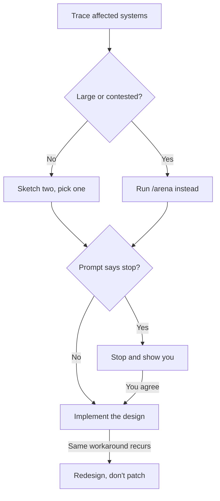
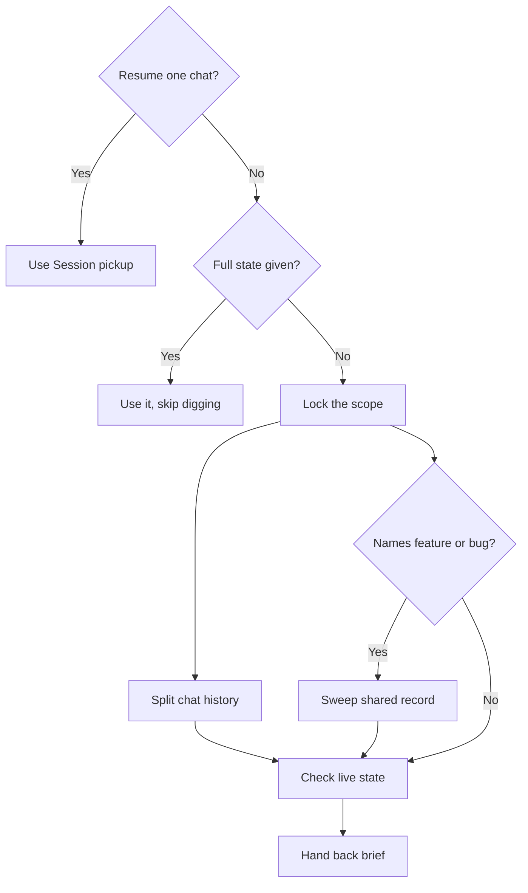
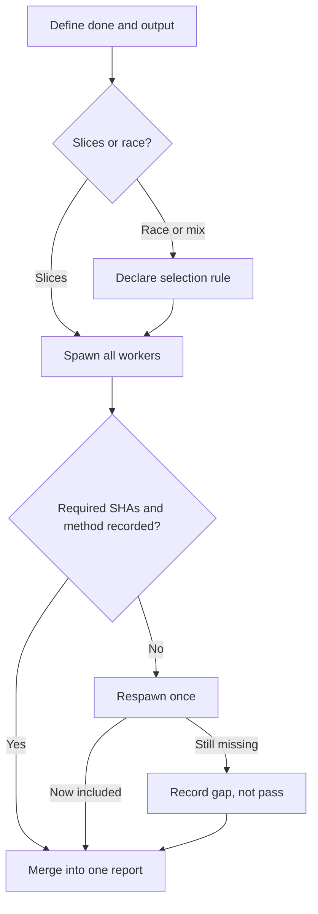

Ask an AI coding assistant to "change this feature," and it often starts editing at the first place that looks reasonable, using the first approach it thinks of. This post shows you how to flip that order with five pstack skills. First have the AI explain how the code works now and why it is shaped that way, then have it compare a few designs, and after the change, have other models look for problems.

> pstack Series | Part 2
>
> - Series guide: [What pstack is and how to read the four parts](/posts/pstack-series-guide/)
> - Previous (Part 1): [Install, pick models, start with /poteto-mode](/posts/pstack-install-routing/)
> - Next (Part 3): [After the code is written, prove it works before merging](/posts/pstack-build-verify-merge/)
{: .prompt-info }

> This post is based on pstack [version `0.15.43`](https://github.com/cursor/plugins/blob/2f87c854fe3e2fcda44ca86b46ede35aad3c46b7/pstack/.cursor-plugin/plugin.json), at `cursor/plugins` commit `2f87c85` (05:47 on 2026-11-17, Taipei time), with Claude Code 2.1.326. I rechecked all five posts in the series against this version on 2026-11-17, and at that time `main` had no pstack changes after `2f87c85`; later versions may behave differently.
{: .prompt-info }

## Before You Start

pstack is a set of skills in Cursor's official plugin repository. A skill is a set of instructions that tells the AI how to do one kind of job. I covered installing pstack and picking models in [Part 1](/posts/pstack-install-routing/); this post assumes it is already installed.

pstack's docs use Cursor's form, such as `/how`. In Claude Code (an AI coding assistant you use in a terminal), plugin commands carry the plugin name in front, so you type `/pstack:how`. The examples below use the Claude Code form; in Cursor, just drop the `pstack:`.

Each of these skills is set so the AI can't invoke it on its own; you have to type the command. The other option is to hand the task to `/pstack:poteto-mode` and let it sequence the work. For example, if your prompt says "don't change any code yet," it runs a read-only investigation, which first traces the code involved and adds `/why` for questions about motivation.

When a skill runs, it sends out other AI instances to work on parts of the job; each one is a subagent.

{: w="800" h="450" }
_Understand first, then design, then review the change. `/arena` works on its own, and `/architect` switches to it for a large or contested design._

## /how: Learn How the Code Works Now

Before you change code you don't know well, use `/how`. Also use it to ask "where should this live, which module owns it, is this the right layer." It answers how things work now; why they were written that way is `/why`'s job.

Ask the question you actually have. You can add an entry point and the part you care about most:

```text
/pstack:how how does <feature or module> work? start from <an entry point, such as an API or a command> and explain how data flows and what each file is responsible for. i most want to know <the part you care about>.
```

For example:

```text
/pstack:how where is the session created after a user logs in, and how does it expire? what happens on the frontend once it expires?
```

The flow is short:

1. If the scope is unclear, it states its interpretation and starts exploring; you can redirect it if it's off.
2. Whatever the size of the question, it sends a single read-only subagent that reads the code and writes the explanation in one pass. The explanation is for a senior engineer new to this area, who should come away with a solid mental model, enough to start working in it confidently.
3. It hands you that explanation, with light edits or context from the conversation at most. It doesn't substantially rewrite it.

The skill file doesn't fix the sections. The pstack guide says it covers the runtime flow, the key types (the kinds and shapes of data, such as which fields an order has), and the non-obvious parts that trip people up. If you want fixed sections, such as "which files to look at before starting," say so in your prompt.

When you go through a read-only investigation with `/pstack:poteto-mode`, the result is organized into Overview, Key Concepts, How It Works, Where Things Live, and Gotchas. If the question is a choice between options, you get a recommendation with a tradeoffs table instead.

The pstack guide's suggested order is how first, then why: mechanics before history.

## /why: Find Out Why the Code Looks This Way

Use `/why` when you want to know why a piece of code was written this way, why an approach was chosen, where a threshold number came from, or how a regression (something that used to work and then broke) came about. I think it is especially useful before you change something, so you know which parts exist for a reason and shouldn't be touched lightly.

Name the target and ask your question. If you're asking because you plan to change it, include the change you have in mind and ask whether the original reason still holds:

```text
/pstack:why why does <a piece of code or a decision> work this way? does the reason still hold? i plan to <the change you want to make>.
```

For example:

```text
/pstack:why why is the API retry limit set to five? does the reason still hold? i plan to make it configurable.
```

If you suspect the history explains the mess, you can ask for both at once: "do why first, then how."

The skill file is a single paragraph. It doesn't say how many subagents to send, which kinds of sources to search, or what sections the report has. As I read it, it asks for three things:

1. **Answers from the record, not by guessing from the code.** It reads the commits (a commit is one recorded change in git) and PR (pull request) discussions that introduced the code. Then it reads those for each later change to it.
2. **Looks at other sources only when that trail is thin.** If you have MCP servers connected, it may use them. An MCP server is a connector that lets the AI use an outside tool, such as an issue tracker, Slack, or Notion.
3. **Keeps track of who said what.** It cites what the authors wrote, marks its own inferences as inferences, and says what the record doesn't answer.

The answer cites its sources. "Nobody wrote down why" is an answer too.

If you plan to change the code, I suggest ending your prompt by asking it to list what to **Preserve**, what you can **Change**, what to **Avoid**, and what the **Risks** are. The skill file doesn't ask for this list, so you have to request it. Take the list to `/architect` as constraints for the design.

> `/why` may use the MCP servers you've connected to read issues, docs, and chat history. Before you start, decide what you're willing to let the AI read. For how to tighten permissions, see my post [Third-Party Skills and MCP Servers: The New Attack Surface in Your Coding Agent](/posts/coding-agent-supply-chain-permission-risks/).
{: .prompt-tip }

## /architect: Sketch the Design Before Writing Code

Use `/architect` for work that isn't a small fix, where jumping straight into code could lock in the wrong structure. The pstack guide's rule of thumb: if the change crosses function boundaries or moves which code owns what, it earns `/architect`.

Say what you want built and what you care about most. By default it moves on to writing code once the design is done, so **if you want to see the design first, you must say "stop and show me the design first" in your prompt**:

```text
/pstack:architect design <the feature>. stop and show me the design before implementing, and tell me which two designs you compared and why you picked this one. i care most about <how callers use it / performance / room to grow>. constraints: <what /why found must not change>.
```

For example:

```text
/pstack:architect design the import pipeline, then stop and show me before implementing. i care most about how callers use it.
```

The skill file is just two short paragraphs. Here is the flow:



Both designs contain only types, function signatures (a function's name, parameters, and return value), and how modules divide the work. It picks the one that best fits three tests: each piece of state has one owner, each task has one way to do it, and callers need to know the least. When it switches to `/arena`, several subagents each draw one to compare.

The skill file doesn't say what format the design comes in. If you want to see how the two designs compare, why it picked this one, and which questions are yours to decide, ask for them in your prompt, as in the template above.

If the design matters and a mistake would be expensive, you can run `/interrogate` on the design before implementation. In that case, the models it sends out build a prototype or probe the current code to find where the design breaks. Otherwise, run `/interrogate` on the change once it's built.

## /interrogate: Have Several Models Look for Problems

After the code is changed and before you merge, use `/interrogate` to find problems neither you nor the AI noticed. Every finding has to be proven by a run, so it works best on actual code changes. A plan with no code behind it gives it little to break, so settle open questions with prototypes first.

Say what to review: a few files, a diff (the lines that changed between two versions), or a whole branch (a line of development in git). Adding "don't change anything yet" and "no nitpicks" makes the result more useful:

```text
/pstack:interrogate the whole branch, but skeptically. don't change anything yet. no nitpicks unless it's an actual bug or regression in behavior.
```

To review just a few files:

```text
/pstack:interrogate review <files or folder>. the goal of this change is <what you want to achieve>.
```

How it works:

1. **Sets the scope.** If you named files or a diff, it uses those. Otherwise it takes every change on the current branch from where it split off (the merge base) through your working directory, uncommitted changes included.
2. **Writes down the intent of the change.** It restates it in its own words from your message, the commit messages, and the PR description. If the intent is unclear, it asks you first.
3. **Sends out adversaries.** It sends one adversary per model you've set in the `interrogate reviewers` line. Each gets its own worktree (a separate working copy of the same project), with your uncommitted changes copied in.
4. **Reruns to verify.** It reruns the command attached to each finding. A finding stays only if the output shows the failure and that failure breaks the intent of the change; the rest are dropped. Findings that share a root cause are merged into one.

Each adversary gets the same scope, intent, and brief: break this change, and prove every finding with a run against the real code. That run can be a failing test, a repro script, or command output that shows the wrong behavior. For a design or plan, it builds a prototype or probes the current code.

Anything it didn't run stays out of the report, including style, naming, structure, and risks that only matter after some future change. Finding nothing is a valid result.

The verdict has three parts:

- **Intent:** its restatement of what the change is meant to do.
- **Findings:** each verified finding, with the command, its output, how it breaks the intent, and which adversaries found it. If none survive, it says there are no verified findings.
- **Dropped:** for each adversary, how many findings were dropped and why.

It doesn't change your code automatically; whether to fix anything, and what, is up to you. Handle the Findings first; each one comes with its command, so you can rerun it yourself to confirm. Read the Dropped list too, and override either one if you disagree.

{: w="800" h="450" }
_Several models each try to break the same change, and only findings that still fail on a rerun are kept._

## /arena: Let Several AIs Each Try, Then Keep the Best

Hand `/arena` anything where a single attempt would likely lock in the wrong approach. The pstack guide's examples are standalone decisions like naming, data formats, and algorithms. You can also use it for a second opinion: your current design becomes one candidate, and you see whether the others found something better.

State the task, why it matters, and how many candidates you want. The more the decision matters, the more you can ask for:

```text
/pstack:arena <the task>. this matters because <it's hard to change later / it affects many places>. <N> candidates, own worktree per attempt.
```

Each candidate gets its own place to work, a git worktree where possible, meaning a separate working copy of the same project. Parallel AIs sharing one working directory overwrite each other, and nobody can tell who changed what, so you can ask for it in your prompt as above.

For example:

```text
/pstack:arena pick the cache key format, 3 candidates. the format is expensive to change later.
```

```text
/pstack:arena give me a second opinion on our current approach.
```

It opens a to-do list with six phases:

1. **Frame:** every candidate gets exactly the same prompt, so the prompt is the contract. It states what each candidate should produce, then writes 3 to 6 concrete criteria that can be scored, for the judge and for picking the base in step 4; the candidates see only the task.
2. **Fan out:** it sends N subagents at the same time. Each does the task and notes the alternatives it considered and why it rejected them. If one produces nothing, it carries on with the remaining N-1 and notes the dropout.
3. **Cross-judge:** once every candidate is done, it sends one read-only judge that scores each candidate against each criterion and recommends one as the base. The judge must run on a model from a different vendor than the main conversation (Fable counts as Claude); if none can run, it skips the judge and says so in its note.
4. **Pick:** it reads every candidate end to end itself and scores each one criterion by criterion, then compares with the judge when there was one. If they agree, the pick is confirmed; if not, one side is biased or the criteria were unclear, so it reads both rationales. It picks the version a future maintainer can extend most easily without breaking its rules.
5. **Graft:** it usually takes one or two strengths from each losing candidate and folds them into the base by hand instead of pasting. If the candidates converge, it ships the shared approach as is. If they differ wildly, step 1 wasn't clear enough, so it reframes and runs again instead of averaging.
6. **Verify:** it checks the merged result like any other output. If it finds a problem, it works out whether step 1 was wrong (start over) or a candidate had caught it and the graft was missed (back to step 5).

In Claude Code, subagents can only use Claude models (Opus, Sonnet, Haiku, Fable). A model from another vendor in the judge list (Gemini by default) [runs on the main conversation's model instead](https://github.com/cursor/plugins/blob/2f87c854fe3e2fcda44ca86b46ede35aad3c46b7/pstack/docs/harness/claude-code.md#L36); if the list has only Claude models, the judge is skipped. Either way, the result says which.

You get one merged result and a note: the base and why, the judge's verdict (or that the judge was skipped), each graft and the candidate it came from, what was rejected and why, any convergence or dropouts, and the verification result.

If the result is code, you can run `/interrogate` before merging. If what you need is coverage, such as checking every package once, rather than comparing approaches, use `/swarm` instead.

{: w="800" h="450" }
_More candidates means more subagents: N candidates plus at most one judge._

## When the Situation Calls for It: Three More Skills and Two Playbooks

The five skills above are the main path; the ones below are for specific situations. Prototypes and plans are playbooks under `/poteto-mode`, so you run them through it; they have no command of their own.

### /teach: When a Summary Isn't Enough

When `/how`'s explanation isn't enough and you want to actually understand a change or a piece of code, use `/teach`. For example, you're reviewing a PR, taking over an unfamiliar module, or checking that a fix addresses the cause and not the symptom. It also works on the AI's own choices ([guide, chapter 3](https://github.com/cursor/plugins/blob/2f87c854fe3e2fcda44ca86b46ede35aad3c46b7/pstack/docs/guide/03-understand.md#L37-L51)).

Say what you want to understand. The guide suggests adding "convince me", which turns the explanation into an argument you can test instead of a tour:

```text
/pstack:teach me how this PR changes retries. convince me it fixes the cause and not the symptom.
```

To ask about the AI's own approach:

```text
/pstack:teach me why you implemented it this way and not with a queue. what did you trade off, and why?
```

The guide points out that this helps the AI too: it has to read the code and back each claim with evidence, instead of stating it confidently and moving on.

How it works ([SKILL.md](https://github.com/cursor/plugins/blob/2f87c854fe3e2fcda44ca86b46ede35aad3c46b7/pstack/skills/teach/SKILL.md#L11-L17)):

1. **Decides the few things you should walk away with.** It reads from the conversation why you're asking (about to change it, reviewing it, debugging it, or new to it) and what you already know, then picks a few points. It skips what you plainly know and doesn't quiz you.
2. **Lets `/how` and `/why` do the digging.** It reads the code itself to get oriented, then runs `/how` and `/why` in parallel and combines the results. For a whole subsystem it runs both; for a small change, one may be enough.
3. **Gives the smallest complete answer first.** It says what the thing is in a sentence or two, ties it to the case in front of you, and only then goes into the mechanism, the reasons, and the edge cases. It goes deeper when you ask, never with a wall of text.
4. **Builds diagrams up one at a time.** When there are three or more moving parts, it doesn't draw one diagram with everything at once. It draws a series, where each diagram redraws the last and adds one part.
5. **Keeps `/why`'s hedges intact.** It rewords freely for teaching, but where `/why` marked an inference or said the record has no answer, that stays as written, because those hedges are findings, not style.

You get a plain explanation, not a report on what it did. It leads with the main point, then covers what the thing is, how it works, and why, and ends with the threads worth chasing with `/how` or `/why` ([SKILL.md](https://github.com/cursor/plugins/blob/2f87c854fe3e2fcda44ca86b46ede35aad3c46b7/pstack/skills/teach/SKILL.md#L21)). Its goal is your understanding; it changes no code ([SKILL.md](https://github.com/cursor/plugins/blob/2f87c854fe3e2fcda44ca86b46ede35aad3c46b7/pstack/skills/teach/SKILL.md#L9)).

Once you understand it and are ready to make changes, move on to `/architect`.

### /recall: Get Your Context Back Before Resuming a Topic

When you're starting or resuming work on a topic you've touched before, use `/recall` to rebuild where you left off. Your old chats hold context a fresh agent lacks, so the guide suggests loading it first and then handing over the new input ([guide, chapter 3](https://github.com/cursor/plugins/blob/2f87c854fe3e2fcda44ca86b46ede35aad3c46b7/pstack/docs/guide/03-understand.md#L53-L65)). Resuming **one specific** chat is the Session pickup playbook's job, which I cover in [Part 4](/posts/pstack-principles-customization/).

Name the topic and the time range. If there's new input for it to handle, add it after:

```text
/pstack:recall catch me up on the export work from last week
```

```text
/pstack:recall my work on the virtualized list from yesterday, then read this bug report.
```

Here is the flow ([SKILL.md](https://github.com/cursor/plugins/blob/2f87c854fe3e2fcda44ca86b46ede35aad3c46b7/pstack/skills/recall/SKILL.md#L17-L22)):



The full state means paths, branch, and the change. The scope covers the time window ("recent" defaults to the last 7 days), the topic, and the project (the current one by default; it doesn't read another project's history unless you ask). It states the scope back to you first.

For chat history, it sends several subagents on a fast, cheap model in parallel, each taking a slice and reading only the chats and passages that match the topic. With only one or two chats, it skips the subagents and searches directly.

Every subagent reports in the same format: the topic, your goal, decisions, open threads, where you got stuck or corrected the agent, and artifacts (PRs, tickets, branches). In Claude Code, it reads this project's history (`.jsonl` files) under `~/.claude/projects/`, and only this project's folder ([Claude Code mapping](https://github.com/cursor/plugins/blob/2f87c854fe3e2fcda44ca86b46ede35aad3c46b7/pstack/docs/harness/claude-code.md#L57)).

The shared record means source control, the issue tracker, chat channels, docs, and error tracking. It sends one subagent per source to ask "what's the current state, what's been tried and didn't hold, and what are users still reporting". When the topic names a feature, file, subsystem, or bug, this step always runs; it skips only MCP servers that aren't connected, and says so.

The last step uses `git` and `gh` to confirm the current state of the PRs, branches, and tickets it found.

The brief follows a fixed format ([SKILL.md](https://github.com/cursor/plugins/blob/2f87c854fe3e2fcda44ca86b46ede35aad3c46b7/pstack/skills/recall/SKILL.md#L24-L33)):

- **Capsule:** at most 5 bullets on what the work is and where it stands overall.
- **Threads:** one line per thread, each tagged with a status such as `[merged #N]`, `[open PR #N]`, `[in flight <branch>]`, or `[reverted #N]`.
- **Problems:** at most 5 recurring ones, including symptoms users keep reporting and fixes that shipped and were reverted, so the next attempt starts where the last one failed.
- **Next move:** the single most useful next action.

Findings from your chats cite the chat ID, and findings from the shared record cite their source, such as a PR number or ticket ID. Start a new task from the Next move and hand it to `/pstack:poteto-mode`.

> `/recall` reads your past chat history, and may also use the MCP servers you've connected to read issues, chat channels, and error tracking. As with `/why`, decide first what data you're willing to let the AI read.
{: .prompt-tip }

### /swarm: When You Need Coverage, Not a Comparison

Use `/swarm` when running in parallel buys you coverage or lets several independent attempts race. For example, checking every package once, or having several workers try to reproduce a flaky failure at the same time.

Three skills send work out in parallel; they differ in how they converge:

| Skill | How it sends work out | How it converges |
| --- | --- | --- |
| `/arena` | The same task N times | A judge scores; it picks a base and grafts in strengths |
| `/interrogate` | Borrows `/arena`'s fan-out, one adversary per model | No judge, base pick, or grafting; adversaries find different failures, so it keeps every verified finding |
| `/swarm` | Slices that each do their own part, or workers racing on the same task | A selection rule declared up front, with no base pick or grafting ([guide, chapter 4](https://github.com/cursor/plugins/blob/2f87c854fe3e2fcda44ca86b46ede35aad3c46b7/pstack/docs/guide/04-design.md#L47-L55)) |

Say how to split the work, how to check each slice, and that you want one report:

```text
/pstack:swarm check every package under packages/ against its check.sh. one worker per package. one report.
```

For a race, state the selection rule up front:

```text
/pstack:swarm 3 workers, each trying to reproduce this flaky test failure. first one to reproduce it wins.
```

It opens a to-do list with four phases: Frame, Fan out, Aggregate, and Report ([SKILL.md](https://github.com/cursor/plugins/blob/2f87c854fe3e2fcda44ca86b46ede35aad3c46b7/pstack/skills/swarm/SKILL.md#L11-L41)):



The selection rule is one of `first pass`, `rank all`, or `best-of`. The worker model comes from the `swarm workers` line in your `/setup-pstack` configuration, or Opus 5.5 (high) if that line is missing.

Workers that write files each get their own output location, and when workers verify or measure commits, each brief names the exact SHAs and the method.

Every brief stands alone, with the goal, scope, slice, how to verify, and what to report. Workers report `PASS`, `ISSUES`, or `BLOCKED` with evidence, and a worker that can prove a defect lists every issue it can prove, not only the first.

In Cursor, workers run in the cloud by default; in Claude Code, each worker gets its own worktree instead ([Claude Code mapping](https://github.com/cursor/plugins/blob/2f87c854fe3e2fcda44ca86b46ede35aad3c46b7/pstack/docs/harness/claude-code.md#L24)). If a worker drops out, it carries on with N-1 and notes it.

When aggregating, coverage work needs a result for every slice, and a race applies the rule declared up front. The report comes back in the chat without raw worker output: a results table, a one-line summary per issue, and any gaps or dropouts, plus the selection rule for a race.

Fix the `ISSUES` one by one. Handle `BLOCKED` results and gaps separately; don't count them as passes.

### Prototypes: Decide With Something That Runs

Prototyping runs through the Prototype playbook, for an open question you can answer by running something, such as a layout, an interaction, a timing, or an approach. The guide's advice is never to take the first design: ask for a few and pick from evidence you can see. It works for behavior and algorithms, not just UI ([guide, chapter 4](https://github.com/cursor/plugins/blob/2f87c854fe3e2fcda44ca86b46ede35aad3c46b7/pstack/docs/guide/04-design.md#L67-L83)).

`/poteto-mode` already prototypes on its own when it hits a fork that running something can settle, instead of stopping to ask you ([SKILL.md](https://github.com/cursor/plugins/blob/2f87c854fe3e2fcda44ca86b46ede35aad3c46b7/pstack/skills/poteto-mode/SKILL.md#L21)).

Say what to compare and what evidence you want to see:

```text
/pstack:poteto-mode prototype a few options for the new dropdown menu. put them behind a switcher and send me screenshots of each.
```

For a larger design, pair it with `/architect` and keep a review gate:

```text
/pstack:poteto-mode we need rate limiting for external webhooks. /architect it first, and answer open questions with prototypes. let me review before proceeding.
```

This is the one playbook that inverts "smallest change" and the verification bar. Speed comes before polish, code quality doesn't matter, and there's no planning; the rigor is in picking the right design cheaply, and it proposes variations you didn't ask for. The steps ([Prototype playbook](https://github.com/cursor/plugins/blob/2f87c854fe3e2fcda44ca86b46ede35aad3c46b7/pstack/skills/poteto-mode/playbooks/prototype.md#L5-L12)):

1. **Names the decision.** For example, which layout, interaction, or density, or which behavior, timing, or approach. No decision means no prototype; the work goes to the regular Feature playbook instead.
2. **Gathers references when the direction is open.** It searches for prior art and summarizes themes, palettes, and layouts so you can pick a direction first. It skips this when the direction is set.
3. **Builds throwaway versions in a scratch directory, apart from production code.** For a visual decision, it uses the lightest stack that shows the idea, such as plain HTML, CSS, and JavaScript. For a behavior or timing decision, it uses the smallest script that tests the question. No production framework, no tests, no abstractions.
4. **Puts the options behind one switcher.** You switch with buttons or a keypress, and each option is labeled.
5. **Verifies on the matching surface.** For a visual decision, it screenshots each option and drives the interaction. For a behavior or timing decision, it logs the timing, prints the output, or watches the render, and the observation is the test. Screenshots need a skill that drives the UI, such as `control-ui` from `cursor-team-kit` (see [Part 1](/posts/pstack-install-routing/)).
6. **Lays out the options, tradeoffs, and a recommendation.**

You get the options it tried, the evidence (screenshots for a visual decision, observed output or timing for a behavioral one), the tradeoffs, its recommendation, and the scratch directory path. It says plainly that the prototype is throwaway ([Prototype playbook](https://github.com/cursor/plugins/blob/2f87c854fe3e2fcda44ca86b46ede35aad3c46b7/pstack/skills/poteto-mode/playbooks/prototype.md#L14)). Once you pick a direction, hand it to the Feature playbook for the real build, or use `/architect` to settle the shape first; don't merge prototype code into the project.

### Plans: Split the Work Into PRs After the Design Settles

A written plan comes from the Multi-phase plan playbook. pstack has no planning skill on purpose; in the README, the author writes about not believing in planning and says the best spec is code ([README](https://github.com/cursor/plugins/blob/2f87c854fe3e2fcda44ca86b46ede35aad3c46b7/pstack/README.md#L268-L270)).

Use it only when the work spans several PRs and the design has settled ([guide, chapter 4](https://github.com/cursor/plugins/blob/2f87c854fe3e2fcda44ca86b46ede35aad3c46b7/pstack/docs/guide/04-design.md#L95-L111)). Say in your prompt how each PR should prove it works:

```text
/pstack:poteto-mode turn this design into a plan. small verifiable PRs, each with its own verification steps.
```

For a migration, put the bar in the prompt:

```text
/pstack:poteto-mode plan the migration of our ui library to the new styling system. small verifiable PRs, each with visual regression checks. the result must match the original exactly, bugs included.
```

"bugs included" keeps the migration from quietly fixing things along the way, which would make the old and new output impossible to compare.

The steps ([Multi-phase plan playbook](https://github.com/cursor/plugins/blob/2f87c854fe3e2fcda44ca86b46ede35aad3c46b7/pstack/skills/poteto-mode/playbooks/multi-phase-plan.md#L5-L9)):

1. **Skips small changes.** For one or two files with an obvious approach, it says no plan is needed and stops.
2. **Settles open questions with prototypes first.** It asks you only about product or preference calls that no run can settle.
3. **Writes the plan file's header.** It covers what changes, the PRs in landing order, and the dependency graph: which PRs are independent and branch from trunk, which wait for which, and which files each may touch.
4. **Writes one section per PR.** One PR is one change with its own evidence. Each section has checkboxes for what it depends on, the files it edits, the one change it makes, the result you'll see, and how it's verified.
5. **Doesn't accept tests alone as verification.** The unit, live, and perf boxes must all be checked. A live check drives the real UI or CLI through a concrete scenario with a pass condition. A perf check names the metric, how it's measured, a trunk baseline measured first, and the number that counts as a failure. A PR that changes an interaction waits for your review before merge.
6. **Hands back the plan path and stops.** Execution starts only when you explicitly say go.

You get the plan file path, the PR IDs with their dependencies, which PRs need your review before merging, and what remains unproven ([Multi-phase plan playbook](https://github.com/cursor/plugins/blob/2f87c854fe3e2fcda44ca86b46ede35aad3c46b7/pstack/skills/poteto-mode/playbooks/multi-phase-plan.md#L11)). The plan also names the playbook that will carry it out ([guide, chapter 10](https://github.com/cursor/plugins/blob/2f87c854fe3e2fcda44ca86b46ede35aad3c46b7/pstack/docs/guide/10-recipes-and-pitfalls.md#L45)).

For work that spans several days, the guide suggests committing the plan to the repo for a while so other agents can see the progress, then deleting it when the work lands.

## A Complete Example (Made Up)

> **I made up this scenario.** It only shows how the five skills fit together.
{: .prompt-info }

Say you maintain a website that sends an email for every notification (a new comment, a new like). You want to add an option so users can get one daily digest email instead.

**1. Understand how notifications are sent today.**

```text
/pstack:how where are notifications triggered, how do they get queued, and what finally sends the email? i most want to know how the sending step connects to user preferences.
```

Read its explanation, and make sure you know where the sending code lives and what the traps are.

**2. Find out why it's one email per notification.**

```text
/pstack:why why is each notification emailed right away instead of in batches? does the reason still hold? i plan to add a daily digest option. at the end, list what to preserve, what can change, what to avoid, and the risks.
```

Because you asked for that list at the end of your prompt, the report includes it. It might, for example, point out that some kinds of notification were made instant on purpose and should stay that way.

**3. Sketch the design and have it stop for you.**

```text
/pstack:architect design a daily digest email option. stop and show me the design before implementing, and tell me which two designs you compared and why you picked this one. i care most about not affecting the existing instant notifications. constraints: <paste the preserve and avoid items from step 2>.
```

`/architect`'s first step already traces the code the change touches on its own, but its skill file doesn't have it dig into history. If you want the original reasons as constraints, run `/why` yourself first, as in step 2.

I also wrote the first two steps as manual runs so you understand the code yourself and can check whether the AI's understanding is off. If you don't need that, you can start at this step.

**4. Hand a standalone decision to `/arena`.**

Suppose the design leaves an open question: should the digest list notifications by time, or group them by type? A standalone decision like this can go to `/arena` on its own:

```text
/pstack:arena design the content layout for the daily digest email, 3 candidates. the point is to let users see the most important notifications at a glance.
```

**5. Review after the change, before merging.**

```text
/pstack:interrogate the whole branch, but skeptically. don't change anything yet. no nitpicks unless it's an actual bug or regression in behavior.
```

Handle the Findings first, then read Dropped too.

> I wrote this example to call each skill **by hand**, so you stay in control of every step. Normally you can give the goal and constraints to `/pstack:poteto-mode` and let it decide which skills to use and in what order. When you do, don't list the skills in your prompt, since that reorders steps it already sequences; name a skill only when you want to override a default.
{: .prompt-tip }

## Which One When

The pstack guide starts with a point I think is important: **most changes need none of these.** Here is its rough ladder, to which I've added `/how`, `/why`, `/teach`, and `/recall`:

| Situation | Use |
| --- | --- |
| You're about to change unfamiliar code and need to know how it works now | `/how` |
| You want to know why it's written this way and what must not change | `/why` (ask it to end with what to preserve and what to avoid) |
| A summary isn't enough; you want to actually understand a change or a piece of code | `/teach` |
| You're resuming a topic and want to rebuild where you left off | `/recall` (to resume one specific chat, use Session pickup) |
| A small, finished change you're unsure about | `/interrogate` alone |
| A change that crosses function boundaries or moves which code owns what | `/architect` (it brings `/arena` with it when the design is large or contested) |
| A standalone decision, such as naming, a data format, or an algorithm | `/arena` directly |
| A contested design that's expensive to reverse | `/architect`, then `/interrogate` before merging |
| Coverage, such as checking every package once, or a race between workers | `/swarm` |
| A question you can answer by running something, such as a layout, a timing, or an approach | A prototype through `/poteto-mode`, not a debate |
| Work that spans several PRs | A plan through `/poteto-mode`, after the design settles |
| You want the AI to decide | `/poteto-mode`, which already applies this ladder |

## How Many Subagents Each Skill Sends

The more subagents a skill sends out, the more of your quota it usually takes:

| Skill | Subagents it sends |
| --- | --- |
| `/how` | One |
| `/why` | The skill file doesn't say |
| `/teach` | Actually runs `/how` and `/why`; for a small change, maybe just one |
| `/recall` | Subagents through your chat history in parallel, plus one per shared-record source when the topic names a feature or bug |
| `/interrogate` | One adversary per model, each actually running code in its own worktree |
| `/arena` | N candidates plus at most one judge |
| `/architect` | A whole `/arena` for a large or contested design, which is when it sends the most |
| `/swarm` | One worker per slice |

A small change isn't worth `/architect` or `/arena`.

## Conclusion

You don't need all of these every time. For a small change, just make it, and review it with `/interrogate` if you're unsure. For a change that touches structure, understand it first with `/how` and `/why`, then have `/architect` stop and show you the design.

## Further Reading

- [Guide: Understand the code](https://github.com/cursor/plugins/blob/2f87c854fe3e2fcda44ca86b46ede35aad3c46b7/pstack/docs/guide/03-understand.md): when to use `/how`, `/why`, `/teach`, and `/recall`.
- [Guide: Design](https://github.com/cursor/plugins/blob/2f87c854fe3e2fcda44ca86b46ede35aad3c46b7/pstack/docs/guide/04-design.md): `/architect`, `/arena`, `/swarm`, `/interrogate`, and prototypes.
- [Guide: Recipes and pitfalls](https://github.com/cursor/plugins/blob/2f87c854fe3e2fcda44ca86b46ede35aad3c46b7/pstack/docs/guide/10-recipes-and-pitfalls.md): prompts worth copying and common mistakes.
- The skill files: [how](https://github.com/cursor/plugins/blob/2f87c854fe3e2fcda44ca86b46ede35aad3c46b7/pstack/skills/how/SKILL.md), [why](https://github.com/cursor/plugins/blob/2f87c854fe3e2fcda44ca86b46ede35aad3c46b7/pstack/skills/why/SKILL.md), [architect](https://github.com/cursor/plugins/blob/2f87c854fe3e2fcda44ca86b46ede35aad3c46b7/pstack/skills/architect/SKILL.md), [interrogate](https://github.com/cursor/plugins/blob/2f87c854fe3e2fcda44ca86b46ede35aad3c46b7/pstack/skills/interrogate/SKILL.md), [arena](https://github.com/cursor/plugins/blob/2f87c854fe3e2fcda44ca86b46ede35aad3c46b7/pstack/skills/arena/SKILL.md), [teach](https://github.com/cursor/plugins/blob/2f87c854fe3e2fcda44ca86b46ede35aad3c46b7/pstack/skills/teach/SKILL.md), [recall](https://github.com/cursor/plugins/blob/2f87c854fe3e2fcda44ca86b46ede35aad3c46b7/pstack/skills/recall/SKILL.md), and [swarm](https://github.com/cursor/plugins/blob/2f87c854fe3e2fcda44ca86b46ede35aad3c46b7/pstack/skills/swarm/SKILL.md).
- The playbook files: [Prototype](https://github.com/cursor/plugins/blob/2f87c854fe3e2fcda44ca86b46ede35aad3c46b7/pstack/skills/poteto-mode/playbooks/prototype.md) and [Multi-phase plan](https://github.com/cursor/plugins/blob/2f87c854fe3e2fcda44ca86b46ede35aad3c46b7/pstack/skills/poteto-mode/playbooks/multi-phase-plan.md).
- [pstack, Part 1: Install, Pick Models, Start With /poteto-mode](/posts/pstack-install-routing/): how to install, and how `/poteto-mode` sequences a task.
- [Write Your Own Agent Skill: From SKILL.md to Testing and Upkeep](/posts/agent-skill-authoring-guide/): SKILL.md structure and testing from the skill author's side.
- [Third-Party Skills and MCP Servers: The New Attack Surface in Your Coding Agent](/posts/coding-agent-supply-chain-permission-risks/): what files an agent can read, and how to tighten permissions.
- Another skill set's approach: [mattpocock/skills Series Guide](/posts/mattpocock-skills-series-guide/), [From Vague Requirements to Shared Terms](/posts/mattpocock-skills-requirements-shared-language/), [Spec, Tickets, or More Questions?](/posts/mattpocock-skills-specs-work-breakdown/), [Structure, Code Review, and Merge Conflicts](/posts/mattpocock-skills-design-review-integration/), and [Skills for Research, Handoffs, and Learning](/posts/mattpocock-skills-research-handoff/).
