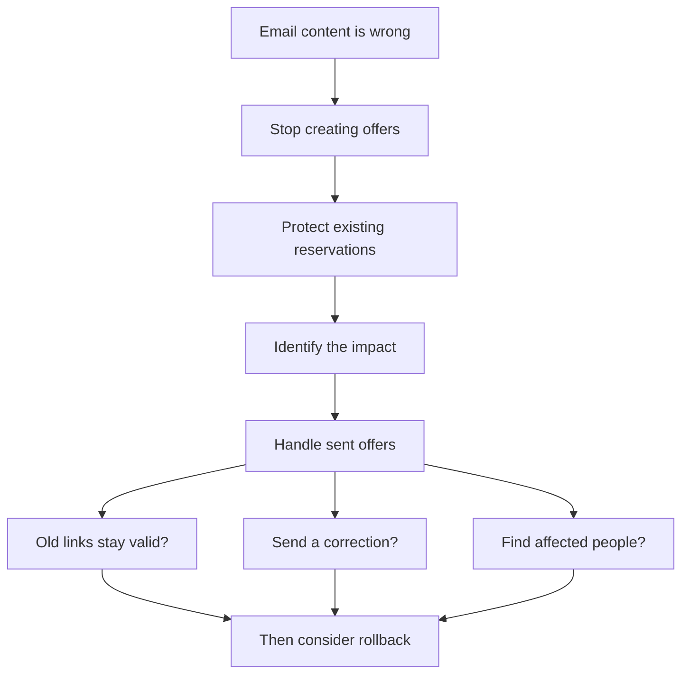
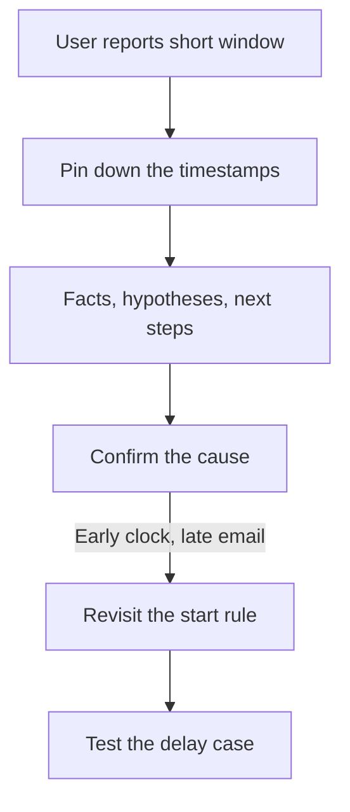

After reading Anthropic's [*The AI-native SDLC playbook*](https://claude.com/resources/articles/the-ai-native-sdlc-playbook), I kept coming back to one question: if AI can write code so quickly, what are we still waiting for?

Suppose I run an event registration website and want to add waitlist notifications. AI quickly builds the email flow and confirmation page, but a few decisions are still open. How long should an open place be held for someone on the waitlist? If they don't respond, should the next person get an offer? And can an expired link still be used?

Having the code ready is still a long way from being ready to launch.

> The original article is by Louis Claxton, and its page lists a publication date of August 21, 2026. The website, people, times, and numbers below are all hypothetical. The prompts and documents are illustrative too.
{: .prompt-info }

The article argues that as AI accelerates code production, bottlenecks move to requirements, verification, and delivery. The development process should involve AI at every stage, connect stages through traceable work products, and keep people responsible for decisions. This post is my reading of that idea, followed by the waitlist feature from start to finish.

## I Break the SDLC Into Six Questions

SDLC stands for Software Development Lifecycle: how a feature goes from an idea to something people use. I break it into six questions:

| Stage | The question I want to answer | In the waitlist example |
| --- | --- | --- |
| Plan | Why build this? | Organizers have to contact people on the waitlist manually |
| Design | How will people use it? | A person receives an offer and confirms before it expires |
| Build | What needs to change? | Capacity tracking, notification emails, and the confirmation page |
| Test | How do I know it works? | Repeated clicks and expired links cannot cause overbooking |
| Deploy | How will people get access? | Rehearse with a test event, then enable it gradually |
| Maintain | What should I watch after launch? | Email delivery and the correct release of reserved places |

Deployment means putting a new version into the environment that serves real users. Maintenance includes investigating errors, fixing problems, and making improvements. On a small project, one person might do all six jobs, but it is still useful to consider them separately.

To me, an AI-native process considers three things from the start: what AI can do, what information it needs, and how its work will be checked. If someone has to retell an entire conversation, reorganize files, and chase down results before the next step can begin, the process still has room to improve.

## I Look at the Whole Wait, Not Just Coding Speed

A restaurant is a useful analogy. Cooking faster doesn't help much if the order is unclear, the ingredients aren't ready, or finished dishes are waiting to be served. The customer still waits.

The same applies to waitlist notifications. AI might build the email feature quickly, but if I then spend days deciding how to allocate places, or never find time to review the changes, users won't experience faster delivery.

{: width="1600" height="800" }
_I use this diagram to show how waiting adds up. The block lengths are illustrative._

So I watch the whole process:

- How long does a feature take from proposal to usable?
- Where do discussions keep repeating?
- Does the release create more support work?

If more code is being produced but review is stuck, that tells me where to focus next.

## Step 1: I Clarify the Problem Before Building the Feature

“When someone cancels, notify the next person on the waitlist” sounds straightforward, but it leaves plenty of gaps before anyone can build it. I would start by asking AI to find the decisions I need to make:

```text
I want to add waitlist notifications to an event registration website.
Don't write code yet.

The current problem: after a cancellation, organizers have to check the
waitlist and contact people individually. They don't know when to expect a reply.

List the decisions I need to make, grouped into:
1. Rules that must be settled before design can proceed.
2. Options that can wait for a later version.
3. Questions that require inspecting the existing system.

Don't invent business rules that I haven't confirmed.
```

I would expect it to flag decisions such as the response deadline and queue order, and to leave “Can we use the existing email service?” as something to investigate. If it simply writes “Hold the place for 24 hours,” I would ask it to label that as an assumption, because that number decides how quickly an organizer can fill the event.

After discussing those questions, I would keep a short requirements draft:

```markdown
# Waitlist Notifications: Requirements Draft

## Problem
After cancellations, organizers have to contact people manually.
Open places are easy to overlook.

## Outcome for This Version
Order the waitlist by signup time. Offer each open place to one person at a time.
Give that person 2 hours to confirm before offering it to the next person.

## Constraints
Do not change the payment flow or let organizers move people ahead in the queue.
Notifications must not include information about other people on the waitlist.

## Open Questions
Should we keep offering places when the event starts in less than 2 hours?
If the email service is down, when should the response window begin?
```

Two hours is simply the choice made for this example. I deliberately keep the open questions visible, because a document that looks complete can easily make unsettled decisions look final.

My check at this stage: could someone who wasn't in the discussion read the draft and explain what the feature solves and what this version leaves out? If not, I would keep clarifying.

## Step 2: I Use a Concrete Scenario to Force the Design Into the Open

Once the direction is clear, I would turn the abstract rules into a sequence of real use.

Suppose a cancellation frees up a place at 9:00 a.m. Alex, first on the waitlist, receives an offer, and the system holds the place until 11:00. Alex doesn't confirm, so after 11:00 the place is held for Ben, who is next in line. At 11:05, Alex opens the original email.

What should the page do? I would have it display “This offer has expired” and prevent Alex from taking the place now held for Ben. Unless I have actually decided how rejoining works, the page also shouldn't promise “You've automatically rejoined the queue.”

{: width="1600" height="900" }
_These times are part of my example. Putting events on one timeline makes it easier to see what an expired link can do and who the place is now reserved for._

Next, I would ask AI to work through the design against that scenario:

```text
Using the requirements draft, map the flow from waiting to receiving an offer,
then either confirming it or letting it expire. Don't implement it yet.

Answer each question:
- How does the system know that an offer is still valid?
- What actions are available through the old link after the offer expires?
- If the same person clicks Confirm twice, could they take two places?
- If sending the email fails, what do the user page and admin view show?

Mark any rule that the requirements haven't settled as an open question.
Don't make that decision yourself.
```

I would pay particular attention to what happens after a failed action. The path from receiving an email to clicking Confirm is usually easy to draw. The complications tend to appear when delivery fails, links expire, or people repeat an action.

That is exactly where I want AI's help: exposing overlooked branches so I can decide which behavior to accept before the code changes.

## Step 3: I Review the Scope Before Letting AI Edit Code

Once the design makes sense, I would ask for an implementation plan I can review. It can be a simple document, but it needs to show the boundaries of the change. For this hypothetical project, the work might cover:

| Area | What I would ask the plan to explain |
| --- | --- |
| Waitlist | How to select the next person and avoid allocating one place to two people |
| Offer records | How to record the event, recipient, deadline, and current status |
| Email jobs | How retries work and how to avoid creating duplicate offers |
| Confirmation page | What appears for successful, expired, and already confirmed offers |
| Admin interface | How organizers find delivery failures and other items needing attention |

This table only lists areas for discussion. The actual files, data structures, and order of work can only be decided after reading the existing code. So I wouldn't invent a list of filenames and tell AI to follow it.

My prompt would look like this:

```text
Read the existing registration, waitlist, and email flows, then propose
an implementation plan.

List the actual files to change, the behavior affected at each step,
any required data changes, and how each step will be verified.
If the existing system cannot support the design, explain why and describe
possible alternatives.

For this pass, only read and prepare the plan. Don't change code.
```

I want to catch changes that look small but touch important rules. Adding an expiry time, for example, may require handling existing waitlist data that has no deadline. Changing how places are held may also affect the normal registration flow.

If the design turns out to be unworkable during development, I would update the plan and acceptance criteria together. Otherwise, I would end up reviewing one implementation against an outdated description of another.

## Step 4: I Check the Feature Against Acceptance Scenarios

“All tests pass” is reassuring, but I still want to know what was tested.

I would list the important scenarios first, then ask AI or an engineer to automate the checks where appropriate. Here is the acceptance table for the example:

| Scenario | Expected result |
| --- | --- |
| Alex confirms before the deadline | One place is booked, and the offer is marked as confirmed |
| Alex clicks twice, or a network retry sends the same request again | There is still only one valid registration, and capacity is reduced only once |
| Alex's offer expires and the place is now held for Ben | Alex cannot confirm through the old link; Ben's reservation stays valid |
| Nobody else is on the waitlist | The place remains available; no notification is sent without a recipient |
| The email service temporarily fails | The failure is not recorded as successful delivery, and its status remains traceable |
| The event has been canceled | An old offer cannot complete registration, and the page explains why |

The repeated-request row is about *idempotency*: repeating an operation should have the same effect as performing it once. The waitlist example makes this tangible, because people really do click twice, and systems really do resend requests after network problems.

There are two kinds of checks. Both matter, and neither replaces the other:

| What it checks | Example | Suitable method |
| --- | --- | --- |
| Internal outcomes | A place cannot be allocated twice | Automated tests |
| Whether people understand the page | The expired-offer message is clear | Using the page and reviewing screenshots |

When asking AI to fix a bug, I would also insist on keeping the acceptance criteria:

```text
First reproduce the bug where an expired offer can still be confirmed,
and explain why it fails. Then fix the code.
Rerun the relevant tests and attach the actual output.

Don't make the checks pass by deleting tests, skipping checks, or weakening
the requirement that the event must not be overbooked.
If you think the acceptance criteria contradict each other, flag that for me
to decide before proceeding.
```

What matters to me is whether the evidence supports the conclusion. Green checks that don't cover expired links or duplicate confirmations are not enough to show that the waitlist flow works correctly.

## Step 5: I Review Behavior in the PR and Rehearse How to Stop the Change

A PR, or pull request, brings changes together for review before they are merged. I want it to tell me three things quickly: what changed, how it was verified, and what remains unresolved.

I would ask for a summary like the one below. It is a template to fill in, not evidence that any checks have already passed:

```markdown
## What Changes for Users
After a cancellation, the first person on the waitlist gets an offer.
The next person gets an offer only after that offer expires.
Expired offers cannot claim a place.

## Verification Evidence
- Automated tests: actual commands, results, and scenarios not yet covered.
- UI checks: screenshots for valid, expired, and already confirmed offers.
- Email failure: how it was simulated and what happened.

## Release and Recovery
- Enable the feature for an internal test event first.
- Explain how to stop creating new offers and who can do so.
- Explain what happens to offers already sent but not yet confirmed.

## Review Needed
List unsettled rules and known limitations. Don't leave them at "probably fine."
```

Before launch, I would walk through the entire flow using test inboxes. Alongside confirming that the new version can ship, I would rehearse how to stop it if something goes wrong.

Suppose the invitation email contains incorrect information. I would handle it in this order:



Stopping new offers won't recall emails already sent, so the offers already out need their own decisions.

I wouldn't settle for “Roll back if there is a problem.” If the new version has already changed capacity or offer data, restoring the old code still leaves those records to deal with. That is why rollback comes last.

## Step 6: I Feed User Reports Back Into the Next Round of Requirements

Suppose someone reports after launch: “By the time I received the email, the link was about to expire.”

I wouldn't immediately ask AI to change the response window from two hours to four, because that could hide the real problem. First, I would pin down a few points in time:

- When did the clock start?
- When did the email enter the sending queue, and when did the email service accept it?
- Were there retries or delays?

I would ask AI to separate the investigation into three parts:

| Category | What it might contain for this incident |
| --- | --- |
| Known facts | Offer creation time, deadline, sending attempts, and retry logs |
| Hypotheses to verify | Delayed email delivery or an incorrect time displayed on the page |
| Next steps | Check time zones, investigate email jobs, and confirm how deadlines are calculated |

One point is easy to get wrong: an email service accepting a request doesn't mean the recipient received or read the message. An investigation needs to state exactly which step was observed, so assumptions don't become facts.

If the investigation shows that the countdown starts when the offer is created but the email is delayed, I would bring the start of the response window back into the requirements discussion:



Adding the delayed-delivery scenario to the checks keeps the same problem from recurring. That is how evidence from maintenance returns to planning, and the six stages become a cycle of improvement.

{: width="1600" height="1000" }
_I want each handoff to record what was decided, how it was checked, and who takes over. This is my hypothetical waitlist example._

## I Want the Information to Exist Outside the Chat

Working through this example makes it clear that requirements, design, implementation, and verification are a series of connected decisions.

If those decisions live only in chat, someone taking over a few days later has to reconstruct them. How long is a place held? Does the clock start if sending fails? Which version of the discussion contains the final decision?

The original article connects work through files such as `intent.md`, `spec.md`, and `plan.md`, with version history. It also allows existing requirements systems to remain in use, provided the authoritative source is clear. [See the original article](https://claude.com/resources/articles/the-ai-native-sdlc-playbook). A `.md` file is Markdown text that an ordinary text editor can read.

For me, maintaining one useful issue or work ticket is a good start. At a minimum, it should link to the requirements decisions, relevant PRs, and verification results. If I change the hold time from two hours to four, I would update the acceptance scenarios and support guidance at the same time, so they stay consistent.

I would also keep the amount of documentation in check. A change to a few lines of text doesn't need three nearly identical documents just to satisfy a naming convention. Helping the next person and the AI find the right information matters more than the number of files.

## I Distinguish Between Reminding AI and Enforcing a Rule

The original article distinguishes between skills, which provide working instructions, and hooks, which can run programmatic checks when an action occurs. [See its discussion of skills and hooks](https://claude.com/resources/articles/the-ai-native-sdlc-playbook). I cover how hooks are actually configured in Claude Code, and what they can and can't block, in [Claude Code Hooks: Format, Test, and Flag Sensitive Files](/posts/claude-code-hooks-automate-checks/).

I think of two arrangements at an event: “Please check tickets” belongs in the staff handbook, while a gate that opens only after a ticket is validated enforces a condition. The handbook explains what to do; the gate checks whether a requirement has been met.

For the waitlist feature, I would divide the work like this:

| Rule | Instructions I would provide | Checks or restrictions still needed |
| --- | --- | --- |
| No overbooking | Explain capacity and reservation rules | Mechanisms that protect capacity updates, plus tests for repeated and concurrent actions |
| No disclosure of contact details | State which fields must not appear in error logs | Log checks and restricted data access |
| Confirm before sending real emails | Explain the difference between test and real events | Test accounts cannot send email to real attendee lists; designated people authorize real operations |

I wouldn't expect a single hook to enforce everything. Development tool checks, email service permissions, and the registration system's own rules protect different parts of the process. Any of them can also be configured incorrectly.

So the question I would ask is: if this rule is broken, will someone get a warning, will the action be blocked, or will we only find out when a user reports a problem? The answer tells me whether the current protection is enough.

## A Personal Blog Can Use a Smaller Version

Waitlist notifications involve capacity and contact details, so the workflow needs more detail. The same thinking also works for a personal website, at a scale small enough to actually start.

Suppose I want to add an article reading progress bar to my blog. I would approach it like this:

1. **Define the purpose.** I want readers to know how much of an article remains, rather than adding a feature just because other sites have it.
2. **Specify the behavior.** Progress starts with the article body and excludes navigation and comments. I would also decide whether short articles need the bar.
3. **Have AI inspect the existing template.** It should find the article container and current styles before proposing changes, rather than adding duplicate code to every page.
4. **Check actual reading behavior.** I would try long and short posts, mobile layouts, and dark mode. Progress should be close to complete at the bottom of the article body.
5. **Review screenshots.** The PR should include desktop and mobile views and explain how to remove the feature.
6. **Revisit the experience.** If the bar covers a heading or crowds the mobile layout, I would adjust it rather than keep it simply because the code is finished.

This change doesn't need a full enterprise process. One issue, a small PR, and a few screenshots could preserve enough context.

What I would avoid is asking AI to “add a nice-looking progress bar” and merging as soon as it moves. That makes it easy to overlook pages that aren't articles, mobile behavior, and the actual boundaries of the reading area.

## How I Would Decide Whether the Process Helps

To try this out, I would choose a small change with a clear scope and an easy recovery path. I would first record where time is currently spent waiting, then observe several changes in the same way.

I would look at four things:

- **Delivery time:** How long does it take to go from agreed requirements to a usable feature? How much of that is waiting?
- **Reasons for rework:** Was the code wrong, were the requirements unclear, or did review reveal a design problem?
- **User problems:** Do situations we hadn't considered appear after launch?
- **Total cost:** AI usage fees, execution time, and my time reading documents, reviewing PRs, and handling errors.

What I observe decides what to adjust next:

| What I observe | What I would adjust |
| --- | --- |
| AI writes faster, but I spend more time working out why it made each change | Make changes smaller and ask for clearer summaries |
| Requirements keep shifting | Improve the initial clarification |

One smooth release doesn't prove that the same approach suits every job, so I would keep observing different kinds of changes.

What I most want to improve after reading this playbook is the completeness of each handoff:

- Have I explained the problem clearly?
- Has AI provided enough verification?
- Does the next person know which decisions are settled and which still need judgment?

Those answers give me a better chance of turning faster coding into software I can ship with confidence, with improvements my readers or users can actually experience.

## Further Reading

- Louis Claxton, Anthropic: [The AI-native SDLC playbook](https://claude.com/resources/articles/the-ai-native-sdlc-playbook): detailed practices and governance across the six stages. This post contains my reading notes and illustrative examples; its diagrams are original, not reproductions of the source's figures.
- [Automating PR Review With GitHub Actions and an AI Agent: This Site as an Example](/posts/github-actions-ai-agent-pr-review/): how the PR review in Step 5 is split on this site among automated checks, AI review, and human approval.
- [How to Write AGENTS.md: Give Coding Agents Your Project Rules](/posts/agents-md-project-rules-for-coding-agents/): keeping project rules in a file a coding agent can read.
