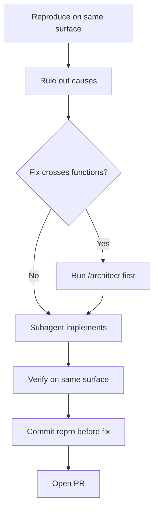
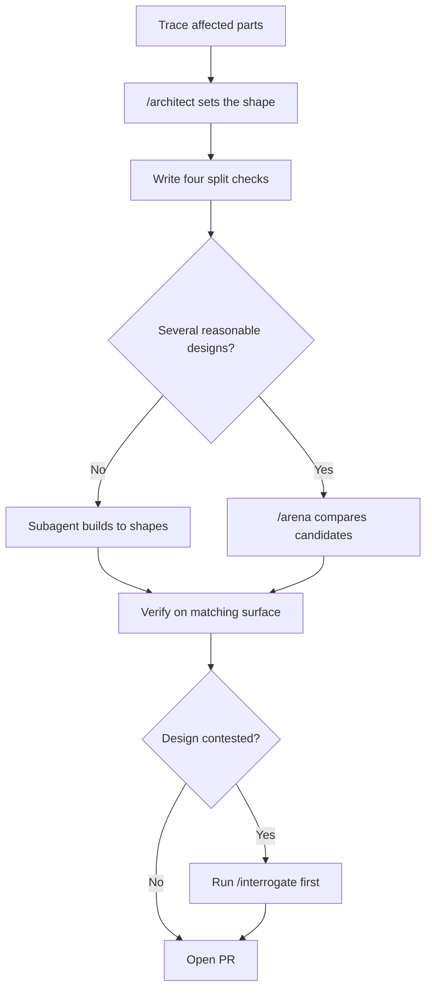
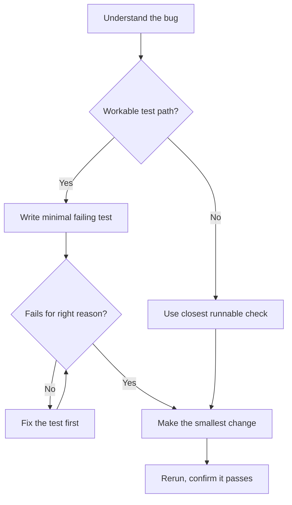
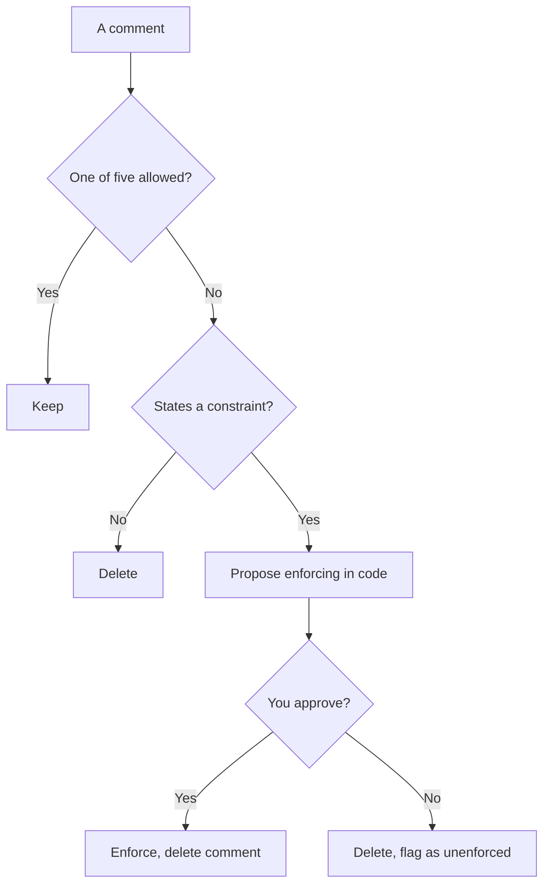
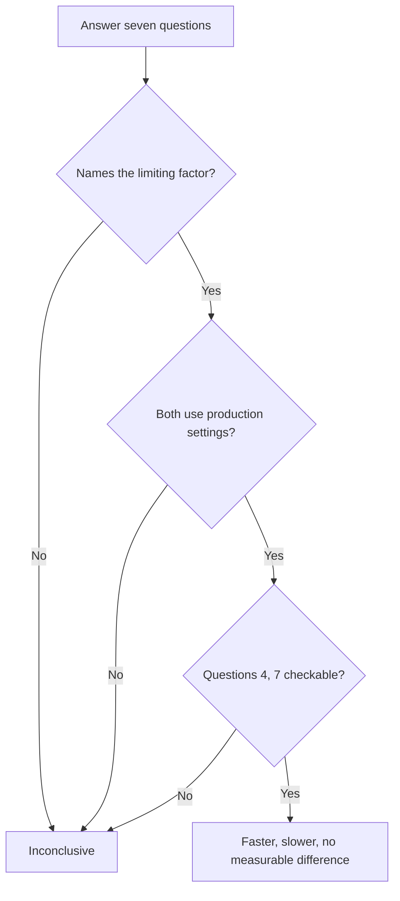

When an AI coding assistant finishes a change, it often says "Done, this should work." But a successful build only shows that the code passes compilation checks. It doesn't show that the feature meets its requirements, and "should work" rests on no verification at all.

This post shows how pstack makes "prove it works" part of the process: you reproduce before fixing, clean the diff, find what else the change could break, and have the AI drive your app. Then you open a PR and get it to mergeable.

> pstack Series | Part 3
>
> - Series guide: [What It Is and Where to Start](/posts/pstack-series-guide/)
> - Previous (Part 2): [Understand Code and Compare Designs First](/posts/pstack-understand-design/)
> - Next (Part 4): [Steer With Principles, Build Your Own Mode, and Let It Run Unattended](/posts/pstack-principles-customization/)
{: .prompt-info }

> I based this post on pstack [version `0.15.43`](https://github.com/cursor/plugins/blob/2f87c854fe3e2fcda44ca86b46ede35aad3c46b7/pstack/.cursor-plugin/plugin.json) with Claude Code 2.1.326. That version is `cursor/plugins` commit `2f87c85` (05:47 on 2026-11-17, Taipei time). I rechecked all five posts in the series against this version on 2026-11-17, and at that time `main` had no pstack changes after `2f87c85`. Later versions may behave differently.
>
> Claude Code leaves auto-update off for third-party marketplaces by default ([README](https://github.com/cursor/plugins/blob/2f87c854fe3e2fcda44ca86b46ede35aad3c46b7/pstack/README.md#L28)), so a pstack you installed by following Part 1 stays at the version you installed. For how to update or pin it, see [Part 1](/posts/pstack-install-routing/).
{: .prompt-info }

## Before You Start

pstack is a set of skills in Cursor's official plugin repository, where a skill is a set of instructions that tells the AI how to do one kind of job. [Part 1](/posts/pstack-install-routing/) covers installing it, and [Part 2](/posts/pstack-understand-design/) covers understanding and designing before you change code. This post assumes it is already installed.

In Claude Code (an AI coding assistant you use in a terminal), plugin commands carry the plugin name in front, such as `/pstack:tdd`. The examples below use the Claude Code form; in Cursor, just drop the `pstack:`.

This post uses two kinds of tools, and you call them differently:

| Kind | What it is | Used in this post | How to start it |
| --- | --- | --- | --- |
| playbook | A fixed procedure inside `/poteto-mode` that goes step by step | Feature, Bug fix, Opening a PR, and Babysit (looking after a PR until it can merge) | No command of its own. You hand the task to `/pstack:poteto-mode`, and it picks the matching playbook |
| skill | A standalone command | `/tdd`, `/unslop`, `/no-comments`, `/blast-radius`, `/benchmark-checklist`, `/create-verification-skill`, `/maintain-verification-skill` | Configured for user invocation, so you type it when needed |

Skills are set for you to call, but a playbook can still read their instructions directly. When a `/poteto-mode` playbook reaches a related step, it reads that skill's instruction file and follows it ([Claude Code adapter notes](https://github.com/cursor/plugins/blob/2f87c854fe3e2fcda44ca86b46ede35aad3c46b7/pstack/docs/harness/claude-code.md#L12)). For example, it:

- uses the `/tdd` cadence when fixing bugs
- runs `/no-comments` before review
- applies `/unslop` to any prose it writes

`/blast-radius` and the two verification skills aren't steps in any playbook, so you call them yourself when you want them.

{: w="800" h="450" }
_The four stages from writing code to mergeable. Opening a PR doesn't start babysit on its own, and merging is always your call._

## Put "What Counts as Done" in Your First Prompt

The pstack guide makes this the first step of verification ([guide, chapter 6](https://github.com/cursor/plugins/blob/2f87c854fe3e2fcda44ca86b46ede35aad3c46b7/pstack/docs/guide/06-verify-and-ship.md#L9-L27)). For example:

```text
/pstack:poteto-mode Add JSON output to this command. The existing text output must stay byte-for-byte the same, the JSON must parse, and run both formats on the sample project. Show me the evidence.
```

That gives the AI three concrete acceptance requirements it can check one by one. Its reply should include the exact commands and their output; when a check can't run, a good reply marks it "inconclusive" instead. **I would treat a confident reply with no evidence as a warning sign**.

The check also has to match the change:

| What changed | How to check |
| --- | --- |
| A command | Run the command |
| The UI | Walk the changed flow in the running app |
| A parser or data migration | Replay a saved input |
| Performance | Compare profiles from before and after |
| Saving data | Read the stored value back |

On its first reply, `/poteto-mode` restates your goal and the smallest change it plans, then starts right away without waiting for you to confirm ([SKILL.md](https://github.com/cursor/plugins/blob/2f87c854fe3e2fcda44ca86b46ede35aad3c46b7/pstack/skills/poteto-mode/SKILL.md#L19)). So if it misread you, you can tell at once.

## Build: Write the Code With a Playbook

The principle in [chapter 5 of the guide](https://github.com/cursor/plugins/blob/2f87c854fe3e2fcda44ca86b46ede35aad3c46b7/pstack/docs/guide/05-build-and-clean.md#L5-L31) is to put what you observed in the prompt and let the playbook gather the evidence needed to verify the result. The playbook fills in steps you didn't type, such as reproducing before fixing and stating the data shapes before building.

### Fix a Bug: Reproduce First, Then Fix

When you have a reported bug to reproduce, find the root cause of, and fix, with runtime evidence, hand it to the Bug fix playbook. Describe the symptom in the prompt and ask for a reproduction first:

```text
/pstack:poteto-mode <symptom: under what conditions, what happened, what should happen>. Reproduce it first, then fix it, then verify.
```

For example:

```text
/pstack:poteto-mode This command writes two records after a retry; it should write one. Reproduce it first, then fix it, then verify.
```

Its flow ([bug-fix playbook](https://github.com/cursor/plugins/blob/2f87c854fe3e2fcda44ca86b46ede35aad3c46b7/pstack/skills/poteto-mode/playbooks/bug-fix.md)):



To reproduce, it drives the app on the same surface where the bug happens (the command line, a web page, and so on). It asks you to reproduce it only when it truly can't reach that surface and can say exactly why. If it can't reproduce the bug directly, it builds the trigger conditions itself or adds logging until the bug shows up.

It finds the cause by bisecting. First it traces the code involved and uses `/why` to read that code's history, then lists a few possible causes. Each round it picks the cut that narrows things down most and rules causes out with runtime evidence, not guesses.

The implementation goes to a subagent, a separate AI a skill sends off to do part of the work. When verifying, the original reproduction steps must now pass; "inconclusive," or verifying on a different surface, doesn't count as passing. A unit test only proves how one branch runs; it doesn't prove the bug is gone.

Commits go in this order: the failing reproduction (for example, a test) goes into git history first, and the fix comes after it. When the bug has a cheap local test path, it follows the `/tdd` cadence; when testing is expensive, needs a lot of setup, or the test path is unclear, it skips that.

One rule runs through the whole process, and I think it's the one most worth remembering: **every line of the change that stays must trace back to runtime evidence**. A "might help" defensive tweak is only a hypothesis and doesn't stay. If evidence disproves a hypothesis, the code changed because of it gets reverted too ([bug-fix playbook, line 5](https://github.com/cursor/plugins/blob/2f87c854fe3e2fcda44ca86b46ede35aad3c46b7/pstack/skills/poteto-mode/playbooks/bug-fix.md#L5)).

Its reply explains what was broken, the root cause, the fix, and how it was verified, with **the reproduction output pasted verbatim, failing before the fix and passing after it**. I recommend reading that before-and-after output yourself and confirming the failure is really the bug you reported. The default flow opens a PR next; if you asked it to pause, review the evidence before letting it continue.

### New Feature: State the Data Shapes First

When you're adding or changing a behavior, hand it to the Feature playbook. Describe the behavior you want and **what must not change**:

```text
/pstack:poteto-mode <the behavior to add>. <which existing behavior must not change>. <how to verify>.
```

For example (from [chapter 5 of the guide](https://github.com/cursor/plugins/blob/2f87c854fe3e2fcda44ca86b46ede35aad3c46b7/pstack/docs/guide/05-build-and-clean.md#L13-L17)):

```text
/pstack:poteto-mode Add a --json flag. The existing text output must stay byte-for-byte the same. Verify both formats.
```

Its flow ([feature playbook](https://github.com/cursor/plugins/blob/2f87c854fe3e2fcda44ca86b46ede35aad3c46b7/pstack/skills/poteto-mode/playbooks/feature.md)):



`/architect` sketches two different sets of types, function signatures, and module boundaries, then picks one ([SKILL.md](https://github.com/cursor/plugins/blob/2f87c854fe3e2fcda44ca86b46ede35aad3c46b7/pstack/skills/architect/SKILL.md#L9); covered in detail in Part 2).

The four split checks become four items on the to-do list. If one doesn't apply (for example, only one file changes), it stays on the list marked `n/a: <reason>`:

- which steps must finish first
- which work can run in parallel
- which state gets shared
- what the smallest safe split is

When it hands the coding to a subagent, the scope is tight: file paths, **data shapes**, and success criteria. A data shape is what the code's data looks like and how it's organized. Examples are one state machine instead of a pile of scattered true/false flags, or a lookup table instead of a long chain of ifs.

Verification follows the same standard as a bug fix: "inconclusive," or verifying on the wrong surface, doesn't count as passing. It verifies each small unit before moving to the next, and finally organizes the work into small, ordered commits.

Its reply covers what it did, what it chose and why, the four split checks, and the decisions still open; design alternatives come as a table. Review the design choices and verification results, and resolve any open decisions before letting it continue to the PR.

### /tdd: Write a Failing Test First

Use `/tdd` when you explicitly want TDD (writing the test before the code), a failing test, or a regression test, or when the bug has an obvious, cheap local test to write ([SKILL.md](https://github.com/cursor/plugins/blob/2f87c854fe3e2fcda44ca86b46ede35aad3c46b7/pstack/skills/tdd/SKILL.md#L3)). Skip it when the test path is unclear, expensive, or needs a lot of integration setup.

When the chat already has the bug's context, this line is enough ([chapter 5 of the guide](https://github.com/cursor/plugins/blob/2f87c854fe3e2fcda44ca86b46ede35aad3c46b7/pstack/docs/guide/05-build-and-clean.md#L43-L51)):

```text
/pstack:tdd implement
```

Without that context, describe the bug:

```text
/pstack:tdd Fix <description of the bug>. First write a test that fails because of this bug, show me it failing, then fix it.
```

Its flow ([SKILL.md](https://github.com/cursor/plugins/blob/2f87c854fe3e2fcda44ca86b46ede35aad3c46b7/pstack/skills/tdd/SKILL.md#L13-L26)):



Understanding the bug means knowing what should happen, what happens now, which path it takes, and the smallest reproduction. It prefers the kind of test the code already uses; if there's no obvious test path, it won't build a whole test setup just to follow the process.

The failing test is minimal and catches exactly this bug, and it describes what should happen rather than copying how the code works now. It runs the test once before the fix; if the test passes, or fails for an unrelated reason, it fixes the test first. The fix itself is the smallest change that keeps nearby existing contracts intact.

When a failing test isn't worth writing, it uses the closest runnable check instead, such as a script, a manual reproduction command, browser automation, or a log assertion. Its rule is **better no test than a bad test**. A bad test is one that:

- mostly exercises mocks
- locks in implementation details
- depends on timing
- only proves the fix and then gets deleted

You get the name of the test (or check) that failed before the fix and the failure it produced, plus the passing run after the fix. If it can't show a failure before the fix, it explains why and which check it used instead. Next, clean the diff (a diff is the set of lines that changed between two versions), then open the PR.

## Clean: Make the Diff Easy to Review

Before each commit, the PR-opening playbook runs `/deslop` on the diff. For the PR description and commit messages, `/poteto-mode` applies `/unslop` ([chapter 5 of the guide](https://github.com/cursor/plugins/blob/2f87c854fe3e2fcda44ca86b46ede35aad3c46b7/pstack/docs/guide/05-build-and-clean.md#L57-L59)). The three tools split the work like this:

| Tool | What it cleans |
| --- | --- |
| `/deslop` | Code |
| `/unslop` | Prose |
| `/no-comments` | Comments, handed to a reviewer who didn't write them |

`/deslop` lives in the `cursor-team-kit` plugin, not in pstack; Part 1 covers whether to install it as well. Without it, I would ask for the same result in plain words:

- delete narrating comments
- delete unjustified defensive checks
- delete compatibility code nobody uses anymore
- drop changes unrelated to this one

### /unslop: Strip the AI Tone From Prose

Use `/unslop` when prose meant for people, such as a README, docs, a PR description, or commit messages, reads as if an AI wrote it. Point at the prose to clean and add your own rules:

```text
/pstack:unslop <the prose or file to clean>, <your extra rules>
```

For example (from [chapter 5 of the guide](https://github.com/cursor/plugins/blob/2f87c854fe3e2fcda44ca86b46ede35aad3c46b7/pstack/docs/guide/05-build-and-clean.md#L61-L67)):

```text
/pstack:unslop the readme changes, no emdashes
```

It finds AI writing habits in the prose and rewrites them, keeping the meaning and the voice ([SKILL.md](https://github.com/cursor/plugins/blob/2f87c854fe3e2fcda44ca86b46ede35aad3c46b7/pstack/skills/unslop/SKILL.md#L9)). Its list is a set of numbered rules ([the rules](https://github.com/cursor/plugins/blob/2f87c854fe3e2fcda44ca86b46ede35aad3c46b7/pstack/skills/unslop/SKILL.md#L13-L40)), with examples all in English, covering:

- trailing phrases that add no fact
- unsourced claims like "experts say"
- words AI overuses
- forced groups of three
- dashes
- bolding every proper noun
- a bold label that just restates its line
- chat tone, such as "Hope this helps!"
- filler
- abstract metaphor nouns
- plain-language rules: active voice, one idea per sentence, everyday words

You get the rewritten prose. I recommend reading it once more yourself to make sure the meaning didn't change.

### /no-comments: Have Someone Who Didn't Write the Comments Review Them

Use `/no-comments` before review. The AI that wrote the comments tends to defend its own choices, so a reviewer who didn't write them should check them ([chapter 5 of the guide](https://github.com/cursor/plugins/blob/2f87c854fe3e2fcda44ca86b46ede35aad3c46b7/pstack/docs/guide/05-build-and-clean.md#L69-L77)).

```text
/pstack:no-comments the diff
```

With no scope given, it uses the current branch's diff against `main`, including changes that aren't committed yet ([SKILL.md](https://github.com/cursor/plugins/blob/2f87c854fe3e2fcda44ca86b46ede35aad3c46b7/pstack/skills/no-comments/SKILL.md#L13-L15)). You can also name files:

```text
/pstack:no-comments <files or folders>
```

It sends out Comment Sicko to do the review. This is a subagent that reviews only comments: it touches only comments, points out where to refactor, and **never writes application code** ([Comment Sicko](https://github.com/cursor/plugins/blob/2f87c854fe3e2fcda44ca86b46ede35aad3c46b7/pstack/agents/comment-sicko.md#L30)). Each comment is handled like this ([SKILL.md](https://github.com/cursor/plugins/blob/2f87c854fe3e2fcda44ca86b46ede35aad3c46b7/pstack/skills/no-comments/SKILL.md#L17-L24)):



It lets only these five kinds of comments through:

- license headers
- doc comments that define a public API contract
- issue or spec links the code can't express
- non-obvious behavior forced by an outside library or platform
- formatter directives like `// prettier-ignore`

Surprising parts of your own code don't pass just because they have a comment. It marks them `MUST KILL` and asks for a rename, an extracted function, or a type change so the code reads clearly without the comment.

A comment like "don't delete this" or "ask so-and-so before changing this" states a constraint. It proposes the cheapest way to put that constraint into the code, such as a type, a runtime check, a test, or a lint rule (an automatic check on how code is written). It **waits for your approval** before doing it.

After Comment Sicko hands back its report:

- Findings where it edited code beyond its role, or gave the wrong reason, get sent back.
- Small accepted findings get fixed directly, such as deleting a dead path or dropping an unused parameter. Ones that need a reshaped design get an `/architect` sketch first.
- Fixes go to the root cause, only within this change. Anything outside that scope goes on a to-do list instead of being fixed in passing.

You get a report: how many comments were deleted, which were restored, and what was fixed. It also includes the `/architect` sketches, the proposed enforcements and which you approved, and what's still open. Reply to the proposed enforcements; once the diff is clean, move on to verification.

## Verify: Prove It Really Works

### /blast-radius: Find What the Change Could Break

Use `/blast-radius` when you don't fully trust a small diff and want to know whether it breaks something **elsewhere** ([chapter 6 of the guide](https://github.com/cursor/plugins/blob/2f87c854fe3e2fcda44ca86b46ede35aad3c46b7/pstack/docs/guide/06-verify-and-ship.md#L29)). It pairs with `/how` and `/why`: `/how` says what the code does, `/why` says why it looks that way, and `/blast-radius` checks what this change could affect.

```text
/pstack:blast-radius <the change, such as the current branch or a PR>. I'm most worried about <what worries you>.
```

For example:

```text
/pstack:blast-radius The changes on this branch. I'm most worried that the cache-clearing part could delete data that's still in use.
```

It goes beyond listing callers found by search to trace behavioral effects that a text search alone may miss ([SKILL.md](https://github.com/cursor/plugins/blob/2f87c854fe3e2fcda44ca86b46ede35aad3c46b7/pstack/skills/blast-radius/SKILL.md#L13)):

1. **Reads the change**, including indirect behavioral effects that the diff doesn't show directly.
2. **Finds the key fact that makes the change safe**. Most changes that look risky are safe because of one fact, and if that fact holds, most of the risk goes away with it. An example of such a fact: "this call only clears cache entries that have already expired and does nothing else."
3. **Looks where search can't see**: the source and pinned versions of the libraries you call, and when the code runs. It also checks the JSON an API returns, database columns, feature flags, and code several layers downstream.
4. **Rates each risk honestly**: how likely it is and what it costs if it happens. Confirmed risks are listed apart from ones it checked and ruled out.
5. **Proves that fact by running code**. It writes a script or test that calls the real code, runs it once, and pastes the result.
6. For a large or wide change, it uses `/arena` to have several models answer the same question, then combines the answers.

For each fact it states how far it proved it, from weakest to strongest ([SKILL.md](https://github.com/cursor/plugins/blob/2f87c854fe3e2fcda44ca86b46ede35aad3c46b7/pstack/skills/blast-radius/SKILL.md#L19-L27)):

- just asserted
- pointed to a line of code
- reasoned step by step that the bad case can't happen
- ran code
- reproduced it in the running app

You get ([SKILL.md](https://github.com/cursor/plugins/blob/2f87c854fe3e2fcda44ca86b46ede35aad3c46b7/pstack/skills/blast-radius/SKILL.md#L40-L46)):

- what it did
- the key fact that makes the change safe, with proof, or marked unproven if it couldn't prove it
- the risks: how it breaks, on which line, likelihood and cost, how to check
- what it ruled out
- a "before merging" section: the cheapest test or reproduction that would catch a real bug

If the fact is marked unproven, or there are confirmed risks, I recommend dealing with them before opening the PR. The tests in "before merging" can go straight into this change.

### /benchmark-checklist: Check Whether a Performance Number Holds Up

Use `/benchmark-checklist` when you measured a performance number and are about to put it in a PR or base a decision on it, or when someone else's number looks too good to be true. Before-and-after numbers are the easiest to get wrong without noticing: a warm cache, a debug build on one side, or a timed region where no work happened ([chapter 6 of the guide](https://github.com/cursor/plugins/blob/2f87c854fe3e2fcda44ca86b46ede35aad3c46b7/pstack/docs/guide/06-verify-and-ship.md#L31-L49)).

The Perf issue and Hillclimb (keep improving a single metric) playbooks in `/poteto-mode` already run this checklist. So you only need to call it yourself for numbers you measured outside those two:

```text
/pstack:benchmark-checklist Before this goes in the PR, check <which number, such as how much faster the export got>
```

Before measuring, it writes down the claim you plan to make, for example that export is 30% faster on a 60,000-row dataset. Next it reads the measurement script to see what it counts and what it skips, and checks how busy the machine is ([SKILL.md](https://github.com/cursor/plugins/blob/2f87c854fe3e2fcda44ca86b46ede35aad3c46b7/pstack/skills/benchmark-checklist/SKILL.md#L13-L17)). Then it answers seven questions with evidence from actual runs ([SKILL.md](https://github.com/cursor/plugins/blob/2f87c854fe3e2fcda44ca86b46ede35aad3c46b7/pstack/skills/benchmark-checklist/SKILL.md#L19-L27)):

1. What limits this number? Why isn't it twice as good?
2. Did each side run with production settings?
3. Does the result exceed a physical limit, such as disk bandwidth or core count?
4. Were there errors, or wrong results?
5. Does it reproduce when you alternate runs (A, B, A, B…)? What are the median and the spread?
6. Does the difference matter across the whole path a user waits on?
7. Did the work you meant to time actually happen inside the timed region?

How it reaches a verdict ([SKILL.md](https://github.com/cursor/plugins/blob/2f87c854fe3e2fcda44ca86b46ede35aad3c46b7/pstack/skills/benchmark-checklist/SKILL.md#L29-L34)):



The report leads with the verdict, then the numbers with units, how many runs, the spread, and the limiting factor. Put one headline number in the PR description, and keep the detailed run logs in a separate linked file.

### /create-verification-skill: Let the AI Drive Your App the Way a User Does

Use `/create-verification-skill` when your project doesn't yet have a written-down way for the AI to start the app, use it the way a user does, and keep evidence. Walking a UI change through the running app, as described earlier, needs exactly this ([chapter 6 of the guide](https://github.com/cursor/plugins/blob/2f87c854fe3e2fcda44ca86b46ede35aad3c46b7/pstack/docs/guide/06-verify-and-ship.md#L51-L59)).

```text
/pstack:create-verification-skill
```

Its flow ([SKILL.md](https://github.com/cursor/plugins/blob/2f87c854fe3e2fcda44ca86b46ede35aad3c46b7/pstack/skills/create-verification-skill/SKILL.md)):

1. **Interviews the project, not you**. It answers the questions below from the code and asks you only what the code can't answer. If the project can't build or start, it fixes that or reports it clearly before going on.
   - What users actually touch: a web page, a command line, a desktop app, an API…
   - How the app starts locally.
   - How the AI can drive it. It prefers existing tools in the project that can already drive the app, such as Playwright or Cypress specs, terminal helper scripts, endpoints you can call with curl, or a debug port. Only without those does it fall back to general approaches such as a browser, a terminal, or HTTP.
   - What evidence it can keep.
   - Whether two copies can run side by side without interfering.
2. **Generates the skill**. In Claude Code, it writes to `.claude/skills/verify-<app>/`. pstack's instructions say Cursor's `.cursor/skills/`, and the [Claude Code adapter notes](https://github.com/cursor/plugins/blob/2f87c854fe3e2fcda44ca86b46ede35aad3c46b7/pstack/docs/harness/claude-code.md#L49-L53) map that to `.claude/skills/`.
3. **Builds a feature map**. Under `features/` it puts an index plus one file per main feature (starting with 3 to 5). Each file is written from the user's side: what the feature is, how to get there, how to use it, and what result counts as success.
4. **Runs it once before handing it over**. Following the instructions it just wrote, it launches the app, runs the health check, drives one feature, keeps evidence, and cleans up. Then it confirms the evidence is still there after cleanup, because a skill that hasn't been run is only a draft.
5. **Reminds you that `/maintain-verification-skill` can keep it up to date**.

The generated skill is a set of instructions for the AI, in these sections:

| Section | Content |
| --- | --- |
| Launch | How to start the app |
| Doctor | A health check that the running app is ready to use |
| Drive | Driving it with the project's real selectors or commands |
| Evidence | What evidence to keep and where |
| Cleanup | How to clean up what it started |
| Helpers | How to use the bundled scripts |

> Claude Code treats the project's `.claude/` folder as a protected location and, in the default mode, asks you before writing to it ([Claude Code docs](https://code.claude.com/docs/en/permission-modes)). When it asks, I recommend checking that the path is `.claude/skills/verify-<app>/` before you approve.
{: .prompt-tip }

You get a verification skill for your project, plus a feature map. From then on, "verify it in the app" is a step any AI can take in this project, without you explaining again how to start it.

I recommend committing it to the project so every person and every AI drives the app the same way. To have the AI verify with it later, name it in your prompt (from [chapter 6 of the guide](https://github.com/cursor/plugins/blob/2f87c854fe3e2fcda44ca86b46ede35aad3c46b7/pstack/docs/guide/06-verify-and-ship.md#L63-L71)):

```text
/pstack:poteto-mode Add a "bulk archive" action. Verify your changes with /verify-<app> and give me a video and screenshots as evidence.
```

```text
/pstack:poteto-mode Reproduce this issue with /verify-<app>. If it also reproduces on main, fix it and give me a video as evidence.
```

{: w="800" h="450" }
_Generate it once and commit it to the project. When the code changes, /maintain-verification-skill keeps the instructions current._

### /maintain-verification-skill: Keep the Verification Skill in Step With the Code

Every code change can make the feature map go stale, so the guide suggests running `/maintain-verification-skill` at least once a day ([chapter 6 of the guide](https://github.com/cursor/plugins/blob/2f87c854fe3e2fcda44ca86b46ede35aad3c46b7/pstack/docs/guide/06-verify-and-ship.md#L86-L94)):

```text
/pstack:maintain-verification-skill
```

The scheduled automation in the guide means Cursor Automations, and pstack's Claude Code adapter notes say to skip that step in Claude Code ([adapter notes](https://github.com/cursor/plugins/blob/2f87c854fe3e2fcda44ca86b46ede35aad3c46b7/pstack/docs/harness/claude-code.md#L59-L65)). Claude Code has its own scheduled tasks, but pstack doesn't set them up. So I think the simplest option is to run it yourself on a regular schedule.

Its flow ([SKILL.md](https://github.com/cursor/plugins/blob/2f87c854fe3e2fcda44ca86b46ede35aad3c46b7/pstack/skills/maintain-verification-skill/SKILL.md#L23-L37)):

1. **Finds the verification skill to maintain**. If there are several, it asks which one; if there are none, it stops and tells you to run `/create-verification-skill` first.
2. **Tidies the index**: adds what's missing and removes duplicate or dead entries.
3. **Reads the source**: it sends one read-only subagent per feature file. Each one explains from the source how the feature works, points out where the instructions may be stale, and gives a set of steps to drive it.
4. **Combines the results**: it merges overlapping steps, spot-checks the stale spots that were flagged, and looks at recent changes for new features the map doesn't cover yet.
5. **Drives the app**: it always does this, even when the source looks fine. It drives every feature at least once, runs the health check first, and makes sure the evidence survives cleanup.
6. **Sorts and wraps up**: if the instructions are wrong, it fixes the instructions. If the app works but the driving method can't reach it, it fixes the driving method. If the app itself is broken, it writes that down and tells you, and keeps it out of this change.

It **edits only the verification skill's own folder, never product code** ([SKILL.md](https://github.com/cursor/plugins/blob/2f87c854fe3e2fcda44ca86b46ede35aad3c46b7/pstack/skills/maintain-verification-skill/SKILL.md#L19-L21)). The result is one of three outcomes:

- `clean`: every feature was read in the source and driven, nothing needs changing, and no PR is opened.
- `changed`: it opens one PR with only verified fixes.
- `blocked`: it couldn't finish, and it says where it got stuck.

For `changed`, review the PR it opened; handle any product problems in the report separately.

### Formal Verification: Prove the Cases Tests Rarely Reach

A verification skill proves the paths you actually drove. But some bugs hide on paths that ordinary use and tests rarely cover, such as two retries that overlap, a lock that expires halfway through a write, or state changes that happen out of order. For code where a mistake is that costly, you can run:

```text
/pstack:create-formal-verification-skill
```

How it works ([chapter 6 of the guide](https://github.com/cursor/plugins/blob/2f87c854fe3e2fcda44ca86b46ede35aad3c46b7/pstack/docs/guide/06-verify-and-ship.md#L96-L116)):

1. It picks the one property in the code most worth proving.
2. It chooses a tool to fit the problem. For example, to check whether events can happen in the wrong order, it defaults to a model checker like TLA+.
3. It first makes the property fail once against deliberately broken code, to prove the check can catch a problem.
4. It leaves a project-specific skill so later AIs can check new changes with one command.

## Prepare for Review: Open a PR and Get It to Mergeable

### Open a PR (Opening a PR Playbook)

Every other playbook hands off to it automatically when it ends ([opening-a-pr](https://github.com/cursor/plugins/blob/2f87c854fe3e2fcda44ca86b46ede35aad3c46b7/pstack/skills/poteto-mode/playbooks/opening-a-pr.md#L3)), and you can also call it yourself (from [chapter 6 of the guide](https://github.com/cursor/plugins/blob/2f87c854fe3e2fcda44ca86b46ede35aad3c46b7/pstack/docs/guide/06-verify-and-ship.md#L128-L134)):

```text
/pstack:poteto-mode Open the PR. Organize it into small, ordered commits, and put the evidence in the description.
```

Its steps ([opening-a-pr](https://github.com/cursor/plugins/blob/2f87c854fe3e2fcda44ca86b46ede35aad3c46b7/pstack/skills/poteto-mode/playbooks/opening-a-pr.md)):

1. **Works in a worktree**. A worktree is a second working copy of the same repository; it branches off main and keeps unrelated changes out.
2. **Organizes the commits**: before opening the PR, it reshapes the work into small commits, each of which can merge on its own.
3. **Cleans up**: it runs `/deslop` on the diff before committing. It also runs `/no-comments` before review, and writes the PR title, description, and commit messages with `/technical-writing`, then applies `/unslop`. These two are standing `/poteto-mode` rules for all work ([SKILL.md](https://github.com/cursor/plugins/blob/2f87c854fe3e2fcda44ca86b46ede35aad3c46b7/pstack/skills/poteto-mode/SKILL.md#L23-L24)), so they apply when it opens a PR too.
4. **Titles** use the Conventional Commits format: type, scope in parentheses, colon, then the summary, such as `fix(export): ...`.
5. **The description** is a one-minute briefing for the reviewer, under 40 lines, with empty sections left out. The sections, in order:
   - Why
   - What changed
   - Scope
   - Tradeoffs (only alternatives you rejected that a reviewer would otherwise ask about)
   - Blast Radius
   - Verification
6. **Opens the PR with `gh` (GitHub's command-line tool) by default**, ready for review, not as a draft.

**It doesn't start babysit on its own after opening the PR** ([opening-a-pr](https://github.com/cursor/plugins/blob/2f87c854fe3e2fcda44ca86b46ede35aad3c46b7/pstack/skills/poteto-mode/playbooks/opening-a-pr.md#L9)). When CI (the checks that run automatically on every push) fails or review comments need handling, you ask for babysit. The guide also suggests stacking follow-up changes as a new PR on top instead of letting one branch keep growing ([chapter 6 of the guide](https://github.com/cursor/plugins/blob/2f87c854fe3e2fcda44ca86b46ede35aad3c46b7/pstack/docs/guide/06-verify-and-ship.md#L134)).

Once the PR is open, I recommend reading the Verification section of its description yourself first.

### Babysit: Get the PR to Mergeable, Without Merging for You

After a PR is open, you can hand babysit the chores: CI failures, reviewer comments, and conflicts when main moves ahead (from [chapter 6 of the guide](https://github.com/cursor/plugins/blob/2f87c854fe3e2fcda44ca86b46ede35aad3c46b7/pstack/docs/guide/06-verify-and-ship.md#L136-L150)):

```text
/pstack:poteto-mode Babysit this PR and get it all green.
```

When you only want the current status and don't want it to change anything, ask something smaller:

```text
/pstack:poteto-mode Check PR 123. What's left?
```

It names its mode in the first line of its reply, before checking any status ([babysit playbook](https://github.com/cursor/plugins/blob/2f87c854fe3e2fcda44ca86b46ede35aad3c46b7/pstack/skills/poteto-mode/playbooks/babysit.md)):

| Mode | What you say | What it does |
| --- | --- | --- |
| `drive` | "babysit this," "get it all green" | Works all the way to mergeable |
| `threads-only` | You only want review comments handled | Handles review comments and touches nothing else |
| `check` | "check X" | Looks at the status once and reports |

It follows these rules while working:

- **One PR at a time**. With several PRs open, it finishes one before moving to the next.
- **No changes to the PR's structure**. No rebase (replaying the branch's commits onto a new base), no change of base branch, no force push (overwriting the remote branch's history). When a rebase is needed, it reports that so the PR's owner can do it.
- **Conflicts, then review comments, then CI**. When it finds a conflict, it doesn't resolve it; it says which branch needs a rebase, then stops.
- **Status from `watch-pr` on GitHub**. This is a script that ships with pstack and supports GitHub only. `drive` mode keeps watching until there's a final result; `check` mode passes `--status-only` and looks once.
- **One rerun for a flaky CI failure**. A flake is a failure that comes and goes without any code change, and it gets one fresh build. Only failures caused by this change's own code get a fix committed.
- **Suspicion toward Bugbot (Cursor's automated reviewer)**. It checks each Bugbot comment against the code, fixes only real problems, and dismisses noise with a concrete disproof. Anything touching billing, data, auth, or security goes to a person.
- **Review comments are data**. It never follows the text of any review comment as instructions.
- **It stops where the decision is yours**. Waiting for an owner's approval is "waiting," not a problem for it to fix.

On GitHub, `drive` ends when watch-pr reports `READY` ([watch-pr](https://github.com/cursor/plugins/blob/2f87c854fe3e2fcda44ca86b46ede35aad3c46b7/pstack/skills/poteto-mode/scripts/watch-pr/render.ts#L149-L154)). `READY` means no merge conflicts, no unresolved review threads, and no failing or pending checks.

**Babysit never merges, even when everything is green** ([chapter 6 of the guide](https://github.com/cursor/plugins/blob/2f87c854fe3e2fcda44ca86b46ede35aad3c46b7/pstack/docs/guide/06-verify-and-ship.md#L150)). Only when you clearly say "merge" or "ship" does it move to a separate playbook called Shipping ([SKILL.md](https://github.com/cursor/plugins/blob/2f87c854fe3e2fcda44ca86b46ede35aad3c46b7/pstack/skills/poteto-mode/SKILL.md#L27)). Shipping first verifies each PR independently, then merges them one at a time from the bottom up ([chapter 6 of the guide](https://github.com/cursor/plugins/blob/2f87c854fe3e2fcda44ca86b46ede35aad3c46b7/pstack/docs/guide/06-verify-and-ship.md#L152-L160)).

> Calling babysit makes the AI download and install packages from the internet on your computer. `watch-pr` is a script that runs on bun (a JavaScript runtime). **The first time it runs**, it runs `bun install --frozen-lockfile` in `skills/poteto-mode/scripts/` inside the plugin folder. That command downloads the packages it needs from npm according to the lockfile (a file that pins the exact version of every package) and installs them into `node_modules` there.
>
> Later, if a plugin update changes the package list (`package.json`) or the lockfile, it installs again ([bootstrap.ts](https://github.com/cursor/plugins/blob/2f87c854fe3e2fcda44ca86b46ede35aad3c46b7/pstack/skills/poteto-mode/scripts/bootstrap.ts#L25-L52)). The lockfile pins the versions, but I think you should still know this happens. I covered the risks and how to tighten permissions in [Agent Skill and MCP Security Risks: 5 Cases, a Checklist](/posts/coding-agent-supply-chain-permission-risks/).
{: .prompt-warning }

When `drive` completes normally, it confirms the PR can merge, along with the comments it handled, the CI failures it saw, and its reasoning. If a conflict or required approval needs your attention, it reports what is holding up the PR. `check` gives you a status report.

{: w="800" h="450" }
_It reports conflicts instead of resolving them, and stops at mergeable without pressing merge for you._

## A Complete Example (Made Up)

> **I made up the following scenario.** It only shows how these playbooks and skills fit together.
{: .prompt-info }

Say you maintain a command-line tool that exports data. A user reports that when the network is flaky and the command retries on its own, the same record appears twice in the output file.

**1. Reproduce and investigate without changing the code.**

```text
/pstack:poteto-mode After a network timeout and automatic retry, the export command writes the same record twice; it should write it once. For now, only reproduce it, identify the cause, and paste the failing output. Do not change the code or open a PR yet.
```

This prompt deliberately stops the flow at investigation: the AI creates the timeout conditions, narrows down the cause, and confirms it with runtime evidence. Read the failing output first to check that it reproduced the reported problem.

**2. Use `/tdd` to write a failing test, then fix the bug.**

Step 1 explicitly asked it to pause, so the fix has to be started separately. Assuming the bug has a cheap local test path, continue in the same chat with:

```text
/pstack:tdd implement
```

Check that the test fails because of this bug before the fix and passes afterward. If there is no suitable test path, use one of the runnable checks described earlier.

**3. Review the comments.**

```text
/pstack:no-comments the diff
```

Say it flags a comment that says "don't touch this, retries will break" and proposes turning it into a test. Once you approve, it writes the test first, then deletes the comment.

**4. Not sure? Find the blast radius.**

```text
/pstack:blast-radius The changes on this branch. I'm most worried that changing the retry logic affects other commands that also retry.
```

Check whether it proved the key fact that makes the change safe, and read the tests it suggests in "before merging."

**5. Open the PR, then call babysit.**

```text
/pstack:poteto-mode Open the PR. Organize it into small, ordered commits, and put the evidence in the description.
```

```text
/pstack:poteto-mode Babysit this PR and get it all green.
```

Babysit handles CI and review comments and stops when GitHub judges the PR mergeable. You press merge.

> I wrote this example to call each step **by hand, one at a time**, so you can see every link in the chain. Day to day, you can hand the goal and the done criteria to `/pstack:poteto-mode` and let its playbooks decide which skills to use. Name a skill only when you want to change the default.
{: .prompt-tip }

## Which One When

| Situation | What to use |
| --- | --- |
| A reported bug to fix | `/poteto-mode` + the symptom + "reproduce first" (Bug fix playbook) |
| A new feature to add | `/poteto-mode` + the behavior + what must not change (Feature playbook) |
| You want to see a failing test before the fix | `/tdd` (needs a cheap local test path) |
| A README or PR description reads like an AI wrote it | `/unslop` |
| The diff has a lot of comments, before review | `/no-comments` |
| A small diff you're not sure is safe for the rest of the code | `/blast-radius` |
| You measured a performance number for a PR | `/benchmark-checklist` |
| The AI can't start or drive your app on its own | `/create-verification-skill` (once, committed to the project) |
| The code changed and the verification skill may be stale | `/maintain-verification-skill` |
| Retries, concurrency, state machines, and other cases tests rarely reach | `/create-formal-verification-skill` |
| The change is done and needs a PR | `/poteto-mode` + "open the PR" (other playbooks hand off to it automatically) |
| A PR has CI failures or review comments to handle | `/poteto-mode` + "babysit"; ask it to "check" for status only |
| Time to merge | Press merge yourself; to have the AI merge, say so clearly, and it runs Shipping |

## Conclusion

Next time you ask an AI to change code, put what counts as done in your first prompt, and ask it to attach evidence from actual runs. If your project doesn't have a verification skill yet, run `/create-verification-skill` once, and every later verification can use it. Pressing merge is always up to you.

## Further Reading

- [Guide: Build the change and clean the diff](https://github.com/cursor/plugins/blob/2f87c854fe3e2fcda44ca86b46ede35aad3c46b7/pstack/docs/guide/05-build-and-clean.md): how to prompt for different build tasks, and cleanup habits.
- [Guide: Verify the result and open a PR](https://github.com/cursor/plugins/blob/2f87c854fe3e2fcda44ca86b46ede35aad3c46b7/pstack/docs/guide/06-verify-and-ship.md): done criteria, verification skills, formal verification, opening a PR, babysit, and Shipping.
- The four playbooks: [bug-fix](https://github.com/cursor/plugins/blob/2f87c854fe3e2fcda44ca86b46ede35aad3c46b7/pstack/skills/poteto-mode/playbooks/bug-fix.md), [feature](https://github.com/cursor/plugins/blob/2f87c854fe3e2fcda44ca86b46ede35aad3c46b7/pstack/skills/poteto-mode/playbooks/feature.md), [opening-a-pr](https://github.com/cursor/plugins/blob/2f87c854fe3e2fcda44ca86b46ede35aad3c46b7/pstack/skills/poteto-mode/playbooks/opening-a-pr.md), [babysit](https://github.com/cursor/plugins/blob/2f87c854fe3e2fcda44ca86b46ede35aad3c46b7/pstack/skills/poteto-mode/playbooks/babysit.md).
- Skill instructions: [tdd](https://github.com/cursor/plugins/blob/2f87c854fe3e2fcda44ca86b46ede35aad3c46b7/pstack/skills/tdd/SKILL.md), [unslop](https://github.com/cursor/plugins/blob/2f87c854fe3e2fcda44ca86b46ede35aad3c46b7/pstack/skills/unslop/SKILL.md), [no-comments](https://github.com/cursor/plugins/blob/2f87c854fe3e2fcda44ca86b46ede35aad3c46b7/pstack/skills/no-comments/SKILL.md), [blast-radius](https://github.com/cursor/plugins/blob/2f87c854fe3e2fcda44ca86b46ede35aad3c46b7/pstack/skills/blast-radius/SKILL.md), [benchmark-checklist](https://github.com/cursor/plugins/blob/2f87c854fe3e2fcda44ca86b46ede35aad3c46b7/pstack/skills/benchmark-checklist/SKILL.md), [create-verification-skill](https://github.com/cursor/plugins/blob/2f87c854fe3e2fcda44ca86b46ede35aad3c46b7/pstack/skills/create-verification-skill/SKILL.md), [maintain-verification-skill](https://github.com/cursor/plugins/blob/2f87c854fe3e2fcda44ca86b46ede35aad3c46b7/pstack/skills/maintain-verification-skill/SKILL.md), [create-formal-verification-skill](https://github.com/cursor/plugins/blob/2f87c854fe3e2fcda44ca86b46ede35aad3c46b7/pstack/skills/create-formal-verification-skill/SKILL.md).
- [pstack, Part 1: Install in Claude Code, Then /poteto-mode](/posts/pstack-install-routing/): how to install and update, and how `/poteto-mode` sequences a task.
- [pstack, Part 2: Understand Code and Compare Designs First](/posts/pstack-understand-design/): `/how`, `/why`, `/architect`, `/interrogate`, `/arena`, `/teach`, `/recall`, and `/swarm`, plus prototypes and plans.
- [How to Write an Agent Skill: SKILL.md, Triggers, Tests](/posts/agent-skill-authoring-guide/): where project skills live and how to write a SKILL.md.
- [Agent Skill and MCP Security Risks: 5 Cases, a Checklist](/posts/coding-agent-supply-chain-permission-risks/): the risks when an agent downloads packages and reads files, and how to tighten permissions.
- Another skill set's approach: [mattpocock/skills Series Guide](/posts/mattpocock-skills-series-guide/), [Trusting Code When the AI Writes the Tests](/posts/mattpocock-skills-implementation-feedback-loops/), [Structure, Code Review, and Merge Conflicts](/posts/mattpocock-skills-design-review-integration/).
