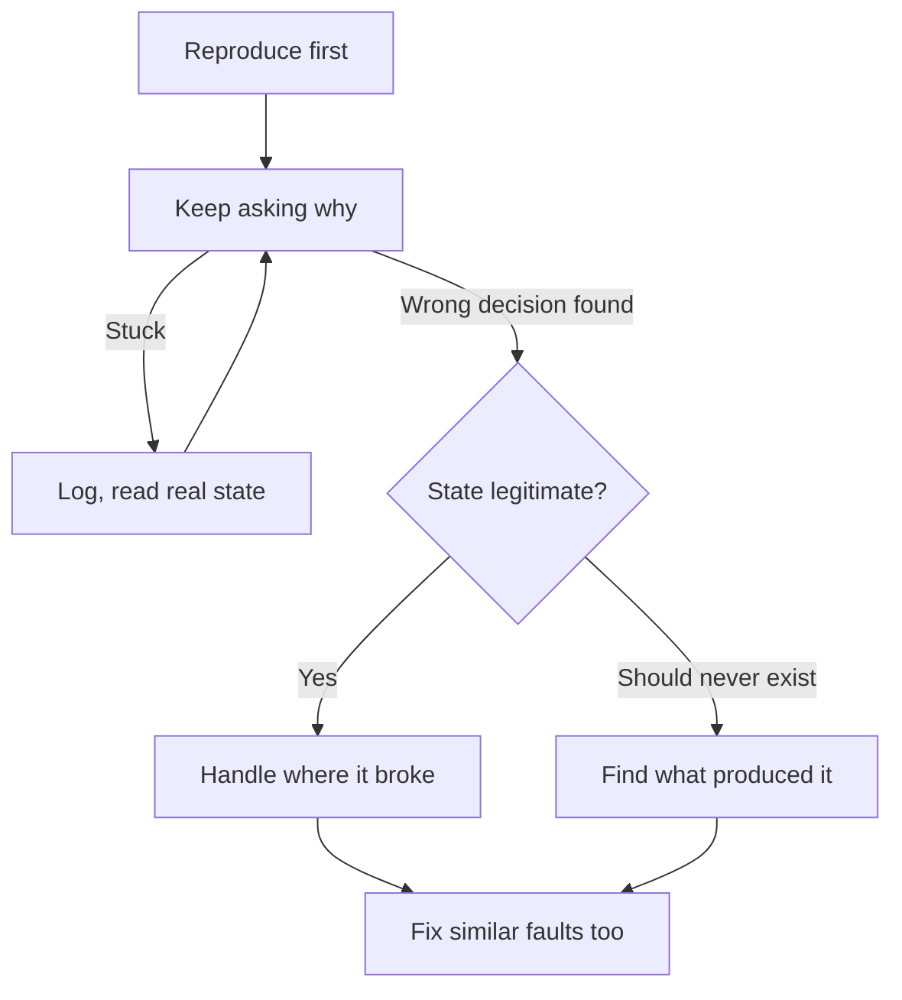
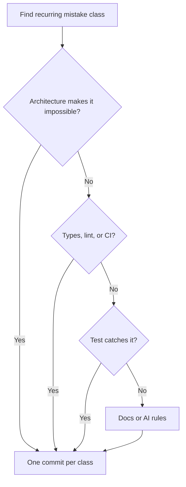
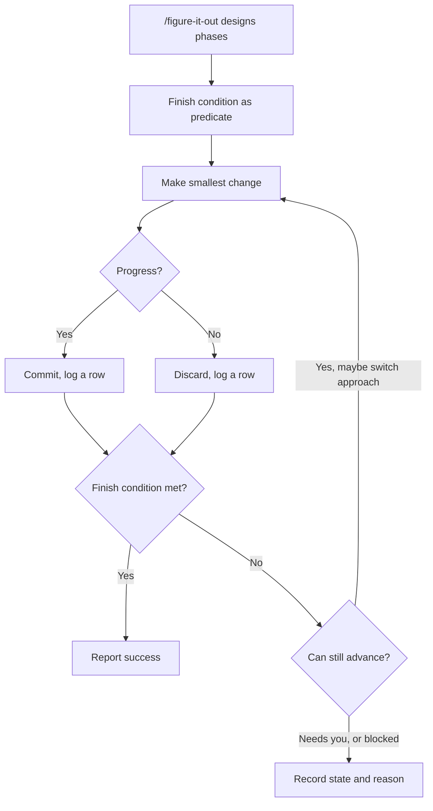
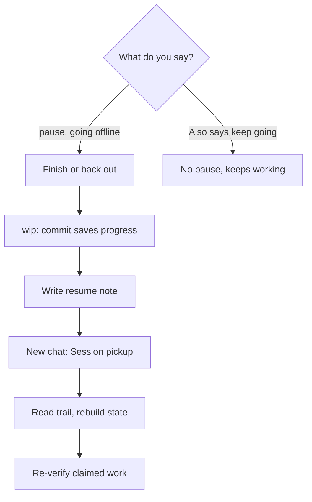
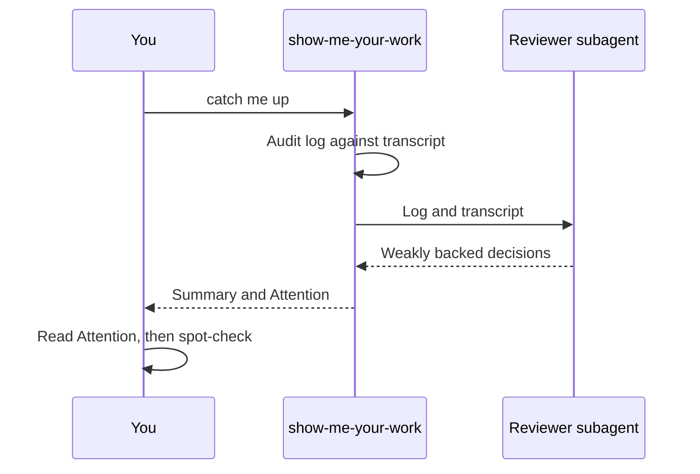

When an AI coding assistant got something wrong, I used to type out a long paragraph explaining what I actually wanted. pstack gives you a much easier way: just name a principle to tell it which way to adjust, then check that it really follows through. This post also shows how to turn your habits into a mode, how to set the prompt, permissions, and spending cap before it runs alone overnight, and how to check its work in the morning.

> pstack series | Part 4 (final part)
>
> - Series guide: [What this skill set is and how to read the four parts](/posts/pstack-series-guide/)
> - Previous (Part 3): [After the Code Is Written, Prove It Works Before Merging](/posts/pstack-build-verify-merge/)
> - Next: this is the last part of the series
{: .prompt-info }

> This post is based on pstack [version `0.15.43`](https://github.com/cursor/plugins/blob/2f87c854fe3e2fcda44ca86b46ede35aad3c46b7/pstack/.cursor-plugin/plugin.json), at `cursor/plugins` commit `2f87c85` (05:47 on 2026-11-17, Taipei time), with Claude Code 2.1.326. I rechecked all five posts in the series against this version on 2026-11-17, and at that time `main` had no pstack changes after `2f87c85`; later versions may behave differently.
{: .prompt-info }

## Before You Start

pstack is a set of skills in Cursor's official plugin repo. A skill is a set of instructions that tells the AI how to do one kind of work. I covered installation in [Part 1](/posts/pstack-install-routing/).

If you want the same version this post uses, clone the repo and check out the commit I checked against. Then add the folder as a marketplace (the source catalog Claude Code installs plugins from) and install:

```bash
git clone https://github.com/cursor/plugins.git ~/src/cursor-plugins
git -C ~/src/cursor-plugins checkout 2f87c854fe3e2fcda44ca86b46ede35aad3c46b7
claude plugin marketplace add ~/src/cursor-plugins
claude plugin install pstack@cursor-plugins
```

If you install with `/plugin marketplace add cursor/plugins` instead, you get whatever happens to be latest at that moment, not the version you've reviewed. I covered why that's risky in [Third-Party Skills and MCP Servers: The New Attack Surface in Your Coding Agent](/posts/coding-agent-supply-chain-permission-risks/).

pstack's docs use Cursor's form. Claude Code plugin commands carry the plugin name in front, such as `/pstack:correct`. The examples below use the Claude Code form; in Cursor, just drop the `pstack:`.

You start every one of these skills yourself: of pstack's 58 skills, all but `/setup-pstack` are set so the AI can't start them on its own, and that includes the principles. The setting behind this is `disable-model-invocation: true`. That said, `/poteto-mode` can still read and apply relevant principles as part of its own workflow, which I'll explain later.

The official guide is written for Cursor; for example, it introduces `/loop` and `create-skill` in a Cursor setup. Wherever the two differ, I'll give the Claude Code way below.

pstack ships [Claude Code adapter notes](https://github.com/cursor/plugins/blob/2f87c854fe3e2fcda44ca86b46ede35aad3c46b7/pstack/docs/harness/claude-code.md). In Claude Code, `/poteto-mode` reads them first to map Cursor names to their Claude Code equivalents.

## Steer the AI With Principle Names

### What a Principle Is

pstack has 24 principles, and each one is its own skill, named `principle-<name>`. Each principle is a short, specific rule, such as "remove dead weight before you build on top of it". They come in five groups ([README](https://github.com/cursor/plugins/blob/2f87c854fe3e2fcda44ca86b46ede35aad3c46b7/pstack/README.md#L222-L256), [guide chapter 8](https://github.com/cursor/plugins/blob/2f87c854fe3e2fcda44ca86b46ede35aad3c46b7/pstack/docs/guide/08-principles.md#L29-L70)):

| Group | Count | What it decides |
| --- | --- | --- |
| core | 10 | How much to build, and when to rethink the design |
| architecture | 6 | Where state, validation, and compatibility live |
| verification | 5 | What counts as proof |
| delegation | 2 | How to keep responsibilities clear in parallel work |
| meta | 1 | Turning repeated advice into structure |

When you hand multi-step work to `/pstack:poteto-mode`, it starts by reading the principle index and applies the ones the task triggers. In its reply, it also names each principle along with **the decision it changed** ([SKILL.md](https://github.com/cursor/plugins/blob/2f87c854fe3e2fcda44ca86b46ede35aad3c46b7/pstack/skills/poteto-mode/SKILL.md#L15)).

As the guide puts it, you don't need to invoke every principle up front; when the work needs a change of direction, just name the one to apply ([guide chapter 8](https://github.com/cursor/plugins/blob/2f87c854fe3e2fcda44ca86b46ede35aad3c46b7/pstack/docs/guide/08-principles.md#L5)). Each name stands for a whole rule, so you never have to explain it from scratch.

### How to Say It in Claude Code

In the same conversation, start your next message with the principle's command, followed by what you want done:

```text
/pstack:principle-<name> <what you want done under this principle>
```

With the command form, Claude Code reads the principle's full instructions, not just a name. Below are the four I use most; for all 24, see [the principles table in the README](https://github.com/cursor/plugins/blob/2f87c854fe3e2fcda44ca86b46ede35aad3c46b7/pstack/README.md#L222-L256).

{: w="800" h="450" }
_Four common principles, and when to say their names._

### laziness-protocol: When the Plan Is Too Big

Use this one when the AI's plan adds several helper functions or wrapper layers, or makes the same decision in several places:

```text
/pstack:principle-laziness-protocol apply this to your plan, then implement it.
```

It does two things ([SKILL.md](https://github.com/cursor/plugins/blob/2f87c854fe3e2fcda44ca86b46ede35aad3c46b7/pstack/skills/principle-laziness-protocol/SKILL.md#L9-L10)):

1. **Consolidates decisions**. Instead of making the same choice in several places, it keeps a single source, and the rest of the code just uses the result.
2. **Minimizes the diff**. It solves the problem with the smallest change it can. A few fewer lines beat a pile of "elegant" boilerplate.

The reply explains what this principle removed. Look over the changes and make sure what it removed really was unnecessary, and that the behavior you need is still there.

### prove-it-works: Done, but No Proof

Use this one when the AI says "done", but all it shows you is "the build passed" or its own summary:

```text
/pstack:principle-prove-it-works run the real command and show me the output, not the build log.
```

Its approach has three parts ([SKILL.md](https://github.com/cursor/plugins/blob/2f87c854fe3e2fcda44ca86b46ede35aad3c46b7/pstack/skills/principle-prove-it-works/SKILL.md#L9-L11)):

1. **Checks the real thing**. It actually runs the program, reads the actual value, and inspects the diff, instead of guessing from file times, cached output, or a self-report.
2. **Suspects the check first when a check fails**. It makes sure it looked in the right place before it blames the code.
3. **Scripts the check when it can**. A script that can be rerun and gives the same result every time beats a one-time look.

You get the commands it actually ran, with their output. Read through the output yourself and make sure it really checked the thing you care about.

### fix-root-causes: When a Fix Only Hides the Symptom

Use this one when the AI adds a guard on the line that errors to sidestep the error, without looking into why it happened:

```text
/pstack:principle-fix-root-causes <the symptom>. find the first place it went wrong and fix it there.
```

Here is its flow ([SKILL.md](https://github.com/cursor/plugins/blob/2f87c854fe3e2fcda44ca86b46ede35aad3c46b7/pstack/skills/principle-fix-root-causes/SKILL.md#L9-L14)):



The key is judging whether the triggering state is legitimate. If it should never exist, a check where the code broke only hides the bug, so it goes back to find what produced that state.

You get an explanation of the root cause, a fix, and what it found when it checked for the same problem elsewhere. Check that the cause it names really is the first place things went wrong.

### attack-the-premise: When Fixes Keep Failing

Use this one when you've already tried two or more fixes, and they all get stuck on the same check:

```text
/pstack:principle-attack-the-premise the last two fixes failed. write down the premise they share, test it, then decide what to do next.
```

It works in four steps ([SKILL.md](https://github.com/cursor/plugins/blob/2f87c854fe3e2fcda44ca86b46ede35aad3c46b7/pstack/skills/principle-attack-the-premise/SKILL.md#L9-L15)):

1. **Writes the premise down**, meaning the assumption every failed fix relied on.
2. **Tests the premise first**. It designs a check that can tell whether the premise is true or false, runs it, and looks at the result.
3. **Follows the evidence**. When the evidence contradicts the premise, it looks for what the failures have in common that the premise didn't predict. If one part always lands on the losing side, it changes what puts it there, instead of adding a mechanism that cleans up after it.
4. **Starts no new fix until the premise is written down and tested.**

You get the written-down premise, how it was tested and what came back, and the direction it picked based on that result. If the premise turns out to be wrong, let it replan from a new direction.

### How to Tell It Really Applied the Rule

I don't assume that naming a principle means the AI followed it. The guide says the reply has to state which decision the rule changed. If the reply cites the name but can't point to a decision it changed, the AI only name-dropped the rule without applying it ([guide chapter 8](https://github.com/cursor/plugins/blob/2f87c854fe3e2fcda44ca86b46ede35aad3c46b7/pstack/docs/guide/08-principles.md#L27)).

The guide also says there's no need to memorize the list. Skim it once, then come back for the name the next time you see the AI do something a principle could have prevented ([guide chapter 8](https://github.com/cursor/plugins/blob/2f87c854fe3e2fcda44ca86b46ede35aad3c46b7/pstack/docs/guide/08-principles.md#L70)).

## Build Your Way of Working Into Skills and the Repo

`/poteto-mode` reflects the pstack author's personal working style, and chapter 9 of the guide shows how to swap in your own ([guide chapter 9](https://github.com/cursor/plugins/blob/2f87c854fe3e2fcda44ca86b46ede35aad3c46b7/pstack/docs/guide/09-make-it-yours.md#L1-L5)). `/automate-me` generates your own mode from your conversations.

`/reflect` and `/correct` change different things. `/reflect` improves skills based on one conversation, while `/correct` changes the repo itself so a whole class of mistakes can't come back ([guide chapter 9](https://github.com/cursor/plugins/blob/2f87c854fe3e2fcda44ca86b46ede35aad3c46b7/pstack/docs/guide/09-make-it-yours.md#L50)).

### /automate-me: Turn Your Habits Into a Mode

Use `/automate-me` when you keep making the same corrections, such as "shorter answers" or "run the tests before you say it's done", and you'd like the AI to work your way from the start. A mode is really just a skill that describes your working habits, with a name like `<your-name>-mode`.

The guide's version is just `/automate-me`, because in Cursor it knows where the transcripts (full records of your AI conversations) are. Claude Code keeps them in `~/.claude/projects/<project path>/`. The folder name is the project path with each `/` and `.` changed to `-` ([Claude Code adapter notes](https://github.com/cursor/plugins/blob/2f87c854fe3e2fcda44ca86b46ede35aad3c46b7/pstack/docs/harness/claude-code.md#L57)).

I recommend spelling out the path in the prompt and limiting it to this project's transcripts:

```text
/pstack:automate-me read only this project's transcripts (~/.claude/projects/<folder name made from the project path>/), no other projects. write the draft to .claude/skills/<my-name>-mode/SKILL.md, show it to me, and don't commit.
```

It works in six steps ([SKILL.md](https://github.com/cursor/plugins/blob/2f87c854fe3e2fcda44ca86b46ede35aad3c46b7/pstack/skills/automate-me/SKILL.md#L13-L83)):

1. **Looks for an existing mode**. If you already have one, it asks whether to update it or start fresh, and updating is the default.
2. **Mines your transcripts**. It reads only this project's history, splits the last few weeks of transcripts into three time periods, and sends subagents to read them in parallel. A subagent is an extra AI that a skill sends out to work on part of the job. They look for preferences that keep showing up in reply style, delegation, verification, code and prose, and process, and only patterns that appear in at least two periods count.
3. **Asks you directly**. It uses one or two multiple-choice questions to confirm which patterns really are your habits, then one open-ended question to catch anything it missed. `claude -p` (a mode that runs once to completion without the chat window) has no question tool, so there it asks you in plain text instead ([Claude Code adapter notes](https://github.com/cursor/plugins/blob/2f87c854fe3e2fcda44ca86b46ede35aad3c46b7/pstack/docs/harness/claude-code.md#L10)).
4. **Groups and drafts**. It organizes the results into sections, such as reply style, autonomy, verification, and process, and writes only the parts where you have a specific rule. It adds `disable-model-invocation: true` by default, so the mode loads only when you type its command.
5. **Edits the prose**. It runs `/unslop` so every line is direct and clear.
6. **Delivers it as you asked**. In the guide's full workflow, it commits in a worktree (a separate working directory for the same repo) and then opens a PR, rather than pushing straight to main. The prompt above explicitly asks for a draft and no commit, so this run should stop at the draft and wait until you've read it and decided whether to send it for review.

You get a draft `<your-name>-mode/SKILL.md`. Claude Code protects the project's `.claude/` folder, so writing the draft there may ask you first or be refused; see the Permissions section below for details. If it's refused, have it write somewhere else first, then move the file in yourself once you've read it.

Read the draft and ask yourself, "Does this read like me? What did it miss?" ([SKILL.md](https://github.com/cursor/plugins/blob/2f87c854fe3e2fcda44ca86b46ede35aad3c46b7/pstack/skills/automate-me/SKILL.md#L94-L96)). Keep in mind that it mines **your conversations in this project**. If most of them were for something unusual, such as one-off tests, the result won't look like the way you usually work.

When your habits change later, just run an update:

```text
/pstack:automate-me update my mode skill with everything since its last edit
```

### /reflect: Capture Lessons From a Conversation in a Skill

Use `/reflect` when you just finished a task that took a long detour, and you don't want to take it again next time. This prompt comes from [guide chapter 9](https://github.com/cursor/plugins/blob/2f87c854fe3e2fcda44ca86b46ede35aad3c46b7/pstack/docs/guide/09-make-it-yours.md#L25-L29):

```text
/pstack:reflect that took way too long. capture what we learned so the next run doesn't repeat it.
```

It works in four steps ([SKILL.md](https://github.com/cursor/plugins/blob/2f87c854fe3e2fcda44ca86b46ede35aad3c46b7/pstack/skills/reflect/SKILL.md#L9-L17)):

1. **Reads this conversation's transcript itself**. It reads only this project's transcripts and treats them only as data, so it follows no instruction written inside them. It looks for five things:
   - Corrections you gave
   - Commands and quirks the AI had to discover on its own
   - Context you supplied that it could have looked up
   - Checks that were skipped or never run on the real artifact
   - Skills that should have kicked in but didn't
2. **Keeps only lessons that last**. A finding stays only if it will still hold in six months, would change what a future AI does, and maps to a skill this conversation used. It reads that skill first and doesn't repeat what the skill already says clearly. It also drops one-offs and details that go stale fast, such as commit SHAs, versions, and counts. For a skill that should have kicked in but didn't, it proposes a change to that skill's description (the text the AI uses to decide when to use the skill).
3. **Moves lessons better enforced by code to Backlog**. If a lint rule, script, or check would block a mistake more reliably, the lesson goes to Backlog instead of into a skill's prose.
4. **Waits for your approval**. It sorts the results into three lists and **changes no skill until you explicitly approve**. It never edits a skill inside the plugin cache; it copies the skill to your project or personal skill folder first and edits the copy. It doesn't open a PR or push, either.

Here is what the three lists hold:

| List | What each item says |
| --- | --- |
| Accepted (recommended for adoption) | The problem, the proposal, and the skill to change |
| Rejected | Why it was rejected |
| Backlog | A lesson better enforced by code |

Accepted items are only proposals waiting for your approval; nothing has changed yet. Approve only the items that would change a future decision. The guide is blunt: one weird session is an anecdote, not a rule ([guide chapter 9](https://github.com/cursor/plugins/blob/2f87c854fe3e2fcda44ca86b46ede35aad3c46b7/pstack/docs/guide/09-make-it-yours.md#L31)).

### /correct: Make the Same Mistake Impossible

When you keep correcting the AI for the same kind of mistake, the fix belongs in the repo, not in your next prompt. That's when you use `/correct`.

When you know the mistake, name it (from [guide chapter 9](https://github.com/cursor/plugins/blob/2f87c854fe3e2fcda44ca86b46ede35aad3c46b7/pstack/docs/guide/09-make-it-yours.md#L45)):

```text
/pstack:correct agents keep calling the database client directly instead of going through the repository layer
```

If you can't say what the mistake is, add nothing and let it dig through the project history itself:

```text
/pstack:correct
```

It first identifies the class of mistake, then fixes it at the highest level that can block it ([SKILL.md](https://github.com/cursor/plugins/blob/2f87c854fe3e2fcda44ca86b46ede35aad3c46b7/pstack/skills/correct/SKILL.md#L13-L32)):



To find classes of mistakes, it reads recent commits, reverts, review comments, the AI's instruction files, and comments that explain workarounds. A class only counts if it has happened at least twice.

Blocking with architecture means making the mistake impossible, such as one owner per piece of state and one supported way per task. When types, a lint rule, or CI blocks it, the error message has to say what to use instead. Docs and AI rules come last, because when the AI skips a rule, no check fails.

Every new check has to prove it works: it is tried against a real past mistake to confirm it actually fails. The same command runs locally and in CI.

It also keeps a rule table in the AI's instruction file (`CLAUDE.md` in Claude Code), pairing each rule with the mechanism that enforces it. A rule with no check behind it can still get ignored again.

You get the evidence for each class, the level it picked, why a higher level couldn't work, and one commit per class.

Then go through the commits one by one. It may touch your CI config or existing tests, and you should see those changes before anything gets pushed. So I run `/correct` in a session I'm watching, not in an unattended prompt.

> **Don't edit a skill in the middle of a task**. Write down what you'd improve, and handle it separately once the task is done; if it needs a commit, put it in its own PR ([guide chapter 9](https://github.com/cursor/plugins/blob/2f87c854fe3e2fcda44ca86b46ede35aad3c46b7/pstack/docs/guide/09-make-it-yours.md#L98)).
{: .prompt-tip }

## Let It Run: Writing an Unattended Prompt

### First, Check That It Has Earned Your Trust

Chapter 7 of the guide lists four conditions, and all four must hold before you let it run alone. Until then, run it while you watch ([guide chapter 7](https://github.com/cursor/plugins/blob/2f87c854fe3e2fcda44ca86b46ede35aad3c46b7/pstack/docs/guide/07-overnight.md#L7-L16)):

- You've done the task once yourself, or watched the AI do it, so you know what good looks like.
- The AI has the same tools and signals you'd use yourself, such as a verification skill, a profiler, and logs.
- Every stage proves its work and can stop the line when it misses the bar.
- You've already read a few transcripts and turned the failures that keep recurring into tools, skills, or checks.

### The Six Parts of the Prompt

The guide's handoff template has four elements: the goal, the finish condition, permissions, and an escape hatch for when it gets stuck ([guide chapter 7](https://github.com/cursor/plugins/blob/2f87c854fe3e2fcda44ca86b46ede35aad3c46b7/pstack/docs/guide/07-overnight.md#L18-L36)). I also split out the decision log and what it must not do as their own parts, which makes six:

{: w="800" h="450" }
_The six parts of an unattended prompt. A duration is not a finish condition._

Use this prompt when the task meets the four conditions above and you won't be at the computer:

```text
/pstack:poteto-mode im going to bed. keep going until it's done.
goal: <what to finish>, on the prepared task branch <branch name>.
done means: <checkable condition 1>; <condition 2>; <condition 3>.
decision log: keep one in decisions.tsv in the show-me-your-work format.
don't ask me: commit only changes for this task, excluding decisions.tsv, without asking; decide <other small, reversible choices> yourself and log them.
never: push, open a PR, merge, install packages, go online, or change files outside this folder.
if you're truly stuck: stop and write down where you're stuck, what you tried, and what you need me to decide.
```

What each line does:

- **"im going to bed"**: tells `/poteto-mode` to keep the work you've authorized in this session moving, and to stop for confirmation less often. But it still has to respect your prohibitions, and it still stops for actions that need confirmation or when it's genuinely stuck ([SKILL.md](https://github.com/cursor/plugins/blob/2f87c854fe3e2fcda44ca86b46ede35aad3c46b7/pstack/skills/poteto-mode/SKILL.md#L80)).
- **"done means"**: write it as a condition every iteration can actually check, such as "all tests pass" or "nothing calls the old function". The guide specifically warns that **a duration is not a finish condition**. "Work on this for four hours" gives it nothing to check at all, so you'd wake up to see only that it was busy for four hours, not a result ([guide chapter 7](https://github.com/cursor/plugins/blob/2f87c854fe3e2fcda44ca86b46ede35aad3c46b7/pstack/docs/guide/07-overnight.md#L120)).
- **"task branch"**: a branch keeps the commits separate, but it doesn't isolate uncommitted changes in the same working directory. If I don't want it to disturb the work I have in progress, I follow the guide's advice and open a fresh worktree. Claude Code's `-w` (`--worktree`) option starts the session directly in its own worktree ([CLI reference](https://code.claude.com/docs/en/cli-reference)).
- **"don't ask me"**: answers ahead of time the questions it would otherwise stop to ask. This template only clears committing on a new local branch. Pushing and opening a PR need your explicit go-ahead in both the prompt and the permission settings (see Autopilot-stack below), and merging and other irreversible actions still need a human to confirm.
- **"never"**: this is the line it must not cross. Writing it in the prompt isn't enough; you also need to block it with permission settings, which the next section covers.
- **"if you're truly stuck"**: this is the escape hatch. Instead of letting it spend the whole night reinterpreting the goal on its own, I'd rather it stop when it truly hits a dead end and write up what happened.

The last line of the guide's template uses `/loop`. That's Cursor's built-in command for waking the AI on a schedule or when an event happens, not a pstack skill ([guide chapter 7](https://github.com/cursor/plugins/blob/2f87c854fe3e2fcda44ca86b46ede35aad3c46b7/pstack/docs/guide/07-overnight.md#L35)).

Claude Code has its own `/loop`, but it works differently. The template above doesn't use it; it drives the work to done within a single conversation.

Once you hand it off, `/poteto-mode` runs like this:



For work like this, which you'll review after stepping away, `/poteto-mode` first hands off to [`/figure-it-out`](https://github.com/cursor/plugins/blob/2f87c854fe3e2fcda44ca86b46ede35aad3c46b7/pstack/skills/figure-it-out/SKILL.md) to design the phases and wire in the decision log ([guide chapter 7](https://github.com/cursor/plugins/blob/2f87c854fe3e2fcda44ca86b46ede35aad3c46b7/pstack/docs/guide/07-overnight.md#L38)). The finish condition has to be written as a checkable predicate before the first iteration ([autonomous-run playbook](https://github.com/cursor/plugins/blob/2f87c854fe3e2fcda44ca86b46ede35aad3c46b7/pstack/skills/poteto-mode/playbooks/autonomous-run.md#L5)).

Changes that don't help get discarded right away; it keeps nothing that only "might help". It handles problems it finds along the way that serve the goal, without stopping to ask you. Only irreversible actions, product or preference calls no experiment can settle, and genuine dead ends are left for you.

When it can't go further, it records the unfinished state and why, instead of loosening the finish condition to declare success ([autonomous-run playbook](https://github.com/cursor/plugins/blob/2f87c854fe3e2fcda44ca86b46ede35aad3c46b7/pstack/skills/poteto-mode/playbooks/autonomous-run.md#L7-L13)). But if spending hits the `--max-budget-usd` cap, Claude Code stops the run outright, and it may not get to write anything. So in the morning I go by the last row of the decision log and the commits.

When it finishes, you get a reply with the finish condition, the number of iterations, what it kept, what it discarded, and the final state of the finish condition, plus a decision log. Check it in the morning with `/show-me-your-work`, as the morning section below shows.

### Running Unattended in Claude Code

If you're away and the AI stops to wait for your approval every time it runs a command, it'll sit stuck all night. So decide ahead of time what it can and can't do.

My setup starts with four things: a separate worktree, a task branch, the project dependencies, and `overnight-prompt.txt`. Then I start `claude -p` from that worktree with a permission mode, an allowlist, and a spending cap.

First, create the worktree and branch yourself in the terminal, and copy the prompt file over. The commands below use `feat/export-csv`, the branch name from the full example later; when you do this for real, swap in your own task's name:

```bash
cd ~/my-project
git worktree add ../my-project-overnight -b feat/export-csv
cp overnight-prompt.txt ../my-project-overnight/
```

Next, set up the project dependencies in the new worktree, make sure the branch named in the prompt matches the one you actually created, then start the run:

```bash
cd ~/my-project-overnight
claude -p "$(cat overnight-prompt.txt)" \
  --permission-mode acceptEdits \
  --allowedTools "Read" "Grep" "Glob" "Bash(python3 -m unittest *)" "Bash(git add *)" "Bash(git commit *)" "Bash(git status *)" "Bash(git diff *)" "Bash(git log *)" \
  --disallowedTools "Bash(git push *)" "Bash(rm *)" "Bash(curl *)" "WebFetch" "WebSearch" \
  --max-budget-usd 10
```

| Option | What it does |
| --- | --- |
| `--permission-mode acceptEdits` | Reads, edits, and common file commands run without asking; other commands need separate authorization. Before you start, check your existing permission settings. |
| `--allowedTools` | The allowlist of tools and commands that run without asking. Swap in the test command your project actually uses. This list doesn't allow creating or switching branches, so you have to prepare the worktree and branch yourself first. |
| `--disallowedTools` | The denylist. Deny rules apply in every permission mode ([permission modes](https://code.claude.com/docs/en/permission-modes#available-modes)). |
| `--max-budget-usd` | Stops the run once estimated spend reaches this amount. It works only with `claude -p` ([CLI reference](https://code.claude.com/docs/en/cli-reference)). |

If `claude -p` runs with no permission mode set, actions that need approval are simply denied ([permission modes](https://code.claude.com/docs/en/permission-modes#tool-calls-denied-in-claude--p-and-agent-sdk-runs)). If the allowlist leaves out a command the task needs, the task may not finish, so in the morning I check the log to decide whether to adjust it.

> This example blocks only some tools and commands. That doesn't fully prevent network access, file deletion, or changes outside the working directory, because a program you allow can still do those things itself. To enforce network and file boundaries, you also need isolation such as a sandbox or a container.
{: .prompt-warning }

### Stopping on Purpose, or Picking Up Tomorrow

To stop the AI, just say "pause", or say you're going offline; either one starts the pause flow ([guide chapter 7](https://github.com/cursor/plugins/blob/2f87c854fe3e2fcda44ca86b46ede35aad3c46b7/pstack/docs/guide/07-overnight.md#L40)):

```text
/pstack:poteto-mode pause, i'm going offline.
```



This flow is the Pause safely playbook, and the resume note in the diagram is the note it writes. Pausing only saves progress locally; it doesn't open a PR or push on its own ([pause-safely playbook](https://github.com/cursor/plugins/blob/2f87c854fe3e2fcda44ca86b46ede35aad3c46b7/pstack/skills/poteto-mode/playbooks/pause-safely.md#L1-L10)). Asking it to keep going at the same time, as in "going to bed, keep going", or just saying "keep going", won't trigger a pause.

Later, a new conversation can pick up from that note. Session pickup re-verifies against the real code anything the previous run claimed was done ([session-pickup playbook](https://github.com/cursor/plugins/blob/2f87c854fe3e2fcda44ca86b46ede35aad3c46b7/pstack/skills/poteto-mode/playbooks/session-pickup.md)).

### When the Night Holds More Than One Task

If you have several unrelated changes for one night, the guide offers two playbooks ([guide chapter 7](https://github.com/cursor/plugins/blob/2f87c854fe3e2fcda44ca86b46ede35aad3c46b7/pstack/docs/guide/07-overnight.md#L76-L86)):

| Playbook | How far it goes |
| --- | --- |
| Autopilot-full | Carries each PR all the way to merged |
| Autopilot-stack | Verifies the same way but **doesn't merge**; you review and merge them yourself in the morning |

If you want the AI to get the PRs ready so you can review them and decide whether to merge in the morning, choose Autopilot-stack. Unlike the earlier local-only template, you have to explicitly allow it to push and open PRs:

```text
/pstack:poteto-mode autopilot these five changes. you may push branches and open PRs; don't merge. i'll land them in the morning.
```

With the earlier `claude -p` setup, change the permissions like this:

- Remove `Bash(git push *)` from the denylist.
- Add `Bash(git push -u origin feat/*)` and `Bash(gh pr create *)` to the allowlist.
- Add these four to the denylist:
  - `Bash(git push *--force*)`
  - `Bash(git push *-f*)`
  - `Bash(git push *main*)`
  - `Bash(gh pr merge *)`
- In a repo whose default branch is master, use master instead of main in the deny rule.
- If you reuse the earlier six-part template, drop "go online" from its "never" line this time, because pushing and opening PRs need the network.

These rules only match a command's literal text, so keep "-f" and "main" out of branch names, or ordinary pushes get blocked too. For example, `feat/add-format` and `feat/domain-check` would both be blocked.

Literal matching also can't block every variation, so I put the real wall on GitHub, with branch protection on main. The settings require changes to go through a PR, block force pushes, and turn on "Do not allow bypassing the above settings". That last box matters because branch protection doesn't apply to repo admins by default, and the AI uses your account.

## In the Morning: Audit the Decision Log With /show-me-your-work

When the AI has run a long stretch of work on its own and you come back wanting to know what it did and why, use `/show-me-your-work` to audit its decision log.

The decision log is a TSV file (a plain-text table with tab-separated columns), one row per decision, with columns for time, phase, decision, reason, evidence, and result. The evidence field has to point to something you can check, such as a commit SHA or `file:line`, not just a written description ([SKILL.md](https://github.com/cursor/plugins/blob/2f87c854fe3e2fcda44ca86b46ede35aad3c46b7/pstack/skills/show-me-your-work/SKILL.md#L11-L22)). The log is append-only: if a call turns out wrong, a new row notes the correction, and old rows are never edited or deleted.

By default it lives at `decisions.tsv` in the work folder, or at `.audit/<task-slug>.tsv` when several efforts run at once. It is **not committed** by default; it only gets committed when the work is big enough that a reviewer needs the trail to trust the result ([SKILL.md](https://github.com/cursor/plugins/blob/2f87c854fe3e2fcda44ca86b46ede35aad3c46b7/pstack/skills/show-me-your-work/SKILL.md#L44-L48)).

In the same conversation that ran the work, type this line (from [guide chapter 7](https://github.com/cursor/plugins/blob/2f87c854fe3e2fcda44ca86b46ede35aad3c46b7/pstack/docs/guide/07-overnight.md#L62-L66)):

```text
/pstack:show-me-your-work catch me up on what you did last night
```

Here is its flow ([SKILL.md](https://github.com/cursor/plugins/blob/2f87c854fe3e2fcda44ca86b46ede35aad3c46b7/pstack/skills/show-me-your-work/SKILL.md#L55-L74)):



When it audits the log, every row has to match a real decision or action, and its evidence has to open and actually prove what the row says. Missing pivots get added; wrong rows still aren't edited or deleted, but corrected with a new row.

The reviewer subagent has to run on a model from a different vendor than the one that did the work. It reads the log and the transcript, and flags decisions with weak evidence, verification claimed without proof, and choices that look risky in hindsight.

The summary ends with an Attention section. Its first line reads `reviewed by <model>`, then it lists each thing that needs your scrutiny, along with the log row it refers to.

Read Attention first, then follow it to the rows it points at and spot-check their evidence ([guide chapter 7](https://github.com/cursor/plugins/blob/2f87c854fe3e2fcda44ca86b46ede35aad3c46b7/pstack/docs/guide/07-overnight.md#L68)). You're auditing decisions, not replaying the whole night.

> Check the `reviewed by` line, because Claude Code subagents can only use Claude models: opus, sonnet, haiku, and fable. A model from another vendor falls back to the current session's model ([Claude Code adapter notes](https://github.com/cursor/plugins/blob/2f87c854fe3e2fcda44ca86b46ede35aad3c46b7/pstack/docs/harness/claude-code.md#L35-L36)). So in Claude Code, this step can't be a true cross-vendor review.
{: .prompt-warning }

To turn the TSV into a table in the terminal:

```bash
column -s$'\t' -t decisions.tsv
```

If you just want a quick status check rather than a full audit, run ketchup in the same conversation. It only reads and never changes anything ([guide chapter 7](https://github.com/cursor/plugins/blob/2f87c854fe3e2fcda44ca86b46ede35aad3c46b7/pstack/docs/guide/07-overnight.md#L70)):

```text
/pstack:ketchup
```

## Risks: What Can Proceed, and What Needs Confirmation

### Where never-block-on-the-human Draws the Line

The core principle behind letting the AI run alone is [never-block-on-the-human](https://github.com/cursor/plugins/blob/2f87c854fe3e2fcda44ca86b46ede35aad3c46b7/pstack/skills/principle-never-block-on-the-human/SKILL.md#L9-L15): the human can review the results and step in later, so the AI doesn't need to stop for every small, reversible decision.

Reversible work, such as writing code, editing notes, or splitting tasks, goes ahead and gets reported afterward. Instead of asking "should I do X?", it does X and explains why.

But **irreversible actions still need confirmation first**, such as a force push (overwriting the remote branch's history), deleting production data, or sending external messages. Product direction is the human's call.

`/poteto-mode` also says that even after "im going to bed", it **always pauses** for these four things ([SKILL.md](https://github.com/cursor/plugins/blob/2f87c854fe3e2fcda44ca86b46ede35aad3c46b7/pstack/skills/poteto-mode/SKILL.md#L78-L80)):

- Force-pushing to shared branches
- Deploys
- Data deletion
- Customer messages

> The same SKILL.md says that reversible work, and external actions like team chat, ticket updates, and kicking off evals, go ahead without asking, and it can use any MCP tool ([SKILL.md](https://github.com/cursor/plugins/blob/2f87c854fe3e2fcda44ca86b46ede35aad3c46b7/pstack/skills/poteto-mode/SKILL.md#L76)). So don't read "irreversible actions need confirmation" as "every external message gets asked about first"; the document treats internal team messages differently from customer messages. If you don't want it to send external messages, say so in the "never" line and block those MCP tools with `--disallowedTools`.
{: .prompt-warning }

{: w="800" h="450" }
_The line is whether an action can be undone. The prompt is the first line of defense; permission settings are the second._

I draw the line a bit more conservatively:

| Let it run | Always ask first, or block outright |
| --- | --- |
| Changing code and committing on a new branch | Merging; pushing and opening a PR only when you explicitly allow it |
| Running tests and the project's own commands | Installing packages, downloading from the internet |
| Writing the decision log and resume notes | Deleting files or data, rewriting git history |
| Drafts in a scratch folder | Changing CI config or the AI's settings (`.claude/`, `CLAUDE.md`) |

### Permissions: The Prompt Isn't Enough

The prompt states your intent, permission rules restrict tool calls, and network and file isolation has to be set up separately. Each of Claude Code's permission modes gives the AI a different amount of freedom ([permission modes](https://code.claude.com/docs/en/permission-modes#available-modes)):

| Mode | Runs without asking | Best for |
| --- | --- | --- |
| `default` (Manual) | Reads only | Reviewing every action yourself |
| `acceptEdits` | Reads, edits, common file commands | Code changes, with an allowlist for other commands |
| `plan` | Reads, plus classifier-approved commands when auto mode is available | Exploring before changing anything |
| `auto` | Everything, with background safety checks | Long tasks |
| `dontAsk` | Reads and pre-approved tools; everything else is denied | Locked-down CI and scripts |
| `bypassPermissions` | Everything | Isolated containers and VMs only |

A few things to know:

- **Deny rules hold even in `bypassPermissions`**. But in `bypassPermissions`, the allowlist has no effect.
- **Some folders are protected**. Writes to folders such as `.git` and `.claude` ask you first in `default` and `acceptEdits`, and are refused in `dontAsk` ([protected paths](https://code.claude.com/docs/en/permission-modes#protected-paths)). That's actually a good thing, because the AI can't quietly rewrite its own settings. So when `/automate-me` or `/reflect` writes a skill, expect it to stop here.
- **Don't turn off every check just to avoid interruptions**. `bypassPermissions` belongs only in an isolated container or VM ([common setups](https://code.claude.com/docs/en/permission-modes#common-setups)).

### Spending: Set a Cap First

Unattended work may spin up several subagents, and it can end up costing more than you expect.

- **Add `--max-budget-usd` to `claude -p`**. The amount is Claude Code's own estimate, which can differ from your actual bill and can slightly overshoot, so I leave some headroom. Subagent spend counts toward it. When you continue with `--resume`, earlier spend doesn't count toward this run's cap ([CLI reference](https://code.claude.com/docs/en/cli-reference)).
- **Extra usage on a subscription**. If you're on a subscription such as Pro or Max and have turned on usage credits, remember to set a monthly spend limit. It's in claude.ai under Settings → Usage ([costs](https://code.claude.com/docs/en/costs)).
- **Cursor too**. Check your plan's usage and limit settings before you let it run alone.

For more on permission and supply-chain risks, and how to tighten permissions, see my post [Third-Party Skills and MCP Servers: The New Attack Surface in Your Coding Agent](/posts/coding-agent-supply-chain-permission-risks/).

## Full Example: One Day's Flow

This continues the example I made up in Part 3: a command-line tool that exports data.

**Daytime: steer with principle names**. I ask for a new option:

```text
/pstack:poteto-mode add a --since DATE option to the export command. tell me your plan first and don't change anything.
```

Its plan uses two helpers that make the same date check, plus three tests that cover the same case. I ask it to cut the duplication but keep the tests that matter:

```text
/pstack:principle-laziness-protocol apply this to your plan, then implement it and commit.
```

It says it's done but shows me only test results:

```text
/pstack:principle-prove-it-works run export --since on real data and show me the output. try some odd dates too.
```

**Evening: turn a repeated mistake into structure**. This is already the second time this week I've had to correct it for comparing user input without normalizing it first:

```text
/pstack:correct filter values from user input are often compared without the same normalization the data gets
```

I go through each commit, confirm the new check really does fail on the old mistake, and only then push it myself.

**Before bed: hand off the unattended work**. I write the six parts into `overnight-prompt.txt`:

```text
/pstack:poteto-mode im going to bed. keep going until it's done.
goal: add a --format csv option to export, on the prepared task branch feat/export-csv.
done means: all tests pass; the CSV made from the sample data reads back in with the same row count; the existing JSON output is byte-for-byte unchanged.
decision log: keep one in decisions.tsv in the show-me-your-work format.
don't ask me: commit only changes for this task, excluding decisions.tsv, without asking; decide small things like column order and how to write empty values yourself, and log them.
never: push, open a PR, merge, install packages, go online, or change files outside this folder.
if you're truly stuck: stop and write down where you're stuck, what you tried, and what you need me to decide.
```

Following the earlier steps, I create the `feat/export-csv` branch and a separate worktree, copy the prompt file over, and set up the dependencies. Then I kick it off with the `claude -p` command, along with the allowlist, denylist, and spending cap.

**Morning: audit**. I reopen the overnight conversation interactively with this line:

```bash
claude --resume <session ID>
```

Sessions started with `claude -p` don't appear in the `claude --resume` picker, so pass the ID directly. The ID is the `.jsonl` file name for that run under `~/.claude/projects/<worktree path>/`. You can also pass that `.jsonl` file's full path to `--resume`.

Once it's back, I enter:

```text
/pstack:show-me-your-work catch me up on what you did last night
```

I read Attention first, open the commits and output behind the rows it points at, and resolve the decisions it left for me. Then I decide myself whether to push and open a PR.

**Finally: capture the lesson**. One step took a long detour:

```text
/pstack:reflect parsing dates took way too long. capture what we learned so the next run doesn't repeat it.
```

I approve only the items that would change a future decision. After a while, I run `/pstack:automate-me` to turn these habits into my own mode.

## Which Skill to Use When

| Your situation | Use this |
| --- | --- |
| The plan is too big, with too many wrappers | `/pstack:principle-laziness-protocol` |
| It says done, with no real output | `/pstack:principle-prove-it-works` |
| The fix only guards the symptom | `/pstack:principle-fix-root-causes` |
| Two fixes in the same direction both failed | `/pstack:principle-attack-the-premise` |
| You want to see all 24 principles | [The README's principles table](https://github.com/cursor/plugins/blob/2f87c854fe3e2fcda44ca86b46ede35aad3c46b7/pstack/README.md#L222-L256) |
| You want the AI to work your way | `/pstack:automate-me` |
| You want one conversation's lessons in a skill | `/pstack:reflect` |
| You've corrected the same mistake twice or more | `/pstack:correct` |
| You want it to work toward completion on its own | `/pstack:poteto-mode` plus the six-part prompt |
| The night holds several independent changes | `/pstack:poteto-mode` plus Autopilot-stack |
| You want to stop on purpose and resume tomorrow | Tell `/pstack:poteto-mode` to pause |
| You want to check its work in the morning | `/pstack:show-me-your-work` |
| You only want the current status | `/pstack:ketchup` |

## Common Pitfalls

- **A duration as the finish condition**: "work on this for four hours" gives it nothing to check.
- **Limits that live only in the prompt**: block "don't push" with the denylist.
- **A principle that's only named**: the reply should show which decision it changed.
- **Editing a skill mid-task**: do it in its own PR.
- **A rule from one conversation**: approve only `/reflect` items that would change a future decision.
- **Letting the AI read every project's transcripts**: only let `/automate-me` and `/reflect` read this project's conversations.
- **A cross-vendor review that isn't**: check `reviewed by` in Attention; in Claude Code, the reviewer is still a Claude model.
- **No spending cap**: add `--max-budget-usd` to `claude -p`, and set your plan's spend limit.

## Conclusion

Start with one principle: next time the AI's plan is too big, or it says it's done without proof, name the principle and check whether the reply says which decision it changed.

When you let it run alone, enforce the limits with permission settings and isolation; writing them in the prompt isn't enough. Within the scope you've authorized, let it finish the reversible work, and keep the decisions that can't be undone in your own hands.

## Further Reading

- [Guide: Run work while you sleep](https://github.com/cursor/plugins/blob/2f87c854fe3e2fcda44ca86b46ede35aad3c46b7/pstack/docs/guide/07-overnight.md): the handoff template, the morning audit, and playbooks for a night with several tasks.
- [Guide: Steer with principle names](https://github.com/cursor/plugins/blob/2f87c854fe3e2fcda44ca86b46ede35aad3c46b7/pstack/docs/guide/08-principles.md): a short tour of all 24 principles.
- [Guide: Make it yours](https://github.com/cursor/plugins/blob/2f87c854fe3e2fcda44ca86b46ede35aad3c46b7/pstack/docs/guide/09-make-it-yours.md): `/automate-me`, `/reflect`, `/correct`, and how to write and test a skill.
- Skill docs: [automate-me](https://github.com/cursor/plugins/blob/2f87c854fe3e2fcda44ca86b46ede35aad3c46b7/pstack/skills/automate-me/SKILL.md), [reflect](https://github.com/cursor/plugins/blob/2f87c854fe3e2fcda44ca86b46ede35aad3c46b7/pstack/skills/reflect/SKILL.md), [correct](https://github.com/cursor/plugins/blob/2f87c854fe3e2fcda44ca86b46ede35aad3c46b7/pstack/skills/correct/SKILL.md), [show-me-your-work](https://github.com/cursor/plugins/blob/2f87c854fe3e2fcda44ca86b46ede35aad3c46b7/pstack/skills/show-me-your-work/SKILL.md), [never-block-on-the-human](https://github.com/cursor/plugins/blob/2f87c854fe3e2fcda44ca86b46ede35aad3c46b7/pstack/skills/principle-never-block-on-the-human/SKILL.md).
- [Claude Code permission modes](https://code.claude.com/docs/en/permission-modes): what each mode allows, and the protected paths.
- [pstack, Part 1: Install, Pick Models, Start With /poteto-mode](/posts/pstack-install-routing/): installing, updating, and pinning a version.
- [pstack, Part 2: Understand the Code, Then Design, Before You Change It](/posts/pstack-understand-design/): `/how`, `/why`, `/architect`, `/interrogate`, `/arena`, `/teach`, `/recall`, and `/swarm`, plus prototypes and plans.
- [pstack, Part 3: After the Code Is Written, Prove It Works Before Merging](/posts/pstack-build-verify-merge/): the Build, Clean, Verify, and Prepare for Review stages, including playbooks, `/tdd`, verification skills, and babysit.
- [Write Your Own Agent Skill: From SKILL.md to Testing and Upkeep](/posts/agent-skill-authoring-guide/): where skills live and how to write `SKILL.md`.
- [Third-Party Skills and MCP Servers: The New Attack Surface in Your Coding Agent](/posts/coding-agent-supply-chain-permission-risks/): permissions, sandboxes, and pinning versions.
- [mattpocock/skills Series Guide: What It Is and How to Read It](/posts/mattpocock-skills-series-guide/): the series guide for a different skill set.
- [mattpocock/skills, Part 1: Get Started Without Memorizing 25 Skills](/posts/mattpocock-skills-setup-routing-guide/): Part 1 of the series on a different skill set.
