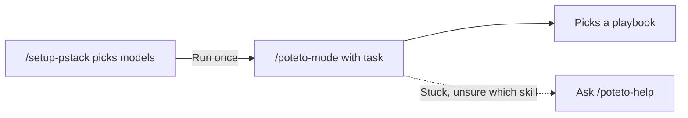
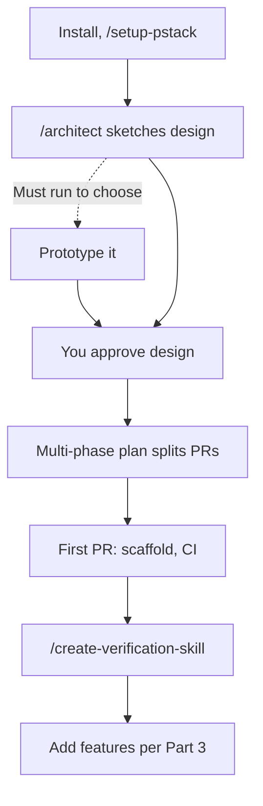

Maybe you've heard of pstack, opened the repo, and found nothing but a long list of skill names. Or maybe you landed on one of the posts from a search and want to know what comes before and after it. The series has four parts, each covering one stretch of coding with AI. This guide skips the details: it explains what pstack is and suggests which part to start with.

> pstack Series | Guide
>
> - Start from the beginning (Part 1): [Install in Claude Code, Then /poteto-mode](/posts/pstack-install-routing/)
>
> All five posts in this series are pinned to pstack [`0.15.43`](https://github.com/cursor/plugins/blob/2f87c854fe3e2fcda44ca86b46ede35aad3c46b7/pstack/.cursor-plugin/plugin.json), with Claude Code 2.1.326. That version is commit `2f87c85` in `cursor/plugins` (2026-11-17 05:47, Taipei time). All five posts were rechecked against it on 2026-11-17, and when I checked, `cursor/plugins` main had no pstack changes after `2f87c85`. The counts and behavior may change in later versions.
{: .prompt-info }

## What pstack Is

[pstack](https://github.com/cursor/plugins/tree/2f87c854fe3e2fcda44ca86b46ede35aad3c46b7/pstack) is a collection of skills that [Lauren Tan](https://x.com/poteto) (known online as poteto) maintains in Cursor's official plugin repo, [`cursor/plugins`](https://github.com/cursor/plugins), under the MIT license. It's for AI coding assistants like Cursor or Claude Code, tools that can read and write your project files and write code for you.

Version `0.15.43` contains:

| Type | Count | What it is |
| --- | --- | --- |
| skill | 58 | A set of instructions telling an AI coding assistant how to handle one kind of work |
| principle | 24 | A short, specific rule, each named `principle-*` |
| playbook | 22 | A fixed set of steps for one kind of task, living under `/poteto-mode` |

Don't confuse it with the Unix command `pstack` (which prints a process's call stack). Here it means this set of AI skills.

Two things are worth knowing before you read on:

- **You start almost every skill yourself.** Every skill except `/setup-pstack` is set up so the AI can't launch it on its own.
- **Day to day, you only need to remember one entry point.** Start any task that needs a careful process with `/poteto-mode`, and spell out the goal and what "done" means.

Here's how it fits together:



How to install, how to pin a version, and the `/pstack:` prefix that commands need in Claude Code are all covered in [Part 1](/posts/pstack-install-routing/). If you want the same version as this series, I suggest cloning the repo, checking out `2f87c85`, and then adding it as a marketplace. For the step-by-step details and the risks of not pinning a version, see [Part 1](/posts/pstack-install-routing/) and [Third-Party Skills and MCP Servers: The New Attack Surface in Your Coding Agent](/posts/coding-agent-supply-chain-permission-risks/).

## Who It's For, and Who It Isn't

Pulling together what I wrote across the four posts, this skill set fits situations like these:

- You use Cursor or Claude Code and want the AI to work more methodically, without memorizing dozens of skill names first ([Part 1](/posts/pstack-install-routing/)).
- Before changing unfamiliar code, you want to understand how it works and why it looks the way it does, then compare a few designs ([Part 2](/posts/pstack-understand-design/)).
- You want "prove it works" to be a routine: reproduce, clean up, check the blast radius, exercise the change with a verification skill, open a PR, and press merge yourself ([Part 3](/posts/pstack-build-verify-merge/)).
- You want to steer mid-task with principle names, turn your habits into your own mode, and let it run unattended within permission and spending limits ([Part 4](/posts/pstack-principles-customization/)).

On the other hand, I don't think you need the whole set in cases like these:

- **Small, obvious changes**: just tell the AI; you don't need pstack. Parts 1 and 2 both say so, and Part 2 says outright that most changes don't need those tools.
- **You don't want to spend extra usage on a careful process**: pstack sends out subagents and assembles reviewers. The more they read and write, the more usage you burn (see the caveats in Parts 1 and 2).
- **Unattended runs with every check turned off**, or `bypassPermissions` outside an isolated environment: I argue explicitly against this in Part 4. Irreversible actions such as merging, force-pushing, deleting data, and messaging customers should still be a human's call.

## The Four Parts Follow the Workflow

The four parts follow a single piece of work: install the tools, understand the code and then design, prove it works, and finally steer with principles and let it run on its own within limits.

{: w="800" h="450" }
_The four parts are ordered by workflow; each covers one stretch, and the details live in that post._

### Part 1: Install in Claude Code, Then /poteto-mode

Using it for the first time, where do you begin? This part covers four things:

- Two ways to install.
- How to check and pin a version.
- How to pick models with `/setup-pstack`.
- How to write a task for `/poteto-mode`.

By the end, you'll see that you can get going without memorizing every skill name.

→ [Part 1: Install in Claude Code, Then /poteto-mode](/posts/pstack-install-routing/)

### Part 2: Understand Code and Compare Designs First

When you're facing unfamiliar code, how do you get the AI to understand it before it starts editing? This part covers two groups of tools:

- The main five: `/how`, `/why`, `/architect`, `/interrogate`, and `/arena`. For each, it covers when to use it, how to prompt it, what you get back, and where to go next.
- The situational ones: `/teach`, `/recall`, and `/swarm`, plus two playbooks, for prototypes and for plans.

Most small changes don't need them. When you do need them, the order is understand first, compare designs, and only then change the code.

→ [Part 2: Understand Code and Compare Designs First](/posts/pstack-understand-design/)

### Part 3: After the Code Is Written, Prove It Works Before Merging

Once the code is written, what counts as proof that it actually works? This part splits the flow into four stages: Build, Clean, Verify, and Prepare for Review. It covers playbooks, `/tdd`, verification skills, opening a PR, and babysit. Opening a PR doesn't start babysit on its own, and whether to merge is always your call.

→ [Part 3: After the Code Is Written, Prove It Works Before Merging](/posts/pstack-build-verify-merge/)

### Part 4: Steer With Principles, Build Your Own Mode, and Let It Run Unattended

You don't have to write a long paragraph every time you want to change how the AI works. This part covers four things:

- How to steer the AI mid-conversation with principle names.
- How to build your own way of working with `/automate-me`, `/reflect`, and `/correct`.
- What to set up before you let it run unattended: the six-part prompt, permissions, and spending caps.
- How to audit the decision log the next morning with `/show-me-your-work`.

→ [Part 4: Steer With Principles, Build Your Own Mode, and Let It Run Unattended](/posts/pstack-principles-customization/)

## Which Part to Start With

{: w="800" h="450" }
_Figure out which step you're stuck on, then open the matching part. You don't have to read all four in order before you start._

| Your situation | Start here |
| --- | --- |
| Not installed yet, or unsure how to invoke commands | [Part 1](/posts/pstack-install-routing/) |
| You have an empty repo | [Start from an empty repo](#starting-from-an-empty-repo) |
| You can use `/poteto-mode`, but your changes often head the wrong way from the start | [Part 2](/posts/pstack-understand-design/) |
| The feature is written, but you're stuck on proving it works or opening a PR | [Part 3](/posts/pstack-build-verify-merge/) |
| You're comfortable with everyday use and want to steer with principles, build your own mode, or run unattended | [Part 4](/posts/pstack-principles-customization/) |
| You just want to know what this set of skills is | Finish this guide first, then jump ahead using the table above |

### Starting From an Empty Repo {#starting-from-an-empty-repo}

With an empty repo, I'd start by deciding what the project should do and getting a bare version running. Set up CI and tests early, and add any types you already know the rest of the project will share. That's how I'd apply pstack's [`foundational-thinking` principle](https://github.com/cursor/plugins/blob/2f87c854fe3e2fcda44ca86b46ede35aad3c46b7/pstack/skills/principle-foundational-thinking/SKILL.md#L9-L13) to a new project.

Here's the order; the list after the diagram has the details for each step:



1. Install pstack and pick your models as shown in [Part 1](/posts/pstack-install-routing/). If `/setup-pstack` offers to generate a verification skill, wait until you have something that runs.
2. You can skip `/how` and `/why` from [Part 2](/posts/pstack-understand-design/) until there's code or history to read. If you're still weighing designs, ask `/architect` for a sketch. Some questions you can answer by running something, such as whether two approaches produce the same output. For those, ask `/pstack:poteto-mode` to use the Prototype playbook in the same prompt.

   ```text
   /pstack:poteto-mode I want to build <describe what the project should do in one sentence>. Use /architect to sketch the main types and module boundaries. If you need to run something to choose between approaches, try it with the Prototype playbook. Show me the design and any prototype results, then wait for my go-ahead before writing production code.
   ```

3. If the work needs several PRs, ask `/pstack:poteto-mode` to use the [Multi-phase plan playbook](https://github.com/cursor/plugins/blob/2f87c854fe3e2fcda44ca86b46ede35aad3c46b7/pstack/skills/poteto-mode/playbooks/multi-phase-plan.md). It writes the plan to a file and waits for you to tell it to start.

   ```text
   /pstack:poteto-mode Use the Multi-phase plan playbook to split this design into PRs. In the first PR, set up the project, run a basic test in CI, and document how to check that the project runs locally. Include any types we already know we'll share. Give each later PR one change and its own verification steps.
   ```

   Setting up tests early gives you somewhere to put a regression test when a bug turns up. Without a practical test path, [`/tdd` falls back to another check it can run](https://github.com/cursor/plugins/blob/2f87c854fe3e2fcda44ca86b46ede35aad3c46b7/pstack/skills/tdd/SKILL.md#L16-L24).

4. For the first PR, check that the project runs locally and that CI runs the test. Once the first feature works, such as a CLI command, use [`/create-verification-skill`](https://github.com/cursor/plugins/blob/2f87c854fe3e2fcda44ca86b46ede35aad3c46b7/pstack/skills/create-verification-skill/SKILL.md#L11-L21) to turn your manual check into a skill the AI can run again. In Claude Code, call it directly with `/pstack:create-verification-skill`.
5. As you add features, follow [Part 3](/posts/pstack-build-verify-merge/) to build, verify, and open a PR. Tell the AI which existing behavior the change needs to preserve. If you're adding a CLI subcommand, for example, scripts may already rely on the output format of an existing command.

## Conclusion

You don't have to read the four parts in order. If you haven't installed pstack yet, start with Part 1; if you already use it, find the step you're stuck on and start there.

## Further Reading

- [Official pstack (the commit this guide pins)](https://github.com/cursor/plugins/tree/2f87c854fe3e2fcda44ca86b46ede35aad3c46b7/pstack): the README, the guide, and each skill.
- [Guide directory](https://github.com/cursor/plugins/tree/2f87c854fe3e2fcda44ca86b46ede35aad3c46b7/pstack/docs/guide/): from install and overnight runs to principles and making it yours.
- [Part 1](/posts/pstack-install-routing/) · [Part 2](/posts/pstack-understand-design/) · [Part 3](/posts/pstack-build-verify-merge/) · [Part 4](/posts/pstack-principles-customization/)
- [mattpocock/skills Series Guide](/posts/mattpocock-skills-series-guide/) and [Part 1](/posts/mattpocock-skills-setup-routing-guide/): a series about a different set of skills.
- [Write Your Own Agent Skill: From SKILL.md to Testing and Upkeep](/posts/agent-skill-authoring-guide/): where skills live and how to write `SKILL.md`.
- [Third-Party Skills and MCP Servers: The New Attack Surface in Your Coding Agent](/posts/coding-agent-supply-chain-permission-risks/): permissions, sandboxes, and pinning versions.
