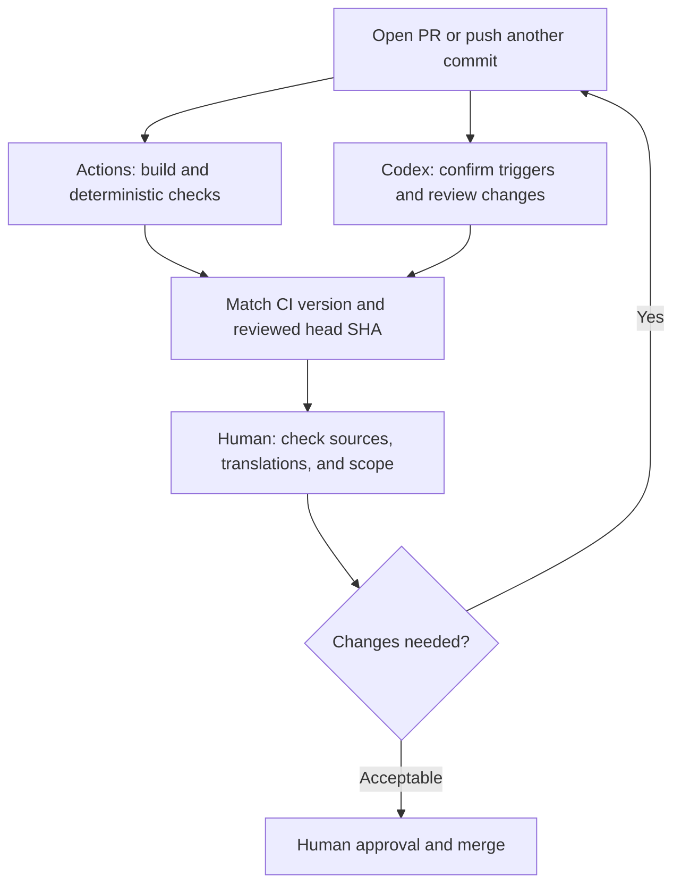

The article is finished, the PR is open, Actions is green, and the AI has raised no issues. Ready to merge? First check: which commit did the AI review? Did CI check external references? Were the translation edits pushed afterward reviewed too?

This post uses an article PR from this Jekyll site to show how GitHub Actions and an AI agent can form a review process you can trace. You only need to know that a PR submits changes for review and a commit records a version. The section on custom workflows comes later.

The goal is concrete: **for every review, know what was checked, which version was checked, and what still needs a human decision.**

> **Scope**: I checked this site's source and public PR records on 2026-11-07. The configuration is pinned to commit [`15a6041`](https://github.com/justmaocom/justmaocom.github.io/tree/15a6041c0974248f91f3dd678a35ace5d1bec995); the example is merged [PR #29](https://github.com/justmaocom/justmaocom.github.io/pull/29). The Codex Action discussed later is a proposed extension. This article does not install or enable it on the site, or claim that the proposed workflow has passed an end-to-end test.
{: .prompt-info }

## This Site Already Has Two Automated Review Paths

Look at what exists before adding another tool. This site's [Build and Deploy workflow](https://github.com/justmaocom/justmaocom.github.io/blob/15a6041c0974248f91f3dd678a35ace5d1bec995/.github/workflows/pages-deploy.yml) has three jobs: `build`, `lib`, and `deploy`.

| Job | What it does today | What it establishes |
| --- | --- | --- |
| `build` | Builds the production site with Ruby 3.4, checks localized URLs, then runs html-proofer | The site builds, and the URLs and internal links covered by the checks meet the rules |
| `lib` | Runs `npm ci` and `npm run sync-lib`, then checks `assets/lib` | Committed frontend assets match the locked npm dependencies |
| `deploy` | Waits for both jobs to pass, then deploys to GitHub Pages | The published artifact passed those checks |

PR events run the first two jobs. The condition on `deploy` is `github.event_name != 'pull_request'`, so a PR check does not publish the site directly. The workflow also accepts pushes to `main` or `master` and manual dispatches. Describing deployment as something that can happen *only* after a PR merge would therefore be inaccurate.

Each check has a boundary. html-proofer uses `--disable-external`, so **the validity of external references is outside that check's scope**. `check-i18n.rb` checks URLs in each language's `og:url`, search data, feed, sitemap, and related output. It cannot tell whether the English reads naturally or whether the Simplified Chinese retains Taiwan-specific phrasing.

The second path appears in the PR discussion. [The Codex summary on PR #29](https://github.com/justmaocom/justmaocom.github.io/pull/29#issuecomment-6655342679) records a Codex Code Review triggered when the PR opened. That is the Codex GitHub integration. The workflow above contains no `openai/codex-action`; that does not mean the site has no AI review, and it does not mean Actions started this review.

## PR #29: Changes Continue After a Review Finishes

The PR added the [pstack series guide](/posts/pstack-series-guide/) and updated navigation links in four articles, across Traditional Chinese, English, and Simplified Chinese. Its public history shows:

| Version or record | Observable fact |
| --- | --- |
| [`6857f1f`](https://github.com/justmaocom/justmaocom.github.io/commit/6857f1fc9eae761b018d8c48ad6b77c017d991ab) | Added the guide and navigation links in three languages. The Codex summary names this as the reviewed commit, with a completed status and no findings |
| [`3e0be05`](https://github.com/justmaocom/justmaocom.github.io/commit/3e0be05e3136aeb8d4d6b80bee4aaf1bc02b1657) | Subsequently revised the prose in all three languages |
| [`ff4455b`](https://github.com/justmaocom/justmaocom.github.io/commit/ff4455b570ad97936f0cce3083fdf8c4ccfecee3) | Changed a GitHub directory link from `blob` to `tree` and changed the Simplified Chinese “关光” to “关掉.” This was the PR head before merge |

The supported conclusion is narrow: **the Codex review in that summary covered the initial `6857f1f`, so it cannot establish that the later `ff4455b` was covered by the same review.** I do not infer checks that the public summary does not list, or conclude that nobody reviewed the later changes.

The example also shows why the work needs several kinds of review. A path error in an external GitHub link calls for checking the source or running a separate external-link check. A phrase such as “关光” calls for language editing. Neither a successful build nor the absence of AI findings covers both. Nor does this show Codex missed the final correction: the available summary refers to an earlier version.

## Give CI, the Agent, and the Human Separate Responsibilities

I would start with this site's existing Actions workflow and Codex integration, using them to supply different evidence on the same PR:



**Give repeatable rules to Actions.** Parsing front matter, building the site, and checking localized URL paths have repeatable checks. On this site, start locally with:

```bash
bash tools/test.sh
```

It rebuilds the production site and checks localized URLs and internal links. It does not include the npm asset comparison in the `lib` job. Even for an article-only change, the full PR workflow still runs `lib`.

**Give reasoning tasks to the agent.** An article might say an action accepts PRs from anyone, while the cited version restricts who can trigger it. Or the three translations might describe the same option differently. Ask for the file, passage, evidence, and impact of each finding. Those are easier to verify than an open-ended request to “review everything.”

**Keep source verification, voice, and publishing decisions with a human.** Statements such as “I tested this” or “this site already enables it” need execution records or configuration to support them. Check AI suggestions against their sources too. No findings means that the review reported no issues; it does not replace editing, fact-checking, or approval to merge.

## Start With the Existing Codex Integration

[The official Codex documentation](https://developers.openai.com/codex/cloud/code-review) describes two entry points: enable automatic review for the repository in Codex settings, or leave this comment on a PR:

```text
@codex review
```

This is an instruction readers can use, not a new comment posted to the example PR by this article. Check automatic trigger events and personal preferences in settings. One “PR opened” record does not establish that every push causes another review.

For an article repository, review guidance could look like this. If it proves useful, put it in a version-controlled `AGENTS.md`. This site currently lists `AGENTS.md` in `.gitignore`, so sharing that file with the team requires an explicit decision about tracking it.

```text
Review only issues introduced by this PR. State the reviewed head SHA.
Check tool-behavior claims against the source version pinned in the article.
Compare commands, numbers, and limitations across all three languages.
Flag claims such as "tested" or "enabled" that lack supporting records.
For each finding, give the file, passage, evidence, impact, and suggested fix.
State unavailable sources and partial coverage. Do not claim a full pass.
```

This guidance expresses the desired focus; it does not guarantee a response to every item. At the time of checking, the official documentation says GitHub Code Review focuses on high-priority P0 and P1 issues. Paragraph-by-paragraph editing or a complete report with mandatory fields needs a separately designed process.

## When a Custom Codex Action Is Useful

Consider [`openai/codex-action`](https://github.com/openai/codex-action/tree/bdf19a4a223ec2549a3e2274a0cf61556bc07675) when you need a fixed report format, different prompts for articles and code, or output connected to an existing review tool. It installs Codex CLI on a runner and executes a task through an API. You provide the API key and manage usage. This is a different integration from the Codex reviews already visible on this site's PRs.

The following shows **only the Codex step inside a review job**, not a complete workflow you can paste and run. Earlier steps must prepare trusted review instructions, the full PR diff, and the required context, record the base and head SHAs, and check for truncated input. Do not run PR-supplied installation scripts and then introduce an API key into that same environment.


```yaml
- name: Review the prepared PR diff
  id: review
  uses: openai/codex-action@bdf19a4a223ec2549a3e2274a0cf61556bc07675 # v1.13
  with:
    openai-api-key: ${{ secrets.OPENAI_API_KEY }}
    permission-profile: ":read-only"
    safety-strategy: drop-sudo
    prompt-file: review-input/prompt.md
```


The pinned [README](https://github.com/openai/codex-action/blob/bdf19a4a223ec2549a3e2274a0cf61556bc07675/README.md) says permission profiles require Codex CLI `0.138.0` or later and were still in beta when checked. `:read-only` constrains filesystem and network access for commands; `drop-sudo` controls process privileges. They serve different purposes. Do not combine `permission-profile` with the legacy `sandbox` input, or treat `safety-strategy: read-only` as another spelling of these two settings.

Pinning the action SHA fixes the action itself; it does not also pin the Codex CLI it installs or the model it uses. Before adoption, choose and record a tested `codex-version`, model, and report format, and check that the runner supports the required isolation. This article does not invent a supposedly tested version combination.

Follow the [official security guidance](https://github.com/openai/codex-action/blob/bdf19a4a223ec2549a3e2274a0cf61556bc07675/docs/security.md): make Codex the last step in its job. If you need to post a comment, first map `steps.review.outputs.final-message` to a job output, then consume it through `needs` in a fresh job, granting only the posting permissions it needs. Treat the report as data; do not splice it into executable shell or JavaScript source. Start with advisory output for a person to read. An action executing successfully does not mean the content has been approved.

### Triggers and Permissions Are Part of the Design

[GitHub's event documentation](https://docs.github.com/en/actions/reference/workflows-and-actions/events-that-trigger-workflows#pull_request) says `pull_request` handles `opened`, `synchronize`, and `reopened` by default. Add `ready_for_review` explicitly if a custom review should also run when a draft becomes ready. Add a separate draft condition if drafts should be skipped.

`synchronize` covers additional commits, but it does not guarantee the Codex Action can run. By default, the action restricts triggering users to those with repository write access. Fork PRs also normally lack Actions secrets, and a read-only `GITHUB_TOKEN` cannot post review feedback directly. An initial rollout can be limited to trusted collaborators' PRs within the same repository. Design trust, isolation, and reporting separately before accepting external submissions.

Do not switch to `pull_request_target` just to obtain a secret and then check out and execute an external PR's code. PR text, diffs, and added `AGENTS.md` files can all carry untrusted instructions. Prompt reminders help, but runners, tokens, and isolation must enforce the actual permissions. Avoid `allow-users: "*"` as a shortcut that opens API usage to everyone. These constraints are covered by [GitHub's security guide](https://docs.github.com/en/actions/security-for-github-actions/security-guides/security-hardening-for-github-actions) and the Codex Action security document above.

## Confirming That a New Commit Was Actually Reviewed

For PR #29, I would want a record like the following before merge, rather than a bare “review complete.” This is a suggested format, not an execution result already present in the example:

```text
PR: #29
Current head: ff4455b
CI: link to the workflow run checking this version; list build/lib results
AI: reviewed head, report link, and coverage limitations
Human: checked the GitHub directory link and edited passages in all languages
Outstanding: list unresolved issues; explicitly say none if there are none
```

The sequence can stay simple:

1. **Resolve CI failures first.** Fix reproducible problems such as a failed build or incorrect localized URLs.
2. **Read the evidence for each AI suggestion.** Accept and fix it, or record why you disagree. Supply missing context instead of counting an incomplete report as a pass.
3. **Match versions after every new commit.** Confirm CI checked the latest changes. If a `pull_request` run checks a synthetic merge commit, also record the corresponding PR head. Match the AI review's head too, and request another review when needed.
4. **Have a person approve and merge.** Required checks and approvals must be configured in a GitHub ruleset or branch protection. A workflow file alone does not make its jobs merge requirements.

A custom reporting program should read the PR head again before publishing a result. If it changed, mark the old report as stale and arrange review of the latest version. `concurrency` can cancel unfinished older runs and reduce usage. It cannot retract a report already posted, or replace the version check.

## Validate These Cases Before Adoption

Use small test PRs to validate the review process before chasing finding counts:

| Case | Expected result |
| --- | --- |
| Add a normal article | CI passes; the AI report identifies its reviewed version, and a person interprets it |
| Deliberately add a broken internal link | CI fails, even if the AI misses it |
| Push another commit after AI review | The new version is checked; the old report remains clearly versioned |
| Oversized diff, unavailable source, or API timeout | Report incomplete or partial review, rather than treating missing results as no issues |
| Fork PR without a secret, or an unauthorized actor | Explicitly skip or wait for maintainer handling, rather than broadening everyone's permissions |

This is a proposed acceptance checklist, not a claim that the custom Action has passed it. After adoption, examine real records: which suggestions were accepted, which were noise, how long review took, and how much it consumed. Do not claim a percentage of time saved or accuracy gained before collecting evidence.

The lesson I take from this site's example is that connecting existing evidence can already improve review. Actions supplies repeatable checks, the agent raises evidence-backed questions, and a person verifies references, prose, and publishing scope. When all three refer to the same changes, the next person opening the PR can tell what they are approving.

## Sources and Further Reading

- [This site's workflow at `15a6041`](https://github.com/justmaocom/justmaocom.github.io/blob/15a6041c0974248f91f3dd678a35ace5d1bec995/.github/workflows/pages-deploy.yml) and [PR #29](https://github.com/justmaocom/justmaocom.github.io/pull/29): the configuration and case study.
- [Official Codex Code Review documentation](https://developers.openai.com/codex/cloud/code-review): GitHub integration, automatic reviews, guidance, and manual triggers.
- [Pinned Codex Action README](https://github.com/openai/codex-action/blob/bdf19a4a223ec2549a3e2274a0cf61556bc07675/README.md) and [security documentation](https://github.com/openai/codex-action/blob/bdf19a4a223ec2549a3e2274a0cf61556bc07675/docs/security.md): inputs, output, permissions, and job separation.
- GitHub's [workflow events](https://docs.github.com/en/actions/reference/workflows-and-actions/events-that-trigger-workflows#pull_request), [security guide](https://docs.github.com/en/actions/security-for-github-actions/security-guides/security-hardening-for-github-actions), and [protected branches](https://docs.github.com/en/repositories/configuring-branches-and-merges-in-your-repository/managing-protected-branches/about-protected-branches): events, tokens, and merge requirements.
- [After Coding, Prove It Works Before You Merge](/posts/pstack-build-verify-merge/): put verification and review into the agent's workflow.
- [What Third-Party Skills and MCP Add to Your Coding Agent's Attack Surface](/posts/coding-agent-supply-chain-permission-risks/): why file access, command execution, and credentials need separate consideration.
