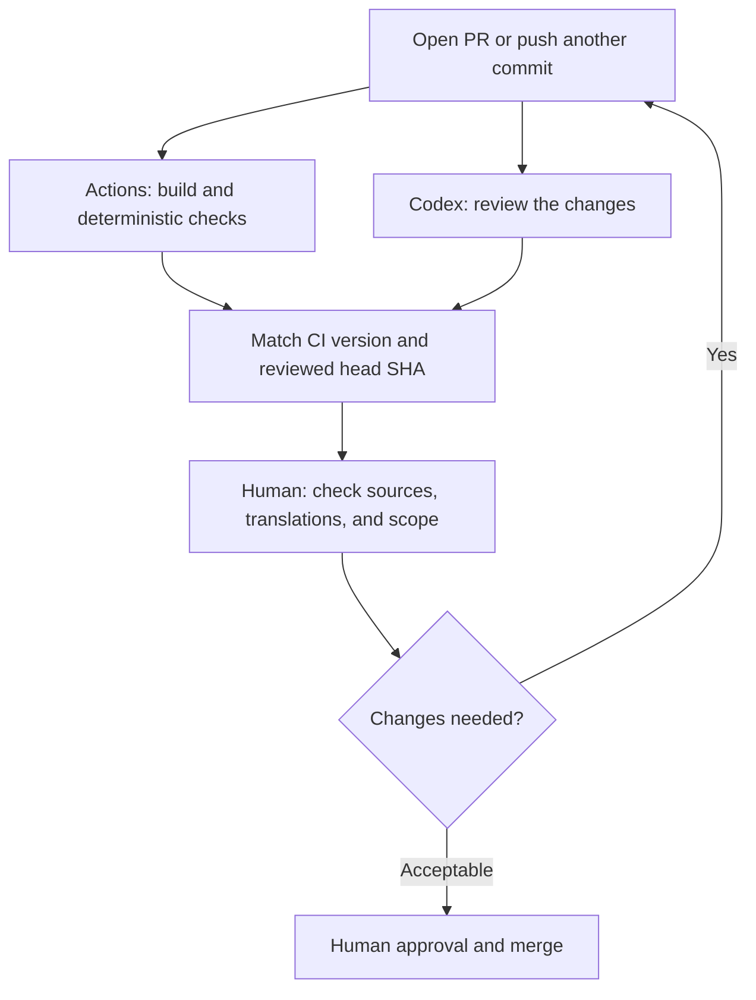

The article is finished and submitted for review. GitHub's automated checks are green, and the AI raised no issues. Ready to merge? Not yet. Three questions remain: Which version did the AI review? Did the automated checks confirm that external links still work? Did anyone look again at the translation fixes added after the review?

This post uses a real article review on this site to show how GitHub Actions and an AI agent can form a review process you can trace from start to finish. Three terms come up constantly:

- **PR (pull request)**: a request to have a set of changes reviewed before they are merged into the published version.
- **Commit**: a saved record of one version. Fixes added after a PR is opened become new commits.
- **AI agent**: an AI assistant that can read files, compare content, and raise issues on its own. The review visible on this site's public PRs comes from OpenAI's Codex.

Other terms are explained where they first appear. The goal is concrete: **for every review, be able to say what was checked, which version was checked, and what still needs a human decision.**

> **Scope**: I checked this site's source and public PR records on 2026-11-07. The configuration is pinned to commit [`15a6041`](https://github.com/justmaocom/justmaocom.github.io/tree/15a6041c0974248f91f3dd678a35ace5d1bec995); the example is merged [PR #29](https://github.com/justmaocom/justmaocom.github.io/pull/29). The custom Codex Action near the end is only an extension example: this article does not install or enable it on the site, and its configuration should not be read as verified or ready to use.
{: .prompt-info }

## When This Process Helps

It is worth recording who checked what, and which version, whenever:

- Changes continue after a review finishes, such as wording edits, translation fixes, or link changes.
- The same content exists in several languages, or describes how an external tool behaves.
- You already have automated checks and AI review, but cannot say what each one covers.

The example here, PR #29, meets the first two conditions.

## The Two Automated Checks This Site Already Has

### Actions: Fixed-Rule Checks

**GitHub Actions** is GitHub's built-in automation service. When an event you specify happens in a repository (where the site's source files and change history are stored), it runs the configured work. One configuration file is a **workflow**, and a workflow can contain several **jobs**, each a separately run unit of work. **CI** (continuous integration) is the narrower practice of rerunning the same checks on every change. The same workflow can also deploy the site, and that step is not a check.

This site's [Build and Deploy workflow](https://github.com/justmaocom/justmaocom.github.io/blob/15a6041c0974248f91f3dd678a35ace5d1bec995/.github/workflows/pages-deploy.yml) has three jobs:

| Job | What it does | What success shows |
| --- | --- | --- |
| `build` | Builds the production site with Ruby 3.4, checks localized URLs, then runs html-proofer to check page links | The site builds, and the URLs and internal links covered by the checks meet the rules |
| `lib` | Runs `npm ci` and `npm run sync-lib`, then checks `assets/lib` | Committed frontend assets match the locked npm dependencies |
| `deploy` | Waits for both jobs to pass, then deploys to GitHub Pages (GitHub's site hosting service) | The published artifact passed those checks |

PR events run only the first two jobs. The condition on `deploy` is `github.event_name != 'pull_request'`, so a PR check does not publish the site directly. The workflow also runs on pushes to the `main` or `master` branch and on manual dispatch, so it would be inaccurate to say deployment can happen *only* after a PR merge. `paths-ignore` on push excludes only `.gitignore`, `README.md`, and `LICENSE`. `pull_request` has no path filter, so an article-only PR still runs `build` and `lib`.

These fixed rules have clear limits; passing them does not mean the content is right:

- html-proofer uses `--disable-external`, so **whether external links are valid is outside that check's scope**.
- `check-i18n.rb` checks URLs in each language's `og:url`, search data, feed, sitemap, and related output. It cannot tell whether the English reads naturally or whether the Simplified Chinese retains Taiwan-specific phrasing.

### Codex: AI Review Inside the PR

The second check appears in the PR discussion. [The Codex summary on PR #29](https://github.com/justmaocom/justmaocom.github.io/pull/29#issuecomment-6655342679) shows a completed Codex Code Review from when the PR was opened; that row's trigger column says PR opened. The comment comes from Codex's GitHub integration (the `chatgpt-codex-connector` account), which is not part of the workflow above. So the absence of `openai/codex-action` from the workflow does not mean the site has no AI review, and it does not mean Actions started this review.

AI review is good at reading prose, comparing claims, and spotting issues that take reasoning to find. Its suggestions still need a person to check them against the sources.

## Case Study: PR #29 Changed After Its Review

The PR added the [pstack series guide](/posts/pstack-series-guide/) and updated navigation links in four articles, across Traditional Chinese, English, and Simplified Chinese.

To tell which version was reviewed, you need version identifiers. Each commit has a unique string of letters and digits called a **SHA**; this article shows only the first seven characters. A PR's latest commit at any given moment is its **head**. Only two versions matter here:

- [`6857f1f`](https://github.com/justmaocom/justmaocom.github.io/commit/6857f1fc9eae761b018d8c48ad6b77c017d991ab): the initial version. The Codex summary names this as the reviewed commit, with a completed status and no findings (issues raised by the review).
- [`ff4455b`](https://github.com/justmaocom/justmaocom.github.io/commit/ff4455b570ad97936f0cce3083fdf8c4ccfecee3): the head before merge. After the initial version, one commit revised the prose in all three languages. This final commit then changed a GitHub directory link from `blob` to `tree` and changed the Simplified Chinese “关光” to “关掉.”

The supported conclusion is narrow: **the Codex review in that summary covered the initial `6857f1f`, so it cannot establish that the final `ff4455b` was covered by the same review.** I do not infer checks that the public summary does not list, or conclude that nobody reviewed the later changes.

Those last two fixes also show why the work needs several kinds of review. Whether a GitHub link path is correct calls for checking the source or running a separate external-link check. A phrase such as “关光” calls for language editing. Neither a successful build nor the absence of AI findings covers both. Nor does this show that Codex missed the final fix: the available summary refers to an earlier version.

## Dividing the Work: Fixed Rules, AI Reasoning, Human Approval

I would start with this site's existing Actions workflow and Codex integration, letting each supply different evidence on the same PR:



**Give fixed rules to Actions.** Whether front matter (the settings block at the top of a post, holding the title, date, and similar details) parses, whether the site builds, and whether localized URLs land in the right place all have clear right answers and can be checked repeatedly. To check on your own computer first, run this in the site's repository:

```bash
bash tools/test.sh
```

It rebuilds the production site and checks localized URLs and internal links. It does not include the npm asset comparison in the `lib` job. If CI fails, the change has not passed, even if the AI raised no issues.

**Give reasoning tasks to the AI agent.** An article might say an action runs for PRs from anyone by default, while the cited version restricts who can trigger it. Or the three translations might describe the same option differently. Ask the agent for the file, passage, evidence, and impact of each finding. Those are easier to verify than an open-ended request to “review everything.”

**Keep sources, voice, and publishing decisions with a human.** Statements such as “I tested this” or “this site already enables it” need execution records or configuration to support them. Check AI suggestions against their sources too. No findings means only that the review reported no issues; it does not replace editing, fact-checking, or approval to merge.

{: w="800" h="450" }
_Keep the three apart: fixed rules, questions that take reasoning, and the decision to merge._

## Steps

### Step 1: Trigger Review With the Existing Codex Integration

There is no need to rush into installing another bot (an automated account that performs tasks). [The official Codex documentation](https://developers.openai.com/codex/cloud/code-review) describes two entry points: enable automatic review for the repository in Codex settings, or leave this comment on a PR:

```text
@codex review
```

This is an instruction readers can use, not a new comment posted to the example PR by this article. A one-off focus can follow on the same line. The official docs use `@codex review for issues in the database migration`. The review instructions in the next step can be handed over the same way; the next step also covers keeping them for every review.

The trigger column on the PR #29 summary says PR opened. The same public comment lists three ways a review starts: opening a PR, marking a draft as ready, or commenting `@codex review`. Pushing another commit is not on that list. Settings also let you choose a Review trigger, so this one record does not mean every later commit is reviewed again.

### Step 2: Add Review Instructions (Copyable)

For a repository that is mostly articles, you can give the agent instructions like these:

```text
Review only issues introduced by this PR. State the reviewed head SHA.
Check tool-behavior claims against the source version named in the article.
Compare commands, numbers, and limitations across all three languages.
Flag claims such as "tested" or "enabled" that lack supporting records.
For each finding, give the file, passage, evidence, impact, and suggested fix.
State unavailable sources and partial coverage. Do not claim a full pass.
```

Two things to know before you use them:

- They express the desired focus. At the time of checking, the official documentation says GitHub Code Review flags only high-priority P0 and P1 issues (the most serious problems, to be fixed first). It does not promise a reply to every item. Paragraph-by-paragraph editing or a complete report with mandatory fields needs a separately designed process.
- To keep using them, the official docs say to put the rules in the repository's `AGENTS.md` (a project rules file written for agents to read), under a `## Code Review Rules` heading. Codex on GitHub reads the file that is in the repository. This site currently lists `AGENTS.md` in `.gitignore` (the list of files kept out of version control), so an uncommitted copy does not appear on a public PR. Sharing the rules with the team and with that review means deciding to track the file. For how to write the file itself, see [How to Write AGENTS.md: Give Coding Agents Your Project Rules](/posts/agents-md-project-rules-for-coding-agents/).

### Step 3: After New Commits, Confirm the Latest Version Was Reviewed

For PR #29, I would want more than a bare “review complete” before merge. After the article changes, the earlier review still belongs to the old version, and the new version needs to be checked again.

{: w="800" h="450" }
_A note on the old version does not prove the new one was reviewed. Read the revised passages again._

The record below is a suggested format, not a record that exists in the example:

```text
PR: #29
Current head: ff4455b
CI: link to the workflow run checking this version; list build/lib results
AI: reviewed head, report link, and coverage limitations
Human: checked the GitHub directory link and read the revised passages in all three languages
Outstanding: list unresolved issues; explicitly say none if there are none
```

The sequence can stay simple:

1. **Resolve CI failures first.** Fix reproducible problems such as a failed build or incorrect localized URLs.
2. **Read the evidence for each AI suggestion.** Accept and fix it, or record why you disagree. Supply missing context instead of counting an incomplete report as a pass. If an oversized diff, an unavailable source, or a timeout leaves the review partial, mark it incomplete; a missing result is not the same as no issues.
3. **Match versions after every new commit.** This site's workflow does not name a different version when it checks out the code. [GitHub's event docs](https://docs.github.com/en/actions/reference/workflows-and-actions/events-that-trigger-workflows#pull_request) say `GITHUB_SHA` for `pull_request` (the version that run actually checks out) is the synthetic merge commit, a temporary merge of the PR into its target branch. The default checkout step gets that commit, not the PR head itself. GitHub still reports the check on the PR head; the last `build` and `lib` runs on PR #29 are reported on `ff4455b`. Record that head when you compare versions. If the PR has a merge conflict, this `pull_request` workflow does not run until the conflict is resolved. Match the AI review's head too, and request another review when needed.
4. **Have a person approve and merge last.** Required checks and approvals must be configured in a GitHub ruleset or branch protection. A workflow file in the repository does not by itself make its jobs merge requirements.

## Advanced: When a Custom Codex Action Is Worth It

> This site does not install or enable the configuration in this section. It is an extension example, not this site's current process.
{: .prompt-info }

Consider [`openai/codex-action`](https://github.com/openai/codex-action/tree/bdf19a4a223ec2549a3e2274a0cf61556bc07675) when you need a fixed report format, different prompts for articles and code, or output connected to an existing review tool. It installs Codex CLI (Codex's command-line tool) on a runner (the machine that executes Actions jobs) and runs a task through an API. You provide the API key (the credential for calling the service) and manage usage yourself. This is a different integration from the Codex reviews already visible on this site's PRs.

The following shows **only the Codex step inside a review job**, not a complete workflow you can paste and run. Earlier steps must prepare trusted review instructions, the full PR diff (the before-and-after differences), and the required context; record the base and head SHAs (the comparison starting point and the latest version); and check for truncated input. **Do not run PR-supplied installation scripts and then introduce an API key into that same environment.**


```yaml
- name: Review the prepared PR diff
  id: review
  uses: openai/codex-action@bdf19a4a223ec2549a3e2274a0cf61556bc07675 # v1.13
  with:
    openai-api-key: ${{ secrets.OPENAI_API_KEY }}
    permission-profile: ":read-only"
    safety-strategy: drop-sudo
    prompt-file: review-input/prompt.md
```


In short, `openai-api-key` reads the key from GitHub secrets (encrypted, stored credentials), `prompt-file` points to the prepared review prompt, and the other two inputs restrict what Codex can do.

The [README fixed to this version](https://github.com/openai/codex-action/blob/bdf19a4a223ec2549a3e2274a0cf61556bc07675/README.md) says permission profiles require Codex CLI `0.138.0` or later and were still in beta when checked. `:read-only` constrains filesystem and network access for commands; `drop-sudo` controls process privileges. They serve different purposes. Do not set `permission-profile` and the legacy `sandbox` input together; the action rejects that before it starts. `safety-strategy: read-only` switches to the legacy read-only sandbox, so it cannot be combined with a permission profile either. It is not another spelling of `:read-only`.

The long string at the end of the `uses` line is a SHA that pins the action's version. It fixes only the action itself; it does not also pin the Codex CLI it installs or the model it uses. Before adoption, choose and record a tested `codex-version`, model, and report format, and check that the runner supports the required isolation. This article does not invent a version combination that merely looks guaranteed to work.

Follow the [official security guidance](https://github.com/openai/codex-action/blob/bdf19a4a223ec2549a3e2274a0cf61556bc07675/docs/security.md):

- Make Codex the last step in its job.
- If you need to post a comment, first map `steps.review.outputs.final-message` to a job output, then consume it through `needs` in a fresh job, granting only the posting permissions it needs.
- Treat the report as data; do not splice it into executable shell or JavaScript source.
- Start with advisory output for a person to read. An action executing successfully does not mean the content has been approved.

If you write a custom reporting program, have it read the PR head again before publishing a result. If the head changed, mark the old report as stale and arrange review of the latest version. `concurrency` keeps one group from running several workflows at once. With only a group, a new run waits and cancels an older run that is still queued. To stop the run already in progress, also set `cancel-in-progress: true`. This site's Build and Deploy workflow uses that pair to cancel an unfinished build or deploy on the same ref. Used on a custom review, it can stop a run that has not finished. It cannot retract a report already posted, or replace the version check.

### Triggers and Permissions Are Part of the Design

[GitHub's event documentation](https://docs.github.com/en/actions/reference/workflows-and-actions/events-that-trigger-workflows#pull_request) says `pull_request` handles `opened`, `synchronize` (new commits pushed), and `reopened` by default. Add `ready_for_review` explicitly if a custom review should also run when a draft becomes ready. Add a separate draft condition if drafts should be skipped.

`synchronize` covers additional commits, but it does not guarantee the Codex Action can run:

- By default, the action restricts triggering users to those with write access to the repository.
- PRs from forks (copies of the repository made by someone else) normally lack Actions secrets, so there is no API key to run with.

Posting the result on the PR is a separate question. `GITHUB_TOKEN` is the token a workflow receives automatically when it runs. On a PR from a fork, that token is read-only. On a PR from the same repository, it depends on the workflow or repository permissions. This site's current workflow sets `contents: read` at the top level and does not grant `pull-requests: write`, so that workflow cannot use the token to post a review comment. A custom review that needs to comment has to grant posting permission in a separate job.

When a fork PR lacks a secret or the actor lacks permission, skip explicitly or wait for a maintainer, rather than broadening everyone's permissions to make it run. An initial rollout can be limited to trusted collaborators' PRs within the same repository. Design trust, isolation, and reporting separately before accepting external submissions.

**Do not switch to `pull_request_target` just to obtain a secret and then check out and execute an external PR's code.** PR text, diffs, and added `AGENTS.md` files can all carry untrusted instructions. Prompt reminders help, but runners, tokens, and isolation must enforce the actual permissions. Avoid `allow-users: "*"` as a shortcut that opens API usage to everyone. These constraints are covered by [GitHub's security guide](https://docs.github.com/en/actions/security-for-github-actions/security-guides/security-hardening-for-github-actions) and the Codex Action security document above.

## Results and Next Steps

Following this process, every PR leaves a traceable record before merge: which version the automated checks ran on, which version the AI reviewed and what it covered, what a person read, and what remains open. The next time you open a PR, you will know what you are approving.

Next steps:

1. In Codex settings, confirm which events trigger automatic review, and decide who requests another review after new commits, and when.
2. Decide whether to put `AGENTS.md` under version control so the team can share the review instructions above.
3. If you have not already, configure required checks and human approval as merge requirements in a ruleset or branch protection.
4. Consider a custom Codex Action only when you need a fixed report format, separate prompts for articles and code, or integration with an existing tool. Start with trusted collaborators' PRs within the same repository, and with advisory output.
5. After adoption, review real records: which suggestions were accepted, which were noise, and how much time and usage each review took.

The lesson I take from this site's example is that connecting existing evidence can already improve review. Actions supplies repeatable checks, the agent raises evidence-backed questions, and a person verifies references, prose, and publishing scope. Approval means something only when all three refer to the same changes.

## Sources and Further Reading

- [This site's workflow at `15a6041`](https://github.com/justmaocom/justmaocom.github.io/blob/15a6041c0974248f91f3dd678a35ace5d1bec995/.github/workflows/pages-deploy.yml) and [PR #29](https://github.com/justmaocom/justmaocom.github.io/pull/29): the configuration and case study.
- [Official Codex Code Review documentation](https://developers.openai.com/codex/cloud/code-review): GitHub integration, automatic reviews, guidance, and manual triggers.
- [Pinned Codex Action README](https://github.com/openai/codex-action/blob/bdf19a4a223ec2549a3e2274a0cf61556bc07675/README.md) and [security documentation](https://github.com/openai/codex-action/blob/bdf19a4a223ec2549a3e2274a0cf61556bc07675/docs/security.md): inputs, output, permissions, and job separation.
- GitHub's [workflow events](https://docs.github.com/en/actions/reference/workflows-and-actions/events-that-trigger-workflows#pull_request), [security guide](https://docs.github.com/en/actions/security-for-github-actions/security-guides/security-hardening-for-github-actions), and [protected branches](https://docs.github.com/en/repositories/configuring-branches-and-merges-in-your-repository/managing-protected-branches/about-protected-branches): events, tokens, and merge requirements.
- [pstack, Part 3: After the Code Is Written, Prove It Works Before Merging](/posts/pstack-build-verify-merge/): put verification and review into the agent's workflow.
- [Third-Party Skills and MCP Servers: The New Attack Surface in Your Coding Agent](/posts/coding-agent-supply-chain-permission-risks/): why file access, command execution, and credentials need separate consideration.
- [Automate Repeated Checks: Format, Test, and Flag Sensitive Files With Claude Code Hooks](/posts/claude-code-hooks-automate-checks/): format files and run tests automatically inside a Claude Code session, before the PR is opened.
- [AI Writes Code Faster. Why Is Shipping Still Slow? How I Think About an AI-Native SDLC](/posts/ai-native-sdlc-playbook/): where PR review sits among the six stages from requirements to release, and what comes before and after it.
