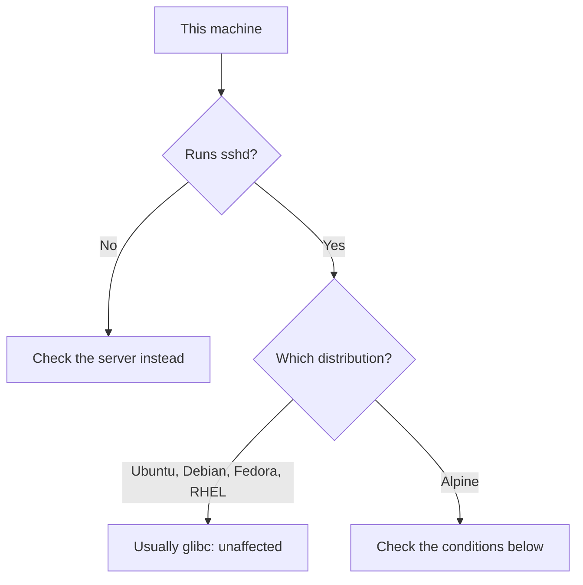
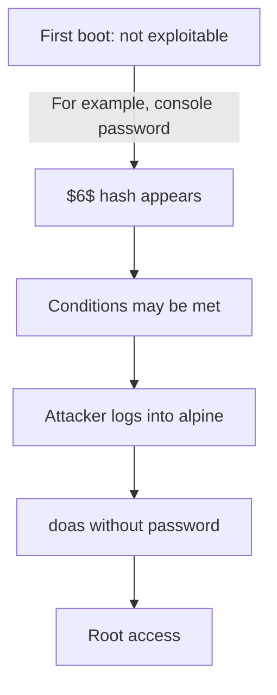
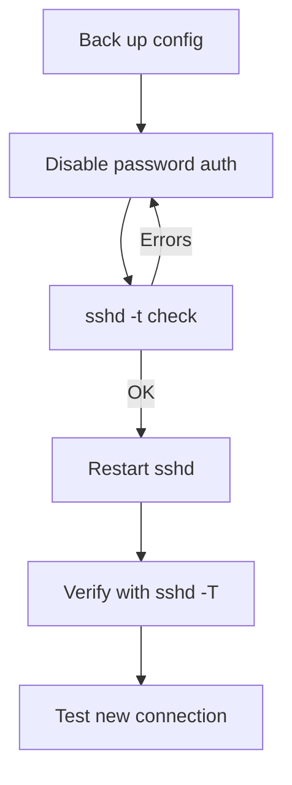
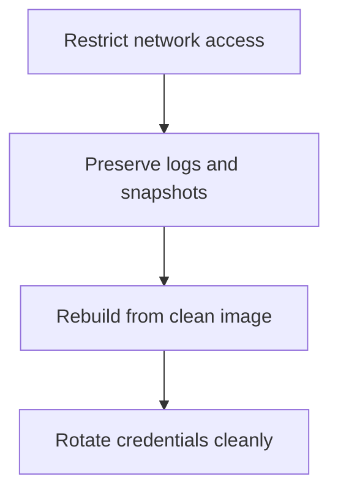

The obvious question after reading about an OpenSSH password bypass is: does this affect my server? With certain system and account settings, **CVE-2026-123158** may let an attacker log in without knowing the correct password. But it only affects `sshd`, the server program that accepts connections, and several conditions have to line up.

> Based on the OpenSSH and Alpine advisories, checked on 2026-11-07 (Taipei time). For later changes to the vulnerability status or package versions, use the latest official information.
{: .prompt-info }

I would start with the operating system and whether the machine accepts remote logins over SSH:



If a computer only connects elsewhere with `ssh`, or a container does not run sshd, the problem is not in that client or container. An Alpine host that accepts SSH logins needs a closer look. Using a key for my own logins would not put it in the clear, for reasons the conditions below explain.

If you do not manage servers, I suggest sharing this with whoever handles your systems. The commands below are for administrators; understanding the risk does not require running them yourself.

## Three terms worth knowing

**sshd accepts remote logins.** It runs on a server and waits for incoming connections. `ssh` is the client used to connect to another machine. sshd is the program that needs this fix.

**musl and glibc are low-level C libraries.** Programs share them for basic tasks, including password calculations. Alpine uses musl, and most familiar Linux distributions use glibc. This advisory concerns musl environments.

**PAM is a framework for checking logins.** sshd can ask PAM to verify a password, or it can call system functions directly. The vulnerable path is the one that does not use PAM.

## Fixes shipped on November 5, rated High

OpenSSH released [Portable OpenSSH 10.6p2](https://www.openssh.org/txt/release-10.6p2) on 2026-11-05, adding protection in sshd against this password authentication bypass. The project considers the root cause to be outside sshd. It blocks the bypass there because it can be triggered through the server.

The same day, [Alpine published an advisory](https://alpinelinux.org/posts/2026-11-05-openssh-password-authentication-bypass/) and provided fixed packages for branches from 3.16 through edge. Alpine explains that when the exploitation conditions hold, knowing the account name can be enough; guessing the password is unnecessary. So my first priorities would be whether a host is patched and whether an attacker can reach it.

Three sources describe the severity differently:

| Source | Severity |
| --- | --- |
| OpenSSH release notes | "critical security workaround" |
| [CVE record](https://cveawg.mitre.org/api/cve/CVE-2026-123158), from MITRE | CVSS 3.1 score of 8.1, rated High |
| [NVD](https://services.nvd.nist.gov/rest/json/cves/2.0?cveId=CVE-2026-123158) | As of 2026-11-07, still listed as Received, with no score of its own |

I would keep the project's urgent warning separate from the CVSS score, because they come from different sources.

If you notice "no CVE assigned" in Alpine's advisory, that describes the situation when it was written. The CVE record was published on 2026-11-05 at 23:46 Taipei time, and Alpine's security database now lists the corresponding fixes.

## All five conditions must hold

Following Alpine's advisory, a host is affected only when all of these conditions hold:

1. **The host runs Linux with musl, and its running sshd is unpatched.** A host with its distribution's fixed package installed and sshd restarted is not affected by this vulnerability.
2. **sshd does not use PAM to verify passwords.** On Alpine, that includes `openssh-server`, and `openssh-server-pam` configured with `UsePAM no`. The latter with `UsePAM yes` is not affected.
3. **Password authentication is still allowed: `PasswordAuthentication yes`.** This is the upstream OpenSSH default, but a host may override it. Check the settings actually applied.
4. **An account has `*` as its password field.** This includes some accounts that use keys and have no usable password set. Alpine also lists directory-service users obtained through musl-nscd. These accounts come from a central account system and have no local shadow entry.
5. **At least one other local account has a password hash starting with `$5$` or `$6$`.** A hash is the calculated value used to verify a password. This condition means another account's password settings can change the risk.

The attacker must also be able to reach the SSH port and know the target account's name. Other login restrictions still apply to that account. Bypassing the password comparison does not automatically override a rule that denies the account access.

So I would not treat one `*` field as proof that a login is possible. Nor would I skip these checks just because I normally use keys.

Two distinctions matter here:

- **`*` means there is no usable password hash. It is not an empty password and does not mean all logins are disabled.** The account may still accept keys. Alpine separately notes that locked accounts with `!` as their password field are not affected by this flaw.
- **Using a key does not mean the server has password authentication disabled.** I would check the actual `PasswordAuthentication` value rather than infer it from my own login habits.

### Alpine cloud images: safe on first boot is not safe for good

Alpine identifies official tiny-cloud images from 3.18.11 through 3.24.3 as affected versions. Their `alpine` account has a `*` password field and can use `doas` without a password to gain root, the system administrator account.

The advisory says these images do not meet the exploitation conditions on first boot. But **account changes can change the risk; being safe on first boot is not a lasting guarantee**:



The default `PermitRootLogin prohibit-password` only prevents password logins directly as root. It does not stop an attacker who first logs in as `alpine` and then uses `doas` to become root.

Alpine lists images configured through cloud-init as unaffected, because cloud-init writes `PasswordAuthentication no`. Later changes may have enabled it again, so I would still check the current configuration.

## The error marker `*` is treated as a matching password

My simplified version of the normal process has two steps: sshd uses `crypt()` to turn the submitted password into a hash, then compares it with the stored value.

A field containing only `*` has no salt, an additional parameter needed for normal password hashing. sshd borrows parameters from another account instead. That is why another account having a password matters.

According to Alpine, musl's `crypt()` returns `*` to signal an error when the password exceeds 256 bytes. Unpatched sshd compares that result with the account's password field, which is also `*`, and mistakenly accepts it. **A calculation error that should reject the login is treated as a matching password.**

[OpenSSH's fix](https://github.com/openssh/openssh-portable/commit/4353fdc43ef646c43a8dda7025cc1a898caf1482) adds a length check on the stored hash so that short values such as `*` cannot pass the comparison. Alpine's older branches carry corresponding fixes.

{: w="1280" h="720" }
_I use `* = *` to show the mistaken comparison: the calculation's error return matches the account's stored value and is treated as a correct password._

## Checking a server: system and packages first, then settings and accounts

These are read-only checks for Alpine administrators. Reading `/etc/shadow`, running the sshd checks, and applying the updates below should be done from an administrative shell with root privileges.

### 1. Identify the system and installed packages

```sh
cat /etc/os-release
apk info -v | grep openssh
```

The first command identifies Alpine and its release. The second lists installed OpenSSH packages for comparison with the fixed versions below. On another distribution, use that distribution's package tools and advisory instead.

I would not rely on `ssh -V`. It reports the client version and cannot establish whether the server has the distribution's fix.

### 2. Check the settings sshd would apply

```sh
sshd -T | grep -Ei '^(usepam|passwordauthentication|permitrootlogin) '
```

First check whether `passwordauthentication` is `yes` or `no`, then consider the PAM package and settings. A build without PAM support may not list `usepam`; its absence is not evidence that PAM is enabled.

`sshd -T` reads configuration files from disk and prints the parsed settings. **It does not ask the running service which settings it is using.** Seeing `no` after editing a file still requires the service to reload its configuration before the change takes effect.

These commands assume the default configuration file. Custom paths or service startup options need to be reflected in the checks too.

If the configuration has `Match` blocks, which define exceptions for particular users or connection sources, test those contexts separately. For example, to check `deploy` connecting from `203.0.113.10`:

```sh
sshd -T -C user=deploy,addr=203.0.113.10 | grep -i passwordauthentication
```

Replace the example account and IP with real values. The [sshd manual](https://man.openbsd.org/sshd.8) lists extra parameters for rules that match other conditions:

- Rules that match the source hostname: add `host=`.
- Rules that match the server's address or port: add `laddr=` and `lport=`.

Also check files loaded by `Include`, rather than rely on one line in the main file.

### 3. List relevant accounts without displaying password hashes

```sh
awk -F: '$2=="*"{print "password field is *:", $1} $2 ~ /^\$[56]\$/{print "has SHA password hash:", $1}' /etc/shadow
```

This checks whether both account types are present. It prints account names, not the hashes. Finding both types means the other conditions need checking; the list alone cannot establish exploitability.

It is not a complete account inventory either, because directory-service users obtained through musl-nscd are absent from the local `/etc/shadow`. The full file contains sensitive information, so I would not paste it into forums, chats, or AI tools.

## Updating: judge by branch version, then restart sshd

Patch status depends on **the package version for the relevant Alpine branch**. Alpine applies fixes to older packages, a practice called backporting, so not every host needs to move to OpenSSH 10.6p2.

The advisory lists these as the first fixed versions for selected branches. Later packages in the same branch that retain the fix are suitable too:

| Alpine branch | Fixed openssh package version |
| --- | --- |
| edge | `10.6_p2-r0` |
| 3.24 | `10.3_p1-r2` |
| 3.23 | `10.2_p1-r1` |
| 3.22 | `10.0_p1-r11` |

For 3.16 through 3.21, see [the advisory's full table](https://alpinelinux.org/posts/2026-11-05-openssh-password-authentication-bypass/). It also notes that 3.21 reached end of support on 2026-11-01, and older branches no longer receive routine updates either. **This exceptional fix does not restore ongoing support.** I would still plan a move to a supported release.

Before making changes, prepare a way back in:

- Confirm key login works in another window.
- Keep the current SSH session open.
- Check that a cloud console or another recovery route is available.

Alpine's recommended `apk upgrade -U -a` updates packages across the system, not just OpenSSH, so schedule maintenance. Then proceed in order, **continuing only when each step succeeds**:

1. Refresh package indexes, then preview changes. Run these in order:

   ```sh
   apk update
   apk upgrade -a --simulate
   ```

   The preview does not upgrade packages.

2. After reviewing the impact, update:

   ```sh
   apk upgrade -U -a
   ```

3. Check sshd's configuration:

   ```sh
   sshd -t
   ```

   Resolve errors before attempting a restart.

4. Restart the service and confirm the command succeeds:

   ```sh
   rc-service sshd restart
   ```

5. Recheck the package version and relevant settings, then test a new SSH connection.
6. Close the original session only after the new one works.

**Installing the fixed package must be followed by a successful sshd restart.** Alpine stresses that upgrading the package does not replace the running service. After an upgrade alone, the old program may still be accepting connections.

Testing a new connection only checks availability. Being able to log in is not, by itself, proof that the vulnerability is fixed.

{: w="1280" h="720" }
_I would follow steps 1 → 2 → 3: keep the existing session open, update and restart sshd, then test a new connection. I would close the old session only after that succeeds._

For new images, containers, or source builds:

- **New images**: Alpine 3.21.10, 3.22.8, 3.23.8, and 3.24.4 images include the fix, but a new image release does not automatically repair existing hosts.
- **sshd in a container**: update the packages used in the build, rebuild the image, and redeploy the running containers.
- **Source-built OpenSSH**: use 10.6p2 or a later release containing the fix, and confirm that the service is running the new program.

## If updating has to wait: turn off password authentication

Alpine's temporary measure is `PasswordAuthentication no`, which closes the password authentication path this vulnerability uses. It only blocks exploitation for now, and a planned update still has to follow.

**Verify key login before changing the setting**, to avoid locking yourself out.

The change has to cover every place that loads settings, because:

- `Match` blocks may separately set `PasswordAuthentication yes`.
- Alpine's default configuration only starts reading `/etc/ssh/sshd_config.d/` in 3.19. Older releases do not automatically read that extra configuration directory.
- Custom configurations may differ from the default.

Back up the configuration, then follow [the advisory's "If you cannot update" section](https://alpinelinux.org/posts/2026-11-05-openssh-password-authentication-bypass/), covering the main file, included files, and relevant `Match` rules. The full sequence:



Check for configuration errors:

```sh
sshd -t
```

After restarting, use `sshd -T` and `-C` as above to confirm `passwordauthentication no` for the relevant contexts.

For a lasting policy of allowing only keys, check other authentication methods too. For example, [keyboard-interactive authentication](https://man.openbsd.org/sshd_config#KbdInteractiveAuthentication) can use PAM to ask for a password or one-time code.

So setting `PasswordAuthentication no` alone does not disable every interactive password prompt. Any existing multifactor authentication requirements need to be considered before making further changes.

## If someone may have logged in: check the logs, rebuild if unsure

As of 2026-11-07, the OpenSSH and Alpine advisories I checked do not mention known attacks. CISA labels the exploitation status `poc` in the CVE record, indicating a proof of concept. That is not confirmation of real attacks, and it is not a guarantee that none have occurred.

For a host that was reachable over the network and met the affected conditions, I would follow Alpine's advice and check:

- `Accepted password for` entries in `/var/log/messages`, especially for accounts without a usable password that should only use keys. I would also check any centrally stored logs.
- `doas` records for unfamiliar use of administrator privileges.
- Recently created accounts and files, and unfamiliar login keys in `authorized_keys`.

An absence of records is not proof of safety, because logs may be missing, rotated, or altered. Alpine recommends treating the host as compromised if a login cannot be ruled out. My order of work from there:



Revoke and replace potentially exposed credentials from a clean administrative environment. These include private keys held on the host, passwords, and API tokens. **Patching stops further exploitation of the flaw; it does not remove what an intruder may already have left behind.**

## Check "how I log in" separately from "how the server allows logins"

The useful habit from this is to check "how I normally log in" separately from "how the server allows logins." For a host intended to use keys, I would explicitly review its authentication settings.

To verify a fix, I would check the distribution's advisory, the package version, and whether the service has been restarted. Checking all three helps avoid an updated package leaving an old service running and accepting connections.

Version numbers alone can mislead in the other direction too. In [From a Forum Image Upload to Codex: The HEIF and SSO Attack on OpenAI](/posts/openai-libheif-sso-attack-chain/), the distribution had backported the security fix while the upstream version number stayed the same.

## Main sources

- [OpenSSH 10.6p2 release notes](https://www.openssh.org/txt/release-10.6p2)
- [OpenSSH password authentication bypass fix](https://github.com/openssh/openssh-portable/commit/4353fdc43ef646c43a8dda7025cc1a898caf1482)
- [Alpine Linux advisory and complete fixed-version table](https://alpinelinux.org/posts/2026-11-05-openssh-password-authentication-bypass/)
- [Alpine secdb (v3.24 main)](https://secdb.alpinelinux.org/v3.24/main.json) and [v3.22 main](https://secdb.alpinelinux.org/v3.22/main.json): CVE-to-fixed-version mappings
- [CVE-2026-123158 record (CVE Services API)](https://cveawg.mitre.org/api/cve/CVE-2026-123158)
- [CVE-2026-123158 on NVD (API)](https://services.nvd.nist.gov/rest/json/cves/2.0?cveId=CVE-2026-123158)
- [sshd check options](https://man.openbsd.org/sshd.8) and [sshd_config authentication settings](https://man.openbsd.org/sshd_config)
