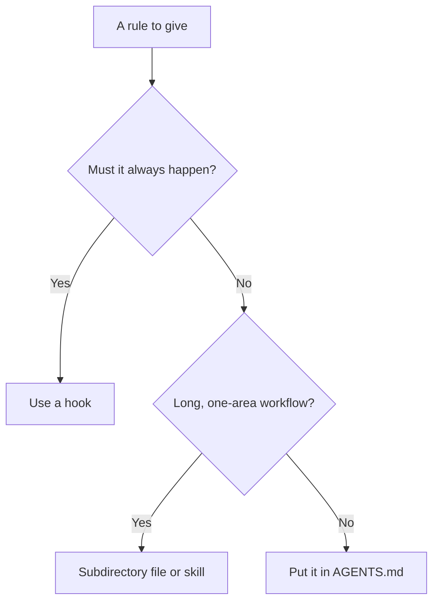
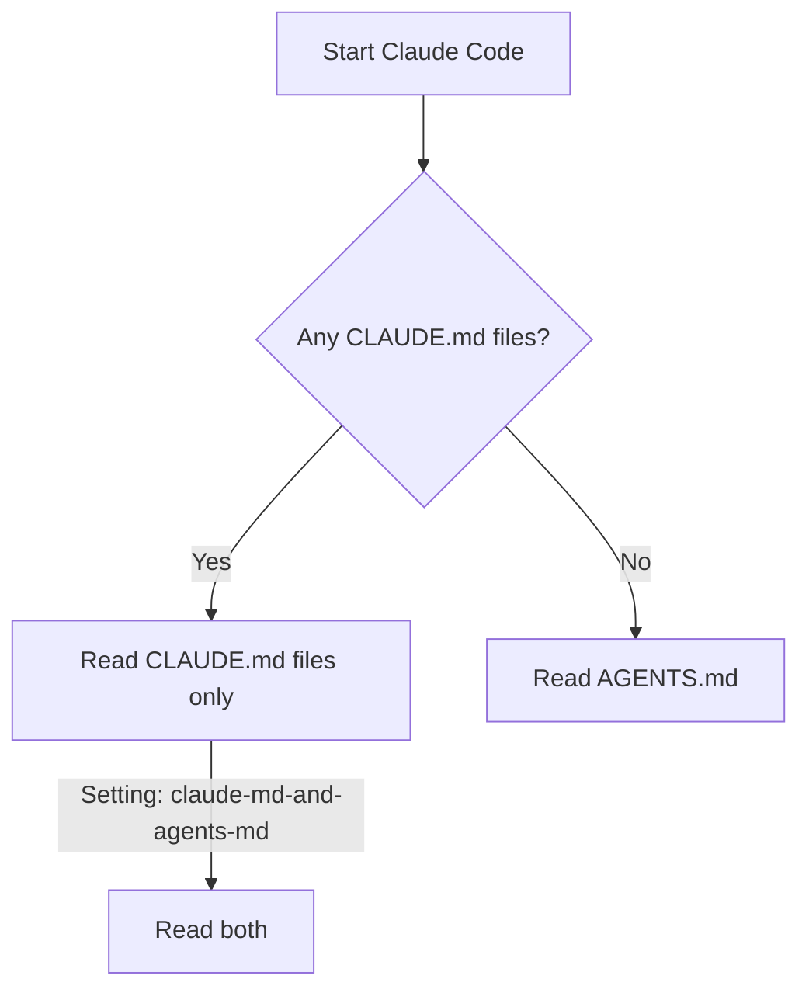
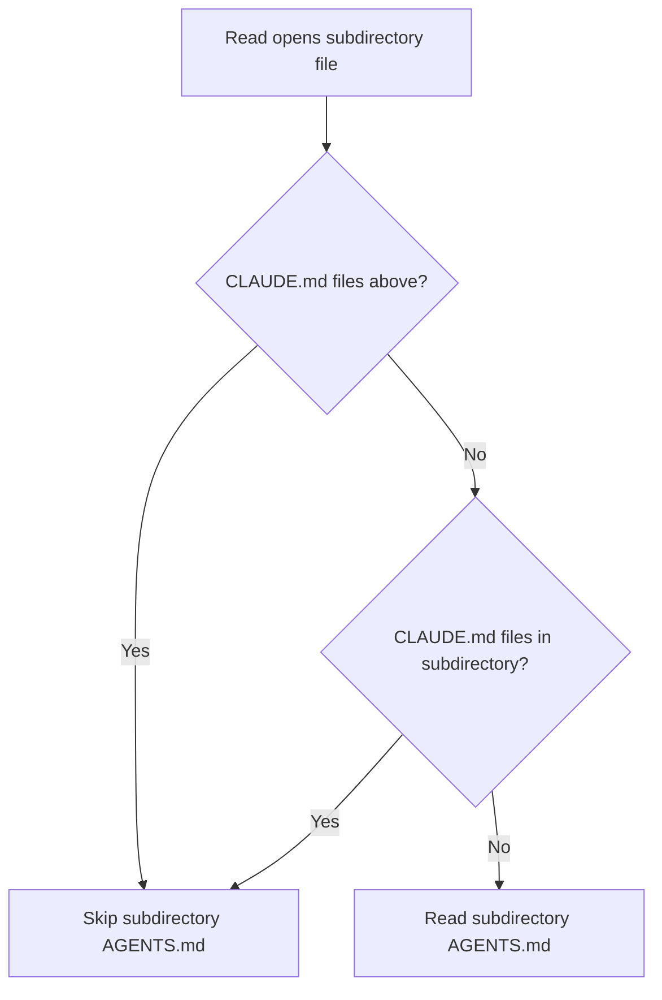
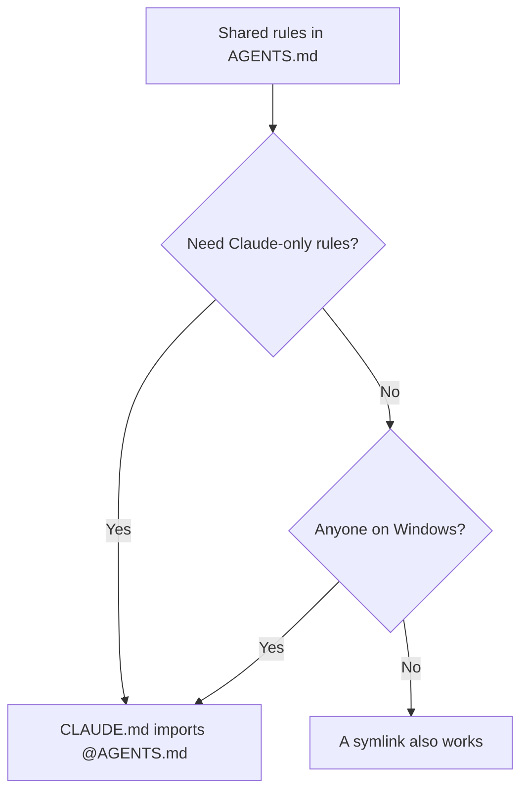

When I have both Codex and Claude Code open on the same project, what I worry about most is writing the rules twice and letting one copy drift.

A coding agent is an AI assistant for software work: you describe the job in ordinary sentences, and it opens files in your project, edits them, and runs commands on its own. Codex (from OpenAI) and Claude Code (from Anthropic), the two tools in this post, are both coding agents. They need project notes to know how to run tests, which files to leave alone, and what to do before they submit a change.

AGENTS.md is a README for those assistants. A README is the file many projects keep at the top level to tell newcomers what the project is and how to get started. AGENTS.md tells an AI assistant the same kind of thing.

You write it in Markdown, a plain-text format where `#` marks a heading and `-` starts a list item, saved with a `.md` extension. There are no required fields, and you can choose your own headings. The format is stewarded by the [Agentic AI Foundation](https://agents.md/) under the Linux Foundation.

This post covers only how to write the file, and what the official docs for [Codex](https://learn.chatgpt.com/docs/agent-configuration/agents-md) and [Claude Code](https://code.claude.com/docs/en/memory#agents-md) say each tool will actually read. I will not claim that every tool behaves the same way, and I will not list products I have not checked.

A skill pack is a set of packaged workflows that an assistant loads when it needs them. If you want one to help generate project rules, see my post [mattpocock/skills, Part 1: Install, Set Up, Then /ask-matt](/posts/mattpocock-skills-setup-routing-guide/). That post is about that skill workflow. This one is about the file format itself, and how these two tools load it.

> This post is based on the [Codex AGENTS.md guide](https://learn.chatgpt.com/docs/agent-configuration/agents-md), the [Claude Code memory and CLAUDE.md docs](https://code.claude.com/docs/en/memory) (including the [AGENTS.md section](https://code.claude.com/docs/en/memory#agents-md)), and the [AGENTS.md site](https://agents.md/), as I read them on 2026-11-10 (Taipei time). That day, the latest Codex CLI on npm was 0.167.0, and Claude Code was 2.1.322. Later versions or docs may change how files are loaded.
{: .prompt-info }

## Before You Start: A Few Terms

If you are not an engineer, these words come up again and again. A minute spent here makes the rest much easier to follow:

- **Repo (code repository):** the folder that holds all of a project's files, usually managed with Git (a version-control tool that records every change).
- **Repository root:** the top-level folder of the repo. In a project managed with Git, the root is usually the folder that contains a hidden `.git` folder.
- **Subdirectory:** a folder inside another folder. For example, `services/payments/` is the `payments` folder inside the `services` folder.
- **Terminal:** a window where you type commands. The code blocks marked `bash` in this post are commands you run there.
- **Current working directory:** the folder your terminal is in when you start Codex or Claude Code. It is not always the root. For example, if you type `cd services/payments` (`cd` is the command that changes folders) and then start the tool, your current working directory is `services/payments`.
- **`~` (home folder):** your own user folder. `~/.codex/AGENTS.md` means "the AGENTS.md in the `.codex` folder inside your user folder." File managers often hide folders whose names start with a dot, so if you cannot find one, turn on "show hidden files."
- **Import:** a line such as `@AGENTS.md` inside CLAUDE.md. When Claude reads CLAUDE.md, it also reads the contents of AGENTS.md, so you do not have to copy them. The "Share One File With Both Tools: Import AGENTS.md" section walks through it step by step.

## Write an AGENTS.md When You Repeat Yourself

These are good reasons to put the rules in AGENTS.md:

- You have already had to repeat the same reminder to the assistant.
- It keeps running the wrong test command, for example `npm test` when the project uses `pnpm test`.
- A new teammate, or anyone who opens this repo next, also needs to know it.

I think two kinds of content do not belong here: long workflows that apply only to one small area, and rules that must always happen.



Subdirectory files come up later in this post. [Write Your Own Agent Skill: From SKILL.md to Testing and Upkeep](/posts/agent-skill-authoring-guide/) shows how to write a skill.

A rule that must always happen can't rely on an instruction file alone. The [Claude Code docs](https://code.claude.com/docs/en/memory) are explicit: these files are context (text added to the conversation for the model to read), not enforced configuration. The model takes them into account, but what it does in the end is still the model's decision.

To block an action at a fixed point, use a hook (a command the tool runs automatically at a set moment); see my post [Claude Code Hooks: Format, Test, and Flag Sensitive Files](/posts/claude-code-hooks-automate-checks/).

## Write Short, Checkable Instructions

Write instructions that are specific enough to check. The official contrast is clear: "Use 2-space indentation" works better than "format code nicely," and "Run `npm test` before opening a pull request" is clearer than "remember to test."

My test is simple: if someone reading the sentence could not check whether it was followed, make it more specific.

At a minimum, I recommend covering:

- Install and test commands
- Code style
- What to do before opening a pull request (PR: a request to have your changes reviewed and then merged into the main version of the code)
- Cautions, such as security notes and files to leave alone

Keep it short, and put the important lines first. The two tools say different things about length:

| Tool | Suggested size or cap | Past that |
| --- | --- | --- |
| Claude Code | [Stay under 200 lines per file](https://code.claude.com/docs/en/memory#write-effective-instructions) | Longer files use more context and are followed less consistently |
| Codex | It concatenates the files it finds and [stops at 32 KiB by default](https://learn.chatgpt.com/docs/agent-configuration/agents-md) (`project_doc_max_bytes`) | Anything past that limit is not read |

32 KiB is 32,768 bytes. An English letter takes about 1 byte in the common UTF-8 encoding, so that is roughly 32,000 characters of plain English. Many other scripts, such as Chinese, take more bytes per character.

Here is a root-level template I wrote for you to copy, a little over twenty lines. Change the commands and paths to match your project:

```markdown
# AGENTS.md

## Project overview

This is a Node.js web service. Use pnpm to manage packages. The Node version is in `.nvmrc`.

## Install and test

- Install dependencies: `pnpm install`
- Run the full test suite: `pnpm test`
- Run a single file: `pnpm test -- path/to/file.test.ts`
- Before opening a PR, run `pnpm lint` and `pnpm test`

## Code style

- Use 2-space indentation, not tabs
- Add TypeScript types to public functions, and do not use `any`

## Cautions

- Do not edit `.env`, `.env.*`, or any file that holds secrets
- Do not write real API keys or passwords into the source

## Before you open a PR

- Use one sentence in the title to say what changed
- In the description, say how to run the tests and which ones you ran
```

The `pnpm install`, `pnpm test`, and `pnpm lint` commands in the template are only examples. If you are not sure which commands your project uses, check its existing README or ask the engineer who maintains it. I would rather leave a section out than write it wrong.

### Hands-On: Create Your First AGENTS.md

1. Find the project's root folder (see "Before You Start: A Few Terms" above).
2. In the root, create a plain-text file named `AGENTS.md`. Any plain-text editor works. When you save, check that the name ends in `.md`, not `AGENTS.md.txt`, and that it is not saved as a Word or RTF document.
3. Paste in the template above, change it to your project's real commands, paths, and cautions, and save.
4. Commit it to the repo like any other project file, so teammates and later contributors get the same copy. If you are not comfortable with Git, ask an engineer to do this step.
5. Check that the tools picked it up, as described in "Confirm the Tools Actually Loaded the File" below.

### Codex Review Rules on GitHub

If you use Codex code review on GitHub (code review: checking changes before they are merged), you can add a `## Code Review Rules` section. Put it in the AGENTS.md closest to the code those rules govern.

That is what the [Codex docs say for GitHub review](https://learn.chatgpt.com/docs/agent-configuration/agents-md#add-code-review-rules). It applies to that feature, and it is not a general rule for how both tools load instruction files.

Use the heading exactly as the docs write it, then list what reviewers should watch for. For example, in the payments service's `services/payments/AGENTS.md`:

```markdown
## Code Review Rules

- When the payment flow changes, check that matching tests were added
- Flag any password or API key written directly into the code
```

To learn more about having an AI agent review PRs on GitHub, see my separate post [Automating PR Review With GitHub Actions and an AI Agent: This Site as an Example](/posts/github-actions-ai-agent-pr-review/).

## How Codex Reads the Files: From the Root Down to Your Folder

The [Codex guide](https://learn.chatgpt.com/docs/agent-configuration/agents-md) says Codex reads AGENTS.md before it does any work, and that it builds the instruction chain (the files it found, joined in order into one set of instructions) once per start. So after you edit a file, restart Codex to pick up the new text.

Codex rules live in two kinds of places:

- **Global rules:** your own preferences that apply to all of your projects, in `~/.codex/AGENTS.md` (or in `CODEX_HOME`, if you set that).
- **Project rules:** rules that live in the repo and travel with the project. This is the file most of this post is about.

For a project, Codex starts at the project root (typically the Git root) and walks down to your current working directory. In each directory it looks for `AGENTS.override.md`, then `AGENTS.md`, then any fallback names you configured (backup filenames, explained below). It takes at most one file per directory.

It concatenates those files from the root down. Files closer to your current directory appear later, so the more specific rules effectively override the broader ones above.

For example, if you start Codex in `services/payments`, it looks at the root, then `services/`, then `services/payments/`. It takes at most one rules file from each, and the `services/payments/` file is added last.

{: w="1280" h="720" }
_A concept illustration, not the real UI. On the left, folders go from the root at the top down to the current folder, outlined in teal, where you started Codex. Codex follows the teal arrows down and joins each folder's rules into the single set on the right, with the closest folder's rules last. The gray, deeper folder is not read._

Discovery stops at the current directory: files deeper than that are not loaded at start. To use a subdirectory's rules, start Codex from that directory, or start it with `--cd`:

```bash
codex --cd subdirectory
```

`--cd` tells Codex to treat that folder as the current directory. If Codex cannot find a project root, it only checks the current directory.

So I start with one AGENTS.md at the root. If one subproject needs different rules, I add a file in that directory and start Codex there.

### When a Directory Has an Override, Only the Override Counts

When one directory has both an override, `AGENTS.override.md`, and a regular `AGENTS.md`, Codex still takes only one, and the override wins:

{: w="1280" h="720" }
_A concept illustration, not the real UI. In every folder, only one rules file is lit up and taken by Codex. The middle folder has both AGENTS.override.md (the coral page with the star) and AGENTS.md (the blue page), and Codex takes the override. The folders on either side have only AGENTS.md, so Codex takes that._

An override is a temporary stand-in for the usual rules. When you are done, I recommend deleting it rather than leaving an empty file behind. The official wording is that you remove the override to restore the original file.

### Keep an Existing Filename: Fallback Names

If the repository already uses another filename, such as `TEAM_GUIDE.md`, you can make it one of the fallback names mentioned above. Add it to `project_doc_fallback_filenames` in `~/.codex/config.toml` (the Codex settings file).

Codex uses this list only in a directory that has neither `AGENTS.override.md` nor `AGENTS.md`. Filenames not on the list are not treated as rules files.

Open the settings file in a plain-text editor (create it if it does not exist), and add a line at the top of the file, before any section heading that starts with `[`:

```toml
project_doc_fallback_filenames = ["TEAM_GUIDE.md", ".agents.md"]
```

You can raise the combined size cap with `project_doc_max_bytes`; the default is 32 KiB (that is, `32768`). See the [Codex config sample](https://learn.chatgpt.com/docs/config-file/config-sample.md) for the fields.

## How Claude Code Reads the Files: By Default, Any CLAUDE.md Means No AGENTS.md

Claude Code's own project instructions file is called CLAUDE.md, and it plays the same role as AGENTS.md. Claude Code can also read a repository's AGENTS.md as project instructions, so you do not have to add a CLAUDE.md just to get started. The [default conditions](https://code.claude.com/docs/en/memory#agents-md) are stricter, though:



Here, "CLAUDE.md files" means `CLAUDE.md`, `.claude/CLAUDE.md`, and `CLAUDE.local.md`. Claude checks your current working directory and above it ("above" means the folders that contain it, all the way up). When it reads AGENTS.md, that includes `.claude/AGENTS.md`.

Your personal `~/.claude/CLAUDE.md`, your organization's managed CLAUDE.md, and files under `.claude/rules/` do not count in that check. They do not stop AGENTS.md from loading.

There is a common trap: you add `CLAUDE.local.md` for private notes you will not commit, and Claude stops reading AGENTS.md. To keep both, set Project instructions to `claude-md-and-agents-md`. Type this slash command in the Claude Code chat box to open the settings:

```text
/config
```

Claude Code also does not read `AGENTS.override.md`, `AGENTS.local.md`, or anything under a `.agents/` directory. So an override you added for Codex has no effect on Claude.

### Subdirectory AGENTS.md: Read Only When No CLAUDE.md Files Sit Above

A subdirectory AGENTS.md is not loaded at launch for every folder. The [official docs](https://code.claude.com/docs/en/memory#when-claude-code-reads-agents-md) place this behavior under the case where no counting CLAUDE.md files exist in the working directory or above:



The Read tool is the built-in Claude Code feature for opening a file's contents. If the repository root already has a CLAUDE.md, this default path does not apply. See "Share One File With Both Tools: Import AGENTS.md" below for what to do when you still need those subdirectory rules.

### Version Requirements and the Load Message

Direct AGENTS.md support requires Claude Code v2.1.277 or later. In these cases Claude may not load it, so use the import from "Share One File With Both Tools" below instead:

- Older versions
- Sessions where the built-in plugin (add-on feature) that reads AGENTS.md is disabled
- The first session (one run of the tool, from opening it to closing it) after you upgrade from an older version

In an interactive session that does load it, you will often see a line such as `no CLAUDE.md found; AGENTS.md loaded: …`.

### Change the Default

To change the default, set Project instructions in `/config`. You can also write the value in the user-level settings file `~/.claude/settings.json`; this setting is ignored in project settings files.

If you are not used to editing settings files, I recommend `/config`, the less error-prone route. The four values mean:

| Value | What Claude reads |
| --- | --- |
| `claude-md-or-agents-md` | The default. It reads your CLAUDE.md files, or AGENTS.md when no CLAUDE.md files are present |
| `claude-md-and-agents-md` | Both. In each directory, CLAUDE.md files come first, then AGENTS.md |
| `claude-md` | CLAUDE.md files only |
| `managed-only` | At launch, only the organization's managed instructions and auto memory; project CLAUDE.md and AGENTS.md files are not loaded then |

## Share One File With Both Tools: Import AGENTS.md

If you use both tools, as I do, the aim is to maintain one shared set of rules. When two files contradict each other, the [Claude docs](https://code.claude.com/docs/en/memory#write-effective-instructions) say Claude may pick one arbitrarily.

I think the key is an import, which means "pull in another file by reference." Instead of copying the contents of AGENTS.md into CLAUDE.md, you write one line, `@AGENTS.md`. When Claude reads CLAUDE.md, it expands that line into the contents of AGENTS.md and reads them as part of CLAUDE.md.

Nothing is copied, so AGENTS.md stays the only file you maintain. To pick an approach:



The steps are:

1. Put the team-wide rules in `AGENTS.md` at the repository root. Codex reads that file directly.
2. If the project also needs Claude-specific notes, create a `CLAUDE.md` in the same folder (the root). Put `@AGENTS.md` on the first line, then add the Claude-only content below.

That is the [official example](https://code.claude.com/docs/en/memory#share-one-file-with-other-coding-tools):

```markdown
@AGENTS.md

## Claude Code

Use plan mode for changes under `src/billing/`.
```

Plan mode in the example is one of Claude Code's working modes. The line is only there to show what a Claude-specific rule can look like, so replace it with whatever you need.

The path after `@` is relative to the CLAUDE.md that contains it, not to your current working directory. When CLAUDE.md and AGENTS.md sit in the same folder, `@AGENTS.md` is all you need.

If you wrap the path in backticks, such as `` `@AGENTS.md` ``, it is only a mention, and the file is not expanded.

{: w="1280" h="720" }
_A concept illustration, not the real UI. The assistant on the left stands for Codex and reads the blue AGENTS.md directly. The assistant on the right stands for Claude Code and reads the purple CLAUDE.md, whose first line, `@AGENTS.md`, brings in the shared rules (the dashed blue box). The Claude-only notes come after that, and nothing has to be copied._

### When You Don't Need Claude-Only Content: A Symlink

If you do not need any Claude-specific content, a symlink (a filename that points at another file, a little like a shortcut) also works. In the terminal, go to the repository root and run:

```bash
ln -s AGENTS.md CLAUDE.md
```

The command prints no output on success.

If anyone on the team works on Windows, though, I would use the import instead. The docs point out two problems:

- Creating a symlink on Windows needs Administrator privileges or Developer Mode.
- If Git does not have `core.symlinks` enabled, a checkout can turn the link into a one-line plain-text file, which leaves the clone without your instructions.

### Two Approaches That Don't Replace an Import

- **A sentence such as "please read AGENTS.md":** the docs say Claude then sees that file only if it decides to open it.
- **`/import` as a long-term substitute:** this is a different Claude Code chat command with a similar name. The official wording is that it appends a one-time copy of instruction files such as AGENTS.md to the matching CLAUDE.md. Later edits to AGENTS.md are not copied over automatically.

## Confirm the Tools Actually Loaded the File

After editing the files, I would not assume the tool has already seen the new text.

### Codex: Restart, Then Ask for a Summary

Restart Codex first, then run the [official checks](https://learn.chatgpt.com/docs/agent-configuration/agents-md#verify-your-setup) in the terminal from the repository root:

```bash
codex --ask-for-approval never "Summarize the current instructions."
```

The quoted sentence is the request you are giving Codex. `--ask-for-approval never` comes from the official example; copy it as is.

To confirm a subdirectory's rules, change the path to yours:

```bash
codex --cd services/payments --ask-for-approval never "Show which instruction files are active."
```

This line starts Codex as if from `services/payments` and asks it to list the instruction files that are active.

You should see the active instruction sources listed in order, such as the global file, the root AGENTS.md, and (when you start in a subdirectory) the closer file. That is the check described in the official docs.

### Claude Code: Check the Memory List

In Claude Code, type this in the chat and look for your file in the list:

```text
/memory
```

Or type this and check under Memory files:

```text
/context all
```

Before v2.1.280, this list does not show an AGENTS.md that was read directly. In an interactive session that loaded AGENTS.md directly, you should also see the `AGENTS.md loaded` line mentioned earlier.

### If a File Wasn't Loaded, Check These Three Things

- That the filename and location are right.
- That you restarted Codex.
- Whether a CLAUDE.md file already exists in Claude Code's current directory or above. If it does, use an import or change the setting.

## A Worked Example: A Frontend Plus a Payments Service

Suppose the repo has a frontend in `web/` (the web pages people see) and a payments service in `services/payments/`. That layout is a monorepo: one repository that holds more than one project. I would place the files like this:

```text
my-project/              ← repository root
├── AGENTS.md            ← rules for the whole project
├── CLAUDE.md            ← @AGENTS.md on the first line, then Claude-only notes
├── web/
└── services/
    └── payments/
        └── AGENTS.md    ← rules for the payments service only
```

- Root `AGENTS.md`: shared install commands, code style, and PR rules
- `services/payments/AGENTS.md`: only the payments service's own test command, for example `make test-payments`
- Root `CLAUDE.md`: `@AGENTS.md` on the first line, then one Claude-specific rule, such as using plan mode before changing payment code

I would keep `services/payments/AGENTS.md` very short and cover only what differs from the root:

```markdown
# AGENTS.md (payments service)

## Tests

- In this folder, run `make test-payments`, not `pnpm test`
```

### What Codex Loads

When you start Codex from the repository root, it loads the global file (if you have one) and the root AGENTS.md. It does not load `services/payments/AGENTS.md` at start, because discovery stops at the current directory.

After `codex --cd services/payments`, the payments file is appended. Its more specific test command effectively overrides the broader one at the root.

### What Claude Code Loads

When you start Claude Code from the root, a CLAUDE.md is already present, so [by default it reads the CLAUDE.md files only](https://code.claude.com/docs/en/memory#agents-md). The root AGENTS.md comes in through the `@AGENTS.md` import.

When Claude later uses Read to open a file under `services/payments/`, it still does not read `services/payments/AGENTS.md` directly. The reason is in "Subdirectory AGENTS.md: Read Only When No CLAUDE.md Files Sit Above": the root already has a CLAUDE.md, so the documented condition is not met.

If Claude should also see the payments rules, I would add a `CLAUDE.md` in `services/payments/` that starts with `@AGENTS.md`. Because an import path is relative to the CLAUDE.md that contains it, that line points to `services/payments/AGENTS.md` in the same folder, not to the root file.

A [subdirectory CLAUDE.md](https://code.claude.com/docs/en/memory#how-claude-md-files-load) loads when Claude reads, writes, or edits a file in that directory. The other option is to set Project instructions to `claude-md-and-agents-md`, so both kinds of files are read.

## Which File to Use in Each Situation

| Situation | Which file to use |
| --- | --- |
| Rules the whole team shares | `AGENTS.md` at the repository root |
| Rules that apply to only one subproject | `AGENTS.md` in that subdirectory (start Codex from there; if the root already has a CLAUDE.md, Claude needs an import or a settings change) |
| Your personal preferences across all projects | `~/.codex/AGENTS.md`, or `~/.claude/CLAUDE.md` |
| A temporary change to Codex rules | `AGENTS.override.md` in the same directory (delete it when you are done; Claude does not read it) |
| Extra rules for Claude only | `CLAUDE.md` with `@AGENTS.md` on the first line, then the extra notes |
| Private Claude notes you will not commit | `CLAUDE.local.md` (by default this stops Claude from reading AGENTS.md; change the setting if you still need both) |
| Something that must always happen | A hook or a permission setting, not an instruction file |

## Conclusion

I suggest following "Hands-On: Create Your First AGENTS.md" and adding an AGENTS.md of 30 lines or fewer at the repository root today, with the install, test, and caution lines you actually use. If you also need Claude-specific notes, add a CLAUDE.md that starts with `@AGENTS.md`. Then use the commands above, or `/memory`, to confirm the files were loaded.

If you want to keep reading:

- Why every line written for an assistant has a cost: see [mattpocock/skills, Part 6: Skills for Research, Handoffs, and Learning](/posts/mattpocock-skills-research-handoff/).
- Turning a rule into a check that runs at a fixed point: see the [hooks post](/posts/claude-code-hooks-automate-checks/).
- I think long material such as a full architecture write-up doesn't belong in AGENTS.md. I discuss keeping it in a wiki inside the repo and pointing to it from AGENTS.md in [OpenWiki Can Track Code Changes, but It Can't Prove the Docs Are Correct](/posts/openwiki-agent-docs-maintenance/).
- Official references: the [Codex AGENTS.md guide](https://learn.chatgpt.com/docs/agent-configuration/agents-md), the [Claude Code memory docs](https://code.claude.com/docs/en/memory#agents-md), and the [AGENTS.md site](https://agents.md/).
