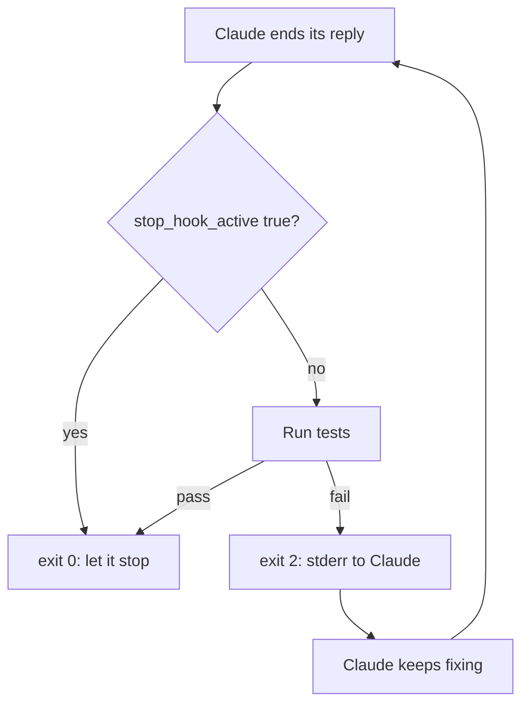

After I ask an AI to edit a file, I still have to check: did formatting run? Did the tests pass? Did it touch `.env`? Claude Code (an AI coding assistant you use in the terminal) has hooks that run these checks at fixed points, so you don't wait for the AI to decide whether to run them.

This post sets up four common hooks, then covers what they cannot block.

> Based on the [Claude Code hooks guide](https://code.claude.com/docs/en/hooks-guide), the [Hooks reference](https://code.claude.com/docs/en/hooks), and [Security considerations](https://code.claude.com/docs/en/hooks#security-considerations) as of 2026-11-10 (Taipei time). The latest Claude Code on npm that day was 2.1.322. Later versions may change events and fields.
{: .prompt-info }

I covered the permission risks of third-party skills and MCP servers in [this earlier post](/posts/coding-agent-supply-chain-permission-risks/). This one is about everyday checks you configure yourself.

## What hooks are

A hook is a command you write that Claude Code runs at a fixed point in the conversation. Use hooks for work that should happen every time and needs no judgment: formatting, running tests, blocking an edit to a given file. Decisions that need judgment stay with you or the permission settings.

The four most useful moments:

- **PreToolUse**: before a tool (a file edit, a command) runs. It can block that call.
- **PostToolUse**: after a tool succeeds, for example to format the file it just changed.
- **Stop**: when Claude finishes a reply. It fires at the end of every reply, not only when a whole task is done.
- **SessionStart**: when a session starts or resumes. Set the matcher to `compact` to run it only after compaction.

The full list of events is in the [Hooks reference](https://code.claude.com/docs/en/hooks#hook-lifecycle).

{: w="1280" h="720" }
_A concept illustration, not the real UI. The four moments are: before a tool runs, after it succeeds, when the reply ends, and when the session starts or is compacted._

A good hook candidate is a reminder you've repeated more than once with a clear rule, such as "format JavaScript after it's edited" or "don't use Edit or Write on `.env`."

## Where to put the settings

Every example here goes in `.claude/settings.json` at the project root. Commit it and the whole team shares it. Two other locations exist:

- `~/.claude/settings.json`: applies to all your projects on this machine.
- `.claude/settings.local.json`: stays out of version control.

Hooks from all layers are merged. One layer does not replace another.

The file is JSON: no comments, and no trailing comma after the last item. It has three levels: the event name, a group of rules with a matcher, then the hooks to run.

The matcher decides whether a hook runs. For PreToolUse and PostToolUse, it compares the tool name, case-sensitively. `"Edit|Write"` fires only when Claude uses `Edit` or `Write`, and `"Edit, Write"` means the same thing. With no matcher, or `"*"`, the hook runs on every occurrence of the event.

The examples need [`jq`](https://jqlang.org/) to read fields from the JSON a hook receives. The formatter also needs Node.js and `npx`. On macOS and Linux, hook scripts must be executable:

```bash
chmod +x .claude/hooks/*.sh
```

## Auto-format after edits: PostToolUse

Add this to `.claude/settings.json`. If the file already has a `"hooks"` object, add `PostToolUse` inside it instead of replacing the file:

```json
{
  "hooks": {
    "PostToolUse": [
      {
        "matcher": "Edit|Write",
        "hooks": [
          {
            "type": "command",
            "command": "f=$(jq -r '.tool_input.file_path'); npx prettier --write \"$f\""
          }
        ]
      }
    ]
  }
}
```

After a successful `Edit` or `Write`, the command reads the file path from the input JSON and runs `npx prettier --write` on it. It's adapted from the official guide's Prettier example: the path goes into a variable and is quoted, so spaces or apostrophes don't split it.

On success the conversation usually shows nothing, so open the file to see whether it was reformatted. The official test: ask Claude to add a single-quoted string to a JavaScript file, then check whether it became double-quoted (Prettier's default).

## Block edits to sensitive files: PreToolUse

This hook blocks the one `Edit` or `Write` call that targets `.env`, a file under `.git/`, or `package-lock.json`, and tells Claude why. It does not mean the AI can never touch these files.

Add `.claude/hooks/protect-files.sh`. It follows the official guide's protected-file example and also normalizes Windows backslashes:

```bash
#!/bin/bash
# protect-files.sh — based on official Claude Code hooks guide example
INPUT=$(cat)
FILE_PATH=$(echo "$INPUT" | jq -r '.tool_input.file_path // empty')

# Normalize Windows backslash separators so the patterns below match
FILE_PATH="${FILE_PATH//\\//}"

PROTECTED_PATTERNS=(".env" "package-lock.json" ".git/")

for pattern in "${PROTECTED_PATTERNS[@]}"; do
  if [[ "$FILE_PATH" == *"$pattern"* ]]; then
    echo "Blocked: $FILE_PATH matches protected pattern '$pattern'" >&2
    exit 2
  fi
done

exit 0
```

Then add this inside `"hooks"` in `.claude/settings.json`:

```json
"PreToolUse": [
  {
    "matcher": "Edit|Write",
    "hooks": [
      {
        "type": "command",
        "command": "\"$CLAUDE_PROJECT_DIR\"/.claude/hooks/protect-files.sh"
      }
    ]
  }
]
```

`$CLAUDE_PROJECT_DIR` is an environment variable Claude Code sets to the project root. Exit code `2` blocks the call, and the `Blocked:` line on stderr goes back to Claude. Exit code `0` only means the hook has no opinion. The normal permission flow still applies, so it is not an approval.

{: w="1280" h="720" }
_A concept illustration, not a real permission screen. This hook blocks that Edit or Write, not every path that could change the file._

Matching only `Edit|Write` misses changes made through `Bash` or `PowerShell`. The limits section shows how to cover them.

## Run tests when the turn ends: Stop

This hook runs the tests when Claude finishes a reply. If they fail, it hands the failure back so Claude keeps fixing.

A Stop hook has no matcher. It runs at the end of every reply, and not when you interrupt. The risk is an endless loop: once a hook has made the conversation continue, the next input has `stop_hook_active` set to `true`, and the script must let Claude stop.



The official docs say to always check `stop_hook_active`, or read the transcript, so a hook never blocks on a condition that can't be met. After eight blocks in a row, Claude Code ends the turn anyway. The count resets whenever Claude calls a tool.

Add `.claude/hooks/run-tests-on-stop.sh`. It uses `bun test` to match the scenario later on. Swap in your own test command, such as `npm test` or `pytest`:

```bash
#!/bin/bash
# run-tests-on-stop.sh — Stop hook with official stop_hook_active guard
INPUT=$(cat)
if [ "$(echo "$INPUT" | jq -r '.stop_hook_active')" = "true" ]; then
  exit 0  # Allow Claude to stop
fi

PROJECT_DIR="${CLAUDE_PROJECT_DIR:-$(cd "$(dirname "$0")/../.." && pwd)}"
if ! (cd "$PROJECT_DIR" && bun test) >&2; then
  echo "Blocked stop: tests failed. Fix the failing tests before finishing." >&2
  exit 2
fi
exit 0
```

The matching settings:

```json
"Stop": [
  {
    "hooks": [
      {
        "type": "command",
        "command": "\"$CLAUDE_PROJECT_DIR\"/.claude/hooks/run-tests-on-stop.sh"
      }
    ]
  }
]
```

Exit code `2` does something different on each event:

| Event | What exit code `2` does |
| --- | --- |
| PreToolUse | Blocks the tool call and sends stderr to Claude |
| PostToolUse | The tool already ran, so nothing is undone; stderr goes to Claude |
| Stop | Keeps Claude from stopping; stderr becomes the reason to continue |

## Re-inject rules after compaction: SessionStart

When the context (what is still in front of the model) gets too long, Claude Code runs compaction. It summarizes the earlier conversation to free up space, and details can be lost. The official fix is a SessionStart hook with the matcher `compact` that writes key rules back into the context after each compaction. Plain text the command prints to stdout is added to Claude's context:

```json
"SessionStart": [
  {
    "matcher": "compact",
    "hooks": [
      {
        "type": "command",
        "command": "echo 'Reminder: use Bun, not npm. Run bun test before committing. Current sprint: auth refactor.'"
      }
    ]
  }
]
```

Per the docs, Claude sees this reminder again after compaction. Replace the reminder with your project rules. `compact` covers both automatic and manual compaction, and SessionStart cannot block compaction itself. Rules that rarely change can live in `CLAUDE.md` instead.

## Check your setup with /hooks

Type `/hooks` at the Claude Code prompt to open a read-only hooks browser. Each hook shows its source: user settings, project settings, local settings, a plugin, or the current session. Select one to see the exact command and the settings file or plugin that defines it. Switch to `All events` to include events with no hooks yet.

The screen is read-only. To change a hook, edit its JSON file.

## A full example: one day on a small project

Say you maintain a small site. You want JavaScript formatted after edits, no Edit or Write on `.env`, tests at the end of every reply, and a reminder after compaction to use Bun and test before committing.

1. At the project root, create `.claude/settings.json` with the four events above. Add `protect-files.sh` and `run-tests-on-stop.sh`, point the test command at your project, and run the `chmod` from earlier.
2. Make sure `jq` is installed, along with a Node.js that can run `npx prettier`. Formatting uses `npx prettier`, so it works whether the project manages packages with Bun or npm.
3. Start Claude Code, type `/hooks`, and confirm that PostToolUse, PreToolUse, Stop, and SessionStart are listed, sourced from project settings.
4. Ask Claude to add a feature in a `.js` file. After its Edit or Write, Prettier formats the file.
5. If it tries to change `.env` with Edit or Write, that change is blocked with a `Blocked:` reason.
6. When it says it's done, the Stop hook runs the tests. On failure, it keeps working from the feedback.
7. After compaction, SessionStart puts your reminder back into the context.

You can add the four hooks one at a time.

## Which hook when

| Your situation | Use this |
| --- | --- |
| Auto-format after an Edit or Write | PostToolUse, matcher `Edit\|Write` |
| Block that Edit or Write to `.env`, `.git/`, and similar files | PreToolUse, matcher `Edit\|Write`, exit code 2 with a reason |
| Scan a file after it changes, whoever wrote it | FileChanged (runs after the file is written, cannot block in advance) |
| Run tests or scan the working tree when a reply ends | Stop, and check `stop_hook_active` |
| Put project rules back after compaction | SessionStart, matcher `compact` |
| Just want to see which hooks are configured | `/hooks` (read-only browser) |

## What hooks cannot block

**A matcher compares tool names only.** When Claude changes files with `Bash` or `PowerShell`, `"Edit|Write"` does not fire. The official docs give three ways to cover that:

- To see every change in a turn (compliance scans, audit logs): add a Stop hook that scans the working tree at the end of each turn.
- To see it on every call: also match `Bash|PowerShell` and list modified and untracked files with `git status --porcelain`.
- To react when a specific file is written, whoever wrote it: use [FileChanged](https://code.claude.com/docs/en/hooks#filechanged).

{: w="1280" h="720" }
_A concept illustration. The matcher watches named tools; changes made through Bash or PowerShell take another path._

**The `if` field is best-effort.** Tool events can take an `if` filter that uses permission-rule syntax on the tool name and arguments, such as `"Edit(*.ts)"`. The docs call it best-effort, so use the permission system for a hard allow or deny. `if` works only on tool events. On any other event, it stops the hook from running at all.

**A hook's allow does not bypass deny.** Deny rules in settings, including enterprise managed deny lists, still apply. A hook's deny, in turn, holds in every permission mode.

**PostToolUse can't undo anything.** By then the file is written, the command has run, and the network request is sent. To block or rewrite a call before it runs, use PreToolUse.

**Hooks run with your full user permissions.** The docs warn that a command hook can read, change, or delete any file your account can reach. Read the commands and try them somewhere safe before you add them. Before using hooks in a shared or production environment, read [Security considerations](https://code.claude.com/docs/en/hooks#security-considerations).

An interactive session asks whether you trust the folder. Per the docs, `claude -p` and the SDK don't ask and treat the folder as trusted, so hooks in a repo's `.claude/settings.json` can run in a directory you never approved.

Hooks are not a security boundary. To have the operating system limit what commands can read and write, see [Claude Code Sandbox Setup: Keep SSH Keys and Tokens Out](/posts/claude-code-sandbox-setup/).

## Conclusion

Start with one hook in the project's `.claude/settings.json`, confirm it in `/hooks`, and add more as you need them. Treat hooks as checks that save you repetition, not as the last line of defense.

## Further reading

- [Claude Code hooks guide](https://code.claude.com/docs/en/hooks-guide): common uses and copyable examples.
- [Hooks reference](https://code.claude.com/docs/en/hooks): events, input and output, and [Security considerations](https://code.claude.com/docs/en/hooks#security-considerations).
- [Third-Party Skills and MCP Servers: The New Attack Surface in Your Coding Agent](/posts/coding-agent-supply-chain-permission-risks/): permission and supply-chain risks.
- [Anthropic's AI-Native SDLC Playbook, With a Worked Example](/posts/ai-native-sdlc-playbook/): how skills differ from hooks.
- [Automating PR Review With GitHub Actions and an AI Agent: This Site as an Example](/posts/github-actions-ai-agent-pr-review/): rule checks, AI review, and human approval after a PR opens.
- [How to Write AGENTS.md: Give Coding Agents Your Project Rules](/posts/agents-md-project-rules-for-coding-agents/): rules the AI only needs to know, not enforce.
- [Claude Code Plugins: What to Check Before You Install One](/posts/claude-code-plugin-safe-install/): a plugin can bring in hooks someone else wrote.
