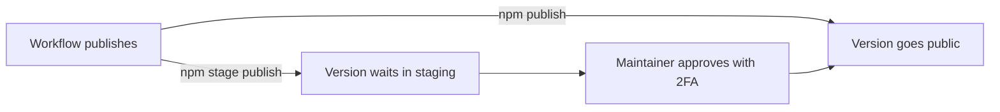
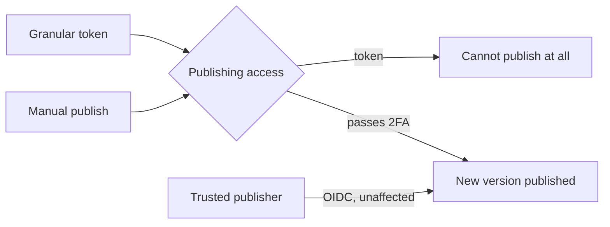

If GitHub Actions publishes your npm package, I recommend switching to npm's trusted publishing so you can stop storing a long-lived token in CI. Once that works, you still need to retire your old tokens before the risk actually goes down.

A few terms first:

- **npm package**: code uploaded to the npm registry so others can install it with `npm install`. **Publishing** means uploading a new version.
- **CI/CD**: a pipeline that runs tests, builds, and publishes automatically when code is pushed.
- **GitHub Actions**: GitHub's built-in CI/CD tool.
- **Repo** (repository): the place on GitHub that holds a project's code.
- **Workflow**: a YAML file in the repo's `.github/workflows/` folder that says what to run automatically.
- **Runner**: the machine that executes a workflow.

The thing to replace is the long-lived token. A token is a passcode that stands in for your account password; whoever has it can do whatever that token allows in your name.

If your automated publishing works by putting an `NPM_TOKEN` in GitHub Actions secrets (where GitHub stores passwords and other sensitive values), that is a long-lived token. It stays valid until it is revoked or expires, and if it leaks, someone else can publish a new version as you.

In [Third-Party Skills and MCP Servers: The New Attack Surface in Your Coding Agent](/posts/coding-agent-supply-chain-permission-risks/), I looked at this risk from the user's side. In the Nx case, according to [Nx's security advisory](https://github.com/nrwl/nx/security/advisories/GHSA-cxm3-wv7p-598c), an attacker obtained an npm publish token through a GitHub Actions injection flaw. This post looks at the **publisher** side and removes one specific risk: a long-lived token sitting in CI.

To be clear, trusted publishing cannot stop that kind of incident by itself. If malicious commands have already been injected into the workflow, it can still publish. To add a human check on each version, see "Stricter Options" later in this post.

This post covers only GitHub-hosted runners (machines provided by GitHub) and the matching settings on npmjs.com. For adding automated review to a workflow, see [Automating PR Review With GitHub Actions and an AI Agent: This Site as an Example](/posts/github-actions-ai-agent-pr-review/).

> Based on npm's official guide, [Trusted publishing for npm packages](https://docs.npmjs.com/trusted-publishers), as of 2026-11-11. npm is still adjusting this feature; for example, configurations created after 2026-09-03 allow only stage publish by default. So treat the official docs as the source of truth for the setup screens and defaults.
{: .prompt-info }

## What Trusted Publishing Is, and How It Works

[Trusted publishing](https://docs.npmjs.com/trusted-publishers) lets npm verify a publish by which repository and which workflow it came from, so CI no longer needs to store a long-lived npm token.

It relies on OIDC (OpenID Connect), a standard that lets systems present proof of identity to each other. I think of the flow as four steps:

1. The workflow starts on a GitHub-hosted runner. The job that publishes (a group of steps inside a workflow) needs the `id-token: write` permission to request an identity document.
2. GitHub issues a short-lived OIDC identity document (technically, a JWT) that names the repository and the workflow.
3. npm checks that the organization or user, the repository, and the workflow filename all match the settings you saved on npmjs.com. Only then does it issue a short-lived credential for this publish.
4. The job runs `npm publish`. For a public repository and a public package, npm also attaches provenance automatically (a public record of which repository and workflow built that version).

According to the docs, the credential from step 3 is cryptographically signed, specific to your workflow, and cannot be extracted or reused.

{: w="1600" h="900" }
_A concept illustration: GitHub Actions presents an identity, npm checks your settings, and only then issues a short-lived credential for this publish. A public repository plus a public package also gets provenance. Publishing itself needs no npm token; installing private dependencies still needs a read-only token._

**Old tokens can still publish after setup.** npm accepts trusted publishers **in addition to** existing tokens and manual publishes. The npm CLI detects an OIDC environment and uses it first, falling back to traditional tokens only when OIDC is not available. So you have to shut the old tokens off separately in Step 4.

## When to Use It, and When You Cannot Yet

Packages you publish automatically with GitHub Actions on GitHub-hosted runners are a good fit to switch now. Self-hosted runners are not supported yet.

**Switch now, because publishing directly with a token is going away.** [npm's docs say](https://docs.npmjs.com/about-access-tokens) legacy tokens were removed in November 2025, leaving only granular access tokens. A granular token is one you can limit by package, permission, and expiry date.

The docs also say the ability to publish new versions directly with a granular token will be removed in January 2027. As I read it, if your CI publishes directly with a token, you will need a different method by then. npm's [CI/CD guide](https://docs.npmjs.com/using-private-packages-in-a-ci-cd-workflow) also recommends trusted publishing instead of access tokens for publishing from CI.

The docs currently list three supported platforms:

- GitHub-hosted runners on GitHub Actions, which this post covers.
- GitLab.com shared runners.
- CircleCI cloud.

For the other two, see [the same page](https://docs.npmjs.com/trusted-publishers); I don't walk through them in this post. Self-hosted runners (machines you run yourself) are not currently supported, the [docs say](https://docs.npmjs.com/trusted-publishers), but are planned for future releases.

Trusted publishing covers publishing only. It does not handle these two things:

- **Installing private dependencies.** Dependencies are other packages your project needs. If any of them are private, installing them still requires a read-only granular token (one that can read but not publish).
- **Other npm commands.** Commands such as `npm install`, `npm view`, and `npm access` still use traditional authentication when they need to authenticate.

## Step 0: What You Need Before You Start

Before you begin, check these four things:

- **Recent enough versions:** npm CLI 11.5.1 or later and Node.js 22.14.0 or later are the [official requirements](https://docs.npmjs.com/trusted-publishers). The official example uses Node 24, whose bundled npm (currently 11.19.x) already qualifies. **The npm bundled with Node 22 is 10.x, which is below 11.5.1.** If you need to stay on Node 22, upgrade npm before you publish, for example by adding a workflow step that runs:

  ```bash
  npm install -g npm@latest
  ```

- **An exact `repository.url`:** `package.json` is your package's settings file, which records its name, version, and so on. Its `repository.url` field must **exactly match** your GitHub repository, including letter case. A fork (a copy of someone else's repo) that still points at the original URL will fail to publish.
- **Account access and 2FA:** your npm account must be able to manage the package, and 2FA (two-factor authentication: a code you enter in addition to your password) must be enabled. Step 4 switches the package to require 2FA for publishing, and approving a staged publish also requires 2FA.
- **A package that already exists on npm:** setup lives on an existing package's Settings page. The official docs do not describe a separate flow for a brand-new package.

Once all four check out, you are ready for the form.

## Step 1: Add a Trusted Publisher on npmjs.com

This step tells npm which repository and which workflow to trust.

On [npmjs.com](https://www.npmjs.com), open your package and go to **Settings**. In the **Trusted Publisher** section, under **Select your publisher**, choose **GitHub Actions**. The docs give the management path as Packages → your package → Settings → Trusted publishing.

The fields are:

- **Organization or user** (required): your GitHub username or organization name.
- **Repository** (required): the repository name. For example, for a repo named `my-lib` under `octo-org`, enter `octo-org` and `my-lib`.
- **Workflow filename** (required): the filename only, such as `publish.yml`, not the full path. Include the `.yml` or `.yaml` extension; the file must live in `.github/workflows/`. If publishing is split across two workflows, enter the caller's filename; see "Special Case: Publishing Split Across Two Workflows" below.
- **Environment name** (optional): a GitHub environment is a deployment gate that can carry protection rules, such as a required human approval. Fill this in only if you use one; otherwise leave it blank.
- **Allowed actions**: which actions this publisher may perform.

**Do not skip Allowed actions.** It offers two publishing options, and they differ in when the version goes public:



**Tell the two interfaces apart.** npm's docs describe two versions of the setup, and you can switch between them at the top of the docs page. The two differ in defaults, deadlines, and whether you can edit a configuration. Compare the docs with what you see on npmjs.com, and follow the matching version:

| | Multiple trusted publishers | Single trusted publisher |
| --- | --- | --- |
| Publishers per package | Up to 10 | Only 1 at a time |
| Allowed actions | `npm stage publish` is always allowed; `npm publish` must be selected separately. Configurations created after 2026-09-03 **allow only `npm stage publish` by default** | Required; select at least one option |
| Editing an existing configuration | Not possible; if something is wrong, delete it and create a new one | Modify or remove it at any time |
| Deadline for a new configuration | [Must complete its first successful publish within 2 days](https://docs.npmjs.com/trusted-publishers). Otherwise it expires and can no longer be used or edited; you have to delete it and start over | No such deadline |

Some interfaces also offer a separate `npm dist-tag` permission; leave it off unless you need it.

On either interface, if you want the `npm publish` command in the Step 2 example to succeed, **you must select `npm publish`**. Allowing only `npm stage publish` is a stricter setup, which I cover in "Stricter Options."

Two more things before you save:

1. Every field is case-sensitive and must match exactly.
2. npm does **not** verify the configuration when you save it. A mistake shows no error now; it fails only when you try to publish.

Because of the 2-day deadline on the Multiple interface, I suggest reading Step 2 and getting the workflow ready before you come back and save this form. Once it is saved, npm has a trusted publisher record, waiting for the workflow to match it.

## Step 2: Write the GitHub Actions Workflow

In your repo, create `.github/workflows/publish.yml` and paste in the [official npm example](https://docs.npmjs.com/trusted-publishers) below. The filename must match what you entered on npmjs.com:

```yaml
name: Publish Package

on:
  push:
    tags:
      - 'v*'

permissions:
  id-token: write  # Required for OIDC
  contents: read

jobs:
  publish:
    runs-on: ubuntu-latest
    steps:
      - uses: actions/checkout@v6

      - uses: actions/setup-node@v6
        with:
          node-version: '24'
          registry-url: 'https://registry.npmjs.org'
          package-manager-cache: false  # never use caching in release builds

      - run: npm ci
      - run: npm run build --if-present
      - run: npm test
      - run: npm publish  # Or: npm stage publish
```

Line by line:

- `on: push: tags: v*` publishes only when you push a tag such as `v1.2.3`. A tag is a name attached to a specific commit (a saved change), often used to mark a version. Ordinary commits do not trigger a publish.
- `permissions: id-token: write` is the most critical line. It lets GitHub issue an OIDC identity document for this job. [GitHub's docs](https://docs.github.com/en/actions/reference/security/oidc#workflow-permissions-for-the-requesting-the-oidc-token) say it only allows fetching an OIDC token; it does not grant write access to other resources.
- `contents: read` lets the job read the repository. An example in [GitHub's docs](https://docs.github.com/en/actions/reference/security/oidc) notes that `actions/checkout` needs it to check out your code.
- `runs-on: ubuntu-latest` uses a GitHub-hosted runner.
- In `setup-node`, `registry-url` points at the official npm registry, and `package-manager-cache: false` follows the official comment: never use caching in release builds.
- The job then installs dependencies (`npm ci`), builds, tests, and runs `npm publish`. If you allowed only stage publish in Allowed actions, change that last line to `npm stage publish`, as the comment suggests.

The publish step does **not** need `NODE_AUTH_TOKEN`, and it does **not** need `--provenance`. When you publish with trusted publishing from a public repository to a public package, npm generates provenance automatically.

If `actions/checkout` or `actions/setup-node` has a newer major version, follow that action's README. This example uses `@v6`, as the official npm docs do.

**If the package has private dependencies**, add this to the `npm ci` step:


```yaml
- run: npm ci
  env:
    NODE_AUTH_TOKEN: ${{ secrets.NPM_READ_TOKEN }}
```


`NPM_READ_TOKEN` must be a **read-only** granular token: it is for installing only, never for publishing. To create and store it:

1. On npmjs.com, open your avatar menu → **Access Tokens** → **Generate New Token**.
2. Set Permissions to **Read-only**. Granular tokens cannot be created from the CLI today.
3. Save it in the repo's secrets under the same name as the example, `NPM_READ_TOKEN`.

**A scoped package needs a flag on its first public publish.** A scoped package has a name that starts with `@`, like `@org/package`. npm's guide [Creating and publishing scoped public packages](https://docs.npmjs.com/creating-and-publishing-scoped-public-packages) says scoped packages are published with private visibility by default, and you make one public with:

```bash
npm publish --access public
```

The [provenance docs](https://docs.npmjs.com/generating-provenance-statements) also remind you to set access to public explicitly on a first publish.

You now have a publish workflow that does not store a publishing token.

## Step 3: Run a Publish and Confirm It Worked

Push a tag that matches `v*` (for example, `v1.2.3`) to trigger the workflow.

How to tell it worked:

- **Check the publish result:** the workflow's `npm publish` step finishes without an error, and the new version appears on npm. npm does not verify the configuration when you save it, so you only know the setup is right after a real publish.
- **Check provenance:** when trusted publishing, a public repository, and a public package all apply, the version gets provenance automatically. According to [Viewing package provenance](https://docs.npmjs.com/viewing-package-provenance), a green check mark appears in the Version field on the npmjs.com package page, to the right of the README. Click it to see details such as the build environment and source commit. A private repository never generates provenance, so its absence there does not mean the setup failed.
- **Do not rely on `npm whoami`:** the docs say this command is not a check of trusted publishing permissions.

If the publish fails, see "Common Mistakes and Fixes" below. On the Multiple interface, keep the 2-day deadline in mind: once a configuration expires, you have to delete it and create a new one.

Retire old tokens only after a publish succeeds. Do not reverse the order.

## Step 4: Retire Your Old Tokens

As noted earlier, setting up trusted publishing does not disable old tokens. So I follow the docs' migration tip, in this order:

1. Set up trusted publishing and confirm that a publish works.
2. On the package, go to **Settings → Publishing access** and select **Require two-factor authentication and disallow tokens**. Then click **Update Package Settings**.
3. Revoke tokens you no longer need. On npmjs.com, open your avatar menu → **Access Tokens**, then click the **×** next to a token, or select tokens and click **Delete Selected Tokens**.

   You can also find the token's ID in the terminal:

   ```bash
   npm token list
   ```

   Then replace `<id>` with that ID and delete the token:

   ```bash
   npm token delete <id>
   ```

   The docs say revocation can take up to an hour to take effect. See [Revoking access tokens](https://docs.npmjs.com/revoking-access-tokens).

After the Publishing access change, the three publishing paths work like this:



Once revoked, the old publishing `NPM_TOKEN` in your GitHub secrets is no longer useful, so you can delete it too. From then on, publishes go through OIDC, and old long-lived tokens can no longer ship a new version.

## Special Case: Publishing Split Across Two Workflows

Some projects split publishing into two workflows: a caller, and a called workflow that actually runs `npm publish`. The called file must include `workflow_call` under `on` so another workflow can invoke it. This pattern is called a reusable workflow.

Two details are easy to get wrong:

- **Both layers need `id-token: write`.** npm requires it on both the caller and the called workflow. [GitHub's docs](https://docs.github.com/en/actions/reference/workflows-and-actions/reusing-workflow-configurations) also say a called workflow can only downgrade, never elevate, the permissions passed from the caller. So if the caller does not grant it, the called workflow cannot get it.
- **Enter the caller's filename on npmjs.com.** npm validates the caller's workflow filename, not the file that contains `npm publish`. The docs note that publishing via `workflow_dispatch` (a manual trigger from the GitHub web page) can cause a similar mismatch.

For example, with `release.yml` as the caller and `publish.yml` as the called workflow:

```yaml
# .github/workflows/release.yml (caller)
name: Release
on:
  release:
    types: [published]
permissions:
  contents: read
jobs:
  call-publish:
    permissions:
      contents: read
      id-token: write
    uses: ./.github/workflows/publish.yml
```

```yaml
# .github/workflows/publish.yml (called)
name: Publish Package
on:
  workflow_call:
permissions:
  contents: read
  id-token: write
jobs:
  publish:
    runs-on: ubuntu-latest
    steps:
      - uses: actions/checkout@v6
      - uses: actions/setup-node@v6
        with:
          node-version: '24'
          registry-url: 'https://registry.npmjs.org'
          package-manager-cache: false
      - run: npm ci
      - run: npm test
      - run: npm publish
```

On npmjs.com, enter `release.yml`, not `publish.yml`.

{: w="1600" h="900" }
_A concept illustration: on the left, the caller `release.yml`; on the right, the called `publish.yml`. Both need `id-token: write`, and npmjs.com should be given the caller's filename._

## Stricter Options

Trusted publishing removes the long-lived token, but a compromised workflow can still publish. For extra gates, the docs suggest the following; you don't need all of them at once:

- **Environment approval:** give the publish job a GitHub environment that requires a human approval, and enter the same name in **Environment name** on npmjs.com.
- **Tag protection rules:** limit who can push the tags that trigger a release.
- **Stage publish only:** in Allowed actions, permit only `npm stage publish`. Also change the workflow's last line to `npm stage publish`. Each version then waits in a staging area until a maintainer approves it with 2FA. You can approve it with **Approve** on the **Staged Packages** tab in your npmjs.com account settings, or by running:

  ```bash
  npm stage approve <stage-id>
  ```

  The docs treat a stage-only trusted publisher as a stronger combination. If you configured several publishers, check each one for any remaining direct-publish permissions. This requires npm CLI 11.15.0 or later; see [Staged publishing](https://docs.npmjs.com/staged-publishing).

- **Regular reviews:** audit the package's trusted publishers periodically, and delete publish tokens you no longer use.

I explain how to set up these gates step by step in the follow-up, [Trusted Publishing Is Not Enough: Lock Down Your npm Release Pipeline](/posts/npm-release-pipeline-lockdown/). It also explains why a release with provenance can still be malicious.

## Limits You Should Know First

{: w="1600" h="900" }
_A concept illustration: on the left, Steps 0 through 4 of this post condensed into a six-item checklist; on the right, the four limits people hit most often: no self-hosted runners, no provenance from a private repository, a token still needed for private dependencies, and a publisher count that depends on the interface. The 2-day deadline in the checklist applies only to the Multiple interface; the full list of limits is below._

> Read these limits before you rely on the setup:
>
> - Self-hosted runners are not supported today.
> - Trusted publishing does not stop workflow injection: if malicious commands have already been injected into the workflow, it can still publish.
> - Provenance is generated automatically only when trusted publishing, a public repository, and a public package all apply. The [docs say](https://docs.npmjs.com/trusted-publishers) private repositories do not get provenance, even when publishing public packages. CircleCI does not generate provenance today either.
> - Provenance tells people where a version was built; it [does not guarantee the package has no malicious code](https://docs.npmjs.com/generating-provenance-statements).
> - Installing private dependencies still requires a read-only token.
> - The number of publishers you can configure depends on the interface: up to 10 on the Multiple interface, one at a time on the Single interface.
> - On the Multiple interface, an existing configuration cannot be edited; you have to delete it and create a new one.
{: .prompt-warning }

## What to Do in Each Situation

| I want to… | Do this |
| --- | --- |
| Set it up for the first time | Check versions and `repository.url`; add a GitHub Actions publisher on npmjs.com and select `npm publish`; write a workflow with `id-token: write`; on the Multiple interface, complete the first publish within 2 days |
| Confirm the setup works | Publish once for real; npm does not verify on save, and `npm whoami` is not a check |
| Hit ENEEDAUTH on publish | Check the workflow filename (including the extension), letter case, a GitHub-hosted runner, and `id-token: write` |
| Fix a wrong setting | Multiple interface: delete and recreate it; Single interface: edit it directly |
| Recover an expired setting | Delete and recreate it, then complete a publish within 2 days |
| Stay on Node 22 | Upgrade npm to 11.5.1 or later before publishing, or switch to Node 24 |
| Install private dependencies | Add a read-only `NODE_AUTH_TOKEN` to `npm ci` |
| Split the workflow into two files | Give `id-token: write` to both layers; enter the caller's filename on npmjs.com |
| Use a self-hosted runner | Not supported yet, so trusted publishing is not an option for now |
| Require a person to approve each version | Add an environment approval, or allow only `npm stage publish` |
| Still have old tokens after setup | Confirm a successful publish, change Publishing access, then revoke the tokens |

## Common Mistakes and Fixes

Where people most often get stuck, and what to do:

- **`ENEEDAUTH` or "Unable to authenticate":** check the workflow filename on npmjs.com; it must include `.yml` or `.yaml`. The letter case of every field must match too. Then confirm you are on a GitHub-hosted runner and that the workflow has `id-token: write`.
- **`repository.url` does not match:** the `repository.url` in `package.json` must exactly match the GitHub repository. Check this carefully on forks.
- **Allowed actions does not include `npm publish`:** configurations created on the Multiple interface after 2026-09-03 allow only stage publish by default. Existing configurations there cannot be edited, so delete it, create a new one with `npm publish` selected, and publish within 2 days.
- **The configuration expired:** on the Multiple interface, a new configuration expires if it has no successful publish within 2 days. Delete it, create a new one, and publish within 2 days.
- **Using `workflow_call` with the called workflow's filename:** enter the caller's filename instead, and make sure both layers have `id-token: write`.
- **Staying on Node 22 without upgrading npm:** Node 22 bundles npm 10.x, which is below 11.5.1. Upgrade npm before publishing, or switch to Node 24.
- **Private dependencies fail to install:** `npm ci` needs a read-only token; trusted publishing does not handle installs.
- **Treating missing provenance as a failure:** private repositories never get provenance.
- **Using `npm whoami` as a check:** the docs say this command is not a check of trusted publishing permissions.
- **Assuming old tokens stop working once trusted publishing is set up:** you still need to change Publishing access and revoke unused tokens.

## What to Do Next

Move GitHub Actions publishing from a long-lived key to a short-lived credential issued on each run, then retire the old tokens, and add an approval or stage publish if you want a tighter gate.

## Further Reading

- [Third-Party Skills and MCP Servers: The New Attack Surface in Your Coding Agent](/posts/coding-agent-supply-chain-permission-risks/): what else users can do to lower the risk.
- [Automating PR Review With GitHub Actions and an AI Agent: This Site as an Example](/posts/github-actions-ai-agent-pr-review/): adding automated review to these workflows.
- [gh actions-lock Tutorial: Pin GitHub Actions Dependencies With a Lockfile](/posts/gh-actions-lock-workflow-lockfile/): pinning the third-party actions a workflow uses.
- [npm 12 Blocks Install Scripts by Default: Review Scripts and Add a 7-Day Cooldown](/posts/npm-12-install-scripts-allowscripts/): blocking install scripts when you install packages.
- [CVE-2026-123158: OpenSSH Password Bypass on Alpine (musl)](/posts/openssh-musl-password-bypass-alpine/): another security write-up of mine.

Treat [Trusted publishing](https://docs.npmjs.com/trusted-publishers) as the official reference. See also:

- [provenance](https://docs.npmjs.com/generating-provenance-statements)
- [about access tokens](https://docs.npmjs.com/about-access-tokens)
- [staged publishing](https://docs.npmjs.com/staged-publishing)
- [GitHub's OIDC documentation](https://docs.github.com/en/actions/concepts/security/openid-connect)
