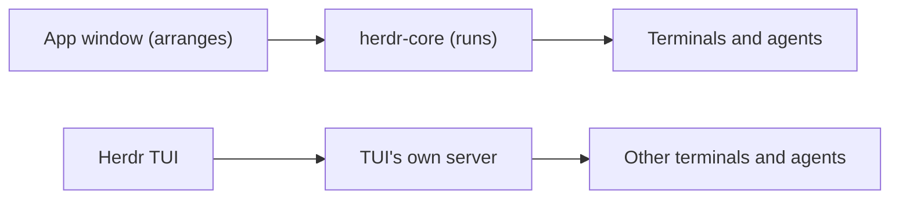
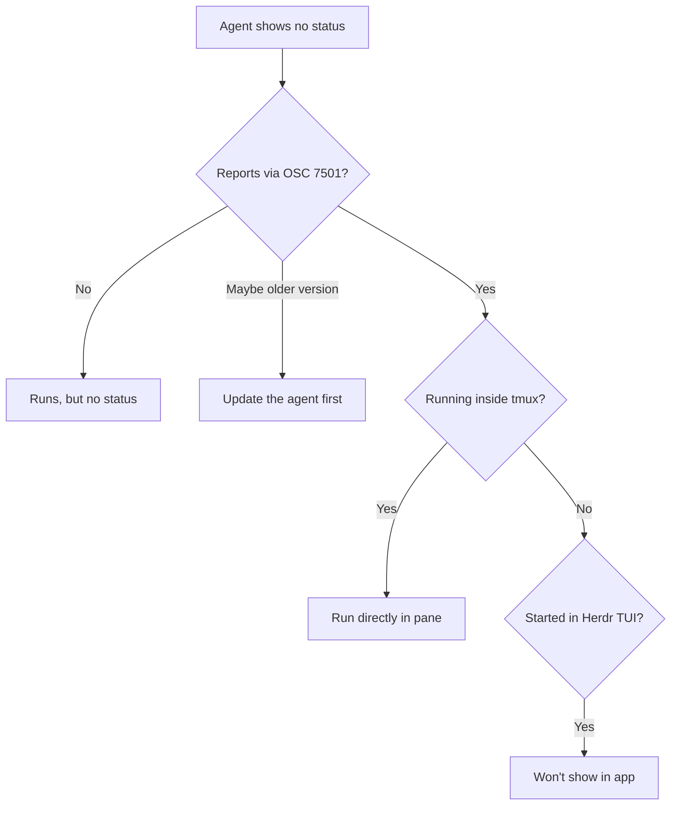
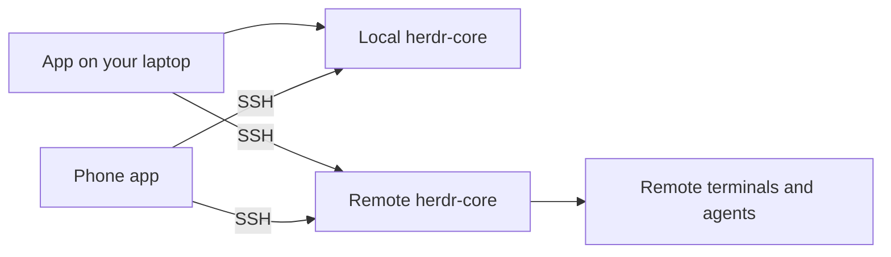
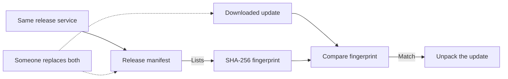

When several AI agents write code in different projects at the same time, the usual sticking point is that you can't tell which one has stopped to wait for your answer. So you end up flipping through the windows one by one.

The Herdr desktop app (the program is called herdr-app) is built for exactly this. According to the official README, it is a desktop app for terminals and coding agents that groups your work into spaces and shows which agents need you. The programs in your terminals keep running after you close the window.

According to the official homepage, it is free, and the app, herdr-core, and Herdr TUI are all open source under the Apache 2.0 license.

> Based on the official docs for herdr-app v0.1.15; the three illustrations are concept diagrams I made. v0.1.15 was released on 2026-11-11 (Taipei time), and on 2026-11-12 I confirmed it was still the current version on releases.herdr.dev and Homebrew. Herdr App has not reached 1.0 yet and changes quickly, so treat the [official README](https://github.com/herdrdev/herdr-app/blob/v0.1.15/README.md) as authoritative for how things work and which keys to press.
{: .prompt-info }

## A few terms first

- **Terminal:** A text window where you type commands. The Terminal app on macOS and PowerShell on Windows are both terminals.
- **Repo:** A project folder managed with git. When this post says "a repo," you can read it as "a project."
- **Agent (coding agent):** An AI that runs in a terminal and reads files, edits code, and runs commands on its own, such as Anthropic's Claude Code or OpenAI's Codex. According to the official site, anything that runs in a terminal can go into Herdr.
- **Space / tab / pane:** The three layers of Herdr App, from largest to smallest. Step 3 has a diagram and details.
- **OSC 7501:** An agreed way for an agent to tell Herdr whether it is busy, done, or waiting for you. Herdr can show a status only for agents that report this way; agents that don't still run, just without a status.
- **SSH:** A way to connect from one computer to another and work on it. Herdr uses SSH to reach your other computers or servers, and the phone app connects over SSH too.
- **Telemetry:** Usage statistics the app sends back to its developers.
- **Mods and layouts:** A mod is a small JavaScript program that runs inside Herdr, such as a panel in a pane. A layout is the arrangement of the whole window, and the built-in ones are Herdr, Terminals, and Herdr 98.

## First, tell them apart: the app, herdr-core, and Herdr TUI

herdr.dev has two programs with very similar names, and this post covers Herdr App. According to the official FAQ and README, they relate like this:



- **Herdr App (herdr-app):** A new, separate program with its own desktop window, built on herdr-core. The window you see only arranges terminals on screen.
- **herdr-core (command: `hc`):** Comes with Herdr App and runs every terminal and agent in the background. The README sums up the split in one line: "The window arranges terminals. The core runs them."
- **Herdr TUI:** The original Herdr. Its whole interface lives in the terminal, and its own background program (a server) runs the agents. The FAQ says it keeps working, and everything for it is at [herdr.dev/tui](https://herdr.dev/tui/).

The app and the TUI **don't share agents**: according to the official FAQ, an agent started in one does not show up in the other. The phone app also works only with herdr-core, not with Herdr TUI. According to the phone app page, Herdr TUI and herdr-core can both be installed on the same computer.

I suggest picking one as your main tool. Because agents aren't shared, running a few in each brings back the old problem of not knowing who is waiting for you. If you want to stay in the terminal, read [herdr Tutorial: Run Multiple AI Agents in One Terminal](/posts/herdr-run-multiple-ai-agents/); if you want a desktop window, or want to check on agents from your phone, read on.

## When it's worth using

- You run two or more agents at once, in different repos or on different tasks, and want one window that shows which one is waiting for you: a good fit.
- You want to close the window and let agents keep working: a good fit. According to the official docs, closing the window doesn't stop the terminals (Step 5). Work on an SSH machine also keeps going while your laptop sleeps (Step 6).
- You only run one agent and your current setup works fine: you don't have to switch (my view).

## Before you start

Per the official FAQ, these computers are supported:

| System | Architecture | Other requirements |
| --- | --- | --- |
| macOS | Apple Silicon (a Mac with an M1 chip or later) | For Intel Macs, see Step 1 |
| Linux | x86_64, arm64 | Must run in a graphical desktop (a desktop session; a server with only a text screen won't work), with a working Vulkan driver (graphics features provided by your graphics card's driver) |
| Windows | x86_64 | Windows 10 1803 or later, plus curl and tar, two tools for downloading and unpacking files; Windows has included both since 1803 |

The agent you want to use should already be installed, such as Claude Code or Codex. Typing `claude` or `codex` in a regular terminal should start it.

According to CHANGELOG 0.1.14, each Codex you start from the + menu runs on its own, so closing one doesn't end the others. This needs Codex 0.156 or newer.

## Step 1: Install

### macOS (Apple Silicon): dmg or Homebrew

Pick one of the two. If you've never used Homebrew, just pick the dmg.

**Use the dmg.** Download [Herdr.dmg](https://releases.herdr.dev/app/Herdr.dmg), double-click to open it, and drag Herdr to the Applications folder.

**Use Homebrew.** Homebrew is a tool for installing software on a Mac with one command. Run this in a terminal:

```bash
brew install --cask herdr-app
```

According to the Homebrew cask data, the app is installed to `/Applications/Herdr.app` and you also get a `herdr-app` command. The cask data also marks the app as updating itself (`auto_updates: true`); see "Automatic updates" below.

> **No installer for Intel Macs.** The README says macOS builds are available for Apple Silicon only, and Intel Mac users can build from source; the official install script also stops on an Intel Mac.
>
> Not sure which kind of Mac you have? Open the Apple menu in the top-left corner and choose About This Mac. If the Chip line starts with Apple M, it's Apple Silicon; if you see a Processor line that says Intel, it's an Intel Mac.
{: .prompt-warning }

### Linux and Windows: download the script and read it before running

For Linux and Windows, the official options are install scripts, and the other route is building from source. An install script is a prepared list of commands that downloads and installs the app when you run it. According to the README, both install scripts download and run code, and you can read them first if you prefer.

**Linux.** The README's command is `curl -fsSL https://releases.herdr.dev/app/install.sh | sh`. The `|` in the middle hands the downloaded content straight to `sh`, which runs it, so you never get a chance to look at it first. I suggest splitting that into two steps, starting with downloading it to a file:

```bash
curl -fsSL https://releases.herdr.dev/app/install.sh -o herdr-app-install.sh
```

Open it in a text editor and read it. Once you understand it and it looks fine, run it:

```bash
sh herdr-app-install.sh
```

If you can't tell what the script does, don't run it yet. I read the comments at the top of the script and its contents. On Linux, it:

- Installs the app to `~/.local/share/herdr-app`, puts the `herdr-app` command in `~/.local/bin`, and adds a launcher and icon.
- Installs herdr-core to `~/.local/bin/herdr-core` (along with `hc`) only if the machine doesn't have it yet; after that, the app keeps it up to date.
- Downloads the release manifest (`latest.json`), checks the download's SHA-256 (a fingerprint computed from the file's contents; if the file changes even slightly, the fingerprint changes) against it, and stops if they don't match.

`~` stands for your user folder (your home folder). PATH is the list of folders the terminal looks in to find commands. If the installer asks, add `~/.local/bin` to PATH, so that typing `herdr-app` in a terminal finds the command.

Running the script again later updates the app. The script supports macOS too (the app goes in `~/Applications/Herdr.app`), but on a Mac I suggest the dmg or Homebrew above.

**Windows.** The official command, run in PowerShell, is `irm https://releases.herdr.dev/app/install.ps1 | iex`, and the download page writes it as `powershell -c "irm https://releases.herdr.dev/app/install.ps1 | iex"`.

This also runs the script right after downloading, so I suggest splitting it into two steps here too. First, download the script to a file in PowerShell:

```powershell
irm https://releases.herdr.dev/app/install.ps1 -OutFile herdr-app-install.ps1
```

Open it in Notepad and read it. If it looks fine, run the copy you just read:

```powershell
Get-Content .\herdr-app-install.ps1 -Raw | iex
```

Like the official command, this line hands the script to `iex` to run, but it runs the file you read, not a new download. Don't run the official line after reading the file, because it downloads the script again, and what runs may not be what you read. If you can't follow the script, hold off on installing.

According to the notes at the top of the script, installing doesn't need administrator rights, and once installed, Herdr appears in the Start menu. The installer adds `%LOCALAPPDATA%\Programs\herdr-app` to your user PATH; open a new terminal window for that to take effect. Running the script again later updates the app.

### After installing: where herdr-core comes from

Most people don't need to do anything about herdr-core. According to the official docs:

- Script install: if the machine doesn't have herdr-core yet, the script installs it; if it already does, the script leaves it alone.
- dmg or Homebrew install: the app sets up herdr-core if you don't have it yet. If the core it finds can't be used, the app also helps you install or update it.
- The app looks for the core in your PATH, `~/.local/bin`, Homebrew, mise, Nix, and cargo. The last four are ways to install developer tools; if you haven't used them, you can ignore them.
- When the app can't reach a running core, it tells you why and how to fix it (CHANGELOG 0.1.14).

## Step 2: Open the app and start an agent from the + in the tab bar

According to the download page, once you open Herdr, start an agent from the **+** in the tab bar, such as Claude Code or Codex. The + menu can also open a plain terminal.

You can also start an agent directly in a pane by typing a command such as `claude`, just as in a regular terminal. If you're used to tmux, note that the official FAQ says to run agents directly in a Herdr pane, not inside tmux; Step 4 explains why.

According to the README, a new tab starts in the folder of the selected terminal (the one your cursor is in). So to have an agent work in a particular repo, first move to that repo's folder in the current terminal, for example:

```bash
cd ~/projects/web-app
```

Then open a new tab. Other things to know:

- The first time you use it on macOS, the system may ask whether herdr-core (or Herdr Core) can access folders such as Documents, your local network, or the microphone. According to CHANGELOG 0.1.12 and 0.1.13, that is part of Herdr, so click Allow.
- When an agent exits, its terminal doesn't close with it. The terminal stays open for your next command.
- If an agent fails as soon as it starts, the built-in guide says Herdr shows an error notification with the error code and the last few lines of output, so you can find out why.
- An unnamed space follows its first terminal's folder. If you want a label that stays, name the space or tab; the default keys are `f2` for a tab and `shift-f2` for a space.
- If you're on a version older than 0.1.15 on macOS, the + menu may mark every agent as "not installed" right after login or a restart; 0.1.15 fixes this.

## Step 3: Get to know spaces, tabs, and panes

{: w="1600" h="900" }
_Concept diagram: one machine → space (usually one repo) → tab (one task) → pane (one terminal; each can run Claude Code or Codex)._

According to the official README, the three layers work like this:

- **Space:** a body of work on one computer, usually one repo.
- **Tab:** one task inside a space, including its terminals and how they're split right and down. Closing the last tab in a space closes the space too; according to the built-in guide, Herdr asks you to confirm first.
- **Pane:** one section of a tab, holding a terminal or a mod panel beside the terminals.

The official homepage suggests one space for each repo and one tab for each task. For example, in one repo, one tab could have Claude Code build a login page while another has Codex fix tests. When you want to watch an agent while you run tests yourself, split the tab into two panes; the keys are in the table below.

### Default keyboard shortcuts

I compiled this table from the official default key files ([macOS](https://github.com/herdrdev/herdr-app/blob/v0.1.15/defaults/keys.macos.json), [Linux/Windows](https://github.com/herdrdev/herdr-app/blob/v0.1.15/defaults/keys.json)). If you can't remember them, that's fine: press `cmd-shift-p` (`ctrl-shift-p` on Linux/Windows) to open the command palette. It finds every action by name and also lists its key.

`cmd-shift-p` means pressing Command, Shift, and P together. On a Mac, `cmd` is the ⌘ Command key and `ctrl` is the Control key; they are different keys.

| Action | macOS | Linux/Windows |
| --- | --- | --- |
| New space | `cmd-n` | `ctrl-shift-n` |
| New tab | `cmd-t` | `ctrl-shift-t` |
| Close tab | `cmd-w` | `ctrl-shift-w` |
| Split pane right | `cmd-d` | `ctrl-shift-o` |
| Split pane down | `cmd-shift-d` | `ctrl-shift-e` |
| Close pane | `cmd-shift-w` | `ctrl-shift-x` |
| Zoom current pane | `cmd-shift-enter` | `ctrl-shift-z` |
| Next / previous agent | `cmd-]` / `cmd-[` | `alt-down` / `alt-up` |
| Show / hide sidebar | `cmd-b` | `ctrl-shift-b` |
| Go to tab 1–9 | `cmd-1`…`cmd-9` | `ctrl-1`…`ctrl-9` |
| Go to space 1–9 | `ctrl-1`…`ctrl-9` | `alt-1`…`alt-9` |
| Rename tab / space | `f2` / `shift-f2` | `f2` / `shift-f2` |
| Command palette | `cmd-shift-p` | `ctrl-shift-p` |
| Settings | `cmd-,` | `ctrl-,` |
| Help | `cmd-/` | `ctrl-shift-/` |

### Using it with git worktree

I suggest one space per worktree, or at least a pane of its own, so each agent edits files only in its own directory. A worktree is a separate working directory you give each agent; see [git worktree for AI Agents: Run Two Agents in One Repo](/posts/git-worktree-parallel-ai-agents/) for how.

The app can also manage worktrees itself. According to the built-in guide:

- The space menu and the + menu have New worktree, Open worktree (open an existing one), and Remove worktree.
- A new worktree goes in `~/.herdr/worktrees/<repo name>/<branch name>` on that machine.
- The Spaces sidebar lists the spaces for those worktrees under the original repo's space.

## Step 4: Check the agents sidebar to find the one waiting for you

{: w="1600" h="900" }
_Concept diagram: what the four states mean and how this site suggests handling them; a worker without a pane opens in peek over your current tab when you click it. The colors are this site's illustration colors, not the app's interface colors._

According to the README, the agents sidebar brings the agents from all your spaces into one list, including programs started by another agent (the docs call them workers). Agents that report status show one of the four states below. The right-hand column is my suggestion; in short, handle Blocked first, then Done.

| State | Official meaning (plain English) | What this site suggests you do |
| --- | --- | --- |
| Working | Still busy | Leave it alone and let it work |
| Blocked | Waiting for you | Handle it first: open it, see what it needs, then answer |
| Done | Finished while you were looking elsewhere | Check the result and what it changed |
| Idle | Not working, or finished and you've already looked | Give it the next task |

- Spaces and tabs show a status too: the most urgent one among their agents, in the order blocked > done > working > idle. So if a space shows blocked, at least one agent in it is waiting for you.
- Done turns into Idle once you've looked.
- Click an agent to jump to it. A worker without a pane opens in **peek**, a temporary preview that covers your current tab. If you want it beside your other work, keep it as a tab.
- You can also jump to the next or previous agent with keys; see the table in Step 3.
- Herdr gives each terminal an address (a short code): `t7` is a terminal on the same computer, and `vps/t7` is one on another computer named vps. When terminal text contains the address of a running terminal, Ctrl-click it (Cmd-click on macOS) to peek at it.

According to the built-in guide, when an agent needs you or finishes while you aren't looking, Herdr plays a sound, and when you aren't looking it also shows a clickable notification (a toast). Sounds are set under `sounds` in `settings.json`, and you can preview them in Settings > Alerts.

### When no status shows up

I would work through these three checks from the official FAQ, in order:



- **Reporting:** According to the herdr-core page, herdr-core doesn't read the text on screen and has no built-in list of agents, so it doesn't guess. Older agent versions may not report yet, so update the agent first.
- **tmux:** If the agent runs inside tmux started within Herdr, its status can't reach Herdr. If you've never used tmux, skip this one.
- **Herdr TUI:** An agent started in the TUI lives in the TUI's own server.

## Step 5: Closing the window doesn't stop agents

According to the README and the official FAQ:

| What you did | What happens to terminals and agents |
| --- | --- |
| Close the app window | They keep running in herdr-core |
| Quit the app (`cmd-q` on macOS) or update it | They keep running; nothing changes |
| Close a pane or tab | The terminals in it end |
| Reboot, log out, or herdr-core stops or crashes | The programs stop too |

After a reboot or the core stopping, kept panes come back with the same terminal address. Each pane opens a fresh shell (the program in a terminal that waits for your commands) in its last folder.

But the original command is not run again, and Herdr doesn't restart the agent or resume its work in progress. According to the FAQ, you just start the agent again yourself and carry on.

Also, a terminal that exits on its own or is killed is closed, not restarted.

> **Mac users who just upgraded from an older version:** According to CHANGELOG 0.1.15, terminals opened before herdr-core 0.1.20 may still end when Herdr quits. Once the core is 0.1.20 or newer (Settings > Updates shows it), close and reopen those terminals, or reboot once.
{: .prompt-tip }

## Step 6 (optional): Add an SSH machine and check in from your phone



According to the official homepage and the phone app page, your computer and phone both talk straight to herdr-core on each machine over SSH. You can also use Tailscale (a service that links your own devices into a private network). There is no Herdr account and no official server in between, and what's in your terminals never passes through Herdr.

### Add another machine

This step is for people who have another computer or a cloud server and can already reach it over SSH. If you don't, skip it.

According to the README, add an SSH machine from Settings → Machines or the sidebar's Add machine action. You can pick a host from your SSH config, or type how SSH reaches it. Spaces on that machine then run their terminals there, not on your computer.

- That machine needs herdr-core too. According to CHANGELOG 0.1.14, if the connection needs a password, a new host key (the key SSH uses to confirm a host's identity), or herdr-core installed there, Settings > Add machine tells you what to run.
- As long as the remote machine and its core stay up, remote work keeps running when your local window closes or your laptop sleeps.

### Check in from your phone

There is an official phone app for iPhone, iPad, and Android, available from the [App Store](https://apps.apple.com/app/id6828898364) and [Google Play](https://play.google.com/store/apps/details?id=dev.herdr.app). According to the [phone app page](https://herdr.dev/mobile/):

- The Inbox is sorted by urgency: needs you, done, working, idle.
- Opening an agent gives you a real terminal you can type in. You can also use compose (the message box) to paste text, screenshots, or photos, or to dictate by voice.
- When you're away from home, you can reach your machines over Tailscale or any VPN. The official site says Tailscale SSH needs no separate key setup.
- On a machine that has only herdr-core, your phone still shows terminals and agents. You see spaces only when that machine also runs Herdr App.
- To see what it looks like first, tap Try the demo when the app opens.
- The official site says the phone app has no sign-in, no ads, no tracking, and no analytics.

## Step 7 (optional): Customize

**Settings changes preferences.** Press `cmd-,` (`ctrl-,` on Linux/Windows) to change fonts, colors, sounds, and other preferences.

**Everything lives in `~/.config/herdr-app`.** The app keeps its settings, keys, layouts, mods, and the generated agent guide in this folder inside your user folder, on macOS and Windows too.

A folder whose name starts with `.`, such as `.config`, is hidden by default; in the macOS Finder, press `cmd-shift-.` to show hidden files. (Advanced: if you set the `XDG_CONFIG_HOME` or `HERDR_APP_HOME` environment variable, the location changes accordingly.)

According to the security doc, spaces, tabs, and splits are stored in each machine's core, not in this folder. So removing this folder doesn't stop the core or erase its data.

The reverse also matters. If you remove the app with Homebrew and add `--zap` (`brew uninstall --zap herdr-app`), the cask data says this folder goes to the Trash too, and your settings and mods go with it.

**Change shortcuts in `keys.json`.** You can change any key in `keys.json`, for example:

```json
{"global": {"ctrl-shift-t": "tab.new"}}
```

This line makes `ctrl-shift-t` open a new tab (`tab.new`) from anywhere. Save the file and the window reloads it; a broken edit keeps the last good version and writes the error to `keys.error`. Two things to watch:

- An untouched keys file gets the current default shortcuts on upgrade. Once you've edited it (even just whitespace), the whole file is yours, and new default shortcuts must be added by hand.
- Plain ctrl+letter combinations (such as ctrl+c and ctrl+d) go to the program in the terminal by default, so don't bind them to Herdr actions.

**Duplicate built-in layouts and mods before changing them.** To change the structure or code, edit your copy. Herdr leaves your copies alone, and updates the shipped ones to the latest version every time it starts.

**Let an agent make changes through `AGENTS.md`.** According to the official homepage, Herdr keeps its layout, sidebar, tabs, keys, and themes as plain files in `~/.config/herdr-app`. The `AGENTS.md` in there explains them to your agent.

The download page suggests telling your agent to read this guide first, then asking in everyday words for what you want, such as a board, a timer on each tab, or another look.

**Don't edit `AGENTS.md` yourself.** The app rewrites it on every start, so your changes get overwritten.

**Most users won't need `herdr-app --skill`.** It prints the agent guide for driving the window.

The official split: use herdr-core for running and coordinating programs, and use the app to change what you see. herdr-core's own manual is `hc --skill`.

**Escape hatch `ctrl-alt-shift-escape`.** If a layout or key edit goes wrong and the window is a mess, press Ctrl, Alt (Option on a Mac keyboard), Shift, and Esc together.

According to the built-in guide, this combo always works and can't be changed. It moves the current layout and `keys.json` aside (renamed to `*.reset-<time>`) and returns to the default `main` layout.

## Privacy, updates, and mod safety

{: w="1600" h="900" }
_Concept diagram: turn off telemetry in Settings → Privacy or by adding `"telemetry": false` to settings.json; check updates in Settings → Updates; mods have full permissions, so read them before installing._

### Telemetry is on by default: three ways to turn it off

According to the official [Security and privacy](https://github.com/herdrdev/herdr-app/blob/v0.1.15/docs/security.md) doc, usage telemetry is **on by default**. Release builds send a small daily report to `https://telemetry.herdr.dev/v1/report` with a random install ID.

- What is sent: app and core versions, OS and architecture, the range your usage time and counts fall into (not exact numbers), known agent names, built-in layout names, mod count, app command names, and fixed event counts. Custom layout names are sent as `custom`, and custom mod names are not sent.
- What is not sent: terminal text, prompts, file contents, folder paths, and free-text names.
- According to the [privacy page](https://herdr.dev/privacy/), usage reports are kept for 3 months, IP addresses are not stored, and data is not sold or shared.

Three ways to turn it off:

1. Turn it off in **Settings → Privacy**. The same page also lets you inspect the report.
2. Add the field `"telemetry": false` to your **existing** `settings.json` in `~/.config/herdr-app`. The official example is `{"telemetry": false}`; if the file already has other settings, add the field inside the outermost braces, separated from the other fields by a comma, rather than replacing the whole file.
3. **For one run only:** when you start the app from a terminal, set the environment variable `DO_NOT_TRACK=1` or `HERDR_TELEMETRY=0`, as in the line below.

```bash
DO_NOT_TRACK=1 herdr-app
```

Collection also stops automatically in CI (servers that build and test code for you). Before you turn it off, know two things:

- Turning it off deletes the local install ID and unsent reports, but **reports already sent can't be recalled**.
- Turning telemetry off does **not** stop update checks, network requests made by mods, or feedback you choose to send. Feedback is drafted for you to review and send, not sent silently.

### Automatic updates: download in the background, switch on restart

According to the README and the built-in guide:

- Installed releases check for updates in the background and download the new app beside the running one. It takes over when you quit and reopen the app, or choose the update action. Your terminals keep running in the core.
- The first start after an app update also updates herdr-core to the latest release of the same generation, keeping terminals running.
- If the app crashes or is killed while a verified newer update is waiting, the next launch installs it before opening a window.
- **Settings → Updates** shows what is available and keeps the app and core update actions together.
- According to the built-in guide, What's New (the release notes) opens on its own after an update only for a few highlighted releases, and other releases just show a small Updated mark for that launch. To read what changed, use the What's new button in Settings → Updates, or open it from the command palette.
- Builds from source don't update themselves.

### Update verification: SHA-256 only

According to the official security doc, before unpacking an update the app checks that its SHA-256 fingerprint matches the one in the release manifest. But the fingerprint and the manifest come from the same service:



> So this check only catches a file damaged during download; it is not an independent signature on the manifest. The app does not verify a separate digital signature on update manifests either, so if someone could replace both the update and the manifest, this check would not stop them.
>
> The security doc also says that when the release pipeline has no signing credentials configured, packages can be unsigned or have only an ad hoc signature (a signature not tied to a developer's identity). Apple notarization (Apple's security check of an app) is tested separately and is not required for publishing a release.
>
> In the doc's own words: "Do not assume every download is notarized or signed."
{: .prompt-warning }

### Mods and other people's layouts: read before you install

> According to the official security doc, a mod is trusted JavaScript running inside Herdr. It has no sandbox (a way of isolating a program to limit what it can touch) and full permissions: it can run programs as you, connect to any URL, read your files, and run programs on machines you've connected.
>
> The doc states plainly that a mod "is not a security boundary," meaning Herdr does not block anything a mod does, and there is no permission prompt for each program or network request.
>
> Read someone else's mod before installing it, and treat it like a shell script you would run yourself. Layouts can load mods too, so when you install someone else's layout, check the mods it references as well.
{: .prompt-warning }

When you look for other people's layouts or mods in the [gallery](https://herdr.dev/gallery), the built-in guide tells the agent to read the recipe and every file first. The recipe is the `RECIPE.md` that comes with each entry and explains how it was made. Before adding anything, the agent must tell you whether the mod:

- Reaches the network.
- Runs programs (`exec`, `hc`).
- Reads files outside its own folder.

Two more points about the config folder:

- Mods may store sensitive data in `~/.config/herdr-app`, and Herdr does not encrypt this folder.
- The app exposes a local control socket (a connection point local programs use to talk to each other) in this folder so agents can inspect and drive the window. The doc warns: treat access to this folder as access to the window and its commands.

## Next steps

- To manage agents in the terminal instead: [herdr Tutorial: Run Multiple AI Agents in One Terminal](/posts/herdr-run-multiple-ai-agents/) (Herdr TUI, a different program from the app).
- To give each agent its own working directory: [git worktree for AI Agents: Run Two Agents in One Repo](/posts/git-worktree-parallel-ai-agents/).

Further reading: [README](https://github.com/herdrdev/herdr-app/blob/v0.1.15/README.md), [Security and privacy](https://github.com/herdrdev/herdr-app/blob/v0.1.15/docs/security.md), [Built-in guide AGENTS.md](https://github.com/herdrdev/herdr-app/blob/v0.1.15/defaults/AGENTS.md), [macOS default keys](https://github.com/herdrdev/herdr-app/blob/v0.1.15/defaults/keys.macos.json), [Linux/Windows default keys](https://github.com/herdrdev/herdr-app/blob/v0.1.15/defaults/keys.json), [CHANGELOG](https://github.com/herdrdev/herdr-app/blob/v0.1.15/CHANGELOG.md), [Install script](https://github.com/herdrdev/herdr-app/blob/v0.1.15/distribution/install.sh), [herdr.dev](https://herdr.dev/), [Download page](https://herdr.dev/download/), [Phone app](https://herdr.dev/mobile/), [herdr-core](https://herdr.dev/core/), [Privacy](https://herdr.dev/privacy/), [Herdr TUI](https://herdr.dev/tui/), [Homebrew cask](https://formulae.brew.sh/cask/herdr-app).
