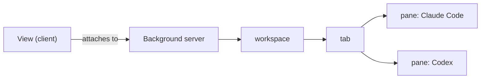
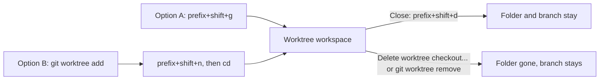
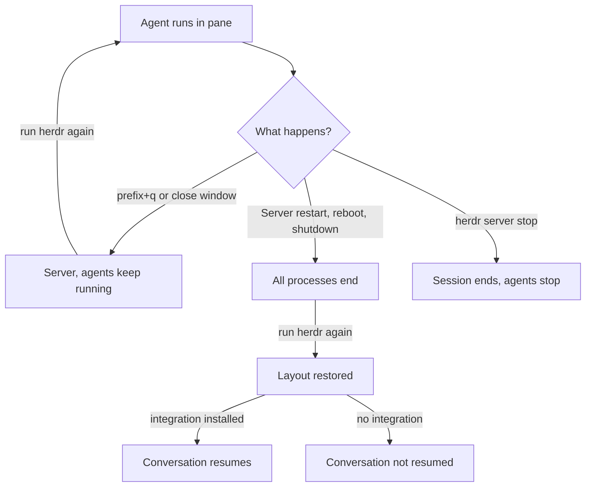

If you followed [git worktree for AI Agents: Run Two Agents in One Repo](/posts/git-worktree-parallel-ai-agents/) and now run two or three coding agents at once, the next snag is usually telling which one waits for you to click Allow and which one is still working. You have to flip through the windows one by one. And if you close the terminal or your SSH connection drops, half-finished work may stop with it.

herdr is a tool that manages workspaces and split views in your terminal; the official docs also call it a terminal workspace manager. It puts each agent in its own split view (a pane) and recognizes which coding agent runs there. A colored dot in the sidebar then shows whether the agent is working, waiting for you, or done.

Close the view you are looking at, and the work in the background keeps going. The official description is "the runtime your coding agents live on."

herdr does not wrap or replace your agents. The README says "herdr doesn't wrap or replace them; it owns their terminals." It manages the terminals, and the agent is still the one you already use.

This post covers the terminal Herdr TUI ([herdr.dev/tui](https://herdr.dev/tui)). The Herdr desktop App ([herdr-app](https://github.com/herdrdev/herdr-app)) that the herdr.dev homepage now promotes is a separate program, and an agent started in one does not show up in the other. For the desktop app, see [Herdr Desktop App: Manage AI Agents With Spaces and Tabs](/posts/herdr-app-desktop-manage-ai-agents/).

The post focuses on macOS and Linux and uses Claude Code and Codex as examples; for the other supported agents, see [Agents](https://herdr.dev/tui/docs/0.9.5/agents/). Native Windows support is available, with known limitations; see [Windows support](https://herdr.dev/tui/docs/0.9.5/windows-beta/).

> Based on the official docs for herdr v0.9.5, released on 2026-10-15; on 2026-11-12 I confirmed it was still the latest stable release. herdr is still 0.x and changes quickly, so treat the commands and shortcuts in the [official docs](https://herdr.dev/tui/docs/0.9.5/) as authoritative.
{: .prompt-info }

## A few terms first

- **Terminal:** The text window where you type commands.
- **Detach / reattach:** Leave the view for a while, then come back to the same session.
- **Prefix key:** Press `ctrl+b`, release it, then press the next key. The official [Keyboard](https://herdr.dev/tui/docs/0.9.5/keyboard/) example is "`prefix+c` means: press `ctrl+b`, release, then press `c`." So `prefix+shift+g` means release `ctrl+b`, then press `shift+g`. On a Mac this is the Control key, not Command; if you have used tmux, it will feel familiar.
- **Package manager:** A program such as Homebrew (`brew`) or mise that installs, upgrades, and removes tools for you.
- **Coding agent, worktree, and branch:** Same sense as in the worktree post: an agent edits files and runs commands on its own. A worktree is a separate working directory in the same repo. A branch is a separate line of changes in git, and each working directory sits on its own branch.

herdr itself has these layers:



- **Background server / client:** herdr runs terminals in a background server, and the view you see is only a client attached to it.
- **Workspace:** One project or task. The official guidance is "one workspace per repo, task, or investigation."
- **Tab:** A layout inside a workspace.
- **Pane:** A real terminal split. The official wording is "A pane is a real terminal."

For commands, shortcuts, state definitions, and what happens when you disconnect, I follow the official docs and link to them. "Install with brew or mise," "one workspace per worktree," and "deal with blocked first" are my own suggestions, and I mark them as such.

## When it is worth using

I suggest herdr if you run two or more agents at once, or you often step away or work on a remote machine over SSH. If you only run one agent, or you already have a setup that works, I do not think you need to switch.

## Before you start

- A Mac or Linux computer and a terminal. On macOS, the built-in Terminal app is fine.
- Either Homebrew or mise. If you have used neither, on macOS you can install Homebrew first by following the instructions on the [Homebrew website](https://brew.sh/).
- A project folder managed with git that has at least one commit. You will need it in Step 3 to create a worktree.
- Claude Code or Codex already installed and signed in: typing `claude` or `codex` in a regular terminal should start it.

Once herdr is installed, each round of work is the five steps in the figure below, which match Steps 2 through 6.

{: w="1600" h="900" }
_Concept diagram: The five steps in one loop are Start herdr, Add a worktree, Run agents, Find the stuck one, and Detach and return. The prefix means press ctrl+b, release, then press the next key._

## Step 1: Install herdr

{: w="1600" h="900" }
_Concept diagram: The left side is this site's suggestion, installing and upgrading with brew or mise. The right side is the one-liner from the official Install/TUI page; if you use it, download the script, read it, then run it._

If you already use [Homebrew](https://formulae.brew.sh/formula/herdr), I recommend installing with brew:

```bash
brew install herdr
```

If you already use [mise](https://mise.jdx.dev/), I recommend installing with mise:

```bash
mise use -g herdr
```

Both are listed on the official [Install](https://herdr.dev/tui/docs/0.9.5/install/) page. If mise reports `herdr not found in mise tool registry`, the official docs say to update mise and try again. If you installed mise with brew, run:

```bash
brew upgrade mise
```

Otherwise, run:

```bash
mise self-update
```

### The official one-liner: download and read it first

The official Install/TUI page also offers a one-line install command, `curl -fsSL https://herdr.dev/install.sh | sh`. I recommend not pasting it straight into a shell, for two reasons:

- What runs is whatever the server returns at that moment, which you have not read, and a later run may not be the same.
- It installs into `~/.local/bin` and then updates itself with `herdr update`, so it never appears in your package manager's list. That makes it harder to see what you installed, and harder to remove it later. With brew or mise, you can look up the version, and upgrades and uninstalls use the same tool.

That is not a claim that the install script is broken. It comes from my habit of reading first, then running, which I explained in [Agent Skill and MCP Security Risks: 5 Cases, a Checklist](/posts/coding-agent-supply-chain-permission-risks/).

If you do need the official script, download it to a file first:

```bash
curl -fsSL https://herdr.dev/install.sh -o herdr-install.sh
```

Open it in a text editor and read it. You can also read it with less in the terminal, and press `q` when you are done:

```bash
less herdr-install.sh
```

Once you are satisfied, run:

```bash
sh herdr-install.sh
```

If you cannot tell what the script does, I suggest using brew or mise instead.

### Check the install

After the install, run:

```bash
herdr --version
```

According to the official docs, it prints a version number, such as 0.9.5. If you use a Chinese, Japanese, or Korean input method and the prefix shortcuts do not respond, make sure you are on 0.9.5 or later. The official notes for this release include a fix for that.

### Upgrade with the tool you installed with

The official wording is: "Use `herdr update` only for installs managed by Herdr's own installer. Update Homebrew, mise, and Nix installs through those package managers instead." If you installed with brew, run:

```bash
brew upgrade herdr
```

If you installed with mise, run:

```bash
mise upgrade herdr
```

After a package-manager upgrade, run `herdr` again to reconnect with the new client. The background server and the agents already running are not affected.

To move the server itself to the new version, stop the server and start it again, as the Update section of the Install page describes. Stopping the server stops every running agent (see Step 6). Run these in order:

```bash
herdr server stop
herdr
```

If you do not want herdr contacting herdr.dev in the background, turn off these two checks under `[update]` in the config file; see [Configuration](https://herdr.dev/tui/docs/0.9.5/configuration/). The config file is `~/.config/herdr/config.toml`; create it if it does not exist:

```toml
[update]
version_check = false
manifest_check = false
```

## Step 2: Start herdr in your project folder

In the terminal, move into your project folder, then run `herdr`. For example:

```bash
cd ~/projects/demo-app
herdr
```

According to the [Quick start](https://herdr.dev/tui/docs/0.9.5/quick-start/), this launches or attaches to your default background session. If that session has no workspaces yet, herdr opens one automatically; that is the demo-app entry in the sidebar below. Each worktree you add later gets one more workspace (Step 3).

{: w="1600" h="900" }
_Real screen: herdr opened in the demo-app folder, with a second pane split off by prefix+v. Both panes run a plain shell, not an agent, so the agents list is empty._

You can use herdr entirely with the mouse: click to switch between panes, tabs, workspaces, and agents, drag borders to resize, and right-click to split. The official docs say the mouse covers everything and keyboard shortcuts are optional, so do not worry if you cannot remember the shortcuts below.

## Step 3: Give each working directory its own workspace

I suggest one workspace per worktree, so each agent edits only its own working directory and two agents never change the same file at the same time. This follows the same idea as the worktree post.

For how to merge and delete branches when you are done, and why repos with submodules should not use worktrees, see [git worktree for AI Agents: Run Two Agents in One Repo](/posts/git-worktree-parallel-ai-agents/).

There are two ways to create one; pick either. Both use `git worktree` underneath. When you clean up, keep in mind that closing a workspace and deleting a worktree are different things:



**Option A: Let herdr create it.**

1. In the project's workspace, press `prefix+shift+g`, or pick `New worktree` from the workspace's row in the sidebar. A new worktree dialog opens.
2. The branch field starts with a random name. Press ctrl+c to clear it, then type the branch name you want, for example `login-page`.
3. Press Enter. herdr creates a git worktree and opens it as a new workspace, grouped under the original project. Click its name in the sidebar to switch to it.

This does the same thing as running the following inside the project folder:

```bash
herdr worktree create --branch login-page
```

{: w="1600" h="900" }
_Real screen: prefix+shift+g adds a worktree. The branch field starts with a random name, so press ctrl+c to clear it before typing; Enter creates it and opens a new workspace._

The default location is `~/.herdr/worktrees/<repo>/<branch>`. To change it, set `[worktrees] directory` in `~/.config/herdr/config.toml`; see [Configuration](https://herdr.dev/tui/docs/0.9.5/configuration/).

**Option B: Follow the worktree post.** Inside the project folder, create the worktree folder with git first, for example:

```bash
git worktree add -b login-page ../demo-app-login-page
```

Then press `prefix+shift+n` in herdr to open a new workspace, and move into the folder you just created:

```bash
cd ../demo-app-login-page
```

According to the official docs, closing the project's row also closes the worktree workspaces grouped under it.

To remove a worktree folder, select that worktree's workspace in the sidebar (the row grouped under the project) and use `Delete worktree checkout...`. It runs `git worktree remove` underneath, and you can also run that yourself. Either way, delete the branch separately.

## Step 4: Start an agent in each pane

Switch to the workspace you want, and type `claude` or `codex` in a pane, just as you would in a regular terminal. According to the Quick start, herdr detects which agent it is automatically, and a new row appears in the agents section of the sidebar.

Official support also includes Cursor Agent CLI, GitHub Copilot CLI, OpenCode, and others; see the full list on [Agents](https://herdr.dev/tui/docs/0.9.5/agents/). If you need another terminal in the same workspace, for example to run tests, split a pane: `prefix+v` to the right, `prefix+minus` downward.

Integrations are optional. You can read states without them; install one if you want the same conversation to resume after herdr's background server restarts. For Claude Code, run:

```bash
herdr integration install claude
```

For Codex, run:

```bash
herdr integration install codex
```

An integration changes the agent's settings; see [Integrations](https://herdr.dev/tui/docs/0.9.5/integrations/):

- Claude Code: it adds a hook script and the matching hook entries in `settings.json`.
- Codex: it adds a hook script, updates `hooks.json`, and turns on `[features] hooks = true` in `config.toml`.

To remove one, run the line below; for Codex, replace `claude` with `codex`. After removal, Codex's `config.toml` is not reverted.

```bash
herdr integration uninstall claude
```

For what a hook is, see my post [Claude Code Hooks: Format, Test, and Flag Sensitive Files](/posts/claude-code-hooks-automate-checks/).

## Step 5: Read the states and find the stuck one

{: w="1600" h="900" }
_Concept diagram: What the five states mean, and what this site suggests you do. Deal with blocked first. A new prompt may first show as idle, and idle does not mean you can click Allow without reading. The colors in the figure are this site's palette, not herdr's own UI colors._

The sidebar marks each agent's state with a colored dot. If an agent in a workspace is blocked, that workspace's own row also uses the blocked color. The official docs define five states; the right-hand column, "what you should do," is my suggestion.

| State | Official meaning, in plain words | What this site suggests you do |
| --- | --- | --- |
| blocked | It is waiting for an answer, an approval, or a decision | Deal with it first: open it, read carefully, then answer |
| working | It is running | Leave it alone and let it work |
| done | It finished, and you have not looked yet | Go read the result and check what changed |
| idle | It finished or is waiting for the next instruction, and you have already looked | You can give it the next task |
| unknown | herdr cannot tell the state | Open it yourself and take a look |

{: w="1600" h="900" }
_Real screen (herdr default theme): yellow dot = working, red = blocked, teal = done, hollow green = idle. The demo “agents” are shell scripts reporting state with herdr pane report-agent, not Claude Code or Codex._

The sidebar only shows dots. To see the state names written out, or to find a stuck agent quickly, press `prefix+g` to open the Go to list.

In the list, press `b` to show only blocked agents; `w`, `i`, and `d` show only working, idle, and done, and `a` shows all. Pick a row with the arrow keys and press Enter to jump there.

{: w="1600" h="900" }
_Real screen: prefix+g opens Go to with each state written out; press b to keep only the blocked row, then Enter to jump there. The demo “agents” are shell scripts reporting state with herdr pane report-agent, not Claude Code or Codex._

### Idle is not approval

The official [Agents](https://herdr.dev/tui/docs/0.9.5/agents/) page says blocked detection is deliberately strict: an unusual new prompt that herdr has not seen before may first show as idle instead of blocked. The same page says "idle status is not authorization to approve an action," which means seeing idle does not make it safe to approve.

So after you jump to the pane, read it carefully before you click Allow. That is the same point I made about human-agent trust and approval fatigue in [OWASP Agentic Top 10 Checklist: Audit Your AI Workflow](/posts/owasp-agentic-top-10-ai-workflow-checklist/).

If a state looks wrong, run the line below to see why herdr classified it that way; see [Agents](https://herdr.dev/tui/docs/0.9.5/agents/):

```bash
herdr agent explain <target>
```

### Notifications are off by default

herdr does not show notifications by default. The `delivery` setting under `[ui.toast]` in the config file decides where they appear:

| `delivery` | Where notifications appear |
| --- | --- |
| `off` (default) | Nowhere; no notifications |
| `herdr` | Inside herdr |
| `system` | Your operating system's notifications; on macOS, herdr tries terminal-notifier first |

To turn on notifications inside herdr, add this to the config file `~/.config/herdr/config.toml`:

```toml
[ui.toast]
delivery = "herdr"
```

Save the file, then run the line below, or press `prefix+shift+r`, to apply it:

```bash
herdr server reload-config
```

If you use `system`, the official docs suggest installing terminal-notifier on macOS first:

```bash
brew install terminal-notifier
```

For the other options, see [Configuration](https://herdr.dev/tui/docs/0.9.5/configuration/) or the [Config reference](https://herdr.dev/tui/docs/0.9.5/config-reference/).

## Step 6: Detach, then come back

To leave, press `prefix+q` (`ctrl+b`, then `q`), or just close the terminal window. According to the Quick start, running `herdr` again later reattaches to the same session. Here is what happens to your agents in each case:



For the restart path, the README says "the original processes do not survive," and that includes agents. Layout in the diagram means the arrangement of workspaces, tabs, and panes, and the integration is the one from Step 4. For the full table of what survives and what does not, see the official [Session state](https://herdr.dev/tui/docs/0.9.5/session-state/) page.

If you work on a remote machine over SSH, run `herdr` on the remote host, so work can continue after the connection drops. You can also point herdr at a host with `--remote`; see [How to work](https://herdr.dev/tui/docs/0.9.5/how-to-work/):

```bash
herdr --remote <host>
```

To shut everything down, run:

```bash
herdr server stop
```

Officially, that ends the session and stops its panes. Note that this stops every agent still running in those panes.

## Keyboard cheatsheet

Press `prefix+?` when you forget a shortcut.

| Keys | Action |
| --- | --- |
| `prefix+v` / `prefix+minus` | Split a pane right / down |
| `prefix+h` / `j` / `k` / `l` | Move to the pane on the left / below / above / right |
| `prefix+c` | New tab (a naming window opens first; press Enter to create it) |
| `prefix+w` | Open workspace navigation to switch workspaces |
| `prefix+shift+n` | New workspace |
| `prefix+shift+g` | New worktree |
| `prefix+shift+d` | Close the selected workspace |
| `prefix+g` | Open Go to (then `b` to show blocked only) |
| `prefix+z` | Zoom the current pane |
| `prefix+x` | Close the current pane |
| `prefix+q` | Detach |
| `prefix+?` | Show every shortcut |

## Next step

There is also an official skill that lets an agent operate herdr. The line below prints content that matches your current version:

```bash
herdr --skill
```

I recommend reading any third-party skill before you install it; [Agent Skill and MCP Security Risks: 5 Cases, a Checklist](/posts/coding-agent-supply-chain-permission-risks/) explains why.

Further reading: the [herdr README](https://github.com/herdrdev/herdr), the [v0.9.5 release](https://github.com/herdrdev/herdr/releases/tag/v0.9.5), the [docs home](https://herdr.dev/tui/docs/0.9.5/), [Install](https://herdr.dev/tui/docs/0.9.5/install/), [Quick start](https://herdr.dev/tui/docs/0.9.5/quick-start/), [Concepts](https://herdr.dev/tui/docs/0.9.5/concepts/), [Keyboard](https://herdr.dev/tui/docs/0.9.5/keyboard/), [Agents](https://herdr.dev/tui/docs/0.9.5/agents/), [Integrations](https://herdr.dev/tui/docs/0.9.5/integrations/), [Session state](https://herdr.dev/tui/docs/0.9.5/session-state/), [Configuration](https://herdr.dev/tui/docs/0.9.5/configuration/), [Windows support](https://herdr.dev/tui/docs/0.9.5/windows-beta/), and the [Homebrew formula](https://formulae.brew.sh/formula/herdr).
