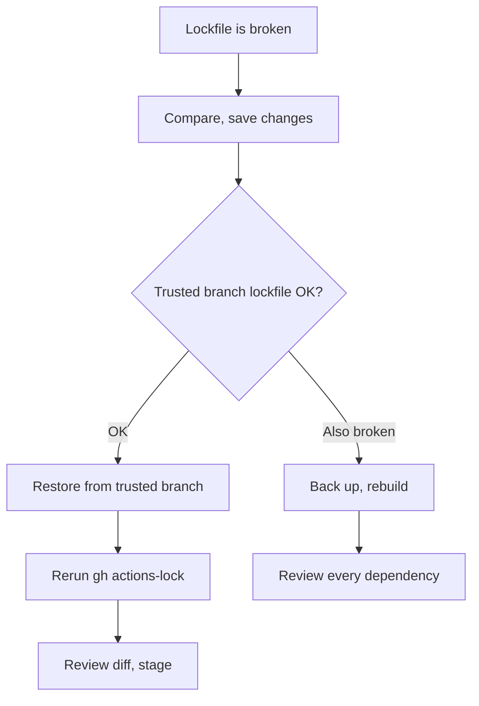
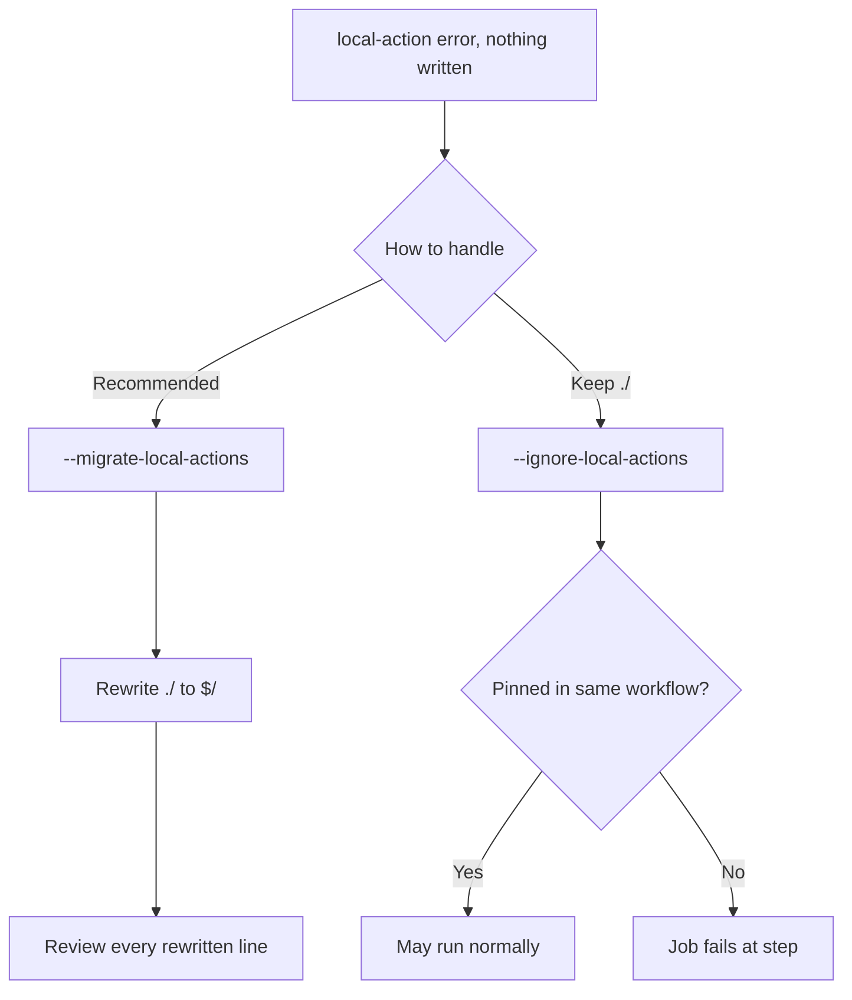
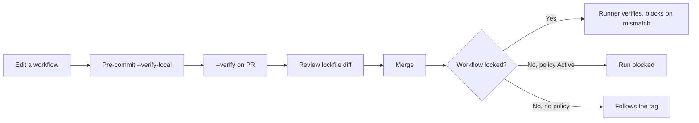

A workflow line such as `uses: actions/checkout@v7` looks like a choice of version 7. In practice, it runs the commit the `v7` tag points to right now. Move that upstream tag, and the code can change without a single edit to your workflow.

GitHub introduced workflow lockfiles on 2026-10-28. `gh actions-lock` resolves supported actions to exact commits and records them in `.github/workflows/actions.lock`. Onboarded workflows then run what those records say.

You keep readable version names, and the code that actually runs becomes part of review. Generating the lockfile, however, does not perform that security review for you.

> The steps follow GitHub's official material, checked on 2026-11-13. Sources: the [GA announcement](https://github.blog/changelog/2026-10-28-github-actions-workflow-lockfiles-are-generally-available/), [Locking action dependencies in a repository's workflows](https://docs.github.com/en/actions/how-tos/secure-your-work/lock-workflow-dependencies), [Workflow dependency lockfiles](https://docs.github.com/en/actions/concepts/security/workflow-dependency-lockfiles), and the [gh-actions-lock v0.4.1 README](https://github.com/github/gh-actions-lock/blob/v0.4.1/README.md) and [troubleshooting guide](https://github.com/github/gh-actions-lock/blob/v0.4.1/docs/troubleshooting.md). The tool keeps changing, so check commands and options against `gh actions-lock --help` for your installed version.
{: .prompt-info }

This post deals with one supply chain risk: an action someone else wrote gets swapped out. In [OWASP Agentic Top 10 Checklist: Audit Your AI Workflow](/posts/owasp-agentic-top-10-ai-workflow-checklist/), I briefly recommended locking third-party actions with a lockfile under ASI04 (supply chain). Here is the full procedure.

A few terms first:

- **GitHub Actions**: GitHub's built-in automation service. Push code, and it can run tests, builds, and deployments for you.
- **repo** (repository): where a project's code lives on GitHub.
- **workflow**: a YAML file in the repo's `.github/workflows/` folder that says what to automate.
- **action**: a reusable, ready-made step inside a workflow, such as `actions/checkout`, which checks out your code. A workflow picks an action and its version with a `uses:` line.
- **commit and SHA**: a commit is a snapshot of the code at one point in time. A SHA is the commit's unique ID, a long string of letters and digits. Change a single character and the ID changes.
- **tag**: a friendly name for a commit, such as `v3.1.0`. A tag is like a sticker: it can be peeled off and stuck onto a different commit.
- **lockfile**: a file that records exactly which version of each dependency to use. If you have written JavaScript, `package-lock.json` is the same idea.
- **Dependabot**: GitHub's built-in bot. When a dependency has a new version, it opens a PR (a request to merge changes) to update it.
- **gh**: GitHub's official command-line tool (GitHub CLI). `gh actions-lock` is an extension for it.

## Why `@v3` may not be the version you reviewed

`uses: octo-org/deploy-action@v3` does not mean "use version 3." It means "use whatever commit the `v3` sticker is on right now." Anyone authorized to update that tag can move the sticker, and upstream tag protections decide who has that authority.

Normally that is how authors ship releases, so `v3` follows the latest 3.x. But if an author's account is compromised, an attacker can use the same move to stick the tag onto a commit with malicious code. Your workflow did not change by a single line, yet the next run executes someone else's code.

This has really happened: `tj-actions/changed-files` in March 2025 is one example. According to the [GitHub security advisory](https://github.com/advisories/GHSA-mrrh-fwg8-r2c3), attackers retroactively changed several of its version tags to point at the same malicious commit. That code printed CI secrets (tokens, keys, and so on) into the workflow logs.

The advisory gives the affected window as March 14 to 15, 2025, and says over 23,000 repositories used the action. The US agency CISA also issued an [alert](https://www.cisa.gov/news-events/alerts/2025/03/18/supply-chain-compromise-third-party-tj-actionschanged-files-cve-2025-30066-and-reviewdogaction) about the incident (CVE-2025-30066).

The usual defense used to be pinning each action to its full commit SHA. The deploy workflow for my site does exactly that:

```yaml
- uses: actions/checkout@3d3c42e5aac5ba805825da76410c181273ba90b1 # v7.0.1
```
{: .nolineno }

A full SHA avoids following a moved tag, but it does not establish that the commit is safe. It is also hard to read, because you cannot tell the version from the long ID and must rely on the comment at the end of the line. That comment can drift out of sync with the SHA, and every update has to change both.

Workflow lockfiles take a different approach. The workflow keeps a readable version such as `@v7.0.1`, and the SHA lives in the lockfile instead. The [official docs](https://docs.github.com/en/actions/concepts/security/workflow-dependency-lockfiles) put it plainly: for actions already onboarded to the lockfile, the file can pin their SHAs instead of putting a SHA on every line.

I don't take that as a reason to remove existing SHAs first and add the lockfile later. Remove them only after the workflow is onboarded, reviewed, and verified.

## What a workflow lockfile is and how it works

The lockfile is the file `.github/workflows/actions.lock`. It records which commit each action in each workflow resolved to, and GitHub runs what it says.

`gh actions-lock` generates it, and you should not edit it by hand. Each action gets these fields:

- `ref`: the tag or branch the commit was resolved from, such as `v3.1.0`.
- `commit`: the commit it resolved to, which is **the code that will actually run**.
- `owner_id` and `repo_id`: numeric IDs for the source repo. At run time they confirm that the name still belongs to the repo you locked.

The lock covers more than the actions in your own `uses:` lines. According to the [GA announcement](https://github.blog/changelog/2026-10-28-github-actions-workflow-lockfiles-are-generally-available/), the actions that those actions use (transitive dependencies) are locked too.

Once a workflow is added to the lockfile (GitHub calls this "onboarding"; this post calls it "locking"), the [concepts page](https://docs.github.com/en/actions/concepts/security/workflow-dependency-lockfiles) lists three rules at run time:

1. Every action the workflow uses must be in the lockfile.
2. The commit recorded in the lockfile runs, not whatever the tag points to now.
3. That commit must be in the action's own repo and reachable from the recorded tag or branch. A commit that exists only in a fork (someone else's copy of the repo), or that is no longer in that tag's history, is rejected when the workflow runs.

So when a tag moves, the workflow either keeps running the locked version or is blocked outright. It never quietly switches to new code.

{: w="1600" h="900" }
_Diagram: the same `uses: octo-org/deploy-action@v3` line. On the left there is no lockfile, so the run follows the tag. On the right there is a lockfile, so the locked commit runs, and if that commit is no longer in the tag's history, the run is blocked._

Who can use it depends on which source you read:

| Source | Stated availability |
| --- | --- |
| GA announcement | GitHub Enterprise Cloud (including data residency), Team, and Free |
| Setup and policy guides | Availability still labeled Enterprise Cloud |
| [v0.4.1 README](https://github.com/github/gh-actions-lock/blob/v0.4.1/README.md) | The extension supports github.com and GHE.com |

When I checked, the GA announcement and the setup and policy guides did not agree on plans. Go by the features and policy settings your repository actually offers. Above all, do not assume that being able to generate the file means your runs are protected.

## Step 0: Get these ready

- **Install and sign in to GitHub CLI.** Install it from the [GitHub CLI site](https://cli.github.com/), then sign in:

  ```bash
  gh auth login
  ```
  {: .nolineno }

  The extension needs an authenticated `gh`.
- **Have write access to the repo.** The docs say write access is enough to create the lockfile. You do not need admin rights.
- **Save existing changes and use a working branch.** The tool modifies workflows and the lockfile. Check the current state first:

  ```bash
  git status --short
  ```
  {: .nolineno }

  If you want a report first, run this after installing the tool. It only checks and writes nothing:

  ```bash
  gh actions-lock --no-fix
  ```
  {: .nolineno }

- **Turn on Dependabot first.** GitHub recommends letting Dependabot manage your GitHub Actions versions before you create the lockfile. The basic configuration is below. If `.github/dependabot.yml` already exists, merge this update entry into it rather than replacing the entire file:

  ```yaml
  version: 2
  updates:
    - package-ecosystem: "github-actions"
      directory: "/"
      schedule:
        interval: "weekly"
  ```

- **Review every `uses:` line first.** GitHub says to review dependencies before you lock them. Make sure each line points to a current, maintained version, because the lockfile locks what you wrote, and an old version stays old once it is locked.
- **Find out whether you have an action allowlist.** Some organizations only allow specific actions. Locking changes how that list is matched, as Step 3 explains.

## Step 1: Install gh-actions-lock

```bash
gh extension install github/gh-actions-lock
```
{: .nolineno }

This installs the latest release available at installation time, and this post follows the v0.4.1 docs. To stay on that release, add `--pin v0.4.1` when installing:

```bash
gh extension install github/gh-actions-lock --pin v0.4.1
```
{: .nolineno }

`--pin` selects a release tag, not a full commit SHA. It also says nothing about whether the tool is safe, so you still need to verify where it comes from.

An unpinned installation can later be upgraded with:

```bash
gh extension upgrade gh-actions-lock
```
{: .nolineno }

After installing, I read the help once. The README says it is the authoritative list of options:

```bash
gh actions-lock --help
```
{: .nolineno }

## Step 2: Generate the lockfile

From the root of the repo, run:

```bash
gh actions-lock
```
{: .nolineno }

It scans every workflow under `.github/workflows/` and pins each action it can resolve to a commit. The result goes into `.github/workflows/actions.lock`.

GitHub recommends adding workflows one at a time. To lock a single workflow, pass its path:

```bash
gh actions-lock .github/workflows/ci.yml
```
{: .nolineno }

Note that only a run over the whole directory removes entries for workflows you have deleted.

## Step 3: Read the diff before you commit

After the run, I first find which files were modified or added, then look at tracked changes:

```bash
git status --short
git diff -- .github/workflows/
```
{: .nolineno }

The new `actions.lock` is untracked, so **it does not appear in a normal `git diff`**. Open it directly, or stage it and inspect it with:

```bash
git diff --cached
```
{: .nolineno }

There are two main changes to review.

**First, `uses:` lines in your workflows become more specific.** For example, `octo-org/deploy-action@v3` may become `octo-org/deploy-action@v3.1.0`. The tool rewrites a line only when it finds a full version tag that points to the same commit, so the commit does not change and you do not get upgraded to a different release.

To keep `@v3` as written, pass `--no-narrow`.

**Second, a new `actions.lock`.** It opens with a few comment lines saying the file is generated and should not be edited by hand. The rest looks roughly like this (values are made up):

```yaml
version: 'v0.0.3'
workflows:
    '.github/workflows/ci.yml':
        - 'octo-org/deploy-action@v3.1.0'
dependencies:
    'octo-org/deploy-action@v3.1.0':
        ref: 'v3.1.0'
        commit: '<commit SHA>'
        owner_id: 1234567
        repo_id: 7654321
```

`version` is the lockfile format version, not the extension version. `workflows` lists which actions each workflow uses, and `dependencies` records the commit each action resolved to.

When reviewing, I look for two things:

- **A changed `commit`.** The workflow will run different code from now on. GitHub says to review it like any other code change and check what changed upstream.
- **A changed `owner_id` or `repo_id`.** This should be rare. GitHub says to investigate before you merge.

{: w="1600" h="900" }
_Diagram: at the top, the workflow change, where `@v3` becomes `@v3.1.0` and still points to the same commit. At the bottom, the new `actions.lock` and what `ref`, `commit`, and `owner_id` / `repo_id` mean._

**If you use an action allowlist, update it.** The [how-to guide](https://docs.github.com/en/actions/how-tos/secure-your-work/lock-workflow-dependencies) warns that once a workflow is locked, the allowlist is checked against the locked commit SHAs, not tags. Entries pinned to a tag, such as `actions/checkout@v6`, stop matching. There are two fixes:

- Switch the entry to the corresponding full commit SHA.
- Have an administrator use a wildcard. Keep it limited to trusted owners and repositories instead of loosening the whole allowlist to make the error go away.

The list may be set at the repo, organization, or enterprise level. Ask an admin if you are not sure.

Once it all looks right, commit `actions.lock` together with the rewritten workflows. GitHub also recommends adding `.github/workflows/actions.lock` to CODEOWNERS (the file that says who must review which files).

CODEOWNERS alone does not block merges. It only takes effect when branch protection or a ruleset requires code owner approval. Protect the workflows and CODEOWNERS too, or someone can still remove the check or select different actions.

## Step 4: Day-to-day upkeep

Locking is not a one-time job. These habits decide whether it keeps working.

**Rerun it when `uses:` changes.** When you add a workflow, or add or remove actions in an existing one, run this again:

```bash
gh actions-lock
```
{: .nolineno }

**Dependabot updates it for you.** For locked workflows, when Dependabot opens a version update PR, it regenerates the matching lockfile entry in the same PR, with no extra setup. It only does this for locked workflows, though. For workflows that are not locked, it updates the workflow file as usual, and it will not add new workflows to the lockfile for you.

**Have CI check whether the lockfile is stale.** `gh actions-lock --verify` only checks and does not change files. Blocking problems, such as missing required pins or failed verification, make it exit with an error, so it works well as a required PR check.

The gh-actions-lock repository provides a [`verify-lockfile.yml` sample](https://github.com/github/gh-actions-lock/blob/v0.4.1/.github/workflows/verify-lockfile.yml). Below is my adaptation of it. It installs v0.4.1, the release this post follows, and is meant for ordinary PR checks on github.com:


```yaml
# Fails when .github/workflows/actions.lock is out of sync with the
# workflows or a locked pin no longer verifies upstream.
name: verify-lockfile

on:
  pull_request:
  push:
    branches:
      - main

permissions:
  contents: read

jobs:
  verify:
    runs-on: ubuntu-latest
    env:
      GH_TOKEN: ${{ github.token }}
    steps:
      - uses: actions/checkout@v7.0.1
        with:
          persist-credentials: false
      - run: gh extension install github/gh-actions-lock --pin v0.4.1
      - run: gh actions-lock --verify
```
{: file=".github/workflows/verify-lockfile.yml" }


The key parts:

- `on`: checks every PR, and every push to `main`.
- `permissions: contents: read`: read-only access. The check changes nothing.
- `persist-credentials: false`: does not leave the checkout's Git credentials in the Git config afterward. The job still passes a token to the tool through `GH_TOKEN` for its GitHub queries, so the job is not token-free.
- `--pin v0.4.1`: selects an extension release tag so every install matches the version this post follows. This downloaded binary is outside the workflow lockfile, which does not pin its contents.

`gh actions-lock --verify` has three exit codes:

| Exit code | Meaning |
| --- | --- |
| 0 | No blocking errors, **but there may still be warnings** |
| 1 | Blocking findings |
| 2 | The tool itself failed, such as a bad option, an unreadable lockfile, or a rejected token |

A passing check does not establish that every dependency has been reviewed or is safe.

The README notes that after you copy this file into your repo, you should run this once more so the checking workflow is locked too:

```bash
gh actions-lock
```
{: .nolineno }

There is also `--verify-local`. It works offline and only checks that every `uses:` line has a lockfile entry, which makes it handy before a commit. It does not verify where the code came from, so it cannot replace `--verify`.

The tool also cannot fix missing permissions, network failures, or API rate limits for you. Fix the underlying problem and rerun. Do not treat an inconclusive check as a pass.

**GHE.com needs separate token handling.** The v0.4.1 README says a GHE.com tenant's `GITHUB_TOKEN` cannot query public actions on github.com. Locally, sign in to github.com separately; in CI, follow the docs to provide `GH_ACTIONS_LOCK_GITHUB_COM_TOKEN`.

That token only looks up public repositories, so it needs no write access. Do not grant extra permissions to get around rate limits.

**When a tag or branch moves, it depends on the kind of reference.** The table below shows what the extension does when checking and maintaining the lockfile. When a workflow actually runs, the runner verifies the locked records separately.

According to the v0.4.1 troubleshooting guide, `ref-moved` warnings for references such as `main` and `v4` appear only in JSON output and do not make the exit code fail. To inspect them, run:

```bash
gh actions-lock --verify --json
```
{: .nolineno }

| What you wrote | What happens | What to do |
| --- | --- | --- |
| A branch or partial version, such as `main` or `v4` | Keeps the old pin while its ancestry remains verifiable; JSON reports a `ref-moved` warning | Check what changed upstream; to move forward, run `gh actions-lock --relock` |
| A full version tag, such as `v3.1.0` | The tag must point at the locked commit; if it moved, you get an error | Find out why the tag moved, then run `gh actions-lock --relock` or edit the `uses:` line |
| Rewritten history, for example after an upstream force push, so the locked commit is no longer in the history | An error that `--relock` cannot fix | First rule out accidental lockfile edits, then review upstream history and the new commit; run `gh actions-lock --accept-moved` only when you intend to adopt it |

{: w="1600" h="900" }
_Diagram: three ways a reference can move, with the matching command. `--accept-moved` in the third case is for use only after a human check, never in automation._

**What does `--accept-moved` accept?** It says you have reviewed upstream history and trust the new commit. It does not let the old, unverifiable commit keep passing. Rewritten history can come from legitimate maintenance, a supply chain attack, or an accidental lockfile edit, and the tool stops because it cannot tell which.

The option applies only to dependencies your workflow references directly. If the problem sits inside a third-party composite action, upgrade, replace, or stop using that action. The same flag cannot let everything through.

`--relock` changes the commits that run too, so review its diff as well. I would not use either option as a generic "CI failed, add this flag" fix, and the official docs specifically prohibit using `--accept-moved` in automation.

**Do not delete the lockfile.** The README warns that locked references are sticky. Delete the file and regenerate it, and every reference resolves again to whatever it points to now, which means trusting upstream all over again.

If the file is broken, work through it in this order:



Compare your working copy, staged changes, and the trusted version, and save the changes you intend to keep. The restore commands are below. `restore` overwrites the working copy of the lockfile without updating the index, so make sure no uncommitted contents need preserving first:

```bash
git fetch origin
git restore --source=origin/main --worktree -- .github/workflows/actions.lock
gh actions-lock
```

Replace `origin/main` on the second line if your default branch is not `main`. A rebuild resolves every dependency again, so use it only when the trusted branch's lockfile is also broken, never as a routine way to clear errors.

## Step 5: Handle local actions (`./`)

Some workflows use an action from inside the same repo, written like `uses: ./.github/actions/setup`. A `./` path runs whatever files are checked out on the runner at that moment, so the extension cannot lock it or see which actions it uses.

If that local action uses other actions, `gh actions-lock` reports a `local-action` error and writes nothing. You have two options:



**Switch to `$/` (recommended).** Run this:

```bash
gh actions-lock --migrate-local-actions
```
{: .nolineno }

It rewrites `uses: ./…` to `uses: $/…` in your workflows and in the repo's `action.yml` files.

`$/` means "run the repo's own action at the workflow's commit." So the action itself follows the workflow commit and needs no separate lockfile entry, while its remote action dependencies can be recorded.

This is more than a path change. If your workflow checks out a different ref before running the `./` action, `$/` runs the version at the workflow's commit instead. What runs can differ, so review every rewritten line.

**Keep `./`.** Pass `--ignore-local-actions` instead, which downgrades the error to a warning. A local action with only `run:` steps, or whose dependencies are already recorded for **the same workflow**, can still run.

The cost is that if the entry for that workflow is missing, the job fails only when it reaches that step. The error looks like `lockfile missing pin for octo-org/setup-tool@v2.0.0`, and by then the earlier steps have already run.

## Going further: require every workflow to be locked

The steps above make locked workflows run locked versions, but they do not stop someone from adding a new workflow that is not locked. To enforce locking everywhere, use the **Require lockfile** policy ([docs](https://docs.github.com/en/actions/how-tos/administer/enforce-workflow-lockfiles)).

Enterprise, organization, and repo admins can add it as a workflow execution protection in an Actions policy. It has two modes:

| Mode | Behavior |
| --- | --- |
| **Evaluate** | Only records what would be blocked; GitHub Enterprise Cloud only |
| **Active** | Blocks every targeted workflow that is not onboarded, including workflows with only `run:` steps and no `uses:`, even if other workflows in the same repository are onboarded |

Before switching to Active, run the line below in each targeted repo, or check Policy insights while in Evaluate mode:

```bash
gh actions-lock --verify
```
{: .nolineno }

Keep the `--verify` check after the policy is on. `--verify` tells authors their lockfile is stale while the PR is still open, and the policy blocks runs without a valid lockfile only at run time:



If your organization already requires actions to be pinned to a full SHA, that policy and Require lockfile are separate checks, and both must pass. A locked workflow passes both, even with no SHAs in the file.

## What a lockfile does not cover

> Know these limits before you lock:
>
> - **Reusable workflows are not locked.** A reusable workflow is one that other workflows can call, at the job level with `jobs.<job_id>.uses`. It is not in the lockfile, so pin it to a full commit SHA; the actions it uses are covered by the lockfile in its own repo. With the Require lockfile policy on, a run is blocked if the called workflow is not locked in its own repo.
> - **Container images are not locked.** The README says `docker://` steps and a job's `container:` and `services:` are not locked. Docker action images and Dockerfile base images are not locked either. Images without an `@sha256:` digest are flagged as warnings.
> - **It only covers action code.** Inputs, secrets, the runner image, and contents fetched separately by `run:` or installation scripts are out of scope. Locking also does not restrict the action's file, network, or token permissions.
> - **It does not judge safety.** A lockfile only makes sure the version you locked is the one that runs, not that the version is safe. GitHub says to review dependencies before you lock them, because if the locked version is already bad, the lockfile will faithfully keep running it.
> - **Rollbacks go unnoticed.** The README warns that if someone changes a moving reference such as `v4` or `main` in the lockfile back to an older commit in its history, the tool cannot detect it. Have someone review lockfile diffs, or use full version tags.
> - **The extension does not support GitHub Enterprise Server.**
{: .prompt-warning }

## What to do when

| I want to… | Do this |
| --- | --- |
| Lock for the first time | Turn on Dependabot and check `uses:` lines; install the extension and run `gh actions-lock` at the repo root; read the diff before committing |
| Lock just one workflow first | `gh actions-lock .github/workflows/<name>.yml` |
| Keep `@v3` as written | Pass `--no-narrow` |
| Add or change a `uses:` line | Run `gh actions-lock` again |
| Check for a stale lockfile on PRs | Add `verify-lockfile.yml` to run `gh actions-lock --verify`, and make it a required check |
| Handle a `ref-moved` warning | Check upstream changes; to move forward, run `gh actions-lock --relock` |
| Handle a moved full version tag | Find out why first, then `gh actions-lock --relock` or edit `uses:` |
| Handle a locked commit that left upstream history | `--accept-moved` only after a human check, never in automation |
| Use a local action (`./`) | Switch to `$/` with `--migrate-local-actions` |
| Work with an action allowlist | Use the matching full SHA or an administrator-approved, narrowly scoped wildcard |
| Require every workflow to be locked | An admin sets the Require lockfile policy; on Enterprise Cloud, observe with Evaluate first, then switch to Active |
| Fix a broken lockfile | Restore it from git, then run `gh actions-lock`; do not delete and regenerate it |

## Common mistakes and fixes

- **Editing the lockfile by hand:** The extension rejects entries whose `ref` does not match the workflow's reference. Change the workflow instead, then rerun `gh actions-lock`.
- **The allowlist blocks a workflow after locking:** Check whether matching has switched to the locked SHA. Use that full SHA or a limited rule reviewed by an administrator rather than allowing everything.
- **A `local-action` error:** A local action uses other actions. Switch to `$/` with `--migrate-local-actions`, or pass `--ignore-local-actions` and accept the risk of a job failing partway through.
- **A job fails partway with `lockfile missing pin for …`:** A local action kept as `./` uses an action with no lockfile entry. Switching to `$/` is the simplest fix.
- **Dependabot did not add a new workflow:** Dependabot does not lock new workflows. Run `gh actions-lock` yourself.
- **Dependabot updated an action but the lockfile did not change:** Check that the workflow is onboarded, then inspect the PR diff and `--verify` output. File changes alone do not establish whether an update is complete.
- **CI adds `--accept-moved` automatically:** Remove it. That is exactly what the lockfile is meant to stop.
- **Assuming reusable workflows are locked:** They are not. Pin `jobs.<job_id>.uses` to a full SHA separately.
- **Verification passes without showing moved-reference warnings:** Some v0.4.1 `ref-moved` messages appear only in JSON, and warnings do not fail the command. Inspect them with `--verify --json`.
- **Deleting and regenerating the lockfile:** Every reference gets resolved again to what it points to now. Restore it from git instead.

## Wrapping up

Start in this order: turn on Dependabot, run `gh actions-lock`, read the diff before you commit, and let CI watch it with `--verify`. When a tag moves, stop and take a look. Do not let automation press `--accept-moved` for you.

I would lock release workflows first. Following my [npm Trusted Publishing With GitHub Actions: A Setup Guide](/posts/npm-trusted-publishing-github-actions/) removes the long-lived token from your release workflow. But if an action in that workflow is swapped out, it can still ship a bad release.

- [Trusted Publishing Is Not Enough: Lock Down Your npm Release Pipeline](/posts/npm-release-pipeline-lockdown/): approval and review checkpoints for the release pipeline itself.
- [Automating PR Review With GitHub Actions and an AI Agent: This Site as an Example](/posts/github-actions-ai-agent-pr-review/): automated review in the same CI pipeline.
- [OWASP Agentic Top 10 Checklist: Audit Your AI Workflow](/posts/owasp-agentic-top-10-ai-workflow-checklist/): a fuller AI workflow risk check.
