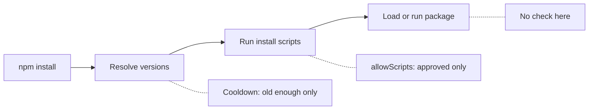
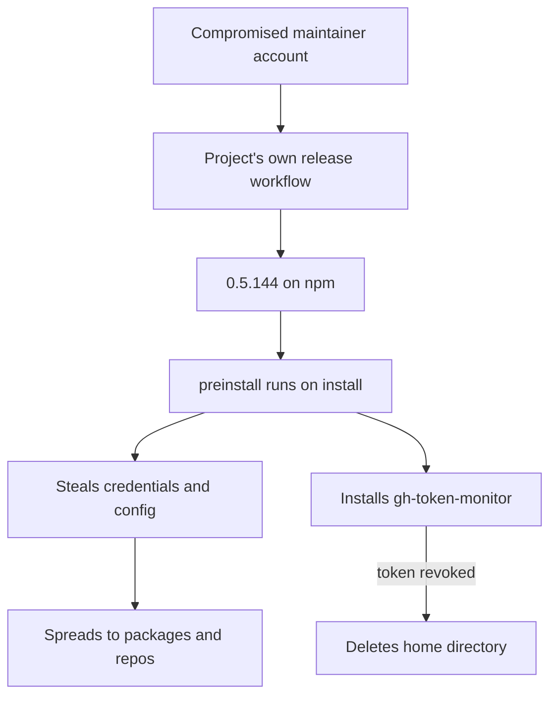

After upgrading to npm 12, `npm install` finishes and the packages are there, but a feature no longer works. A dependency's install script may have been skipped, because npm 12 no longer runs these scripts by default.

This post shows how to find the packages that need review, check each script's purpose and source, then approve the ones you need and commit the list. You can also add a 7-day cooldown to reduce the chance of installing a malicious version as soon as it appears. These two protections do different jobs, and both have limits.

A few terms first:

- **Dependency**: a package your project uses, including the packages it depends on in turn.
- **Install script**: a command that runs automatically during installation, commonly named `preinstall`, `install`, or `postinstall`. It runs with the permissions of the account running npm and can access files and credentials that account can read.
- **`package.json`**: the file that records project settings and dependencies. npm 12 also stores script approvals here.
- **Lockfile** (`package-lock.json`): records resolved dependency versions and sources so later installs can use the same versions.
- **`.npmrc`**: npm's configuration file. This post puts shared team settings in the project root.
- **Token**: a credential that proves identity. Whoever has it can act within the permissions it grants.

Install scripts deserve review because malicious code can run at install time, before your application even loads the package. `tensorlake@0.5.144`, published on October 8, 2026, is one example. According to the [official security advisory](https://github.com/tensorlakeai/tensorlake/security/advisories/GHSA-8g63-53c9-65j2), it stole tokens and credentials in its `preinstall` script.

My [npm Trusted Publishing setup guide](/posts/npm-trusted-publishing-github-actions/) covers the publisher side. This post takes the installer's side: how to manage scripts, how to avoid freshly published versions, and why the tensorlake incident calls for a specific response order.

> The steps follow the official npm CLI 12.2.2 docs, checked on 2026-11-13. The docs are [npm-install-scripts](https://docs.npmjs.com/cli/v12/commands/npm-install-scripts/), [npm-approve-scripts](https://docs.npmjs.com/cli/v12/commands/npm-approve-scripts/), and [config](https://docs.npmjs.com/cli/v12/using-npm/config/), plus GitHub's [npm v12 announcement](https://github.blog/changelog/2026-07-08-npm-install-time-security-and-gat-bypass2fa-deprecation/). For exact commands and defaults, defer to the docs for your npm version.
{: .prompt-info }

## What Changed in npm 12

GitHub's [changelog post](https://github.blog/changelog/2026-07-08-npm-install-time-security-and-gat-bypass2fa-deprecation/) on 2026-07-08 announced npm v12 as generally available and tagged it `latest`. Three changes matter here:

- **Dependency install scripts do not run by default.** This covers `preinstall`, `install`, `postinstall`, and node-gyp builds triggered implicitly by `binding.gyp`. The `prepare` script of dependencies installed from git, local files, or links is also controlled.
- **By default, npm skips the scripts and keeps installing.** When the install finishes, npm lists the packages that are not yet approved so you can review them. So a successful install only means the packages are present. It does not mean their build or download steps have run.
- **Approvals and denials live in `allowScripts` in `package.json`.** Scripts that match an allow rule can run. Explicitly denied ones are skipped and no longer listed for review.

The same release also blocks git dependencies (`allow-git`) and remote URL dependencies (`allow-remote`, such as a direct link to a `.tgz`) by default. Whether a source is allowed and whether a script is allowed are separate checks, so approving a script does not also allow its source. Projects that use these sources need to check those settings separately.

{: w="1600" h="900" }
_With default settings, only scripts that match an approval run. Explicitly denied scripts are skipped, and unreviewed scripts are skipped and listed. Approvals pin versions by default, so an upgrade needs a new review._

The packages most likely to be affected are those that compile or download native code, such as image processing libraries and database drivers. The docs use `canvas` and `sharp` to demonstrate approval, but that does not mean every project needs to approve them. It depends on the versions you use and how you install them.

## Step 1: Check Your npm Version

Run this in your terminal:

```bash
npm -v
```

- **12.x**: unapproved install scripts are already blocked by default. Go to Step 2.
- **11.x at 11.16.0 or later**: according to GitHub's [June preview](https://github.blog/changelog/2026-06-09-upcoming-breaking-changes-for-npm-v12/), these versions warn first so you can prepare to migrate. But a warning is not the same as npm 12's default block. Use this to view the list, then approve or deny each entry:

  ```bash
  npm approve-scripts --allow-scripts-pending
  ```

- **Older versions**: first confirm that your Node.js version meets the target npm version's requirements, then upgrade. To follow this post, you can specify npm 12:

  ```bash
  npm install -g npm@12
  ```

Team members and CI (automated tests and builds) should use the same npm version. An older npm is not guaranteed to enforce the same `allowScripts` the same way. Also check whether any setting overrides the default behavior.

## Step 2: See Which Packages Need Review

In a project folder where dependencies are already installed, run:

```bash
npm install-scripts ls
```

This command lists only packages that have install scripts and are not yet covered by an `allowScripts` rule. It does not change any files. Packages you have explicitly denied do not appear in this list.

In a new project, you can first install once with npm 12 defaults:

```bash
npm install
```

Then read the message at the end of the install and this list.

Next, check each version's scripts. For example, if the list includes `canvas@3.2.0`, run:

```bash
npm view canvas@3.2.0 scripts
```

`npm view` reads data from the currently configured registry, which may differ from the files actually installed on your machine. So in a real review, I also compare these in `node_modules`:

- That version's `package.json`.
- The files the script calls.
- The source the script downloads code from.

Transitive dependencies may sit in nested directories, and the same package can be installed in more than one version. So don't check only the top-level copy.

When deciding, I use these rules of thumb:

| What the script does | What to do |
| --- | --- |
| Compiles or downloads native code | It may truly need the script, but still verify the source, download location, and purpose; "it needs to compile" alone is not a reason to allow it |
| Only sends usage telemetry, or prints ads or thank-you messages | If it doesn't affect a feature you need, you can deny it |
| Downloads from an unknown URL, or contains deliberately obfuscated code | Don't approve it yet; find out why first. If you suspect malware, don't run it just to test |
| Purpose still unclear | Leave it pending |

For a package with an unclear purpose but a trusted source, you can test the related feature while its script stays blocked. If the feature breaks, find out what is missing before deciding whether to approve it. This test only tells you whether the script is needed. It does not prove the package is safe.

## Step 3: Approve or Deny, Rebuild, Then Commit

The example below reuses the package names from the docs. Replace them with packages you have reviewed:

```bash
npm install-scripts approve canvas sharp
npm install-scripts deny telemetry-pkg
```

`telemetry-pkg` is a placeholder for a denied package. `npm approve-scripts` and `npm deny-scripts` do the same thing.

**Approvals pin versions by default.** `approve` writes `package@version`, so the approval covers only the version you reviewed. But the [docs](https://docs.npmjs.com/cli/v12/commands/npm-approve-scripts/) also say that passing a package name applies the approval to every installed version of it. So if your project has two versions installed, review both before approving.

The result in `package.json` looks roughly like this. I put this snippet together from the docs. The versions are illustrative, and the command's actual output is what counts:

```json
{
  "allowScripts": {
    "canvas@3.2.0": true,
    "sharp@0.34.5": true,
    "telemetry-pkg": false
  }
}
```

- `true` allows and `false` denies. Denials are recorded by name, regardless of version, and an existing denial takes precedence over approval.
- `--no-allow-scripts-pin` records only the name and allows future versions too. I generally don't recommend it.
- `approve --all` approves every pending entry at once. Use it only after reviewing each one.

**If the lockfile lacks a `resolved` download URL, the approval gets broader.** npm may then be unable to verify the version, so it approves by name only and warns you. Don't ignore that warning. Fix it in this order:

1. If `omit-lockfile-registry-resolved` is enabled, change that setting first.
2. Restore the lockfile's source information as the [docs](https://docs.npmjs.com/cli/v12/commands/npm-approve-scripts/) describe.
3. Remove the overly broad name-only approval, then approve again.
4. Check the diff and confirm that only version-specific rules remain.

**Approving only updates the list. It does not rerun the scripts that were skipped.** So after approving, run:

```bash
npm rebuild canvas sharp
```

According to the [npm rebuild docs](https://docs.npmjs.com/cli/v12/commands/npm-rebuild/), it runs those packages' lifecycle scripts. Then run your project's tests and build to confirm the features you need work.

I check the diff before committing. Always commit the approval list. If the lockfile also has intended changes, commit those too:

```bash
git diff -- package.json package-lock.json
git add package.json
# If package-lock.json has intended changes, also run git add package-lock.json
git commit -m "chore(deps): approve required install scripts"
```

**After an upgrade, review again.** A new version no longer matches the old approval, so it goes back to pending. Approve it after reviewing the new scripts, and npm updates the version rule. You can preview stale entries first:

```bash
npm install-scripts prune --dry-run
```

Then clean them up:

```bash
npm install-scripts prune
```

`prune` also removes denials that no longer match an installed package. If your team wants to pre-block certain packages, check before pruning.

**To make CI fail on pending entries**, add this to the project's `.npmrc`:

```ini
strict-allow-scripts=true
```

According to the [docs](https://docs.npmjs.com/cli/v12/using-npm/config/#strict-allow-scripts), with this line an unreviewed install script makes the install fail, while explicitly denied scripts are still skipped. After you commit the setting and the list, have CI run `npm ci` and your existing tests with the same npm version. That confirms the project builds from a clean install.

## Step 4: Add a 7-Day Cooldown in .npmrc

A cooldown makes a new version wait seven days before it can be selected. That gives a bad release more time to be noticed, reported, and removed. It acts at a different stage of the install than script review:



A malicious version is not guaranteed to be caught within seven days, though. The cooldown only adds a buffer.

First add this to `.npmrc` in the project root:

```ini
min-release-age=7
```

The unit is **days**. According to the [docs](https://docs.npmjs.com/cli/v12/using-npm/config/#min-release-age), when npm resolves dependencies, it picks versions within the allowed range that were published more than seven days ago. If no version qualifies, resolution fails.

If one of your own packages must be installable as soon as it is published, add an exception for it, for example:

```ini
min-release-age-exclude[]=@your-org/internal-tool
```

Replace the placeholder with the real package. You can also use `@your-org/*` to exclude a whole scope, but a wider exclusion lets more packages skip the cooldown. That's why I start with the individual packages that need it.

Keep two things in mind when you add exceptions:

- **Only packages that match the name are exempt.** Their dependencies still follow the cooldown unless they also match an exclusion.
- **An exclusion does not change where packages come from.** It matches names only and does not configure a registry for you. The docs also warn that if you use a private scope, you should own the same scope on the public npm registry, so nobody else can publish a package with the same name first.

{: w="1600" h="900" }
_The tensorlake incident as an illustration. The organization exclusion in the image is an optional example, not something to copy._

According to the advisory, `tensorlake@0.5.144` was live on npm for only about 1 hour and 40 minutes. It was up from 01:12 to 02:54 UTC on 2026-10-08, which is 09:12 to 10:54 Taipei time. If version resolution applied the seven-day limit, with no exception or override, it never reached seven days before removal, so it would not have been selected.

**But a cooldown does not guarantee protection in every install scenario.** The docs do not say whether versions already pinned in a lockfile are checked again. So I don't treat a cooldown as a malware scanner for existing dependencies.

**It can also block urgent patches.** The docs say that if the cooldown blocks the patched version `npm audit fix` wants to install, npm keeps the vulnerable version, warns, and exits with a failure. In that case, first verify the patched version and its source, then temporarily add that package to the exclusion list. Remove the exception after you finish updating and validating. Lowering the number of days also relaxes the limit, but it affects every other package as well.

**If you also set `before`, check which setting wins.** `before` selects only versions published before a given date. When it is in the same config file as the cooldown, `before` wins. When they come from different config sources, npm's config precedence decides. So watch for CI flags, environment variables, or personal settings that change the limit your project expects.

Finally, make sure `.npmrc` contains no tokens or other secrets before committing it. Then your team and CI share the same policy.

## Step 5: Allow Scripts for Global Installs and npx

Global installs (`npm install -g`) and one-off execution (`npm exec`, `npx`) have no project `package.json` to record approvals. Running `npm install-scripts -g` only returns an `EGLOBAL` error. In these cases, use the `allow-scripts` setting instead.

`your-cli@1.2.3` below is a placeholder tool and version. Replace it with the tool you actually want to install or run. Also replace `canvas,sharp` with the script packages that tool really needs and that you have reviewed:

```bash
# Specify the tool to install; allow only the listed packages' scripts for this install
npm install -g your-cli@1.2.3 --allow-scripts=canvas,sharp

# One-off execution: the command and its arguments go after --
npm exec --allow-scripts=canvas,sharp --package=your-cli@1.2.3 -- your-cli

# Save a persistent list only if you need it
npm config set allow-scripts=canvas,sharp --location=user
```

- `--allow-scripts` names the **packages allowed to run install scripts**. It does not name the tool to install.
- According to the [docs](https://docs.npmjs.com/cli/v12/using-npm/config/#allow-scripts), passing this flag directly to a project's `npm install`, `npm ci`, `npm update`, or `npm rebuild` is an error. In projects, maintain `allowScripts`.
- This list matches package names. Unlike `allowScripts`, it does not pin versions by default. Once saved in your user config it stays in effect, and you can remove it when you no longer need it:

  ```bash
  npm config delete allow-scripts --location=user
  ```

- It controls only install scripts. A tool you then run with `npm exec` or `npx` still runs with your permissions. So a blocked script is no reason to trust an unfamiliar tool.

## After Installing Malware: The Special Response Order in the tensorlake Incident

In this incident, **remove the persistent service before revoking tokens**. The malware installs a persistent `gh-token-monitor` service, and when it detects that the stolen GitHub token was revoked, it deletes the user's home directory. That is why the advisory requires isolating the machine and removing the service before revoking tokens.

Rotating credentials is still a necessary response. The order just has to be right. The procedure below, which I compiled from the advisory, is specific to this incident. Do not apply it as a fixed sequence for every compromise.

According to the [official advisory](https://github.com/tensorlakeai/tensorlake/security/advisories/GHSA-8g63-53c9-65j2), the affected packages are npm's `tensorlake@0.5.144` and the `tensorlake-native-*` packages at that version. The PyPI and crates.io packages and the tensorlake CLI were not affected. Here is how the attack unfolded:



Because the malicious version was published through the project's own release workflow, it carried valid npm provenance. Provenance shows where and how a package was built. It cannot guarantee the code is free of malicious behavior.

The payload collected:

- GitHub, npm, and cloud credentials.
- SSH and GPG keys.
- `.env` files.
- Browser passwords.
- AI tool and MCP configuration.

### Check Whether You Were Affected

I'd start with lockfiles and installation records. There is no need to execute the suspicious package:

- Find the `tensorlake` and `tensorlake-native-*` entries and check whether their `version` is `0.5.144`. Some lockfile formats store names and versions separately, so searching only for the literal `tensorlake@0.5.144` can miss matches.
- `npm list tensorlake` shows only the currently installed version. Even if the package has since been removed or downgraded, that does not prove it was never installed.
- Check historical CI logs, especially for resolution to that version between 01:12 and 02:54 UTC on 2026-10-08. The current lockfile does not replace installation history either.

The advisory says that if a machine or CI runner installed 0.5.144 with install scripts enabled, you should treat it and every credential it could reach as compromised. So finding the version is only the starting point of the investigation. Also establish whether scripts ran and which credentials were reachable.

### Follow the Advisory

1. **Disconnect from the network** to isolate the affected machine.
2. **Stop and remove `gh-token-monitor` before revoking GitHub tokens**:
   - On Linux, run:

     ```bash
     systemctl --user disable --now gh-token-monitor.service
     ```

     Then delete `~/.config/gh-token-monitor/` and `~/.local/bin/gh-token-monitor.sh`.

   - On macOS, run:

     ```bash
     launchctl bootout gui/$(id -u) ~/Library/LaunchAgents/com.user.gh-token-monitor.plist
     ```

     Then delete that plist file.

   - On Windows: delete the scheduled task named `gh-token-monitor` and the `%LOCALAPPDATA%\gh-token-monitor\` folder.
3. **Rotate every reachable credential from a separate clean computer.** Do not enter new credentials on the affected machine.
4. **Check whether your packages and repositories were used to spread the malware.** The advisory lists these indicators:
   - Unexpected releases.
   - Commits with `claude` as the author.
   - A `dependabot/github_actions/format/setup-formatter` branch.

   Still compare the content and logs before drawing conclusions.
5. **Rebuild the machine from a trusted image.**

{: w="1600" h="900" }
_This is the special order from the tensorlake advisory. For other incidents, follow that incident's advisory and response guidance._

**Fix your project's dependency version too.** The advisory lists `0.5.143` and earlier as unaffected by this incident. When restoring the environment, remove the malicious version, update the lockfile, and confirm later installs cannot select `0.5.144` again. Downgrading or deleting `node_modules` cannot recall leaked credentials, and it does not replace the rebuild and investigation above.

## What These Settings Do Not Protect

> - **Script approval is not a sandbox.** Approved scripts still run with the npm account's permissions. File and network access are not automatically restricted.
> - **Loading packages and running tools still carry risk.** Malicious code can run through `require`, `import`, or direct tool execution.
> - **Pinning only narrows approval.** If the approved version is malicious, pinning it does not make it safe.
> - **A cooldown does not replace review and patching.** A malicious version that goes undetected for more than seven days can still be selected. Urgent patches may need a controlled exception.
> - **Check workspaces separately.** The docs say `npm install-scripts` is unaware of workspaces. So do not assume that adding `-w` manages a separate policy for each workspace.
> - **Other settings can override the policy.** `--ignore-scripts` prevents even approved scripts from running. `--dangerously-allow-all-scripts` bypasses approvals and denials, so do not make it your routine fix.
{: .prompt-warning }

## Common Situations and What to Do

| Situation | Action |
| --- | --- |
| Installation succeeds but a feature is broken | Check `npm install-scripts ls` for a skipped build step the feature needs |
| A feature still fails after approval | Confirm you ran `npm rebuild <package>`, then check `ignore-scripts` and build logs |
| Several versions of one package are installed | Review each; approving by name matches all installed versions |
| An upgrade PR fails CI because scripts need review | Review the new scripts, reapprove, and commit the list changes |
| A previously denied package now needs approval | Remove the denial, then review and approve; `approve --all` will not override `false` |
| Approval warns that it cannot pin a version | Check lockfile `resolved` data, repair it, then reapprove and confirm only version-specific rules remain |
| The cooldown blocks an urgent patch | Verify the source, exempt only that package temporarily, and remove the exception after validation |
| A global or one-off tool needs install scripts | Specify the tool and version, then list approved script packages with `--allow-scripts` |

Start with your existing project's review list. Restore the scripts you need after review, then commit the list and `.npmrc` so your team and CI share them. Whenever you upgrade a dependency, review the new version's scripts too.

## Further Reading

- [npm Trusted Publishing setup guide](/posts/npm-trusted-publishing-github-actions/): removing long-lived publishing tokens.
- [Trusted Publishing Is Not Enough: Lock Down Your npm Release Pipeline](/posts/npm-release-pipeline-lockdown/): adding review checkpoints to the release pipeline.
- [Third-Party Skills and MCP Servers: The New Attack Surface in Your Coding Agent](/posts/coding-agent-supply-chain-permission-risks/): related AI tool and MCP risks.
- [OWASP Agentic Top 10 checklist](/posts/owasp-agentic-top-10-ai-workflow-checklist/): a broader workflow review.
