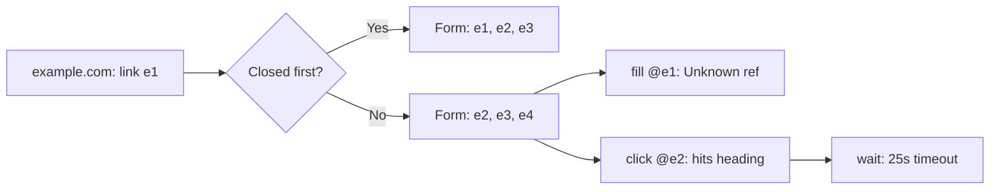
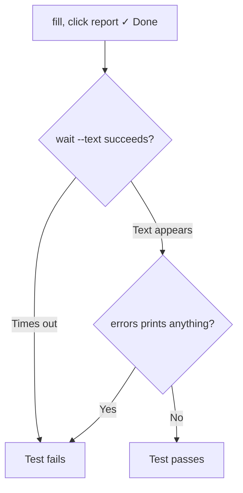
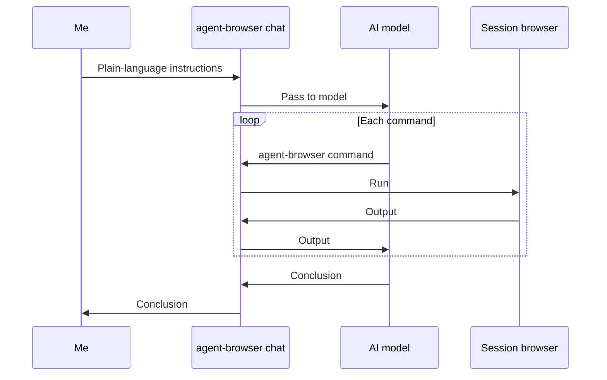

When a coding agent changes a web page and only reads the code, it can't see whether the page reacts when someone clicks the button. The code can look fine while the page is still broken.

[agent-browser](https://github.com/vercel-labs/agent-browser) is a command-line tool from Vercel Labs, written in Rust. An AI uses it to drive a browser one command at a time: open a page, list the buttons and fields on it, click one, and read the result. Coding agents can already run terminal commands, so an agent can click through the page before it reports "done."

This post tests it on a small local newsletter form and on a copy I broke on purpose. Then it hands the check to an AI and limits which domains the AI can visit and which actions it can take. The source of both demo pages is in the post, so you can repeat every step.

> The official material I checked is the [README](https://github.com/vercel-labs/agent-browser/tree/v0.43.0) at the agent-browser v0.43.0 tag, plus four official docs pages: [Installation](https://agent-browser.dev/installation), [Quick Start](https://agent-browser.dev/quick-start), [Snapshots](https://agent-browser.dev/snapshots), and [Security](https://agent-browser.dev/security). The docs website may already describe a newer version.
>
> I ran the test on 2026-11-19 (Taipei time) on a Debian 13 (x86_64) machine. I used agent-browser 0.43.0 and the Chrome for Testing 158.0.8127.36 build it downloaded. That day, 0.43.0 was the release GitHub marked as Latest, published on 2026-11-13 Taipei time. GitHub lists 10 releases from v0.39.1 (2026-10-14 Taipei time) through 0.43.0, so check your version before you follow along:
>
> ```bash
> agent-browser --version
> ```
>
> The terminal screenshots are the recorded output, laid out as images without changes. A few show only some of the commands.
{: .prompt-info }

## A few terms first

- A headless browser is a browser without a window. It loads pages and runs JavaScript as usual but doesn't show anything on screen. According to `--help`, agent-browser runs headless by default, and `--headed` shows the window.
- A snapshot is the text list agent-browser makes of a page, with elements such as headings, input fields, and buttons. According to agent-browser's bundled core skill (its usage guide), a snapshot is faster than a screenshot and uses far fewer tokens.
- A ref is the ID a snapshot gives each element, such as `@e2`. You use the ref to say which button to click or which field to fill.
- A session is a browser that stays open in the background. Every command in a session goes to the same browser, so the page you opened in one step is still there in the next. According to the README, it closes itself after an hour without commands. To close it yourself, run:

  ```bash
  agent-browser close
  ```

## Step 1: Install

The official recommendation is a global npm install, then `agent-browser install` to download the Chrome it uses. That Chrome is [Chrome for Testing](https://googlechromelabs.github.io/chrome-for-testing/), the build Google makes for automated testing.

According to the docs, you can also install with brew on macOS:

```bash
brew install agent-browser
```

Installing with cargo builds from source and needs the Rust toolchain:

```bash
cargo install agent-browser
```

I used npm:

```bash
npm install -g agent-browser
agent-browser --version
agent-browser install
```

{: w="1102" h="636" }
_My install on Debian Linux (real output)_

npm printed an `install-scripts` warning during the install. It said the postinstall script of `agent-browser@0.43.0` wasn't covered by allowScripts yet. It suggested `--allow-scripts=agent-browser` to let that script run.

According to the Installation docs, you don't need to act on this warning. When a package manager such as npm 12 blocks install scripts by default, agent-browser links itself on the first run. I covered how npm blocks install scripts in [npm 12 Blocks Install Scripts by Default](/posts/npm-12-install-scripts-allowscripts/).

I ignored the warning and ran `agent-browser --version`. It printed `agent-browser 0.43.0` right away.

On Linux, `agent-browser install` printed a hint twice: if the browser fails to start or you see a shared library error, run this instead:

```bash
agent-browser install --with-deps
```

According to the docs, this command uses your system package manager to install the libraries Chrome needs, and runs through `sudo` when you aren't root. On my machine, plain `agent-browser install` was enough, and the browser started fine in every later step.

After the install, you can run a health check:

```bash
agent-browser doctor --offline --quick
```

My result was `Summary: 8 pass, 0 warn, 0 fail`. According to the docs, `--offline --quick` checks only the local machine, skips the network, and skips the test that actually launches a browser. The output also had a line `AI_GATEWAY_API_KEY not set (chat command disabled)`. Step 5 uses that environment variable.

## Step 2: Walk through the basic loop

Using agent-browser takes four steps: open the page, take a snapshot, act by ref, and check the result. Whenever the page changes, take a new snapshot.

{: w="1600" h="900" }

I started with `example.com`, which both the README and Quick Start use:

```bash
agent-browser open example.com
agent-browser snapshot -i
agent-browser get title
agent-browser screenshot shots/example.png
agent-browser click @e1
agent-browser get url
agent-browser snapshot -i
```

![Real terminal output: open example.com shows Example Domain; snapshot -i lists link "Learn more" [ref=e1]; get title returns Example Domain; screenshot saves a file; after click @e1, get url returns an iana.org address; the last snapshot -i prints (no interactive elements)](term-core.webp){: w="1102" h="568" }
_The snapshot gives `@e1`, and clicking it changes the URL (real output)_

Line by line:

- `open` starts the browser in the background and prints `[agent-browser] launched browser` the first time. Then it opens the page and prints the page title and URL.
- `snapshot -i` lists only the interactive elements. This page has a single link, with ref `e1`. Version 0.43.0 actually prints `- link "Learn more" [ref=e1]`, which differs from the example format in Quick Start. Trust the output you see.
- `screenshot` saves the current view as a PNG file.
- `click @e1` clicks that link. `get url` returns `https://www.iana.org/help/example-domains`, so the page has changed.
- After the page change, `snapshot -i` prints `(no interactive elements)`.

`-i` is short for interactive. Without it, a snapshot lists the structure of the whole page, paragraph text included. When you only want buttons and fields, `-i` keeps the output short.

## Step 3: Test a local form

The real use is usually checking the page you're building. I wrote a newsletter form with one Email field and one Subscribe button. After you submit, the area below the button should show "Thanks! We sent a confirmation to" followed by the email you entered.

The demo only updates text on the page and never sends a confirmation email. Below is the full `site/index.html`. Save it exactly as shown, without reformatting, so the error line numbers in Step 4 match mine:

```html
<!doctype html>
<html lang="en"><head><meta charset="utf-8"><title>Newsletter demo</title>
<style>body{font-family:system-ui,sans-serif;background:#fff7ed;margin:0;display:grid;place-items:center;min-height:100vh}
main{background:#fff;border:2px solid #fdba74;border-radius:16px;padding:32px 40px;width:420px}
h1{margin:0 0 8px;color:#9a3412}label{display:block;margin:16px 0 6px}input{width:100%;padding:10px;font-size:16px;box-sizing:border-box}
button{margin-top:16px;padding:10px 18px;font-size:16px;background:#ea580c;color:#fff;border:0;border-radius:8px}
#msg{margin-top:16px;color:#166534;font-weight:600}</style></head>
<body><main><h1>Weekly newsletter</h1><p>A local demo page for agent-browser.</p>
<form id="f"><label for="email">Email</label><input id="email" type="email" placeholder="you@example.com" required>
<button type="submit">Subscribe</button></form><p id="msg" role="status"></p></main>
<script>
document.getElementById('f').addEventListener('submit', e => {
  e.preventDefault();
  const email = document.getElementById('email').value;
  document.getElementById('msg').textContent = 'Thanks! We sent a confirmation to ' + email + '.';
});
</script></body></html>
```
{: file="site/index.html" }

From the folder above `site`, run this line to serve the page on port 8765 with Python's built-in HTTP server:

```bash
python3 -m http.server 8765 --bind 127.0.0.1 --directory site
```

Leave that terminal running and open a second terminal for agent-browser. Any server that serves static files works, as long as the URL is `http://localhost:8765/`.

If you just finished Step 2, close the browser first:

```bash
agent-browser close
```

When I ran this step for real, the browser was closed, so `open` printed `launched browser` and the refs started at `e1`. If you don't close it first, the refs keep counting up. The warning at the end of this section explains why.

Next, open the page and take a snapshot:

```bash
agent-browser open http://localhost:8765/
agent-browser snapshot -i
```

The snapshot listed three elements: the heading is `e1`, the Email field is `e2`, and the Subscribe button is `e3`.

Then fill in the email, click Subscribe, confirm the thank-you message appears, and check for JavaScript errors:

```bash
agent-browser fill @e2 "reader@example.com"
agent-browser click @e3
agent-browser wait --text "Thanks"
agent-browser get text "#msg"
agent-browser errors
agent-browser screenshot shots/good.png
```

{: w="1102" h="658" }

{: w="1280" h="577" }
_In the working version, the message appears and `errors` prints nothing_

Each command checks one thing:

- `wait --text "Thanks"` waits until this text appears on the page and fails if it never does. According to `wait --help`, `--text` matches a substring. The official core skill also recommends this kind of wait over a fixed delay such as `wait 2000`.
- `get text "#msg"` reads the full content of the `#msg` element, to confirm the email I typed is in it.
- `errors` lists JavaScript errors and uncaught exceptions on the page. It printed nothing this time, which means the tool recorded no JavaScript errors during this run. You still need the page result to judge whether the feature works.

`"#msg"` must be quoted, because the shell treats everything after `#` as a comment. On my first attempt, the script wrapping the commands lost the quotes, so it actually ran `agent-browser get text #msg`. agent-browser replied `Missing arguments for: get text`.

Ref numbers have a trap too. On my first attempt I didn't `close` first, so the form's numbering continued after example.com:



> Don't copy refs from the docs examples. Before every action, use the refs from your latest snapshot. The diagram shows the run where I copied `fill @e1` from the docs: it got `✗ Unknown ref: e1`. The next `click @e2` reported `✓ Done`, but `e2` was the heading that time, so `wait` timed out after 25000ms.
>
> According to the Snapshots docs, a page change invalidates old refs, but the numbers aren't reused. So after a page change in the same session, the numbering keeps going up.
{: .prompt-warning }

## Step 4: Break it on purpose and see if it catches the bug

I copied `index.html` to `broken.html` and changed only two lines:

- Line 2: I added ` (broken)` to the `<title>`.
- Line 15: I misspelled the ID of the message element, from `msg` to `mesage`.

Leave every other line alone, including `#msg` in the CSS on line 7 and `id="msg"` on line 10. If you replace every `msg`, the typo cancels out and the page works again. You can make your own copy from this diff and put it in the same `site` folder:

```diff
--- site/index.html
+++ site/broken.html
@@ -2 +2 @@
-<html lang="en"><head><meta charset="utf-8"><title>Newsletter demo</title>
+<html lang="en"><head><meta charset="utf-8"><title>Newsletter demo (broken)</title>
@@ -15 +15 @@
-  document.getElementById('msg').textContent = 'Thanks! We sent a confirmation to ' + email + '.';
+  document.getElementById("mesage").textContent = 'Thanks! We sent a confirmation to ' + email + '.';
```

The typo doesn't change how the page looks. After you click the button, the message just never appears.

I ran the same flow again in the same session. Because it was still the same session, the refs kept counting up: heading `e4`, Email field `e5`, and button `e6`.

I added `--timeout 5000` to `wait`, so it waits only 5 seconds. Without it, `wait` uses the default of 25 seconds, the 25000-millisecond default of `AGENT_BROWSER_DEFAULT_TIMEOUT` listed in `--help`.

```bash
agent-browser open http://localhost:8765/broken.html
agent-browser snapshot -i
agent-browser fill @e5 "reader@example.com"
agent-browser click @e6
agent-browser wait --text "Thanks" --timeout 5000
agent-browser errors
agent-browser console
agent-browser screenshot shots/broken.png
```

{: w="1102" h="546" }

{: w="1280" h="577" }
_In the broken version, nothing on screen shows an error, and the message never appears_

`fill` and `click` both reported `✓ Done`, so those two lines show no problem. According to the README, `click` fails when the target is covered, hidden, or disabled. So `Done` only means the action happened, not that the page responded correctly.

The next two commands caught the problem:

1. `wait --text "Thanks" --timeout 5000` printed `✗ Wait timed out after 5000ms`. The expected message never appeared.
2. `errors` printed `TypeError: Cannot set properties of null (setting 'textContent')`. The location was `broken.html:15:49`, the line 15 where I made the typo.

`getElementById("mesage")` finds no element and returns `null`, and setting `textContent` on `null` throws this error. `console` printed nothing this time, and the final `screenshot` saved the view above, with no thank-you message.

So judge the test by the result, not by what the actions report:



### Extra: label refs on a screenshot

To see where each ref sits on screen, use `screenshot --annotate`. The next two images come from a separate run: a new session where I set the viewport size first, then opened the form and took an annotated screenshot. To try it, close the Step 4 session first:

```bash
agent-browser close
agent-browser set viewport 1280 800
agent-browser open http://localhost:8765/
agent-browser snapshot -i
agent-browser screenshot --annotate shots/annotated.png
agent-browser close
```

![Real terminal output: snapshot -i lists three elements, a heading, textbox "Email", and button "Subscribe"; screenshot --annotate saves the file and prints a legend mapping [1] @e1, [2] @e2, and [3] @e3](term-annotate.webp){: w="1102" h="388" }

{: w="1280" h="800" }
_Labels [2] and [3] on the screenshot are `@e2` and `@e3` from the snapshot_

## Step 5: Let the AI run it

I ran the commands above from a few shell scripts, with no AI involved. There are three ways to hand the check to an AI. The first two give the flow to your existing coding agent. The third uses the built-in `chat` to check a local site that's already running, and it's the one I tested below.

### Option 1: Install the official skill

A skill is a usage guide for a coding agent to read. According to the docs, this line installs the agent-browser skill into your coding agent:

```bash
npx skills add vercel-labs/agent-browser
```

Supported coding agents are Claude Code, Codex, Cursor, Gemini CLI, GitHub Copilot, Goose, OpenCode, and Windsurf.

According to the v0.43.0 README, the skill it installs is a short stub that tells the agent to run `agent-browser skills get core` first. That command prints agent-browser's bundled core skill, so the guide the agent reads matches the CLI version you installed. It's also the first command the AI runs in Option 3.

The core skill says each task should use its own `--session <name>`. The default session is one browser shared by the whole machine, so working in it can take over another agent's page. All my tests ran in the default session.

### Option 2: Write it into AGENTS.md

If your project has an `AGENTS.md` or `CLAUDE.md`, you can write the flow into it. See [How to Write AGENTS.md](/posts/agents-md-project-rules-for-coding-agents/) for how. The template below is based on the basic loop in the Installation docs, with a few testing rules added. Change the URL and the expected text to fit your project:

```markdown
## Test web changes before you report them done

When you change a page, a form, or a button, open the page with agent-browser and test it. Don't rely on reading the code.
Run `agent-browser --help` to see every command.
Add `--session <name for this task>` to every command. Don't use the default session.

1. `agent-browser --allowed-domains "localhost" open http://localhost:8765/`: open local URLs only
2. `agent-browser snapshot -i`: get the elements and their refs
3. Act with refs from the latest snapshot, such as `fill @e2 "..."` and `click @e3`. Don't guess refs.
4. `agent-browser wait --text "<text you expect to appear>"`
5. `agent-browser errors`
6. `agent-browser close`

If the expected text doesn't appear, or `errors` prints anything, the task isn't done. Report the error.
Take a new snapshot whenever the page or its content changes.
```

### Option 3: Use the built-in chat command

agent-browser's `chat` command lets an AI model drive the browser for you. According to `chat --help`, it works like this:



It runs in the session you choose and can't create or switch sessions on its own. Running `chat` needs these settings:

- You must set `AI_GATEWAY_API_KEY`.
- According to `--help`, `AI_GATEWAY_URL` is the base URL of the Vercel AI Gateway. Its default is `https://ai-gateway.vercel.sh`.
- The default model is `anthropic/claude-sonnet-4.6`, and `--model` changes it.

I have an OpenAI-compatible LiteLLM service, so I pointed `AI_GATEWAY_URL` and `AI_GATEWAY_API_KEY` at it. The key and URL lived only in environment variables and were never written to a file.

After confirming the local HTTP server was still running, I closed the previous browser first:

```bash
agent-browser close
```

Then I asked the `gpt-6.1-sol` model to check the broken page:

```bash
agent-browser chat --model gpt-6.1-sol "Open http://localhost:8765/broken.html, type reader@example.com into the email field, click Subscribe, and check that a thank-you message appears. Also check the page for JavaScript errors. Tell me in two sentences whether the form works."
```

{: w="1102" h="411" }
_The AI ran 10 commands on its own and reached the same conclusion I did by hand (real output)_

The AI reached the same conclusion I did by hand: it answered that the form doesn't work, and cited the same `TypeError` and `broken.html:15:49`. The run took 36 seconds from start to the final `close`, and it ran these commands in order:

1. `skills get core`, to read the core skill first
2. `open`
3. `snapshot` without `-i`
4. `fill @e2` and `click @e3`
5. `wait --text "Thank" --timeout 3000`
6. `snapshot` again
7. `skills get core --ref commands`
8. `errors` and `console`

Its refs were `e2` and `e3` because I had already run `close` at the end of the previous run, so this was a new session.

I ran the same instructions once more with `-v`, which prints the full output of each command. The command order and the conclusion were the same, and `wait` printed `✗ Wait timed out after 3000ms`. Both runs used `gpt-6.1-sol`.

## Step 6: Limit where it can go and what it can do

According to the Security docs, agent-browser puts no limits on navigation, actions, or output by default. You have to turn those controls on yourself. Without them, the AI can open any site, and it can use `eval` to run any JavaScript on the page, such as reading `document.cookie`.

If you're worried about the AI being misled by page content, for example a page with hidden text telling it to open some URL, you need to narrow the scope yourself. For more on this kind of risk, see the tool misuse section of my [OWASP Agentic Top 10 Checklist](/posts/owasp-agentic-top-10-ai-workflow-checklist/).

I tested two settings:

- `--allowed-domains` allows only the listed domains. According to the docs, it blocks page navigation and also subresource requests such as images, scripts, and fetch.
- `--action-policy` points to a JSON policy file that lists which actions to block.

{: w="1102" h="883" }
_The domain limit works; the docs' `"eval"` doesn't block anything in 0.43.0, so add `"evaluate"` (real output)_

### Domain limit: matches the docs

I opened the session with `--allowed-domains "localhost"`, then ran `open https://example.com`. It was blocked with `✗ Domain 'example.com' is not in the allowed domains list`.

According to the docs, both the domain limit and the action policy stay with the session until `close` succeeds.

### Action policy: use the internal action name

The action policy didn't behave as documented. I first used the example from the Security docs, `"deny": ["eval", "download", "upload"]`. Even so, `eval "document.title"` still ran and returned `"Newsletter demo"`.

I checked the v0.43.0 source. `cli/src/native/policy.rs` matches the command's internal action name exactly. The internal action name of the `eval` command is `evaluate`, so the `eval` category in the docs has no effect.

Someone has already reported this in [issue #1612](https://github.com/vercel-labs/agent-browser/issues/1612), and the fix is in [PR #2506](https://github.com/vercel-labs/agent-browser/pull/2506). Both were still open when I wrote this. Once I added `"evaluate"`, `eval` was blocked with `✗ Action 'evaluate' denied by policy: Action 'evaluate' is denied by policy`:

```json
{
  "default": "allow",
  "deny": ["eval", "evaluate", "download", "upload"]
}
```
{: file="policy-0.43.json" }

I kept `"eval"` in the file. According to PR #2506, the fix makes category names match the actions under them, and then the `"eval"` entry will take effect.

I also tried two other setups by hand. The first was the strict example from the Security docs, changed to `"default": "deny"`. Its `allow` list was `navigate`, `snapshot`, `click`, `fill`, `wait`, `get`, and `close`.

`open`, `snapshot -i`, `fill`, `click`, and `wait --text` all ran, but the commands below were blocked. `get` was on the list, but the check still uses the internal action name:

| Command | Internal action name |
| --- | --- |
| `get text "#msg"` | `gettext`, with the message `Action 'gettext' denied by policy` |
| `get title` | `title` |
| `get url` | `url` |
| `screenshot` | `screenshot` |
| `errors` | `errors` |

The second was `--confirm-actions eval`, and it had no effect either: `eval "1+1"` returned `2` without asking for confirmation.

So after you set an action policy, don't trust the policy file alone. Run a blocked action yourself, as I did, to confirm it's really blocked. Also confirm the commands you need aren't blocked along with it.

### Other measures from the docs

- According to `--help`, `--profile` reuses the login state of a Chrome profile. If you use the profile you normally sign in with, the AI gets the login state of every account in that profile. According to the Security docs, `--allowed-domains` also can't be combined with `--profile`.
- When a login is needed, the Security docs offer the auth vault instead. `agent-browser auth save` stores credentials locally, and later you log in by name, so the password never shows up in what the AI reads.
- `--content-boundaries` wraps page content in markers with a random nonce, so the AI can tell tool output from text on the page.
- `--max-output` caps the output length, so one very long page can't flood the AI's context. It applies to snapshot, `get text`, `get html`, `eval`, and `console`.

According to the Security docs, the domain limit isn't an operating system firewall. If you use Claude Code, you can add a second layer at the operating system level with [Claude Code Sandbox Setup](/posts/claude-code-sandbox-setup/).

## Next: put it in your workflow

To make testing part of your routine, write the rules into your project instructions or set up automatic checks:

- Put the Step 5 template in `AGENTS.md`, so coding agents that support it read it when they start work.
- Use a hook to run a check automatically before the AI reports it's done. See [Claude Code Hooks: Format, Test, and Flag Sensitive Files](/posts/claude-code-hooks-automate-checks/).
- Prove it works before you merge. I described that flow in [pstack, Part 3](/posts/pstack-build-verify-merge/).

Whichever you pick, the bar is the same: `✓ Done` from an action doesn't count. The expected text has to appear, and `errors` has to print nothing.

## Further reading

- The [agent-browser docs](https://agent-browser.dev/): every command, setting, and advanced feature.
- [Security](https://agent-browser.dev/security): domain limits, the action policy, the auth vault, and other safety settings.
- [How to Write AGENTS.md: Give Coding Agents Your Project Rules](/posts/agents-md-project-rules-for-coding-agents/): put your testing rules in the project.
- [Claude Code Hooks: Format, Test, and Flag Sensitive Files](/posts/claude-code-hooks-automate-checks/): run checks automatically.
- [OWASP Agentic Top 10 Checklist: Audit Your AI Workflow](/posts/owasp-agentic-top-10-ai-workflow-checklist/): why you should limit an agent's tools.
- [Modern Web Guidance Hands-On: Agents Fix Legacy Web Code](/posts/modern-web-guidance-coding-agent/): an agent fixes legacy web code from a guide, then verifies the result in Chrome.
