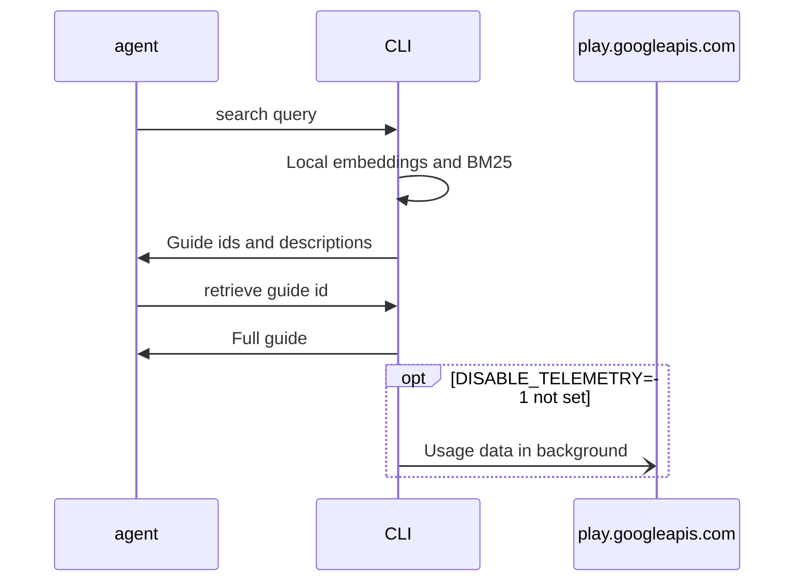
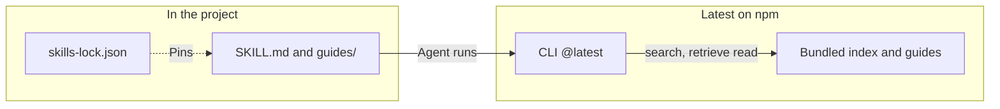
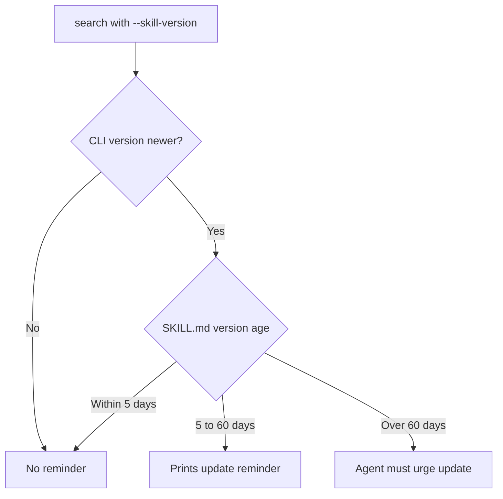
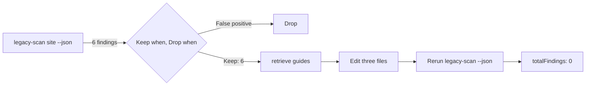

The Modern Web Guidance SKILL.md says near the top that "training weights contain obsolete patterns". Measuring `scrollHeight` in JavaScript to grow a textarea and checking click targets by hand to close a dialog are two examples. Browsers now have built-in ways to do both.

[Modern Web Guidance](https://developer.chrome.com/docs/modern-web-guidance) is a skill and command-line tool for coding agents. According to the [GitHub README](https://github.com/GoogleChrome/modern-web-guidance), it is maintained by the Google Chrome, Microsoft Edge, Mozilla Firefox, and MDN teams together with the community.

Before writing web code, the agent looks up a guide. The guide tells it which HTML, CSS, or JavaScript feature to use, how widely browsers support it, and what to fall back to when they don't. There is also a `legacy-scan` command that finds outdated patterns in an existing project.

In this post I wrote a small guestbook page, scanned it with `legacy-scan`, had Claude Code fix it using the guides, and compared the before and after versions in a browser. Then I ran it again on another machine, with a different sample and Codex.

> The official sources I checked are the [Modern Web Guidance docs](https://developer.chrome.com/docs/modern-web-guidance), the [1.0 announcement](https://developer.chrome.com/blog/modern-web-guidance-v1) (published 2026-11-10), [Modernization workflow](https://developer.chrome.com/docs/modern-web-guidance/modernization-workflow), and the README, SKILL.md, and CLI source inside the npm package version 1.0.1. I read them on 2026-11-19 and checked them again on 2026-11-20 when I updated this post.
>
> I ran the tests on 2026-11-19 (Taipei time) on macOS with Node.js 25.2.1 and npm 11.6.2. The agent was Claude Code 2.1.328, with model `claude-opus-5-5`. I used modern-web-guidance 1.0.1, which was tagged latest on npm that day. The `skills` package that the installer pulled in was 1.9.0.
>
> The terminal screenshots are the recorded output laid out as images. I removed only the color codes, the intermediate spinner frames, and the exit-code markers my recording script added. When I updated this post, I reran the same commands on a second machine. The output of `search`, `retrieve`, `skills-lock.json`, and both `legacy-scan` runs matched the first run, so those images use the rerun output. The `install` image keeps the first run's output because the detected agent name differs.
{: .prompt-info }

## How it works

Modern Web Guidance has two parts:

- The skill is a SKILL.md plus the guides in a `guides/` folder. After installing it in my project, I counted 210 Markdown files under `guides/`.
- The CLI is the npm package `modern-web-guidance`. It looks up guides and scans for old patterns.

SKILL.md tells the agent to run these two commands:

```bash
npx -y modern-web-guidance@latest search "<query>" --skill-version 2026_11_10-47b4c80e
npx -y modern-web-guidance@latest retrieve "<id>"
```

The agent runs `search` to find the IDs of relevant guides, then `retrieve` to load a whole guide into its context. According to How It Works in the README, `search` matches with a local embedding model and BM25. It calls no external API and needs no API key. The CLI does send usage data in the background by default, though. The next section covers what it sends and how to turn it off:



When the agent uses the skill depends on the description in SKILL.md. I covered how a description affects triggering in [Write Your Own Agent Skill: From SKILL.md to Testing and Upkeep](/posts/agent-skill-authoring-guide/).

This description says the agent must run it first for all HTML, CSS, and frontend JavaScript work ("MANDATORY: Execute FIRST"). It then lists a long set of trigger topics, such as dialogs, tables, dark mode, form validation, and Core Web Vitals.

`legacy-scan` only finds problems and leaves the fixes to the agent. According to the Modernization workflow docs, it scans the project locally with fixed rules, calls no model, and has no `--fix` option.

It only covers guides that static rules can check. My scan output said 38 guides, about 20% of all guides. The agent still has to judge each finding against the Keep when and Drop when conditions that come with each rule, to rule out false positives.

The official numbers: the docs home page says the pass rate in public evals is 91% with the guides, versus about 51% for frontier models without them. The README also has a per-run results table, where the `claude_code (opus-5-5)` row from November 8 goes from 57% to 88%. All of these numbers come from the official pages (read on 2026-11-19).

## Prepare: turn off usage data and inspect the package

The CLI needs Node.js 22 or later (`engines` in `package.json`). Before starting, I set an environment variable in my shell to turn off usage data:

```bash
export DISABLE_TELEMETRY=1
```

Search matches locally, but your search terms are still sent by default. I read the CLI source: when commands such as `search`, `retrieve`, `legacy-scan`, and `install` run, each starts a separate child process in the background. That child process sends usage data to `play.googleapis.com`.

According to the Telemetry & Privacy section of the README, the data includes:

- Install counts
- The name of the agent calling it
- The IDs of guides retrieved
- The search terms the agent generates

The user's original prompt isn't collected.

Before installing, I downloaded the package to look inside, the same way I describe in [Claude Code Plugins: What to Check Before You Install One](/posts/claude-code-plugin-safe-install/):

```bash
npm pack modern-web-guidance@1.0.1
```

The `package.json` in 1.0.1 has no `scripts`, so no install scripts run during installation. The package has 281 files and takes 17 MB unpacked. The three largest parts are:

- The vector data for search, about 8.8 MB
- `legacy-scan.mjs`, bundled into a single file, about 4.9 MB
- The guides, about 1.9 MB

The `install` subcommand runs only this one line:

```bash
npx -y skills add GoogleChrome/modern-web-guidance --skill modern-web-guidance
```

`skills` is Vercel's skill installer. No version is pinned here, so it fetches whatever is latest on npm at the time, which was 1.9.0 for me. It fetches the skill from `GoogleChrome/modern-web-guidance` on GitHub, not from the package I just downloaded with `npm pack`.

## Step 1: Try search and retrieve without installing

You can use the CLI without installing anything. The official example uses `@latest`. I pinned `@1.0.1` so the output is reproducible:

```bash
npx -y modern-web-guidance@1.0.1 search "submit on enter key"
npx -y modern-web-guidance@1.0.1 retrieve ime-safe-enter-submit | head -n 12
```

{: w="1100" h="1199" }
_search returns JSON and retrieve prints the full guide. Only the first 12 lines are shown (actual output)._

`search` returned 10 results, each with an `id` and a `description`. The first one, `ime-safe-enter-submit`, is the one I wanted.

SKILL.md sets these rules for how the agent writes search queries:

- Describe the feature the user sees, such as `"light dismiss dialog"`.
- Don't add framework names such as React or Tailwind, and don't add component or file names from the project.
- Look up one feature at a time.

`retrieve` prints the whole guide. This one is 115 lines of Markdown, with a problem description, the recommended approach, accessibility notes, and browser support data.

The guide explains that when Chinese, Japanese, or Korean users type with an input method editor (IME), pressing Enter confirms the selected characters. If the code sends the message whenever `keydown` sees Enter, the message goes out before the user finishes choosing characters.

The guide recommends checking `event.isComposing` first. Safari reports `isComposing` as `false` on the Enter that confirms the characters, so you also need `event.keyCode === 229`.

## Step 2: Install it in the project

The official docs install it by running this in the project folder:

```bash
npx modern-web-guidance@latest install
```

I pinned the version here too and added two options:

```bash
npx -y modern-web-guidance@1.0.1 install --agent claude-code -y
```

`--agent` and `-y` are options of `skills add`, and `install` passes any extra options straight through to it. `--agent claude-code` installs only for Claude Code, and `-y` skips the confirmation prompts.

{: w="1100" h="1002" }
_I ran it inside Claude Code, so the first line says the claude agent was detected (actual output)._

Because I ran it inside Claude Code, `skills` detected an agent environment and installed without asking anything. In a normal terminal, it may ask which agents to install for and whether to install in the project or globally.

The last line of output says to review skills before use, in these words: "Review skills before use; they run with full agent permissions." So I checked the installed files first. Two things appeared in the project:

{: w="1100" h="608" }

- `.claude/skills/modern-web-guidance/`: only `SKILL.md` and `guides/`, without the CLI itself. After installing, read `.claude/skills/modern-web-guidance/SKILL.md`.
- `skills-lock.json`: records which GitHub commit the skill came from (`64a6d70`) and a content hash. Commit this file along with the skill.

The lock file can't pin the CLI the agent actually runs, or the guides the agent gets from it:



SKILL.md tells the agent to run `modern-web-guidance@latest`. So even if you install with `@1.0.1`, every lookup the agent makes runs whatever is latest on npm at that moment. I read the 1.0.1 source: `search` and `retrieve` read the index and guides bundled with the CLI package, not the `guides/` folder in the project.

I compared them, and the SKILL.md and guides installed that day were identical to the ones in the npm 1.0.1 package.

### Update and uninstall

The `search` command in SKILL.md includes `--skill-version 2026_11_10-47b4c80e`, and the CLI compares it with the version date bundled in the CLI. According to the source, it behaves like this:



The official Get started docs say that installing with the CLI lets you "enable automatic updates". Going by the source of modern-web-guidance 1.0.1, the CLI itself compares versions and reminds you.

When you see the update reminder, run this in the project folder:

```bash
npx modern-web-guidance@latest update
```

To uninstall, run:

```bash
npx modern-web-guidance@latest uninstall
```

According to the source, `update` hands off to `skills update`, and `uninstall` hands off to `skills remove`.

### Other ways to install

According to the official docs, you can also install it with `skills` directly:

```bash
npx skills add GoogleChrome/modern-web-guidance
```

Claude Code users can also install it as a plugin by running these two lines in order:

```bash
claude plugin marketplace add GoogleChrome/modern-web-guidance
claude plugin install modern-web-guidance@googlechrome
```

The README also warns that versions installed from `claude-plugins-official` have been stuck at `v0.0.194` since October 12. Remove that version and reinstall from the `googlechrome` marketplace.

The [Get started](https://developer.chrome.com/docs/modern-web-guidance/get-started) docs also list install steps for other agents, such as GitHub CLI, Gemini CLI, Codex, and Copilot CLI.

### Baseline target and experimental features

The guides use Baseline to decide whether a feature is safe to use as-is. According to the Get started docs, the default target is Baseline Widely available when you don't set one. To change it, add a line like this to `AGENTS.md` or `CLAUDE.md`:

```text
This project's Baseline target is Baseline 2024.
```

I used the default this time.

Two kinds of guides aren't given to the agent by default:

- Volatile features: features implemented in only one browser engine that may still change.
- Features still in an origin trial.

To turn them on, run the matching command in the project root:

```bash
# Volatile features
npx modern-web-guidance@latest set-allow-volatile-features
# Origin trials
npx modern-web-guidance@latest set-allow-origin-trials
```

According to the 1.0.1 source, both commands refuse to run when they detect an agent environment or a non-interactive terminal. You have to run them yourself in a terminal.

## Step 3: Build a guestbook with legacy patterns

I wrote this sample page from the `legacy-scan` rule list, and every legacy pattern in it is there on purpose. It's a guestbook: Enter posts a message, Shift+Enter adds a new line, and a "Clear all" button opens a confirmation dialog.

I put in five legacy patterns:

1. `keydown` sends the message as soon as it sees Enter, without checking whether an IME is still composing.
2. JavaScript measures `scrollHeight` so the textarea grows with its content.
3. `textarea:invalid` shows the error style.
4. The dialog checks `e.target === confirmDialog` to detect a backdrop click, then closes itself.
5. `list.innerHTML = ''` clears the messages.

The three files go in a `site/` folder. If you follow along, save them exactly as shown so the line numbers in the next scan match mine:

```html
<!doctype html>
<html lang="en">
<head>
  <meta charset="utf-8">
  <meta name="viewport" content="width=device-width, initial-scale=1">
  <title>Guestbook demo</title>
  <link rel="stylesheet" href="style.css">
</head>
<body>
  <main>
    <h1>Guestbook</h1>
    <p class="hint">Press Enter to post, Shift+Enter for a new line.</p>
    <form id="form">
      <label for="msg">Message</label>
      <textarea id="msg" rows="1" required placeholder="Say hi..."></textarea>
      <button type="submit">Post</button>
    </form>
    <ul id="list"></ul>
    <button id="clear" type="button" class="secondary">Clear all</button>
  </main>

  <dialog id="confirm">
    <p>Delete all messages?</p>
    <form method="dialog">
      <button value="cancel">Cancel</button>
      <button value="ok" class="danger">Delete</button>
    </form>
  </dialog>

  <script src="app.js"></script>
</body>
</html>
```
{: file="site/index.html" }

```css
body { font-family: system-ui, sans-serif; background: #f1f5f9; margin: 0; }
main { max-width: 480px; margin: 48px auto; background: #fff; padding: 28px 32px; border-radius: 14px; }
h1 { margin: 0 0 4px; color: #1e3a8a; }
.hint { margin: 0 0 16px; color: #64748b; font-size: 14px; }
label { display: block; margin-bottom: 6px; font-weight: 600; }
textarea { width: 100%; box-sizing: border-box; padding: 10px; font: inherit; resize: none; overflow: hidden; border: 2px solid #cbd5e1; border-radius: 8px; }
textarea:invalid { border-color: #dc2626; background: #fef2f2; }
button { margin-top: 10px; padding: 8px 16px; font: inherit; border: 0; border-radius: 8px; background: #2563eb; color: #fff; }
button.secondary { background: #e2e8f0; color: #0f172a; }
button.danger { background: #dc2626; }
ul { padding-left: 20px; }
dialog { border: 0; border-radius: 12px; padding: 20px 24px; }
dialog::backdrop { background: rgb(15 23 42 / 0.5); }
```
{: file="site/style.css" }

```javascript
const form = document.getElementById('form');
const msg = document.getElementById('msg');
const list = document.getElementById('list');
const confirmDialog = document.getElementById('confirm');

function post() {
  const text = msg.value.trim();
  if (!text) return;
  const li = document.createElement('li');
  li.textContent = text;
  list.appendChild(li);
  msg.value = '';
  autosize();
}

// Grow the textarea as the user types.
function autosize() {
  msg.style.height = 'auto';
  msg.style.height = msg.scrollHeight + 'px';
}
msg.addEventListener('input', autosize);

// Enter posts the message, Shift+Enter adds a new line.
msg.addEventListener('keydown', (e) => {
  if (e.key === 'Enter' && !e.shiftKey) {
    e.preventDefault();
    post();
  }
});

form.addEventListener('submit', (e) => {
  e.preventDefault();
  post();
});

document.getElementById('clear').addEventListener('click', () => {
  confirmDialog.showModal();
});

// Close the dialog when the user clicks the backdrop.
confirmDialog.addEventListener('click', (e) => {
  if (e.target === confirmDialog) confirmDialog.close();
});

confirmDialog.addEventListener('close', () => {
  if (confirmDialog.returnValue === 'ok') list.innerHTML = '';
});
```
{: file="site/app.js" }

I committed the whole folder to git, so I could see exactly what the agent changed later.

## Step 4: Run legacy-scan once

Run this in the project root:

```bash
npx -y modern-web-guidance@1.0.1 legacy-scan .
```

{: w="1100" h="1667" }
_It found all five legacy patterns, and the auto-grow code counted as two items (actual output)._

The result was 6 findings across 5 guides. The auto-grow code was counted twice: once at line 19, where it measures `scrollHeight`, and once at line 13, where `post()` calls `autosize()`.

Each finding includes the rule description, Keep when, and Drop when. The top of the output also says that static analysis results are only a first pass and need confirming against those conditions.

This step doesn't change any files. The last line of the output suggests `retrieve <guide-id>` to read the matching guide.

## Step 5: Have Claude Code make the changes

I ran Claude Code in non-interactive mode (`-p`), so I could record the whole session as JSON and check it afterward. The prompt follows the 1.0 announcement and calls the skill directly as a slash command:

```bash
claude -p "/modern-web-guidance Modernize the code in this directory" \
  --setting-sources project \
  --permission-mode acceptEdits \
  --allowedTools "Read" "Edit" \
    "Bash(npx -y modern-web-guidance@latest *)" \
    "Bash(pnpx modern-web-guidance@latest *)" \
  --output-format stream-json --verbose --no-session-persistence > run.jsonl
```

What the options do:

- `--setting-sources project` reads only the project settings and skips my own user settings and plugins. The init event in the session log showed that, apart from Claude Code's built-in skills, modern-web-guidance was the only skill loaded.
- `--permission-mode acceptEdits` lets it edit files directly.
- `--allowedTools` allows only reading and editing files, plus the modern-web-guidance commands that SKILL.md itself suggests allowing. My machine has pnpm installed, and SKILL.md says to prefer `pnpx` when pnpm is available, so I allowed `pnpx` as well.

I set `DISABLE_TELEMETRY=1` in the shell that started `claude -p`, so the commands the agent ran inherited that environment variable. The command above leaves out a few settings that only matter on my machine.

The agent followed the Modernization workflow. The diagram marks this run's results:



The guides it retrieved:

- First, four guides in one call: `dialog`, `form-fields-automatically-fit-contents`, `ime-safe-enter-submit`, and `validate-input-after-interaction`.
- Then `validate-input-after-interaction` and `js`.

The Enter handling became this:

```javascript
// Enter posts the message, Shift+Enter adds a new line.
msg.addEventListener('keydown', (e) => {
  if (e.key === 'Enter' && !e.shiftKey) {
    e.preventDefault();
    // Enter also confirms IME composition (Japanese, Chinese, Korean); don't submit then.
    // keyCode 229 covers Safari, which reports isComposing as false on that keystroke.
    if (e.isComposing || e.keyCode === 229) return;
    form.requestSubmit(); // Runs native validation, unlike calling post() directly.
  }
});
```

The other changes:

- It deleted the auto-grow JavaScript and switched to CSS `field-sizing: content`, with `max-block-size: 12lh` to cap the height at 12 lines. In browsers without `field-sizing`, the textarea stays one line tall and scrolls when the content gets longer. The agent explained in its report that the guide recommends accepting this rather than writing a more complex fallback.
- Pressing Enter in an empty textarea now shows the browser's built-in "required" message, the same as clicking Post. Before the change, nothing happened.
- `textarea:invalid` became `textarea:user-invalid`, with a new error message and `aria-invalid` kept in sync.
- The dialog got `closedby="any"`. Safari doesn't support that attribute, so it kept a fallback. The fallback is attached only when the attribute isn't supported, and it uses the pointer coordinates to check whether the click landed outside the dialog.
- `list.innerHTML = ''` became `list.replaceChildren()`.

SKILL.md requires the agent to end its report with a `### Modern Web Guidance` section whenever it uses a guide. The section lists each guide it used and the sentence it quoted from that guide. This report had that section, and it was handy when I compared the diff.

Finally, I reran the scan myself in the project root:

```bash
npx -y modern-web-guidance@1.0.1 legacy-scan .
```

{: w="1100" h="287" }
_After the changes, the rescan found 0 items (actual output)._

The output also reminds you that `legacy-scan` covers only 38 guides. Zero findings only means the rules from those 38 guides found nothing more. It doesn't check patterns covered by the other guides.

### Watch the polyfill if you switch to the command attribute

For buttons that open a dialog, like "Clear all", one guide recommends the HTML `commandfor` and `command` attributes. That guide is `declarative-dialog-popover-control`, and if you follow it, watch the polyfill it suggests.

Browsers without `command` support need a polyfill. Projects with a bundler or an import map install it from npm:

```bash
npm install invokers-polyfill
```

Otherwise you load it from a CDN, and the example is this:

```javascript
if (!('commandForElement' in HTMLButtonElement.prototype)) {
  import('https://esm.run/invokers-polyfill');
}
```

That URL has no version. If you copy it as-is, browsers without `command` support load whatever version of `invokers-polyfill` is latest at runtime. If your project doesn't allow loading code from a CDN at runtime, say so clearly in `CLAUDE.md` or `AGENTS.md`. For how, see [How to Write AGENTS.md: Give Coding Agents Your Project Rules](/posts/agents-md-project-rules-for-coding-agents/).

### Without a slash command

This time I called the skill directly with a slash command. A request without one also triggers a scan, as long as its scope is broad. SKILL.md says it runs `legacy-scan` only for broad modernization requests that don't name a specific feature or component.

According to the Modernization workflow docs, asking the agent to check a whole project or folder for "legacy patterns", or asking it to "modernize", also triggers a scan. If you name a single component, the agent uses the regular `search` and `retrieve` to look up guides instead.

Another example prompt in the docs asks the agent to propose a modernization plan first and edit files only after you confirm:

```text
Modernize this repository using Modern Web Guidance. Scan our frontend files for legacy patterns, verify the findings, and propose a modernization plan before making any code edits.
```

The first time I use it on an existing project, I'd choose this kind of prompt. It lets me see which findings the agent decides to keep before it changes anything.

## Step 6: Compare in a browser

`legacy-scan` only reads code, so I checked the page behavior in a browser too. I wrote a small Node.js script with no dependencies that drives headless Chrome 157 through the Chrome DevTools Protocol. The script opens only local files and uses a throwaway Chrome profile.

I ran the same actions on the before and after pages, then compared screenshots. The first pair shows the page just after it opens:

{: w="2584" h="840" }
_Left: before, with the error style showing on load. Right: after, with the normal style._

The original textarea has `required` and is empty, so it matches `:invalid` as soon as the page loads, and the user sees a red border before typing anything. After the switch to `:user-invalid`, the error style appears only after the user interacts or tries to submit. When I clicked Post on the empty updated page, the red border and the error message appeared:

{: w="1280" h="840" }

The second pair tests the IME. Through the DevTools Protocol, I simulated a Chinese IME in the middle of composing, so the textarea held an unconfirmed "你好" (hello), and then sent one Enter. These are the two steps from the script. The events that release Enter and commit the text come after them and are left out here:

```javascript
await send('Input.imeSetComposition', { text: '你好', selectionStart: 2, selectionEnd: 2 });
await send('Input.dispatchKeyEvent', { type: 'keyDown', key: 'Enter', code: 'Enter', windowsVirtualKeyCode: 229, nativeVirtualKeyCode: 229 });
```

I also attached a `keydown` listener to the textarea that only logs and doesn't intercept anything. Both versions received an event with `key: "Enter"`, `keyCode: 229`, and `isComposing: true`.

{: w="2584" h="840" }
_Left: before, the Enter meant to confirm the IME candidate posted "你好". Right: after, nothing was posted._

The original version posted the still-composing "你好" as a message. The updated version saw `isComposing` was `true` and didn't post it, so the message list stayed empty.

## Another machine, another sample

I wrote the guestbook above from the `legacy-scan` rule list, so it's no surprise the scan caught everything. On 2026-11-20 (Taipei time), I switched to another machine, downloaded 1.0.1 again, and wrote a page on a different topic myself:

- Machine: Linux (Debian 13), Node.js 24.22.1, npm 11.21.1, Chrome 156.
- Agent: Codex CLI 0.171.0 with model `gpt-6.1-sol`, called through my own LiteLLM server.
- Codex's sandbox mode was `workspace-write`, with network access enabled.

First, what matched the earlier run:

- The same `search "submit on enter key"` returned the same 10 results.
- `skills-lock.json` had the same commit and `computedHash`, and the install again had 210 guides.
- I saved the three guestbook files unchanged and scanned them again. The result was again 6 findings across 5 guides, with the same line numbers.

### Scan results for the campsite sample

The new sample is a campsite booking page, with three files in `web/`. `legacy-scan` found 5 findings across 5 guides:

{: w="1100" h="1593" }
_Second machine, my own example (actual output)_

This table lists the legacy patterns I put in and whether the scan found them:

| Legacy pattern I put in | `legacy-scan` result |
| --- | --- |
| The search box checks `e.keyCode === 13` for Enter, then searches | Not found |
| Four required fields use `input:invalid` for the error style | `validate-input-after-interaction`, `style.css:6` |
| A hand-built `div` confirmation popup, closed by checking `e.target === overlay` for outside clicks, without `<dialog>` | Not found |
| Checking "Rent a tent" runs JavaScript that adds a class to the wrapper to change its background | Not found |
| The FAQ expands with `max-height: 9999px` | `animate-to-intrinsic-sizes`, `style.css:11` |
| dayjs loaded from jsDelivr without `integrity` | `secure-external-subresources`, `index.html:8` |
| Two duplicate `@media (prefers-color-scheme: dark)` blocks | `dark-mode`, `style.css:18` |
| `results.innerHTML = ''` clears the search results | `js`, `app.js:9` |

The `div` popup wasn't found because the dialog rule looks for a click listener attached to a `<dialog>`. A popup built from a `div` is outside its scope.

The `keyCode === 13` check isn't really a miss. The ime-safe-enter-submit guide says that when you press Enter during IME composition, the browser reports a `keyCode` of 229, not 13. So the old `keyCode === 13` check never fires during composition anyway. The trouble starts when someone changes it to `e.key === 'Enter'` without adding the check.

### Hand it to Codex

I gave Codex the same prompt. `$` is how Codex selects a skill:

```text
$modern-web-guidance Modernize the code in this directory
```

Here is what happened:

- It retrieved 5 guides in one `retrieve` call. The content was 84.4 KB, so the CLI didn't print it. It saved the content to `/tmp/mwg-guide-….md` instead, and the agent had to read that file in chunks.
- It fixed all 5 findings, and the rescan showed 0. My own rescan from the project root with 1.0.1 also showed 0.
- It also changed the search box to `e.key === 'Enter' && !e.isComposing`. That code wasn't in the scan results, and the agent never retrieved the ime-safe-enter-submit guide. According to the guide, this change lacks `e.keyCode === 229`, so in Safari the Enter that confirms the characters may still trigger a search.
- To check its own work, it installed jsdom into `/tmp` with npm to run DOM tests, and used curl to download the CDN files and compare hashes. With network access enabled, the agent does this kind of extra downloading.
- The whole run took 119 seconds. The session log showed 525,856 input tokens (434,990 of them cache hits) and 4,418 output tokens.

So the agent also changes code outside the scan results, and doesn't always apply the guide in full. When you read the diff, pay extra attention to changes outside the scan results.

### Compare three versions in a browser

I again drove headless Chrome 156 through the DevTools Protocol, simulating an IME composing "溪邊" (riverside) and pressing Enter. Besides the original (A) and Codex's version (B), I made a control version (C) that only changes A's condition to `e.key === 'Enter'`:

{: w="1954" h="696" }
_A: the original keyCode === 13. B: after Codex. C: control, changed only to e.key === 'Enter'._

All three versions received an event with `key: "Enter"`, `keyCode: 229`, and `isComposing: true`. The results:

| Version | Enter during composition | Four required fields on load |
| --- | --- | --- |
| A: original `keyCode === 13` | No search | Red borders |
| B: Codex's version | No search | Normal style |
| C: control, `e.key === 'Enter'` | Searched mid-composition | Red borders |

In B, the fields turned red and showed an error message only when I clicked Book directly, and `aria-invalid` also became `true`.

### Code in demo/ gets skipped

By default, `legacy-scan` skips folders that look like docs, examples, or tests, such as `docs/`, `examples/`, `demo/`, and `test/`.

When I put the same sample under `demo/` and scanned it, the result was 0, and the last line said `Skipped 3 docs and test files`. Only with `--include-docs-and-tests` did it find the 5 findings.

{: w="1100" h="460" }

If you put your sample under `demo/` when following along, remember to add that option, or use a different folder name.

### What the usage data actually contains

The usage data does include your search terms. Without network access and without setting `DISABLE_TELEMETRY`, I ran `search "booking date picker"` once. I swapped the `fetch` that sends the data for one that only logs it.

The background child process prepared a POST to `play.googleapis.com` that contained that search phrase, the IDs of the guides it found, and their similarity scores. With `DISABLE_TELEMETRY=1` set, the request didn't happen.

## Pair it with browser checks

According to the 1.0 announcement, Google recommends pairing it with Chrome DevTools for agents. Modern Web Guidance has the agent write current code from the start, and DevTools for agents lets the agent see how the page actually runs in the browser.

The post gives a few examples of using them together:

- Record a performance trace on a simulated low-end CPU, then split long tasks using the guides until the main thread is never blocked for more than 50 milliseconds.
- Record dialog and popover animations to check that they fit the site's style, and confirm that animation is reduced when the user turns on `prefers-reduced-motion`.
- When caching views in memory, use the memory tools to confirm memory use doesn't keep growing.

This time I used my own small DevTools Protocol script. To have the agent open and check the page itself, see [agent-browser Tutorial: Let AI Test Its Own Web Pages](/posts/agent-browser-ai-test-web-pages/). I described a flow for confirming things work before merging in [pstack, Part 3: After the Code Is Written, Prove It Works Before Merging](/posts/pstack-build-verify-merge/).

## Conclusion

To try it, I'd suggest scanning your own project with the `legacy-scan` command from Step 4 before installing anything, and seeing what it finds. The first time you hand it to an agent, ask for a modernization plan first. After the agent's changes, read the diff and try the page in a browser yourself.

## Further reading

- [Modern Web Guidance docs](https://developer.chrome.com/docs/modern-web-guidance): installation, example prompts, and how to set a Baseline target.
- [Get started](https://developer.chrome.com/docs/modern-web-guidance/get-started): install commands for each agent, the Baseline target, and how to turn on guides for volatile features and origin trials.
- [Modernization workflow](https://developer.chrome.com/docs/modern-web-guidance/modernization-workflow): the four-step process of running `legacy-scan` and having the agent make the changes.
- [Write Your Own Agent Skill: From SKILL.md to Testing and Upkeep](/posts/agent-skill-authoring-guide/): how the description in SKILL.md affects when a skill triggers.
- [Claude Code Plugins: What to Check Before You Install One](/posts/claude-code-plugin-safe-install/): which files to read before installing a skill or plugin.
